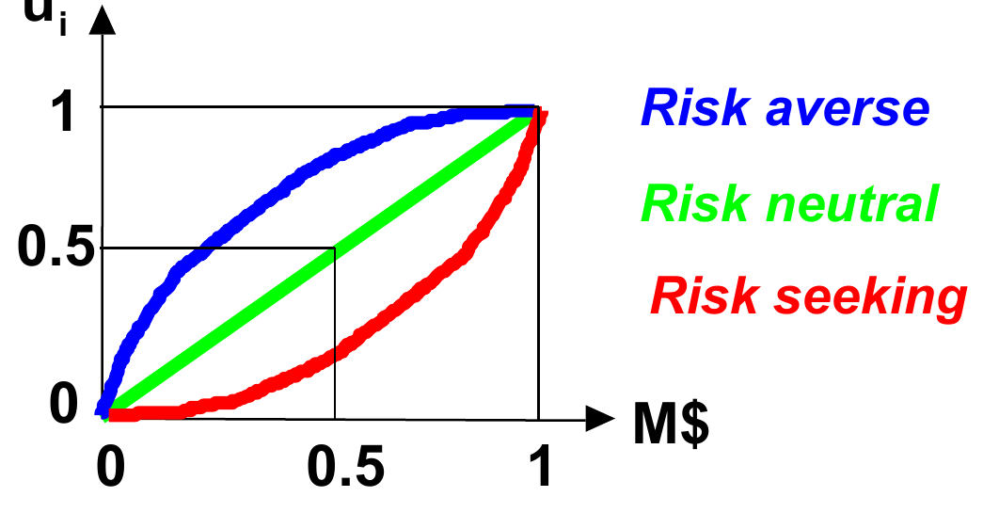
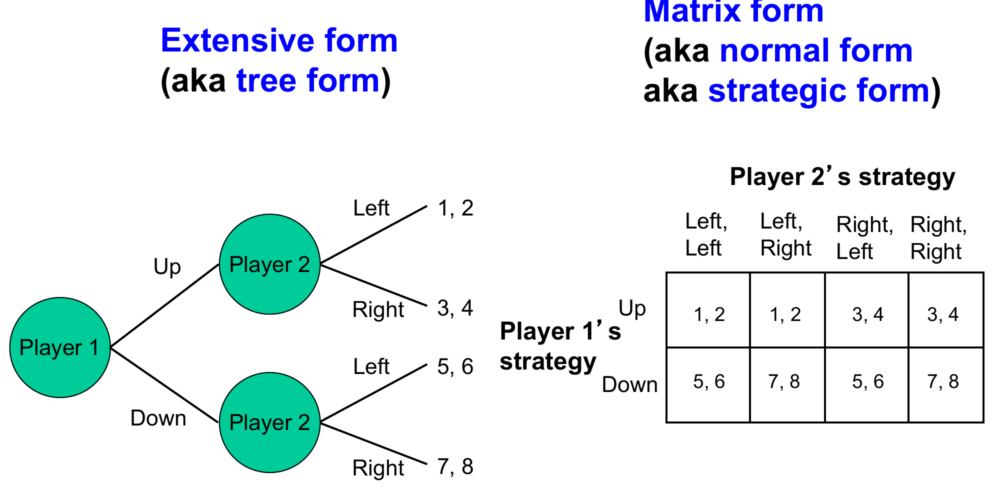
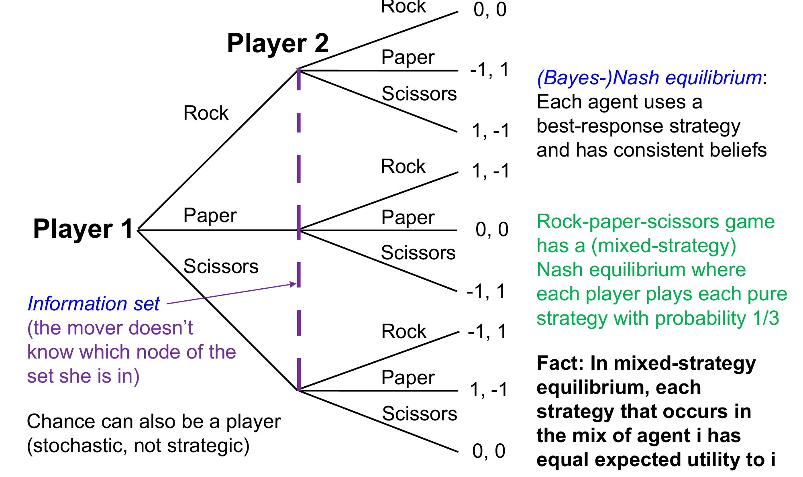
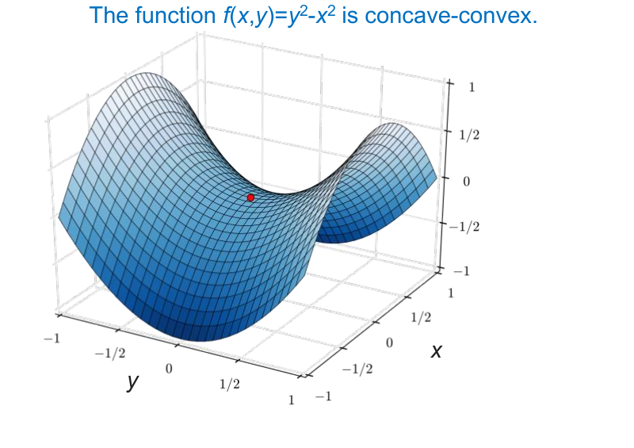

# 导论：博弈表示、解概念与复杂度

本章给出全课程的基本语言：博弈的两种经典表示、核心解概念（占优策略均衡与纳什均衡）、纯策略与混合策略均衡的存在性定理，以及求均衡的计算复杂度图景。最后聚焦双人零和博弈——它的优良性质是后续所有大规模博弈求解算法的理论基点。

## 问题的核心

在单智能体（single-agent）环境中，智能体的期望效用最大化策略是良定义的：只需对每个候选策略评估其期望效用并取最大。但在多智能体（multiagent）环境中，结局同时取决于其他智能体的策略——因此一个智能体的最优策略可能依赖于其他智能体选择什么策略，反之亦然。博弈论（game theory）正是为处理这种策略相互依赖而发展的，也是处理该问题的唯一严谨（sound）途径。

## 基本术语

- **智能体（agent）**：即参与人（player）。
- **行动（action）**：即着法（move），智能体在博弈中某一点可做的一次选择。
- **策略（strategy）** $s_i$：从（智能体 $i$ 所能区分的）历史到行动的映射。它可以同时包含"战略性""战役性""战术性"的决策。
- **策略集（strategy set）** $S_i$：智能体可用的所有策略。
- **策略组合（strategy profile）** $(s_1, s_2, \dots, s_{|A|})$：每个智能体各取一个策略构成的元组。
- **效用（utility）**：当每个智能体（包括用来建模不确定性的"自然"）都选定策略、博弈进行完毕之后，智能体 $i$ 的效用被确定为 $u_i = u_i(s_1, s_2, \dots, s_{|A|})$。

## 智能体与效用

智能体试图最大化其期望效用。智能体 $i$ 的**效用函数（utility function）** $u_i$ 是从结局到实数的映射，它内嵌了智能体的风险态度（risk attitude），从而允许做定量权衡。以金钱结局为例，比较两个彩票（lottery）：

- 彩票 1：以概率 1 获得 50 万美元；
- 彩票 2：以概率 0.5 获得 100 万美元，以概率 0.5 获得 0 元。

两者期望货币值相同，但风险厌恶（risk averse）者偏好彩票 1，风险追求（risk seeking）者偏好彩票 2，风险中性（risk neutral）者无差异。智能体的策略在这里就是对彩票的选择。风险厌恶正是保险公司存在的理由。在博弈论中我们通常直接谈论**期望收益（expected payoff）**或**期望值（expected value, EV）**。

如图所示，效用函数关于金钱的曲率刻画风险态度：凹函数对应风险厌恶，线性对应风险中性，凸对应风险追求。

**效用函数是尺度不变的（scale-invariant）。** 智能体 $i$ 选择最大化期望效用的策略：

$$
\max_{\text{strategy}} \sum_{\text{outcome}} p(\text{outcome} \mid \text{strategy}) \, u_i(\text{outcome})
$$

若 $u_i'(\cdot) = a\, u_i(\cdot) + b$（其中 $a > 0$），则智能体在效用函数 $u_i'$ 下会选择与 $u_i$ 下完全相同的策略——正仿射变换不改变偏好序。（注意 $u_i$ 必须对每个可能结局都取有限值，否则多个策略的期望效用可能同时为无穷，策略之间便无法比较。）但不同智能体之间的效用比较（inter-agent utility comparison）是有问题的，不能据此断言"谁的收益更大"。

## 经典博弈表示

博弈有两种经典表示：

- **扩展式（extensive form，亦称树式 tree form）**：用博弈树显式表示行动顺序，每个节点标明由谁行动，叶节点给出各参与人的收益。
- **矩阵式（matrix form，亦称标准式 normal form 或策略式 strategic form）**：行与列分别对应各参与人的（纯）策略，每个格子给出该策略组合下的收益向量。

上图左侧是一个两阶段博弈的扩展式：参与人 1 先选 Up/Down，参与人 2 观察到后选 Left/Right，叶节点 $(u_1, u_2)$ 为双方收益。右侧是同一博弈的矩阵式：参与人 1 有两个策略（Up、Down），参与人 2 的策略必须对两个决策点各指定一个行动，故有四个策略（Left,Left）、（Left,Right）、（Right,Left）、（Right,Right）。注意即便这个微型博弈，矩阵式已经出现冗余——**从扩展式转成矩阵式会发生组合爆炸（combinatorial explosion）**，这正是本课程大量算法直接在扩展式上工作的原因。

## 占优策略均衡

> **定义（最优响应，best response）**：给定其他参与人的策略组合 $s_{-i}$，策略 $s_i^*$ 是 $i$ 的最优响应，当且仅当对所有 $s_i'$ 都有
> $$u_i(s_i^*, s_{-i}) \ge u_i(s_i', s_{-i}).$$

> **定义（占优策略，dominant strategy）**：$s_i^*$ 是占优策略，当且仅当它对**所有** $s_{-i}$ 都是最优响应。占优策略不总存在；被占劣的策略称为**被支配策略（dominated strategy）**。

> **定义（占优策略均衡，dominant strategy equilibrium）**：每个智能体都选择了自己的占优策略的策略组合。它同样不总存在。

占优策略均衡的优点是**不需要反投机（counterspeculation）**：无论对手做什么，自己的选择都是最优的。经典例子是囚徒困境（Prisoners' Dilemma）：

| | 合作 | 背叛 |
|---|---|---|
| **合作** | $-1, -1$ | $-3, 0$ |
| **背叛** | $0, -3$ | $-2, -2$ |

对每个参与人，无论对方如何选择，"背叛"都严格优于"合作"，故（背叛，背叛）是占优策略均衡。

## 纳什均衡

在许多博弈中，一个智能体的最优响应依赖于他人的策略，因而不存在占优策略。纳什均衡（Nash equilibrium）[Nash 1950] 是更弱的稳定性概念：

> **定义（纳什均衡）**：策略组合 $s^*$ 是纳什均衡，当且仅当在他人不偏离的前提下，没有任何参与人有动机单方面偏离，即对每个智能体 $i$、对所有 $s_i'$，
> $$u_i(s_i^*, s_{-i}^*) \ge u_i(s_i', s_{-i}^*).$$

占优策略均衡必是纳什均衡，反之不然。囚徒困境中（背叛，背叛）是唯一的纳什均衡。而"性别之战"（Battle of the Sexes）没有任何占优策略：

| | 拳击 | 芭蕾 |
|---|---|---|
| **拳击** | $2, 1$ | $0, 0$ |
| **芭蕾** | $0, 0$ | $1, 2$ |

它有两个纯策略纳什均衡：（拳击，拳击）与（芭蕾，芭蕾）。

**对纳什均衡的批评**主要有两点。

1. **不唯一**。如性别之战。应对此问题的途径包括：
   - 均衡概念的**精炼（refinement，即加强）**：先剔除弱被支配策略；选取社会福利最高的纳什均衡；子博弈精炼（subgame perfection）等；
   - 聚点（focal points）、调解（mediation）、沟通（communication）、惯例（convention）、学习（learning）。
2. **可能不存在**（在纯策略意义下）。例如下述博弈没有任何纯策略组合是稳定的：
$$
\begin{pmatrix} 1,0 & 0,1 \\ 0,1 & 1,0 \end{pmatrix}
$$

## 不完美信息博弈

以石头剪刀布（rock-paper-scissors）为例：若双方**序贯行动**（一方先出、另一方看到后出），后手必胜，博弈是平凡的；只有**同时行动**——等价地，后行动者看不到先行动者的选择——才有真正的策略内容。大多数现实博弈都是**不完美信息博弈（imperfect-information games）**，因为参与人并不完全知道其他参与人和"自然"已经做了什么。这类博弈是本课程的主要研究对象。

针对完美信息博弈的技术（如 AlphaZero）在这里不适用，因为不完美信息带来额外的问题：

- **私有信息**：需要理解信号（signal）以及其他参与人会如何解读信号；
- 博弈常常涉及**欺骗**，以及识破他人的欺骗；
- 博弈论是唯一能够严谨处理**诈唬（bluffing）、透露/隐瞒（reveal/conceal）、诱饵（decoy）**等现象的方法。

现实中的不完美信息序贯（或同时行动）博弈比比皆是：谈判；拍卖（如 FCC 的升价多阶段拍卖、组合拍卖、多物品序贯拍卖）；在不确定随机环境中面对对手的智能体；扑克等纸牌游戏；货币攻击；国际（过度）捕捞；政治竞选（如在各地区的电视广告投放）；极地、月球、行星的归属博弈；兵力与军备的部署与时机；军费博弈（如太空 vs 海洋）；机场安检、空中警察、海岸警卫、铁路安保；网络安全，等等。

## 混合策略与信息集

不完美信息博弈可能需要**混合策略（mixed strategy）**——智能体自行选定的、定义在纯策略上的概率分布。

上图把同时行动的石头剪刀布画成扩展式：参与人 1 先"行动"，参与人 2 后行动，但参与人 2 的三个决策节点同属一个**信息集（information set）**——行动者不知道自己处于集合中的哪个节点，因而无法针对参与人 1 的实际选择作答。自然（chance）也可以作为一个参与人：它是随机的，但不具有策略性。此博弈有一个（混合策略）**（贝叶斯）纳什均衡**：每个参与人以概率 $1/3$ 出石头、剪刀、布——每个智能体都使用最优响应策略，并且持有相互一致的信念（consistent beliefs）。

> **事实**：在混合策略均衡中，出现在智能体 $i$ 混合支撑（mix）里的每个纯策略，给 $i$ 带来的期望效用都相等。

与混合策略密切相关的另一概念是**行为策略（behavioral strategy）**：智能体在自己的**每个信息集**上各有一个关于行动的概率分布（边走边掷骰子，而非开局前一次性选定纯策略）。

> **定理（Kuhn 定理）**：若智能体具有完美回忆（perfect recall），则对每个混合策略，都存在一个收益等价的行为策略（即两种策略等价）。该定理对无限博弈同样成立。

## 纯策略纳什均衡的存在性

> **定理**：任何有限博弈，若其中**每个行动节点都单独构成一个信息集**（即在博弈的每一点，轮到行动的智能体都知道迄今为止已发生过的所有行动），则该博弈可通过**反向归纳（backward induction）**做占优求解——至少在排除平局（ties）的情况下成立。

**证明思路（构造性）**：多人极小极大搜索（multi-player minimax search）——从叶节点向上，每个节点由行动者选取对自己最优的子节点值，即得均衡。

围绕这一构造的计算复杂度已有大量工作：跳棋（checkers）已被完全求解；国际象棋与围棋尚未被求解，但最强的 AI 已超越人类。

## 混合策略纳什均衡的存在性与复杂度

> **定理（Nash 1950）**：任何参与人有限、策略有限的博弈，在允许混合策略均衡与纯策略均衡的前提下，至少存在一个纳什均衡。（证明基于 Kakutani 不动点定理。）

但纳什均衡可能**难以计算**。在标准式博弈中求一个纳什均衡的复杂度图景：

- **双人零和博弈**：可用线性规划（LP）在多项式时间内求解；
- **双人（一般和）博弈**：是 **PPAD-完全**的，即使收益只有 0/1 [Chen, Deng & Teng, JACM-09；Abbott, Kane & Valiant, FOCS-05；Daskalakis, Goldberg & Papadimitriou, STOC-06]；并且即便是求一个**近似意义上"好"的**纳什均衡也是 **NP-完全**的 [Conitzer & Sandholm, GEB-08]；
- **三人博弈**：是 **FIXP-完全**的 [Etessami & Yannakakis, FOCS-07]。

## 双人零和博弈的性质

双人零和博弈（2-player 0-sum games）具有其他博弈所不具备的优美性质：

- **可交换性（swappability）**：若 $(x, y)$ 与 $(x', y')$ 都是均衡，则 $(x', y)$ 与 $(x, y')$ 也是均衡。因此**不存在均衡选择问题**：参与人使用自己的任意一个均衡策略都是安全的。
- 一个参与人的均衡策略全体构成一个**有界凸多胞形（bounded convex polytope）**：其均衡策略的任意凸组合仍是均衡策略。
- 纳什均衡的集合恰好是**极小极大问题（minmax problem）**
$$
\max_x \min_y u_1(x, y)
$$
的解集。
- **极小极大定理（minmax theorem）[von Neumann 1928]**：哪一方先"亮出"自己的混合策略都无所谓：
$$
\max_x \min_y u_1(x, y) = \min_y \max_x u_1(x, y),
$$
这个共同值称为**博弈值（game value）**。

更一般地，该定理有凸分析形式：

> **定理（鞍点定理）**：设 $X \subset \mathbb{R}^n$ 与 $Y \subset \mathbb{R}^m$ 为紧致凸集，$f: X \times Y \to \mathbb{R}$ 连续且为**凹-凸（concave-convex）**函数，即对每个固定的 $y$，$f(\cdot, y): X \to \mathbb{R}$ 为凹函数；对每个固定的 $x$，$f(x, \cdot): Y \to \mathbb{R}$ 为凸函数。则有
> $$\max_{x \in X} \min_{y \in Y} f(x, y) = \min_{y \in Y} \max_{x \in X} f(x, y).$$

**例**：取 $f(x, y) = x^\top A y$（$A \in \mathbb{R}^{n \times m}$ 为有限矩阵），这正是混合策略下的双人零和矩阵博弈，由上式得 $\max_x \min_y x^\top A y = \min_y \max_x x^\top A y$。

这些性质有深刻的算法与安全含义：

- 因此，**即使对手知道我们的混合策略**，也无法使我们的期望收益低于博弈值。
- 反之，用机器学习、强化学习、生成式 AI 或任何其他方法得到的**非均衡策略，都无法保证拿到博弈值**——即该策略是**可被利用的（exploitable）**。
- 在多步不完美信息博弈中有一个惊人的**安全性（safety）性质**：对手通过采用非均衡策略，可以让我们的信念出错，但**无法以提高其自身期望值的方式**做到这一点。因此，假设对手理性是安全的：如果对手不理性，那只会对我们有利。
- 双人零和博弈可用 LP 在**博弈树规模的多项式时间**内求解——但如果博弈树有 $10^{165}$ 个节点呢？如何求解规模远超穷举与直接 LP 能力范围的博弈，正是本课程后续章节（抽象、CFR、子博弈求解等）要回答的问题。

## 要点小结

- 多智能体环境中策略相互依赖，博弈论是处理它的唯一严谨途径；效用函数刻画风险态度且正仿射不变。
- 扩展式与矩阵式是两种经典表示，后者相对前者会发生组合爆炸。
- 占优策略均衡强于纳什均衡但常不存在；纳什均衡可能不唯一（需精炼、聚点等机制），纯策略意义下也可能不存在。
- 不完美信息博弈（谈判、拍卖、扑克、安全等）是本课程主角；其核心概念是信息集，其策略往往需要混合策略。Kuhn 定理保证完美回忆下混合策略与行为策略等价。
- 完美信息有限博弈可由反向归纳求解（构造性证明：多人极小极大搜索）；一般博弈混合均衡必然存在（Nash，经 Kakutani 不动点），但计算上：双人零和可用 LP 多项式求解，双人一般为 PPAD-完全、求近似好均衡为 NP-完全，三人为 FIXP-完全。
- 双人零和博弈有极小极大定理（博弈值存在）、均衡可交换性、均衡集为凸多胞形等优良性质；均衡策略保证博弈值，非均衡策略则可被利用——这为大规模不完美信息博弈求解提供了目标与安全基准。
