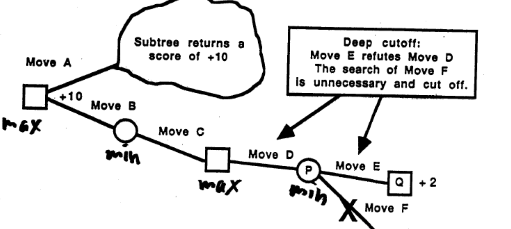
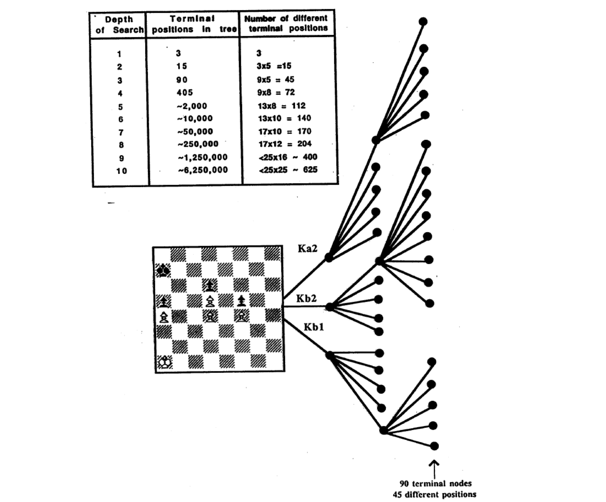

# L2 完全信息博弈 1：树搜索

本讲以国际象棋为主线，介绍求解序贯、零和、完全信息博弈（sequential zero-sum complete-information games）的经典方法：极小化极大搜索（minimax search）、α-β 剪枝（alpha-beta pruning）及其一系列工程与算法改进。这条技术路线在 1997 年以 Deep Blue 战胜世界冠军卡斯帕罗夫（3½–2½，六盘战绩为负—胜—和—和—和—胜）达到顶点，其中的思想至今仍是理解更现代博弈求解方法的起点。

## 历史脉络：累积的思想

计算机象棋的强盛并非源于某一项单独突破，而是几十年累积的思想。下表按系统列出其贡献（年份为该项技术出现的年份）：

| 系统 | 贡献 | 年份 |
|---|---|---|
| Claude Shannon、Alan Turing | 带评分函数的 minimax 搜索 | 1950 |
| Kotok/McCarthy 程序与 ITEP 程序 | α-β 搜索、暴力搜索 | 1966 |
| Mac Hack | 换位表（transposition table） | 1967 |
| Chess 3.0–Chess 4.9 | 迭代加深的深度优先搜索 | 1975 |
| Belle | 专用电路 | 1978 |
| Cray Blitz | 并行搜索 | 1983 |
| Hitech | 并行评估 | 1985 |
| Deep Blue | 并行搜索 + 专用电路 | 1987 |

此外还有静态搜索（quiescence search，约 1960 年代）、基于动态规划自动生成的残局数据库（1977）、阴谋数（conspiracy numbers，1988）、单步扩展（singular extension，1980 年代）、开局库，以及评估函数的学习与工程化（1950 年代起）等思想。

## 博弈论视角

国际象棋是一个**完全信息博弈**（game of perfect information）：每个玩家行动时都完全了解此前的全部历史。它同时是**有限博弈**：行动集有限、博弈长度有限。因此：

- 国际象棋**有解**：其结果为胜/和/负三者之一（即存在纳什均衡（Nash equilibrium），在零和有限完全信息博弈中均衡值唯一）。
- 通过逆向归纳（backward induction）可以得到**子博弈精炼纳什均衡**（subgame perfect Nash equilibrium）。

**现实约束**：计算复杂度限制了理性（computational complexity bounds rationality）。象棋的状态空间大到无法完整逆向归纳，因此实践中必须用有限深度的搜索加启发式评估来近似。

## 博弈树的结构


如上图所示，国际象棋的博弈树从初始位置出发：白方第一步后有 20 个位置，双方各走一步后有 400 个位置；树的每个位置平均扇出 30–40 步合法着法；叶子标记为胜（W）/和（D）/负（L）。实际对局分三个阶段处理：

- **开局阶段**：使用开局库（opening book），数据库通常覆盖前 5–15 步。开局库也有电子版；有的开局变例（如西班牙开局（Ruy Lopez）中的马歇尔反击（Marshall Counter Attack））书中分析可深达 16 步（32 个半回合（ply））。
- **中局阶段**：在 minimax 算法指导下进行大规模搜索来选择着法。
- **残局阶段**：使用残局数据库——目前已构建全部 5 子和部分 6 子残局的数据库。

## 极小化极大搜索（minimax search）

minimax 是求解完全信息零和博弈的基本算法：MAX 方（白方）在每个自己的节点选择使值最大的后继，MIN 方（黑方）选择使值最小的后继，叶节点的值由评估函数给出，值逐层向上回传（backed-up）。


以上图的两层搜索为例，算法步骤为：

1. 把博弈树展开到两层的深度（注意图中并未画出前两层的所有着法）。
2. 为每个终止位置赋予评分（本例只用双方子力差评分：如位置 D 白方多三兵，评分 +3）。
3. 为非终止位置赋予回传评分（backed-up score）：MIN 层取子节点最小值，MAX 层取子节点最大值。例如位置 B 的两个后继评分为 +3 与 +1，回传值为 +1；位置 C 回传值为 −3；根节点位置 A（MAX 方）取 $\max\{+1, -3\} = +1$。
4. 确定主变（principal continuation），即双方最优应对构成的路径（图中加粗所示）。
5. 选择主变上的第一步作为实际着法。

### 搜索深度病理

直觉上搜索越深棋力越强（实践中也确实如此），但理论研究揭示了一个微妙问题——**搜索深度病理**（search depth pathology）：

- Beal（1980）与 Nau（1982, 1983）分析了"由 minimax 搜索回传的值是否比启发式评估值本身更可信"。在其模型上，分析表明回传值反而**更不可信**。
- 当兄弟节点的值高度相关时，这种反常现象会消失 [Beal 1982; Bratko & Gams 1982; Nau 1982]。
- Pearl（1984）部分不同意该结论：他认为虽然兄弟节点间的强依赖可以消除病理，但国际象棋这类实际博弈并不具备足够强的依赖——几乎没有哪个象棋局面是"强到无论怎么糟蹋都糟蹋不掉"的。他的结论是：minimax 的成功"基于常见博弈并不具有均匀结构这一事实——它们布满提前终止的位置，俗称大漏着（blunder）、陷阱（pitfall）。这些陷阱的近亲节点携带比其他节点更可靠的评估，当搜索暴露出更多这样的祖先节点时，决策就变得更有效。"
- 该问题至今未被完全理解。更新的工作可参见 Sadikov、Bratko、Kononenko（2003）关于 KRK 残局的实证研究，以及 Ramanujan、Sabharwal、Selman 关于采样式对抗搜索的 UAI-2010 / ICAPS-2010 论文。
- 当一方的前瞻（lookahead）有限时，同样的现象也出现在不完全信息博弈中 [Kroer & Sandholm, IJCAI-15; Kroer, Farina & Sandholm, AAAI-18]。

## α-β 剪枝

α-β 剪枝（alpha-beta pruning）在保持返回值与 minimax 完全一致的前提下剪去不可能影响最终决策的子树。其思想是：在搜索过程中维护两个界——$\alpha$ 是 MAX 方在到当前节点路径上已能保证的最好得分，$\beta$ 是 MIN 方已能保证的最好得分；一旦某节点能证明越出该窗口，其后继就不必再搜索。



上图展示了一个深层剪断：走法 A 的子树已返回 +10，因此根节点（MAX 层）已能保证至少 +10；沿走法 B 到达 MIN 节点后，若该分支的值能被证明不超过 +10，便不可能改变根处的决策。当在节点 P（MIN 层）发现走法 E 使局面 Q 得分仅为 +2 时，走法 E 已经"驳倒"（refute）了走法 D——P 的值至多为 +2，沿走法 B 的分支因而至多只值 +2，不可能优于根部已有的 +10——于是走法 F 的搜索不必要，直接剪掉。剪断可以跨越多个层级传播，而不限于相邻父子节点之间。

伪代码如下（MAX-VALUE 与 MIN-VALUE 互相递归）：

```text
function MAX-VALUE(state, game, α, β) returns the minimax value of state
    inputs: state, current state in game
            game, game description
            α, the best score for MAX along the path to state
            β, the best score for MIN along the path to state

    if CUTOFF-TEST(state) then return EVAL(state)
    for each s in SUCCESSORS(state) do
        α ← MAX(α, MIN-VALUE(s, game, α, β))
        if α ≥ β then return β      (* β 剪断 *)
    end
    return α

function MIN-VALUE(state, game, α, β) returns the minimax value of state
    if CUTOFF-TEST(state) then return EVAL(state)
    for each s in SUCCESSORS(state) do
        β ← MIN(β, MAX-VALUE(s, game, α, β))
        if β ≤ α then return α      (* α 剪断 *)
    end
    return β
```

### α-β 搜索的复杂度

设分支因子约为 $b = 30$、搜索深度为 $d$。**最好情形**下（着法排序最理想）α-β 只需检查约 $2\,b^{d/2}$ 个终止位置：

| 搜索深度 $d$ | 最好情形下终止位置数（约） | 数值 |
|---|---|---|
| 2 | $2\times 30^1 \approx 6\times 10^1$ | 60 |
| 4 | $2\times 30^2 \approx 2\times 10^3$ | 2,000 |
| 6 | $2\times 30^3 \approx 6\times 10^4$ | 60,000 |
| 8 | $2\times 30^4 \approx 2\times 10^6$ | 2,000,000 |
| 10 | $2\times 30^5 \approx 6\times 10^7$ | 60,000,000 |
| 12 | $2\times 30^6 \approx 2\times 10^9$ | 2,000,000,000 |
| 14 | $2\times 30^7 \approx 6\times 10^{10}$ | ≈ Deep Blue 的每步搜索量 |
| 16 | $2\times 30^8 \approx 2\times 10^{12}$ | 2,000,000,000,000 |

- **最好情形**：同样的计算量下，α-β 可比 minimax 多搜**一倍深度**（有效分支因子由 $b$ 降为约 $\sqrt{b}$）[Knuth & Moore 1975]。
- **最坏情形**：一个节点也剪不掉，复杂度与 minimax 同为 $O(b^d)$。
- **平均情形**（着法随机排序）：由 $O(b^d)$ 降至 $O\big((b/\log b)^d\big)$。

要接近最好情形，关键在于**先搜更好的着法**（着法排序，move ordering）：吃子 → 威胁 → 向前的着法 → 向后的着法；并利用**迭代加深**（iterative deepening）——用上一轮迭代回传的值来决定本轮后继节点的排序。由于 α-β 与静态搜索使各分支搜索时间差异很大，迭代加深（配合时间控制）被所有主流象棋程序采用。

## 评估函数

截断处的叶节点由评估函数（evaluation function）打分。典型做法是计算双方若干特征之差：子力（material）、机动性（mobility）、王的位置、双象、双车、开放车线、中心控制（逐子计算）等。例如 Deep Blue 用逐格价值表刻画棋子的位置价值：其马的价值表中，马位居中心得正分，退到边角则得负分。

- **Deep Blue** 的评估函数在硬件中实现了约 **6,000 个特征**；每走完一步真实对局着法后，都会根据当前盘面形势把一套**不同的特征权重**下载到芯片中——这大大贡献了其强大的局面型弈法。
- **权重的获取**：
  - 基于 900 盘特级大师对局的数据库做权重学习（约 120 个特征）：调整某一个特征的权重 → 做 5–6 层搜索 → 若与大师着法更吻合，则沿该方向继续调整该参数（爬山法）；也用过不做搜索的最小二乘拟合。
  - 人工方式：特级大师 Joel Benjamin 与程序下"悔棋象棋"（take-back chess）；在可能出错之处把评估分解、可视化，并相应修改权重。
- 值得强调：Deep Blue **并非**蛮力——它是"聪明的搜索 + 知识工程化的评估"。
- 其他学习途径同样可行，例如 Tesauro 的西洋双陆棋程序：Neurogammon（1989）用 400 盘对局做监督学习，达到人类中级水平；TD-Gammon（1992）用强化学习（时序差分），达到世界级人类比赛选手水平。
- Deep Blue 在对局过程中**不**使用大师对局数据库，但离线地用它们来学习评估函数。

## 水平线问题及其缓解

**水平线问题**（horizon problem）：固定深度搜索无法看到"地平线"之外的必然变化，会做出严重误判。


上图中，黑车的一连串将军把白方必然的兵升变推到了搜索深度"地平线之外"，使这个局面看起来像黑方略优，而实际上白方必胜。

缓解办法有两类：

- **静态搜索**（quiescence search）：评估函数（领域相关）除评估值外再返回一个数——**稳定性**（stability），由威胁等因素决定；若到达正常深度的局面不稳定，则继续向下搜索。代价是搜索时间出现方差。
- **单步扩展**（singular extension）：领域无关；若某节点的值远优于其兄弟节点，则对该节点搜索得更深——甚至达 30–40 个半回合。Deep Blue 使用了该方法的一个变体。

## 换位与换位表

不同的着法序列常常到达同一局面，这种现象称为**换位**（transposition），因此"博弈树"实际上是一个有向无环图。



如上图的残局例：深度 3 时树中有 90 个终端节点，却只有 45 个不同局面；深度 10 时约有 $6{,}25\times 10^6$ 个终端节点，而不同终端局面仅约 625 个。识别换位可带来数量级的节省。

**换位表**（transposition table）用一个存数百万局面的哈希表来避免重复搜索。每个表项保存：局面、哈希码、得分、得分类型（精确值 / 上界 / 下界）、以该局面为根已搜索树的深度、该局面的最佳着法。

查找算法：

```text
到达局面 P 时，探测哈希表：
  若命中，且
    new_depth(P) ≥ stored_depth(P)，且
    表中得分为精确值，或其界足以使通往 P 的着法劣于其他选择
  则 P 直接取表中的属性
  否则重新为 P 评分（直接评估或搜索——先搜表中记录的旧最佳着法），
       并把新属性存入表中
```

表满后的替换策略：保留下方已搜索树更深的局面，或保留下方已搜索节点更多的局面。

## 残局数据库

残局数据库（endgame database）把残局**完全求解**并存储。其历史可追溯到 Torres y Quevedo 的自动机 KRK（王车对王）将杀算法：该算法以条件规则集描述（如"若黑王与车同侧，则车走到另一侧远离王；若车的横线超出黑王多于一线，则车退一线压缩黑王活动范围；若两王水平距离为奇数，则车做等着……"），可以证明从任意初始位置强制将杀；若对方王置于 a6 并采取最佳拖延，将杀最长需 61 步。

### 自动生成：逆向分析

残局数据库通过动态规划式的**逆向分析**（retrograde analysis）自动构建：

- 状态空间 = {白方走（WTM), 黑方走（BTM)} × {剩余棋子的所有可能布局}；建 WTM 表与 BTM 表，合法着法连接两张表中的状态。
- 从终止位置开始：将杀、逼和、无补偿的直接被吃子（称为**约化**（reduction））。把白方必胜的位置标记为 won-in-0。
- 把所有未分类、且存在一步走到某个 won-in-0 位置的 WTM 位置标记为 won-in-1（并存储对应着法）。
- 把所有未分类、且被强制走到 won-in-1 位置的 BTM 位置标记为 won-in-2。
- 如此反复，直到不再有新标记；对黑方做同样的事。
- 剩余未标记的位置皆为和棋。

紧凑表示方法可以辅助数据库的表示与生成：利用棋盘对称性（如 KRK 数据库中黑王只需考虑一个三角区域内的一小半格子），并在生成过程中先把非法（illegitimate）与被将军（in check）的状态剔除。

### 残局数据库如何改变了国际象棋

- 全部 5 子残局已解出（状态数可超过 $10^8$），许多 6 子残局也已解出。例如 KRBKNN（约 $10^{11}$ 个状态）：最长"到约化的路径"为 223 步。
- **规则修改**：数据库发现某些残局取胜所需步数远超旧规则限制，促使"从吃子/动兵到终局的最大步数"规则被修改。
- **改写象棋知识**：例如 KRKQ 中"车应与王分离"的新认识；KRKN 曾被认为是和棋，但数据库表明白方在 51% 的 WTM 位置和 87% 的 BTM 位置获胜。
- 经典案例：1977 年 Walter Browne 执白对阵 Ken Thompson 的 Belle（KQKR 残局），Belle 凭数据库将必败局面守和；又如计算机曾凭数据库逼和国际大师 Hans Berliner。数据库还会给出人类难以置信的精确解，例如 KNNKP(d4) 残局"白方先走、84 步将杀"的完整着法序列。
- 实战含义：与带残局数据库的计算机对弈时，**不要**在兑子会进入数据库内局面时兑子！

## Deep Blue 的搜索与硬件

**搜索能力**：

- 约每秒 2 亿步着法 = 3 分钟内 $3.6\times 10^{10}$ 步；1 秒约相当于人类思考 380 年。
- 3 分钟对应：均匀深度的 minimax 搜索约 7 层；均匀深度的 α-β 搜索 10–14 层。
- 软件先搜（含选择性与单步扩展），最后 5 层由专用硬件完成。

**硬件**：

- 32 节点 RS/6000 SP 多计算机；每节点含 1 个 IBM Power2 Super Chip（P2SC）和 16 个象棋芯片。象棋芯片负责：着法生成（通常占 40–50% 的时间）、评估、部分残局启发式与小型残局数据库。
- 32 GB 的开局与残局数据库。

## 算力的角色

对 Belle 等程序的自对弈实验（Thompson 的两组实验）以及程序等级分与"每步三分钟内所搜树规模"的关系曲线表明：棋力随搜索规模增长而提升，但**算力回报递减**（diminishing returns to computation power）。一个量化证据是：Belle 第 $l$ 层版本与第 $l-1$ 层版本选择不同着法的比例，从深度 4 对 3 的约 33% 总体下降到深度 11 对 10 的约 18%——搜索越深，再加深一层所带来的着法改变越小（当然，同期的棋力提升也来自其他算法与知识上的进步）。

有趣的是，**"自由式象棋"（Freestyle Chess）** 中的人机混合体（半人马，centaur）一度比纯人类或纯 AI 都更强。

## 要点小结

- 完全信息有限零和博弈（如象棋）必有解（胜/和/负），逆向归纳给出子博弈精炼纳什均衡；但计算复杂度限制了完全理性，实践中以有限深度搜索近似。
- minimax 在 MAX/MIN 层交替取最大/最小回传值；搜索深度病理表明回传值未必比静态评估更可信，Pearl 将其归因于博弈结构的非均匀性（陷阱的存在使搜索有效）。
- α-β 剪枝返回值与 minimax 相同；最好情形只需约 $2b^{d/2}$ 个叶子、同等算力下深度翻倍；最坏 $O(b^d)$；随机排序下约 $O((b/\log b)^d)$。着法排序与迭代加深是逼近最好情形的关键。
- 评估函数是知识与学习的载体：Deep Blue 约 6,000 个硬件特征 + 动态下载的权重；权重来自大师对局库的学习与人工调试。TD-Gammon 证明强化学习也能得到世界级评估。
- 水平线问题用静态搜索（领域相关）与单步扩展（领域无关，可达 30–40 层）缓解。
- 换位使博弈树实为 DAG；换位表（含深度与界的检查、替换策略）带来数量级节省。
- 残局数据库用逆向分析完全求解残局，改写了象棋规则与人类残局知识。
- Deep Blue = 并行搜索 + 专用硬件 + 知识工程化评估；算力回报递减，且人机混合（半人马）曾长期最强。
