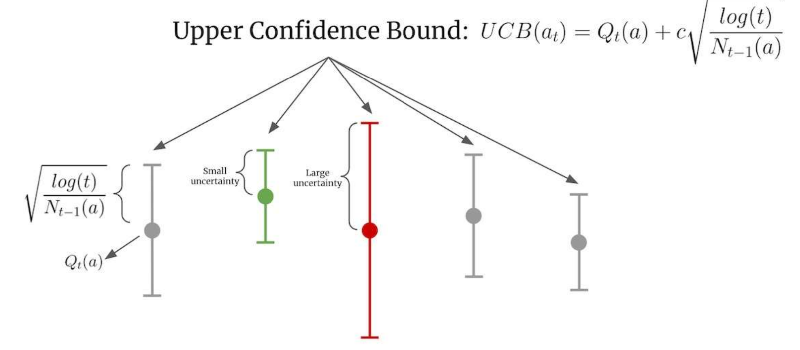
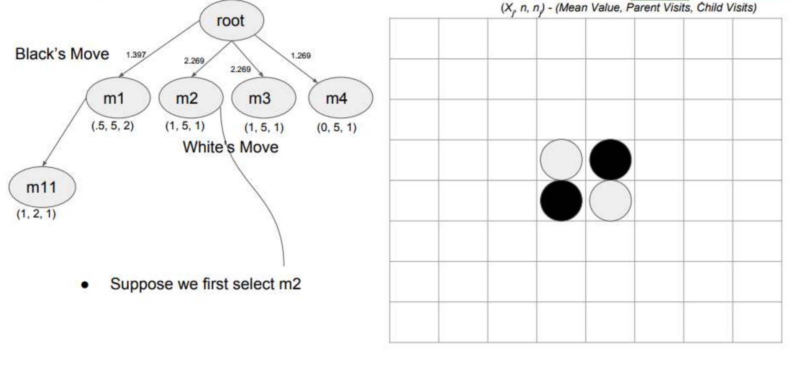
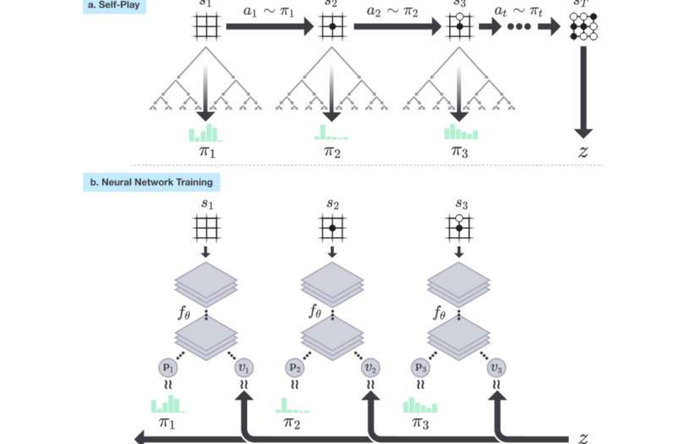

# L3 完全信息博弈 2：蒙特卡洛树搜索与 AlphaGo

本讲介绍**蒙特卡洛树搜索**（Monte Carlo Tree Search, MCTS）——一种通过随机模拟迭代构建部分搜索树的前瞻搜索框架，以及它的两个里程碑式应用：AlphaGo 与 AlphaGo Zero。前者把深度学习与 MCTS 结合、首次在围棋上达到超人水平；后者进一步摆脱人类棋谱，完全通过自我对弈从零训练，并揭示了"MCTS 本身可以作为策略改进算子"这一深刻观点。

## MCTS 总览

MCTS 的思想是：**不试图展开整棵博弈树，而是迭代地构建一棵部分搜索树**，把计算资源集中在最有前途的分支上。每一次迭代（iteration）包含四个阶段：

1. **选择**（Selection）：从根节点出发，依据**树策略**（tree policy）递归地选择子节点、沿树下潜。树策略负责在**探索**（exploration，访问了解尚少的节点）与**利用**（exploitation，访问当前估值最高的节点）之间权衡。当下潜到一个**可扩展节点**（expandable node）——即非终止且仍有未探索子节点的节点——时停止。
2. **扩展**（Expansion）：向树中加入一个或多个子节点。加入哪些节点取决于当前局面可用的动作，具体方式也由树策略决定。
3. **模拟**（Simulation，又称 rollout）：从新加入的节点出发，按照**默认策略**（default policy）把对局模拟到底——最简单的默认策略是完全随机行棋——得到终局局面，由终局的实际胜负（棋盘结果）确定本次模拟的值。
4. **反向传播**（Backpropagation）：沿本次迭代保存的路径回溯，用模拟结果更新路径上各节点的统计量。一个节点的值代表"从父节点沿这条路径下来的收益"的估计；模拟对局如何结束，就如何更新这些值。

两类策略共同决定 MCTS 的行为：**树策略**决定如何选择子节点（即选择阶段的行为），**默认策略**决定如何运行模拟（例如随机化），而模拟的结果又用于更新节点的值。重复上述迭代，搜索树逐渐向"最有前途"的方向生长，各个节点的值估计也随之精化。

## 从多臂老虎机到 UCT

### 老虎机中的上置信界（UCB）

选择阶段的每个节点都可以看成一个**多臂老虎机**（multi-armed bandit）问题：每个子节点是一条"臂"，拉下它就获得一个随机的回报，我们要在有限次数内平衡"试新臂"与"拉当前最好的臂"。经典解法是**上置信界**（Upper Confidence Bound, UCB）策略：为每条臂维护一个置信区间，总是选择**上置信界最大**的臂，

$$
UCB(a_t) = Q_t(a) + c\sqrt{\frac{\log t}{N_{t-1}(a)}},
$$

其中 $Q_t(a)$ 是臂 $a$ 目前的平均回报，$N_{t-1}(a)$ 是该臂被拉过的次数，$t$ 是总次数，$c$ 控制置信区间宽度。上式第二项随 $\log t$ 缓慢增长、随 $N_{t-1}(a)$ 衰减：被拉得少的臂置信区间宽（不确定性大），其上界被抬高，从而被优先探索；被拉得多的臂区间收窄，上界回归到其真实均值附近。探索与利用由此被同一个标量准则统一起来。

### UCT 算法

把 UCB 用作树策略，就得到 **UCT**（Upper Confidence bounds applied to Trees）算法 [Kocsis & Szepesvári, ECML-06]：在节点选择处把"选哪个子节点"当作多臂老虎机问题，用下式给子节点 $i$ 打分并选最高分者，

$$
v_i + C \times \sqrt{\frac{\ln N}{n_i}},
$$

其中 $v_i$ 是子节点 $i$ 的**值估计**（value estimate），$C$ 是可调的**探索参数**（exploration parameter），$N$ 是**父节点被访问的次数**，$n_i$ 是**该子节点被访问的次数**。

UCT 的几个关键性质：

- **$n_i = 0$ 意味着无穷大的权重**：任何从未被访问过的子节点得分都是 $+\infty$，这保证了每个子节点至少被探索一次；
- **每个子节点都有非零的被选概率**（不存在被永远冷落的分支）；
- **调节 $C$ 即可改变探索—利用的权衡**：$C$ 越大越偏探索，越小越偏利用。

> **定理.** 在选择阶段采用 UCT 动作选择的 MCTS 能够找到最优策略。[Kocsis & Szepesvári, ECML-06]

## 例：黑白棋（Othello）上的 UCT

用一个具体例子走一遍算法。考虑黑白棋开局，轮到黑方行棋，共有四个合法着法 $m_1, m_2, m_3, m_4$，它们是根节点的四个子节点。每个节点维护三元组 $(\bar X_j, n, n_j)$，含义为（平均回报，父节点访问数，本节点访问数）：

- $n_j$：初始为 0，因此所有边的初始权重都是无穷大；
- $n$：初始为 0；
- $C$：某个正常数（本例后续数值对应 $C = 1$）；
- $\bar X_j$：选择该局面（着法）的平均回报，取值于 $[0,1]$，初始为 N/A。

**前 4 次迭代。** 由于所有子节点权重为无穷大，前四次迭代依次选中 $m_1, m_2, m_3, m_4$，各自扩展并做一次随机模拟。假设模拟结果是：$m_1, m_2, m_3$ 黑胜（回报 1），$m_4$ 白胜（回报 0）。反向传播后的统计量为

| 节点 | $\bar X_j$ | $n$ | $n_j$ |
|------|-----------|-----|-------|
| $m_1$ | 1 | 4 | 1 |
| $m_2$ | 1 | 4 | 1 |
| $m_3$ | 1 | 4 | 1 |
| $m_4$ | 0 | 4 | 1 |

**第 5 次迭代。** 四个子节点的 UCT 分数都是 $1 + \sqrt{\ln 4} \approx 2.18$（$m_4$ 为 $0+\sqrt{\ln 4}\approx 1.18$），第一次选择（黑方层）打平后取 $m_1$；$m_1$ 成为可扩展节点，扩展出白方的三个应手 $m_{11}, m_{12}, m_{13}$（统计量均为 (N/A, 1, 0)，权重无穷大），第二次选择（白方层）取 $m_{11}$。从 $m_{11}$ 运行一次模拟，假设**白方胜**。回溯更新：$m_{11}$ 变为 $(1, 2, 1)$（从白方视角记录其平均回报），$m_1$ 的平均回报被拉低到 $(0.5, 5, 2)$，其余节点父访问数更新为 5，根节点累计访问 5 次。

**第 6 次迭代。** 此时根处四个子节点的 UCT 分数为（$N=5$）：

- $m_1$：$0.5 + \sqrt{\ln 5 / 2} \approx 1.397$；
- $m_2$：$1 + \sqrt{\ln 5} \approx 2.269$；
- $m_3$：$1 + \sqrt{\ln 5} \approx 2.269$；
- $m_4$：$0 + \sqrt{\ln 5} \approx 1.269$。

$m_2$ 与 $m_3$ 并列最高，假设选中 $m_2$；扩展出白方应手 $m_{21}, m_{22}, m_{23}$，再假设选中 $m_{22}$。从该局面模拟一局，假设**黑方胜**，回溯更新：$m_{22} \to (0, 2, 1)$（白方视角平均回报 0），$m_2 \to (1, 6, 2)$，其余节点的父访问数 $n$ 更新为 6。

6 次迭代之后树的样子是：根的四个子节点为 $m_1 (0.5, 6, 2)$、$m_2 (1, 6, 2)$、$m_3 (1, 6, 1)$、$m_4 (0, 6, 1)$，其 UCT 分数分别为 $1.447$、$1.947$、$2.339$、$1.339$；白方层 $m_{11}$ 的分数为 $1 + \sqrt{\ln 2} \approx 1.833$，$m_{22}$ 为 $\sqrt{\ln 2} \approx 0.833$，其余未探索节点（图中红色）权重为无穷大、实际上并不在树中。

**搜索结束后如何决策。** 给出一棵搜索完成的树，实际的着法可以用 max 子节点（平均分最高）、robust 子节点（访问次数最多）、max-robust 或其他子节点选择策略来挑。一旦真实走出一步，我们只保留该步之后的子树继续搜索，其余部分丢弃。

## AlphaGo：用神经网络增强 MCTS

纯 MCTS 靠随机模拟估值，模拟质量决定了树上值估计的质量。AlphaGo [Silver et al., Nature 2016] 的核心想法是：用一个**价值网络**（value network）和一个**策略网络**（policy network）来增强 MCTS，使搜索既更浅（不必模拟到终局）又更窄（集中到高概率着法上）。整个系统分三步构建：

1. **策略网络**先在人类职业棋手对局棋谱上监督学习，再用强化学习（自我对弈）进一步训练，记其输出为 $p_\sigma(a \mid s)$——局面 $s$ 下每个着法的概率；
2. **价值网络** $v_\theta(s)$ 用策略网络自我对弈产生的数据训练，直接估计局面 $s$ 的胜率（评估值）；
3. 然后运行 MCTS，搜索过程中借力这两个网络。

两个高层思想对应 MCTS 的两个瓶颈：

- **用价值网络压缩深度**：不再把模拟 rollout 到终局，而是在叶子处直接调用价值网络给出评估，把"看到终局"换成"网络一眼估值"；
- **用策略网络压缩宽度**：用网络给出的着法概率引导搜索，把注意力集中在少数高概率着法上，而不是平均对待全部合法着法。

AlphaGo 的 MCTS 四个阶段如下（对照下图 a–d）：

- **a. 选择**：每次模拟沿树下行，选择使动作价值 $Q$ 加上奖励项 $u(P)$ 最大的边，其中 $u(P)$ 依赖于该边上存储的先验概率 $P$（来自策略网络）与访问计数；
- **b. 扩展**：到达叶节点时可以将其扩展；新节点被策略网络 $p_\sigma$ 处理一次，输出的概率作为每个动作的先验概率 $P$ 存储下来；
- **c. 评估**：模拟结束时，叶节点以两种方式估值——用价值网络 $v_\theta$ 直接评估，以及用快速走子策略（fast rollout policy）$p_\pi$ 把对局走到终局、由函数 $r$ 算出胜负；
- **d. 备份**：更新动作价值 $Q$，使其追踪该动作之下子树内所有评估 $r(\cdot)$ 与 $v_\theta(\cdot)$ 的均值。

搜索完成后，算法从根节点选择**被访问次数最多**的着法走出。

## AlphaGo Zero：从零开始的自我对弈

AlphaGo Zero 把上述框架推向极端：

- **除了游戏规则之外不使用任何人类数据**——没有人类棋谱、没有人工特征；
- 价值网络与策略网络（合并为一个双头网络）在 **MCTS 的语境中**通过自我对弈训练，而不是用人类数据、也不是脱离搜索单独训练。换言之，**MCTS 本身被用作策略改进算子**（policy improvement operator）：搜索产出的着法分布 $\pi$ 是对网络原始输出 $p$ 的一次改进，网络再向 $\pi$ 学习，如此循环；
- 整个系统在 **4 个 TPU 上训练了 70 天**——作为对比，Gemini 这样的大模型要消耗上万个 TPU。（论文报告了两轮训练：20 残差块网络约 3 天、40 残差块网络约 40 天，自我对弈与评估在单台 4 TPU 机器上进行，参数优化另用 64 个 GPU worker 与 19 个 CPU 参数服务器；此处时长按课件口径。）

**训练循环**（对照下图）：a. 自我对弈——在每个局面 $s_t$ 运行 MCTS，得到搜索概率 $\pi_t$，按 $a_t \sim \pi_t$ 采样走子，直到对局结束得到结果 $z$；b. 神经网络训练——把每个局面 $s_t$ 输入网络 $f_\theta$，输出 $(\mathbf p_t, v_t)$，训练目标是让 $v_t$ 拟合真实对局结果 $z$、让 $\mathbf p_t$ 拟合搜索概率 $\pi_t$。

### 训练管线：三个异步组件

论文把自我对弈训练管线拆为三个并行执行的组件，数据在其中循环流动：

- **优化**（optimisation）：每步从最近 50 万局自我对弈的所有时间步中均匀采样小批量（64 个 GPU worker，每 worker 批量 32，合计 2,048），用带动量（0.9）的 SGD 最小化损失，$L_2$ 正则系数 $c = 10^{-4}$；每 1,000 步产出一个新检查点。
- **评估**（evaluator）：新检查点与当前最优网络对弈 400 局（每步 1,600 次模拟，温度 $\mu \to 0$ 即确定性地取访问最多的着法，棋力最强），**胜率超过 55% 才替换**当前最优网络——这一门槛避免仅凭噪声换网。
- **自我对弈**（self-play）：当前最优玩家每轮生成 25,000 局，每步运行 1,600 次 MCTS 模拟（约 0.4 秒思考时间）。每局前 30 手温度 $\mu = 1$（按访问计数比例采样，保证局面多样性），此后 $\mu \to 0$；另在根节点的先验概率上注入 Dirichlet 噪声 $P(s,a) = (1-\varepsilon)\,p_a + \varepsilon\,\eta_a$（$\eta \sim \mathrm{Dir}(0.03)$，$\varepsilon = 0.25$），保证所有着法都可能被尝试，而搜索仍可否决坏棋。为节省计算，明显落败的局提前认输，认输阈值自动选取、把"本可翻盘"的误判率控制在 5% 以下（具体做法是 10% 的自我对弈局禁止认输、用于测量误判率）。

### 神经网络损失函数

网络 $(\mathbf p, v) = f_\theta(s)$ 的损失函数为

$$
l = \underbrace{(z - v)^2}_{\text{价值误差}} \;-\; \underbrace{\boldsymbol\pi^{\mathrm T} \log \mathbf p}_{\text{使网络的着法概率 }\mathbf p\text{ 与搜索概率 }\boldsymbol\pi\text{ 的相似度最大化}} \;+\; \underbrace{c\,\lVert \theta \rVert^2}_{\text{正则项}}
$$

三项分别是：价值头对实际对局结果 $z$ 的平方误差；策略头与 MCTS 搜索分布 $\boldsymbol\pi$ 的交叉熵；以及参数 $\theta$ 的 $L_2$ 正则项。

### 神经网络结构

网络输入是 $19 \times 19 \times 17$ 的特征平面堆叠：当前方与对方的棋子各占 8 个历史平面（当前局面及前 7 步），外加 1 个常数平面表示行棋方颜色。历史平面是必需的——规则禁止局面重复出现，单看当前局面无法完全观测状态；颜色平面则因贴目不可观测而必需。网络主体是一个**残差塔**：一个卷积块（256 个 $3\times3$ 滤波器 + 批归一化 + ReLU）后接 19 或 39 个残差块（每块两层 256 滤波器的 $3\times3$ 卷积、批归一化与 ReLU，带跳跃连接），顶部接双头：策略头输出 $19^2 + 1 = 362$ 个着法（含停着）的 logit，价值头经 256 维隐藏层以 $\tanh$ 输出 $[-1, 1]$ 的标量胜率。

论文还做了架构消融实验：在固定数据集上分别训练"分离 vs 合并双头" × "卷积 vs 残差"四种网络，配上同样的搜索比较棋力。采用残差结构带来约 **+600 Elo**，把策略与价值合并为双头再带来约 **+600 Elo**——后者部分来自计算效率，更重要的是双目标把网络正则化到一个同时支持两种用途的共同表示上。

### 搜索算法

搜索树中每个节点 $s$ 为所有合法动作保存边 $(s, a)$，每条边存储一组统计量 $\{N(s,a), W(s,a), Q(s,a), P(s,a)\}$：

- $N$：该边被访问的次数；
- $W$：总价值（累计评估和）；
- $Q$：平均价值，$Q = W / N$；
- $P$：策略网络的输出（该动作的先验概率）。

**选择**采用 PUCT 变体：

$$
a_t = \arg\max_a \bigl( Q(s_t, a) + U(s_t, a) \bigr), \qquad
U(s, a) = c_{\text{puct}}\, P(s, a)\, \frac{\sqrt{\sum_b N(s, b)}}{1 + N(s, a)}.
$$

与 UCT 相比，探索项中乘入了先验 $P(s,a)$：策略网络认为好的着法天然获得更高的探索权重，访问次数增多后该项衰减，让位于由 $Q$ 主导的利用。

**扩展与评估**：到达叶节点时，把该状态输入神经网络，得到价值估计 $v$ 与策略估计 $\mathbf p$；新节点的每条边将 $(N, W, Q)$ 初始化为 0、$P$ 设为策略输出，随后用 $v$ 做备份。

**备份**：沿路径用网络给出的价值 $v$ 更新各边统计量：

$$
N(s,a) \leftarrow N(s,a) + 1, \qquad
W(s,a) \leftarrow W(s,a) + v, \qquad
Q(s,a) = \frac{W(s,a)}{N(s,a)}.
$$

**走子**：搜索完成后，返回与 $N^{1/\mu}$ 成正比的搜索概率 $\pi$，其中 $N$ 是根状态处每个着法的访问计数，$\mu$ 是控制温度（temperature）的参数——$\mu$ 小则集中在访问最多的着法上，$\mu$ 大则更均匀地探索。

论文实现中的若干工程细节值得注意：多条搜索线程并行时使用**虚拟损失**（virtual loss）保证各线程评估不同的节点；叶节点总是立即扩展（AlphaGo 用的是动态扩展），局面入队后先随机施加 8 种旋转/反射之一再送入网络（以批量 8 评估），这利用了围棋规则在旋转、反射下的对称性做数据增强；大规模训练实例（40 块网络）还使用了置换表。与 AlphaGo 的 APV-MCTS 相比，AlphaGo Zero 的搜索**完全不做 rollout、不用树策略**——"更简单的搜索反而更强"，这本身就是论文的论点之一。

### 实验结果

- **训练速度**：从随机行棋开始仅 **36 小时**即超过 AlphaGo Lee（作为对比，AlphaGo Lee 训练了数月）；72 小时后，在与首尔人机大战完全相同的 2 小时时限与比赛条件下，以 **100 : 0** 完胜当年击败李世石的 AlphaGo Lee 原版——且 AlphaGo Zero 只用单台 4 TPU 机器，AlphaGo Lee 则分布在多台机器上用了 48 个 TPU。
- **最终棋力**：在 5 秒/手的内部锦标赛上（Elo 分制，200 分差距约对应 75% 胜率），AlphaGo Zero（40 块网络、训练 40 天、期间生成 2,900 万局自我对弈）达 **5,185**，AlphaGo Master 4,858，AlphaGo Lee 3,739，AlphaGo Fan 3,144。值得强调的是，**不做任何搜索的纯网络**（直接取 $\mathbf p$ 中概率最大的着法）也有 3,055——逼近 AlphaGo Fan，说明网络本身已从搜索中学到了极强的棋感。在 2 小时时限的 100 局对抗中，AlphaGo Zero 以 **89 : 11** 战胜曾 60 : 0 横扫人类顶尖棋手的 AlphaGo Master。
- **自我对弈 vs 监督学习**：用同一架构在 KGS 人类棋谱上监督训练的网络，预测人类着法的准确率更高（KGS 测试集 60.4%，超过此前所有工作），但棋力明显更弱——自我对弈玩家在训练最初 24 小时内就击败了它。这提示 AlphaGo Zero 学到的策略与人类下法有**质的不同**，而非对人类棋谱的更好拟合。

### AlphaGo Zero 学到的围棋知识

论文记录了知识涌现的时间线：约 10 小时时偏好平庸的角部着法，47 小时时高频走出**点三三**定式（与人类职业定式一致），随后又将其抛弃、偏好自己发现的新变体。布局、手筋、死活、劫争、收官、对杀、先手、棋形、外势与实地等概念全部从第一性原理自发涌现；耐人寻味的是，"征子"（可能横跨全盘、人类最早学会的知识之一）AlphaGo Zero 反而到训练后期才真正掌握。

## 这些技术同样适用于单智能体场景

"学习 + 搜索"的组合不限于双人博弈，在单智能体问题上同样强大：

- **例 1：魔方**。McAleer et al., "Solving the Rubik's Cube with Approximate Policy Iteration", ICLR 2018；Agostinelli et al., "Solving the Rubik's Cube with Deep Reinforcement Learning and Search", Nature Machine Intelligence 2019。用值函数指导在打乱状态 $x_0, x_1, \dots, x_N$ 上的搜索，对每个动作 $a \in \{U, U', \dots, F, F'\}$ 以 $v_{x_i}(a) + R(A(x_i, a))$ 评估并取最大者，实现从任意打乱状态还原魔方。
- **例 2：肾脏交换中的边检验选择**。McElfresh, Curry, Sandholm, Dickerson, "Improving Policy-Constrained Kidney Exchange via Pre-Screening", NeurIPS-20。把"下一步对哪条边做实验室检验"建模为搜索问题，用同类技术改进受政策约束的肾脏交换匹配。

## 要点小结

- MCTS 迭代地构建部分搜索树，每次迭代包含选择、扩展、模拟、反向传播四个阶段；树策略负责探索—利用权衡，默认策略负责模拟。
- UCT 把每个节点选择视为多臂老虎机问题，用 $v_i + C\sqrt{\ln N / n_i}$ 选子节点；$n_i=0$ 权重无穷大保证每个子节点至少探索一次，$C$ 调节探索—利用权衡；MCTS+UCT 可找到最优策略（Kocsis & Szepesvári, ECML-06）。
- AlphaGo 用策略网络压缩搜索宽度、用价值网络压缩搜索深度：选择时最大化 $Q + u(P)$，叶子同时用 $v_\theta$ 与快速 rollout 评估，备份取二者均值，最终选根处访问最多的着法。
- AlphaGo Zero 不用任何人类数据，把 MCTS 当作策略改进算子：自我对弈中搜索产出 $\pi$，网络以 $l=(z-v)^2-\boldsymbol\pi^{\mathrm T}\log\mathbf p+c\lVert\theta\rVert^2$ 向 $(\boldsymbol\pi, z)$ 学习；4 个 TPU 训练 70 天。
- AlphaGo Zero 的搜索在每边维护 $\{N, W, Q, P\}$，选择用 $Q + c_{\text{puct}} P \frac{\sqrt{\sum_b N(s,b)}}{1+N(s,a)}$，备份做增量均值更新，走子按 $\pi \propto N^{1/\mu}$；实现上用虚拟损失支持多线程并行、对局面做旋转/反射数据增强，且完全不做 rollout。
- AlphaGo Zero 的训练管线由优化、评估（400 局、胜率 >55% 才换网）、自我对弈（每步 1,600 次模拟、根节点 Dirichlet 噪声、前 30 手温度 $\mu=1$）三个异步组件构成；从随机开始 36 小时即超过 AlphaGo Lee，最终 Elo 5,185（100 : 0 胜 AlphaGo Lee、89 : 11 胜 AlphaGo Master），不做搜索的纯网络也有 3,055。
- 同一套"学习 + 搜索"技术也适用于单智能体问题，如魔方求解与肾脏交换的边检验选择。
