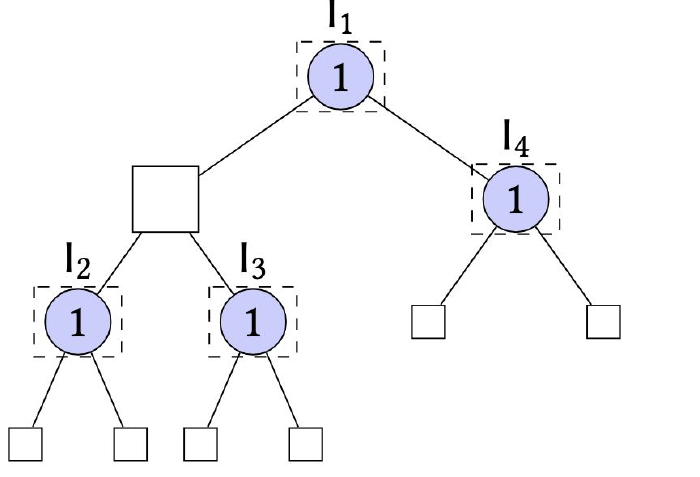

<!-- escape-math: v1 -->
# L5 展开式博弈 1：CFR

上一讲介绍了标准型（normal form）博弈中的均衡计算与无悔算法。虽然任何有限博弈都能写成标准型，但对序贯交互（sequential interaction）建模时，标准型表示往往是低效的。本讲引入更紧凑的**展开式博弈**（extensive-form game），讨论策略的三种表示方式——混合策略、行为策略与序列形式（sequence form），然后引入**树形决策问题**（tree-form decision problem, TFDP）与**后悔电路**（regret circuits），最终得到**反事实后悔最小化**（counterfactual regret minimization, CFR）——它是近二十年来博弈求解领域众多突破性成果的核心算法。

## 展开式博弈

展开式博弈用一棵有根博弈树表示。节点集合记为 $\mathcal{H}$，其中每个节点要么是**决策节点**（decision node），要么是**叶子（终止）节点**。每个决策节点属于某个在该节点行动的玩家；玩家 $i$ 的全部决策节点记为 $\mathcal{H}\_i \subseteq \mathcal{H}$。按惯例，玩家集合 $[n] \cup \\{c\\}$ 中包含一个（非策略性的）**机会玩家**（chance player）$c$，它按某个固定的概率分布选择行动，用于建模掷骰子等外部随机性。在节点 $h \in \mathcal{H}$ 行动的玩家从可用行动集合 $A\_h$ 中选择一个行动；对每个 $a \in A\_h$，博弈树中有一条边连接 $h$ 与采取行动 $a$ 后转移到的节点。当博弈到达叶子节点 $z \in \mathcal{Z}$ 时，每个玩家 $i \in [n]$ 获得由效用函数 $u\_i : \mathcal{Z} \to \mathbb{R}$ 给出的支付。

**不完美信息与完美回忆。** 为刻画不完美信息（imperfect information），每个玩家 $i$ 的节点集合 $\mathcal{H}\_i$ 被划分成若干**信息集**（information set）$\mathcal{J}\_i$。信息集 $j \in \mathcal{J}\_i$ 包含该玩家**无法区分**的所有节点。因此可以假设同一信息集中的所有节点 $h, h'$ 有相同的行动集合 $A\_h = A\_{h'} = A\_j$，否则该玩家就能借此区分 $h$ 与 $h'$。玩家 $i$ 的**序列**（sequence）集合定义为

$$\Sigma\_i := \\{(j, a) : j \in \mathcal{J}\_i,\ a \in A\_j\\}.$$

对节点 $h \in \mathcal{J}\_i$，记 $\sigma\_i(h)$ 为一个有序列表，依次记录该玩家在到达 $h$ 之前经过的（自己的）信息集以及在这些信息集上采取的行动。

> **定义（完美回忆，perfect recall）。** 玩家 $i$ 具有完美回忆，如果对所有属于同一信息集 $j \in \mathcal{J}\_i$ 的节点 $h, h'$，都有 $\sigma\_i(h) = \sigma\_i(h')$。若所有玩家都具有完美回忆，则称该博弈为完美回忆博弈。

直觉上，完美回忆意味着玩家从不忘记此前获得的信息：若同一信息集中两个节点的历史序列不同，玩家就能凭借记忆区分它们，矛盾。本讲绝大部分内容假设完美回忆。图 1 给出的是一个**非**完美回忆博弈：玩家 1 有两个信息集 $I\_1$（行动 $L\_1, R\_1$）与 $I\_2$（行动 $L\_2, R\_2$），轮到他在 $I\_2$ 行动时，他已经忘记了自己在 $I\_1$ 的行动。


### 策略的表示：纯策略与混合策略

玩家 $i$ 的**纯策略**（pure strategy）是任一映射 $\mathcal{J}\_i \ni j \mapsto A\_j$，即为每个信息集指定一个行动。记 $\Pi\_i$ 为玩家 $i$ 的纯策略集合，$\Delta(\Pi\_i)$ 为**混合策略**（mixed strategy，纯策略上的概率分布）集合，混合策略记为 $\boldsymbol{\mu}\_i \in \Delta(\Pi\_i)$。

任何展开式博弈都可以转化为标准型：玩家集合不变（去掉机会玩家），玩家 $i$ 的纯策略取为 $\Pi\_i$，效用在联合纯策略 $(\pi\_1, \dots, \pi\_n) \in \Pi\_1 \times \cdots \times \Pi\_n$ 下定义为

$$\sum\_{z \in \mathcal{Z}} u\_i(z)\\, p\_c(z) \prod\_{i' \in [n]} \prod\_{\substack{(h, a) \preceq z \\\ h \in \mathcal{H}\_{i'}}} \pi\_{i'}(a \mid h),$$

其中 $(h, a) \preceq z$ 表示从根到叶子 $z$ 的路径经过 $(h, a)$；若 $h \in j$，则 $\pi\_i(a \mid h)$ 理解为 $\pi\_i(a \mid j)$；$p\_c(z)$ 是机会玩家在根到 $z$ 的路径上采取所有相应行动的概率。

问题在于 $|\Pi\_i| = \prod\_{j \in \mathcal{J}\_i} |A\_j|$：纯策略数随信息集个数**指数增长**。举个具体例子：玩家 1 先行动，从 $[m]$ 中选择一个行动；玩家 2 观察到玩家 1 的行动后，在自己的 $m$ 个信息集中各选 L 或 R。展开式博弈只有 $\Theta(m)$ 个节点，但诱导标准型中玩家 2 有 $2^m$ 个行动。

> **观察 1.1.** 存在一个 $\Theta(m)$ 个节点的双人展开式博弈，其诱导标准型表示需要某一玩家具有至少 $2^m$ 个行动。

这并非理论上的病态：只要玩家需要应对大量可能的情形，这类爆炸就无处不在。因此我们不可能把展开式博弈一律转成标准型来处理，必须发展专门技术。从优化的角度，我们希望策略的表示满足两条基本要求（至少当其余玩家固定时，能高效优化自己的效用）：

1. 策略集合是一个**凸多胞体**（convex polytope），且可用博弈树规模的多项式个约束描述；
2. 每个玩家的效用关于自己的策略是**线性**（至少凹）的。

### 行为策略与 Kuhn 定理

**行为策略**（behavioral strategy）$\boldsymbol{b}\_i \in \prod\_{j \in \mathcal{J}\_i} \Delta(A\_j)$ 在每个信息集 $j$ 上为每个行动 $a \in A\_j$ 指定一个概率——即在每个信息集上**独立**随机化的混合策略。行为策略的表示是紧凑的（维度等于序列数，而非纯策略数），但它是否损失了表达能力？著名的 Kuhn 定理表明，在完美回忆下没有损失：

> **定理 1.2（Kuhn, 1953）.** 考虑任一完美回忆博弈。对任意混合策略 $\boldsymbol{\mu}\_i \in \Delta(\Pi\_i)$，存在行为策略 $\boldsymbol{b}\_i \in \prod\_{j \in \mathcal{J}\_i} \Delta(A\_j)$，使得对**任意**其余玩家的行为策略组合 $\boldsymbol{b}\_{-i}$，都有 $u\_i(\boldsymbol{b}\_i, \boldsymbol{b}\_{-i}) = u\_i(\boldsymbol{\mu}\_i, \boldsymbol{b}\_{-i})$。

**非完美回忆的反例。** Kuhn 定理的结论在非完美回忆博弈中不成立。回到图 1 的博弈：终端节点的数值是玩家 1 的效用，博弈是零和的（玩家 2 最小化玩家 1 的效用）。若允许混合策略，玩家 1 可取

$$\boldsymbol{\mu}\_1 := \tfrac{1}{2}(L\_1, L\_2) + \tfrac{1}{2}(R\_1, R\_2),$$

这把 $I\_1$ 与 $I\_2$ 的随机化**关联**起来，因此不是行为策略。无论玩家 2 如何应对，玩家 1 都能保证效用 $1/2$。反之，若玩家 1 只能用行为策略，在玩家 2 最小化其效用的情况下，他只能得到

$$\min\big(\boldsymbol{b}\_1[I\_1, L\_1] \cdot \boldsymbol{b}\_1[I\_2, L\_2],\ \boldsymbol{b}\_1[I\_1, R\_1] \cdot \boldsymbol{b}\_1[I\_2, R\_2]\big) = \min\_{p, q}\\, \big(p q,\ (1-p)(1-q)\big),$$

其中 $p = \boldsymbol{b}\_1[I\_1, L\_1]$，$q = \boldsymbol{b}\_1[I\_2, L\_2]$。不难看出该式的最优值为 $1/4$，远低于混合策略能保证的 $1/2$。定理 1.2 保证这种损失在完美回忆下不会发生。

关于定理 1.2 还有两点补充（Shoham & Leyton-Brown, §5.2）。其一，完美回忆下的等价是**双向**的：任何行为策略也可被等价的混合策略替代；由此得到推论——把策略集限制在行为策略上**不改变纳什均衡的集合**，因此在完美回忆博弈中求均衡时可以放心地只考虑行为策略。其二，在一般的（非完美回忆）不完美信息博弈中，混合策略与行为策略的表达能力事实上**不可比**：既存在混合策略能达到而任何行为策略都无法复现的结果（如上例），也存在相反方向的情形。

### 行为策略的问题与序列形式

尽管理论上行为策略与混合策略表达能力相同（定理 1.2），行为策略在优化上有根本缺陷：即使固定其余所有玩家，该玩家的效用关于自己的行为策略**不是线性的，甚至不是凹的**——从上式中的乘积 $p \cdot q$ 已能看出。一般地，效用作为行为策略组合 $(\boldsymbol{b}\_1, \dots, \boldsymbol{b}\_n)$ 的函数可写成

$$\sum\_{z \in \mathcal{Z}} u\_i(z)\\, p\_c(z) \prod\_{i' \in [n]} \prod\_{\substack{(h, a) \preceq z \\\ h \in \mathcal{H}\_{i'}}} \boldsymbol{b}\_{i'}[(j, a)],$$

即使固定除一个玩家外的所有策略，该玩家的效用中仍含有自己策略变量之间的乘积，难以优化。这违反了第二条要求（第一条倒是满足的：行为策略集合是若干单纯形的笛卡尔积，是多项式约束可描述的凸多胞体）。**序列形式**（sequence form）表示巧妙地绕过了这个困难，它由 Romanovskii（1962）与 Koller、Megiddo、von Stengel（1996）独立发现。

序列形式向量 $\boldsymbol{x}\_i \in \mathbb{R}^{\Sigma\_i}$ 与行为策略表示的关键区别在于：对每个序列 $(j, a) \in \Sigma\_i$，分量 $\boldsymbol{x}\_i[(j, a)]$ 存放的是**从根到信息集 $j$ 采取行动 $a$ 的路径上玩家自己各概率的乘积**，即

$$\boldsymbol{x}\_i[\sigma] := \prod\_{(j, a) \preceq \sigma} \boldsymbol{b}\_i[(j, a)], \qquad \forall \sigma \in \Sigma\_i,$$

其中 $\boldsymbol{b}\_i$ 是行为策略。要使 $\boldsymbol{x}\_i$ 是合法的序列形式策略，只需保证概率流量守恒（probability flow conservation）。

> **定义 1.3（序列形式多胞体）.** 序列形式多胞体是凸集
> $$\mathcal{X}\_i := \left\\{ \boldsymbol{x}\_i \in \mathbb{R}^{\Sigma\_i}\_{\geq 0} :\ \sum\_{a \in A\_j} \boldsymbol{x}\_i[(j, a)] = \begin{cases} 1 & \text{若 } p\_j = \varnothing \\\ \boldsymbol{x}\_i[p\_j] & \text{否则} \end{cases} \ \forall j \in \mathcal{J}\_i \right\\},$$
> 其中 $p\_j$ 是玩家 $i$ 在信息集 $j$ 之前的父序列（即从根到 $j$ 的路径上玩家 $i$ 的最后一个"信息集–行动"对；若不存在则记 $p\_j = \varnothing$）。

$\mathcal{X}\_i$ 的约束数是博弈规模的多项式。更精确地说，玩家 $i$ 的序列总数为

$$|\Sigma\_i| = 1 + \sum\_{j \in \mathcal{J}\_i} |A\_j|,$$

其中 "$1$" 对应空序列 $\varnothing$（从根出发未采取任何行动），它在流量守恒中由 $\boldsymbol{x}\_i[\varnothing] = 1$ 刻画；序列数关于博弈树规模是**线性**的，与纯策略数的指数爆炸（观察 1.1）形成对比。多胞体的维数同样紧凑：$1 + |\mathcal{J}\_i|$ 条等式约束线性无关，故 $\dim \mathcal{X}\_i = \sum\_{j \in \mathcal{J}\_i} (|A\_j| - 1)$。更重要的是，每个玩家 $i$ 的效用现在可以写成

$$u\_i(\boldsymbol{x}) = \sum\_{z \in \mathcal{Z}} u\_i(z)\\, p\_c(z) \prod\_{i' = 1}^{n} \boldsymbol{x}\_{i'}[\sigma\_{i'}(z)],$$

其中 $\sigma\_{i'}(z)$ 是玩家 $i'$ 在根到 $z$ 路径上的最后一个序列。于是 $u\_i(\boldsymbol{x})$ 可表示为 $\langle \boldsymbol{x}\_i, \boldsymbol{u}\_i(\boldsymbol{x}\_{-i}) \rangle$，其中 $\boldsymbol{u}\_i(\boldsymbol{x}\_{-i}) \in \mathbb{R}^{\Sigma\_i}$ 不依赖于 $\boldsymbol{x}\_i$——**效用关于自己的序列形式策略是线性的**。两条要求同时满足。

对双人情形，效用还可写成矩阵形式 $\boldsymbol{x}\_1^\top A\\, \boldsymbol{x}\_2$。支付矩阵 $A \in \mathbb{R}^{\Sigma\_1 \times \Sigma\_2}$ 的 $(\sigma\_1, \sigma\_2)$ 元定义为对所有满足"玩家 1、2 在 $z$ 处的末序列恰为 $\sigma\_1, \sigma\_2$"的叶子 $z$ 求和 $u(z)\\, p\_c(z)$。由于每个叶子恰对应唯一一对末序列，每个叶子的支付在 $A$ 中只出现一次，故 $A$ 是**稀疏矩阵**，非零元总数不超过叶子数——这与诱导标准型支付矩阵的稠密性再次形成对比（AGT §3.10；MAS §5.2.3）。

### 零和博弈的线性规划

在零和博弈这一特殊情形下，玩家 2 的效用可写成 $\boldsymbol{x}^\top A \boldsymbol{y}$，其中 $\boldsymbol{x}, \boldsymbol{y}$ 是序列形式向量；与上一讲一样，取玩家 1（选择 $\boldsymbol{x}$）为最小化方。由定义 1.3，把两个玩家的序列形式多胞体写成 $\mathcal{X} := \\{\boldsymbol{x} \in \mathbb{R}^{\Sigma\_1}\_{\geq 0} : F\_1 \boldsymbol{x} = \boldsymbol{f}\_1\\}$ 与 $\mathcal{Y} := \\{\boldsymbol{y} \in \mathbb{R}^{\Sigma\_2}\_{\geq 0} : F\_2 \boldsymbol{y} = \boldsymbol{f}\_2\\}$。固定玩家 1 的策略 $\boldsymbol{x} \in \mathcal{X}$，考虑线性规划

$$\text{(P)}\quad \max\_{\boldsymbol{y}}\ \boldsymbol{x}^\top A \boldsymbol{y} \quad \text{s.t. } F\_2 \boldsymbol{y} = \boldsymbol{f}\_2,\ \boldsymbol{y} \geq \boldsymbol{0}.$$

由强对偶性，对任意 $\boldsymbol{x}$，(P) 的值等于其对偶的值：

$$\text{(D)}\quad \min\_{\boldsymbol{v}}\ \boldsymbol{f}\_2^\top \boldsymbol{v} \quad \text{s.t. } A^\top \boldsymbol{x} \geq F\_2^\top \boldsymbol{v}.$$

也就是说，对任意 $\boldsymbol{x} \in \mathcal{X}$ 都有 $\max\_{\boldsymbol{y} \in \mathcal{Y}} \boldsymbol{x}^\top A \boldsymbol{y} = \min\_{\boldsymbol{v} : A^\top \boldsymbol{x} \geq F\_2^\top \boldsymbol{v}} \boldsymbol{f}\_2^\top \boldsymbol{v}$。于是求解 $\min\_{\boldsymbol{x} \in \mathcal{X}} \max\_{\boldsymbol{y} \in \mathcal{Y}} \boldsymbol{x}^\top A \boldsymbol{y}$ 归结为关于变量 $(\boldsymbol{x}, \boldsymbol{v})$ 的单个线性规划：

$$\min\_{\boldsymbol{x}, \boldsymbol{v}}\ \boldsymbol{f}\_2^\top \boldsymbol{v} \quad \text{s.t. } F\_1 \boldsymbol{x} = \boldsymbol{f}\_1,\ \boldsymbol{x} \geq \boldsymbol{0},\ A^\top \boldsymbol{x} \geq F\_2^\top \boldsymbol{v}.$$

这把上一讲关于标准型零和博弈的结果推广到了展开式博弈：

> **定理 1.4.** 对任意完美回忆的零和展开式博弈，极小极大均衡（minimax equilibrium）可以在博弈树规模的多项式时间内算出。

事实上界可以更精细：约束矩阵 $F\_1, F\_2$ 与支付矩阵 $A$ 的非零元总数都不超过博弈树规模的常数倍，因此该 LP 的规模关于博弈树是**线性**的（AGT §3.11, Theorem 3.13）。对偶变量也有直观的博弈论语义（MAS §5.2.3）：$\boldsymbol{v}$ 的每个分量对应一个信息集，可理解为"以该信息集为根的子博弈在对方最优应对下的值"，而目标值 $\boldsymbol{f}\_2^\top \boldsymbol{v}$ 即整局博弈的值。（对一般和的双人博弈，同样的构造给出一个多项式规模的线性互补问题——即原-LP 与对偶-LP 的可行性加互补松弛条件——可用 Lemke 算法求解；见 AGT §3.11, Theorem 3.14。）

## 树形决策问题

现在引入**树形决策问题**（tree-form decision problem, TFDP）框架：取单个玩家的视角，把展开式博弈中的其余玩家全部抽象掉，剩下的就是该玩家面对的序贯决策问题。玩家以两种基本方式与环境交互：在**决策点**（decision point）$j \in \mathcal{J}$（对应一个信息集），玩家从 $A\_j$ 中选择行动；在**观察点**（observation point）$k \in \mathcal{K}$，玩家观察到一个信号 $s \in S\_k$。决策点与观察点构成一棵树。另设有**转移函数** $\rho$：给定决策点 $j \in \mathcal{J}$ 与行动 $a \in A\_j$，$\rho(j, a)$ 返回树中到达的下一个点 $p \in \mathcal{J} \cup \mathcal{K} \cup \\{\bot\\}$（$\bot$ 表示决策过程结束）；类似地，$\rho(k, s)$ 返回在观察点 $k$ 观察到信号 $s$ 后的下一个点。


### 策略集的归纳分解

设 $\mathcal{X}$ 是该 TFDP 的序列形式策略集（定义 1.3）。我们将看到 $\mathcal{X}$ 可以用两种基本操作——**凸包**（convex hull）与**笛卡尔积**（Cartesian product）——归纳地分解。以上图为例，自底向上进行：在终端决策点 $j = I\_2, I\_3, I\_4$，策略集 $\mathcal{X}\_j$ 就是概率单纯形 $\Delta^2$；在唯一的观察点 $k$，$\mathcal{X}\_k = \mathcal{X}\_{I\_2} \times \mathcal{X}\_{I\_3}$，即分解为两个独立子问题；最后，在 $I\_1$ 处玩家要为两个行动各指定一个概率，记为 $\boldsymbol{\lambda}[a\_1], \boldsymbol{\lambda}[a\_2]$。由序列形式多胞体的定义，需将以 $k$ 为根的子树中的策略乘以 $\boldsymbol{\lambda}[a\_1]$、将以 $I\_4$ 为根的子树中的策略乘以 $\boldsymbol{\lambda}[a\_2]$，即

$$\mathcal{X} := \mathcal{X}\_{I\_1} = \big\\{ \big(\boldsymbol{\lambda}[a\_1], \boldsymbol{\lambda}[a\_2], \boldsymbol{\lambda}[a\_1] \boldsymbol{x}\_k, \boldsymbol{\lambda}[a\_2] \boldsymbol{x}\_{I\_4}\big) : (\boldsymbol{\lambda}[a\_1], \boldsymbol{\lambda}[a\_2]) \in \Delta^2,\ \boldsymbol{x}\_k \in \mathcal{X}\_k,\ \boldsymbol{x}\_{I\_4} \in \mathcal{X}\_{I\_4} \big\\}.$$



这种自底向上的分解可以直接推广到任意 TFDP：

- **观察点用笛卡尔积分**解。设观察点 $k \in \mathcal{K}$ 的子节点集合为 $\\{p\_1, \dots, p\_\nu\\} = \\{\rho(k, s) : s \in S\_k\\} =: \mathcal{C}\_k$，则
$$\mathcal{X}\_k = \mathcal{X}\_{p\_1} \times \mathcal{X}\_{p\_2} \times \cdots \times \mathcal{X}\_{p\_\nu},$$
其中 $\mathcal{X}\_{p\_i}$ 是以 $p\_i$ 为根的子树对应的序列形式多胞体。

- **决策点用凸包分解**。设决策点 $j \in \mathcal{J}$ 的子节点集合为 $\\{p\_1, \dots, p\_\nu\\} = \\{\rho(j, a) : a \in A\_j\\} =: \mathcal{C}\_j$，则
$$\mathcal{X}\_j := \mathrm{co} \left\\{ \begin{pmatrix} \boldsymbol{e}\_1 \\\ \mathcal{X}\_{p\_1} \\\ \boldsymbol{0} \\\ \vdots \\\ \boldsymbol{0} \end{pmatrix}, \begin{pmatrix} \boldsymbol{e}\_2 \\\ \boldsymbol{0} \\\ \mathcal{X}\_{p\_2} \\\ \vdots \\\ \boldsymbol{0} \end{pmatrix}, \dots, \begin{pmatrix} \boldsymbol{e}\_\nu \\\ \boldsymbol{0} \\\ \boldsymbol{0} \\\ \vdots \\\ \mathcal{X}\_{p\_\nu} \end{pmatrix} \right\\},$$
其中 $\boldsymbol{e}\_i \in \mathbb{R}^{A\_j}$ 是第 $i$ 个单位向量。

## 后悔电路与反事实后悔最小化

上一讲给出了单纯形上的多种高效无悔算法（RM、MWU 等）；上一节的分解表明序列形式多胞体可以仅用 i) 笛卡尔积、ii) 凸包两种操作由概率单纯形复合而成。**后悔电路**（regret circuits，Farina, Kroer & Sandholm, ICML 2019）回答的基本问题是：已知如何在某些集合上高效最小化后悔，能否把多个这样的后悔最小化器**组合**起来，以应对复合而成的更复杂的集合？由此只需为上述两种基本操作设计后悔电路，就能得到序列形式多胞体上的无悔算法——这正是 CFR。

需要说明：上一讲在"学习者输出概率分布"的特殊情形下引入了后悔最小化框架，但定义可以直接推广到学习者输出一般凸集 $\mathcal{X}$（例如序列形式多胞体）中的点 $\boldsymbol{x}$、再获得线性效用函数 $\boldsymbol{x} \mapsto \langle \boldsymbol{x}, \boldsymbol{u} \rangle$ 的情形。此外，Farina et al. 还指出线性损失在如下意义下是**万有**的：即使效用是任意凸函数 $\ell^t$，由凸性 $\ell^t(\hat{\boldsymbol{x}}) \geq \ell^t(\boldsymbol{x}^t) + \langle \partial \ell^t(\boldsymbol{x}^t),\\, \hat{\boldsymbol{x}} - \boldsymbol{x}^t \rangle$，把 $\ell^t$ 在 $\boldsymbol{x}^t$ 处的任一（次）梯度当作线性损失喂给只处理线性损失的后悔最小化器，其后悔不劣于原凸损失下的后悔。因此下面只为线性效用设计后悔电路即可，一般凸效用的情形也就自动涵盖在内。

### 笛卡尔积的后悔电路

设对每个 $p \in \mathcal{C}\_k$ 都有在 $\mathcal{X}\_p$ 上高效最小化后悔的在线算法 $\mathfrak{R}\_p$，我们要为 $\mathcal{X}\_k := \prod\_{p \in \mathcal{C}\_k} \mathcal{X}\_p$ 构造后悔最小化器 $\mathfrak{R}\_k$。在线算法的交互分两步——先给出策略，再观察效用反馈，分别处理：

- 每当 $\mathfrak{R}\_k$ 需要给出策略时，向每个 $\mathfrak{R}\_p$ 索取策略 $\boldsymbol{x}\_p$，输出它们的拼接（笛卡尔积）$(\boldsymbol{x}\_p)\_{p \in \mathcal{C}\_k}$；
- 每当 $\mathfrak{R}\_k$ 从环境收到效用向量 $\boldsymbol{u}\_k = (\boldsymbol{u}\_p)\_{p \in \mathcal{C}\_k}$ 时，把分量 $\boldsymbol{u}\_p$ 转发给对应的 $\mathfrak{R}\_p$。


> **命题 3.2.** $\mathfrak{R}\_k$ 的后悔等于 $\sum\_{p \in \mathcal{C}\_k} \mathrm{Reg}\_p^{(T)}$，其中 $\mathrm{Reg}\_p^{(T)}$ 是 $\mathfrak{R}\_p$ 的（$T$ 步累计）后悔。

**证明思路。** 展开定义即可：由于联合最优点 $(\hat{\boldsymbol{x}}, \hat{\boldsymbol{y}})$ 可以逐分量独立选取，

$$\mathrm{Reg}^{\mathcal{X} \times \mathcal{Y}}\_T = \max\_{(\hat{\boldsymbol{x}}, \hat{\boldsymbol{y}}) \in \mathcal{X} \times \mathcal{Y}} \sum\_{t=1}^{T} \big( \langle \boldsymbol{\ell}\_t, (\hat{\boldsymbol{x}}, \hat{\boldsymbol{y}}) \rangle - \langle \boldsymbol{\ell}\_t, (\boldsymbol{x}\_t, \boldsymbol{y}\_t) \rangle \big) = \mathrm{Reg}^{\mathcal{X}}\_T + \mathrm{Reg}^{\mathcal{Y}}\_T.$$

特别地，若每个 $\mathfrak{R}\_p$ 的后悔关于 $T$ 次线性增长，则 $\mathfrak{R}\_k$ 的后悔亦然。多于两个集合的笛卡尔积可直接推广。

### 凸包的后悔电路

凸包情形稍复杂。设对每个 $p \in \mathcal{C}\_j$ 已有 $\mathcal{X}\_p$ 上的后悔最小化器 $\mathfrak{R}\_p$，要为 $\mathcal{X}\_j := \mathrm{co}\\{(\mathcal{X}\_p)\_{p \in \mathcal{C}\_j}\\}$ 构造 $\mathfrak{R}\_j$。我们额外使用一个运行在单纯形 $\Delta(\mathcal{C}\_j)$ 上的后悔最小化器 $\mathfrak{R}\_\Delta$，其作用是决定如何在各 $(\mathfrak{R}\_p)$ 之间混合：

- 每当 $\mathfrak{R}\_j$ 需要给出策略时，向各 $\mathfrak{R}\_p$ 索取策略 $\boldsymbol{x}\_p$，并向 $\mathfrak{R}\_\Delta$ 索取策略 $\boldsymbol{\lambda} \in \Delta(\mathcal{C}\_j)$，输出混合策略 $(\boldsymbol{\lambda}[p]\\, \boldsymbol{x}\_p)\_{p \in \mathcal{C}\_j}$；
- 每当 $\mathfrak{R}\_j$ 收到效用向量 $\boldsymbol{u}\_j$ 时，先把 $\boldsymbol{u}\_j$ 原样转发给每个 $\mathfrak{R}\_p$，再把向量 $\big( \langle \boldsymbol{x}\_p, \boldsymbol{u}\_j \rangle \big)\_{p \in \mathcal{C}\_j}$ 转发给 $\mathfrak{R}\_\Delta$。


注意转发给 $\mathfrak{R}\_\Delta$ 的每个分量 $\langle \boldsymbol{x}\_p, \boldsymbol{u}\_j \rangle$ 反映了对应子最小化器当前的"表现"：$\mathfrak{R}\_\Delta$ 据此学习如何加权。

> **命题 3.3.** $\mathfrak{R}\_j$ 的后悔至多为 $\mathrm{Reg}\_\Delta^{(T)} + \max\_{p \in \mathcal{C}\_j} \mathrm{Reg}\_p^{(T)}$。

**证明思路**（以两个集合 $\mathcal{X}, \mathcal{Y}$ 为例）。设 $\mathfrak{R}\_\Delta$ 输出 $\boldsymbol{\lambda}\_t = (\lambda\_1^t, \lambda\_2^t) \in \Delta^2$，输出策略为 $\lambda\_1^t \boldsymbol{x}\_t + \lambda\_2^t \boldsymbol{y}\_t$。从后悔的定义出发，

$$\mathrm{Reg}\_T = \max\_{\substack{\hat{\boldsymbol{\lambda}} \in \Delta^2 \\\ \hat{\boldsymbol{x}} \in \mathcal{X}, \hat{\boldsymbol{y}} \in \mathcal{Y}}} \sum\_{t=1}^T \Big( \langle \boldsymbol{\ell}\_t, \hat{\lambda}\_1 \hat{\boldsymbol{x}} + \hat{\lambda}\_2 \hat{\boldsymbol{y}} \rangle - \langle \boldsymbol{\ell}\_t, \lambda\_1^t \boldsymbol{x}\_t + \lambda\_2^t \boldsymbol{y}\_t \rangle \Big).$$

关键观察有二。其一，由于 $\hat{\lambda}\_1, \hat{\lambda}\_2 \geq 0$，对 $(\hat{\boldsymbol{x}}, \hat{\boldsymbol{y}})$ 与 $\hat{\boldsymbol{\lambda}}$ 的联合最大化可交换次序：

$$\max\_{\hat{\boldsymbol{\lambda}} \in \Delta^2} \max\_{\hat{\boldsymbol{x}}, \hat{\boldsymbol{y}}} \Big( \hat{\lambda}\_1 \sum\_t \langle \boldsymbol{\ell}\_t, \hat{\boldsymbol{x}} \rangle + \hat{\lambda}\_2 \sum\_t \langle \boldsymbol{\ell}\_t, \hat{\boldsymbol{y}} \rangle \Big) = \max\_{\hat{\boldsymbol{\lambda}} \in \Delta^2} \Big( \hat{\lambda}\_1 \max\_{\hat{\boldsymbol{x}} \in \mathcal{X}} \sum\_t \langle \boldsymbol{\ell}\_t, \hat{\boldsymbol{x}} \rangle + \hat{\lambda}\_2 \max\_{\hat{\boldsymbol{y}} \in \mathcal{Y}} \sum\_t \langle \boldsymbol{\ell}\_t, \hat{\boldsymbol{y}} \rangle \Big).$$

其二，由 $\mathfrak{R}\_{\mathcal{X}}$ 的后悔定义，$\max\_{\hat{\boldsymbol{x}} \in \mathcal{X}} \sum\_t \langle \boldsymbol{\ell}\_t, \hat{\boldsymbol{x}} \rangle = \mathrm{Reg}^{\mathcal{X}}\_T + \sum\_t \langle \boldsymbol{\ell}\_t, \boldsymbol{x}\_t \rangle$（$\mathcal{Y}$ 同理）。代入并注意到无论 $\hat{\boldsymbol{\lambda}}$ 如何取值都有 $\hat{\lambda}\_1 \mathrm{Reg}^{\mathcal{X}}\_T + \hat{\lambda}\_2 \mathrm{Reg}^{\mathcal{Y}}\_T \leq \max\\{\mathrm{Reg}^{\mathcal{X}}\_T, \mathrm{Reg}^{\mathcal{Y}}\_T\\}$，剩下的部分恰好是 $\mathfrak{R}\_\Delta$ 在效用序列 $\boldsymbol{\ell}\_t^\Delta = (\langle \boldsymbol{\ell}\_t, \boldsymbol{x}\_t \rangle, \langle \boldsymbol{\ell}\_t, \boldsymbol{y}\_t \rangle)$ 下的后悔，于是

$$\mathrm{Reg}\_T \leq \mathrm{Reg}^{\Delta}\_T + \max\\{\mathrm{Reg}^{\mathcal{X}}\_T, \mathrm{Reg}^{\mathcal{Y}}\_T\\}.$$

推广到 $n$ 个集合的凸包是直接的：$\mathfrak{R}\_\Delta$ 改为运行在 $\Delta^n$ 上，输出 $\lambda\_1^t \boldsymbol{x}\_1^t + \dots + \lambda\_n^t \boldsymbol{x}\_n^t$，后悔界为 $\mathrm{Reg}\_T \leq \mathrm{Reg}^{\Delta^n}\_T + \max\\{\mathrm{Reg}^{\mathcal{X}\_1}\_T, \dots, \mathrm{Reg}^{\mathcal{X}\_n}\_T\\}$。

把命题 3.2、命题 3.3 与上节的归纳分解相结合，再加上单纯形上高效无悔算法的存在性，即得：

> **定理 3.4.** 存在在序列形式多胞体上最小化后悔的高效在线算法。

### CFR 算法

把上述构造完整写出来，就是**反事实后悔最小化**（counterfactual regret minimization, CFR），最早由 Zinkevich、Bowling、Johanson 与 Piccione（NIPS 2007）提出并分析；这里的推导遵循 Farina et al.（2019）的后悔电路框架。CFR 应理解为一个**算法族**：每个决策点上的局部后悔最小化器 $\mathfrak{R}\_j$ 可以用任意单纯形无悔算法实例化，实践中最常用的是后悔匹配（regret matching, RM）及其现代变体（如 RM$^+$），下一讲将详细讨论。

下面的伪代码中，`NextStrategy` 输出 CFR 的下一步策略：先调用各局部后悔最小化器得到行为策略，再将其转换为序列形式向量（这一转换正是为了保证效用线性，前文已反复强调）。`ObserveUtility` 更新喂给各决策点局部后悔最小化器的**反事实效用**（counterfactual utility）。

```text
算法 1：反事实后悔最小化（CFR）
输入：TFDP 中每个决策点 j ∈ J 上的后悔最小化器 R_j

NextStrategy():
  for 每个决策点 j ∈ J:
      b_j^(t) := R_j.NextStrategy()              # b_j^(t) ∈ Δ(A_j)
  for 每个决策点 j ∈ J（按自顶向下顺序）:
      for 每个行动 a ∈ A_j:
          if p_j = ∅:
              x^(t)[(j, a)] := b_j^(t)[a]
          else:
              x^(t)[(j, a)] := x^(t)[p_j] · b_j^(t)[a]
  return x^(t) ∈ R^Σ                              # 合法的序列形式策略

ObserveUtility(u^(t) ∈ R^Σ):
  V^(t)[⊥] := 0
  for 树中每个节点 p ∈ J ∪ K（按自底向上顺序）:
      if p ∈ J:                                  # 决策点
          j := p
          V^(t)[j] := Σ_{a ∈ A_j} b_j^(t)[a] · ( u^(t)[(j, a)] + V^(t)[ρ(j, a)] )
      else:                                      # 观察点
          k := p
          V^(t)[k] := Σ_{s ∈ S_k} V^(t)[ρ(k, s)]
  for 每个决策点 j ∈ J:
      for 每个行动 a ∈ A_j:
          u_j^(t)[a] := u^(t)[(j, a)] + V^(t)[ρ(j, a)]
      R_j.ObserveUtility(u_j^(t))
```

可以验证 `NextStrategy` 填出的向量 $\boldsymbol{x}^{(t)}$ 满足定义 1.3 的流量守恒约束，确实是合法的序列形式策略。`ObserveUtility` 分两步：第一步自底向上计算以每个节点为根的子树的期望效用 $V^{(t)}$；第二步在每个决策点 $j$ 处构造局部效用向量 $\boldsymbol{u}\_j^{(t)}$——即**反事实效用**，它度量"假设玩家设法让自己到达 $j$"时各行动的价值，再把它交给局部后悔最小化器 $\mathfrak{R}\_j$。

CFR 的累计后悔满足如下界：

> **命题.** 设 $\mathrm{Reg}\_j^{(T)}$（$j \in \mathcal{J}$）为各局部后悔最小化器 $\mathfrak{R}\_j$ 截至时刻 $T$ 累计的后悔，则 CFR 算法截至时刻 $T$ 的后悔 $\mathrm{Reg}^{(T)}$ 满足
> $$\mathrm{Reg}^{(T)} \leq \sum\_{j \in \mathcal{J}} \max\big\\{0,\ \mathrm{Reg}\_j^{(T)}\big\\}.$$

由此立即得到：若每个 $\mathrm{Reg}\_j^{(T)}$ 关于 $T$ 次线性增长，则 $\mathrm{Reg}^{(T)}$ 亦然。结合上一讲的框架（双人零和博弈中两个无悔玩家的时间平均策略收敛到极小极大均衡），CFR 为大规模不完美信息博弈的均衡计算提供了可扩展的引擎。

**反事实后悔的原始表述。** CFR 的原论文（Zinkevich et al., 2007）从展开式博弈的角度引入了同一思想，值得对照。记 $\pi^{\sigma}(h)$ 为策略组合 $\sigma$ 下到达历史 $h$ 的概率，并把它分解为各玩家（含机会玩家）的贡献之积 $\pi^{\sigma}(h) = \prod\_{i'} \pi\_{i'}^{\sigma}(h)$；记 $\pi\_{-i}^{\sigma}$ 为除玩家 $i$ 之外的贡献。信息集 $j \in \mathcal{J}\_i$ 的**反事实效用**定义为"假设玩家 $i$ 设法让自己到达 $j$"时 $j$ 的期望效用：

$$u\_i(\sigma, j) := \frac{\sum\_{h \in j,\\, z \in \mathcal{Z}} \pi\_{-i}^{\sigma}(h)\\, \pi^{\sigma}(h, z)\\, u\_i(z)}{\pi\_{-i}^{\sigma}(j)},$$

其中 $\pi^{\sigma}(h, z)$ 是从 $h$ 走到 $z$ 的概率，$\pi\_{-i}^{\sigma}(j) := \sum\_{h \in j} \pi\_{-i}^{\sigma}(h)$。再记 $\sigma|\_{j \to a}$ 为"在 $j$ 处恒取行动 $a$、其余与 $\sigma$ 相同"的策略组合，则 $j$ 处的**即时反事实后悔**（immediate counterfactual regret）为

$$\mathrm{Reg}\_{i,\mathrm{imm}}^{(T)}(j) = \max\_{a \in A\_j}\ \sum\_{t=1}^T \pi\_{-i}^{\sigma^t}(j)\\, \Big( u\_i\big(\sigma^t|\_{j \to a}, j\big) - u\_i(\sigma^t, j) \Big).$$

> **定理（Zinkevich et al., 2007, Theorem 3）.** 完美回忆博弈中，玩家 $i$ 的总体后悔满足
> $$\mathrm{Reg}\_i^{(T)} \leq \sum\_{j \in \mathcal{J}\_i} \max\big\\{0,\ \mathrm{Reg}\_{i,\mathrm{imm}}^{(T)}(j)\big\\}.$$

这正是上文命题在原始记号下的形式——原论文按信息集逐一分解，后悔电路则按 TFDP 的归纳结构分解，二者殊途同归。原论文用 Blackwell 可接近性（approachability）算法（即后悔匹配）实例化每个信息集上的局部最小化器，并给出精确的收敛速率：

> **定理（Zinkevich et al., 2007, Theorem 4）.** 若玩家 $i$ 在每个信息集上按后悔匹配选择行动（各行动的概率正比于其正累计反事实后悔，全为非正时均匀随机），则 $\mathrm{Reg}\_{i,\mathrm{imm}}^{(T)}(j) \leq \Delta\_{u,i} \sqrt{|\bar{A}\_i|\\, T}$，从而
> $$\mathrm{Reg}\_i^{(T)} \leq \Delta\_{u,i}\\, |\mathcal{J}\_i|\\, \sqrt{|\bar{A}\_i|\\, T},$$
> 其中 $\Delta\_{u,i} := \max\_z u\_i(z) - \min\_z u\_i(z)$ 是效用极差，$|\bar{A}\_i| := \max\_{j \in \mathcal{J}\_i} |A\_j|$。

（原文以**平均**后悔 $\frac{1}{T}\mathrm{Reg}^{(T)}$ 陈述，相应的界为 $\Delta\_{u,i} |\mathcal{J}\_i| \sqrt{|\bar{A}\_i|} / \sqrt{T}$；乘以 $T$ 即得上式。）注意该界关于信息集个数只是**线性**的——若改为在诱导标准型上直接运行无悔算法，界中将出现纯策略数（指数级），这正是必须利用展开式结构的原因。

**时间平均策略与均衡精度。** 无悔与均衡的联系还有一个精确的定量形式（Zinkevich et al., 2007, Theorem 2）：零和博弈中，若两名玩家截至 $T$ 的平均总体后悔都小于 $\epsilon$，则时间平均策略组合 $\bar{\sigma}^{(T)}$ 是一个 $2\epsilon$-纳什均衡。这里的平均策略在每个信息集上按玩家**自己的到达概率加权**：$\bar{\sigma}\_i^{(T)}(j)(a) \propto \sum\_{t} \pi\_i^{\sigma^t}(j)\\, \sigma^t(j)(a)$。两种视角在此也完全吻合：Farina et al.（2019）验证了喂给各局部后悔最小化器的损失恰好是原论文反事实效用（的相反数），且树形（序列形式）策略的均匀时间平均与标准 CFR 的逐信息集加权平均相一致。

**扑克的实验证据。** Zinkevich et al.（2007）在双人有限注德州扑克（heads-up limit Texas Hold'em；全博弈约 $9.2 \times 10^{17}$ 个状态、$3.2 \times 10^{14}$ 个信息集）的抽象博弈上验证了 CFR：保留完整四轮下注结构、仅按"牌力平方"指标把牌序列逐轮各分 10 桶，所得抽象博弈约有 $1.65 \times 10^{12}$ 个状态与 $5.7 \times 10^7$ 个信息集——比以往可求解的规模最大**两个数量级**。每次迭代只对机会玩家的行动采样（每轮迭代仅访问 18,496 个状态），单核每秒可完成约 750 次迭代；并行到 4 个 CPU 后，$2 \times 10^9$ 次迭代耗时不到 14 天，所得策略在抽象博弈中的可利用度（exploitability）仅 **2.2 mb/h**（毫注/手；总是弃牌的策略输 750 mb/h）；仅 $2 \times 10^8$ 次迭代（不到两天）就已降到 13 mb/h 以下。实验还表明，达到给定精度所需的迭代次数大致与信息集个数成正比，与上述理论界一致；更大的抽象直接转化为更强的实战表现。

## 要点小结

- 展开式博弈用有根博弈树表示，信息集刻画不完美信息；**完美回忆**要求同一信息集内各节点的历史序列一致，本讲均在此假设下展开。
- 直接转标准型会指数爆炸：$\Theta(m)$ 个节点的博弈可产生 $2^m$ 个纯策略（观察 1.1）。好的策略表示需满足两条：策略集是多项式约束的凸多胞体；效用关于自己策略线性（至少凹）。
- **Kuhn 定理**：完美回忆下行为策略与混合策略效用等价；非完美回忆时不成立（混合策略保证 $1/2$，行为策略仅 $1/4$）。但行为策略的效用含自身变量的乘积，非线性、非凹。
- **序列形式**用"路径概率乘积"表示策略，多胞体由流量守恒约束刻画，效用关于自己策略线性；零和展开式博弈由此可用多项式规模的 LP 求极小极大均衡（定理 1.4）。
- 单个玩家的视角抽象出**树形决策问题**（TFDP）；其序列形式多胞体可归纳分解：观察点对应笛卡尔积，决策点对应凸包。
- **后悔电路**把单纯形上的无悔算法复合到序列形式多胞体上：笛卡尔积的后悔是各分量后悔之和（命题 3.2），凸包的后悔至多是混合器后悔与各分支最大后悔之和（命题 3.3），从而得到高效的序列形式无悔算法（定理 3.4）。
- 这一构造就是 **CFR**（Zinkevich et al., 2007）：每个决策点运行一个局部后悔最小化器（最常用 RM 及其变体），通过反事实效用驱动，总后悔以 $\sum\_j \max\\{0, \mathrm{Reg}\_j^{(T)}\\}$ 为界。
- 原论文的反事实后悔分解给出精确速率：后悔匹配下 $\mathrm{Reg}\_i^{(T)} \leq \Delta\_{u,i} |\mathcal{J}\_i| \sqrt{|\bar{A}\_i| T}$（关于信息集数线性）；双方平均后悔 $< \epsilon$ 时平均策略是 $2\epsilon$-均衡。实验上，CFR 在 $10^{12}$ 状态的有限注德州扑克抽象上达到 2.2 mb/h 可利用度，比以往可求解规模推进了两个数量级。
