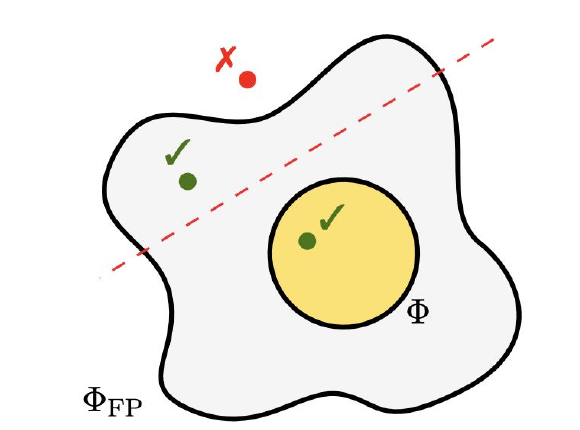

<!-- escape-math: v1 -->
# 最小化 Φ-后悔：非线性偏离

上一讲介绍了 Gordon 等人（2008）提出的最小化 Φ-后悔（Φ-regret）通用框架，它建立在两个基本构件之上：i) 一个不动点神谕（fixed-point oracle），对任意偏离 $\phi\in\Phi$ 输出其不动点；ii) 一个针对集合 $\Phi$ 的外部后悔最小化算法。本讲追问：这两个神谕总能高效实现吗？如果不能，它们对最小化 Φ-后悔是否真正必要？我们将看到：计算不动点在某种意义下是必要的（Hazan–Kale 的部分逆命题），但允许学习者输出混合策略即可绕过这一障碍；随后介绍著名的“无望椭球”（ellipsoid against hope, EAH）算法，它能在多人博弈中以 $\log(1/\epsilon)$ 的多项式时间计算（粗）相关均衡；最后指出 Gordon 框架的第二个构件——在偏离集合上最小化外部后悔——也可以放松为更弱的半分离神谕（semi-separation oracle），从而覆盖多项式维度的非线性偏离。

## 1 期望不动点

### 不动点的必要性

Gordon 等人的框架要求的第一个神谕是：对任意偏离 $\phi\in\Phi$，输出 $\phi$ 的一个不动点。一个直接的概念性问题是：这样的神谕是否真的必要？Hazan 和 Kale（2007）表明，在某种意义下答案是肯定的。回忆：若在线算法的（Φ-）后悔以 $T^{1-\alpha}$（某常数 $\alpha\in(0,1]$）增长，则称其具有**强次线性**后悔；全多项式时间近似方案（FPTAS）指运行时间在 $\mathcal{X}$ 的维度和 $1/\epsilon$ 上都是多项式的算法。

> **命题 1.1（Hazan and Kale, 2007）.** 若存在多项式时间算法在 $\mathcal{X}$ 中输出策略并具有强次线性 Φ-后悔，则存在计算任意 $\phi\in\Phi$ 的不动点的 FPTAS。

**证明思路.** 设 $\epsilon>0$ 为期望精度，$\phi\in\Phi$ 为待求不动点的函数。在第 $t$ 轮，算法输出 $\boldsymbol{x}^{(t)}\in\mathcal{X}$。若 $\lVert\phi(\boldsymbol{x}^{(t)})-\boldsymbol{x}^{(t)}\rVert\_2\le\epsilon$，即可终止；否则向算法反馈效用函数

$$
u^{(t)}:\boldsymbol{x}\mapsto\frac{1}{\lVert\phi(\boldsymbol{x}^{(t)})-\boldsymbol{x}^{(t)}\rVert\_2}\\,\big\langle\phi(\boldsymbol{x}^{(t)})-\boldsymbol{x}^{(t)},\\;\boldsymbol{x}-\boldsymbol{x}^{(t)}\big\rangle .
$$

假设 $T$ 轮之后算法仍未以 $\epsilon$-不动点终止，则其 Φ-后悔满足

$$
\mathrm{\Phi Reg}^{(T)} \\;\ge\\; \sum\_{t=1}^{T} u^{(t)}\big(\phi(\boldsymbol{x}^{(t)})\big)-\sum\_{t=1}^{T} u^{(t)}\big(\boldsymbol{x}^{(t)}\big) \\;=\\; \sum\_{t=1}^{T}\lVert\phi(\boldsymbol{x}^{(t)})-\boldsymbol{x}^{(t)}\rVert\_2 \\;\ge\\; \epsilon T .
$$

当 $T$ 足够大时，这与算法最小化 Φ-后悔（强次线性）的假设矛盾。$\square$

命题 1.1 应被视为最小化 Φ-后悔的障碍：计算一般非线性函数的不动点是难处理的——事实上它与计算纳什均衡等价（Daskalakis et al., 2008）。

### 非线性偏离的重要性

但我们真的需要关心超出线性函数范围的 Φ 吗？上一讲提到，在标准式博弈（normal-form game）中，线性偏离已足以涵盖从纯策略到纯策略的一切偏离；超出该设定就不再够用。

> **例 1.2（XOR 问题）.** 设 $\mathcal{X}=[0,1]^2$ 是某树形决策问题中学习者的策略集，考虑策略偏离
> $$\begin{pmatrix}0\\\1\end{pmatrix}\mapsto\begin{pmatrix}0\\\0\end{pmatrix},\quad \begin{pmatrix}1\\\0\end{pmatrix}\mapsto\begin{pmatrix}0\\\0\end{pmatrix},\quad \begin{pmatrix}1\\\1\end{pmatrix}\mapsto\begin{pmatrix}1\\\1\end{pmatrix},\quad\text{以及}\quad \begin{pmatrix}0\\\0\end{pmatrix}\mapsto\begin{pmatrix}\*\\\ \*\end{pmatrix}.$$
> （即恰有一个分量为 1 的顶点映到 $(0,0)$，顶点 $(1,1)$ 映到 $(1,1)$，$(0,0)$ 的像无关紧要——这是一种“异或”式的条件行为。）我们断言：不存在线性偏离 $[0,1]^2\to[0,1]^2$ 能实现该偏离。反设存在线性映射 $\boldsymbol{x}\mapsto\boldsymbol{M}\boldsymbol{x}$ 做到这点，则一方面
> $$\boldsymbol{M}\left(\frac12\begin{pmatrix}0\\\1\end{pmatrix}+\frac12\begin{pmatrix}1\\\0\end{pmatrix}\right)=\frac12\boldsymbol{M}\begin{pmatrix}0\\\1\end{pmatrix}+\frac12\boldsymbol{M}\begin{pmatrix}1\\\0\end{pmatrix}=\begin{pmatrix}0\\\0\end{pmatrix};$$
> 另一方面
> $$\boldsymbol{M}\left(\frac12\begin{pmatrix}0\\\1\end{pmatrix}+\frac12\begin{pmatrix}1\\\0\end{pmatrix}\right)=\frac12\boldsymbol{M}\begin{pmatrix}1\\\1\end{pmatrix}=\frac12\begin{pmatrix}1\\\1\end{pmatrix},$$
> 矛盾。

可见，线性偏离无法表达“异或”式的条件行为，而这在树形（扩展式）决策问题中十分自然——这正是需要非线性偏离的根本原因。

### 混合策略的作用

幸运的是，命题 1.1 的陈述中有一个看似无害的前提，却带来天壤之别：学习者必须输出 $\mathcal{X}$ 中的（纯）策略。事实表明，若允许学习者输出**混合策略**——即 $\Delta(\mathcal{X})$ 中的点——就可以绕过命题 1.1。

这与之前讲过的 Kuhn 定理似乎冲突：Kuhn 定理说混合策略并不比序列式（或行为式）策略更强（我们隐含假设完美回忆）。但恰恰是偏离的**非线性**本质使该等价在此设定下失效。

Zhang 等人（2024）进一步表明，命题 1.1 造成的障碍比表面看起来更尖锐：即使偏离集合只含**二次**多项式偏离，只要学习者被限制输出行为策略（即 $\mathrm{conv}\\,\mathcal{X}$ 中的点），要保证 Φ-后悔不超过 $\epsilon\sqrt{N}$ 就已是 PPAD 难的（$N$ 为策略空间维度，$\epsilon>0$ 为某绝对常数）。证明从广义电路（generalized circuit）出发，表明所有门都可以仅用多重线性运算近似模拟，从而把 PPAD 完全的不动点问题嵌入到这类“温和”的非线性偏离之中。换言之，允许学习者输出混合策略并非众多技巧之一，而几乎是绕过不动点计算的唯一出路——据我们所知，这也是首个必须借助混合策略才能保证效率的自然在线学习问题。

### 期望不动点

Zhang 等人（2024）观察到这一差别，并引入了**期望不动点**（expected fixed point）的概念。

> **定义 1.3（Zhang et al., 2024）.** 对函数 $\phi:\mathcal{X}\to\mathcal{X}$，分布 $\boldsymbol{\mu}\in\Delta(\mathcal{X})$ 称为 $\phi$ 的 $\epsilon$-期望不动点，如果
> $$\Big\lVert\\,\mathbb{E}\_{\boldsymbol{x}\sim\boldsymbol{\mu}}\big[\phi(\boldsymbol{x})-\boldsymbol{x}\big]\\,\Big\rVert \le \epsilon .$$

注意范数在期望之外：只要求 $\phi(\boldsymbol{x})-\boldsymbol{x}$ 的**平均**很小，而不要求逐点很小。期望不动点有两个关键性质。

**第一，期望不动点容易计算。** 与真实不动点不同，近似期望不动点可以高效计算，下面的简单算法即可：从任意点 $\boldsymbol{x}\_0\in\mathcal{X}$ 出发，反复施加映射 $\boldsymbol{x}\_k\leftarrow\phi(\boldsymbol{x}\_{k-1})$（$k=1,\dots,K$）。关键观察是所得求和发生**望远镜式相消**（telescoping）：

$$
\sum\_{k=1}^{K}\big(\phi(\boldsymbol{x}\_k)-\boldsymbol{x}\_k\big)=\phi(\boldsymbol{x}\_K)-\boldsymbol{x}\_1+\sum\_{k=1}^{K-1}\big(\phi(\boldsymbol{x}\_k)-\boldsymbol{x}\_{k+1}\big)=\phi(\boldsymbol{x}\_K)-\boldsymbol{x}\_1 .
$$

因此，若取 $\boldsymbol{\mu}$ 为 $\boldsymbol{x}\_1,\dots,\boldsymbol{x}\_K$ 上的均匀分布，就有 $\mathbb{E}\_{\boldsymbol{x}\sim\mu}[\phi(\boldsymbol{x})-\boldsymbol{x}]=\frac1K(\phi(\boldsymbol{x}\_K)-\boldsymbol{x}\_1)$。由于 $\mathcal{X}$ 有界，取 $K=O(1/\epsilon)$ 即可算得一个 $\epsilon$-期望不动点。事实上还有指数级更快的算法，复杂度关于 $\log(1/\epsilon)$ 为多项式（Zhang et al., 2025），其要点正是应用下文第 2 节的 EAH 算法，可作为练习尝试证明。

这里有一个被简写掩盖的技术细节：迭代 $\boldsymbol{x}\_k\leftarrow\phi(\boldsymbol{x}\_{k-1})$ 隐含要求 $\phi$ 把 $\mathrm{conv}\\,\mathcal{X}$ 映回自身，但树形策略集合上的偏离通常只定义在纯策略集 $\mathcal{X}$ 上——把一个多项式偏离 $\phi:\mathcal{X}\to\mathcal{X}$ 直接按表达式延拓到 $\mathrm{conv}\\,\mathcal{X}$，像点可能落在 $\mathrm{conv}\\,\mathcal{X}$ 之外。Zhang 等人（2024）的解决办法是引入**一致且高效**的延拓映射 $\delta:\mathrm{conv}\\,\mathcal{X}\to\Delta(\mathcal{X})$：一致性指 $\mathbb{E}\_{\boldsymbol{x}'\sim\delta(\boldsymbol{x})}[\boldsymbol{x}']=\boldsymbol{x}$，高效性指扩展映射 $\phi\_\delta(\boldsymbol{x}):=\mathbb{E}\_{\boldsymbol{x}'\sim\delta(\boldsymbol{x})}[\phi(\boldsymbol{x}')]$ 可高效求值。他们给出两个具体的 $\delta$：i) **行为策略映射** $\beta$，在每个到达概率为正的决策点 $j$ 按 $\boldsymbol{x}[ja]/\boldsymbol{x}[j]$ 采样动作——对 $k$ 次多项式偏离，$\phi\_\beta$ 可在 $N^{O(k)}$ 时间求值，但 $\beta(\boldsymbol{x})$ 的支撑集一般是指数大的；ii) **Carathéodory 映射** $\gamma$，由 Carathéodory 定理把 $\boldsymbol{x}$ 写成至多 $N$ 个纯策略的凸组合（可高效计算）——$\phi\_\gamma(\boldsymbol{x})$ 只需 $N$ 次 $\phi$ 求值，且输出低支撑分布。延拓后的算法是：迭代 $\boldsymbol{x}\_\ell\leftarrow\phi\_\delta(\boldsymbol{x}\_{\ell-1})$，输出 $\boldsymbol{\mu}=\frac1L\sum\_{\ell=1}^{L}\delta(\boldsymbol{x}\_\ell)$，同样的望远镜相消给出 $\lVert\mathbb{E}\_{\boldsymbol{x}\sim\boldsymbol{\mu}}[\phi(\boldsymbol{x})-\boldsymbol{x}]\rVert\le 2/L$。由此得到完整的黑箱化归：若 $\mathfrak{R}\_\Phi$ 的外部后悔为 $\mathrm{Reg}^{(T)}$、每轮耗时 $R\_1$，且 $\phi\_\delta$ 求值耗时 $R\_2$，则存在 Φ-后悔不超过 $\mathrm{Reg}^{(T)}+\epsilon$、每轮耗时 $O(R\_1+R\_2/\epsilon)$ 的学习算法——无需任何（可能昂贵的）真实不动点计算。

> **定理 1.4（Zhang et al., 2025）.** 存在多项式时间算法，计算任意函数 $\phi:\mathcal{X}\to\mathcal{X}$ 的期望不动点。

值得指出，期望不动点并非“过弱”的放松：Zhang 等人（2024）还证明了反方向——任何在 $\Delta(\mathcal{X})$ 上以强次线性 Φ-后悔运行的多项式时间算法，同样蕴含计算期望不动点的多项式时间算法。也就是说，Hazan–Kale 的计算等价性在这一放松意义下依然成立，只是不动点被换成了期望不动点。

**第二，期望不动点可以替代 Gordon 等人框架中的真实不动点。** 现在学习者每轮输出一个分布 $\boldsymbol{\mu}^{(t)}\in\Delta(\mathcal{X})$，其 Φ-后悔定义为

$$
\mathrm{\Phi Reg}^{(T)} := \max\_{\phi\in\Phi}\\;\sum\_{t=1}^{T}\\;\mathbb{E}\_{\boldsymbol{x}^{(t)}\sim\boldsymbol{\mu}^{(t)}}\big\langle\phi(\boldsymbol{x}^{(t)})-\boldsymbol{x}^{(t)},\\,\boldsymbol{u}^{(t)}\big\rangle .
$$

与上一讲相同，仍假设有算法 $\mathfrak{R}\_\Phi$ 在偏离集合 $\Phi$ 上最小化外部后悔；关键区别在于第 4 行返回的是 $\phi^{(t)}$ 的期望不动点，而非真实不动点。

```
算法 1  使用期望不动点细化 Gordon et al. (2008)
输入: 针对集合 Φ 的外部后悔最小化算法 R_Φ

NextStrategy():
    设 φ⁽ᵗ⁾ := R_Φ.NextStrategy();
    return μ⁽ᵗ⁾ := ExpectedFP(φ⁽ᵗ⁾)   ∈ Δ(X);

ObserveUtility(u⁽ᵗ⁾):
    设 u_Φ⁽ᵗ⁾: φ ↦ E_{x∼μ⁽ᵗ⁾}⟨φ(x), u⁽ᵗ⁾⟩;
    R_Φ.ObserveUtility(u_Φ⁽ᵗ⁾);
```

> **定理 1.5.** 设 $\mathrm{Reg}^{(T)}$ 是 $\mathfrak{R}\_\Phi$ 的外部后悔，则该算法的 Φ-后悔满足
> $$\mathrm{\Phi Reg}^{(T)} \le \mathrm{Reg}^{(T)} + \epsilon B T,$$
> 其中 $\epsilon>0$ 是期望不动点间隙的上界（按定义 1.3），且 $\lVert\boldsymbol{u}^{(t)}\rVert\_\*\le B$。

**证明.** 记 $\mathbb{E}$ 为关于 $\boldsymbol{x}^{(t)}\sim\boldsymbol{\mu}^{(t)}$ 的期望，则

$$
\begin{aligned}
\mathrm{\Phi Reg}^{(T)}
&= \max\_{\phi\in\Phi}\sum\_{t=1}^{T}\mathbb{E}\big\langle\phi(\boldsymbol{x}^{(t)})-\boldsymbol{x}^{(t)},\boldsymbol{u}^{(t)}\big\rangle\\\
&= \max\_{\phi\in\Phi}\sum\_{t=1}^{T}\mathbb{E}\big\langle\phi(\boldsymbol{x}^{(t)})-\phi^{(t)}(\boldsymbol{x}^{(t)}),\boldsymbol{u}^{(t)}\big\rangle+\sum\_{t=1}^{T}\mathbb{E}\big\langle\phi^{(t)}(\boldsymbol{x}^{(t)})-\boldsymbol{x}^{(t)},\boldsymbol{u}^{(t)}\big\rangle\\\
&\le \max\_{\phi\in\Phi}\sum\_{t=1}^{T}\big(u\_\Phi^{(t)}(\phi)-u\_\Phi^{(t)}(\phi^{(t)})\big)+\sum\_{t=1}^{T}\mathbb{E}\big(\phi^{(t)}(\boldsymbol{x}^{(t)})-\boldsymbol{x}^{(t)}\big)\\,\lVert\boldsymbol{u}^{(t)}\rVert\_\*\\\
&\le \mathrm{Reg}^{(T)} + \epsilon B T .
\end{aligned}
$$

第一步加减 $\phi^{(t)}(\boldsymbol{x}^{(t)})$；第二步第一项正是 $\mathfrak{R}\_\Phi$ 所见效用的差，第二项用对偶范数放缩；最后由期望不动点间隙 $\lVert\mathbb{E}[\phi^{(t)}(\boldsymbol{x}^{(t)})-\boldsymbol{x}^{(t)}]\rVert\le\epsilon$ 得界。$\square$

**要点：** 最小化 Φ-后悔实际上只需要一个针对集合 $\Phi$ 的无外部后悔算法。第 3 节将考察这一问题的复杂度，并给出 Gordon 框架的第二个关键放松。在此之前，先介绍一个计算相关均衡的著名算法——它与 Gordon 等人的框架有着深刻的内在联系。

## 2 无望椭球算法：多人博弈中的相关均衡 LP

基于后悔最小化的技术给出的运行时间关于 $1/\epsilon$ 是多项式的：若所用算法的（Φ-）后悔为 $\sqrt{T}$，则需要 $1/\epsilon^2$ 次迭代才能达到 $\epsilon$-均衡。当 $\epsilon\ll 1$ 时能否做得更好？另一条路线是线性规划——它能返回**精确**解；但描述 (C)CE 的 LP 的变量数随玩家数指数增长。本节介绍**无望椭球算法**（ellipsoid against hope, EAH）：即使在多人博弈中也能以多项式时间计算 (C)CE。它由 Papadimitriou 和 Roughgarden（2008）首次提出；下面主要遵循 Farina 和 Pipis（2024）的推广版本。注意该算法工作在集中式模型下，与在线学习框架并不兼容，但两者确有相似之处。

我们的目标是计算一个多重线性博弈（multilinear game）的 $\epsilon$-Φ-均衡：相关分布 $\boldsymbol{\mu}\in\Delta(\mathcal{X}\_1\times\cdots\times\mathcal{X}\_n)$，使得对任意玩家 $i\in[n]$ 和偏离函数 $\Phi\_i\ni\phi\_i:\mathcal{X}\_i\to\mathcal{X}\_i$，

$$
\mathbb{E}\_{(\boldsymbol{x}\_1,\dots,\boldsymbol{x}\_n)\sim\boldsymbol{\mu}}\\,u\_i(\boldsymbol{x}\_1,\dots,\boldsymbol{x}\_n)\\;\ge\\;\mathbb{E}\_{(\boldsymbol{x}\_1,\dots,\boldsymbol{x}\_n)\sim\boldsymbol{\mu}}\\,u\_i\big(\phi\_i(\boldsymbol{x}\_i),\boldsymbol{x}\_{-i}\big)-\epsilon . \tag{1}
$$

### EAH 框架

更抽象地看，EAH 处理如下形式的优化问题：

$$
\text{求 } \boldsymbol{\mu}\in\Delta(\mathcal{X}) \text{ 使 } \mathbb{E}\_{\boldsymbol{x}\sim\boldsymbol{\mu}}\langle\boldsymbol{y},G(\boldsymbol{x})\rangle\ge 0\quad \forall \boldsymbol{y}\in\mathcal{Y}, \tag{2}
$$

其中 $\mathcal{X}\subseteq\mathbb{R}^d$，$\mathcal{Y}\subseteq\mathbb{R}^k$，$G:\mathcal{X}\to\mathbb{R}^k$ 可高效求值。（注意：在问题 (1) 的语境下这里的 $\mathcal{X}$ 对应 $\mathcal{X}\_1\times\cdots\times\mathcal{X}\_n$，而非单个玩家的策略集。）问题 (2) 的症结在于 $\boldsymbol{\mu}$ 处在高维空间：典型情形是标准式博弈中 $\mathcal{X}=\mathcal{A}\_1\times\cdots\times\mathcal{A}\_n$，仅描述分布 $\boldsymbol{\mu}$ 就可能需要 $\prod\_{i=1}^{n}|\mathcal{A}\_i|-1$ 个坐标。

我们假设对应偏离集合的 $\mathcal{Y}$ 容许**分离神谕**（separation oracle）；在温和的几何假设下，只需一个**成员神谕**（membership oracle，判断点 $\boldsymbol{y}\in\mathbb{R}^k$ 是否属于 $\mathcal{Y}$）也等价。特殊情形是 $\mathcal{Y}$ 为由多项式个约束描述的多胞形——例如标准式博弈中交换后悔对应的偏离集合就是随机矩阵的集合（每个玩家的偏离集合是概率单纯形的笛卡尔积）。EAH 框架（Farina and Pipis, 2024）的关键假设是存在**足够好响应神谕**（good-enough-response oracle, GER）：给定任意 $\boldsymbol{y}\in\mathcal{Y}$，返回一点 $\boldsymbol{x}\in\mathcal{X}$ 使 $\langle\boldsymbol{y},G(\boldsymbol{x})\rangle\ge 0$。

EAH 只需 $\mathcal{Y}$ 的分离神谕和 GER 神谕即可求解 (2)。基本思想是考虑 (2) 之对偶的 $\epsilon$-近似版本：

$$
\text{求 } \boldsymbol{y}\in\mathcal{Y} \text{ 使 } \langle\boldsymbol{y},G(\boldsymbol{x})\rangle\le-\epsilon\quad \forall \boldsymbol{x}\in\mathcal{X}. \tag{3}
$$

由于 GER 神谕存在，(3) 保证**不可行**。尽管如此，EAH 仍在这个不可行规划上执行椭球算法——这正是“无望椭球”名称的由来。在算法的每一步 $t$，椭球给出一个候选点 $\boldsymbol{y}^{(t)}\in\mathcal{Y}$，我们用 GER 神谕产生一点 $\boldsymbol{x}^{(t)}\in\mathcal{X}$ 来**反驳** $\boldsymbol{y}^{(t)}$——事实上反驳了整个半空间。如此继续，直到椭球体积收缩到指数级小。于是

$$
\forall \boldsymbol{y}\in\mathcal{Y}\\;\exists t\in[T]\\;\text{ 使 }\\; \langle\boldsymbol{y},G(\boldsymbol{x}^{(t)})\rangle>-\epsilon .
$$

从而

$$
\min\_{\boldsymbol{y}\in\mathcal{Y}}\max\_{\boldsymbol{\mu}\in\Delta([T])}\\;\sum\_{t=1}^{T}\boldsymbol{\mu}^{(t)}\langle\boldsymbol{y},G(\boldsymbol{x}^{(t)})\rangle>-\epsilon .
$$

由极小极大定理（minimax theorem），

$$
\max\_{\boldsymbol{\mu}\in\Delta([T])}\min\_{\boldsymbol{y}\in\mathcal{Y}}\\;\sum\_{t=1}^{T}\boldsymbol{\mu}^{(t)}\langle\boldsymbol{y},G(\boldsymbol{x}^{(t)})\rangle>-\epsilon . \tag{4}
$$

换言之，存在 $\boldsymbol{x}^{(1)},\dots,\boldsymbol{x}^{(T)}$ 的一个凸组合可以反驳任意 $\boldsymbol{y}\in\mathcal{Y}$。这个凸组合就是对偶不可行性的证书（certificate），因而也是 (2) 的近似解。关键在于：(4) 中得到的零和博弈比我们出发时的博弈**小得多**（策略集是 $\Delta([T])$ 与 $\mathcal{Y}$），可以用标准 LP 技术求解。

> **定理 2.1（Farina and Pipis, 2024）.** 假设存在 $\mathcal{Y}$ 的分离神谕和 GER 神谕，EAH 在 $\mathrm{poly}(d,k,\log(1/\epsilon))$ 时间内运行，并返回 (2) 的一个 $\epsilon$-近似解。

### 用 EAH 计算相关均衡

现在把该算法应用于求解 (1)。假设每个 $\Phi\_i$ 包含形如 $\mathcal{X}\_i\ni\boldsymbol{x}\_i\mapsto\boldsymbol{M}\_i\boldsymbol{x}\_i\in\mathcal{X}\_i\subseteq\mathbb{R}^{m\_i}$ 的线性函数，其中合法矩阵 $\boldsymbol{M}\_i$ 的集合 $\mathcal{Y}\_i$ 是具有多项式个变量和约束的多胞形（例如上节所说，交换后悔中列随机矩阵的集合是概率单纯形的笛卡尔积），且 $\Phi\_i$ 包含恒等矩阵。由于

$$
\mathbb{E}\_{(\boldsymbol{x}\_1,\dots,\boldsymbol{x}\_n)\sim\boldsymbol{\mu}}\big\langle\boldsymbol{x}\_i-\boldsymbol{M}\_i\boldsymbol{x}\_i,\\,\boldsymbol{u}\_i(\boldsymbol{x}\_{-i})\big\rangle=\mathbb{E}\_{(\boldsymbol{x}\_1,\dots,\boldsymbol{x}\_n)\sim\boldsymbol{\mu}}\big\langle\boldsymbol{I}-\boldsymbol{M}\_i,\\,\boldsymbol{u}\_i(\boldsymbol{x}\_{-i})\otimes\boldsymbol{x}\_i\big\rangle,
$$

（其中 $\boldsymbol{I}$ 为恒等矩阵，$\otimes$ 为张量积）问题 (1) 可写成

$$
\mathbb{E}\_{(\boldsymbol{x}\_1,\dots,\boldsymbol{x}\_n)\sim\boldsymbol{\mu}}\big\langle\boldsymbol{I}-\boldsymbol{M}\_i,\\,\boldsymbol{u}\_i(\boldsymbol{x}\_{-i})\otimes\boldsymbol{x}\_i\big\rangle\ge-\epsilon\quad \forall i\in[n],\ \boldsymbol{M}\_i\in\mathcal{Y}\_i, \tag{5}
$$

这确实符合 (2) 的形式。剩下要证明 (5) 容许 GER 神谕。任取 $i\in[n]$ 和偏离 $\boldsymbol{M}\_i\in\mathcal{Y}\_i$，取 $\boldsymbol{x}\_i\in\mathcal{X}\_i$ 为 $\boldsymbol{M}\_i$ 的一个**不动点**，则

$$
\mathbb{E}\_{(\boldsymbol{x}\_1,\dots,\boldsymbol{x}\_n)\sim\boldsymbol{\mu}}\big\langle\boldsymbol{x}\_i-\boldsymbol{M}\_i\boldsymbol{x}\_i,\\,\boldsymbol{u}\_i(\boldsymbol{x}\_{-i})\big\rangle = 0,
$$

恰如所需——**不动点实现了 GER**。

**元博弈视角与 GER 的构造细节。** Farina 和 Pipis（2024）把问题 (1) 写成 Hart–Schmeidler 式的双人零和**元博弈**：“相关方”（Correlator）的策略集是联合纯策略组合上的分布 $\Delta(\Pi\_1\times\cdots\times\Pi\_n)$，“偏离方”（Deviator）的策略集是 $\mathcal{Y}=\Phi\_1\times\cdots\times\Phi\_n$，效用矩阵 $\boldsymbol{U}$ 满足

$$
\boldsymbol{x}^\top\boldsymbol{U}\boldsymbol{y}=\sum\_{p=1}^{n}\mathbb{E}\_{\boldsymbol{s}\sim\boldsymbol{x}}\Big[u\_p(\boldsymbol{s})-u\_p\big(\phi\_p(\boldsymbol{s}\_p),\boldsymbol{s}\_{-p}\big)\Big] .
$$

$\boldsymbol{U}$ 的行数关于玩家数和策略维度都是指数的（甚至双重指数），这正是无法直接求解、必须借助 GER 的原因。GER 的完整构造分两步：先取每位玩家偏离 $\phi\_p$ 的不动点 $\boldsymbol{x}\_p=\phi\_p(\boldsymbol{x}\_p)$（线性偏离的不动点可由 LP 求得），组成乘积分布使 $\boldsymbol{x}^\top\boldsymbol{U}\boldsymbol{y}=0$；再仿照 Jiang 和 Leyton-Brown 的**纯化**（purification）技术——由 Carathéodory 定理，每个边际 $\boldsymbol{x}\_p$ 可写成至多 $d\_p+1$ 个顶点的凸组合，于是逐玩家把边际替换为保持 $\boldsymbol{x}^\top\boldsymbol{U}\boldsymbol{y}\ge0$ 的顶点（这样的顶点必存在，因为原值是这些顶点取值的凸组合），最终得到一个纯策略组合作为 GER 的响应。整个框架对博弈侧的唯一假设是**多项式效用梯度性质**：给定乘积分布，可高效计算各玩家效用梯度的期望——它推广了 Papadimitriou–Roughgarden 的多项式期望性质，且事实上被每个无后悔学习算法隐含满足。值得注意的是，原 EAH 要求的“多项式类型”（polynomial type）性质在此**不再**需要，这正是该推广能覆盖扩展式博弈的关键。

> **定理 2.2（Farina and Pipis, 2024）.** 若多重线性博弈中每位玩家 $i\in[n]$ 的偏离集合 $\Phi\_i$ 都容许分离神谕，则存在关于 $\log(1/\epsilon)$、$n$ 和 $m=\max\_{1\le i\le n}m\_i$ 为多项式的算法，输出一个 $\epsilon$-Φ-均衡。

关于这个框架还有两点值得补充。**第一，精确均衡。** 当博弈的效用为有理数且各 $\Phi\_i$ 是有界面复杂度的多胞形时，Farina 和 Pipis（2024）实际上算得**精确** Φ-均衡：运行时间关于 $N=\sum\_p d\_p^2$、效用编码长度与面复杂度为多项式，且所得均衡表示为至多 $N$ 个纯策略组合的凸组合。（本讲义定理 2.1 与 2.2 给出的是适用于更一般设定的 $\epsilon$-近似版本；两种版本的复杂度关于 $\log(1/\epsilon)$ 都是多项式，并不矛盾。）作为推论，这给出了扩展式博弈中**首个**多项式时间的精确线性偏离相关均衡（LCE）算法，解决了 Farina 和 Pipis（2023）留下的公开问题；同时也以远比 Huang–von Stengel 的特化构造简洁的方式重新得到精确 EFCE 算法。**第二，GER 这一放松是必要的。** 他们证明为元博弈的相关方构造**最优响应**（best-response）神谕是 NP 难的——经由 SAT 博弈上均衡选择问题的归约——因此 GER 并非仅为简洁：在此设定下最优响应神谕本质上无法高效实现，而 GER 恰好归结为计算偏离函数的不动点。

### 与 Φ-后悔框架的相似性

总体来看，EAH 与 Φ-后悔框架有若干概念上的相似之处：两者都在偏离集合上操作，每轮返回相应偏离的一个不动点；两者输出的相关分布都是乘积分布的混合，从而有高效的紧凑表示；两者都要求偏离集合的分离神谕——这就引出本讲的最后一个话题。

## 3 非线性偏离与半分离神谕

EAH 和 Gordon 等人框架的主要要求都是偏离集合的分离神谕。事实上，聚焦外部后悔最小化，分离神谕足以高效实现 FTRL 这类算法；反过来，任何后悔最小化算法都应能执行分离——否则就存在一个固定的效用使后悔居高不下。也就是说，在温和几何假设下，以下三者等价：i) 判定一点的成员归属；ii) 将一点与集合分离（如下图所示，凸集外的一点总可以被一个超平面与集合分开）；iii) 给定效用向量在集合内求最优响应——而这正是该集合上的后悔最小化问题（必要性由考虑静态效用可得，充分性通过 follow the regularized leader 建立）。


然而，Daskalakis 等人（2025）最近表明：即使 $\Phi$ 只包含 $\mathcal{X}\to\mathcal{X}$ 的线性函数，实现**成员神谕**也可能是 NP 难的。更精确地说，他们证明的是一个指数级**查询复杂度**下界：任何只能对凸集 $\mathcal{P}\subset\mathbb{R}^d$ 做成员查询的算法，若要区分“$\phi$ 的某 $1/d$-邻域内全是 $\mathcal{P}$ 的自同态”与“$\phi$ 不是自同态”这两种情形，至少需要 $\exp(\Omega(d))$ 次查询。证明思路是区分完整的 $d$ 维单位球与去掉一个随机“球帽”（单位球与某半空间之交）的球：两者的自同态集合截然不同——例如取反映射恒为完整球的自同态，却从不是去帽球的自同态——而球面上存在 $\exp(\Omega(d))$ 个互不相交的常数宽度球帽，只有恰好落在帽内的查询才能区分二者。一个直接推论是：即使只是**事后计算**给定损失序列的线性交换后悔值本身（即在 $\Phi$ 上最大化一个线性函数），一般也是难处理的。这是否意味着最小化 Φ-后悔或应用 EAH 框架变得难处理？并非如此。迄今我们坚持同时拥有偏离集合的分离神谕和期望不动点神谕（即 GER 神谕），但事实证明只需实现两者的**析取**即可——Daskalakis 等人（2025）将其命名为**半分离神谕**（semi-separation oracle，定义 3.2）。


下面在一般设定下引入这一概念：偏离集合 $\Phi$ 由如下形式的非线性函数组成。

> **定义 3.1（Zhang et al., 2025）.** 给定映射 $\psi:\mathcal{X}\to\mathbb{R}^{k'}$，偏离集合 $\Phi\_\psi$ 是所有能表示为矩阵–向量乘积
> $$\phi(\boldsymbol{x})=\boldsymbol{K}^{(\phi)}\psi(\boldsymbol{x})+\boldsymbol{c}^{(\phi)}$$
> 的映射 $\phi:\mathcal{X}\to\mathcal{X}$ 的集合，其中 $\boldsymbol{K}\in\mathbb{R}^{d\times k'}$，$\boldsymbol{c}\in\mathbb{R}^d$。记 $k=d\times k'+d$ 为 $(\boldsymbol{K},\boldsymbol{c})$ 的维度。

可以把 $\psi$ 看作**特征映射**（feature mapping）；定义 3.1 涵盖的自然例子是**低次多项式**：$\psi$ 包含 $\boldsymbol{x}$ 各分量的所有次数不超过 $\ell$ 的乘积项。直接在所有合法 $(\boldsymbol{K},\boldsymbol{c})$ 构成的集合上最小化后悔是令人生畏的，但事实证明这并不必要——可以转而求解下面这个更简单的问题（其充分性的论证超出本讲义范围）。

> **定义 3.2（半分离）.** 在半分离问题中，给定函数 $\phi:\mathcal{X}\to\mathbb{R}^d$，要求计算以下二者之一：
> - 要么 $\phi$ 的一个 $\epsilon$-期望不动点 $\boldsymbol{\mu}\in\Delta(\mathcal{X})$；
> - 要么一点 $\boldsymbol{x}\in\mathcal{X}$ 使 $\phi(\boldsymbol{x})\notin\mathcal{X}$。

一旦有了计算期望不动点的算法（定理 1.4），实现半分离神谕其实并不难：基本照搬同一算法即可。若执行过程中发现某点满足 $\phi(\boldsymbol{x})\notin\mathcal{X}$，立即终止——这就是 $\phi$ 不是合法映射的证书；否则算法将找到 $\phi$ 的一个期望不动点，尽管 $\phi$ 未必是合法变换。换言之，Daskalakis 等人（2025）新框架的基本思想是**容许那些不把 $\mathcal{X}$ 映回 $\mathcal{X}$ 的函数**：下图直观展示了这一放松——$\Phi$ 是真正把 $\mathcal{X}$ 映回自身的偏离集合，$\Phi\_{\mathrm{FP}}$ 是“有不动点性质”的更大函数类；对 $\Phi$ 内的函数返回期望不动点（✓），对 $\Phi\_{\mathrm{FP}}$ 外的函数则返回映出 $\mathcal{X}$ 的证据（✗），处于模糊地带的函数两种回答皆可接受。



在线性偏离的特例下，Daskalakis 等人（2025）的半分离神谕构造尤为直接：给定仿射变换 $\phi$，在 $\mathcal{P}$ 上最小化凸函数 $\lVert\phi(\boldsymbol{p})-\boldsymbol{p}\rVert^2$；若最小值为 $0$，即得 $\mathcal{P}$ 中的不动点；否则令 $\boldsymbol{u}=\phi(\boldsymbol{p}^\*)-\boldsymbol{p}^\*$（$\boldsymbol{p}^\*$ 为最优解），取 $\boldsymbol{p}\_{\boldsymbol{u}}=\arg\max\_{\boldsymbol{p}\in\mathcal{P}}\langle\boldsymbol{p},\boldsymbol{u}\rangle$，则线性约束 $\langle\phi'(\boldsymbol{p}\_{\boldsymbol{u}}),\boldsymbol{u}\rangle\le\langle\boldsymbol{p}\_{\boldsymbol{u}},\boldsymbol{u}\rangle$ 被 $\phi$ 违反、却被 $\mathcal{P}$ 的每个自同态 $\phi'$ 满足，从而把 $\phi$ 与 $\Phi$ 分离。要把半分离神谕变成完整的学习与均衡计算算法，论文引入了“壳”（shell）机制：在线算法维护一个由多项式个半空间定义、保证包含 $\Phi$ 且随时间收缩的壳集 $\tilde{\Phi}$；借助椭球法的一个变体，在 $\mathrm{poly}(d,\log(1/\epsilon))$ 时间内要么在壳中找到一个在 $\mathcal{P}$ 中有不动点的变换，要么证出壳与 $\Phi$ 的有交集体积已小于 $\epsilon$；再配合时变行动集上的投影梯度（shell gradient descent）。由此得到两个具体结果：对仅具神谕访问的一般凸集，线性交换后悔有 $O(d^4\sqrt{T})$ 的后悔界、每轮 $\mathrm{poly}(d,T)$ 的运行时间；均衡端则给出一般凸博弈中 $\epsilon$-线性相关均衡（linear correlated equilibrium）的算法，运行时间关于 $\sum\_i d\_i$ 与 $\log(1/\epsilon)$ 为多项式，且均衡表示为多项式个乘积分布的混合。这些结果对应定理 3.3 中 $\psi$ 取恒等特征映射（即线性偏离）的特例；下面的定理 3.3 是经 Zhang 等人（2025）推广到特征映射诱导的非线性偏离的统一版本。

最后给出按定义 3.1 最小化 $\Phi\_\psi$-后悔的主要结论。

> **定理 3.3.** 存在基于 EAH 的算法，计算任意多重线性 $n$ 人博弈的 $\epsilon$-$\Phi\_\psi$-均衡，复杂度为 $\mathrm{poly}(n,m,k,\log(1/\epsilon))$。此外，在线学习设定下存在高效算法，$T$ 轮后的后悔界为 $\mathrm{poly}(m,k)\sqrt{T}$。

该算法对所有具有**多项式维度**的偏离集合最小化 Φ-后悔，并可高效地对该集合运行 EAH。作为特例它涵盖低次多项式偏离；而集合的维度代表了根本性的壁垒。

在扩展式博弈的特化中，Zhang 等人（2024）给出了显式的参数化界：对次数不超过 $k$ 的多项式偏离，$\epsilon$ 的 Φ-后悔可在 $N^{O(kd^3)}/\epsilon^2$ 轮内达到（$N$ 为策略维度，$d$ 为博弈树深度，假设常数分叉因子）——固定 $k$ 时，这对贝叶斯博弈是多项式的，对平衡博弈树（$d=\mathrm{polylog}\\,N$）是拟多项式的。他们还引入了 **$k$-中介偏离**（$k$-mediator deviations）：玩家可在博弈过程中随时查询 $k$ 个各持有一份策略的中介；对该偏离集合，界改进为 $N^{O(k)}/\epsilon^2$，对任意扩展式博弈都是多项式的。所有 $k$-中介偏离都是 $k$ 次多项式，但反之不然；$k=1$ 的情形恰对应线性交换偏离。这一结果处于两个极端之间：一端是 Farina–Pipis 针对线性交换后悔的 $\mathrm{poly}(N)/\epsilon^2$，另一端是 Dagan 等人和 Peng–Rubinstein 针对完全交换后悔的 $N^{\tilde{O}(1/\epsilon)}$（仅当 $\epsilon$ 为常数时是多项式，且已有证据表明在 $\epsilon\le\mathrm{poly}(1/N)$ 的常规精度 regime 下完全交换后悔需要指数轮数）。

## 要点小结

- Hazan–Kale（2007）：具有强次线性 Φ-后悔的多项式时间算法蕴含计算任意 $\phi\in\Phi$ 不动点的 FPTAS——不动点在纯策略输出下是必要的，而一般非线性函数的不动点计算与纳什均衡等价，是难处理的；Zhang 等人（2024）进一步证明，即使只含二次多项式偏离，行为策略输出下保证 $\epsilon\sqrt{N}$ 的 Φ-后悔也已 PPAD 难。
- 线性偏离在标准式博弈中足够，但 XOR 例子表明其在树形决策问题中表达力不足，需要非线性偏离。
- 混合策略（$\Delta(\mathcal{X})$ 中的输出）可绕过 Hazan–Kale 下界；Kuhn 定理的等价性在非线性偏离下失效。
- 期望不动点 $\lVert\mathbb{E}\_{\boldsymbol{x}\sim\boldsymbol{\mu}}[\phi(\boldsymbol{x})-\boldsymbol{x}]\rVert\le\epsilon$ 可高效计算：迭代 $\boldsymbol{x}\_k\leftarrow\phi(\boldsymbol{x}\_{k-1})$ 后望远镜相消，$O(1/\epsilon)$ 次迭代即可；甚至存在 $\log(1/\epsilon)$ 多项式复杂度的算法（定理 1.4）。严谨做法须经一致高效的延拓映射 $\delta$（行为策略映射 $\beta$ 或 Carathéodory 映射 $\gamma$）把偏离延拓到 $\mathrm{conv}\\,\mathcal{X}$，黑箱化归的每轮开销为 $O(R\_1+R\_2/\epsilon)$；且混合策略下的 Φ-后悔最小化与期望不动点计算在计算上等价。
- 用期望不动点替换 Gordon 框架中的不动点神谕，得 $\mathrm{\Phi Reg}^{(T)}\le\mathrm{Reg}^{(T)}+\epsilon BT$（定理 1.5）。
- 无望椭球算法（EAH）：在对偶不可行规划 (3) 上运行椭球，用 GER 神谕逐步反驳候选点，最终由极小极大定理从小得多的零和游戏中读出证书——一个 $\epsilon$-Φ-均衡；时间复杂度 $\mathrm{poly}(d,k,\log(1/\epsilon))$（定理 2.1）。对 CE，线性偏离的不动点正好实现 GER（定理 2.2）；GER 的构造为不动点乘积分布经 Carathéodory 与 Jiang–Leyton-Brown 纯化得到纯策略组合，而为相关方构造最优响应神谕是 NP 难的，故 GER 放松不可替代。有理数多面体博弈中该框架算得**精确** Φ-均衡（至多 $N$ 个纯策略组合的凸组合），包括扩展式博弈中首个多项式时间的精确 LCE 算法。
- 分离、成员判定、最优响应（后悔最小化）在温和几何假设下等价；但即使线性偏离，区分“邻域内全是自同态”与“非自同态”也需 $\exp(\Omega(d))$ 次成员查询（单位球 vs 去帽球），事后计算线性交换后悔值同样难处理。
- 半分离神谕把“分离”与“求期望不动点”放松为二者的析取：返回期望不动点，或返回 $\phi(\boldsymbol{x})\notin\mathcal{X}$ 的证据。线性情形下的构造是：最小化 $\lVert\phi(\boldsymbol{p})-\boldsymbol{p}\rVert^2$，若无不动点则用最远点方向给出分离超平面；配合收缩壳集与椭球法，一般凸集上的线性交换后悔达 $O(d^4\sqrt{T})$，一般凸博弈的 $\epsilon$-线性相关均衡可在 $\mathrm{poly}(\sum\_i d\_i,\log(1/\epsilon))$ 时间算得。由此对特征映射诱导的非线性偏离（含低次多项式），以 $\mathrm{poly}(n,m,k,\log(1/\epsilon))$ 计算均衡、以 $\mathrm{poly}(m,k)\sqrt{T}$ 界控制在线后悔（定理 3.3）；扩展式博弈中对 $k$ 次多项式偏离的显式界为 $N^{O(kd^3)}/\epsilon^2$，对 $k$-中介偏离为 $N^{O(k)}/\epsilon^2$。
