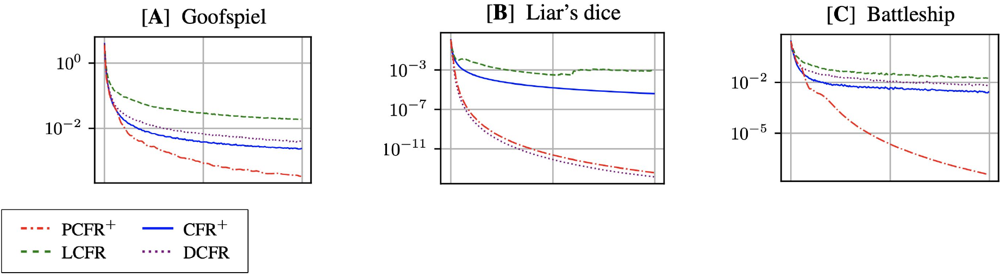
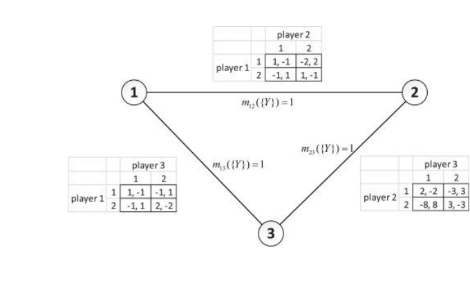
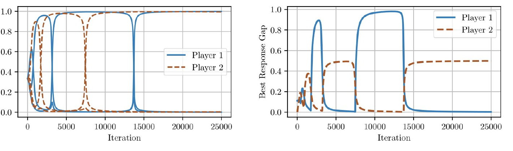
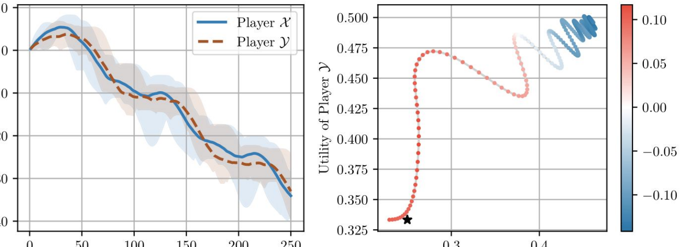

# L8 乐观主义与最终迭代收敛

在线学习框架的基本假设是：输入给学习者的效用序列由对抗者（adversary）产生，以最大化学习者的后悔。这种最坏情形视角在自对弈（self-play）中过于悲观——当我们自己设计双方算法时，对效用序列有相当大的控制力。本章回答两个问题：能否突破对抗情形下 $\Theta(\sqrt{T})$ 的后悔壁垒（乐观无悔学习）；以及基于后悔的保证只给出时间平均意义下的收敛，那么动力系统的**最终迭代**（last iterate）行为如何。

## 乐观无悔学习

### 乐观主义的必要性

在引入框架之前，先指出非乐观算法的内在极限。一种先验的可能性是：也许可以通过更好的分析证明 MWU 等已有算法在自对弈中后悔更小——毕竟对抗性的 $\Omega(\sqrt{T})$ 下界与"对手也在跑 MWU"并不相容。然而这是不可能的：

> **定理 8.1（Chen and Peng, 2020）.** 对任意学习率，当双人博弈中两个玩家都采用 MWU 时，至少有一个玩家的后悔为 $\Omega(\sqrt{T})$。对其他常见算法（如 RM 和 RM+）也有类似下界。

主要结论是：要突破 $\sqrt{T}$ 壁垒需要**新的算法思想**，仅靠改进分析是不够的。这正是乐观（optimistic，亦称预测性 predictive）在线学习框架的切入点（Chiang et al., 2012; Rakhlin and Sridharan, 2013）。乐观算法对每一轮 $t \in [T]$ 维护一个动态更新的**预测向量** $\boldsymbol{m}^{(t)}$，目标是尽可能贴近下一个效用 $\boldsymbol{u}^{(t)}$。

我们见过的所有在线算法都有乐观版本。**乐观 FTRL**（optimistic FTRL，OFTRL；Syrgkanis et al., 2015）定义为

$$
\boldsymbol{x}^{(t)} = \operatorname*{argmax}_{\boldsymbol{x} \in \mathcal{X}} \Big\{ \Big\langle \boldsymbol{x},\, \boldsymbol{m}^{(t)} + \sum_{\tau=1}^{t-1} \boldsymbol{u}^{(\tau)} \Big\rangle - \frac{1}{\eta} \mathcal{R}(\boldsymbol{x}) \Big\},
$$

其中 $\eta > 0$ 是学习率，$\mathcal{R}$ 是严格凸正则化子（如平方欧氏范数或负熵），$\mathcal{X}$ 是凸紧策略集（如序列形式多面体）。与 FTRL 的唯一区别就是预测向量 $\boldsymbol{m}^{(t)}$：若对所有 $t$ 取 $\boldsymbol{m}^{(t)} = \boldsymbol{0}$ 即退化为 FTRL。

**乐观镜像下降**（optimistic mirror descent，OMD，勿与在线镜像下降混淆）定义为

$$
\boldsymbol{x}^{(t)} := \operatorname*{argmax}_{\boldsymbol{x} \in \mathcal{X}} \Big\{ \langle \boldsymbol{x}, \boldsymbol{m}^{(t)} \rangle - \frac{1}{\eta} \mathcal{B}_{\mathcal{R}}(\boldsymbol{x}, \hat{\boldsymbol{x}}^{(t-1)}) \Big\}, \qquad
\hat{\boldsymbol{x}}^{(t)} := \operatorname*{argmax}_{\hat{\boldsymbol{x}} \in \mathcal{X}} \Big\{ \langle \hat{\boldsymbol{x}}, \boldsymbol{u}^{(t)} \rangle - \frac{1}{\eta} \mathcal{B}_{\mathcal{R}}(\hat{\boldsymbol{x}}, \hat{\boldsymbol{x}}^{(t-1)}) \Big\},
$$

其中 $\mathcal{B}_{\mathcal{R}}(\boldsymbol{x}, \boldsymbol{x}') := \mathcal{R}(\boldsymbol{x}) - \mathcal{R}(\boldsymbol{x}') - \langle \nabla \mathcal{R}(\boldsymbol{x}'), \boldsymbol{x} - \boldsymbol{x}' \rangle$ 是由 $\mathcal{R}$ 诱导的 Bregman 散度。与 OFTRL 不同，OMD 依赖一条辅助策略序列 $(\hat{\boldsymbol{x}}^{(t)})$。

预测向量有多种取法（固定窗口 $H$ 上的均匀平均、几何折扣等，都是历史效用的凸组合），但最常用的机制是简单的一步近因偏差 $\boldsymbol{m}^{(t)} := \boldsymbol{u}^{(t-1)}$。下文除非特别声明，均采用这一预测。值得一提的是，本章的主要保证并不依赖一步近因这一具体选择：固定窗口 $H$ 上的均匀平均与几何折扣近因偏差（$\boldsymbol{m}^{(t)} := \sum_{\tau=0}^{t-1} \delta^{-\tau} \boldsymbol{u}^{(\tau)} \big/ \sum_{\tau=0}^{t-1} \delta^{-\tau}$，$\delta \in (0,1)$）都满足形式相同的 RVU 界，从而后文的有界性与收敛结论在这些预测机制下同样成立；甚至允许各玩家采用**不同的**算法与不同的预测机制（Anagnostides et al., 2022a）。

### RVU 性质

乐观无悔学习的分析围绕一个关键性质展开：

> **定义 8.2（RVU；Syrgkanis et al., 2015）.** 若存在常数 $\alpha, \beta, \gamma > 0$ 使得算法的后悔满足
>
> $$
> \mathrm{Reg}^{(T)} \le \alpha + \beta \sum_{t=1}^{T} \big\| \boldsymbol{u}^{(t)} - \boldsymbol{m}^{(t)} \big\|_*^2 - \gamma \sum_{t=1}^{T} \big\| \boldsymbol{x}^{(t)} - \boldsymbol{x}^{(t-1)} \big\|^2,
> $$
>
> 则称该算法满足**效用变差有界后悔**（regret bounded by variation in utilities，RVU）性质。

与 FTRL/MD 通常的后悔界相比有两处显著不同：第一，后悔由**预测误差**（misprediction error）$\sum_t \|\boldsymbol{u}^{(t)} - \boldsymbol{m}^{(t)}\|_*^2$ 界定——整个分析的核心就是证明自对弈中预测误差很小；第二，出现一个**负项**，表明玩家策略变化越剧烈，后悔反而越小（!）。

> **命题 8.3（Syrgkanis et al., 2015）.** OFTRL 与 OMD 都满足 RVU 性质，参数为 $\alpha \propto 1/\eta$、$\beta = \eta$、$\gamma \propto 1/\eta$。精确地说，取一步近因预测 $\boldsymbol{m}^{(t)} = \boldsymbol{u}^{(t-1)}$ 时，OFTRL 满足 $(\alpha, \beta, \gamma) = (\Omega/\eta,\ \eta,\ 1/(4\eta))$，OMD 满足 $(\Omega/\eta,\ \eta,\ 1/(8\eta))$，其中 $\Omega := \sup_{\boldsymbol{x} \in \mathcal{X}} \mathcal{R}(\boldsymbol{x}) - \inf_{\boldsymbol{x} \in \mathcal{X}} \mathcal{R}(\boldsymbol{x})$ 是正则化子的值域直径（OMD 情形相应地取 $\sup_{\boldsymbol{x}} \mathcal{B}_{\mathcal{R}}(\boldsymbol{x}, \hat{\boldsymbol{x}}^{(0)})$）。

于是，若暂时忽略负项，对 $\eta$ 优化得到的最优后悔界正比于 $\sqrt{\sum_{t=1}^{T} \|\boldsymbol{u}^{(t)} - \boldsymbol{m}^{(t)}\|_*^2}$。即使预测很不准它也总是有 $\sqrt{T}$ 量级，而当预测误差小时可以远小于此。

**预测性后悔匹配。** 预测也可以引入后悔匹配框架（Farina et al., 2021）。总体思想相同：用预测 $\boldsymbol{m}^{(t)}$ 去猜测下一个后悔向量。两个算法都保证后悔以 $\sum_{t=1}^{T} \|\boldsymbol{u}^{(t)} - \boldsymbol{m}^{(t)}\|_*^2$ 为界，与 OFTRL/OMD 一样；但 PRM 与 PRM+ **不满足** RVU 性质。尽管如此，如下一章将详述的，PRM 和 PRM+ 是求解零和博弈最有效的算法之一。

```text
算法 1：预测性 RM（PRM）                     算法 2：预测性 RM⁺（PRM⁺）
 1  初始化累计后悔 r⁽⁰⁾ := 0;                 1  初始化累计后悔 r⁽⁰⁾ := 0;
 2  for t = 1, ..., T do                     2  for t = 1, ..., T do
 3      θ⁽ᵗ⁾ := [r⁽ᵗ⁻¹⁾ + m⁽ᵗ⁾                 3      θ⁽ᵗ⁾ := [r⁽ᵗ⁻¹⁾ + m⁽ᵗ⁾
              − ⟨m⁽ᵗ⁾, x⁽ᵗ⁻¹⁾⟩1]⁺;                       − ⟨m⁽ᵗ⁾, x⁽ᵗ⁻¹⁾⟩1]⁺;
 4      if θ⁽ᵗ⁾ = 0 then                     4      if θ⁽ᵗ⁾ = 0 then
 5          x⁽ᵗ⁾ ∈ Δ(A) 任取                 5          x⁽ᵗ⁾ ∈ Δ(A) 任取
 6      else                                 6      else
 7          x⁽ᵗ⁾ := θ⁽ᵗ⁾ / ‖θ⁽ᵗ⁾‖₁;           7          x⁽ᵗ⁾ := θ⁽ᵗ⁾ / ‖θ⁽ᵗ⁾‖₁;
 8      输出策略 x⁽ᵗ⁾ ∈ Δ(A);                 8      输出策略 x⁽ᵗ⁾ ∈ Δ(A);
 9      观测效用 u⁽ᵗ⁾ ∈ [0,1]ᴬ;               9      观测效用 u⁽ᵗ⁾ ∈ [0,1]ᴬ;
10      r⁽ᵗ⁾ := r⁽ᵗ⁻¹⁾ + u⁽ᵗ⁾                 10      r⁽ᵗ⁾ := [r⁽ᵗ⁻¹⁾ + u⁽ᵗ⁾
              − ⟨x⁽ᵗ⁾, u⁽ᵗ⁾⟩1;                         − ⟨x⁽ᵗ⁾, u⁽ᵗ⁾⟩1]⁺;
```

下图（取自 Farina et al.）展示了预测性后悔匹配（以 PCFR⁺ 形式）在 Goofspiel、Liar's dice、Battleship 三个标准测试博弈上相对 CFR⁺、LCFR、DCFR 的显著加速——这是"自对弈中效用序列可预测"这一直觉在实践中的直接证据。



## 零和博弈中的近似最优后悔

先指出一个不可逾越的下界：后悔不可能小于常数。即便在单人（静态）场景中，没有先验信息的学习者第一轮大概率找不到最优策略，因此即使从第二轮起一直最优行动，后悔也是 $\Omega(1)$。所以我们的目标是**有界（常数）后悔**。

分析依赖两个关键性质。第一是正则化带来的**稳定性**：

> **引理 8.4（稳定性）.** 对任意轮 $t$，OFTRL 与 OMD 保证 $\|\boldsymbol{x}^{(t)} - \boldsymbol{x}^{(t-1)}\| \le O(\eta)$。

这一稳定性正是对抗情形下 $\sqrt{T}$ 界证明的要素；虚构博弈、最优响应动力学乃至后悔匹配都不满足它。后悔匹配的问题出在所有后悔为负或接近零时：此时一个极小的效用向量就能导致完全不同的策略。这是为什么接下来的分析（以及任何已有分析，Farina et al., 2023）对 PRM 和 PRM+ 不奏效的根本原因。

第二个性质是：每个玩家观测到的效用序列对其他玩家的策略是 Lipschitz 连续的。下面的引理针对标准型博弈陈述，但更一般的情形也有类似界：

> **引理 8.5.** 对任意玩家 $i \in [n]$，$\|\boldsymbol{u}_i^{(t)} - \boldsymbol{u}_i^{(t-1)}\|_\infty \le \sum_{i' \ne i} \|\boldsymbol{x}_{i'}^{(t)} - \boldsymbol{x}_{i'}^{(t-1)}\|_1$，其中 $\boldsymbol{u}_i^{(t)} = \boldsymbol{u}_i(\boldsymbol{x}_{-i}^{(t)})$。

回忆 $\boldsymbol{u}_i(\boldsymbol{x}_{-i}) = (\mathbb{E}_{\boldsymbol{a}_{-i} \sim \boldsymbol{x}_{-i}}\, u_i(a_i, \boldsymbol{a}_{-i}))_{a_i \in \mathcal{A}_i}$ 是玩家 $i$ 的效用梯度。证明要点：对

$$
\sum_{\boldsymbol{a}_{-i}} \prod_{i' \ne i} \boldsymbol{x}_{i'}^{(t)}[a_{i'}]\, u_i(\cdot, \boldsymbol{a}_{-i}) - \sum_{\boldsymbol{a}_{-i}} \prod_{i' \ne i} \boldsymbol{x}_{i'}^{(t-1)}[a_{i'}]\, u_i(\cdot, \boldsymbol{a}_{-i})
$$

先用三角不等式加 $|u_i(\cdot)| \le 1$，再用"两个乘积分布的全变差距离不超过各边际全变差距离之和"这一事实，即得上式 $\le \sum_{i' \ne i} \|\boldsymbol{x}_{i'}^{(t)} - \boldsymbol{x}_{i'}^{(t-1)}\|_1$。

把引理 8.4、8.5 与 RVU 性质放在一起看：OFTRL/OMD 在预测误差小时表现好；由引理 8.5，自对弈中预测误差被其他玩家策略的变差异界定；而由引理 8.4，若所有玩家都采用稳定算法，这个变差远小于对抗情形。

> **定理 8.6（Syrgkanis et al., 2015）.** 若多人博弈中所有玩家都采用 OFTRL 或 OMD，学习率 $\eta = T^{-1/4}$，则每个玩家的后悔为 $O(T^{1/4})$。

**证明.** 结合命题 8.3 与引理 8.4、8.5，每个玩家 $i$ 的后悔作为 $\eta$ 与 $T$ 的函数满足

$$
\mathrm{Reg}_i^{(T)} \le O\Big(\frac{1}{\eta}\Big) + \eta \sum_{t=1}^{T} \big\| \boldsymbol{u}_i^{(t)} - \boldsymbol{u}_i^{(t-1)} \big\|_*^2 \le O\Big(\frac{1}{\eta}\Big) + O(\eta^3 T).
$$

对 $\eta$ 优化即得结论。$\square$

注意这与对抗情形的 $O(1/\eta) + O(\eta T)$ 形成对照：稳定性把 $\eta T$ 项压成了 $\eta^3 T$。

仅用稳定性已得到 $T^{1/4}$ 的可观改进，但离常数后悔的目标仍远。为此必须利用 RVU 界中的负项。设所有玩家都采用满足参数 $(\alpha, \beta, \gamma)$ 的 RVU 性质的算法。由引理 8.5，把所有玩家的后悔相加并放缩（用到 $\|\boldsymbol{u}_i^{(t)} - \boldsymbol{u}_i^{(t-1)}\|_*^2$ 被 $(n-1)\sum_{i' \ne i} \|\boldsymbol{x}_{i'}^{(t)} - \boldsymbol{x}_{i'}^{(t-1)}\|_1^2$ 控制）：

$$
\sum_{i=1}^{n} \mathrm{Reg}_i^{(T)} \le \alpha n + \big( (n-1)^2 \beta - \gamma \big) \sum_{i=1}^{n} \sum_{t=1}^{T} \big\| \boldsymbol{x}_i^{(t)} - \boldsymbol{x}_i^{(t-1)} \big\|_1^2 \le \alpha n - \frac{\gamma}{2} \sum_{i=1}^{n} \sum_{t=1}^{T} \big\| \boldsymbol{x}_i^{(t)} - \boldsymbol{x}_i^{(t-1)} \big\|_1^2,
$$

只要 $\gamma \ge 2(n-1)^2 \beta$。由命题 8.3，OFTRL 与 OMD 满足 $\gamma \propto 1/\eta$、$\beta = \eta$，故取 $\eta \propto 1/n$ 即可保证 $\sum_{i=1}^{n} \mathrm{Reg}_i^{(T)} = O(1)$——**后悔之和**有界。但我们要界的是后悔的**最大值**：某个玩家可能有 $\Omega(T)$ 的后悔，只要另一个玩家后悔为 $-\Theta(T)$ 就能相互抵消。为处理这一差异，我们暂时聚焦于一类特殊的博弈。

### 后悔之和非负的博弈

典范例子是双人零和博弈。对任意策略序列 $(\boldsymbol{x}^{(t)})$ 与 $(\boldsymbol{y}^{(t)})$，两玩家后悔之和等于对偶间隙，从而非负：

$$
\mathrm{Reg}_1^{(T)} + \mathrm{Reg}_2^{(T)} = \max_{\boldsymbol{x}' \in \mathcal{X}} \sum_{t=1}^{T} \langle \boldsymbol{x}' - \boldsymbol{x}^{(t)}, -\boldsymbol{A}\boldsymbol{y}^{(t)} \rangle + \max_{\boldsymbol{y}' \in \mathcal{Y}} \sum_{t=1}^{T} \langle \boldsymbol{y}' - \boldsymbol{y}^{(t)}, \boldsymbol{A}^\top \boldsymbol{x}^{(t)} \rangle = T \Big( \max_{\boldsymbol{y}' \in \mathcal{Y}} \langle \boldsymbol{y}', \boldsymbol{A}^\top \bar{\boldsymbol{x}}^{(T)} \rangle - \min_{\boldsymbol{x}' \in \mathcal{X}} \langle \boldsymbol{x}', \boldsymbol{A} \bar{\boldsymbol{y}}^{(T)} \rangle \Big) \ge 0.
$$

多人博弈中也有具有该性质的重要类别，如**多矩阵零和博弈**（polymatrix zero-sum games；Cai et al., 2016）：它推广了双人零和博弈——存在一个图，每个玩家唯一对应一个节点；每条边代表其两个端点玩家之间进行的一个（双人）零和博弈；一个玩家的效用是他参与的所有边上博弈效用之和。此外，该性质还涵盖**常和多矩阵博弈**与**策略性零和博弈**（strategically zero-sum games；Moulin and Vial, 1978）——后者指策略上等价于某个零和博弈的双矩阵博弈。值得注意的是，这类博弈之所以有如此好的学习动力学性质，似乎与其**存在极小极大定理**有着深刻联系（Daskalakis and Papadimitriou, 2009; Cai and Daskalakis, 2011; Cai et al., 2016）。



在后悔之和非负的假设下，整理上面的求和不等式可得：

> **定理 8.7（Anagnostides et al., 2022a）.** 若所有玩家在后悔之和非负的博弈中采用 OFTRL 或 OMD 且学习率充分小，则
>
> $$
> \sum_{i=1}^{n} \sum_{t=1}^{T} \big\| \boldsymbol{x}_i^{(t)} - \boldsymbol{x}_i^{(t-1)} \big\|_1^2 \le O(1).
> $$
>
> 左端称为**二阶路径长度**（second-order path length）。也就是说，OFTRL/OMD 保证有界的二阶路径长度（后文将看到这对最终迭代收敛意味着什么）。这里"学习率充分小"的精确含义是：各玩家的 RVU 参数满足 $\gamma_i \ge 2(n-1)\sum_{j \ne i} \beta_j$；由命题 8.3 的常数，所有玩家采用同一学习率 $\eta \le 1/(4(n-1))$ 的 OMD 即满足该条件。这又蕴含每个玩家的预测误差有界，从而：

> **推论 8.8.** 在后悔之和非负的博弈中，若所有玩家采用 OFTRL 或 OMD 且学习率充分小，则每个玩家的后悔有界（$O(1)$）。

精确地说，个体后悔满足 $\mathrm{Reg}_i^{(T)} \le \alpha + 2n(n-1)\alpha\beta/\gamma$；特别地，所有玩家采用负熵正则化、$\eta = 1/(4(n-1))$ 的 OMD 时，每个玩家的后悔不超过 $8n \log |\mathcal{A}_i|$（Anagnostides et al., 2022a）——后悔不仅是常数，而且只随玩家数与动作数的对数缓慢增长。

## 一般和博弈中的近似最优后悔

推论 8.8 的主要假设——后悔之和非负——对博弈类的限制很强。加强前述方法的基本思想是：考虑一种**更强但恒非负**的后悔概念。交换后悔（swap regret）正是这样一种概念。

> **观察 8.9.** 对任意效用序列 $(\boldsymbol{u}^{(t)})$ 与策略序列 $(\boldsymbol{x}^{(t)})$，
>
> $$
> \mathrm{SwapReg}^{(T)} = \max_{\phi \in \Phi_{\mathrm{swap}}} \sum_{t=1}^{T} \big\langle \phi(\boldsymbol{x}^{(t)}) - \boldsymbol{x}^{(t)},\, \boldsymbol{u}^{(t)} \big\rangle \ge 0,
> $$
>
> 其中 $\Phi_{\mathrm{swap}}$ 是所有交换偏离（swap deviation）之集。非负性仅因 $\Phi_{\mathrm{swap}}$ 包含恒等映射。（也可以用 $\max\{0, \mathrm{Reg}^{(T)}\}$ 代替——它相当于 $\Phi$ 包含全部常值变换加恒等映射的 $\Phi$-后悔；下文对更强的交换后悔做分析。）

考虑交换后悔后，各玩家后悔之和自动非负，不再限制博弈类。关键问题在于：是否存在关于交换后悔满足 RVU 界的算法。为此回忆 Blum–Mansour 的交换后悔最小化算法：

```text
算法 3：Blum–Mansour 交换后悔最小化算法
 1  输入：对每个动作 a ∈ A 的（外部）后悔最小化器 ℜ_a
 2  NextStrategy():
 3      for 每个动作 a ∈ A do
 4          Δ(A) ∋ x_a⁽ᵗ⁾ := ℜ_a.NextStrategy();
 5      令 M⁽ᵗ⁾ := [(x_a⁽ᵗ⁾)_{a∈A}];          // 以 x_a⁽ᵗ⁾ 为第 a 列的列随机矩阵
 6      return Δ(A) ∋ x⁽ᵗ⁾ = M⁽ᵗ⁾ x⁽ᵗ⁾;      // 输出马尔可夫链的不动点
 7  ObserveUtility(u⁽ᵗ⁾ ∈ ℝᴬ):
 8      for 每个动作 a ∈ A do
 9          u_a⁽ᵗ⁾ := x⁽ᵗ⁾[a] · u⁽ᵗ⁾;
10          ℜ_a.ObserveUtility(u_a⁽ᵗ⁾);
```

由该归约知 $\mathrm{SwapReg}^{(T)} = \sum_{a \in \mathcal{A}} \mathrm{Reg}_a^{(T)}$，其中 $\mathrm{Reg}_a^{(T)}$ 是作用在随机矩阵第 $a$ 列上的局部最小化器 $\Re_a$ 的外部后悔。若每个 $\Re_a$ 用 OFTRL 或 OMD 实例化，则由命题 8.3，

$$
\mathrm{SwapReg}^{(T)} \le O\Big(\frac{1}{\eta}\Big) + \sum_{a \in \mathcal{A}} \eta \sum_{t=1}^{T} \big\| \boldsymbol{u}_a^{(t)} - \boldsymbol{u}_a^{(t-1)} \big\|_*^2 - \Omega\Big(\frac{1}{\eta}\Big) \sum_{a \in \mathcal{A}} \sum_{t=1}^{T} \big\| \boldsymbol{x}_a^{(t)} - \boldsymbol{x}_a^{(t-1)} \big\|^2.
$$

要完成证明，只需对某个常数 $C$ 建立

$$
\big\| \boldsymbol{x}^{(t)} - \boldsymbol{x}^{(t-1)} \big\|_1 \le C \sum_{a \in \mathcal{A}} \big\| \boldsymbol{x}_a^{(t)} - \boldsymbol{x}_a^{(t-1)} \big\|,
$$

即马尔可夫链的不动点 $\boldsymbol{x}^{(t)}$ 必须随转移概率平滑变化。但一般情形并非如此：在 $\epsilon \ll 1$ 的区域内考虑两个随机矩阵

$$
\boldsymbol{M} = \begin{pmatrix} 1-\epsilon & 2\epsilon \\ \epsilon & 1-2\epsilon \end{pmatrix} \qquad \text{与} \qquad \boldsymbol{M}' = \begin{pmatrix} 1-2\epsilon & \epsilon \\ 2\epsilon & 1-\epsilon \end{pmatrix},
$$

把 $\boldsymbol{M}'$ 看作 $\boldsymbol{M}$ 经一次更新得到。尽管 $\boldsymbol{M} \approx \boldsymbol{M}'$，$\boldsymbol{M}$ 的唯一不动点是 $(2/3, 1/3)$ 而 $\boldsymbol{M}'$ 的唯一不动点是 $(1/3, 2/3)$：转移概率接近的两个马尔可夫链，其不动点可以相距很远，直接违反上式。

### 乘法稳定性与对数正则化子

绕过这一障碍需要两个关键思想。第一，若能保证随机矩阵满足更强的**乘法稳定性**（multiplicative stability），不动点的稳定性就有保证。向量 $\boldsymbol{x}_a^{(t)}$ 的乘法稳定性指

$$
\max_{a' \in \mathcal{A}} \max \Big\{ 1 - \frac{\boldsymbol{x}_a^{(t)}[a']}{\boldsymbol{x}_a^{(t-1)}[a']},\; 1 - \frac{\boldsymbol{x}_a^{(t-1)}[a']}{\boldsymbol{x}_a^{(t)}[a']} \Big\} \le O(\eta),
$$

即相邻两轮每个坐标的**比值**都接近 1。上面的反例不具有此性质：一个坐标从 $\epsilon$ 变到 $2\epsilon$，无论 $\epsilon$ 多小都破坏乘法稳定性。我们见过的大多数算法不保证这种稳定性，但 MWU 保证。

> **定理.** 若两个马尔可夫链的转移概率乘法接近，则它们的不动点也接近。

Chen and Peng（2020）据此证明 Blum–Mansour 算法结合 MWU 能保证不动点稳定，从而得到 $T^{1/4}$ 的改进界（同定理 8.6）。证明基于**马尔可夫链树定理**（Markov chain tree theorem），它给出遍历马尔可夫链平稳分布的组合闭式解。记 $\mathcal{T}_a$ 为所有以 $a \in \mathcal{A}$ 为根的有向树之集（精确定义此处不重要）。

> **事实 8.10.** 由列随机矩阵 $\boldsymbol{M}$ 描述的遍历马尔可夫链，其平稳分布 $\boldsymbol{x} \in \Delta(\mathcal{A})$ 可表为
>
> $$
> \boldsymbol{x}[a] = \frac{\displaystyle \sum_{T \in \mathcal{T}_a} \prod_{(u,v) \in E(T)} \boldsymbol{M}[v, u]}{\displaystyle \sum_{a' \in \mathcal{A}} \sum_{T \in \mathcal{T}_{a'}} \prod_{(u,v) \in E(T)} \boldsymbol{M}[v, u]}.
> $$

即便如此，通过 MWU 得到交换后悔的 RVU 界仍不明朗。第二个关键思想是换用**对数正则化子**

$$
\mathcal{R}: \boldsymbol{x} \mapsto - \sum_{a \in \mathcal{A}} \log \boldsymbol{x}[a].
$$

这涉及我们此前忽略的 FTRL/MD 后悔界的一个重要方面：$\mathcal{R}$ 关于哪个原始范数 $\|\cdot\|$ 强凸。事实上，即使用由 $\mathcal{R}$ 的 Hessian 诱导的、随时间动态变化的**局部范数**（local norm），分析仍然成立。对数正则化子诱导的局部范数为

$$
\|\boldsymbol{x}\|_{\boldsymbol{x}'} = \sqrt{\sum_{a \in \mathcal{A}} \Big( \frac{\boldsymbol{x}[a]}{\boldsymbol{x}'[a]} \Big)^2},
$$

它恰好度量某种乘法意义下的偏离。这一分析可纳入更一般的**自和谐障碍**（self-concordant barrier）正则化框架（Abernethy, Hazan, and Rakhlin, 2008）：对任意非退化自和谐正则化子，OFTRL 都满足以其 Hessian 诱导局部范数表示的 RVU 界，单纯形上的对数障碍（log-barrier）只是典范实例。利用马尔可夫链树定理可以证明

$$
\big\| \boldsymbol{x}^{(t)} - \boldsymbol{x}^{(t-1)} \big\|_1 \le C \sum_{a \in \mathcal{A}} \big\| \boldsymbol{x}_a^{(t)} - \boldsymbol{x}_a^{(t-1)} \big\|_{\boldsymbol{x}_a^{(t-1)}},
$$

（Anagnostides et al., 2022b 的引理 4.2 给出精确形式 $\|\boldsymbol{x}^{(t)} - \boldsymbol{x}^{(t-1)}\|_1^2 \le 64|\mathcal{A}| \sum_{a \in \mathcal{A}} \|\boldsymbol{x}_a^{(t)} - \boldsymbol{x}_a^{(t-1)}\|_{\boldsymbol{x}_a^{(t-1)}}^2$，取 $\eta \le 1/16$ 即可。）于是得到交换后悔的 RVU 界：

> **定理 8.11（Anagnostides et al., 2022b）.** 存在一个算法——记为 BM-OFTRL-LogBar，即 Blum–Mansour 模板中每个局部最小化器 $\Re_a$ 都实例化为对数正则化的 OFTRL——关于交换后悔满足 RVU 性质，参数为 $\alpha \propto \log T / \eta$、$\beta \propto \eta$、$\gamma \propto 1/\eta$。精确地说，设 $m := |\mathcal{A}|$ 且 $\eta \le 1/(128\sqrt{m})$，则对 $T \ge 2$，
>
> $$
> \mathrm{SwapReg}^{(T)} \le \frac{2m^2 \log T}{\eta} + 4\eta \sum_{t=1}^{T} \big\| \boldsymbol{u}^{(t)} - \boldsymbol{u}^{(t-1)} \big\|_\infty^2 - \frac{1}{2048\, m\, \eta} \sum_{t=1}^{T} \big\| \boldsymbol{x}^{(t)} - \boldsymbol{x}^{(t-1)} \big\|_1^2.
> $$

界中出现 $\log T$ 因子是因为对数正则化子的值域无界；处理办法是在后悔定义中只考虑远离单纯形相对边界的比较点（comparator）——此时对数障碍的"有效直径"为 $O(m^2 \log T)$，这正是上式首项的来源，且在现有方法下似乎不可避免。

> **推论 8.12.** 存在一个算法，当所有玩家都采用它时，在任意一般和多人博弈中保证
>
> $$
> \sum_{i=1}^{n} \sum_{t=1}^{T} \big\| \boldsymbol{x}_i^{(t)} - \boldsymbol{x}_i^{(t-1)} \big\|_1^2 \le O(\log T),
> $$
>
> 特别地，每个玩家的交换后悔为 $O(\log T)$——这是近似最优的（改进到常数是公开问题）。

精确地说，设 $m_i := |\mathcal{A}_i|$、$m := \max_i m_i$，所有玩家采用 BM-OFTRL-LogBar 并取 $\eta = 1/(128(n-1)\sqrt{m})$，则二阶路径长度不超过 $8192\sqrt{m} \sum_{i=1}^n m_i^2 \log T$，且每个玩家的交换后悔满足

$$
\mathrm{SwapReg}_i^{(T)} \le 256 \sqrt{m}\, \Big( (n-1)m_i^2 + \sum_{j=1}^{n} m_j^2 \Big) \log T = O\big(n\, m^{5/2} \log T\big).
$$

该协议只需每个玩家知道玩家总数与最大动作数的上界以调节学习率，因此仍是强无耦合（strongly uncoupled）的；它也是首个在**时间不变学习率**下达到该保证的构造。由于交换后悔支配外部后悔，结合交换后悔与相关均衡之间的标准联系，这还给出一般博弈中平均相关行为分布以 $O(\log T / T)$ 的速率收敛到相关均衡——目前已知的最快速率。在随机生成的 $3 \times 3$ 双矩阵博弈上的数值实验表明，各玩家的交换后悔随 $T$ 恰呈对数增长，说明 $O(\log T)$ 的分析基本是紧的（Anagnostides et al., 2022b）。

值得一提的是，外部后悔的第一个近似最优界由 Daskalakis et al.（2021）通过分析 MWU 的乐观版本得到，其分析相当复杂，此处不展开。他们（以及 Anagnostides et al., 2022c 通过 Stoltz–Lugosi 内悔归约）得到的界为 $O(\log^4 T)$，而定理 8.11 的构造把交换后悔——从而外部后悔——直接改进到 $O(\log T)$，并绕开了其引入的高阶光滑性框架。

### 对抗鲁棒性

若一个或多个玩家偏离既定协议怎么办？是否还能保住对抗情形下可行的 $\sqrt{T}$ 后悔？答案是肯定的：让每个玩家跟踪效用的二阶变差 $\sum_{\tau=1}^{t} \|\boldsymbol{u}^{(\tau)} - \boldsymbol{u}^{(\tau-1)}\|_*^2$。只要所有玩家遵循规定算法，该量就是 $O(\log t)$；因此一旦玩家在某轮 $t$ 检测到 $\sum_{\tau=1}^{t} \|\boldsymbol{u}^{(\tau)} - \boldsymbol{u}^{(\tau-1)}\|_*^2 \ge \omega(\log t)$，就切换到为对抗情形调好的算法——例如带消退学习率 $\eta = O(1/\sqrt{t})$ 的 BM-MWU。这样得到的动力学同时保证：所有玩家遵循协议时每个玩家的交换后悔为 $O(\log T)$，而面对任意对抗性效用序列（$\|\boldsymbol{u}^{(t)}\|_\infty \le 1$）时交换后悔为 $O(\sqrt{T})$（Anagnostides et al., 2022b）。

## 最终迭代收敛

迄今基于后悔最小化的所有保证都要经过某种**平均**才成立：零和博弈中是平均策略收敛到极小极大均衡集，更一般地，是平均相关行为分布收敛到（粗）相关均衡集。那么算法的**最终迭代**本身如何？

传统的无悔算法，如 MWU 或在线梯度下降，其迭代点并不收敛到均衡集——即使在零和博弈中，博弈动力学也展现出极为复杂的行为（参见 Andrade et al., 2021）。下图示意了这种失败：动力学围绕均衡（× 标记）持续盘旋甚至向外发散，迭代点永远停不在均衡上。


而乐观主义恰好能补救这一问题：它除了改进后悔，还能在某些博弈类中保证最终迭代收敛。换言之，最终迭代收敛与近似最优后悔之间存在深刻联系。

### 后悔之和非负博弈中的收敛

我们已经证明，在这类博弈中 OMD 与 OFTRL 保证 $\sum_{i=1}^{n} \sum_{t=1}^{T} \|\boldsymbol{x}_i^{(t)} - \boldsymbol{x}_i^{(t-1)}\|_1^2 \le O(1)$。这意味着各玩家的策略随时间变化极慢，或许暗示着某种收敛。对 OMD 家族中的某些算法——如乐观梯度下降——小变差确实蕴含玩家已在近似最优响应：

> **引理 8.13.** 设每个玩家都采用带有**光滑正则化子**的 OMD（光滑指 $\|\nabla \mathcal{R}(\boldsymbol{x}) - \nabla \mathcal{R}(\boldsymbol{x}')\|_* \le G \|\boldsymbol{x} - \boldsymbol{x}'\|$，勿与定义 8.15 的"光滑博弈"混淆）。若对所有玩家 $i$ 都有 $\|\boldsymbol{x}_i^{(t)} - \boldsymbol{x}_i^{(t-1)}\| \le \epsilon$，则 $\boldsymbol{x}^{(t)}$ 是 $O(\epsilon)$-纳什均衡。

注意该引理并非对所有正则化子成立：MWU（熵正则化）就是反例。把引理 8.13 与定理 8.7 结合，可得个体迭代点以 $T^{-1/2}$ 的速率收敛到近似纳什均衡：

> **推论 8.14.** 设每个玩家在后悔之和非负的博弈中采用带光滑正则化子的 OMD。则对任意 $\epsilon > 0$，经过 $T = O(1/\epsilon^2)$ 轮后，大部分策略都是 $\epsilon$-纳什均衡。

这一速率已知是紧的（证明所有迭代点而不仅是"大部分"的最终迭代收敛要困难得多，见 Cai et al., 2022; Gorbunov et al., 2022）。该框架对**扩展式博弈**有直接推论：零和扩展式博弈的纳什均衡可表述为序列形式多面体上的双线性鞍点问题 $\min_{\boldsymbol{x} \in \mathcal{X}} \max_{\boldsymbol{y} \in \mathcal{Y}} \boldsymbol{x}^\top \boldsymbol{A} \boldsymbol{y}$；当双方采用（欧氏正则化）OMD 且 $\eta \le 1/(4\|\boldsymbol{A}\|_2)$（谱范数）时，经 $O(1/\epsilon^2)$ 轮即有一个迭代点为 $O(\epsilon)$-近似纳什均衡——这是扩展式博弈中无悔动力学最终迭代的第一个多项式时间保证（Anagnostides et al., 2022a）。在 Kuhn 扑克与 Leduc 扑克两个标准测试博弈上的实验显示，最终迭代与平均迭代的鞍点间隙都收敛，且学习率越大收敛越快，凸显锐利理论界的重要性。收敛是可预测性的终极形式，它把在线学习问题平凡化了。鉴于推论 8.14，OMD 在零和博弈中后悔有界也许不足为奇。更令人惊讶的是一般和博弈中（对应推论 8.12）学习动力学的行为：即使玩家**并未**收敛到近似纳什均衡，他们的策略仍以任意慢的速度移动——该算法的正则化子不光滑，不满足引理 8.13 的前提，但它仍能保证每个玩家 $O(\log T)$ 的后悔；预测误差依然很小，尽管玩家从未真正收敛。



### 光滑博弈与社会福利

最后把视野扩展到后悔之和非负的博弈之外。动机是**均衡选择**：一个博弈可以有多个均衡，有些比其他的更好。常用的均衡质量度量是**社会福利** $\mathrm{SW}(\boldsymbol{x}) := \sum_{i=1}^{n} u_i(\boldsymbol{x})$；问题是如何保证无悔学习产生的结果的社会福利离最优值 $\mathrm{OPT}$ 不太远。**无政府状态的代价**（price of anarchy）框架正是量化均衡无效率的工具，而下面的概念给出了优雅回答。

> **定义 8.15（光滑博弈；Roughgarden, 2015）.** 称一个博弈关于福利最优策略组合 $(\boldsymbol{x}_1', \dots, \boldsymbol{x}_n')$ 是 $(\lambda, \mu)$-**光滑**（smooth）的，若
>
> $$
> \sum_{i=1}^{n} u_i(\boldsymbol{x}_i', \boldsymbol{x}_{-i}) \ge \lambda \cdot \mathrm{OPT} - \mu \sum_{i=1}^{n} u_i(\boldsymbol{x}_1, \dots, \boldsymbol{x}_n) \qquad \forall (\boldsymbol{x}_1, \dots, \boldsymbol{x}_n).
> $$

用文字说：若每个玩家都改打自己在福利最优组合中的分量，则无论其他人怎么做，玩家们集体能保证最优福利的一个份额。定义看似人为，但 Roughgarden（2015）证明许多重要的博弈类都是光滑的——例如同时二价拍卖、有效效用博弈（valid utility games）、仿射代价的拥塞博弈等；某种意义上它是零和博弈的推广。对给定博弈，使光滑条件成立的所有参数对 $(\lambda, \mu)$ 上的最优比值 $\sup_{\lambda, \mu} \lambda/(1+\mu)$ 即该博弈的鲁棒无政府代价。光滑性与后悔最小化有紧密联系：

> **命题 8.16.** 设在 $(\lambda, \mu)$-光滑博弈中每个玩家 $i$ 的后悔为 $\mathrm{Reg}_i^{(T)}$，则
>
> $$
> \frac{1}{T} \sum_{t=1}^{T} \mathrm{SW}\big(\boldsymbol{x}_1^{(t)}, \dots, \boldsymbol{x}_n^{(t)}\big) \ge \frac{\lambda}{1+\mu} \mathrm{OPT} - \frac{1}{1+\mu} \cdot \frac{1}{T} \sum_{i=1}^{n} \mathrm{Reg}_i^{(T)}.
> $$

即在 $(\lambda, \mu)$-光滑博弈中，无悔动力学总能保证最优福利的 $\lambda/(1+\mu) =: \rho$ 份额；$\rho$ 称为**鲁棒无政府代价**（robust price of anarchy）。收敛速率由玩家后悔**之和**驱动。

现在考察玩家采用带光滑正则化子的 OMD 时的两种可能。若后悔之和**非负**，由推论 8.14 玩家收敛到纳什均衡；否则后悔之和必为**负**——而由命题 8.16，这不仅意味着我们达到了最优福利的 $\lambda/(1+\mu)$，而是**严格超出**了它。换言之，当 OMD 不收敛时，其福利高于光滑性理论的预言：

> **定理 8.17（Anagnostides et al., 2022a）.** 若所有玩家采用带光滑正则化子的 OMD 运行 $T = O(1/\epsilon^2)$ 轮，则
>
> - 要么玩家已收敛到 $\epsilon$-纳什均衡；
> - 要么平均社会福利至少为 $\frac{\lambda}{1+\mu}\mathrm{OPT} + \frac{1}{1+\mu}\cdot\frac{\epsilon^2}{16\eta}$——学习率 $\eta$ 取常数时，即超出鲁棒无政府代价所保证份额达 $\Omega(\epsilon^2)$。
>
> 有趣的是，离纳什均衡越远，社会福利的改进越大。（两个问题各自单独来看都是困难的！）

下图展示了这一二分现象：左图中两玩家的后悔持续变为越来越大的负值（动力学未收敛到纳什均衡）；右图在效用平面上画出动力学轨迹（颜色编码时间），它并未停在纳什均衡（★ 标记）处，而是盘旋向外、持续改进社会福利，超出鲁棒无政府代价所保证的水平。



## 要点小结

- 对抗性 $\sqrt{T}$ 壁垒在自对弈中可被突破，但靠旧分析不行：双人自对弈 MWU 必有玩家 $\Omega(\sqrt{T})$ 后悔（定理 8.1），需要乐观（预测性）算法。
- OFTRL 与 OMD 满足 RVU 性质：后悔 $\le \alpha + \beta\sum_t\|\boldsymbol{u}^{(t)}-\boldsymbol{m}^{(t)}\|_*^2 - \gamma\sum_t\|\boldsymbol{x}^{(t)}-\boldsymbol{x}^{(t-1)}\|^2$；预测通常取 $\boldsymbol{m}^{(t)} = \boldsymbol{u}^{(t-1)}$。PRM/PRM⁺ 有类似的预测误差界但不满足 RVU。
- 稳定性（引理 8.4：$\|\boldsymbol{x}^{(t)}-\boldsymbol{x}^{(t-1)}\| = O(\eta)$）加效用的 Lipschitz 性（引理 8.5）给出自对弈 $O(T^{1/4})$ 后悔；利用 RVU 负项，在后悔之和非负的博弈（含零和、多矩阵零和博弈）中进一步得到 $O(1)$ 后悔与有界二阶路径长度。
- 一般和博弈改用恒非负的交换后悔；Blum–Mansour 归约中不动点一般不稳定，需乘法稳定性（MWU 具备）与对数正则化子诱导的局部范数，借助马尔可夫链树定理得到交换后悔的 RVU 界，从而每个玩家 $O(\log T)$ 交换后悔（近似最优，常数改进为公开问题）；跟踪效用二阶变差可在被偏离协议时退回对抗算法。
- 最终迭代意义下 MWU/梯度下降失败惨重；带光滑正则化子的 OMD 在后悔之和非负博弈中以 $T^{-1/2}$ 速率收敛到近似纳什均衡（$T = O(1/\epsilon^2)$，速率紧）；在 $(\lambda,\mu)$-光滑博弈中，OMD 要么收敛到 $\epsilon$-纳什均衡，要么平均福利超出鲁棒无政府代价 $\lambda/(1+\mu)$ 达 $\Omega(\epsilon^2)$。
