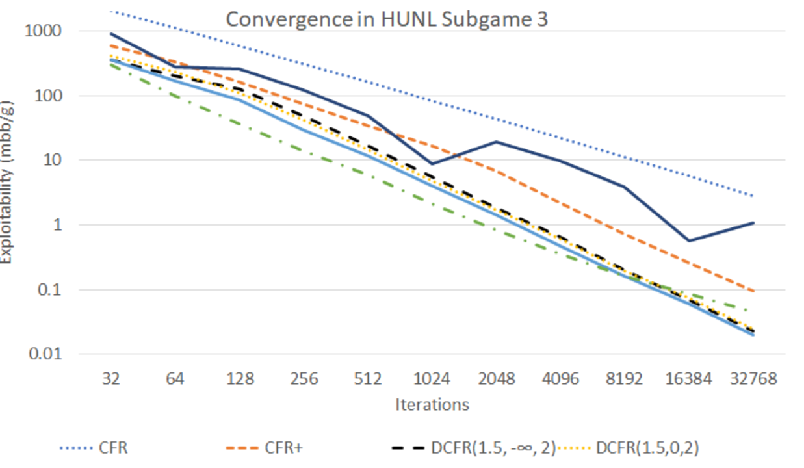
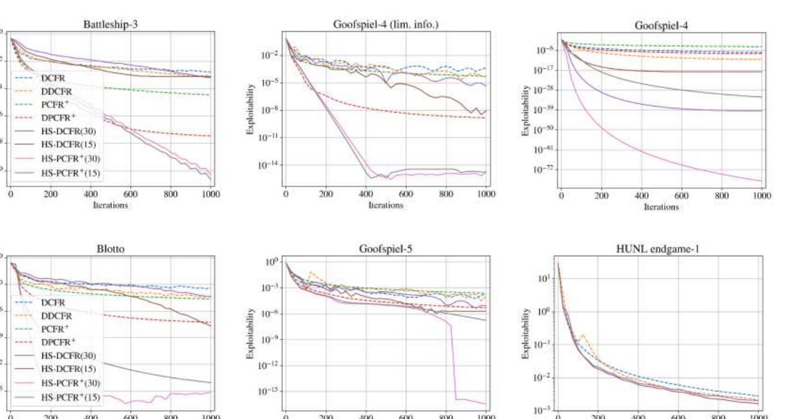

# L9 CFR 加速技术

本讲介绍加速反事实后悔最小化（counterfactual regret minimization, CFR）的一系列技术。重点是**理论上有保证**且**与具体博弈无关**的技术——尽管博弈特定的技术也存在，例如 Johanson 等人（IJCAI-11）提出的更快遍历方法（至少适用于扑克），以及 Farina 与 Sandholm（2021）的序列形式（sequence form）线性规划稀疏化方法（至少在扑克上效果很好）。其中不少技术也适用于 CFR 之外的其他算法。

## 技术族 1：预测性（乐观）

第一族技术是预测性（predictivity），又称乐观（optimism）。该族技术的总体框架已在前一讲（乐观与末迭代收敛）中完整覆盖，本讲不再重复。不过本讲的指定阅读 Farina、Kroer 与 Sandholm（AAAI-21，"Faster Game Solving via Predictive Blackwell Approachability"）为该族补充了一个深刻的结构性结果，其算法 PCFR+ 也会在本讲后面的超参数调度实验中出现，这里给出要点。

**RM 与 RM+ 恰好分别是 FTRL 与 OMD。** Blackwell 可趋近性（Blackwell approachability）把后悔最小化表述为一个向量支付的重复博弈：支付向量 $u(\boldsymbol{x}^t, \boldsymbol{\ell}^t) = \langle \boldsymbol{\ell}^t, \boldsymbol{x}^t\rangle\boldsymbol{1} - \boldsymbol{\ell}^t$ 的第 $i$ 个分量正是相对“总是采取动作 $i$”的后悔变化量，目标集取锥 $\mathbb{R}^n_{\le 0}$，让平均支付趋近该锥即等价于后悔最小化。按 Blackwell 定理的构造性证明，每一轮选取一个包含目标集的半空间并“迫使”（force）支付落入其中。论文证明：用 FTRL（正则项 $\frac{1}{2}\|\cdot\|_2^2$，定义域 $\mathbb{R}^n_{\ge 0}$，任意步长 $\eta > 0$）来选择要迫使的半空间，产生的迭代序列与后悔匹配（RM）**完全一致**；用 OMD 则与 RM+ **完全一致**。换言之，博弈求解实践中最重要的两个局部后悔最小化器，恰好是在线凸优化中两个最经典算法在该可趋近性博弈上的特例，且这一对应与步长无关。

**预测性 RM+（PRM+）与 PCFR+。** 把预测版 OMD（给定对下一损失向量的预测 $\boldsymbol{m}^t$）代入上述对应，得到第一个预测版本的 RM+：维护准后悔向量 $\boldsymbol{z}^t$，观测损失后更新 $\boldsymbol{z}^t \leftarrow \big[\boldsymbol{z}^{t-1} + \langle \boldsymbol{\ell}^t, \boldsymbol{x}^t\rangle\boldsymbol{1} - \boldsymbol{\ell}^t\big]^+$；出招前先用预测修正，$\boldsymbol{\theta}^t \leftarrow \big[\boldsymbol{z}^{t-1} + \langle \boldsymbol{m}^t, \boldsymbol{x}^{t-1}\rangle\boldsymbol{1} - \boldsymbol{m}^t\big]^+$，并按 $\boldsymbol{\theta}^t$ 归一化出招。其后悔界为 $R^T \le \sqrt{2\sum_{t=1}^{T} \big\|u(\boldsymbol{x}^t,\boldsymbol{\ell}^t) - \boldsymbol{v}^t\big\|_2^2}$，直接取决于预测误差，预测完美时后悔保持常数。（作为对比，Brown & Sandholm AAAI-19 曾尝试“把最近一次迭代的后悔计两次”的启发式，但那并不构成预测性算法。）把 PRM+ 用作每个信息集的局部后悔最小化器，配合**二次加权平均**（迭代 $t$ 权重 $t^2$）与**交替更新**，预测取 $\boldsymbol{m}^t = \boldsymbol{\ell}^{t-1}$，即得 **PCFR+**。在 18 个基准扩展式博弈上，PCFR+ 在 Battleship 与 Pursuit-evasion 上 500 次迭代后即比 CFR+、DCFR、LCFR 快 3–6 个数量级（2000 次后约 10 个数量级），在 Goofspiel 上快 0.5–1 个数量级；但在扑克类博弈（Libratus 的 River 残局、Leduc）上预测帮助不大，此时 DCFR 仍然最快。

## 技术 2：交替

**交替（alternation）**指的是：在 CFR 中先为玩家 1 做一次更新、再为玩家 2 做一次更新，如此轮流，而不是在一次迭代内同时（交错地）更新双方。以零和矩阵博弈（支付矩阵为 $\boldsymbol{A}$）中两个后悔最小化器（regret minimizer, RM）的对偶更新为例：

```text
同时迭代（simultaneous iterates）:        交替迭代（alternating iterates）:
for t = 1, …, T:                          for t = 1, …, T:
  · xᵗ ← 从 P1 的 RM 请求策略               · yᵗ ← 从 P2 的 RM 请求策略
  · yᵗ ← 从 P2 的 RM 请求策略               · 把效用 A yᵗ 传给 P1 的 RM
  · 把效用 A yᵗ 传给 P1 的 RM               · xᵗ ← 从 P1 的 RM 请求策略
  · 把效用 −Aᵀ xᵗ 传给 P2 的 RM             · 把效用 −Aᵀ xᵗ 传给 P2 的 RM
```

动机很直接：让每个智能体都基于对手**最新**的策略来更新自己。实践中交替收敛更快。理论上，Burch 等人（JAIR-19）证明了交替 CFR 仍有可证的 $O(\sqrt{T})$ 累积后悔界。后续工作进一步刻画了交替的精细收敛速度：Wibisono、Tao 与 Piliouras（2022）证明交替镜像下降（alternating mirror descent）在零和博弈中有 $T^{1/3}$ 的后悔；Katona、Wang 与 Wibisono（2025）将其改进到 $T^{1/5}$；Farina 等人（2023）则给出了交替 RM+ 约为 $T^{1/2}$ 的下界。

## 技术族 3：重新加权

第三族技术是重新加权（re-weighting），来自 Brown 与 Sandholm（AAAI-19，杰出论文荣誉提名）。该论文提出的算法在当时是零和博弈（标准式与扩展式）中最快的算法。

### 动机：CFR+ 的局限

CFR+ 是此前实践中最快的算法，但下面的玩具例子暴露了它的弱点。考虑玩家 1 的单决策问题：三个动作的奖励分别为 $0$、$1$、$-1{,}000{,}000$。


- **第一轮迭代**：以相等概率 $P = 1/3$ 选择所有动作，期望奖励为 $-333{,}333$。按“动作期望价值 − 实际达到的价值”更新后悔，得到左、中、右三个动作的后悔分别为 $333{,}333$、$333{,}334$、$0$（CFR+ 把后悔地板到零，负后悔被置零）。
- **第二轮迭代**：按后悔成正比例选择动作，即 $P \approx 1/2$、$P \approx 1/2$、$P = 0$，期望奖励约为 $0.5$；更新后悔后中间动作的后悔约为 $333{,}334.5$。

问题在于：左、中两个动作的后悔几乎相等，此后 CFR+ 只能以每次迭代约 $1/2$ 的速率缓慢压低左动作的概率。**CFR+ 需要 471,407 次迭代才能学会以 100% 概率选择中间动作！**

解决办法：对早期“坏”迭代的后悔和平均策略进行折扣，即把迭代 $t$ 按 $t$ 加权——我们称之为 **Linear CFR（线性 CFR）**。它只需 **970 次迭代**就能学会选择中间动作，而最坏情形收敛界只增加一个 $\frac{2}{\sqrt{3}}$ 的因子。

### CFR+ 的加权平均格式

上述“按迭代加权”的做法在理论上是普遍的：

> **定理 1**（Brown & Sandholm, AAAI-19）. 设在两人零和博弈中运行了 $T$ 轮 RM+。则加权平均策略组合——迭代 $t$ 的权重正比于 $w_t > 0$，且对所有 $i < j$ 有 $w_i \le w_j$（权重序列非减）——是一个 $\frac{w_T}{\sum_{t=1}^{T} w_t}\,\Delta\,|\mathcal{I}|\sqrt{|A|}\,\sqrt{T}$-纳什均衡。

注意分子上有 $w_T$，所以这个界永远不会比均匀权重时的界更低；但实践中加权版本收敛快得多，理论界的小幅放松是值得的。

### 折扣 CFR（DCFR）

- **Linear CFR**：把迭代 $t$ 按 $t$ 加权（既用于后悔，也用于平均策略）。
- **CFR+**：把后悔地板到零（并在平均策略中把迭代 $t$ 按 $t$ 加权）。

能否把两者结合成 Linear CFR+？理论上可以，但**实践中表现很差**。不过不那么激进的组合效果很好，这就是**折扣 CFR（Discounted CFR, DCFR）**：

- 每次迭代，把**正**后悔乘以 $\dfrac{t^{\alpha}}{t^{\alpha}+1}$；
- 每次迭代，把**负**后悔乘以 $\dfrac{t^{\beta}}{t^{\beta}+1}$；
- 对平均策略的贡献按 $\left(\dfrac{t}{t+1}\right)^{\gamma}$ 加权。

事实上，DCFR 把此前的算法统一为一个族：LCFR 即 $\mathrm{DCFR}_{1,1,1}$（每次迭代把累计后悔与平均策略贡献各乘 $\frac{t}{t+1}$，等价于把迭代 $t$ 按 $t$ 加权），CFR+ 即 $\mathrm{DCFR}_{\infty,-\infty,2}$（正后悔不衰减、负后悔直接置零、平均策略按 $t^2$ 加权）。

> **定理 2**（Brown & Sandholm, AAAI-19）. 设在两人零和博弈中运行了 $T$ 轮 DCFR。则加权平均策略组合是一个 $\dfrac{6\,\Delta\,|\mathcal{I}|\,(|A| + 1/\sqrt{T})}{\sqrt{T}}$-纳什均衡。

即 DCFR 的最坏情形收敛界只比 CFR 差一个小常数因子。取 $\alpha = 1.5$、$\beta = 0$、$\gamma = 2$ 时，DCFR 在实践中稳定地优于 CFR+——在 HUNL 残局与 Goofspiel 上通常快 2–3 倍。变体 $\mathrm{DCFR}_{3/2,-\infty,2}$（负后悔直接置零）通常同样强，但偶尔会出现可利用度尖峰、需要很多迭代才能恢复，故论文推荐默认使用 $\mathrm{DCFR}_{3/2,0,2}$；而在可能配合负后悔剪枝的场景下，更推荐 $\beta = 1/2$ 的 $\mathrm{DCFR}_{3/2,1/2,2}$（负后悔可乘性地趋向 $-\infty$，便于剪枝）。

下图展示了在 Libratus 所用的双人无限注德州扑克（heads-up no-limit Texas hold'em, HUNL）残局上的实验（可利用度以 mbb/g 计，越低越好）：



$\beta > 0$ 有利于后面要讲的基于后悔的剪枝（regret-based pruning），因为后悔可以变负，所以图中也展示了 $\beta = 1/2$ 的结果。另外，论文中观察到 CFR+ 在平均策略中给迭代 $t$ 赋权重 $t^2$（而非 $t$）时收敛更快，因此该论文在计算 CFR+ 及其变体的平均策略时统一使用 $t^2$ 权重。

该论文还有若干进一步改进：

- **平均策略的折扣方式可以不同**。CFR+ 用的是一种特定方式（线性加权）；论文证明了许多其他方式在理论上同样成立：任何非减权重序列，只要“最终权重 / 权重之和 $\to 0$”即可，例如 $t^x$（任意 $x > 0$）。在这个合法空间中，许多选择在经验上更快。
- **蒙特卡洛 Linear CFR**。CFR+ 和 DCFR 与采样（蒙特卡洛变体）配合不佳，但 Linear CFR 与采样配合得很好。具体做法（折扣 MCCFR）：把 MCCFR 的运行按每 $10^7$ 个“触及节点”（nodes touched，一种与实现和硬件无关的时间度量）划分为一段，每段 $n$ 结束后把全部累计后悔与平均策略贡献乘以 $\frac{n}{n+1}$。在 HUNL 残局上这稳定优于朴素 MCCFR，也好于“只在第一段结束后把累计量一次性乘 $\frac{1}{10}$”的初始折扣变体。
- **更换局部后悔最小化器：NormalHedge**。CFR 框架允许在每个信息集使用任意后悔最小化器。论文测试了用 NormalHedge（NH）替换 RM：NH 同样无参数、且对负后悔动作赋零概率（可与后悔地板配合），在“失误动作代价大”的 HUNL 残局上按迭代数衡量优于 RM；但由于每步需要指数运算和对参数 $c^t$ 的线搜索，每次迭代约慢 5 倍，按时间衡量反而吃亏——除非算法瓶颈在内存访问而非计算。
- **乐观 LCFR**。把最近一次迭代的后悔计两次（Optimistic RM）再用于 LCFR，在失误动作严重的残局上进一步提速，但在其他博弈上反而更差。也就是说，在 LCFR 本就占优的场景可以考虑乐观 LCFR。

小结：对早期 CFR 迭代进行折扣可以获得更优的性能。DCFR 在所有测试领域上匹配或超过 CFR+，是当时大型不完美信息博弈中最先进的均衡求解算法；Linear CFR 在含有极端次优动作的博弈中表现更好，但在其他博弈中不如 DCFR——不过它与采样兼容，而 CFR+ 和 DCFR 不行。

### 超参数调度

上述 DCFR 对任何 $t$ 都使用固定的 $\alpha = 1.5$、$\beta = 0$、$\gamma = 2$，即采用一个**固定的超参数调度（hyperparameter schedule, HS）**。Zhang、McAleer 与 Sandholm（2024，"Faster Game Solving via Hyperparameter Schedules"）提出让超参数随迭代变化，得到 **HS-DCFR**：

- 每次迭代，正后悔乘以 $\dfrac{t^{\mathrm{HS}_\alpha}}{t^{\mathrm{HS}_\alpha}+1}$，负后悔乘以 $\dfrac{t^{\mathrm{HS}_\beta}}{t^{\mathrm{HS}_\beta}+1}$，平均策略贡献按 $\left(\dfrac{t}{t+1}\right)^{\mathrm{HS}_\gamma}$ 加权；
- 调度公式：$\mathrm{HS}_\alpha:\ \alpha = 1 + \frac{3}{n}t$；$\mathrm{HS}_\beta:\ \beta = -1 - \frac{2}{n}t$；$\mathrm{HS}_{\gamma 30}:\ \gamma_{30} = 30 - \frac{5}{n}t$；$\mathrm{HS}_{\gamma 15}:\ \gamma_{15} = 15 - \frac{5}{n}t$，其中 $n$ 取计划运行的总迭代数（实验中取 $n = 1000$）。
- 也就是说，$\alpha$ 从 1 线性升到约 4，$\beta$ 从 $-1$ 线性降到约 $-3$（负后悔被越来越强地折扣），$\gamma$ 从 30（或 15）线性下降。实验表明这比“直接把前 1/3 迭代的权重置 0”效果更好。

由此得到 HS-DCFR(30) 与 HS-DCFR(15) 两个变体（同样的调度思想也可套用到 PCFR+ 等算法上，得到 HS-PCFR+(30)、HS-PCFR+(15)）。下图展示了六个博弈上的结果（Battleship-3、Goofspiel-4（有限信息）、Goofspiel-4、Blotto、Goofspiel-5、HUNL 残局）：



在扩展式与标准式博弈上，HS 驱动的算法相对此前的最先进算法都有**数量级**的速度提升，代表了当前的最先进水平。

## 技术族 4：动态剪枝技术

在完美信息博弈中，$\alpha\beta$ 剪枝可以**永久**剪掉子树。不完美信息博弈中为什么不能这样做？因为 CFR 迭代中策略在不断变化，此刻看来无用的分支以后可能重新变得相关——所以这里的剪枝本质上必须是**动态（暂时）的**。

### 早期思想：部分剪枝

**部分剪枝（partial pruning）**（Lanctot et al., ICML-09）：如果在某条路径上**对手**的到达概率（reach probability，即对手把博弈玩到该处的概率）为 0，那么这条路径可以剪掉，因为它不会影响任何后悔的更新。这是一个无需多想就该用的优化（Lanctot 等人报告在某些博弈上带来约 30 倍的加速），但其实可以剪得更多。

### 区间基于后悔的剪枝（Interval RBP）

**区间基于后悔的剪枝（Interval Regret-Based Pruning, Interval RBP）**（Brown & Sandholm, NeurIPS-15）把剪枝推广到**智能体自身**到达概率为 0 的路径。这种剪枝必然是暂时的。考虑动作 $a \in A(I)$ 满足 $\sigma^t(I, a) = 0$，并假设已知在遥远的将来某迭代 $t'$ 之前动作 $a$ 都不会以正概率被采用（在后悔匹配中，$R^t(I, a) \ll 0$ 时便是这种情况）：

- $t'$ 的确定：可以保守地投影“后悔何时可能转正”的条件，也可以动态检查。
- 既然迭代 $t$ 上动作 $a$ 以零概率被采用，那么在 $a$ 之后（即子树 $D(I, a)$ 中）所采用的策略与获得的奖励，对迭代 $t$ 上任何位于 $a$ 之前的信息集的后悔都没有贡献。事实上，直到迭代 $t'$ 为止，$D(I, a)$ 中发生的一切与博弈树其余部分毫无关系。因此在迭代 $t, \ldots, t'-1$ 上，可以**拖延**决定 $a$ 之后发生了什么。
- 到达迭代 $t'$ 时，不必逐次补齐 $t' - t$ 次迭代，而只需做**一次**迭代：对抗对手在那些被跳过迭代上的平均策略，并宣称我们在所有被跳过的迭代上都采用了该策略。
- 此外，由于在迭代 $t$ 到 $t'$ 之间玩家 $i$ 从不以正概率采用动作 $a$，其他所有玩家都可以对这部分博弈树应用部分剪枝，即完全跳过它。
- 这又意味着玩家 $i$ 在 $D(I, a)$ 中可以随意行动而不影响其他玩家的后悔。鉴于此，并且玩家 $i$ 是在看到其他玩家的行动之后才决定 $D(I, a)$ 中的行动，她不妨直接采用一个能保证 $D(I, a)$ 中所有信息集 $I'$ 在迭代 $t \ldots t'$ 上后悔为零的策略——对对手平均策略的一个**反事实最优反应（counterfactual best response, CBR）**就是这样的零后悔策略。

> **定义**. 反事实最优反应（CBR）是一种与最优反应类似的策略，区别在于它即使在那些由于自身先前的动作而**到达不了**的信息集上，也最大化反事实价值（counterfactual value）。

### 总体基于后悔的剪枝（Total RBP）

**总体基于后悔的剪枝（Total Regret-Based Pruning, Total RBP）**（Brown & Sandholm, ICML-17）改进了剪枝结束时补算后悔的方式：

- Interval RBP：对被跳过的迭代 $t \ldots t'$ 上对手的**区间平均**策略计算一个 CBR，并按“这些迭代上一直采用该 CBR”来更新被剪枝分支中的后悔。
- Total RBP：对被剪枝分支计算一个针对**全部**迭代 $1 \ldots t'$ 上对手平均策略的 CBR，并按“所有那些迭代上一直采用该 CBR”来设定后悔。
- 也可以用**近似 CBR** 代替精确 CBR。论文给出了近似程度的上界，使得理论收敛保证仍然成立：形式上，一个 $T$-近似 CBR（$T$-near CBR）在每个信息集满足 $\sum_{a \in A(I)} \big[v(I,a) - v(I)\big]_+^2 \le \Delta(I)\,|A(I)|$，即正“后悔增量”的平方和保持在 RM 每轮增量界的量级（近似程度随 $T$ 增大须趋向精确 CBR）。需要注意的是：实践中 CFR 的收敛远快于理论界，因此（收敛证明中使用的）势函数通常远低于理论界；按理论选择更粗糙的近似 CBR 虽然允许更长的剪枝，实际表现反而可能更差。精心设计的近似 CBR 启发式可以在实践中带来更好的性能。同样，$t'$ 可以保守投影或动态检查。（该算法在 ICML-17 正式版中更名为**最优反应剪枝（Best-Response Pruning, BRP）**；课件沿用其早期版本中的名称 Total RBP。）

论文给出的精确条件如下。记 $\psi^{\bar\sigma_{-i},T}(I,a)$ 为针对对手总体平均策略的（近似）CBR 价值，$v^{\sigma^t}(I)$ 为迭代 $t$ 上信息集 $I$ 的价值。则在迭代 $T$，若

$$T\,\psi^{\bar\sigma_{-i},T}(I,a) \;\le\; \sum_{t=1}^{T} v^{\sigma^t}(I),$$

动作 $a$ 即可被剪枝——即使从 $a$ 之后完美应对对手的总体平均策略，累计表现仍不如此前迭代已达到的水平。剪枝时长取

$$T' \;=\; \frac{\sum_{t=1}^{T} v^{\sigma^t}(I) \;-\; T\,\psi^{\bar\sigma_{-i},T}(I,a)}{U(I,a) - L(I,a)}$$

次迭代，其中 $U(I,a), L(I,a)$ 是 $D(I,a)$ 中可达支付的上、下界：每次迭代中 $a$ 的后悔最多增加 $U(I,a)-L(I,a)$，故该时长是保守安全的；利用对手的到达概率 $\pi_{-i}^{\sigma^t}(I)$ 做动态检查可以剪得更久。剪枝结束后，计算一个针对对手在全部 $T+T'$ 次迭代上平均策略的 CBR，并按“这些迭代上一直采用该 CBR”重设后悔：

$$R^{T+T'}(I,a) \;=\; (T+T')\,\psi^{\bar\sigma_{-i},T+T'}(I,a) \;-\; \sum_{t=1}^{T+T'} v^{\sigma^t}(I),$$

对 $D(I,a)$ 中每个信息集 $I'$ 与动作 $a'$ 类似地设 $R^{T+T'}(I',a') = (T+T')\,\big[\psi^{\bar\sigma_{-i},T+T'}(I',a') - \psi^{\bar\sigma_{-i},T+T'}(I')\big]$。论文的定理 1 保证：按此重设后悔后，后续平均策略的可利用度界与“从未剪枝地跑了这些迭代”完全一样。由于重设后悔不需要剪枝前的后悔，被剪枝子树的后悔存储可以立即释放——这正是下面空间优势的来源。

**Total RBP 的空间优势。**

- 存储后悔：被剪枝的子树无需存储，因为其后悔在迭代 $t'$ 时从零重算。

> **定理**. 对任何信息集 $I$ 和动作 $a \in A(I)$，若 $a$ 不属于对某个纳什均衡的任何一个最优反应，则存在一个迭代 $T_{I,a}$，使得对所有 $T \ge T_{I,a}$，信息集 $I$ 中的动作 $a$（及其所有后代）可以被**永久**剪枝。

  算法本身无法知道 $T$ 是否已满足条件，所以每隔一段时间仍需在 $D(I, a)$ 中做一次（近似）最优反应计算，但这不需要存储后悔。

- 存储平均策略：幸运的是，如果动作 $a$ 被剪枝足够久，$D(I, a)$ 中存储的累计策略可以被丢弃，代价只是最终平均策略与纳什均衡的距离小幅增加（相当于宣称在 $I$ 中从不采用 $a$）。

> **推论**. 在零和博弈中（对平均策略设定阈值 $C/\sqrt{T}$，$C > 0$），经过有限次迭代后，带 Total RBP 的 CFR 只需 $O(|\text{未被上述定理剪枝的信息集}|\cdot|A|)$ 的空间。

  这在抽象动态增大的场景下特别有用。

**Total RBP 比 CFR 快。** 迭代次数相同，但每次迭代更快。直观地说，当双方都收敛到纳什均衡时，不是 CBR 的动作最终会比是 CBR 的动作表现差，于是这些次优动作积累越来越多的负后悔，从而可以被剪枝越来越长的时间。

> **定理**. 在零和博弈中，若双方都按带 Total RBP 的 CFR 选择策略，则运行 $T$ 次迭代只需遍历 $O(|\mathcal{S}|\,T + |\mathcal{H}|\ln T)$ 个节点，其中 $\mathcal{S}$ 是属于“对某个均衡的某个 CBR”的博弈路径集合，$\mathcal{H}$ 是所有博弈路径（即信息集）的集合。

下图展示了 Leduc Hold'em 与 Leduc-5 Hold'em 上 CFR / CFR+ 加 Total RBP 的收敛与所需空间（上图：存储的信息集-动作对数；下图：可利用度；横轴均为遍历的节点数）。图例中的数字是判别式中的常数 $C$：当某动作的平均概率低于 $C/\sqrt{T}$ 时将其概率置 0。在 Leduc-5 上取 $C = 0.1$ 时，所需空间减少约 **7 倍**（CFR 与 CFR+ 均如此），且缩减比例随博弈规模增大而增大；在 Leduc 上空间很快降到初始值的一半左右。阈值在 $0.01$–$0.1$ 之间时空间与速度都较好：更低的阈值收敛略快，更高的阈值省空间更快。收敛速度上，在 Leduc-5 中 Total RBP 比 Interval RBP 快约 2 倍（都加在 CFR 上时）。同样的思想也可用于其他基于后悔的算法，甚至 EGT、Fictitious Play 等其他算法（Brown, Kroer & Sandholm, AAAI-17）。


关于 CFR+ 与 RBP 配合的一个细节：Interval RBP 只能剪负后悔的动作，因此它修改 CFR+ 的定义，允许后悔为负，但一旦后悔增加就立即跳回零；Total RBP 不需要这种修改。两种 RBP 都会改变 CFR+ 的行为：不剪枝时，CFR+ 在某动作后悔一增加就会给它正概率，而 RBP 会等到剪枝结束。CFR+ 对平均策略的线性加权只在不剪枝时保证收敛到纳什均衡；剪枝与 CFR+ 配合在经验上表现好，但收敛有噪声。这种噪声可以通过使用迄今找到的**可利用度最低的平均策略组合**来降低——上述实验就是这样做的。

## 技术族 5：热启动

**热启动（warm starting）** CFR（Brown & Sandholm, AAAI-16）：

- 朴素地从给定策略开始跑 CFR 并**没有**帮助（相比从均匀策略开始往往反而有害）。因此人们曾认为 CFR 无法热启动，但该论文证明可以做到。
- 输入策略可以来自任何来源：手工构造、另一个算法、在更粗抽象上跑过的 CFR，等等。
- 该技术使得**抽象与均衡求解可以同时进行**（另见更早的论文，Brown & Sandholm, IJCAI-15）。
- 核心思想：**假装输入策略是 CFR 跑出来的**——不只是设定平均策略，还要恰当地设定迄今的迭代数 $T$ 和各个后悔值。论文给出了为使 CFR 收敛证明成立所需满足的约束，并建议了在这些约束内实践表现良好的具体选择。

在 Flop 德州扑克上的第一个实验表明：直接从输入策略朴素地继续跑 CFR（Warm 100 / Warm 500 / Warm 2500，数字表示生成输入策略所用的迭代数），其收敛曲线与从头跑的 CFR 几乎重合——证实了“朴素热启动无益”。而按时间（核分钟）绘制的第二个实验则显示了正确热启动的价值：


在粗抽象上快速求解（Abstraction + MCCFR）很快达到中等精度但随后停滞（抽象误差决定了精度上限）；从抽象解正确热启动的 CFR（Warm CFR）继承了粗抽象阶段节省的时间，又能继续收敛到高精度，在大部分时间段内显著优于从头在完整博弈上跑 CFR。

## 要点小结

- **交替**让每位玩家基于对手最新策略更新，实践更快；仍有 $O(\sqrt{T})$ 后悔保证（Burch et al., JAIR-19），交替镜像下降的后悔已被逐步改进到 $T^{1/5}$，交替 RM+ 有约 $T^{1/2}$ 的下界。
- **RM 与 RM+ 恰好是 FTRL 与 OMD**（Farina, Kroer & Sandholm, AAAI-21）：在 Blackwell 可趋近性框架下两者迭代完全一致；由此得到的预测性 RM+（PRM+）后悔界直接依赖预测误差，其 CFR 实例化 PCFR+ 在非扑克基准博弈上比 CFR+/DCFR/LCFR 快数个数量级，扑克上则 DCFR 更快。
- **重新加权**（Brown & Sandholm, AAAI-19）：Linear CFR 按 $t$ 加权，可把含极端次优动作的玩具例子的收敛从 471,407 次迭代降到 970 次；加权平均对任意非减权重序列都有 $\frac{w_T}{\sum w_t}\Delta|\mathcal{I}|\sqrt{|A|}\sqrt{T}$ 的均衡保证。
- **DCFR**（$\alpha=1.5,\ \beta=0,\ \gamma=2$，统一含 LCFR $=\mathrm{DCFR}_{1,1,1}$ 与 CFR+ $=\mathrm{DCFR}_{\infty,-\infty,2}$）稳定优于 CFR+，最坏情形界为 $\frac{6\Delta|\mathcal{I}|(|A|+1/\sqrt{T})}{\sqrt{T}}$-纳什均衡；Linear CFR 与蒙特卡洛采样兼容（折扣 MCCFR），CFR+/DCFR 不兼容。
- **超参数调度**（Zhang, McAleer & Sandholm, 2024）让 $\alpha,\beta,\gamma$ 随迭代线性变化，HS-DCFR / HS-PCFR+ 在标准式与扩展式博弈上取得数量级加速，为当前最先进。
- **动态剪枝**：部分剪枝剪对手零到达概率路径；Interval RBP 与 Total RBP 进一步剪自身零概率动作，用对（区间或总体）平均对手策略的（近似）CBR 一次性补齐被跳过的迭代。Total RBP 把 $T$ 次迭代的遍历量降到 $O(|\mathcal{S}|T + |\mathcal{H}|\ln T)$ 个节点，并在有限次迭代后只需与未剪枝信息集成正比的空间。
- **热启动**（Brown & Sandholm, AAAI-16）：通过同时设定平均策略、迭代数 $T$ 与后悔值，使 CFR 可以从任意来源的策略继续，支持抽象与均衡求解同时进行。
