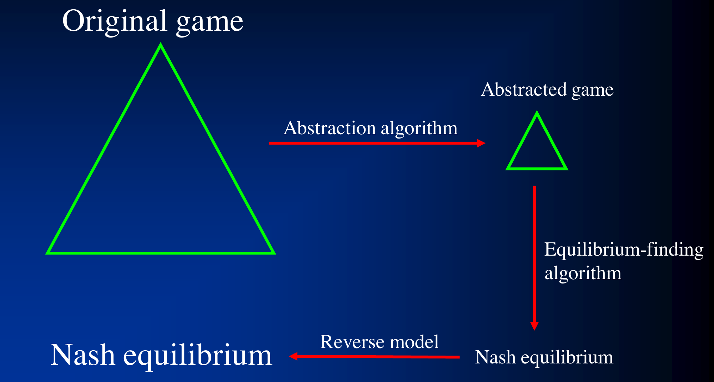

# L10 博弈抽象 1

对于大型不完美信息博弈，即使最先进的均衡求解算法也无法直接在原博弈上运行。本章介绍实践中（practical）的博弈抽象技术：先把原博弈自动压缩成一个更小的抽象博弈，在抽象博弈中求均衡，再把解映射回原博弈。我们依次讲无损抽象（GameShrink）、早期的有损抽象、势能感知抽象，以及 2014 年的最优算法——结合势能感知、不完美回忆与推土机距离的抽象；最后介绍把抽象与分布式均衡计算相结合的层级抽象，以及用这些技术打造的冠军智能体 Tartanian7。带理论保证的抽象将在下一章讨论。

## 自动博弈抽象的框架

自动博弈抽象（automated game abstraction）的框架如下图所示 [Gilpin & Sandholm, EC-06/J. of the ACM 2007, AAAI-06 …]，该思想由 Shi & Littman 01 与 Billings et al., IJCAI-03 预先提出，如今基本上被所有有竞争力的德州扑克程序采用：



流程分三步：抽象算法（abstraction algorithm）把原博弈压缩成抽象博弈；均衡求解算法（equilibrium-finding algorithm）在抽象博弈上求出纳什均衡；逆向模型（reverse model）把抽象博弈的均衡解释为原博弈中的策略。抽象按是否损失信息分为**无损（lossless）**与**有损（lossy）**两类。

## 无损博弈抽象

无损抽象 [Gilpin & Sandholm, EC-06, J. of the ACM 2007] 只合并战略上完全等价的节点，因此抽象博弈的均衡精确对应原博弈的均衡。

### 信息过滤

观察：可以通过**过滤玩家接收到的信息**来缩小博弈。玩家不再精确地观测到某个信号，而是观测到一个过滤后的信号集合。例如在扑克中，玩家不再知道自己拿到的是 A♥，而是收到信号 {A♠, A♣, A♥, A♦}——他只知道自己的牌是某张 A。信息过滤得越粗，抽象后的博弈越小。

### 信号树

算法操作的对象是**信号树（signal tree）**，而不是博弈树本身。信号树中每条边对应"自然（nature）向至少一个玩家揭示了某个信号"这一事件。由于算法只把信号树载入内存，而不需要把整个博弈树载入内存，这使得处理超大博弈成为可能。

### 同构关系

同构关系（isomorphic relation）刻画节点之间的**战略对称性（strategic symmetry）**，递归定义如下：

> **定义（信号树中的同构）。**
> - 信号树中的两个**叶子**是同构的，如果对博弈中每个行动历史，对应的收益向量（每个玩家一个收益）都相同；
> - 信号树中的两个**内部节点**是同构的，如果它们的子节点同构。

内部节点的定义有一个困难：子节点的顺序可能不同（子节点的置换）。解决办法是在两个节点的子节点之间运行一个定制的**完美匹配（perfect matching）**算法，使得只有同构的子节点才被配对；存在这样的完美匹配当且仅当两个节点同构。

### 抽象变换与均衡保持定理

抽象变换（abstraction transformation）把信号树中**互为兄弟的两个同构节点合并**为一个节点。其正确性由下面的定理保证：

> **定理（无损抽象保持纳什均衡）。** 若一个策略组合是抽象（更小）博弈中的纳什均衡，则它在原博弈中的解释也是纳什均衡。

这正是图 1 中"逆向模型"一步在无损情形下精确成立的原因。

### GameShrink 算法

GameShrink 算法分两步：

```text
GameShrink:
  1. 自底向上：在信号树上运行动态规划（DP），标记所有同构的节点对
  2. 自顶向下：从信号树根部开始，对适用的兄弟节点执行抽象变换（合并）
```

> **定理（GameShrink 的完备性与复杂度）。** GameShrink 能执行所有此类变换，运行时间为 $\tilde{O}(n^2)$，其中 $n$ 是信号树的节点数。由于信号树通常远小于博弈树，该复杂度相对博弈树规模通常是高度次线性的。

### 案例：求解罗得岛德州扑克

罗得岛德州扑克（Rhode Island Hold'em）是 Shi & Littman 01 提出的 AI 挑战问题，博弈树有 31 亿个节点。GameShrink 在其上的表现为：

- 不做抽象时，均衡对应的线性规划（LP）有 91,224,226 行和列，无法求解；
- GameShrink 运行**一秒钟**完成无损抽象；
- 抽象后的 LP 只有 1,237,238 行和列（50,428,638 个非零元）；
- 用 CPLEX 障碍法（barrier method）求解该 LP，耗时 8 天、占用 25 GB 内存，得到**精确的纳什均衡**。

这是当时被求解的最大不完美信息博弈，超出此前纪录四个数量级以上。

## 有损博弈抽象

本章余下部分以德州扑克（Texas Hold'em）为例。其结构为：自然给每个玩家发 2 张底牌 → 一轮下注 → 自然发 3 张公共牌 → 一轮下注 → 自然发 1 张公共牌 → 一轮下注 → 自然发 1 张公共牌 → 一轮下注。规模上：

- 两人**限注（Limit）**德州扑克约有 $10^{18}$ 个节点；
- 两人**无限注（No-Limit）**德州扑克约有 $10^{165}$ 个节点。

即使先做无损抽象，得到的博弈仍然太大而无法求解，因此必须进一步压缩——这就需要**有损（lossy）**抽象。

### 首个用于德州扑克的抽象算法

第一个应用于德州扑克的抽象算法 [Gilpin & Sandholm, AAAI-06] 是让 GameShrink 抽象得"更狠"：不再要求子节点之间的完美匹配，从而把近似同构的节点也合并起来。为了匹配速度，使用了更快的匹配启发式：仅当

$$|\text{wins}_{\text{node}_1} - \text{wins}_{\text{node}_2}| + |\text{losses}_{\text{node}_1} - \text{losses}_{\text{node}_2}| < k$$

时才匹配两个节点（即以胜/负次数之差作为相似度）。该方法按贪心方式合并，容易产生不均衡的（lopsided）抽象。

### 聚类 + 整数规划

更好且更可扩展的有损抽象方法 [Gilpin & Sandholm, AAMAS-07] 每次只在**一个玩家的私有信号与公共信号**的信号树上操作（而不再在双方信号的联合信号树上）——后文的最优算法也沿用这一点。方法是"聚类 + 整数规划（IP）"：

- 对每个下注轮 $i$，告诉算法允许生成多少个桶（bucket）$K_i$。$K_i$ 决定抽象的规模，应根据均衡求解可用的计算资源来设定；
- 第一轮：运行 $k_1$-means 聚类把该轮节点分桶；
- 之后的每一轮 $i$：运行一个 IP，决定每个父桶允许拥有多少个子桶，使得子桶总数不超过 $K_i$。"允许某父桶有 $k$ 个子桶"的价值，通过在运行 IP 之前、在每个父桶下对不同的 $k$ 分别做 k-means 聚类来评估。

## 势能感知抽象

此前所有抽象算法都用"（假设不再下注时的）获胜概率"作为手牌之间的相似度，但这不能捕捉手牌的**势能（potential）**——例如一手听牌当前胜率不高，却有很大机会在后续轮次变成强牌。而且势能不只是"正"或"负"一维的，而是"多维的"：一手牌可能以多种不同方式、在不同公共牌面上改善。势能感知抽象（potential-aware abstraction）[Gilpin, Sandholm & Sørensen, AAAI-07; Gilpin & Sandholm, AAAI-08] 正是为捕捉势能而设计的。

### 自底向上确定第 1 轮的抽象

算法从最后一轮开始自底向上推进。假设第 $r$ 轮的分桶已经确定，则第 $r-1$ 轮中每手牌被表示为一个**直方图**：它（通过自然的公共牌发放）转移到第 $r$ 轮各个桶的概率分布，如下图所示（该牌以概率 0.3、0.2、0、0.5 转入第 $r$ 轮的四个桶）。


然后对这些直方图用 $L_1$ 范数做聚类，聚类数目预先设定，取决于目标抽象规模。在最后一个（第 4）轮，之后不再有公共牌，手牌没有势能可言，因此直接用获胜概率（假设把剩余公共牌均匀随机发完，即 rollout）作为相似度。

### 确定第 2 轮的抽象

对第 1 轮的每个桶 $i$：

- 做一次自底向上扫描，只考虑与桶 $i$ 相容的手牌，确定第 3 轮的分桶；
- 对 $k_i = 1, 2, \ldots, \max$，把第 2 轮的手牌按"其在第 3 轮各桶上的直方图"聚成 $k_i$ 个簇。

然后运行 IP 决定每个第 1 轮桶可以有多少个子桶，约束为 $\sum_i k_i \le K_2$。IP 的目标如下：

- 每个桶的误差 = 桶内手牌到该桶形心（centroid）的 $L_2$ 距离之和；
- 要最小化的总误差 = 各桶误差之和，并按到达该桶的概率加权。

### 确定第 3、4 轮的抽象

第 3 轮的做法与第 2 轮完全类似。第 4 轮也类似，只是此时不再有任何势能，聚类直接基于获胜概率（假设 rollout）。至此，势能感知抽象计算完成。

## 2007–2013 年的关键思想

这一时期实用有损抽象的三条主线是：

- **整数规划** [Gilpin & Sandholm, AAMAS-07]：在桶数预算约束下最优地分配各父桶的子桶数；
- **势能感知** [Gilpin, Sandholm & Sørensen, AAAI-07; Gilpin & Sandholm, AAAI-08]：用转移到下一轮桶的分布代替标量胜率作为相似度；
- **不完美回忆（imperfect recall）** [Waugh et al., SARA-09; Johanson et al., AAMAS-13]：允许抽象博弈中的玩家"忘记"此前各轮自己所在的桶，从而把各轮的抽象解耦，大幅降低抽象计算与均衡求解的开销。

不完美回忆值得多说两句 [Brown et al., AAMAS-15]。直观上，完美回忆的抽象迫使玩家在后轮区分他在前轮就能区分的一切信息，即使该区分在后轮已毫无战略意义：例如翻牌前区分了 K♥3♣ 与 K♥4♣，完美回忆就迫使玩家在翻牌面 K♠J♦9♥ 上仍区分这两手牌，尽管 3♣ 与 4♣ 的差别几乎不可能影响打法；不完美回忆则允许"忘记"这类不再相关的区分。代价是理论保证的丧失：CFR 类算法在不完美回忆博弈中没有收敛保证（例外是 Lanctot et al., ICML-12 对一类 well-formed 博弈的保证），行为策略纳什均衡甚至可能不存在。但实践中，使用不完美回忆抽象的扑克程序始终稳定优于使用完美回忆抽象的程序。

## 最优算法：势能感知 + 不完美回忆 + 推土机距离

2014 年的最优算法 [Ganzfried & Sandholm, AAAI-14] 是"不完美信息博弈中带推土机距离的势能感知不完美回忆抽象"。理解它需要三步：EHS 及其缺陷、分布感知与 EMD、再到高维势能感知。

### 期望手牌强度（EHS）

EHS（expected hand strength，又称权益 equity）定义为

$$\text{EHS} = \Pr[\text{赢}] + \tfrac{1}{2}\Pr[\text{平}],$$

其中对手的手牌按均匀随机抽取，剩余公共牌按均匀随机 rollout 发完。早期的扑克抽象方法都用 EHS（或 EHS 的某次幂）来聚类手牌 [如 Billings et al., IJCAI-03; Gilpin & Sandholm, AAAI-06; Zinkevich et al., NIPS-07; Waugh et al., SARA-09]。

EHS 的缺陷在于它不能刻画**手牌强度的分布**。例如 4♠4♥ 与 T♠J♠ 的 EHS 几乎相同（约 0.57），但分布形态截然不同：44 的 EHS 频繁落在 $[0.4, 0.6]$ 区间而很少落在 $[0.7, 0.9]$ 区间，T♠J♠（同花连张）则恰好相反——它经常变成很强的牌，也经常一无所获。下图给出两手牌的 EHS 直方图对比：


按 EHS 聚类会把这两手牌放进同一个桶，但它们的战略打法显然不同。

### 分布感知抽象与推土机距离

分布感知（distribution-aware）抽象考虑手牌强度的**完整分布**：把每手牌表示为一个直方图（直方图取在所有公共牌发完后的权益上，仍假设对手手牌均匀随机），并用**推土机距离（earth mover's distance, EMD）**作为直方图之间的距离。

> **推土机距离（EMD）**：把一个土堆变成另一个土堆的最小代价，其中代价 = 搬运的土量 × 搬运的距离。

EMD 在一维情形可以在线性时间内计算，但在高维情形计算困难。此前最好的方法在翻牌（flop）和转牌（turn）轮使用带不完美回忆的分布感知抽象 [Johanson et al., AAMAS-13]。

### 势能感知 + 高维 EMD

仅有分布感知仍不够：两手牌最终的强度分布可以非常相似，但它们**实现权益的方式与速率**不同——一手牌可能在下一轮就定型，另一手牌要到最后一轮才见分晓，两者的下注策略因而不同。势能感知抽象 [Gilpin, Sandholm & Soerensen, AAAI-07] 考虑所有未来轮次，而不仅是最后一轮。

关键的技术困难是：在分布感知抽象中，直方图建立在**有基数含义（cardinal）的权益值**上，桶间距离天然有定义；而在势能感知抽象中，直方图建立在**无序的（non-ordinal）下一轮信息状态**上，桶与桶之间没有天然的距离，因此必须在高维空间中计算 EMD。

下图的例子说明了这一区别。私有信号 $x_1$ 在节点 A 以概率 1 转移到 B，再从 B 以各 1/2 的概率到达权益 0 或 1；私有信号 $x_2$ 在节点 C 以各 1/2 的概率转移到 D 或 E，D 以概率 1 到达权益 0，E 以概率 1 到达权益 1。若只看博弈进行到最后的结果，$x_1$ 与 $x_2$ 的权益直方图完全相同（权益 0 和 1 各占一半）；但看第 1 轮转移到第 2 轮信息状态的直方图，$x_1$ 全部落在状态 B，而 $x_2$ 各半落在状态 D 与 E——两者的"路径"完全不同。势能感知抽象正是用后一种直方图来区分手牌：


### 算法

带 EMD 的势能感知不完美回忆抽象算法如下：

- 对树做一次**自底向上**扫描，每个节点用"下一轮各簇上的分布直方图"表示；
- EMD 在多维空间中计算，其**基距离（ground distance）**取为对应簇均值之间的（下一轮）EMD——即距离递归地由下一轮已经算好的 EMD 给出；
- 最好的通用 EMD 实现对德州扑克的规模而言太慢，因此论文为该场景开发了快速的定制启发式来近似 EMD；
- 用该算法计算翻牌轮的抽象，得到的策略能击败此前最好的抽象算法。

注意不完美回忆带来的两个简化：

- 不再需要像早期势能感知抽象那样做多次自底向上扫描；
- 不再需要运行 IP 来分配各父桶的子桶数。

## 层级抽象、分布式均衡计算与后处理

2014 年 ACPC（年度计算机扑克竞赛）冠军智能体 Tartanian7 [Brown, Ganzfried & Sandholm, AAMAS-15] 把本章的三步框架推向了更大的规模。其动机来自硬件：当时最强的均衡求解算法 MCCFR 在共享内存机器上容易并行，但共享内存机器的内存与核数有限；要利用拥有更多内存与核数的超级计算机，就必须面对**刀片间（inter-blade）内存访问延迟**（作者所用机器上同刀片访问约 130 纳秒，跨刀片约 1 微秒）。朴素并行的 MCCFR 每次迭代要频繁读写散布在不同刀片上的信息集，慢到不实用。解决办法是让抽象本身配合硬件：把博弈树切成**互不相交的块**，使每个刀片上的采样只访问本刀片的信息集。

### 层级抽象算法

层级抽象（hierarchical abstraction）分两级：

1. 先在博弈早期某个特殊轮 $\hat{r}$（无限注德州扑克中取翻牌轮）对**公共信息**聚类：把 1,755 个（按花色同构去重后的）公共翻牌面聚成 $C=60$ 个公共桶，每个桶固定分配到一台刀片；
2. 然后对每个公共桶，从第 $\hat{r}$ 轮到最后一轮**分别**聚类与该桶相容的私有信息状态（每轮、每公共桶 500 个私有桶）。

$\hat{r}$ 之前的轮次（翻牌前）用任意抽象算法单独处理——最强的智能体在翻牌前不做抽象。这样，每条采样轨迹在离开翻牌前之后只访问一台刀片上的信息集。该方案要求玩家全程记住公共桶（因此不是完全的不完美回忆），但不要求记住其他不再相关的区分，从而在很大程度上保留了不完美回忆的好处。

### 公共信息的相似度

公共翻牌面之间的距离如何定义？此前 Waugh et al., SARA-09 的做法是对每个公共面 $f$ 构造转移表：$T[f][i][j]$ 为（在一个小规模完美回忆基础抽象中）从翻牌前桶 $i$ 转移到翻牌桶 $j$ 的概率，再以转移表间的 $L_2$ 距离做 k-means。这除了难以扩展到大基础抽象外，还有概念性缺陷：两个极相似的公共面 A♥K♠3♦ 与 A♥K♠2♦，若基础抽象把 4♣3♠-A♥K♠3♦ 与 4♣2♠-A♥K♠2♦ 放进桶 12，却把交叉组合放进桶 13，则两面在该转移分量上的概率分别是 0 和 1，$L_2$ 距离给出最大惩罚——尽管它们把极相似的手牌映到了同一个桶，本应判为相似。

新算法的做法是先算一个足够强的基础抽象 $A$（实际用的是 169-5000-5000-5000 的不完美回忆抽象），再统计每个公共面 $i$ 把多少种私有底牌组合送进 $A$ 的每个翻牌桶 $b$，记计数为 $c_i$（给定公共面后有 $\binom{49}{2}=1176$ 种底牌组合）。两个公共面的相似度取各桶计数的重叠之和 $s_{i,j}=\sum_b \min(c_i, c_j)$，距离定义为

$$d_{i,j} = \frac{V - s_{i,j}}{V},$$

即分别与 $i$、$j$ 配对后**未被映到同一个桶**的私有状态占比（$V=1176$）。直觉是：既然已知 $A$ 很强，经常被 $A$ 分到同一桶的公共面就应判为相近。注意 $d$ 不是度量（不同的公共面距离可以为 0），不能用 k-means 这类为度量空间设计的算法；论文用 k-means++ 初始化，再加一个只依赖点对距离的迭代重分配聚类。计算全部距离需遍历约 77 亿个三元组，借助预计算的转移表很快完成。

### 分布式均衡计算

配套的均衡求解算法是外部采样 MCCFR 的分布式改造：指定一台**头刀片**运行树顶部（翻牌前）的 MCCFR；每当采样轨迹离开树顶（进入翻牌），就把当前状态发给全部 $C$ 台子刀片，各子刀片从自己的公共桶中采样公共牌并继续各自的 MCCFR；子刀片返回值后，头刀片按各桶内可选公共牌的数量加权平均，使每个翻牌面在期望中等权——保证估计**无偏**。实践中用两遍法（先记录遇到的翻牌序列、批量发给子刀片算值，再使用返回值）减少通信；每次迭代的跨刀片通信开销约 60 微秒，相对每次迭代约 15 毫秒的耗时可以忽略。

### 后处理：逆向映射、阈值化与纯化

框架图中"逆向模型"一步在动作空间巨大的博弈中还需要专门技术。对手可能采取抽象中不含的动作（如任意下注额），需要把对手的动作映回抽象博弈；实验中使用的是当时领先、被各强队广泛采用的**伪调和映射（pseudo-Harmonic mapping）** [Ganzfried & Sandholm, IJCAI-13]。

均衡求解只是近似收敛，可能给差动作留下正概率，因此还要后处理。**阈值化（thresholding）**把低于某阈值的概率置零再归一化；**纯化（purification）**是其特例，以概率 1 采取概率最高的动作。但结合逆向映射后，阈值化有个陷阱：某区域动作离散得越细，概率质量被稀释得越多，这些动作反而被惩罚。例如概率为 $(0.1, 0.25, 0.15, 0.15, 0.2, \ldots)$ 分布在 {fold, call, 0.5 底池, 0.75 底池, 1 底池, …} 上时，纯化会选 call，尽管 0.65 的质量在下注动作上。补救是先把相似动作**归并为元动作**（fold / call / bet）再纯化，选中 bet 后才在注额内纯化（上例改为下注一个底池）。此外向**降低方差的保守动作**（fold）偏置有利于强者：某处均衡若是混合的，沿该路径打下去大概率会继续犹豫，不如趁早结束牌局，避免进入自己薄弱的区域。最终的新后处理器把三者结合：fold 概率超过阈值则以概率 1 fold，否则在三个元动作间纯化，选中 bet 再在注额内纯化。对 2013 年最强两个智能体的测试显示，新后处理器（阈值 0.2）平均赢率 +71 mbb/h，显著优于纯化（+37）与阈值化 0.15（+27），最差观察情形下也更好。

### Tartanian7 的规模与战绩

用上述技术生成的抽象规模空前：169 个翻牌前桶、60 个公共翻牌桶、每个公共桶在翻牌/转牌/河牌各 500 个私有桶（每轮共 30,000 个私有桶）；动作抽象含 6,104,546 个节点；整个抽象博弈含 $5.49\times10^{15}$ 个节点、$6.6\times10^{10}$ 个信息集、$1.8\times10^{11}$ 个信息集-动作对（该度量与 CFR 的内存占用成正比）——是以往无限注德州扑克智能体最大抽象的 6 倍，也是当时被均衡求解算法处理过的最大不完美信息博弈。均衡计算在 Blacklight 超级计算机上运行 1,200 小时，动用 961 核（60 台刀片 × 16 核 + 头刀片 1 核），合计 1,153,200 核时。由此生成的智能体 Tartanian7 赢得 2014 年 ACPC 两人无限注德州扑克冠军，对每个对手都以统计显著性获胜，平均赢率 479 mbb/h（每手牌毫大盲）。

## 结论

- 本章技术都是**领域无关（domain-independent）**的，虽然以扑克为例展示；
- 自动**无损**信息抽象能精确求解 31 亿节点的博弈（罗得岛德州扑克）；
- **有损**信息抽象是攻克德州扑克这类超大博弈的关键，2007–2013 年间的主要进展是整数规划、势能感知、不完美回忆；
- 2014 年的最优算法首次把势能感知与不完美回忆结合在同一个信息抽象算法中（并以 EMD 为距离）；
- 层级抽象把"先聚类公共信息、再按公共桶分别聚类私有信息"与分布式 MCCFR 结合，使均衡计算能在高内存延迟的超级计算机上扩展到以往 6 倍的抽象规模；配合逆向映射与新后处理族，生成的 Tartanian7 赢得 2014 年 ACPC 冠军；
- 未来方向：把这些技术应用到其他领域；发展既有理论界又有良好实际表现的抽象技术（下一章讨论理论界）。

## 要点小结

- 博弈抽象三步框架：抽象算法压缩博弈 → 在抽象博弈上求均衡 → 逆向模型映回原博弈；分无损与有损两类。
- 无损抽象在信号树上定义同构关系（叶子看所有行动历史的收益向量，内部节点靠子节点的完美匹配），合并同构兄弟节点；定理保证抽象博弈的纳什均衡解释回原博弈仍是纳什均衡。
- GameShrink：自底向上 DP 标记同构对 + 自顶向下合并，时间 $\tilde{O}(n^2)$（$n$ 为信号树节点数）；一秒钟把 31 亿节点的罗得岛德州扑克的 LP 从 9100 万行列压到 120 万行列，最终求得精确纳什均衡。
- 有损抽象用于限注（$\sim\!10^{18}$ 节点）与无限注（$\sim\!10^{165}$ 节点）德州扑克：从放宽匹配的 GameShrink，到"聚类 + IP"（每轮给定桶数预算 $K_i$，IP 在 $\sum_i k_i \le K$ 约束下按到达概率加权的最小聚类误差分配子桶数）。
- 势能感知抽象用"转移到下一轮各桶的概率直方图"（$L_1$ 聚类）代替标量胜率，捕捉多维势能；最后一轮无势能，退回获胜概率。
- EHS 只看均值，分不清分布形态不同的手牌；分布感知抽象用 EMD 比较权益直方图。
- 最优算法（Ganzfried & Sandholm, AAAI-14）：势能感知 + 不完美回忆 + 高维 EMD（基距离为下一轮的 EMD），一次自底向上扫描、无需 IP，击败此前最好的抽象。
- 不完美回忆让玩家忘记不再相关的区分（如翻牌前区分过的 K♥3♣/K♥4♣ 翻牌后不必再区分），实践稳定优于完美回忆抽象，但 CFR 在其上无收敛保证。
- 层级抽象（Brown, Ganzfried & Sandholm, AAMAS-15）：先把公共翻牌面聚成 60 桶分配到各刀片，再按桶分别聚类私有信息；公共面距离用"被强基础抽象分到同一桶的私有组合占比"构造，修正了转移表 $L_2$ 距离的概念缺陷。
- 分布式 MCCFR：头刀片跑翻牌前，子刀片按公共桶采样，按可选公共牌数加权平均保证无偏；跨刀片通信开销可忽略。
- 后处理：伪调和映射把对手动作映回抽象博弈；阈值化/纯化前先把细粒度动作归并为元动作（fold/call/bet）避免稀释惩罚，并向降方差的 fold 偏置；新后处理器平均 +71 mbb/h，优于纯化（+37）。
- Tartanian7：抽象博弈 $5.49\times10^{15}$ 个节点（以往最大抽象的 6 倍），961 核运行 1,200 小时求均衡，2014 年 ACPC 对每个对手均以统计显著性获胜，平均 479 mbb/h。
