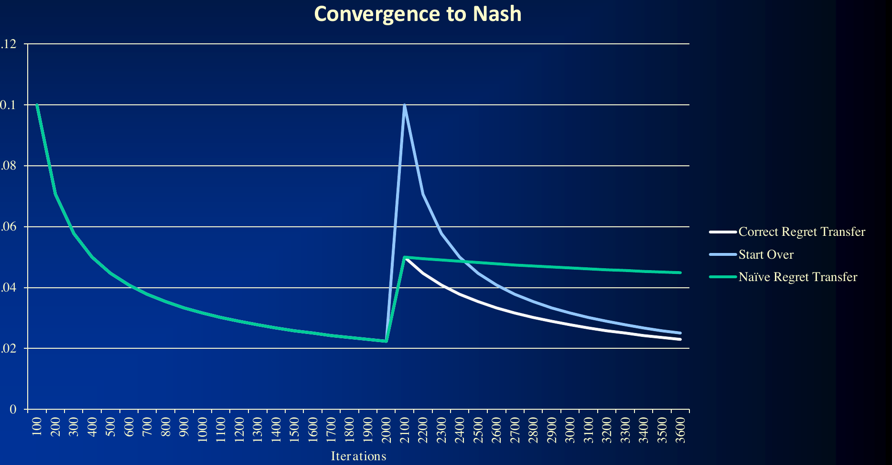
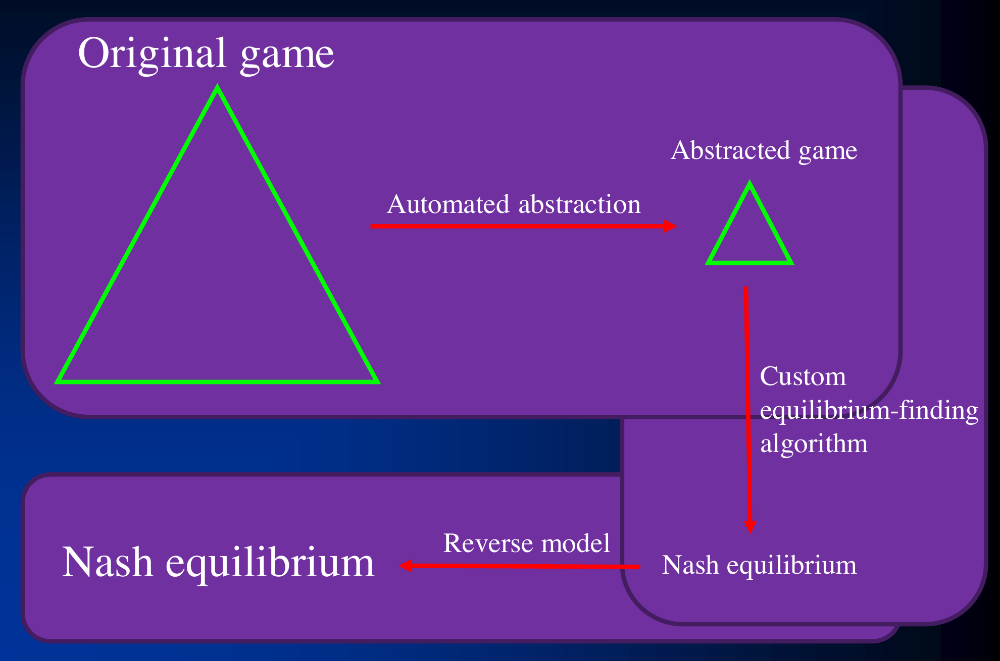
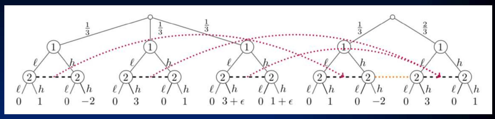
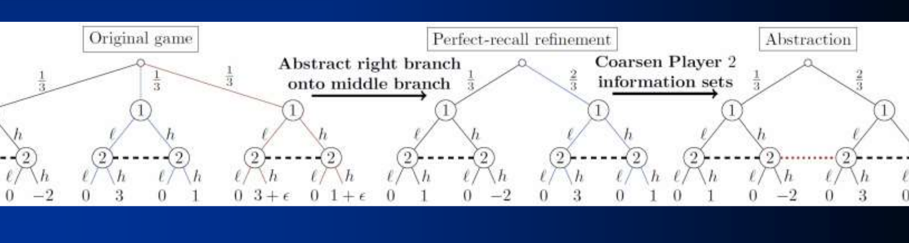

# L11 博弈抽象 2

上一讲介绍了抽象的动机与基本类型，本讲深入四个专题：带最优性保证的动作抽象（通过后悔转移与参数优化实现）、抽象与均衡求解的同时进行、把抽象博弈的解映回原博弈的逆向映射，以及带可利用度界的有损抽象的统一框架。这些技术都是领域无关的。

## 动作抽象（Action Abstraction）

动作抽象传统上靠手工完成：例如人为决定在扑克中允许哪些下注尺度。在 Brown 与 Sandholm 的工作之前，针对扩展式博弈（甚至仅针对扑克）的动作抽象算法对解的质量没有任何保证 [Hawkin et al., AAAI-11, 12]。对于随机博弈（stochastic games），已存在基于离散优化、带界的动作抽象算法 [Sandholm & Singh, EC-12]。

本讲介绍第一个针对（双人零和博弈中）单方参数优化的算法，并把它用于**动作尺度抽象**（action size abstraction）["Regret Transfer and Parameter Optimization with Application to Optimal Action Abstraction", Brown & Sandholm, AAAI-14]。其核心技术是**后悔转移**（regret transfer）：利用后悔匹配（regret matching）或反事实后悔最小化（counterfactual regret minimization, CFR），在博弈收益改变后通过转移后悔值来热启动（warm starting）。

**问题设定**：当我们改变动作（例如扑克中的下注尺度、拍卖中的报价尺度）时，博弈的收益随之改变，但博弈的拓扑结构不变。

### 动机：一个简单博弈

考虑下面的玩具博弈：玩家 1 选择 Bet 或 Fold；若 Fold，收益为 $(-1, 1)$；若 Bet，玩家 2 选择 Fold（收益 $(1, -1)$）或 Call（收益 $\pm 2, \mp 2$，即零和交换 $\pm 2$）。我们用无悔学习（no-regret learning）求解它。

对该博弈运行无悔学习约 2000 次迭代，$\epsilon$（到纳什均衡的利用距离）从约 $0.1$ 平滑下降到约 $0.02$。

现在假设在运行中途改变 Bet–Call 分支的收益：$\pm 2$ 改为 $\pm 2.1$，即收益扰动幅度

$$\delta = 2.1 - 2 = 0.1.$$

此时有三种应对方式：

- **重新开始**（Start Over）：清空所有状态重新求解。$\epsilon$ 重新飙升到约 $0.1$，之前 2000 次迭代的计算全部浪费。
- **朴素后悔转移**（Naïve Regret Transfer）：直接把旧博弈积累的后悔值搬到新博弈继续运行。$\epsilon$ 只跳升到约 $0.05$，但随后**停滞**——收敛速度明显变慢，长期停留在约 $0.045$，反而被重新开始反超。原因在于旧后悔值是按旧收益尺度积累的，量纲与新博弈不匹配，残留的过大后悔值阻碍了均衡的精化。
- **正确后悔转移**（Correct Regret Transfer）：把转移过来的后悔值（以及用于策略平均的累计策略）按 $O\!\left(\dfrac{1}{(1+\delta\sqrt{T})^2}\right)$ 缩放去权重（deweight），其中 $T$ 是已运行的迭代数。直觉是：旧的后悔与旧策略是在略有不同的博弈上收集的，扰动越大、已运行越久，旧数据的可信度越低。这样热启动后 $\epsilon$ 从约 $0.05$ 处继续以良好速率下降，最终显著优于另两条曲线。

### 最优参数选择

后悔转移使我们能够**在线优化抽象参数**。回到动作尺度选择问题：每个抽象（每个下注尺度向量 $\theta$）对应一个均衡值，但该值只有求解之后才知道；我们想选出对我们均衡值最高的动作抽象。（注意：若把动作尺度与动作概率一起优化，问题是二次的；因此只优化尺度。）

算法是一种**热启动的梯度上升**：在上述玩具博弈中把 Bet–Call 收益参数化为 $\pm\theta$，目标是最大化玩家 1 的纳什均衡值（对 $\theta$ 的函数曲线是光滑的单峰曲线，但每一步只能带噪地观测）。

1. **第 1 步**：在当前 $\theta$ 处做 $K_1$ 次无悔学习迭代，得到均衡值的估计及 $\epsilon$ 误差棒。
2. **第 2 步**：估计梯度（用有限差分：在 $\theta$ 附近再做小扰动运行）。
3. **第 3 步**：沿梯度方向移动 $\theta$，并用后悔转移热启动——对后悔值与用于平均的策略按上述方式去权重。移动后误差棒暂时扩大。
4. **第 4 步**：在新 $\theta$ 处做 $K_2$ 次无悔学习迭代，误差棒重新缩小。
5. 重复直至收敛。

该方法已应用于无限注德州扑克（No-Limit Texas Hold'em，实验中优化 1 个下注尺度）和 Leduc 扑克（Leduc Hold'em，实验中同时优化 2 个下注尺度）。

## 抽象与均衡求解的同时进行

传统流程是串行的：先做抽象，再在抽象博弈上求均衡。**基于策略的抽象**（strategy-based abstraction）把两个环节耦合成双向循环：抽象的结果喂给均衡求解器，求解器发现的策略再反馈回来指导抽象的精化，如图：

> **图注**：原博弈经自动抽象得到抽象博弈，由定制均衡求解算法求出纳什均衡，再经逆向模型（reverse model）映射回原博弈。在同时进行（simultaneous）的框架中，反馈箭头使抽象随求解进程动态调整。

目前已实现的是**往抽象中加入动作**的方向：求解过程中发现某些被抽象掉的动作有价值时，把它们加回抽象，并通过折扣（discounting，即上述后悔去权重）热启动 ["Simultaneous Abstraction and Equilibrium Finding in Games", Brown & Sandholm, IJCAI-15]。

## 逆向映射（Reverse Mapping）

在抽象博弈中求出均衡后，对手在原博弈中的动作可能不在抽象的动作集里（例如对手下了一个抽象中不存在的注额），需要**动作转译**（action translation）把对手的实际动作 $x$ 映射到抽象中邻近的动作 $A$ 或 $B$（$A \le x \le B$）。令 $f(x)$ 表示把 $x$ 映射到 $A$ 的概率（以概率 $1-f(x)$ 映射到 $B$）。对 $f$ 的期望性质（desiderata）有：

1. $f(A) = 1,\ f(B) = 0$（端点保持）；
2. 单调性（monotonicity）：$x$ 越接近 $A$，越应映射到 $A$；
3. 尺度不变性（scale invariance）；
4. $x$ 的小变化不应导致 $f$ 的大变化；
5. $A$ 或 $B$ 的小变化不应导致 $f$ 的大变化。

**伪调和映射**（pseudo-harmonic mapping）[Ganzfried & Sandholm, IJCAI-13] 给出：

$$f(x) = \frac{(B-x)(1+A)}{(B-A)(1+x)}.$$

它从一个简化的无限注扑克博弈的纳什均衡推导而来，满足上述全部期望性质；在简化域中比先前的映射被利用程度低得多；在无限注德州扑克中实践表现良好，显著优于此前最好的逆向映射——随机几何映射（randomized geometric mapping）。

## 带可利用度界的有损抽象

### 博弈抽象是非单调的

直觉上"抽象越精细，解越好"并不成立。考虑如下零和博弈（攻击者选行，防守者选列，表中为双方收益）：

| | A | Between | B |
|---|---|---|---|
| **A** | $0, 2$ | $1, 1$ | $2, 0$ |
| **B** | $2, 0$ | $1, 1$ | $0, 2$ |

该博弈的每个均衡形如：攻击者在 A 与 B 之间 50-50 随机化；防守者以概率 $p$ 出 A、概率 $p$ 出 B、概率 $1-2p$ 出 Between；对每个 $p \in [0, \tfrac{1}{2}]$ 都存在一个均衡。

- **一个抽象**：删除攻击者的动作 B。剩余博弈中防守者会选择 A——但在原博弈中这远离均衡，因为攻击者会改选 B。
- **更粗的抽象**：同时删除攻击者的 B 和防守者的 A。剩余博弈中防守者会选择 Between，而这在原博弈中**恰好是**均衡策略。

于是更粗的抽象反而给出了原博弈的均衡解，更细的却没有——这就是**抽象病态**（abstraction pathology）。这类病态在小型扑克博弈中同样存在 [Waugh et al., AAMAS-09]。

### 尽管有抽象病态，能否给出可利用度界？

第一个肯定答案针对随机博弈 [Sandholm & Singh, EC-12]。这里介绍一个针对扩展式博弈的统一抽象框架 [Kroer & Sandholm, NeurIPS-18]：适用于 $n$ 人一般和博弈，推广并改进了先前工作 [Lanctot et al., ICML-12; Kroer & Sandholm, EC-14, EC-16]，也可用于建模（modeling）误差分析。

框架把从原博弈到抽象博弈的映射分解为两个可分别分析的步骤，如下图所示：先把原博弈某分支抽象到中间分支上（得到抽象博弈的**完美回忆精化**，perfect-recall refinement），再粗化玩家 2 的信息集得到抽象博弈。

两步分解示意：

形式地，原博弈 $\Gamma$ 与抽象博弈 $\Gamma'$ 之间的映射由三部分组成：

- **信息集映射** $f$：把原博弈的每个信息集 $I$ 满射到抽象博弈（的完美回忆精化）中的某个信息集 $f(I)$，并要求 $f$ 保持信息集树结构；
- **动作映射** $g$：把 $I$ 处的动作集满射到 $f(I)$ 处的动作集（动作删除就建模为多个原动作映到同一抽象动作）；
- **叶节点映射**：对每个信息集 $I$ 与动作 $a$，把 $I$ 之下、玩家 $i$ 再次行动之前到达的原博弈叶子满射到 $f(I)$ 之下的抽象叶子。

**完美回忆精化**（perfect-recall refinement）$\tilde\Gamma$ 与抽象博弈 $\Gamma'$ 共享同一棵博弈树（同样的节点、动作、机会概率与收益），但把 $\Gamma'$ 中的信息集划分得更细，细到满足完美回忆为止。引入它纯粹是分析工具：第一步（原博弈 $\to$ 精化）度量映射造成的收益与分布差异，第二步（精化 $\to$ 抽象）度量信息集粗化造成的差异。

为何要针对近似解概念给界？实践中最强的抽象是**不完美回忆**抽象，而在不完美回忆博弈中求纳什均衡是 NP 难的；CFR 类算法收敛时产生的是在每个信息集上**反事实后悔有界**的策略。因此框架同时覆盖三类抽象解：精确纳什均衡、$\epsilon$-纳什均衡，以及反事实后悔有界的策略组合。

**定义（提升策略，lifted strategy）**：给定抽象博弈的一个策略组合 $\sigma'$，其提升策略是原博弈中满足如下条件的策略组合 $\sigma$：对每个抽象信息集 $I'$ 及对应的原博弈信息集 $I$，抽象动作上的概率质量可以按任意方式分摊到映射到它的那组原博弈动作上。形式地，

$$\sigma'(I', a') = \sum_{a \in g^{-1}(a')} \sigma(I, a),$$

其中 $g^{-1}(a')$ 是映射到抽象动作 $a'$ 的原博弈动作集合。

**证明的关键构造**是把信息集的值递归地分解到后代信息集上。记 $V_i(I)$ 为信息集 $I$ 的**反事实值**（counterfactual value）[Zinkevich et al., NIPS-07]：除玩家 $i$ 自己采取到达 $I$ 所需的行动外，其余玩家都按策略组合 $\sigma$ 行动时 $I$ 的期望效用。论文沿用 Kroer & Sandholm [EC-14] 的恒等式，把 $V_i(I)$ 写成对直接后代的求和：

$$V_i(I) = \sum_{a \in A_I} \sigma(I, a)\left( \sum_{J \in D_{Ia}} \pi^{\sigma}_{-i}(J \mid I)\, V_i(J) \;+\; \sum_{z \in Z_{Ia}} \pi^{\sigma}_{-i}(z \mid I)\, u_i(z) \right),$$

其中 $D_{Ia}$ 与 $Z_{Ia}$ 分别是在 $I$ 处采取行动 $a$ 之后、玩家 $i$ 再次行动之前可达的后代信息集与叶节点，$\pi^{\sigma}_{-i}$ 为不计玩家 $i$ 行动的到达概率。对抽象值 $W_i$ 有同样形式。对两端分别展开此式并逐层归纳（对抽象信息集的无环性做归纳），可得：原博弈与抽象博弈在同一提升策略下的值之差，恰好等于沿途各信息集上**收益差**与**到达概率差**两项的加权和——记这个递归定义的差为 $M(I, \sigma, \sigma'_{-i})$。特别地，在根节点上有精确等式（而非仅是不等式）：

$$W_i(r') = V_i(r) \pm M\!\left(r, \sigma, \sigma'_{-i}\right).$$

也就是说，对任意抽象策略组合 $\sigma'$ 与它的任意提升策略 $\sigma$，提升策略在原博弈中的效用与抽象效用之差被 $M$ 精确刻画；最终定理中的不等号只来自抽象博弈本身没有被精确求解。

> **定理（抽象定理，[Kroer & Sandholm, NeurIPS-18]）**：给定
> - 一个完美回忆（perfect-recall）博弈，
> - 一个无环的抽象博弈，
> - 二者之间满足若干温和、自然假设的映射，
> - 以及抽象博弈中的一个 $\epsilon$-纳什均衡，
>
> 则其**任意**提升策略都是原博弈中的 $\epsilon'$-纳什均衡，其中 $\epsilon' = \max_i \epsilon'_i$，且
>
> $$\epsilon'_i = \epsilon + \text{mapping error}_i + \text{refinement error}_i,$$
>
> 即映射误差（把真实博弈映射到抽象博弈的完美回忆精化时产生的误差）加精化误差（完美回忆精化与抽象博弈之间的误差）。

论文给出的精确形式如下。令 $\sigma^{*} = (\sigma^{*}_i, \sigma_{-i})$ 为把提升策略 $\sigma$ 中玩家 $i$ 替换为原博弈最优反应后的组合，并令 $\sigma^{*0}$ 为把 $\sigma^{*}$ 按动作映射摊回抽象博弈所得的组合；记 $P(\tilde I, \hat\sigma)$ 为精化信息集 $\tilde I$ 与其所属抽象信息集之间的（收益加分布）值差。则

$$\epsilon'_i = \epsilon + \underbrace{M\!\left(r, \sigma^{*}, \sigma'_{-i}\right) - M\!\left(r, \sigma, \sigma'_{-i}\right)}_{\text{映射误差 } (\text{mapping error}_i)} + \underbrace{\sum_{I \in \mathcal{I}_i} \pi^{\sigma^{*}}(I)\,\big[ P\!\left(f(I), I^{*}\!\!\to\! I\right) - P\!\left(\tilde I_I, \sigma^{*0}\right) \big]}_{\text{精化误差 } (\text{refinement error}_i)},$$

其中 $M$ 即上文递归定义的映射差。注意两项误差都依赖最优反应 $\sigma^{*}$，因此该分解一般是**事后**（ex post）的——要先在抽象博弈上求解并评估，才能算出数值；这是它为精确性付出的代价。

相对先前工作的优点：

- 误差的**精确分解**；
- 抽象博弈中的均衡不必是精确的（允许 $\epsilon > 0$）；
- 不需要先前工作的限制性假设；
- 界比 Lanctot et al. [ICML-12] 指数级地更好；
- 对抽象博弈中具有有界反事实后悔（counterfactual regret，换到任一动作 $a$ 的收益至多为 $\epsilon_a$）的解也有类似结果。

**映射误差**（mapping error$_i$）是以下两项之和：

- **收益误差**（payoff error）：在真实博弈的叶节点上取期望，真实叶子的效用与它映射到的节点的效用之差，即 $R_i(z, \tilde z) = u_i(z) - \tilde u_i(\tilde z)$，其中 $\tilde z$ 是 $z$ 经叶节点映射所映到的精化叶子；
- **分布误差**（distribution error）：对抽象博弈的叶节点求和，到达抽象叶子的概率与映射到它的真实叶子到达概率之和的差，即 $P_i(\tilde z \mid I, a, \sigma, \sigma') = \sum_{z \mapsto \tilde z} \pi^{\sigma}_{-i}(z \mid I) - \pi^{\sigma'}_{-i}(\tilde z \mid f(I))$。

**精化误差**（refinement error$_i$）：对抽象博弈的完美回忆精化中的信息集 $I_p$ 求和（令 $I'$ 为对应的抽象信息集），每项为：

- **收益误差**：对 $I'$ 下的叶子取期望，其效用与 $I_p$ 下对应叶子效用之差。论文允许引入逐信息集的缩放因子 $\omega_{I_p} > 0$，即 $R_i(z' \mid I_p) = \tilde u_i(\tilde z) - \omega_{I_p}\, u_i(z')$：收益只需在**相对意义**上相近即可（例如两个子树的收益相差一个公共常数倍时战略上等价，取相应的 $\omega$ 可使该项为零）；
- **分布误差**：对 $I_p$ 下的叶子求和，从 $I_p$ 到达精化叶子的概率与从 $I'$ 到达抽象叶子概率之和的差。

**对反事实后悔有界的解**（Theorem 2）：若抽象策略组合 $\sigma'$ 在每个抽象信息集 $I'$ 处的反事实后悔不超过 $r(I')$（即换到任一动作 $a'$ 的收益至多为 $r(I')$），则任意提升策略是原博弈的 $\epsilon'$-纳什均衡，界的形式与定理 1 相同，只是抽象求解误差项 $\epsilon$ 被替换为逐信息集项 $\pi^{\sigma'}_{-i}(f(I))\, r(f(I))$ 的加权和——即用各信息集的后悔界代替全局的 $\epsilon$。

**恢复先前的事前界**：论文进一步证明，若满足**分布相似条件**——互相映射的叶子与节点在（不计机会行动的意义下）到达分布一致（这弱于先前工作要求的"相同信息集–动作对序列"）——则映射误差与精化误差中依赖最优反应 $\sigma^{*}$ 的项消失，界变为**可事前计算**（在求解抽象博弈之前，通过取最大值得到）。此时该框架恢复并同时收紧了先前的全部扩展式博弈抽象界：相比 Sandholm & Singh [EC-12]（随机博弈）与 Kroer & Sandholm [EC-14, EC-16]，它在多处保留期望而非取最大值，因此界更紧；相比 Lanctot et al. [ICML-12]（误差随信息集个数线性增长），新界指数级地更好。

### 未来研究方向

上述分解中的分布误差项一般**无法事前计算**（ex ante，即在抽象博弈上运行求解器之前），因为它们可能依赖于玩家的策略。先前的方法要求：对于互相映射的叶子对，它们在抽象中具有相同的、导向它们的信息集–动作对序列——在这一假设下可以取最大值得出事前界。

论文用两个反例说明这类假设在某种意义上是**必要的**：

- **一般和反例**：玩家 1 的两个节点被抽象合并为一个信息集，每个节点处的收益误差仅为 $\epsilon$（任意小）。玩家 2 未被抽象，可以在左、右子树中选择相反的行动，从而改变玩家 1 应偏好左还是右；在原博弈中玩家 1 能分别作出反应，在抽象中却不能。于是抽象均衡中玩家 1 每种策略都只能得到 $v/2$，而原博弈中可得 $v$——尽管收益误差任意小（甚至令 $\epsilon = 0$ 时高损失的均衡依然存在），抽象造成的损失达 $v/2$。
- **零和反例**：玩家 2 的两个底部信息集被合并；抽象均衡中玩家 2 等概率出 $\ell$ 与 $r$，期望效用比原博弈中最优反应低 $\epsilon/2$——收益误差为 $0$ 仍有 $\epsilon/2$ 的损失。原因在于未被抽象的玩家 1 控制了抽象信息集内部的节点分布，使其与玩家 2 在原博弈中所知的信息不一致。

在这两个反例上，定理 1 与定理 2 依然成立，只是它们给出的界会弱到与实际大误差相称（大误差全部落在依赖分布的项里）；这正说明不依赖策略的事前界不可能在完全一般的博弈上存在。

一个有希望的想法：寻找其他特殊但实用的博弈类，利用博弈结构给出可计算的事前界。特别地，该分解依赖效用差本身（而非像先前方法那样取绝对值），因此结构化的博弈类甚至可能让误差项相互抵消。

## 要点小结

- 本讲技术均为领域无关：首个带最优性保证的动作抽象算法（迭代调整动作尺度向量）、抽象与均衡求解同时进行、伪调和逆向映射、带可利用度界的有损抽象。
- **后悔转移**：博弈收益改变（拓扑不变）后，正确做法是把后悔值与累计策略按 $O(1/(1+\delta\sqrt{T})^2)$ 缩放去权重再热启动；朴素转移会停滞，重新开始则浪费已有计算。
- **最优参数选择**：在当前 $\theta$ 运行无悔学习 → 估计梯度 → 移动 $\theta$ 并转移后悔 → 继续运行，重复至收敛；已用于无限注德州扑克与 Leduc 扑克。
- **伪调和映射** $f(x) = \frac{(B-x)(1+A)}{(B-A)(1+x)}$ 满足端点保持、单调、尺度不变、连续性等期望性质，显著优于随机几何映射。
- **抽象病态**：更细的抽象可能给出更差的原博弈解，更粗的反而可能是均衡——抽象质量非单调。
- **抽象定理**（Kroer & Sandholm, NeurIPS-18）：$\epsilon'_i = \epsilon + \text{mapping error}_i + \text{refinement error}_i$，两项误差各自分解为收益误差与分布误差；分解是**精确**的（不等号仅来自抽象博弈未精确求解），但一般为事后（ex post）形式、依赖最优反应；在分布相似条件下恢复为可事前计算的界并收紧先前全部结果；反例表明这类分布假设在一般博弈中是必要的。适用于 $n$ 人一般和完美回忆博弈，界比先前工作指数级更好。
- 开放问题：分布误差一般无法事前计算；寻找可利用结构使误差项可事前计算甚至相互抵消的博弈类。
