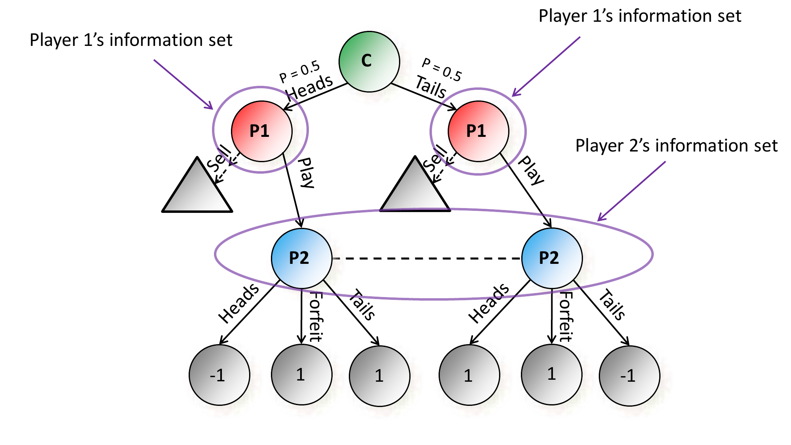
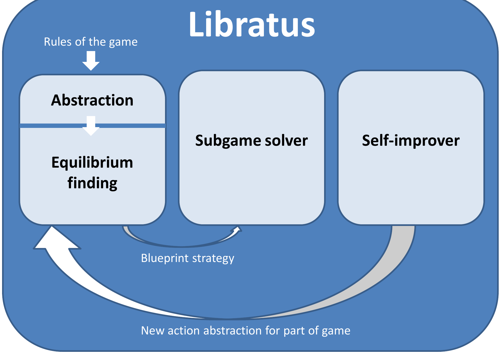

# L12 Libratus（上）：历史与人机大战

本讲介绍 Libratus——首个在双人无限注德州扑克（two-player no-limit Texas hold'em）上超越人类顶尖职业选手的 AI [Brown & Sandholm, *Science* 2018]。本章覆盖背景部分：不完美信息博弈为何困难、扑克 AI 的历史、人机大战的实验设计与结果，以及 Libratus 的总体架构与蓝图策略（blueprint strategy）模块；子博弈求解（subgame solving）与自我改进器（self-improver）两大核心模块留待后续两章。

## 完美信息博弈与不完美信息博弈

AlphaGo 的成功表明，基于搜索与机器学习的技术可以在围棋这类完美信息博弈（perfect-information game）中达到超人类水平，且原则上可推广到其他完美信息博弈（如国际象棋中的西西里防御、后翼弃兵等开局体系所对应的局面）。完美信息博弈的一个关键性质是：**子博弈可以只用子博弈内部的信息独立求解**——这正是 AlphaGo 式搜索与回溯取值（backup）成立的基础。

在不完美信息博弈（imperfect-information game）中，这一性质不再成立：玩家无法观察到完整状态，一个“子博弈”的最优打法依赖于到达该子博弈的概率分布，而后者又取决于博弈其他部分的策略。因此子博弈不能脱离全局单独求解。这是整门课技术主线的出发点，也是 Libratus 必须解决的核心困难。

### 例：掷硬币博弈（Coin Toss）

考虑如下的玩具博弈。自然（chance, 记为 C）以各 $0.5$ 的概率掷出正面（Heads）或反面（Tails），结果只告诉玩家 1。玩家 1 可以选择卖出（Sell，结束博弈并获得与其类型挂钩的确定支付）或继续玩（Play）。若玩家 1 选择 Play，玩家 2 在不知道硬币结果的情况下猜 Heads 或 Tails，也可以弃权（Forfeit）。如下图所示，叶子上的数字是玩家 1 的支付：玩家 2 猜对硬币结果时玩家 1 得 $-1$，猜错时得 $+1$，玩家 2 弃权时玩家 1 得 $+1$。

注意图中玩家 2 的两个决策节点由虚线连在同一信息集（information set）内：他不知道硬币是正是反，因而无法区分这两个节点。后面几章会反复回到这个例子：把 Sell 之后的部分当作“子博弈”来单独精解，正是各种子博弈求解技术的试验场。

在不完美信息博弈中，理性的解概念仍是纳什均衡：

> **定义（纳什均衡与 $\epsilon$-纳什均衡）.** 纳什均衡（Nash equilibrium）是一个策略组合（profile），其中没有任何玩家能通过单方面偏离而改进自己的期望效用（信念由策略经贝叶斯规则导出）。纳什均衡是稳健的（robust）。$\epsilon$-纳什均衡（$\epsilon$-Nash equilibrium）则要求：没有任何玩家能通过偏离改进**超过 $\epsilon$**。

在掷硬币博弈中，均衡策略是混合的：玩家 1 在两种类型下都以 $0.5$ 的概率 Sell、以 $0.5$ 的概率 Play；玩家 2 以 $0.5:0.5$ 的比例猜 Heads 或 Tails。

### 应对不完美信息博弈的路线

这一方向的价值远超扑克本身：谈判、商业战略、安全对抗、拍卖等真实世界中的策略性交互几乎都含有隐藏信息，天然建模为不完美信息博弈，而完美信息在现实中反而罕见 [Brown & Sandholm, IJCAI-17]。

与完美信息博弈不同，这里需要**与具体应用无关的、用算法自动构造策略**的技术。主要挑战有二：

- 对其他玩家和自然（chance）行为的不确定性；
- 存在隐藏状态，因此必须解读对手行动所释放的信号（signal）——这正是需要博弈论的原因：信号的含义本身由均衡内生决定。

## 扑克：博弈论与 AI 公认的挑战问题

扑克作为博弈论与人工智能的挑战问题有悠久历史：[Nash 1950]、[Kuhn 1950]、[Newman 1959]、[Waterman 1970]、[Zadeh 1977]、[Caro 1984]、[Pfeffer & Koller 1995]、[Billings et al. 1998]、[Schaeffer et al. 1999]、[Shi & Littman 2001]、[Billings et al. 2003] 等工作都研究过扑克或其简化形式。2005 年以后进展显著加速：

- Rhode Island Hold'em（一种 $10^9$ 节点规模的简化扑克）被求解 [Gilpin & Sandholm 2005]；
- 年度计算机扑克竞赛（Annual Computer Poker Competition, ACPC）于 2006–2018 年举办；
- 有限注德州扑克（Limit Texas Hold'em，约 $10^{13}$ 个决策点）被近似最优地求解 [Bowling et al. 2015]。

### 双人无限注德州扑克

在 Libratus 之前，双人无限注德州扑克（heads-up no-limit Texas hold'em, HUNL）一直是不完美信息博弈 AI 的**主要基准与挑战问题**：

- 局面数高达 $10^{161}$，比已求解的有限注版本大几十个数量级（该数字按标准赛制计算：两位玩家各持 \$20{,}000、即 200 个大盲注的深筹码，且下注以 1 美元为最小单位）[Brown & Sandholm, IJCAI-17]；
- 主要流行于网络对战，也出现在 World Series of Poker、NBC Heads-Up Championship 等赛事，并出现在《Casino Royale》《Rounders》等电影中；
- 被称为“最纯粹的扑克形式”（purest form of poker）；
- 此前没有任何 AI 战胜过顶尖人类选手。

**规则**：自然给每位玩家发 2 张底牌（私有），之后进行一轮下注；自然发 3 张公共牌（flop），一轮下注；自然发 1 张公共牌（turn），一轮下注；自然再发 1 张公共牌（river），最后一轮下注。无限注（no-limit）意味着任何时刻玩家可以下注任意数额直至全下（all-in），这使得行动空间本质上是连续的，必须借助抽象处理。

## Brains vs AI 重赛：实验设置

2017 年 1 月，Libratus 与四位最优秀的人类双人无限注德州扑克职业选手（均为该项目的 top-10 专才选手 [Brown & Sandholm, IJCAI-17]）进行了名为“Brains vs AI Rematch”的对抗赛：

- 20 天内共打 120,000 手牌；
- 20 万美元奖金按成绩分配给四位职业选手；
- 采用**保守的、偏向人类的实验设计**，以确保结论的说服力。

所谓“偏向人类”的设计包括大量具体安排：

- **样本量大**：120,000 手以保证统计效力；
- 人类可以自选：比赛天数、休息日、每天的比赛时段、局间休息（甚至可动态调整）；双桌同时打（two tabling）；四色牌面；快捷键（可动态调整）；指定的高分辨率显示器和自己的鼠标；Twitch 聊天开或关；每对选手内部选择公开或私下比赛；
- 200 个大盲注（big blind）的深筹码；
- AI 不使用时间马脚（timing tells）；行动历史完整显示；每天晚间把**全部手牌历史（包括对手弃牌的手牌）交给双方**；
- 人类可以：使用计算机和任何程序进行分析；相互协作与协调（单手牌内部除外）；寻求外部帮助（如 Doug Polk）；思考时间不限；误点击的手牌作废。

### 最终结果

Libratus 以很大优势战胜了顶尖人类：

- 赢率 **147 mbb/hand**（milli-big-blinds per hand，每手千分之一大盲注）；
- 统计显著性达 $99.98\%$（即 $p = 0.0002$）；
- **每一位**人类选手各自对 Libratus 都是输的。

### 补充实验：为何博弈论方法优于机器学习

课件特别讨论了为何在这类问题上博弈论 AI 比机器学习路线更合适：

1. **不需要数据**——策略由算法从博弈规则直接算出；
2. **不假设对手会延续过去的行为模式**；
3. **不可被利用（not exploitable）**——即使对手事先知道我方策略也无机可乘。

第 3 点由一次对照实验支撑：Libratus 与 6 位中国扑克选手（其中包括 WSOP 金手链得主，且具备计算机科学与机器学习专长，并**事先研究过 Libratus 的手牌历史**）进行了 36,000 手对抗。结果 AI 以 220 mbb/hand 获胜，赢下全部 9 个 session，并且单独战胜每一位选手。这表明该方法并不脆弱：最小最大定理（minmax theorem）只对精确纳什均衡保证不可利用性，而该实验表明这一性质对**计算近似**的均衡同样成立——这与在围棋、DOTA2、星际争霸 II 等博弈中发现的机器学习方法可被针对性攻击（adversarial exploit）形成对比。

## Libratus 的总体架构

Libratus 由三个模块组成（如下图所示），完整技术报告见 [Brown & Sandholm, *Science* 2018]：

1. **抽象（Abstraction）+ 均衡求解（Equilibrium finding）**：把游戏规则压缩成一个较小的抽象博弈，在其中计算**蓝图策略（blueprint strategy）**；
2. **子博弈求解器（Subgame solver）**：对局中实时在更精细的抽象中求解当前到达的子博弈（下一章主题）；
3. **自我改进器（Self-improver）**：发现蓝图中最常被对手利用的漏洞，为博弈树相应部分计算新的行动抽象并修补（第 14 章主题）。

### Libratus 中的抽象

**对自然的行动（发牌）做抽象**。抽象之所以可行，是因为许多局面在策略上近似、可以按同一方式处理而代价很小——例如下注 \$500 与 \$501 几乎没有任何区别，无需为二者各算一套策略 [Brown & Sandholm, IJCAI-17]。Libratus 采用与 Tartanian8 相同的算法 [Brown, Ganzfried & Sandholm, AAMAS-15]——即课上讲过的、集中式均衡求解中最先进的状态抽象算法的分布式版本：按公共牌 flop 把计算分布到不同节点（blade），使得任何一个样本始终落在单个计算节点内。但抽象粒度细得多：

- 第 1、2 轮下注：不做牌面抽象；
- 第 3 轮：5500 万（55M）种牌面历史压到 250 万（2.5M）个桶（bucket）；
- 第 4 轮：24 亿（2.4B）种牌面历史压到 125 万（1.25M）个桶。

整体上，抽象把博弈从 $10^{161}$ 个决策点压缩到约 $10^{12}$ 个 [Brown & Sandholm, IJCAI-17]。求解该抽象博弈得到的是**前两轮的详细策略**与**后两轮的粗略蓝图**——后两轮抽象得粗是可接受的，因为实际对局进入第三轮时，AI 从不按蓝图在后两轮行事，而是由子博弈求解器（下一章）以蓝图为上下文实时精解出细粒度策略。

**对玩家的行动（下注额）做抽象**。游戏中任一时刻可选的下注额近 $20{,}000$ 种，抽象只为双方各保留其中少数几种 [Brown & Sandholm, IJCAI-17]。注额主要参照顶尖人类与 AI 的常用注额（具体做法是分析历届 ACPC 顶尖 AI 最常使用的注额 [Brown & Sandholm, IJCAI-17]），加入了一些极端注额（radical bet sizes），并用 [Brown & Sandholm, AAAI-14] 的参数优化方法对博弈树早期的部分注额做了优化（收敛到一组局部最优的注额）。此外采用了**非对称抽象**：给对手保留比己方更多的可选行动，以更好地减小行动翻译（action translation，即把对手不在抽象中的下注额舍入到抽象内相近注额）带来的误差 [Bard et al. 2014; Brown & Sandholm, IJCAI-17]。

### 均衡求解算法

蓝图均衡求解器是蒙特卡洛反事实后悔最小化（Monte-Carlo Counterfactual Regret Minimization, MCCFR [Lanctot et al., NIPS-09]）的改进版。MCCFR 是一种迭代算法：每次遍历博弈树的一个采样部分，并在遇到的每个决策点上独立最小化后悔；若双方都按 MCCFR 行事，二人零和博弈中其平均策略可证明收敛到纳什均衡 [Brown & Sandholm, IJCAI-17]。Libratus 对原始 MCCFR 的改进要点：

- **更少访问己方看来不乐观的路径**（思路同 Brown & Sandholm NIPS-15 及 AAAI-17 workshop 论文）——即一种采样形式的**基于后悔的剪枝**（Regret-Based Pruning, RBP）：当前迭代所更新的玩家后悔值极负的路径被更少地访问 [Brown & Sandholm, IJCAI-17]，带来显著加速，从而能求解更大、更细粒度的抽象；
- 由此，不完美回忆（imperfect-recall）抽象在效果上变得**更细粒度**——随着部分路径被降权，抽象状态的**有效入度**（effective in-degree）下降，从而缓解了不完美回忆抽象的固有弊端，解的质量更好 [Brown & Sandholm, IJCAI-17]；
- 计算分布在 $1 + 195$ 个计算节点上：按博弈树结构划分任务，而非“尴尬并行”（embarrassingly parallel）。

### 系统规模：Bridges 超算

Libratus 运行在 Bridges 超级计算机上（由 Hewlett Packard Enterprise 与匹兹堡超算中心建造，含运行费用在内约 1700 万美元，异构架构）：

- 使用其中 800 台 HPE Apollo 2000 服务器的部分，每台 28 核、128 GB 内存（但每节点只用 28 核中的 14 核，因为这样更快）；
- 2016 年 1 月至 2017 年 1 月官方统计用量约 2400 万核时，是同期 Bridges 最大的用户（约占其总用量一半）；
- 蓝图求解通常用 $1+195$ 个节点，一次运行约 1–8 周；每个子博弈求解器用 50 个节点，每次 30–60 秒；每次自我改进器运行用 196–600 个节点、8–30 小时；
- 实现为 C++，节点内用 OpenMP 并行，节点间用 MPI 分布式通信；
- 2.6 PB 磁盘存储（保存多份策略、快照），节点经 Intel Omni-Path 互连，使用 Intel Lustre 文件系统；
- 比赛期间系统跨三地经互联网连接：Rivers 赌场内浏览器上的前端、CMU 的 Dell 机架服务器上的扑克服务器、匹兹堡超算中心（Monroeville 一处工业厂房地下室）Bridges 上运行的 AI。

论文 [Brown & Sandholm, IJCAI-17] 给出了另一口径的算力账目：构建 Libratus 总计约 2500 万核时，其中约 1300 万用于探索性实验与评估，约 600 万用于初始抽象与均衡求解，嵌套子博弈求解与自我改进各约 300 万；均衡求解与自我改进算法均在 Bridges 上使用 196 个节点运行（与课件所列官方统计约 2400 万核时口径略有差异，此处并列备查）。

## 顶级扑克 AI 的谱系与 Libratus 的打法

下图给出 Libratus 前后各顶级 AI 的相对实力（头对头赢率标注在箭头上）：

![顶级扑克 AI 的头对头实力对比。左侧为 CMU 系列：Tartanian7（2014 年 5 月，ACPC 2014 冠军）、Claudico（2015 年 4 月）、Baby Tartanian8（2015 年 12 月，ACPC 2016 冠军）、Tartanian8（2015 年 12 月）、Modicum [NeurIPS-18]、Libratus（2017 年 1 月）；右侧为其他团队的 Slumbot（2015 年 12 月）、DeepStack（2016 年 12 月）与 Supremus [2020]。](assets/ch12-libratus-1-04.png)

人类职业选手观察到的 Libratus 打法特点——长处：

- 既下小注也下巨注、巨大的全下（all-in）；同一局面下使用多种注额；
- 使用人类常规武器库中少见的“跛入”（limping）与“反主动下注”（donk betting）；
- “完美的平衡”（perfect balance）与混合策略；
- 维护的是玩家手牌上的概率分布，而非仅仅基于“范围”（range）的推理；
- 近乎完美的子博弈打法；出色地利用“阻断牌”（blockers）；
- 在不同子博弈中使用不同的下注尺度。

至于弱点：Libratus **不做针对对手的利用（opponent exploitation）**——它玩的是近似均衡策略，不试图识别并利用具体对手的倾向。这也回应了“安全的（均衡）打法是否胆小、乏味”的疑问：均衡打法在 Libratus 这里表现得极具攻击性。

## 要点小结

- 完美信息博弈中子博弈可以独立求解，不完美信息博弈中不行——这是一切技术困难的根源；理性解概念为纳什均衡与 $\epsilon$-纳什均衡。
- 扑克自 Nash（1950）起就是博弈论与 AI 的挑战问题；有限注德州（$10^{13}$ 决策点）已于 2015 年被近似求解，而双人无限注德州（$10^{161}$ 局面）在 Libratus 之前无人能胜过顶尖人类。
- Brains vs AI Rematch（2017 年 1 月）：Libratus 对四位顶尖职业选手、20 天 120,000 手、采用刻意偏向人类的保守实验设计；最终 Libratus 以 147 mbb/hand、统计显著性 $p=0.0002$ 获胜，且每位人类选手都输。
- 对中国选手（事先研究过 Libratus 手牌）的 36,000 手实验以 220 mbb/hand 获胜，表明近似均衡策略在实践中同样不可利用，与机器学习路线的脆弱性形成对照。
- Libratus = 蓝图模块（抽象 + 均衡求解，产出蓝图策略）+ 子博弈求解器 + 自我改进器；抽象把 $10^{161}$ 个决策点压到约 $10^{12}$，蓝图给出前两轮的详细策略与后两轮的粗略策略，后两轮由子博弈求解器实时精解；子博弈求解与自我改进是接下来两章的主题。
- 工程规模：Bridges 超算约 2400 万核时，蓝图运行 $1+195$ 节点、1–8 周，C++ / OpenMP / MPI，2.6 PB 存储。

> **参考阅读获取说明**：本章指派的阅读 Brown & Sandholm, *Science* 2018（"Superhuman AI for heads-up no-limit poker: Libratus beats top professionals", DOI: 10.1126/science.aao1733）为付费墙论文，作者机构与个人站点上均未找到可用预印本。本章的 readings 合并以同作者的开放获取版本为来源：IJCAI-17 论文 "Libratus: The Superhuman AI for No-Limit Poker"（[ijcai.org 官方 proceedings](https://www.ijcai.org/proceedings/2017/0772.pdf)）及 NSF 公共获取库的扩展摘要（[par.nsf.gov](https://par.nsf.gov/servlets/purl/10077470)），二者与 *Science* 版内容同源。
