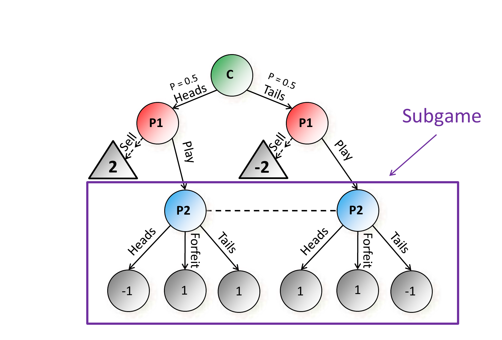
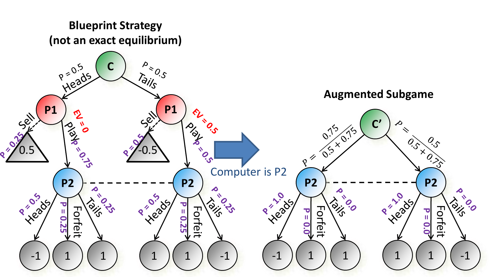
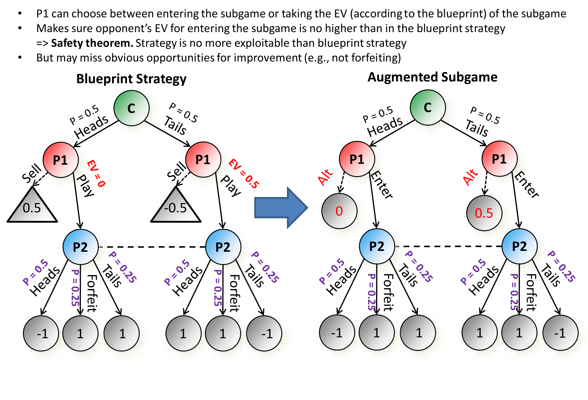
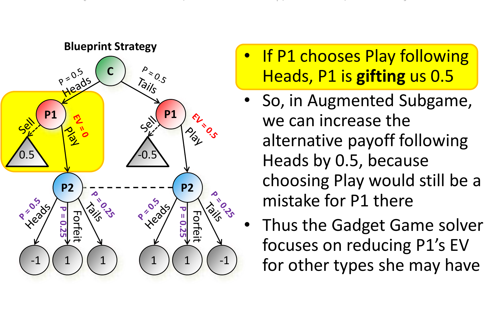
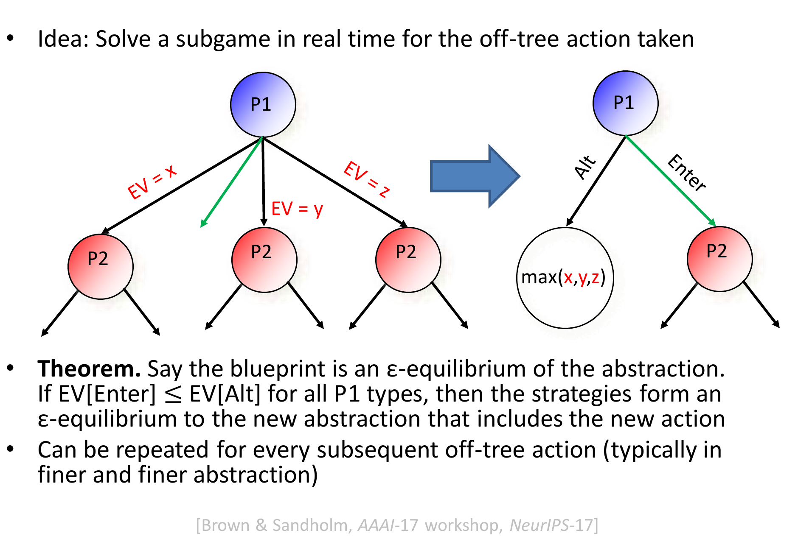

# L13 Libratus（中）：子博弈求解

上一章介绍了 Libratus 的总体架构：先在粗抽象中离线算出蓝图策略（blueprint strategy），对局中再由子博弈求解器（subgame solver）在更细的抽象中实时精解当前到达的局面。本章讲授子博弈求解本身——这是 Libratus 中**最重要的技术** [Brown & Sandholm, *Science* 2018]：为什么不完美信息博弈中的"子博弈"不能像完美信息博弈那样独立求解，如何借助蓝图提供的上下文构造可求解的增广子博弈（augmented subgame），以及从贝叶斯方法、Re-solve、Maxmargin 到 Reach-maxmargin 与嵌套子博弈求解（nested subgame solving）的一系列精化（refinement）技术及其安全性保证。

## 为什么子博弈不能独立求解

在完美信息博弈中，子博弈可以只用子博弈内部的信息求解（这正是 AlphaGo 式搜索的基础）。在不完美信息博弈中这不成立：一个"子博弈"中的最优打法依赖于到达各节点的概率分布（信念），而信念由博弈**其他部分**（包括对手在别处的策略）内生决定。

以上一章的掷硬币博弈（Coin Toss）为例。设玩家 1 选择 Sell 时，Heads 型得 $2$、Tails 型得 $-2$；若她选择 Play，则进入玩家 2 猜硬币的"子博弈"（下图中紫框部分）：

玩家 2 在子博弈中该怎么打，完全取决于他认为硬币是正是反的概率；而这个概率由玩家 1 在子博弈**之外**的策略（何种类型下倾向 Sell、何种类型下倾向 Play）决定。反之，玩家 1 是否值得 Play 又取决于子博弈里会发生什么。因此这个"子博弈"没有脱离全局的、自身闭合的解——它与博弈其余部分通过一个**概率分布（到达分布）和一组反事实价值**耦合在一起。这就是子博弈求解要解决的根本困难。

## 对局中子博弈求解的总体框架

Libratus 的目标是在**更细的抽象**中求解对局中实际到达的"子博弈"，从而获得比蓝图更精确的局部打法。由于子博弈不能独立求解，框架分两步：

1. 离线在一个**粗抽象**中求解整个博弈，得到蓝图策略——它近似地为每个局面提供了上下文（到达概率、各类型对手的期望价值等）；
2. 对局中，以蓝图为上下文，在当前到达的子博弈上构造一个自洽的**增广子博弈**，在更细的抽象中实时求解。

这里"子博弈"的含义需要先说清楚。经典博弈论中的子博弈要求起点处玩家确切知道博弈状态（信息集不被分割）；而扑克中的**不完美信息子博弈**由玩家间的**公共知识**界定——例如由公共牌和到目前为止的行动序列界定。与公共知识一致的每个私有牌组合都是该子博弈的一个根，其所有后代节点都属于子博弈 [Brown & Sandholm, *Science* 2018]。这也是为什么它不能像完美信息子博弈那样从单一根节点出发独立求解。

在增广子博弈中，双方都从蓝图诱导的分布中取样：每次迭代，对手（P1）被随机发一手私有牌；给定我方（P2）在子博弈之前按蓝图策略 $\sigma_2$ 行动、且给定 P1 的这手牌，P2 的牌也按相应的条件概率分布发放 [Brown & Sandholm, *Science* 2018]。因此增广子博弈的根部分布完整地编码了蓝图提供的上下文。

不同的子博弈求解技术的差别，就在于"如何借助蓝图构造增广子博弈"，以及由此得到的安全性（safety）保证的强弱。

## 贝叶斯子博弈求解（不安全）

最早的方法是贝叶斯子博弈求解（Bayesian subgame solving）[Gilpin & Sandholm, AAAI-06, AAMAS-07; Ganzfried & Sandholm, AAMAS-15]：在子博弈根部加一个虚拟的机会节点 $C'$，它按照**蓝图中对手各类型到达该子博弈的概率分布**发对手的"类型"（私有信息），然后正常求解这个增广子博弈。

以上图为例：蓝图中 Heads 型玩家 1 以概率 $0.75$ Play、Tails 型以概率 $0.5$ Play，于是增广子博弈根部 $C'$ 以 $\frac{0.75}{0.5+0.75}$ 与 $\frac{0.5}{0.5+0.75}$ 的概率发两种类型。在该例的解中，玩家 2（计算机）以概率 $1$ 猜 Heads、弃权（Forfeit）概率降为 $0$。

该方法**没有理论保证——是不安全的（unsafe）**：它无条件地信任蓝图给出的到达分布，对手可以偏离蓝图、改变进入子博弈的类型分布来利用我们。不过它在某些问题上实践效果不错。

## Re-solve 精解：安全性定理

Re-solve 精解（Re-solve refinement）[Burch et al., AAAI-14] 通过给对手一个"退出选项"恢复安全性。构造的增广子博弈中，对手（玩家 1）的每种类型在子博弈根部可以在两个行动间选择：

- **Enter**：进入子博弈，按新求解的策略对局；
- **Alt**：不进入，直接拿走该类型在**蓝图策略**下进入子博弈的期望价值（EV）。

由于求解的是零和博弈的均衡，玩家 1 只会在其 Enter 价值不超过 Alt 价值时才进入，于是该构造保证：**对手进入子博弈所获得的 EV 不高于蓝图策略中的 EV**。由此得到安全性定理：

> **定理（Re-solve 的安全性）.** Re-solve 精解得到的策略，其可利用性（exploitability）不超过蓝图策略。

安全性是有代价的：Re-solve **可能错过明显的改进机会**。在上例的解中，玩家 2 仍以 $0.25$ 的概率弃权——弃权在任何情形下都不比猜硬币好，但 Re-solve 的构造没有动力去消除这类残留的次优打法，因为它只要求对手的 EV 不超过蓝图水平。

## Maxmargin 精解

Maxmargin 精解（Maxmargin refinement）[Moravcik et al., AAAI-16] 与 Re-solve 类似，但更进一步：它**尽可能多地惩罚**对手选择 Enter 而非 Alt。对每种类型定义边际（margin）：

$$\mathit{Margin}_{\text{Heads}} = EV[\mathit{Alt}_{\text{Heads}}] - EV[\mathit{Enter}_{\text{Heads}}],$$

求解时**最大化最小边际**（而 Re-solve 只是力图让所有边际非负）。直观上，这迫使我们在增广子博弈中尽可能压低对手各类型的 Enter 价值。在掷硬币例子的解中，玩家 2 以 $5/8$ 猜 Heads、弃权概率降到 $0$，玩家 1 Heads 型 Enter 的 EV 被压到 $-0.25$。

但 Maxmargin 有一个问题（课件中的例子）：当我们集中精力把 Heads 型在子博弈内的 EV 压到 $-0.25$ 时，玩家 1 在 Heads 下本可以直接 Sell 拿走 $0.5$——也就是说，**蓝图早已"惩罚"过这个类型了**（她在蓝图中 Play 的 EV 只有 $0$，远低于 Sell 的 $0.5$），再把求解资源花在压她身上是浪费；这些资源本应用于压其他更有威胁的类型。

Libratus 实际使用的变体称为 **Estimated-Maxmargin（估计-Maxmargin）** [Brown & Sandholm, *Science* 2018]。它与 Maxmargin 的关键区别在于 Alt 支付的来源：此前的安全精解技术（Re-solve、Maxmargin）用的是对手在子博弈中价值的**上界**——上界能保证新策略的可利用性不超过蓝图，但实践中往往过于保守；Estimated-Maxmargin 改用蓝图给出的**估计值**。用估计值在理论上可能使可利用性略高于蓝图，但超出的量被下面的定理精确控制：

> **定理 1（Estimated-Maxmargin 的代价界）.** 设 $\sigma_i$ 是双人零和完美回忆博弈中玩家 $i$ 的策略，$S$ 是一组互不重叠的子博弈，$\sigma_i^*$ 是仅在 $S$ 内的子博弈上与 $\sigma_i$ 不同、且可利用性最小的策略。若对 $S$ 中任何子博弈和对手的任何决策点（扑克中即任何一手牌），我们对"对手对 $\sigma_i^*$ 最优响应在该子博弈中的价值"的估计误差不超过 $\Delta$，那么对局中对到达的子博弈应用 Estimated-Maxmargin 求解，所得整体策略的可利用性至多比 $\sigma_i^*$ 高 $2\Delta$。

直观地说：只要蓝图提供的价值估计足够准确，实时子博弈求解产生的策略就接近"只允许在到达的子博弈集合内改动蓝图"这一受限类中的最优策略——而蓝图本身离精确均衡通常还很远，因此这个受限最优已经可以是巨大的改进。

## Reach-maxmargin 精解：可达支付与"赠送"

Reach-maxmargin 精解（Reach-maxmargin refinement）[Brown & Sandholm, AAAI-17 workshop, NeurIPS-17, *Science*-18] 把上述观察系统化：它考察对手**到达**子博弈的每种类型在蓝图中的处境，把对手相对于蓝图已经犯的错误考虑进来。

具体地，若某类型在蓝图中到达子博弈的 EV 低于她在别处的可得价值（如上例 Heads 型 Play 的 EV 为 $0$，Sell 可得 $0.5$），那么她到达子博弈这一事实本身就说明她犯了错，差额 $0.5$ 是她**赠送（gift）**给我们的。于是我们可以在增广子博弈中把该类型的 Alt 替代支付相应提高（提高 $0.5$）——因为对她而言选 Play 仍是错误，安全性不被破坏；而 gadget game（机关博弈，即上述带 Alt/Enter 选择的增广子博弈）的求解器就可以把精力集中在压低对手**其他**类型的 EV 上。这正是"Libratus 可证明安全的子博弈求解能够把本手牌到目前为止对手所犯的错误考虑进来"的含义。

论文用一个扑克中的典型例子说明同一思想 [Brown & Sandholm, *Science* 2018]：$2\spadesuit 7\heartsuit$ 是 HUNL 中最差的起手牌，正确的打法是立即弃牌结束本局；拿着它进入任何后续子博弈本身就是在犯一个确定性的错误。此前的安全子博弈求解技术却要求新策略让对手**拿着每一手可能的牌**（包括 $2\spadesuit 7\heartsuit$）在子博弈中都不比蓝图更好——这是不必要强的约束：即使新策略把 $2\spadesuit 7\heartsuit$ 在该子博弈中的价值略微抬高，也抵不过对手拿着它进入子博弈（即不弃牌）已付出的代价。因此可以允许这类"不重要"类型的价值在子博弈中小幅上升，只要上升幅度小到拿着该类型到达子博弈仍然是错误；实现方式正是把该类型在增广子博弈中的 Alt 支付提高"到达子博弈所犯错误的代价"（即 gift 的大小）。

### 多个子博弈同时精解的两个问题

实际系统中同一时刻会有多个子博弈被精解，Reach-maxmargin 需要两处修补：

1. **路径外 EV 不再保持不变。** 一个子博弈被精解后，蓝图所假设的"其他子博弈中的 EV"会改变，gift 的账目会乱。解决办法：**按各子博弈被到达的概率在子博弈之间分配 gift**——每个子博弈只动用按其到达概率折算的那份 gift，从而不会因重复透支而破坏安全性。

2. **gift 可能没有想象中大。** gift 来自"对手在某些子博弈中打得很差"这一蓝图事实，但那些子博弈本身也在不断被精解、被改进，对手在那些子博弈中实际能拿到的 EV 会变好，可提取的 gift 随之缩水。解决办法：**用 gift 的一个下界来替代**估计值，宁可保守。

### 中等规模实验

在两个中型扑克博弈（行动抽象之内）上比较各方法的可利用性（exploitability，单位 mbb/hand，越低越好；Unsafe 在大博弈中反而比蓝图更容易被利用）：

| 方法 | 小博弈可利用性 | 大博弈可利用性 |
|---|---|---|
| 蓝图策略（Blueprint） | 91.3 | 41.4 |
| 不安全子博弈求解（Unsafe） | 5.51 | 397 |
| Re-solve 精解 | 81.2 | 36.3 |
| Maxmargin 精解 | 9.36 | 6.12 |
| Reach-maxmargin 精解 | **8.26** | **5.50** |

可以看到：不安全方法在小博弈上表现好但在大博弈上被严重利用；Re-solve 安全但改进有限；Maxmargin 与 Reach-maxmargin 在两个博弈上都把可利用性压低了一个数量级。

Science 论文还在一个三轮下注的更大变体上报告了对照（单位 mbb/game，每局即每手牌）：不做子博弈求解可利用性为 $346$，不安全求解为 $79.3$，安全求解为 $72.6$ [Brown & Sandholm, *Science* 2018]。综合三个变体，安全子博弈求解在**每一个**博弈中都把可利用性相对蓝图降低了四倍以上，而不安全求解在其中大博弈上反而把可利用性放大了近一个数量级（上表中的 $397$）——这正是"不安全方法可能在某些博弈上很强、在另一些上远差于蓝图"的实证。（注意口径：上表五种方法的比较来自 NeurIPS-17 论文的实验，Science 论文的表 1 只比较"无 / 不安全 / 安全"三类；两处大博弈的蓝图可利用性分别为 $41.4$ 与 $41.3$，属舍入差异，此处以课件为准。）

## Libratus 子博弈求解器的全部新思想

上述工作（NeurIPS-17 最佳论文奖）合在一起，构成 Libratus 子博弈求解器相对此前技术的全部新思想：

- **可证明安全、且把对手本手牌到目前为止所犯的错误考虑进来**的子博弈求解（即 Reach-maxmargin 的 gift 机制）；
- 用对对手价值的**估计值**而非上界作为 Alt 支付（Estimated-Maxmargin）；代价由定理 1 控制——可利用性至多比"只在子博弈集合内改动的最优策略"高 $2\Delta$；
- **嵌套子博弈求解**（见下节）；
- 子博弈求解**开始得更早**（不必等到残局，对局中途就启动）；
- 子博弈内部**不做牌面抽象**（在完整牌面上求解）；
- 在手牌之间**更换行动抽象**，使对手难以跨手牌利用固定的抽象漏洞。

## 嵌套子博弈求解：应对树外行动

蓝图和增广子博弈都在**行动抽象**中求解：下注额被离散化。但真实对手可以下任意注额，即走出抽象树之外的行动（off-tree action）。传统处理是**动作翻译**（action translation）：把对手的树外注额映射到树内最近的注额上再继续 [Gilpin, Sandholm & Sørensen, AAMAS-08; Schnizlein et al., IJCAI-09; Ganzfried & Sandholm, IJCAI-13]。问题在于对手可以专门挑选翻译后对我方最不利的注额，翻译本身可被利用。

嵌套子博弈求解的思想：**对手每走出一个树外行动，就实时地为这个行动求解一个新的子博弈**，而不是把行动翻译回旧树。

> **定理（嵌套子博弈求解的安全性）.** 设蓝图是（行动）抽象中的一个 $\epsilon$-均衡。若对玩家 1 的所有类型都有 $EV[\mathit{Enter}] \le EV[\mathit{Alt}]$，则所得策略构成**包含新行动的新抽象**中的一个 $\epsilon$-均衡。

也就是说，每处理一个树外行动，我们都在一个更大的抽象（把该行动显式加入）中保持了与蓝图同级的均衡近似。这一过程可以对每个后续的树外行动**重复**进行（通常在越来越细的抽象中），一层层嵌套下去——故得名嵌套子博弈求解。

论文明确了构造的一个细节：Alt 的替代支付取对手在抽象内**本来可采取的最好行动**的价值，而这个最好行动可以**因手牌而异**——即对对手的每种类型分别取其最优树内行动的价值，而不是对所有类型取同一个最大值 [Brown & Sandholm, *Science* 2018]。直观上，这让新策略保证"对手无论拿着什么牌，选择树外行动都不会比选择树内行动更好"。

值得一提的是，DeepStack 的作者们独立且同期提出了与嵌套子博弈求解类似的**持续重解**（continual re-solving）技术 [Moravcik et al., *Science* 2017]。两者都实时计算对对手具体注额的响应、都用估计值而非上界；但 DeepStack 没有"降低对已犯错类型的关注"（即 Reach 的 gift 机制），也不在手牌之间更换子博弈的行动抽象。另一个差别是 DeepStack 在前两轮下注就进行深度受限的实时求解（深度边界处的价值由神经网络估计），而 Libratus 在前两轮通常直接按预先算好的蓝图策略行动 [Brown & Sandholm, *Science* 2018]。

### 中等规模实验

在同一中型测试博弈上，嵌套子博弈求解与传统动作翻译的可利用性对比（mbb/hand，越低越好）：

| 方法 | 可利用性 |
|---|---|
| 随机伪调和映射（Randomized Pseudo-Harmonic Mapping）[Ganzfried & Sandholm, IJCAI-13] | 1465 |
| 嵌套 Re-solve 精解 | 150.2 |
| 嵌套不安全精解（Nested Unsafe） | 148.3 |
| 嵌套 Maxmargin 精解 | 122.0 |
| 嵌套 Reach-maxmargin 精解 | **119.1** |

嵌套子博弈求解把可利用性降低了一个数量级以上；其中嵌套 Reach-maxmargin 最好。

在完整 HUNL 上的对照实验进一步量化了嵌套子博弈求解的贡献 [Brown & Sandholm, *Science* 2018]。对手是 2016 年 ACPC 冠军、此前最强的公开 HUNL AI Baby Tartanian8（报告均值与 95% 置信区间，单位 mbb/game）：仅用原始蓝图策略，Libratus 以 $-8 \pm 15$ 落败；蓝图上施加后处理（剔除低概率行动）后以 $18 \pm 21$ 取胜；加入嵌套子博弈求解、但只使用对手树内行动时以 $59 \pm 28$ 取胜；采用比赛用的完整嵌套子博弈求解结构后以 $63 \pm 28$ 取胜。作为对照，Baby Tartanian8 当年对 ACPC 第二、三名 AI 的优势分别只有 $12 \pm 10$ 与 $24 \pm 20$。也就是说，嵌套子博弈求解带来的提升（约 $71$ mbb/game）远大于此前最强 AI 之间的代差——这是 Libratus 达到超人类水平的关键来源。（完整 Libratus 在第三、四轮不做后处理，因为剔除低概率行动虽对不调整的 AI 有效，却会使策略更可预测、增大可利用性。）

## 要点小结

- 不完美信息博弈中子博弈不能独立求解：子博弈内的最优打法依赖到达分布与反事实价值，而这些由博弈其余部分内生决定。Libratus 的方案是"粗抽象求蓝图 + 蓝图作上下文实时精解子博弈"，这是 Libratus 最重要的技术。
- **贝叶斯子博弈求解**：按蓝图到达分布在增广子博弈根部发类型；无理论保证（unsafe），大博弈中可被严重利用。
- **Re-solve 精解**：对手每种类型可在 Enter 与 Alt（拿蓝图 EV）之间选择，保证对手进入子博弈的 EV 不高于蓝图——安全性定理：可利用性不超过蓝图；但可能错过明显改进（如不弃权）。
- **Maxmargin 精解**：最大化最小边际 $\mathit{Margin} = EV[\mathit{Alt}] - EV[\mathit{Enter}]$；问题是会在蓝图已经惩罚过的类型上浪费求解力度。
- **Estimated-Maxmargin 精解**（Libratus 实际使用的变体）：用蓝图给出的估计值替代上界作为 Alt 支付，避免过度保守；定理 1 保证：估计误差不超过 $\Delta$ 时，整体可利用性至多比"只在子博弈集合内改动的最优策略"高 $2\Delta$。
- **Reach-maxmargin 精解**：把对手到达子博弈时已犯的错误（gift）计入 Alt 支付；多子博弈时按到达概率分配 gift，并用 gift 的下界替代估计值。实验上把可利用性较蓝图压低约一个数量级，且保持安全。
- **嵌套子博弈求解**：对手走出树外行动时实时求解新子博弈；定理保证在包含新行动的新抽象中维持 $\epsilon$-均衡（条件是各类型 $EV[\mathit{Enter}] \le EV[\mathit{Alt}]$）；较动作翻译把可利用性降低一个数量级以上。
- Libratus 求解器的完整新特性：考虑对手错误的可证明安全求解、嵌套求解、更早启动、子博弈内无牌抽象、手牌间更换行动抽象。
