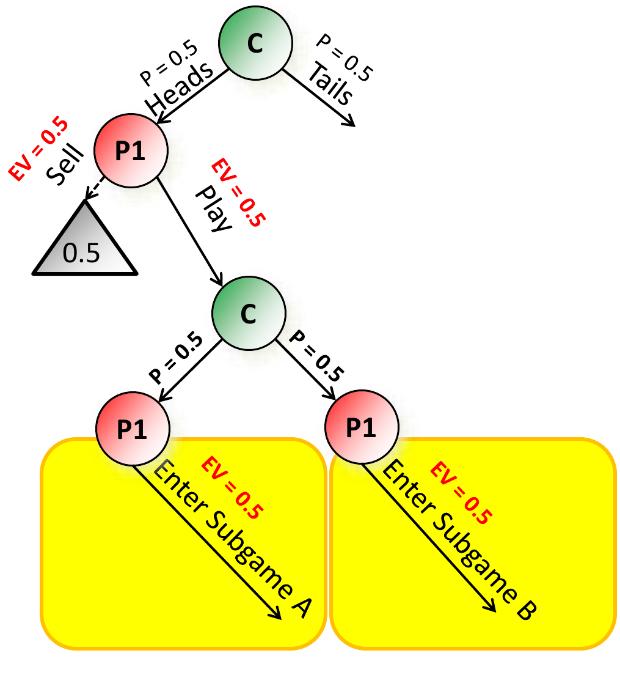
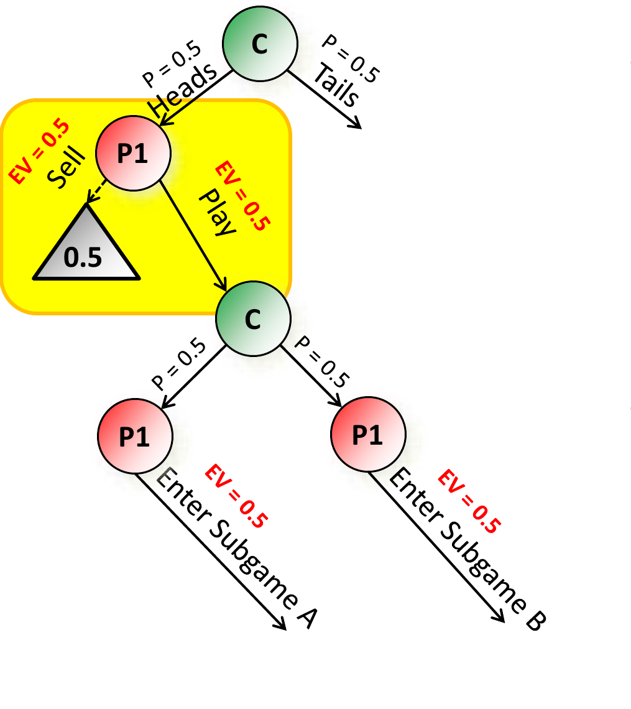
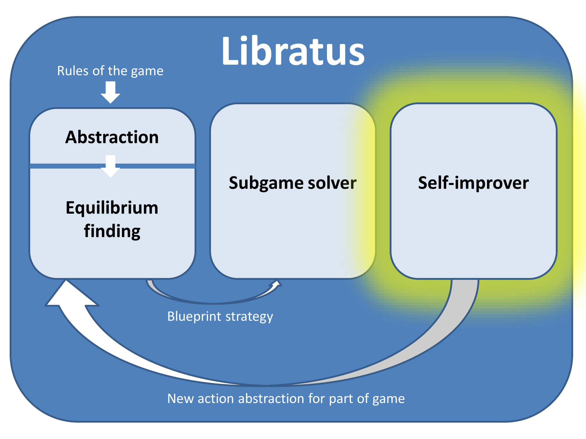
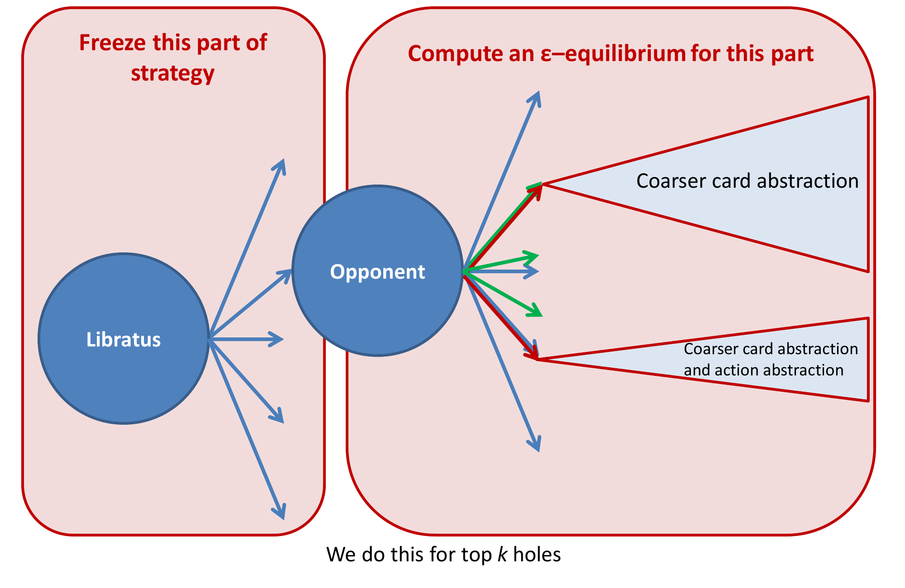

<!-- escape-math: v1 -->
# L14 Libratus（下）：自我改进器

上一章介绍了 Libratus 的第二个模块——子博弈求解器（subgame solver），它在对局中以蓝图策略（blueprint strategy）为上下文，在更细粒度的抽象中实时精解当前到达的子博弈。本章补完 Libratus 的其余内容：可达最大边际求精（reach-maxmargin refinement）在**多个子博弈同时精解**时需要的两个修正；第三个模块**自我改进器（self-improver）**的工作原理；以及一个贯穿性的设计问题——Libratus 如何把人类的扑克知识转化为抽象。

## 同时求解多个子博弈

先回顾上一章单个子博弈的 reach-maxmargin 求精。在掷硬币博弈的例子中，蓝图策略下 P1 拿到 Heads 时以正概率选择 Play，而 Play 的期望价值低于 Sell，于是 P1 实际上在"送礼"：如果她拿到 Heads 还选择 Play 进入子博弈，等于白送给我们 $0.5$ 的期望价值。既然如此，在增强子博弈（augmented subgame）中就可以把 Heads 类型的替代支付（alternative payoff，即"不进入子博弈"的取值）提高 $0.5$——因为即便抬高之后，Play 对 P1 仍然是错误选择。这样，机关博弈（gadget game）的求解器就不必再为压低 Heads 类型的期望价值耗费精力，而可以**集中力量压低 P1 其他类型进入子博弈的期望价值**。抬高替代支付的额度正是所谓的**礼物（gift）**，它来自对手在蓝图策略下已经犯下的错误。

在实际系统中，求精并不是一次只解一个子博弈：到达河牌圈（river）后，每一种公共牌面都对应一个子博弈，Libratus 会同时精解大量子博弈。此时 reach-maxmargin 的两个前提被破坏，需要相应的修正 [Brown & Sandholm, AAAI-17 workshop, NeurIPS-17, *Science* 2018]。

### 问题一：离路径期望价值不再守恒——按到达概率分配礼物

只精解单个子博弈时，礼物的来源子博弈保持蓝图打法，其离路径期望价值（off-path EV）是常数，礼物大小可以直接从蓝图中读出。但**多个子博弈被同时精解时，离路径 EV 可能不再保持常数**：一个子博弈的策略改进会改变对手在其他（产生礼物的）子博弈处的期望价值，从而改变礼物本身。

**解决办法：把礼物按各子博弈被到达的概率分配给它们**（split gifts among subgames by the probability the subgame is reached）。

以上图为例：P1 在 Heads 之后的 Sell 替代支付为 $0.5$，即可分配的礼物总量为 $0.5$；机会节点再以各 $P=0.5$ 的概率把博弈引入子博弈 A 与子博弈 B。课件的动画演示了几种合法的分配方案——例如给 A 分配 $1.0$、给 B 分配 $0$，或两者各分配 $0.5$——只要按到达概率加权的总量不超过礼物即可：

$$0.5 \cdot g\_A + 0.5 \cdot g\_B \\;\le\\; 0.5 .$$

这样每个子博弈的求解器都只"花掉"自己那一份礼物。直观地说，单个子博弈的安全性论证要求"对手进入该子博弈的期望价值不高于蓝图中的取值"；按到达概率分配后，所有被精解子博弈消耗的礼物按到达概率加权求和仍不超过总礼物，因此沿任何一条路径，对手都不会因为多处同时求精而获得比蓝图更高的期望价值——安全性在同时精解时仍然成立。

### 问题二：礼物本身也会被改进——用下界替代名义值

第二个问题更进一步：**礼物可能没有看上去那么大，因为产生礼物的那些子博弈本身也会被精解**。上图中 P1 在 Heads 之后的 Sell 子树（即替代支付的来源）如果也在被求精，那么对手在那里的打法会改进，"$0.5$ 的礼物"就会缩水。课件动画演示了这一过程：随着 Sell 子树被改进，P1 在该处的期望价值从 $0.5$ 降到 $0.25$，进而 Play 分支、子博弈 A、子博弈 B 处的替代支付都应相应下调——若仍按名义值 $0.5$ 计入，替代支付就被高估了，安全性论证随之失效。

**解决办法：不用蓝图给出的名义值，而是代入礼物的一个下界（lower bound on the gift）**。这样即使产生礼物的子博弈被改进到对手不再犯错，增强子博弈中的替代支付也绝不会被高估，安全性得以保持。

这两条修正合在一起，使得 Libratus 可以在每手牌的每一轮同时对大量子博弈做既安全、又能利用对手本手所犯错误的精解。中等规模实验（在动作抽象内部精解）支持了这一路线的效果：reach-maxmargin 求精把蓝图策略 $91.3$ mbb/hand（小博弈）与 $41.4$ mbb/hand（大博弈）的可利用性分别降到 $8.26$ 与 $5.50$ mbb/hand，优于 maxmargin 求精的 $9.36$ / $6.12$，更远优于 re-solve 求精的 $81.2$ / $36.3$（完整实验表格与设置见上一章）。

## 自我改进器（self-improver）

### 为什么需要第三个模块

蓝图策略的动作抽象（action abstraction）是赛前算好并固定下来的：博弈树中每个决策点只允许若干种下注额。人类职业选手会刻意尝试抽象之外的下注尺度，试探 AI 的盲区。对蓝图而言，这些尺度是动作树中的**洞（holes）**：蓝图里没有对应的动作分支，只能靠动作转译（action translation）把对手的下注映射到抽象中邻近的尺度来近似回应，而这种近似会被反复攻击。第三个模块——自我改进器——的任务就是自动发现并修补这些洞。

蓝图策略是赛前离线算好的（一次运行用 $1+195$ 个节点、耗时 1–8 周），比赛期间不可能每晚重算整个蓝图；自我改进器是三个模块中**唯一在对局期间修改蓝图**的模块，因此它必须走"局部修补"路线：冻结其余部分，只重算含洞的小块博弈。自我改进器在架构图中的位置也说明了这一点——它输出的是"博弈某一部分的新动作抽象"，反馈回蓝图模块，而非一份全新的蓝图策略。

值得注意的是自我改进器**不是**对手建模（opponent modeling）。机器学习在博弈中的传统用法是建立对手模型、找出对手策略中的系统性错误（如弃牌过多、跟注过多）并加以利用；但利用对手的同时也会暴露自己——对手同样可以反过来利用我们的偏离（唯一的例外是"安全对手利用"这一保守的技术家族 [Ganzfried & Sandholm, TEAC-15 等]）。因此 Libratus 在一阶近似上不做对手利用：它只借用对手的实际下注数据来**决定在哪里补洞**，补上之后仍以博弈论方法（均衡计算）给出这些分支的策略。这样得到的修补是普适的——它对所有对手都成立，而非只对当前这四名选手成立。

### 填补动作树中的洞

自我改进器的核心算法是**填补动作树中的洞（filling holes in the action tree）**，步骤如下（对照下图）：

1. **定位**：找出蓝图动作抽象中被对手利用最多的前 $k$ 个洞——即对手实际使用了、但蓝图中没有对应分支的下注位置；
2. **冻结**：冻结（freeze）策略的其余部分——蓝图已有的策略不再改动，从而新计算不会破坏已有的安全性；
3. **局部求解**：对每个洞，为包含该新动作的部分博弈计算一个 $\epsilon$-均衡。为了把计算集中在洞附近、保持规模可控，两侧使用不对称的更粗抽象：Libratus 自己一侧的子树用更粗的牌面抽象（coarser card abstraction），对手一侧的子树用更粗的牌面抽象与动作抽象（coarser card and action abstraction）；
4. **并入**：把新算出的动作抽象与相应策略并入蓝图。此后对手再使用该下注额时，Libratus 就有了原生（而非转译近似）的应对。

Science 论文还记录了自我改进的两种形式。其一（较保守）：在为某个洞计算均衡时，同时放入一个**默认的兄弟下注额**（default sibling bet size），从而不假设对手只会使用将被补上的那一个尺度。其二（较激进）：不放默认兄弟注额——这更接近"针对"对手的实际习惯，风险更高、甚至带有利用性；Libratus 的缓释办法是**只在对手确实大部分时间使用该下注额时**，才在对局中启用这部分策略。

### 比赛中的实际运行

Brains vs AI 重赛的 20 天里形成了独特的昼夜节奏：白天，四位职业选手研究前一晚拿到的 Libratus 手牌历史，寻找并攻击它的弱点；夜里，Libratus 的自我改进器修复自身最常被利用的洞。具体的选洞机制是：每天汇总对手当天在第 1 轮下注中最常使用的下注额，按**使用频率**和**与抽象中最近注额的距离**选出前 $k$ 个洞连夜计算响应；论文记录，受算力所限取 $k=3$，通常可在 24 小时内把三个洞修到合理的收敛精度，早晨达到收敛的注额连同新算出的策略一并并入蓝图。职业选手普遍反映 Libratus 越打越强——他们找到的弱点往往在几天后就失效了。这一能力也正是 NeurIPS-17 子博弈求解器新特性之一："**在手牌之间改变动作抽象**"（changing the action abstraction between hands）——Libratus 并非带着一套固定抽象打完全部 120,000 手。

计算规模上，每次自我改进器运行在 Bridges 超算上使用 196–600 个计算节点，通常持续 8–30 小时——恰好覆盖一个夜晚。

## 把扑克知识转化为抽象

最后回到第一个模块的一个根本设计问题：Libratus 的"扑克知识"从何而来？答案是：**几乎全部经由抽象进入系统**。均衡求解器（MCCFR 的改进版）与子博弈求解器都是与领域无关的通用算法，真正承载扑克专门知识的是抽象的选择。论文补充了改进版 MCCFR 的两个要点：它在迭代中对后悔值极负、明显无前途的动作做概率性跳过（约带来 3 倍加速，从而能解更大的抽象）；这一跳过还顺带缓解了不完美回忆抽象（imperfect-recall abstraction）的固有毛病——同一桶内各决策点的最优策略本来会互相"拉扯"桶的共享策略，而实际打不到的决策点不再被更新后，真正会到达的决策点就能把桶的策略拉向它们各自的最优。

**对自然的行动（发牌）做抽象**。采用与 Tartanian8 相同的算法 [Brown, Ganzfried & Sandholm, AAMAS-15]——即课上讲过的、用于集中式均衡求解的最先进状态抽象算法的分布式版本：按公共牌 flop 把计算分布到不同计算节点（blade），使任何一个样本始终落在单个节点内。直观的依据是相似的牌面在策略上几乎没有差别——K 高的同花与 Q 高的同花可以当作同一手牌处理（尽管在最高水平上这类细微差别恰恰决定胜负，这也是后两轮仍需细粒度处理的原因）。但抽象粒度细得多：

- 第 1、2 轮下注：不做牌面抽象；
- 第 3 轮下注：5500 万（55M）种牌面历史压缩到 250 万（2.5M）个桶（bucket）；
- 第 4 轮下注：24 亿（2.4B）种牌面历史压缩到 125 万（1.25M）个桶。

需要强调的是，后两轮的牌面抽象只存在于蓝图中：**实际对局从不按蓝图的抽象解打后两轮**——到达后两轮后由嵌套子博弈求解在不做任何牌面抽象的细粒度抽象中实时求解，每一手具体的牌在对局中都被单独对待。这一算法家族的前身 Baby Tartanian8 与 Tartanian7 分别赢得了 2016 与 2014 年 ACPC（年度计算机扑克大赛）。

**对玩家的行动（下注额）做抽象**。无限注德扑的下注空间本质上是连续的（任意数额直至全下），必须离散化为有限个动作。Libratus 的下注额集合主要基于对**顶尖人类选手与顶级 AI 实际打法**的观察——这保证了抽象覆盖对手最可能采取的尺度；论文进一步明确，这些注额大多是**底池的整齐分数或倍数**，大致通过分析历届 ACPC 顶级 AI 在博弈各位置最常用的注额确定。在此之上加入了人类武器库中不常见的极端注额（radical bet sizes），使 AI 能打出超出人类习惯范围的攻击；并用 [Brown & Sandholm, AAAI-14] 的方法对博弈树早期的部分注额做了优化——那是一个与领域无关的参数优化算法，收敛到局部最优的注额集合。

换句话说，人类扑克知识负责划定"候选动作的集合"，博弈论负责决定"以何种概率使用其中每一个动作"。Libratus 用极端注额与混合策略打出人类看来极不寻常的风格，正是因为后者完全由均衡计算驱动。而自我改进器补上了闭环：候选集合本身也不再固定，它在比赛期间持续演化——人类知识提供起点，自我改进提供适应，均衡求解提供原则性的打法。

## 完整系统的实验评估

Science 论文还报告了完整 HUNL 上的逐级消融实验（报告平均赢率及 95% 置信区间），对手是此前最强的 HUNL AI、2016 年 ACPC 冠军 Baby Tartanian8（它曾以统计显著性击败所有其他参赛 AI）：

- 只用**裸蓝图策略**：Libratus 以 $8 \pm 15$ mbb/hand **输**给 Baby Tartanian8；
- 加上第 3、4 轮的最先进后处理（post-processing，如删除大概率只因未收敛而获得正概率的动作）：蓝图反以 $18 \pm 21$ mbb/hand 获胜。但后处理会让策略更可预测、**提高可利用性**，因此完整版 Libratus 在后两轮并不使用后处理（前两轮使用一种新的、更鲁棒的后处理形式）；
- 再加上嵌套子博弈求解（且只用 Baby Tartanian8 动作抽象内的注额）：以 $59 \pm 28$ mbb/hand 获胜；
- 使用比赛中实际的完整嵌套子博弈求解结构：以 $63 \pm 28$ mbb/hand 获胜。

作为参照，Baby Tartanian8 对 ACPC 中次强的两个 AI 分别只赢 $12 \pm 10$ 与 $24 \pm 20$ mbb/hand——Libratus 对它的优势是数量级级别的。这组数字也直观地量化了前两章与章首各模块的贡献：蓝图本身尚不足以击败上一代最强 AI，子博弈求解器才是拉开差距的关键。

对人类选手的实验即 2017 年 1 月的 Brains vs AI 重赛：20 天、120,000 手，对手为 Jason Les、Dong Kim、Daniel McCauley、Jimmy Chou 四名 HUNL 专家；$20 万奖池中每人保底 $2 万，其余 $12 万按相对四人之最差者的表现分配。Libratus 以 $147$ mbb/hand 的总优势获胜，按手牌独立同分布计 $p = 0.0002$（统计显著性 $99.98\\%$），且**对四名选手中的每一位都单独获胜**。

## 要点小结

- 多个子博弈同时精解时，reach-maxmargin 的两个前提被破坏：其一，离路径 EV 不再守恒——按各子博弈被到达的概率把礼物分配给它们；其二，产生礼物的子博弈本身也会被改进——代入礼物的下界而非名义值。两条修正保证了同时精解的安全性。
- 自我改进器通过**填补动作树中的洞**工作：定位被对手利用最多的前 $k$ 个洞，冻结策略其余部分，在两侧不对称的更粗抽象中为含新动作的局部计算 $\epsilon$-均衡，再把新动作抽象并入蓝图。它不做对手建模/利用，只用对手数据决定补洞位置，因此修补对所有对手普适。
- 比赛期间自我改进器每晚运行（$k=3$，196–600 节点、8–30 小时），使 Libratus 能在手牌之间改变动作抽象；职业选手找到的弱点几天内即失效。自我改进分两种形式：带默认兄弟注额的保守修补，与仅在对手确实常用该注额时才启用的激进修补。
- Libratus 的扑克知识几乎全部经由抽象进入系统：牌面抽象复用 Tartanian8 的分布式算法（后两轮分别压缩到 2.5M、1.25M 个桶，且仅存在于蓝图中，实战后两轮无牌面抽象），动作抽象取底池的整齐分数/倍数、基于顶级人类与 ACPC 顶级 AI 的打法并加入极端注额、优化早期注额；人类知识定候选，均衡计算定用法，自我改进让候选集合持续演化。
- 完整 HUNL 消融：裸蓝图输给 Baby Tartanian8 $8 \pm 15$ mbb/hand，加嵌套子博弈求解后赢 $59$–$63 \pm 28$ mbb/hand；对四名人类专家以 $147$ mbb/hand（$p=0.0002$）获胜且逐一击败。
