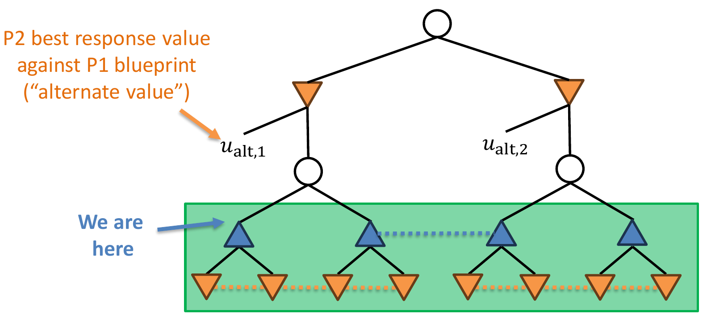
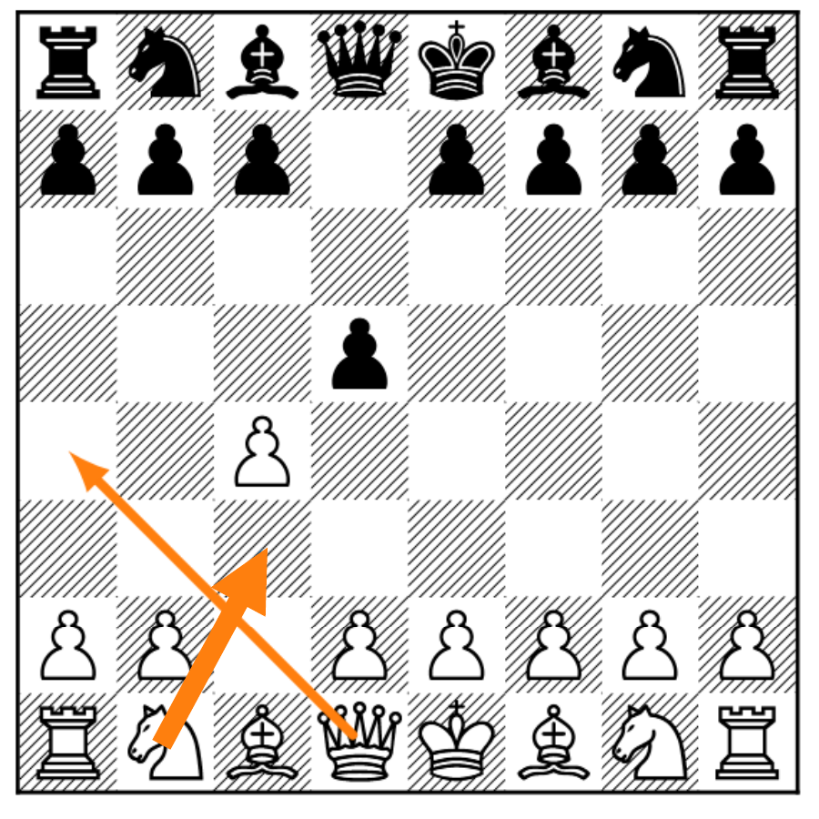

# L15 知识受限子博弈求解（KLSS）

本章介绍不完美信息博弈中不依赖共有知识（common knowledge）的通用搜索技术，并以其在战争迷雾象棋（Fog of War chess，又称暗棋 Dark Chess）上造就的首个超人类智能体 *Obscuro* 作为应用案例。本章内容基于 Tuomas Sandholm 与其博士生 Brian Hu Zhang 的合作工作。

## 战争迷雾象棋

战争迷雾象棋的规则与国际象棋几乎相同，但每个玩家只能看到自己棋子所能到达（移动或攻击）的格子，棋盘其余部分被"战争迷雾"遮蔽：对手棋子走到看不见的地方时，玩家无法察觉其位置。

上图展示了黑方视角下的棋盘：黑方棋子及其控制区域清晰可见，而白方半场完全笼罩在迷雾中。这意味着玩家甚至不知道自己是否正被将军——例如白方后悄悄运动到 h4 而黑方毫无察觉，下一回合王即被吃掉。这一特性使战争迷雾象棋成为信息极度不完美的博弈。

论文 [Zhang & Sandholm NeurIPS-21] 给出的精确规则还包括：若存在合法的吃过路兵，玩家会被告知过路兵格；没有将军与将死，目标就是吃掉对方的王，因此"逼和"（stalemate）反而是使对方无棋可走的一方获胜，王车易位穿过受攻击的格子也是合法的（尽管通常会立即输掉）。这些规则保证玩家始终确知自己的合法走法集合。

## k 阶知识与共有知识

不完美信息博弈中的推理涉及高阶知识（kth-order knowledge）：我知道什么、你知道我知道什么、我知道你知道我知道什么……若命题对任意有限阶的"每个人都知道"都成立，则称该命题是**共有知识**（common knowledge）。

战争迷雾象棋中的高阶知识可以非常深。课件给出了一个精妙例子：设局面 A 为 1. Nf3 e5 2. h3 Qh4 之后的局面，局面 B 为 1. Nc3 g5 2. Nh3 d5 之后的局面。问：在局面 A 中，"当前局面不是 B"是共有知识吗？答案是否定的——但它可以是 8 阶知识。

上图展示了从局面 A 到局面 B 的一条链：链上相邻局面之间每次只变动一个棋子（马、兵、后的位置逐格迁移）。玩家从自己可见的信息出发，只能逐阶排除链上的一个局面：双方都确知当前局面不是链上的第 1 个，双方都知道双方都知道它不是第 2 个……"每个人都知道每个人都知道……当前局面不是 B"这一命题对 8 重重复成立，但对 9 重不成立。换言之，区分两个局面所需的知识阶数可以任意高，这正是共有知识集合可能极其庞大的根源。

## 实时子博弈求解回顾

在**完美信息**博弈中，实时子博弈求解（real-time subgame solving）是直接的：走到某个决策点时，只需把该点之下的子博弈孤立出来求解即可，子博弈之外的部分无关紧要。

在**不完美信息**博弈中，这一招失效：不能孤立地求解子博弈，因为子博弈的解可能依赖于博弈的其他部分——信息集可能横跨"子博弈内"与"子博弈外"的节点。

基本思路 [Gilpin & Sandholm AAAI-06]：从一个**蓝图策略**（blueprint strategy）出发（例如由粗抽象计算、深度学习或人类启发式得到），当到达某个决策点时，在局部对蓝图策略加以**精化**（refine）。这条技术路线的发展史可分为两类：

- **"不安全"方法**：子博弈求解可能使智能体比蓝图更容易被利用 [Gilpin & Sandholm AAAI-06; Gilpin & Sandholm AAMAS-07; Gilpin, Sandholm & Sørensen AAMAS-08; Ganzfried & Sandholm AAMAS-15 …]；
- **"安全"方法**：子博弈求解不会使智能体比蓝图更容易被利用 [Burch et al. AAAI-14; Moravcik et al. AAAI-16; Schmid et al. AAAI-16; Brown & Sandholm NeurIPS-17 …]。

## 共有知识子博弈

以往的子博弈求解方法都建立在**共有知识子博弈**（common-knowledge subgame）之上。

> **定义（共有知识子博弈）**
>
> - 博弈树同一层中的两个节点称为**连通的**（connected），如果存在某个信息集，把第一个节点的某个后代与第二个节点的某个后代连在一起；
> - 节点 $h$ 处的共有知识子博弈由所有与 $h$ **递归连通**的节点以及它们的所有后代组成。

直觉上，共有知识子博弈恰好囊括了"双方都确知双方……确知当前可能处于其中"的所有节点，因此可以在其上自洽地定义并求解一个子博弈。

论文 [Zhang & Sandholm NeurIPS-21] 把这一概念形式化为**信息集超图**（infoset hypergraph）：以博弈的全部节点为顶点、以各信息集为超边构成超图 $G$。对节点集合 $S$，其 **$k$ 阶知识集** $S^k$ 定义为 $G$ 中距 $S$ 不超过 $k-1$ 的所有节点；**共有知识闭包** $S^\infty$ 则是 $G$ 中包含 $S$ 的连通分量。直觉上，若确知真实节点在 $S$ 中，则对手知道真实节点在 $S^2$ 中，我们知道对手知道真实节点在 $S^3$ 中……而"真实节点在 $S^\infty$ 中"正是共有知识。当前信息集 $I$ 的闭包 $I^\infty$ 就是上文课件意义下的共有知识子博弈。

### 边际与安全性

安全子博弈求解的核心概念是**边际**（margin）。设子博弈的各**入口点**（entry point，即进入子博弈的信息集）编号为 $j$。P2 在入口点 $j$ 处的边际定义为

$$M_j := u_{\text{enter},j} - u_{\text{alt},j}$$

其中 $u_{\text{enter},j}$ 是 P2 针对 P1 **新策略**的最优应对值（best response value），$u_{\text{alt},j}$ 是 P2 针对 P1 **蓝图策略**的最优应对值，称为**备择值**（alternate value）。$u_{\text{alt},j}$ 对应图中 P2 在入口点上方"另择他路"时能保证得到的值，如下图所示。

> **定理（非正式表述）**：任何能保证 P2 所有边际都非负的 P1 策略都是安全的（即不会比蓝图更容易被利用）。
> [Burch, Johanson, Bowling 2014; Moravcik et al. 2016; Brown & Sandholm 2017]

在此定理基础上，两类经典目标函数给出了具体的求解方式：

- **Resolve refinement**（重解精化）[Burch, Johanson, Bowling 2014]：寻找最大化
$$\sum_{j \in \text{信息集}} \min\{0, M_j\}$$
的子博弈策略。其思想是"补偿"那些被新策略损害的入口点；
- **Maxmargin 子博弈求解** [Moravcik et al. 2016]：寻找最大化
$$\min_{j \in \text{信息集}} M_j$$
的子博弈策略，即让所有入口点的安全边际尽量大。

此前最先进的安全子博弈求解技术是 **reach maxmargin 子博弈求解** [Brown & Sandholm NeurIPS-17]，其思想是：对通往信息集 $j$ 的路径上对手"赠送"给我们的礼物（gifts），可以视情况予以归还。该技术在两人无限注德州扑克上达到了超人类水平 [Brown & Sandholm Science 2018]。本章的新算法也沿用了这一思想。

## 问题所在：共有知识集合可能过大

扑克之外的博弈中，共有知识集合（记为 $C$）可能大到无法处理：

- **两人德州扑克**：$|C| < 2 \times 10^6$；借助实用的扑克专用技巧，有效规模约 $|C| \approx 10^3$ [Johanson et al. IJCAI-11]，实时求解游刃有余。
- **战争迷雾象棋**：$C$ 常常大到内存都存不下，遑论实时运算；甚至如何高效**判定**两个节点是否属于同一个共有知识集合都不显然。

因此，基于共有知识子博弈的整套方法在战争迷雾象棋这类博弈中根本无法落地。

## 知识受限子博弈求解

**知识受限子博弈求解**的出发点是一个反问：共有知识集合里那些"遥远"的节点真的重要吗？回到高阶知识的图景：P1（▲）知道自己处于某个信息集；P2（▼）知道 P1 知道自己处于那里；P1 知道 P2 知道 P1 知道……但沿着知识链再走几步，就可能出现"▲ 知道 ▼ 知道 ▲ 知道我们**不在**某个节点"的情形——既然如此，那个节点对当前决策的影响便微乎其微。

> **思想**：在知识图（knowledge graph）中忽略"太远"的节点，只保留与当前位置知识距离不超过 $k$ 的节点来构造子博弈，称为 **$k$-KLUSS**。

上图给出 2-KLUSS 的示意：以当前位置为中心，沿知识链扩展两阶所覆盖的部分（绿框）被纳入子博弈并沿用 maxmargin 框架求解（仍保留备择值 $u_{\text{alt},j}$），其余节点直接忽略。一个细节区别：旧版算法 **KLSS** [Zhang & Sandholm NeurIPS-21] 会把被截断边界上的节点**冻结**（freeze）为蓝图策略，而新算法**知识受限非冻结子博弈求解**（Knowledge-Limited Unfrozen Subgame Solving, **KLUSS**）不做冻结。

$k$-KLSS（$k$ 取正奇数）的具体构造分三步压缩博弈树：固定我方在当前信息集 $I$ 的 $k$ 阶知识集 $I^k$ 之外的策略后——

1. 对手在 $I^{k+1}$ 之外的最优应对也随之固定，故 $I^{k+1}$ 之外的节点可以全部剪除；
2. 对 $h \in I^{k+1} \setminus I^k$ 的节点，我方策略同样固定，这些节点处的支付只是对手子博弈策略与蓝图策略的函数，可以预先算出并并入支付矩阵的一行，于是也被剪除——最终只留下规模 $I^k$ 的子博弈；
3. 当 $k = 1$ 时还可做**转置合并**（transposition merging）：互为转置的两个节点在子博弈支付矩阵中诱导出除首行外完全相同的两块，删去其一（或被弱占优的一块）损失很小。在暗棋这类"信息转瞬即逝、局面评估主要取决于局面本身"的博弈中，这种近似影响甚微。

知识受限带来的规模缩减可以非常极端。论文的参数化例子 **$N$-matching pennies**：自然均匀随机选择 $n \in \{1, \dots, N\}$，我方观察到 $\lfloor n/2 \rfloor$，对手观察到 $\lfloor (n+1)/2 \rfloor$，然后双方同时出正面或反面；双方都出正面我方得 $n$ 分，都出反面得 $N - n$ 分，不一致得 $0$ 分。在自然行动后的任何信息集 $I$ 处**没有任何共有知识**——$I^\infty$ 几乎是整个博弈树，而 $I^k$ 只有 $\Theta(k)$ 个节点。

### 它安全吗？

理论上**不安全**。下面的反例表明，忽略"遥远"节点可能让求解结果损害被忽略入口点的边际。

在这个小博弈中，左侧入口点处 P2 的备择值为 $1$，右侧为 $10$。叶节点支付对为 $(1,0),(0,2),(2,0),(0,1)$，右侧分支支付为 $(0,10)$。若求解时把右侧（备择值 $10$ 的）入口点当作"太远"的节点忽略掉，P1 的新策略在该入口点可能让 P2 的最优应对值从 $10$ 掉到 $0$——P2 受到损害意味着 P1 的新策略比蓝图**更容易被利用**。共有知识子博弈求解之所以安全，正是因为它把所有入口点都纳入考量；截断知识链就破坏了这个保证。

论文给出了更强的精确表述：

> **命题** [Zhang & Sandholm NeurIPS-21, Proposition 3]：存在博弈与蓝图，使得在对局中到达的每个信息集上应用 1-KLSS，可利用度会按博弈规模的线性因子增长。

其反例就在 $N$-matching pennies 的变体中：自然选择 $n \in \{1, \dots, N\}$ 并只告诉我方，然后双方玩 matching pennies（对手赢当且仅当双方选择一致）。蓝图"无论 $n$ 为何都以 $1/2 + 2/N$ 的概率出正面"是一个 $\Theta(1/N)$-均衡；但 maxmargin 1-KLSS 在每个信息集独立求解时，把其余 $m \ne n$ 处的策略当作固定，于是在每个信息集都偏向出反面，合成后的策略总出反面——被对手"总出反面"完全利用。直觉上，1-KLSS 会把蓝图中的**系统性误差**（某动作整体出得过多，而非在某个信息集内出得过多）在每个信息集里分别"全额纠正"，造成过度矫正。

不过有两点补救：

- KLSS 在实践中**趋于安全**——基于小博弈上的实验观察 [Zhang & Sandholm NeurIPS-21]；
- 也存在使 KLSS 在理论上安全的办法 [Zhang & Sandholm NeurIPS-21; Liu et al. ICML-23]。

**安全化的三条途径** [Zhang & Sandholm NeurIPS-21]。

1. **更新蓝图**：每当在信息集 $I$ 完成一次 $k$-KLSS 求解，立即把结果**永久并入蓝图**、覆盖蓝图中 $I^k$ 的部分，则蓝图序列的可利用度单调不增（Theorem 4）。值得注意的是，当前对局中应使用蓝图本身而非刚算出的子博弈解：若"在哪个信息集求解"依赖对手当前策略，就会落入上述反例；把求解结果留给以后的对局使用便消除了这种依赖。
2. **分配对蓝图的偏离**：把每个我方信息集缩成单个节点得到图 $G'$。若在一个**祖先闭的独立集** $\mathcal{I}$ 的每个信息集上运行 1-KLSS，则 $\varepsilon$-均衡蓝图仍变为 $\varepsilon$-均衡策略（Theorem 5）——独立性保证对手的每个信息集至多受一次求解影响。实践中可预先选定独立集的分布：到达 $I$ 时以概率 $1 - p(I)$ 直接按蓝图打到底，否则运行 1-KLSS；取 $p(I) \le 1/\chi(I^\infty)$（$\chi$ 为色数）总是安全的。
3. **仿射均衡**（affine equilibrium）：定义为若干纳什均衡策略的**仿射组合**（系数之和为 $1$，但各系数可正可负）。关键性质：每个仿射均衡都是对对手**任意均衡策略**的最优应对——因此对手若想利用它，必须自己偏离均衡、从而暴露于反利用。论文证明：当蓝图恰为均衡策略时，在博弈的每个信息集上运行 1-KLSS，所得策略必为仿射均衡（Theorem 9）。这一均衡概念本身也可能有独立的研究价值。

**内部礼物的视角：Safe-1-KLSS 与 OLSS** [Liu et al. ICML-23]。Liu et al. 从**边际分解**的视角解释了 1-KLSS 为何不安全，并据此构造安全化方法。他们把共有知识子博弈的边际改写为 $\min\{d + R\}$：$d$ 是新策略相对蓝图的变化项，$R \ge 0$ 称为**内部礼物**（internal gift，作用类似 reach maxmargin 中的礼物）。关键在于：一个共有知识子博弈对应**多个** 1 阶子博弈，而 1-KLSS 在每个 1 阶子博弈中独立最大化边际，相当于把同一份内部礼物放大（除以不超过 $1$ 的到达信念）后在多处分别花费，总花费可远超礼物本身。

- **Safe-1-KLSS**：把内部礼物按到达信念**分配**给各 1 阶子博弈，使总花费不超过礼物，由此可证嵌套应用下可利用度不增，即在每个信息集上应用也是安全的。
- **对手受限子博弈求解**（**OLSS**）：OLSS-I 限制对手**如何到达**子博弈——对手只能从一个预设策略集中混合选择到达方式（若该集合包含全部纯无劣势策略则可证安全；实践中蓝图加少量"有偏"策略即可）；OLSS-II 连对手在子博弈内的行动也固定为预设策略，把子博弈退化为单智能体环境（"环境模型"），子博弈规模与任何阶的知识闭包都无关——它不再安全，却是二人麻将（1 阶闭包约 $10^{11}$）这类博弈上唯一可行的方法。

实验上，Safe-1-KLSS 与 OLSS-I 在各扑克测试博弈中都降低了可利用度（而 1-KLSS 多数情况下反而升高），且比共有知识方法快约两个数量级（在 Flop Hold'em 中 1 阶子博弈只有共有知识子博弈的 $1/1326$）；OLSS-II 只用一两个对手策略便显著提升了二人麻将智能体的胜率。

**实践中的安全性：实验证据**。Zhang & Sandholm 在多种中小规模博弈（Abrupt Dark Hex、4 张 Goofspiel、Kuhn poker、3 秩 Leduc poker、Liar's Dice）上，用刻意弱化（每个动作以至少 $\varepsilon$ 概率被迫使用）的蓝图测试 1-KLSS 的嵌套应用：除玩具博弈 100-matching pennies（可利用度约升至原来的 $7.7$ 倍）外，**所有实际博弈的可利用度都下降了**——Kuhn poker 下降 $8.3$ 倍，递增序 Goofspiel 降到 $0$；蓝图恰为精确均衡（$\varepsilon = 0$）时，所有被测博弈的均衡也都未被破坏。这就是课件所说"KLSS 在实践中趋于安全"的实验依据。

## 在战争迷雾象棋上的应用：Obscuro

战争迷雾象棋的博弈规模特征恰好与 KLUSS 互补：

- **无将军与将死**：吃掉对方的王即获胜 $\Rightarrow$ 局面高度动荡（highly volatile）；
- **博弈树大**：与国际象棋的博弈树几乎相同；
- **信息集规模中等**：$10^5$ 到 $10^6$ 是常态，超过 $10^7$ 很罕见 $\Rightarrow$ KLUSS 实际可实现；
- **共有知识集合无法处理**：实践中规模很可能超过 $10^{12}$，甚至可超过 $10^{18}$，实时枚举完全不切实际。

利用 KLUSS，作者团队构建了战争迷雾象棋上首个超人类智能体 **Obscuro**：对业余人类棋手 97–3；对排名第一的人类棋手 16–4——以统计显著性达到超人类水平。

这条路线在 Obscuro 之前已经过一代智能体的检验。NeurIPS-21 论文中的暗棋智能体使用**深度受限 1-KLSS**：没有蓝图，只有 Stockfish 13 在深度 1 处给出的估值（截断到 $\pm 6$ 个兵）作为叶子值；配合不完美信息版的**迭代加深**（每轮精确求解当前干博弈（trunk），再扩展双方策略支撑集中的内部叶子，将军、吃子、升变优先），并实时精确维护当前信息集。该智能体在 6 核 CPU 单机上运行：对只搜 1 层不完美信息的基线智能体 59.5–40.5（95% 置信显著）；对 chess.com 约 1700 分的业余人类 20 余局仅负 2 局；但对当时排名第一的人类棋手（FIDE 大师 Luis Chan，2416 分）以 1–9 落败，估计等级分约 2000——开局与中局常能取得大优势，但残局下得过于悲观。换用不冻结的 KLUSS 并加入下述各项配套技术后，Obscuro 才跨越了超人类门槛。

### Obscuro 的其他关键技术

**评估函数。** 直接使用完美信息国际象棋引擎 Stockfish 作为评估函数。普通国际象棋与战争迷雾象棋在"什么局面好、什么局面坏"上差别不大，因此这个评估函数已经足够好。

**无蓝图 $\Rightarrow$ 嵌套子博弈求解**（nested subgame solving）。Obscuro 没有事先计算的蓝图：第一步从根节点直接求解；之后的每一步，在到达的子博弈上运行 2-KLUSS，并以上一步求得的解作为蓝图。

**求解过程中扩展博弈树。** 使用 growing-tree CFR [Schmid et al. 2023] 的一个新变体：每次迭代中，一方执行一次 MCTS 式探索算法的节点扩展，另一方按其当前策略行动；双方每次迭代互换角色。这样做避免了对**双方都不想走到的**节点做不必要的扩展（单独的 MCTS 或 GT-CFR 都会扩展这些节点），同时仍可证明是正确的，即最终会收敛到均衡。对过程中的任何给定博弈树，使用 PCFR+ [Farina, Kroer & Sandholm AAAI-21] 求解。

**Resolve 与 Maxmargin 的自适应混合。** 两个目标函数各有优劣：

| | Resolve refinement | Maxmargin |
|---|---|---|
| 缺点 | 在所有安全子博弈策略之间没有任何偏好 | 当边际无法全部变为非负时（例如因近似误差）极度悲观：全部注意力集中在边际最小的入口点 $j$ 上 |
| 优点 | 当边际无法全部非负时保持乐观 | 尽可能"进取地"改进蓝图 |

Obscuro 的做法是：当所有边际都能做到非负时用 **Maxmargin**，否则用 **Resolve** $\Rightarrow$ 兼得两者之长。

**加权 Resolve 目标。** 在 Resolve 中（当边际 $< 0$），标准目标是

$$\sum_{j \in [m]} \min\{0, M_j\}$$

但任何全正权重的加权和都享有相同的理论保证。Obscuro 采用

$$\sum_{j \in [m]} \frac{1}{2}\left(\frac{1}{m} + \frac{y_j}{\sum_{j} y_j}\right) \min\{0, M_j\}$$

其中 $y_j$ 衡量信息集 $j$ 被到达的可能性。这样既"给更可能被到达的信息集更大的权重"，又"保持所有权重为正"（一半均匀权重、一半按到达概率加权）。

**近似纯化策略。** 从策略支撑集中只保留最可能的 $k$ 步棋（边际 $< 0$ 时 $k = 1$；边际 $\ge 0$ 时 $k = 3$）。纯化消除了"坏动作以小概率混入支撑集"的危险；但高水平对弈又需要一定的混合，因此至少在"可证明安全"（边际 $\ge 0$）时允许 $k > 1$。

### Obscuro 的行为示例

课件展示了 Obscuro 在实战中涌现出的若干类智能行为：

- **智能随机化**（smart randomization）：如上图，在开局阶段对多个同样合理的着法（如马 b1–c3 与后 d1–b3）进行混合，使对手无法从走法中推断己方布局；
- **诈唬**（bluffing）；
- **劣势时的冒险**（risk-taking when losing，取自与第一名人类棋手的对局）；
- **依赖随机化的战术**（a tactic that relies on randomization）。

这些行为并非手工编码，而是均衡求解在信息极度不完美环境下自然产生的。

## 结论与展望

- 战争迷雾象棋现在是：（i）以不完美信息总量衡量、已实现超人表现的**最大回合制博弈**；（ii）不完美信息搜索技术成功应用的**最大博弈**；
- 知识受限子博弈求解避免了生成共有知识集合的需求；
- Obscuro 中还引入了多项配套技术（Stockfish 评估、嵌套子博弈求解、GT-CFR 新变体、PCFR+、Resolve/Maxmargin 混合、加权 Resolve、近似纯化）。

未来研究方向：

- "MCTS 式探索与按当前策略行动相交替"这一模式的其他应用；
- 实用的、可证明安全的 KLUSS 变体；
- 与其他技术的集成：用深度强化学习产生蓝图、续局策略（continuation strategies）[Brown, Sandholm & Amos NeurIPS-18; Brown & Sandholm Science 2019]，以及对手建模（opponent modeling）。

## 要点小结

- 不完美信息博弈中子博弈不能孤立求解；标准做法是以蓝图策略为基础做实时子博弈精化，并区分"安全"与"不安全"方法。
- 以往方法都基于**共有知识子博弈**（由信息集递归连通关系定义的闭包）；安全性由**边际** $M_j := u_{\text{enter},j} - u_{\text{alt},j}$ 刻画：所有 P2 边际非负的 P1 策略是安全的。代表性目标：Resolve refinement（最大化 $\sum_j \min\{0, M_j\}$）与 Maxmargin（最大化 $\min_j M_j$），以及带回赠礼物的 reach maxmargin。
- 战争迷雾象棋等博弈中共有知识集合规模可超过 $10^{12}$，基于它的方法完全不可行。
- **KLUSS**：在知识图中忽略距离超过 $k$ 的节点（如 2-KLUSS），且不冻结边界节点（区别于旧版 KLSS）。构造上，$I^{k+1}$ 之外的节点直接剪除，$I^{k+1} \setminus I^k$ 的支付并入支付矩阵一行。理论上不安全（可利用度可按博弈规模线性增长，反例如 $N$-matching pennies），但实践中趋于安全；安全化途径包括更新蓝图、在祖先闭独立集上分配偏离、仿射均衡 [Zhang & Sandholm NeurIPS-21]，以及按内部礼物分解边际的 Safe-1-KLSS 与对手受限的 OLSS [Liu et al. ICML-23]。
- **Obscuro** 以 2-KLUSS 为核心，配合 Stockfish 评估、嵌套子博弈求解、GT-CFR 新变体（MCTS 式探索与当前策略交替、每次迭代互换角色，仍可证明收敛）、PCFR+、Maxmargin/Resolve 自适应混合、加权 Resolve 目标 $\sum_j \frac{1}{2}\big(\frac{1}{m} + \frac{y_j}{\sum_j y_j}\big)\min\{0, M_j\}$ 以及近似纯化（$k=1$ 或 $3$），成为战争迷雾象棋上首个具有统计显著性的超人类智能体（对业余 97–3，对世界第一 16–4）。
