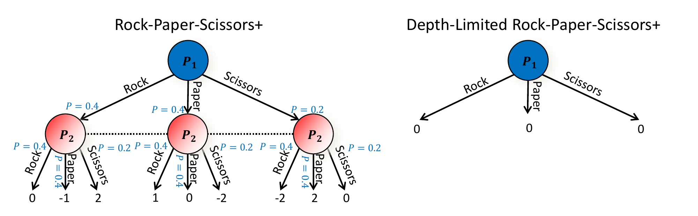
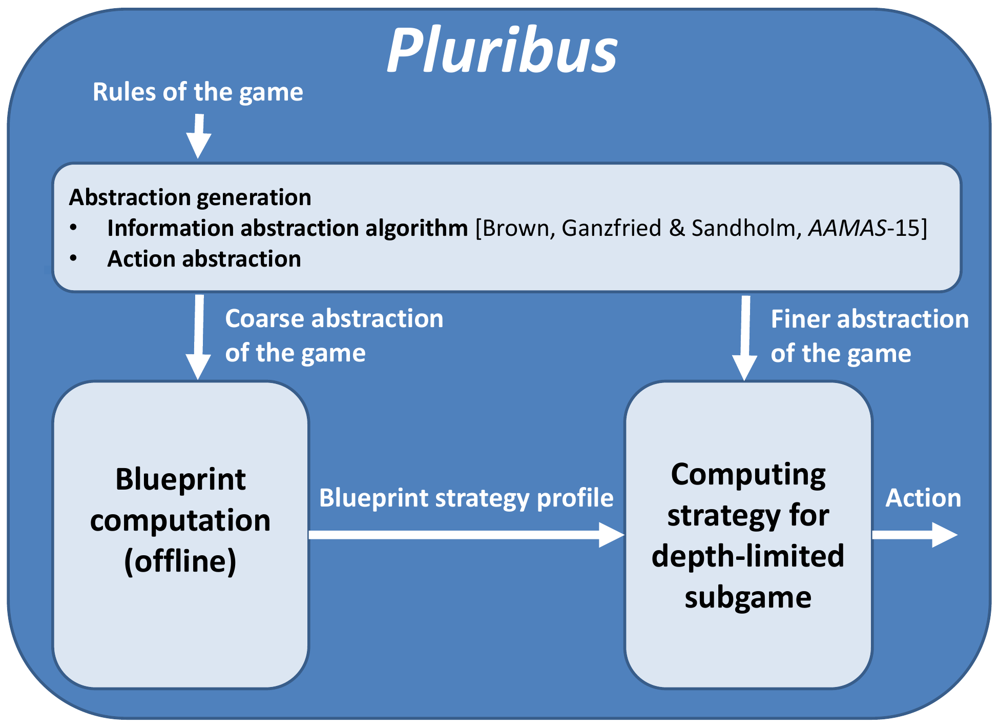

# L16 Pluribus：多人无限注德州扑克

本章分两部分。第一部分介绍**深度受限子博弈求解**（depth-limited subgame solving）[Brown, Sandholm & Amos, NeurIPS-18; Brown & Sandholm, Science 2019]：它把完美信息博弈中“有限前瞻 + 叶子估值”的搜索范式推广到不完美信息博弈，其障碍与出路都富有教益。第二部分介绍 Pluribus——六人无限注德州扑克的超人 AI [Brown & Sandholm, Science 2019]，它正是建立在深度受限求解之上，也是首个在多人博弈中超越人类顶尖选手的 AI。

## 深度受限子博弈求解

### 完美信息博弈中的有限前瞻为何有效

在完美信息博弈与单智能体搜索中，整棵博弈树太大、无法穷尽，但我们可以只展开有限深度，在叶子节点代入一个**状态值估计**——即“双方从此之后都完美行棋时该状态的值”。只要这个估计是精确的，有限前瞻搜索所采取的就是均衡策略。这一范式支撑了从国际象棋到围棋的全部超人系统。

然而，**在不完美信息博弈中，状态的值根本没有良好定义**：一个信息集的值取决于双方在整个博弈中其余部分的策略，不存在脱离策略的“状态值”。下面的例子把这一困难具体化。

### 例：Rock-Paper-Scissors+ 与朴素截断的失败

考虑 Rock-Paper-Scissors+（石头剪刀布的加强版）：P1 先出拳，P2 在**看不到** P1 选择的情况下出拳（因此 P2 的三个节点在同一个信息集中，用虚线相连）。支付矩阵与普通石头剪刀布相同，只是凡涉及剪刀的对局赌注加倍：P1 出石头时支付为 $(0, -1, 2)$，出布时为 $(1, 0, -2)$，出剪刀时为 $(-2, 2, 0)$。该博弈是零和的，其纳什均衡为双方各自按 $(0.4, 0.4, 0.2)$ 混合石头、布、剪刀，博弈值为 0。可以验证无差异条件：当 P2 按 $(0.4, 0.4, 0.2)$ 混合时，P1 出石头的期望支付为 $0 \times 0.4 + (-1) \times 0.4 + 2 \times 0.2 = 0$，出布为 $1 \times 0.4 + 0 \times 0.4 + (-2) \times 0.2 = 0$，出剪刀为 $(-2) \times 0.4 + 2 \times 0.4 + 0 \times 0.2 = 0$，三个纯策略无差异；对称地，P1 按 $(0.4, 0.4, 0.2)$ 混合同样使 P2 无差异。

现在模仿完美信息博弈的做法：在 P1 行动之后截断，把叶子值替换为“双方此后按均衡行棋”的估计值。由于 P2 的均衡策略使 P1 的每个纯策略期望支付都是 0，所有叶子值都是 0，如图右侧所示。但在这个深度受限子博弈里，三个行动的（截断）价值都是 0，P1 无差异，求解器完全可能输出一个远离均衡的混合，例如 $(0.8, 0.1, 0.1)$ 大幅偏向石头。一旦 P1 真的这样打，P2 只要总是出布，每局期望赢 $0.8 \times 1 + 0.1 \times 0 + 0.1 \times (-2) = 0.6$——所谓的“叶子估值”在对手可以**针对你的变化而调整**时根本无法维持。问题的本质：实时规划中必须考虑对手会如何适应你策略的改变（完美信息博弈与单智能体情形除外）。

### 算法：在叶子处给对手续局策略的选择

解决办法是让截断后的子博弈仍然承认“对手有多种打法”：在每个叶子节点，允许对手做最后一次行动，在多个**续局策略**（continuation strategy / policy）$\pi_2^1, \pi_2^2, \dots$ 中选择其一，每个续局策略给出叶子之后的完整打法，从而确定叶子值。算法迭代地进行：

1. 用当前的 P2 叶子策略集合求解该子博弈；
2. 计算 P2 的一个最优响应（best response）；
3. 把该最优响应加入叶子续局策略集合；
4. 重复。

（生成对手续局策略集合并非只有最优响应一种办法。）下图展示了加入两个续局策略后的深度受限子博弈：对手在叶子处可在 $\pi_2^1$ 与 $\pi_2^2$ 之间选择，P1 的策略被推回到接近均衡的 $(0.4, 0.5, 0.1)$。

> **定理.** 该迭代算法在二人零和博弈中收敛到纳什均衡。实践中，很少几次迭代即可达到极低的可利用度（exploitability）。它还可以与安全的递归子博弈求解结合使用。

### 从根之后开始的安全深度受限求解

不完美信息博弈中“子博弈”并不相互独立，但 Libratus 的残局（endgame）求解技术可以搬过来——只是现在的“残局”是**以续局策略选择收尾的中局**：

- 先有一个覆盖整个博弈的**蓝图策略**（blueprint strategy），例如通过“抽象 + 均衡计算”、Deep CFR [Brown, Lerer, Gross & Sandholm, ICML-19] 或人工构造得到；
- 求解某残局（中局）中我方策略时，让对手在两种模型之间选择：沿用蓝图，或进入残局模型 [Burch et al., AAAI-14; Jackson, AAAI-14; Moravcik et al., AAAI-16; Brown & Sandholm, NIPS-17; Moravcik et al., Science 2017; Brown & Sandholm, Science 2018]。求解目标是：对对手可能持有的任何私有类型，她选择残局模型都不会更好——**定理：这是安全的**；
- 允许对手在残局中收回她此前“送出”的所有便宜（gifts）——**定理：安全** [Brown & Sandholm, NIPS-17 最佳论文; Science 2018]。

这套做法可以**递归**应用：可以把对手刚刚实际采取的行动纳入子博弈模型；残局离博弈终点越近，就可以使用越细的抽象——**定理：安全** [Brown & Sandholm, NIPS-17 最佳论文; Science 2018]。

### 二人无限注德州扑克的对头实验：Modicum

深度受限求解造就了当时第二强的双人无限注德州扑克 AI——Modicum [Brown, Sandholm & Amos, NeurIPS-18]，而它只用 700 核时计算、16 GB 内存，在一台 4 核 CPU 上以每手 20 秒实时对局。与两代冠军智能体的对头成绩（单位：毫大盲/局）如下：

| | Baby Tartanian8（2016 冠军，200 万核时，18 TB 内存） | Slumbot（2018 冠军，25 万核时，2 TB 内存） |
|---|---|---|
| Modicum（无实时推理） | $-57 \pm 13$ | $-11 \pm 8$ |
| Modicum（仅一个续局策略） | $-10 \pm 8$ | $-1 \pm 15$ |
| Modicum（少数几个续局策略） | $\mathbf{6 \pm 5}$ | $\mathbf{11 \pm 9}$ |

可以看到实时深度受限搜索带来的质变：不用实时推理时 Modicum 明显落败，而只要给对手少数几个续局策略的选择，它就能战胜两代冠军。

这一部分的要点可以归纳如下：规划（planning）在不完美信息博弈中同样重要，但形态不同——在实时规划中必须考虑对手会如何适应你策略的改变（完美信息博弈与单智能体情形除外）；状态在不完美信息博弈中没有良好定义的值；而上述深度受限求解算法是可靠的（sound），正是它让一台 4 核 CPU、16 GB 内存的机器上诞生了当时第二强的双人无限注德州扑克 AI。

## 多人博弈与 Pluribus

### 从二人零和到多人：缺失的保证

此前所有超人 AI 里程碑都发生在二人（零和）博弈中：跳棋 Chinook（1994）、黑白棋 Logistello（1997）、国际象棋 Deep Blue（1997）、双人有上限德州 Polaris（2008）、围棋 AlphaGo（2016）、双人无限注德州 Libratus（2017），以及（若算超人）星际争霸 II 的 AlphaStar 与 DOTA 2 的 OpenAI Five（2019）。多人博弈即使在标准型下也有本质困难：

- **打纳什均衡不再安全**：均衡策略在多人博弈中不保证取得均衡值；
- **连近似纳什均衡都难求**：理论上有复杂性下界 [Daskalakis et al. 2009; Chen et al. 2009; Rubinstein 2018]；实践中最快的完备算法也只能扩展到 3–5 个玩家、每人 3–5 个策略 [Berg & Sandholm, AAAI-17]。

还有一个更微妙的困难是**均衡选择问题**：即使能高效算出多人博弈的纳什均衡，若每位玩家各自独立计算并打出一个均衡，其联合策略 profile 也未必是均衡，玩家因此仍有偏离的激励。论文以 Lemonade Stand 博弈为例 [Zinkevich et al. 2011]：多名玩家同时在一个圆环上选点，希望离其他玩家越远越好；其纳什均衡是玩家均匀分布在圆环上，但这样的均衡有无穷多个（圆环可以任意旋转），若各人独立选一个来打，联合结果几乎必然不是均匀分布。二人零和博弈是特例：即使双方各自独立计算并选择均衡，联合策略仍然是纳什均衡——这正是此前所有超人里程碑都能落在二人零和博弈的深层原因之一。因此在二人零和之外，“求解的目标应该是什么”本身就成了问题；Pluribus 论文的回答是：不以某个博弈论解概念为目标，而是经验地造出一个能稳定击败人类（含顶尖职业选手）的 AI。

多人无限注德州扑克（世界上最流行的变体是六人桌）是被公认搁置了数十年的 AI、博弈论与运筹学里程碑。Pluribus 用一套新算法找到了超人策略——但在二人零和博弈之外，**没有**保证所求得的解是纳什均衡。该成果获 2019 年《Science》年度突破亚军。

### Pluribus 的总体设计

Pluribus 的开发与运行都只用一台服务器，**不用 GPU**；**不使用任何（人类对局）数据**；**不针对对手做适应**。它的结构是“离线蓝图计算 + 实时深度受限搜索”：

抽象生成模块同时产生信息抽象（algorithm from [Brown, Ganzfried & Sandholm, AAMAS-15]）与行动抽象；粗抽象供离线蓝图计算，较细抽象供在线的深度受限子博弈求解，蓝图策略 profile 作为后者的输入，最终输出行动。

蓝图策略本身只在**第一个下注轮**（共四轮）被直接执行：该轮决策点足够少，蓝图可以不使用信息抽象、并保留很大的行动抽象。第一个下注轮之后（或第一轮中对手打出与行动抽象差异足够大的下注尺度时），Pluribus 转入实时搜索。对第一轮中只是轻微偏离抽象的下注，Pluribus 用**伪调和映射**（pseudoharmonic mapping）[Ganzfried & Sandholm, IJCAI-13] 把下注额舍入到邻近的在树尺度，然后按蓝图继续行动，就像对手用了后者一样。信息抽象会显著降低博弈复杂度，但也可能洗掉对超人水平至关重要的细微差别，因此在与人类的实际对局中，Pluribus 只用信息抽象推理**未来**下注轮的局面，**绝不**用于它当前所处的下注轮（离线自我对局计算蓝图时则全程使用）。

### Pluribus 的新型深度受限搜索

针对不完美信息博弈，Pluribus 的深度受限搜索有两点新设计：

- 在叶子处，**所有玩家**（而不仅是对手）都从 $k$ 个续局策略中选择；
- **搜索从当前局面之前开始**（从当前下注轮的开头），而不是从当前信息集开始：这减轻了不安全搜索的可利用性，同时保留其优点。我方在已经走过的行动上的策略保持固定；与 Libratus 一样，对手实际采取的行动在求解前被加入子博弈模型，因此**无需做行动反映射**（reverse mapping）。

论文中的具体取值为 $k=4$：四个续局策略分别是预计算的蓝图策略、偏向弃牌的蓝图变体、偏向跟注的蓝图变体和偏向加注的蓝图变体。每个仍在牌局中的玩家在叶子处从这 $k$ 个策略中独立选择（互看不到其他玩家的选择），叶子的值即按各玩家所选续局策略把余下牌局打出（rollout）来估计。子博弈的根是一个初始机会节点，按此前已计算策略 profile（本手首次求解时为蓝图 profile）到达各根节点的归一化概率进入。这种结构使搜索者找到的策略更平衡：若搜索者打出不平衡的策略（例如石头剪刀布中总出石头），对手切换到另一个续局策略（总出布）就会惩罚它。由此引出的一个实现要点是：Pluribus 会记录自己以每一手可能的牌到达当前局面的概率；无论实际持牌为何，它都先为**所有可能的持牌**算出平衡的策略，再按实际持牌执行对应行动，从而对对手保持不可预测。

### Pluribus 的均衡求解算法

蓝图计算与深度受限子博弈求解共用同一个均衡求解器，它是对 MCCFR [Lanctot et al., NeurIPS-09] 的重要改进：

- 采用零和博弈中最快的采样类均衡求解算法——**线性 CFR**（linear CFR）[Brown & Sandholm, AAAI-19 杰出论文荣誉提名]：Pluribus 对后悔值与策略平均都使用线性加权，即“**Linear MCCFR**”；
- 运行初期使用一种新形式的**动态剪枝**（在博弈的最后两步不使用）；
- 节省内存：序列（sequence）只有在实际遇到时才在 RAM 中分配。

MCCFR 的每次迭代指定一名**遍历者**（traverser）：按所有玩家的当前策略模拟一手牌，然后对遍历者做过的每个决策（以及改选其他行动后会遇到的假想决策，如此递归地以深度优先方式遍历），考察反事实（counterfactual）结果——由于知道所有玩家本次迭代的策略，这些假想结果可以精确模拟。某行动的反事实值与遍历者实际取得的（期望）值之差，累加进该行动的**反事实后悔**——即遍历者对此前未选该行动的后悔程度；迭代结束时更新策略，反事实后悔越高的行动被选概率越大。二人零和博弈中 CFR 保证平均策略收敛到纳什均衡；而在**所有有限博弈**中，CFR 仍保证各反事实后悔随迭代次数次线性增长——从而平均表现渐近不差于事后最优的固定策略——并能消除迭代严格劣行动。

线性 CFR 的动机在于：原始 CFR 中后悔是累加而非替换，最初完全随机（通常很差）的迭代对后悔的影响仅以 $1/T$ 的速率衰减。线性 CFR 给第 $T$ 次迭代的后悔贡献与策略平均都赋权重 $T$，首次迭代的影响因而以 $1 \big/ \sum_{t=1}^{T} t = \frac{2}{T(T+1)}$ 的速率衰减，实践中策略改进更快，而总后悔的最坏情形界几乎不变（Pluribus 只在运行早期使用折扣，因为后期再做乘法的时间开销不值得）。动态剪枝的具体形式是：后悔值极负的行动在 95% 的迭代中不被探索。实时求解子博弈时，若子博弈较大或处于牌局早期，沿用蓝图计算所用的 Monte Carlo Linear CFR；否则改用只采样机会事件（如公共牌）的向量化 Linear CFR [Johanson et al., IJCAI-11]。

### 对局时的资源与速度

对局时 Pluribus 跑在一台普通电脑上：2 颗 Intel Haswell E5-2695 v3 CPU、少于 128 GB 内存、无 GPU；单个子博弈的搜索耗时 1–33 秒（视具体局面而定），每手牌平均 20 秒，比人类职业选手快一倍。作为对比：AlphaGo 在 2016 年对李世石的比赛中实时搜索动用了 1920 颗 CPU 和 280 块 GPU，Deep Blue 在 1997 年使用了 480 块定制芯片，Libratus 在 2017 年使用了 100 颗 CPU。

### 与顶尖人类职业选手的对抗实验

评估使用了 AIVAT [Burch et al., AAAI-18] 做方差缩减；成绩以该领域标准度量**毫大盲/局**（mbb/game，即每手平均所赢大盲数的千分之一）报告，统计显著性用 95% 置信度的单尾 t 检验判定 Pluribus 是否盈利。共两组实验：

**实验一：1 名职业选手对 5 个 Pluribus 副本。** 各副本相互独立，甚至不知道彼此的座位。Chris Ferguson 与 Darren Elias 各打 5000 手（激励方式为每人 2000 美元出场费，若比另一人输得少再获 2000 美元；两人互不知晓对方身份与成绩）。合计 10000 手中 Pluribus 平均赢 $32 \pm 15$ mbb/game，以统计显著性获胜（$p = 0.014$）；之后相同设置的实验中，Pluribus 又战胜了 Linus Loeliger。分人看，Darren Elias 落后 $40 \pm 22$ mbb/game（$p = 0.033$），Chris Ferguson 落后 $25 \pm 20$ mbb/game（$p = 0.107$，单独看未达显著——论文指出这可能是方差、技术或他在不熟悉的困难局面下偏向弃牌的保守打法所致）。

**实验二：5 名职业选手对 1 个 Pluribus。** 共打 10000 手，历时 12 天；每个六人局的 5 名人类选手根据档期从 13 名顶尖职业牌手中选出——每人都赢过超过 100 万美元，其中多人赢过超过 1000 万美元（Linus Loeliger、Jimmy Chou、Seth Davies、Michael Gagliano、Anthony Gregg、Dong Kim、Jason Les、Daniel McAulay、Nick Petrangelo、Sean Ruane、Trevor Savage、Jake Toole；课件列出这 12 人，论文的 13 人名单还包含 Greg Merson）。参与者互不知晓还有谁参加，每人使用全程不变的别名以便互相追踪打法。5 万美元奖金在人类选手之间按表现分配以激励其尽力（每手保底 0.40 美元，最高 1.60 美元）。经 AIVAT 调整后，Pluribus 平均赢 $48 \pm 25$ mbb/game——这在六人无限注德州扑克中是很高的赢率，尤其对手是精英职业选手的组合——并以统计显著性获胜（$p = 0.028$）。整个实验过程中 Pluribus 的表现相当平稳，这也说明人类选手未能找到可利用的弱点。

### 训练成本与训练曲线

蓝图训练使用一台 64 核服务器、512 GB 内存、无 GPU，共 8 天、12400 CPU 核时，按云计算价格约 150 美元（论文按竞价实例价格计约 144 美元；课件记作约 150 美元）。这与此前所有游戏 AI 里程碑形成鲜明对比——它们都动用了大规模服务器集群和/或 GPU 农场。训练曲线（纵轴为相对最终快照的 BB/100）显示：

Pluribus 在约 7 小时内超过典型人类水平，约 20 小时内超过顶尖人类水平；继续训练，**跛入**（limping，翻牌前仅跟注入池——人类认为偏弱的打法）从它的策略中被完全淘汰。由于 Pluribus 的策略完全来自自我对局、不含任何人类数据，它也为“多人无限注德州的最优打法长什么样”提供了一个外部视角：它证实了人类的传统智慧——除小盲位外任何玩家跛入都是次优的（小盲已按规则投入半个大盲，跟注只需再投一半）；但它推翻了“donk betting（上一轮以跟注收尾、新一轮率先下注）是错误打法”的民间智慧——Pluribus 使用 donk bet 的频率远高于人类职业选手。

## 要点小结

- 完美信息博弈中“有限前瞻 + 叶子状态值”之所以可行，是因为状态值有良好定义；不完美信息博弈中状态值依赖于双方全局策略，**没有良好定义的状态值**，朴素截断会被对手针对（Rock-Paper-Scissors+ 例子）。
- **深度受限求解**：在叶子处给对手最后一次行动、在多个续局策略中选择；迭代地“求解子博弈 → 计算最优响应 → 加入策略集合”。二人零和博弈中收敛到纳什均衡，实践中几次迭代即可，且可与安全递归子博弈求解结合（Modicum 据此以 4 核 CPU、16 GB 内存达到双人无限注德州第二强）。
- 多人博弈中打纳什均衡不再安全、求近似均衡在理论和实践上都困难；Pluribus 以“离线蓝图 + 实时深度受限搜索”（叶子处所有玩家从 $k$ 个续局策略中选择、搜索从下注轮开头开始）和 Linear MCCFR（线性加权 + 动态剪枝 + 按需分配内存）解决了六人无限注德州扑克。
- Pluribus 不用 GPU、不用人类数据、不针对对手适应；训练约 150 美元云成本，对局只需 2 颗 CPU、每手 20 秒，并以统计显著性战胜多位赢过千万美元的顶尖职业选手。
