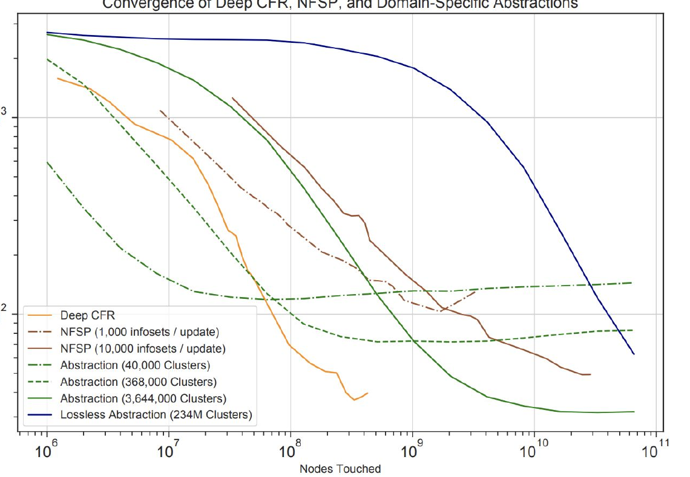

# L17 博弈求解中的深度学习

在非常大的博弈中，即使只运行少数几轮 CFR 也可能完全不可行，因为每轮迭代都要求完整遍历博弈树。本章先介绍蒙特卡洛反事实后悔最小化（Monte Carlo counterfactual regret minimization, MCCFR，Lanctot et al., 2009）——CFR 的一种随机近似，其每轮迭代的运行时间远低于原版 CFR；包括 Libratus 在内的许多最先进博弈求解算法都依赖 MCCFR 或其变体来构建蓝图策略（blueprint strategy）。随后本章在 MCCFR 的基础上介绍两个更现代的算法：Deep CFR（Brown et al., 2019）用深度神经网络代替人工博弈抽象，以应对表格方法无法处理的巨大博弈树；ESCHER（McAleer et al., 2023）则通过大幅降低效用估计器的方差，在处理大型博弈时往往是最有效的方法。贯穿全章的主线是：随机后悔最小化的核心在于找到一个廉价且方差小的梯度估计器，使其紧致地逼近真实梯度。

## 随机后悔最小化与 MCCFR

### 动机与框架

回顾 CFR 的工作方式：它在每个信息集上各部署一个独立的后悔最小化器；每当观测到效用 $\boldsymbol{u}^{(t)}$ 后，需要在每个信息集上构造反事实效用（其关于 $\boldsymbol{u}^{(t)}$ 的确切形式曾通过后悔电路在作业中推导），并对每个后悔最小化器执行更新。这两步都要求完整遍历博弈树，代价高昂。MCCFR 的基本思想是把 $\boldsymbol{u}^{(t)}$ 替换为一个稀疏估计器 $\tilde{\boldsymbol{u}}^{(t)}$，从而带来两个好处：其一，无需精确计算 $\boldsymbol{u}^{(t)}$；其二，每轮只需更新信息集的一个子集。只要估计器是无偏的，即 $\mathbb{E}[\tilde{\boldsymbol{u}}^{(t)}] = \boldsymbol{u}^{(t)}$，就可以把随机近似带来的后悔退化界定为估计器方差的函数（见下文的定理）。

Lanctot et al.（2009）把这一思想组织成一个通用框架。设 $\mathcal{Q} = \{Q_1, \dots, Q_r\}$ 是终结节点集合 $\mathcal{Z}$ 的一组子集（称为**块**，block），其并覆盖整个 $\mathcal{Z}$。每轮迭代以概率 $q_k > 0$ 采样一个块 $Q_k$，只考察该块中的终结节点；记 $q(z) = \sum_{k : z \in Q_k} q_k$ 为终结节点 $z$ 在本轮被考察的概率。对信息集 $j$，采样反事实价值定义为在块内对精确反事实价值按 $1/q(z)$ 加权求和。由于各块覆盖 $\mathcal{Z}$，直接求和验证即知采样反事实价值在期望下等于精确反事实价值——这正是"估计器无偏"在扩展式博弈中的具体化。该框架涵盖此前的所有 CFR 变体：取 $\mathcal{Q} = \{\mathcal{Z}\}$（单块、$q_1 = 1$）就是原版 CFR；让每个块包含具有相同机会结果序列的全部终结节点，就得到 Zinkevich et al. 技术报告中面向扑克的"机会采样 CFR"——这一变体虽被所有早期实验采用，却局限于机会因素主导博弈规模的情形。下文的外部采样与结果采样是该框架的两个新成员。

本章仍然关注（双人）零和扩展式博弈，目标是计算近似极小极大（纳什）均衡；大部分技术可推广到一般和博弈中的后悔最小化。该设定下的均衡计算可以写成双线性鞍点问题

$$
\min_{\boldsymbol{x} \in \mathcal{X}} \max_{\boldsymbol{y} \in \mathcal{Y}} \; \sum_{z \in \mathcal{Z}} u_2(z)\, \boldsymbol{x}[\sigma_1(z)]\, \boldsymbol{y}[\sigma_2(z)]\, \boldsymbol{c}[\sigma_c(z)],
$$

其中 $\sigma_i(z) \in \Sigma_i$ 是玩家 $i \in \{1, 2, c\}$ 从博弈树根到终结节点 $z \in \mathcal{Z}$ 的最后一个序列，$\mathcal{X}$ 与 $\mathcal{Y}$ 是两名玩家的序列形式（sequence form）多胞形，$\boldsymbol{c}$ 是机会玩家（chance player）的固定策略。该鞍点问题可以写成 $\boldsymbol{x}^\top \boldsymbol{A}\boldsymbol{y}$ 的形式；玩家 1 的效用向量为 $\boldsymbol{u}_{\mathcal{X}} = -\boldsymbol{A}\boldsymbol{y}$（负号是因为玩家 1 是最小化方），玩家 2 的为 $\boldsymbol{u}_{\mathcal{Y}} = \boldsymbol{A}^\top\boldsymbol{x}$。效用计算归结为矩阵–向量乘积，代价较高，因此诉诸采样来构造无偏估计器。这里有一个基本的权衡（tradeoff）：希望估计器廉价且稀疏，同时又必须控制其方差，以限制后悔的退化。本章介绍驾驭这一权衡的两种标准方式——外部采样与结果采样。

### 外部采样

外部采样（external sampling）只对外部力量——对手与机会玩家——进行采样。以玩家 1 的视角（玩家 2 完全对称）：独立地为玩家 2 采样一个纯策略 $\tilde{\boldsymbol{y}}^{(t)}$、为机会玩家采样一个纯策略 $\tilde{\boldsymbol{c}}$。若 $\mathbb{E}[\tilde{\boldsymbol{y}}^{(t)}] = \boldsymbol{y}^{(t)}$ 且 $\mathbb{E}[\tilde{\boldsymbol{c}}] = \boldsymbol{c}$，则估计器

$$
\boldsymbol{x} \mapsto u_1(\boldsymbol{x}, \tilde{\boldsymbol{y}}^{(t)}, \tilde{\boldsymbol{c}})
$$

是 $\boldsymbol{u}_{\mathcal{X}}^{(t)} = -\boldsymbol{A}\boldsymbol{y}^{(t)}$ 的无偏估计。

**标准式博弈中的次线性算法。** 先看外部采样在标准式博弈这一特殊情形中的威力。设双方各使用一个每轮运行时间关于维数线性的后悔最小化器（RM、MWU 等大多数在线算法都满足），则每轮复杂度由矩阵–向量乘积 $\boldsymbol{A}\boldsymbol{y}^{(t)}$ 与 $\boldsymbol{A}^\top\boldsymbol{x}^{(t)}$ 主导。若 $\boldsymbol{A} \in \mathbb{R}^{m_1 \times m_2}$ 有 $\mathrm{nnz}(\boldsymbol{A})$ 个非零元，每次计算需 $O(\mathrm{nnz}(\boldsymbol{A}))$ 次算术运算；矩阵稠密时就是二次的，大规模实例下不可接受。外部采样把 $\boldsymbol{y}^{(t)}$ 换成从中采出的纯策略 $\tilde{\boldsymbol{y}}^{(t)}$，此时 $\boldsymbol{A}\tilde{\boldsymbol{y}}^{(t)}$ 显然可以在线性时间内算出，每轮代价从 $O(\mathrm{nnz}(\boldsymbol{A}))$ 降为 $O(m_1 + m_2)$；在扩展式博弈中收益还会更大。结合下文的定理可以推出：自对弈的随机后悔最小化能在 $\tilde{O}((m_1 + m_2)/\epsilon^2)$ 时间内求得 $\epsilon$-均衡（$\tilde{O}$ 隐藏对数因子）。这本质上就是 Grigoriadis 与 Khachiyan（1995）著名的**次线性**算法——称"次线性"，是因为对任意 $\epsilon > 0$，求 $\epsilon$-均衡所需的时间甚至少于读入整个输入（即 $\mathrm{nnz}(\boldsymbol{A})$）的时间！

作为对照，确定性方法中不带采样的乐观（optimistic）变体总运行时间为 $\tilde{O}(\mathrm{nnz}(\boldsymbol{A})/\epsilon)$，当精度 $\epsilon$ 足够小时更优；线性规划则关于 $\log(1/\epsilon)$ 多项式，但引入了更高的维数依赖，无法用于大规模问题。要点是：最优算法取决于所要求的近似精度区间；本章关注超大博弈、容忍较粗精度 $\epsilon$ 的场景，此时随机后悔最小化更可取。

**外部采样在扩展式博弈中的实现。** 从根出发逐步走向终结节点：每当触到属于对手或机会玩家的节点，就分别按 $\boldsymbol{y}^{(t)}$ 或 $\boldsymbol{c}$ 采样一个动作；若节点属于玩家 1，则对所有动作分支并递归进行。由于在对手/机会节点上只沿单一动作分支，计算该估计器远便宜于精确效用向量；且只需更新被采样到的对手/机会策略所经路径上的信息集——通常只占很小一部分。把 CFR 与该效用估计器结合所得的算法称为**外部采样 MCCFR**。

### 结果采样

结果采样（outcome sampling）更进一步：不只对对手和机会玩家，而是对**每个**玩家的策略都采样。以玩家 1 为例，输入一个完全混合的参考策略（reference strategy）$\boldsymbol{r}^{(t)} \in \mathcal{X}$，按下述分布采样终结节点 $\tilde{z}^{(t)} \in \mathcal{Z}$：

$$
\mathbb{P}[\tilde{z}^{(t)} = z] = \boldsymbol{r}^{(t)}[\sigma_1(z)]\, \boldsymbol{y}^{(t)}[\sigma_2(z)]\, \boldsymbol{c}[\sigma_c(z)] \qquad \forall z \in \mathcal{Z},
$$

然后产生估计器

$$
\tilde{\boldsymbol{u}}_{\mathcal{X}}^{(t)} = \frac{u_1(\tilde{z}^{(t)})}{\boldsymbol{r}^{(t)}[\sigma_1(\tilde{z}^{(t)})]}\, \boldsymbol{e}_{\tilde{z}^{(t)}},
$$

其中 $\boldsymbol{e}_z \in \mathbb{R}^{\Sigma_1}$ 是满足 $\boldsymbol{e}_z[\sigma_1(z)] = 1$ 的单位向量。容易验证该估计器无偏：$\mathbb{E}[\tilde{\boldsymbol{u}}_{\mathcal{X}}^{(t)}] = \boldsymbol{u}_{\mathcal{X}}^{(t)}$。采样一个终结节点非常廉价：从根出发在每个节点按当前行动方的策略采样即可，时间正比于博弈树深度 $d$——通常比树的节点数指数级地小；采到 $\tilde{z}^{(t)}$ 后执行一步 CFR 只需 $O(d\,|\mathcal{A}|)$ 时间，因为只要更新从根到 $\tilde{z}^{(t)}$ 路径上的信息集。

代价是方差：该估计器的方差正比于 $\min_{z \in \mathcal{Z}} \boldsymbol{r}^{(t)}[\sigma_1(z)]$ 的倒数。理论上合理的做法是选取 $\boldsymbol{r}^{(t)}$ 使 $\min_z \boldsymbol{r}^{(t)}[\sigma_1(z)]$ 最大化，从而最小化方差；可以证明存在**平衡策略**（balanced strategy）$\boldsymbol{r}^*$ 使得对所有 $\sigma \in \Sigma_1$ 都有 $\boldsymbol{r}^*[\sigma] \geq 1/|\Sigma_1|$（Farina et al., 2020），但它在实践中未必最优。该估计器所用的正是重要性采样（importance sampling）技术，后文 ESCHER 一节还会回到这个问题。把 CFR 与该估计器结合即得**结果采样 MCCFR**。

结果采样还有一个独特的优点：它不要求知道对手的策略。若终结节点按对手自身的策略采样（即采样分布中对手部分取 $\boldsymbol{y}^{(t)}$），则估计式中对手的到达概率恰好与反事实价值中的同一因子相消，更新只依赖观测到的对局结果。Lanctot et al.（2009）指出，由此可以把结果采样 MCCFR 用作扩展式博弈中的**在线**（online）后悔最小化算法——只需在自身策略中混入足够的探索以保证 $q(z) \geq \delta > 0$，其思路与标准式博弈中的 Exp3 算法如出一辙。这一性质是外部采样不具备的。

下图取自 Lanctot et al.（2009），在四个博弈（Goofspiel、Latent Tic-Tac-Toe、One-Card Poker、Princess and Monster）上比较了 CFR、带剪枝的 CFR 与两种 MCCFR 变体。横轴是触及的节点数（一种与实现无关的计算量度量，用墙钟时间作横轴的结论几乎相同），两种 MCCFR 变体在绝大部分预算下都以远少于 CFR 的节点触及数达到了更低的可利用度，外部采样总体又略优于结果采样。实验中的两个实现细节值得一提。其一，结果采样采用 $\epsilon$-贪婪的采样分布：在每个信息集以概率 $\epsilon$ 均匀随机选动作，否则按当前策略 $\boldsymbol{y}^{(t)}$ 采样；$\epsilon = 0.6$ 在全部四个博弈上都表现良好——尽管理论界倾向于让 $\delta$ 尽量大，对最可能发生的结果施加一些偏置在实践中反而有帮助。其二，"带剪枝的 CFR"使用了如下技巧：更新一名玩家的后悔时，若对手到达当前历史的概率为零，则整棵子树本轮可以剪掉而不影响计算结果；这使原版 CFR 在这些博弈上尚属可用（例如在 Latent Tic-Tac-Toe 中，首轮迭代触及 1.42 亿个节点，而随着被占优动作被识别并排除，后续迭代可少至 500 万个节点），但即便如此 MCCFR 仍有数量级优势。以 Goofspiel 为例，两种 MCCFR 变体只需数百万个触及节点即可把可利用度降到 0.5 以下，而 CFR 需要约 25 亿个——相差三个数量级。每轮迭代的墙钟时间差异更为极端：原版 CFR 每轮需 28–120 秒，而结果采样每轮仅 46–150 微秒，外部采样约 28–150 毫秒。值得注意的是，结果采样并非全面占优（它在 Goofspiel 上优于外部采样，在 Latent Tic-Tac-Toe 上甚至逊于原版 CFR），何种博弈性质有利于何种采样方案在论文中仍是一个开放问题。

### 随机近似的后悔分析

下述分析不限于扩展式博弈，也不限于外部/结果采样：只要估计器无偏，随机后悔最小化的后悔相对其确定性内核只有很小的退化。形式化地，我们要设计一个随机后悔最小化器 $\mathfrak{R}$，它在收到真实效用序列 $(\boldsymbol{u}^{(t)})_{t=1}^T$ 时，把估计值 $(\tilde{\boldsymbol{u}}^{(t)})_{t=1}^T$ 喂给一个确定性后悔最小化器 $\tilde{\mathfrak{R}}$（如 CFR），并直接输出 $\tilde{\mathfrak{R}}$ 的输出。记 $\mathrm{Reg}^{(T)}(\boldsymbol{x}) = \sum_{t=1}^T \langle \boldsymbol{x} - \boldsymbol{x}^{(t)}, \boldsymbol{u}^{(t)} \rangle$ 为关于比较点 $\boldsymbol{x} \in \mathcal{X}$ 的后悔，$\mathrm{Reg}^{(T)} = \max_{\boldsymbol{x} \in \mathcal{X}} \mathrm{Reg}^{(T)}(\boldsymbol{x})$；$\widetilde{\mathrm{Reg}}^{(T)}(\boldsymbol{x})$ 类似地以 $\tilde{\boldsymbol{u}}^{(t)}$ 定义。核心假设是条件无偏性：

$$
\mathbb{E}\big[\tilde{\boldsymbol{u}}^{(t)} \,\big|\, \tilde{\boldsymbol{u}}^{(1)}, \dots, \tilde{\boldsymbol{u}}^{(t-1)}\big] = \boldsymbol{u}^{(t)}.
$$

> **定理（Farina et al., 2020；较弱版本见 Lanctot et al., 2009）.** 设存在常数 $M$ 与 $\tilde{M}$ 使得对所有 $\boldsymbol{x}, \boldsymbol{x}' \in \mathcal{X}$ 与 $t \in [T]$，
>
> $$
> |\langle \boldsymbol{x} - \boldsymbol{x}', \boldsymbol{u}^{(t)} \rangle| \leq M, \qquad |\langle \boldsymbol{x} - \boldsymbol{x}', \tilde{\boldsymbol{u}}^{(t)} \rangle| \leq \tilde{M}.
> $$
>
> 则对任意 $\delta \in (0, 1)$，以至少 $1 - \delta$ 的概率有
>
> $$
> \mathrm{Reg}^{(T)} \leq \widetilde{\mathrm{Reg}}^{(T)} + (M + \tilde{M}) \sqrt{2T \log \frac{1}{\delta}}.
> $$

**证明思路.** 固定任意比较点 $\boldsymbol{x} \in \mathcal{X}$，把真实后悔分解为

$$
\mathrm{Reg}^{(T)}(\boldsymbol{x}) = \widetilde{\mathrm{Reg}}^{(T)}(\boldsymbol{x}) + \sum_{t=1}^T d^{(t)}, \qquad d^{(t)} := \langle \boldsymbol{x} - \boldsymbol{x}^{(t)}, \boldsymbol{u}^{(t)} \rangle - \langle \boldsymbol{x} - \boldsymbol{x}^{(t)}, \tilde{\boldsymbol{u}}^{(t)} \rangle.
$$

由条件无偏性，$\boldsymbol{x}^{(t)}$ 只依赖于 $\tilde{\boldsymbol{u}}^{(1)}, \dots, \tilde{\boldsymbol{u}}^{(t-1)}$，故 $(d^{(t)})$ 是**鞅差序列**（martingale difference sequence）；其幅度满足 $|d^{(t)}| \leq M + \tilde{M}$。对其和施用 Azuma–Hoeffding 集中不等式：

$$
\mathbb{P}\Big[\mathrm{Reg}^{(T)}(\boldsymbol{x}) \leq \widetilde{\mathrm{Reg}}^{(T)}(\boldsymbol{x}) + \epsilon\Big] = 1 - \mathbb{P}\Big[\sum_{t=1}^T d^{(t)} > \epsilon\Big] \geq 1 - \exp\Big(-\frac{2\epsilon^2}{4T(M + \tilde{M})^2}\Big).
$$

取 $\epsilon = (M + \tilde{M})\sqrt{2T \log(1/\delta)}$ 即得结论。$\square$

$\tilde{\mathfrak{R}}$ 是确定性后悔最小化器，$\widetilde{\mathrm{Reg}}^{(T)}$ 可用课程前面部分的技术界定，只是观测效用的幅度可达 $\tilde{M}$。定理的主要教益有两点。其一，忽略低阶项后，$\mathfrak{R}$ 的后悔只比 $\tilde{\mathfrak{R}}$ 多出一个依赖 $\sqrt{T}$ 与估计器幅度 $\tilde{M}$ 的项；因此**以高概率得到次线性后悔**，但与确定性算法不同，随机后悔最小化无法突破 $\sqrt{T}$ 屏障——这不是分析的局限，而是有根本性原因（见下文稀疏均衡的讨论）。其二，应当尽量减小 $\tilde{M}$：这正是外部采样与结果采样权衡的体现——即使使用平衡策略，结果采样的 $\tilde{M}$ 也高出一个 $|\Sigma|$ 因子；用 CFR 实例化 $\tilde{\mathfrak{R}}$ 时，总后悔界为 $O(|\Sigma|\sqrt{T})$。

**MCCFR 的专属界。** 对扩展式博弈，Lanctot et al.（2009）给出了更显式地依赖博弈结构的界。设 $\vec{a}_i$ 为历史中只保留玩家 $i$ 动作的子序列，$\mathcal{I}_i(\vec{a}_i)$ 为玩家 $i$ 动作子序列恰为 $\vec{a}_i$ 的那些信息集所成的集合，定义博弈的 $M$-值 $M_i = \sum_{\vec{a}_i} \sqrt{|\mathcal{I}_i(\vec{a}_i)|}$；它满足 $\sqrt{|\mathcal{I}_i|} \leq M_i \leq |\mathcal{I}_i|$，且两端都能被某些博弈取到。记 $\Delta_{u,i} = \max_z u_i(z) - \min_z u_i(z)$ 为效用值域。他们首先把原版 CFR 的平均后悔界收紧为 $R_i^{(T)} \leq \Delta_{u,i} M_i \sqrt{|\mathcal{A}_i|}\,/\sqrt{T}$（此前 Zinkevich et al. 的界中以 $|\mathcal{I}_i|$ 取代 $M_i$），进而证明：

- **外部采样**：对任意 $p \in (0, 1]$，以至少 $1-p$ 的概率有
$$
R_i^{(T)} \leq \Big(1 + \sqrt{\tfrac{2}{p}}\Big)\, \Delta_{u,i}\, M_i\, \sqrt{|\mathcal{A}_i|}\,\big/\sqrt{T}.
$$
即外部采样只需比原版 CFR 多常数倍（常数依赖于置信度）的迭代次数，而每轮只遍历博弈树的一部分；对双方决策次数大致相等的平衡博弈，其每轮代价为 $O(\sqrt{|H|})$（原版 CFR 为 $O(|H|)$，$|H|$ 为历史数），因此均衡计算的总时间在渐近意义下严格更优。
- **结果采样**：若每轮都有 $q(z) \geq \delta > 0$（或对手到达概率为零），则以至少 $1-p$ 的概率有
$$
R_i^{(T)} \leq \Big(1 + \sqrt{\tfrac{2}{p}}\Big)\, \frac{1}{\delta}\, \Delta_{u,i}\, M_i\, \sqrt{|\mathcal{A}_i|}\,\big/\sqrt{T}.
$$
额外的 $1/\delta$ 因子正是重要性采样代价在界中的体现，与上文"方差正比于最小采样概率的倒数"的分析互相印证。

**稀疏均衡与随机算法的下界。** 在标准式零和博弈中，称策略 $\boldsymbol{x} \in \Delta(\mathcal{A})$ 是 $k$-稀疏的，若它至多有 $k$ 个坐标取正值。算法博弈论中的一个经典结果（Lipton, Markakis, and Mehta, 2003）是：对任意 $\epsilon > 0$，存在 $\log(m)/\epsilon^2$-稀疏的均衡策略。随机后悔最小化给出了这一事实的构造性证明：运行自对弈 MWU，每轮采样双方的纯策略，其平均就是稀疏均衡。而 $\log(m)/\epsilon^2$ 已是可望达到的最好稀疏度（Feder et al., 2007），由此推出任何随机算法即使在自对弈中也无法突破 $\Omega(\sqrt{T \log m})$ 的后悔屏障——随机设定下不存在乐观型（optimistic）加速的对应物（这一观察归于 Haipeng Luo）。

## 自动博弈抽象与 Deep CFR

随机后悔最小化是以 MCCFR 为起点的现代博弈求解算法的关键组件；另一个核心创新是用深度神经网络的函数近似（function approximation）代替人工博弈抽象。抽象技术在扑克中非常成功，但主要弊病是：抽象往往需要领域专门知识，可能丢失博弈的战略细节；还有一个"鸡生蛋"问题——确定好的抽象需要知道均衡，而计算均衡又依赖于紧凑的博弈抽象。

### 神经虚拟自对弈

神经虚拟自对弈（neural fictitious self-play, NFSP，Heinrich and Silver, 2016）是 Deep CFR 的先驱。虚拟博弈（fictitious play）在表格设定下并非最有吸引力的算法——甚至表格版虚拟博弈也可能收敛得指数级慢（Daskalakis and Pan, 2014）——但它在大规模博弈求解中重新流行起来：不同于 FTRL 或镜像下降这类每轮要解凸优化问题的复杂算法，虚拟博弈的执行只依赖一个**最优响应预言机**（best response oracle），而这恰好适合用深度强化学习技术实现。

NFSP 维护两个在训练中不断增大的数据集 $\mathcal{D}_{\mathrm{RL}}^{(t)}$ 与 $\mathcal{D}_{\mathrm{SL}}^{(t)}$，以及两个神经网络：

- **价值网络** $Q(\theta_Q^{(t)})$：用标准的深度强化学习算法 Q-learning 在 $\mathcal{D}_{\mathrm{RL}}^{(t)}$ 上训练，预测每个状态下各动作的价值；通过对各状态取价值最大（并混入少量探索）给出玩家的近似最优响应策略，这正是虚拟博弈所要求的。
- **策略网络** $\Pi(\theta_\Pi^{(t)})$：在 $\mathcal{D}_{\mathrm{SL}}^{(t)}$ 上以监督学习模仿玩家过往的行为，目标是捕捉玩家的**平均策略**。之所以需要它，是因为（表格）虚拟博弈中只有平均策略才收敛——若能得到末次迭代（last-iterate）保证，这个额外的网络就没有必要了。

两个网络用随机梯度下降持续更新；玩家行动时在深度强化学习给出的近似最优响应与策略网络给出的平均策略之间按一定比例混合。NFSP 是评估大型博弈深度学习方法时的常用基线。

### Deep CFR

Deep CFR（Brown et al., 2019）是 CFR 的一个可靠的（sound）近似，其动机与 NFSP 相同：摆脱人工抽象。它不再在每个信息集上精确计算后悔——信息集的数量极其庞大——而是寄希望于神经网络在相似信息集之间的**泛化**能力。具体地，Deep CFR 为每名玩家维护一个**后悔网络** $R(\theta_R^{(t)})$，对每个信息集输出其各动作反事实后悔的近似值；若该网络完全精确，Deep CFR 就退化为通常的 MCCFR。后悔网络用动态数据集 $\mathcal{D}^{(t)}$ 训练，每条样本把一个（信息集，动作）对映射到反事实后悔。与 NFSP 类似，Deep CFR 也维护一个**策略网络**来近似平均策略——同样是因为即使表格 CFR 也只在平均意义下收敛。

每一轮迭代中，Deep CFR 按外部采样 MCCFR 的方式对博弈树做多次部分遍历：

1. 在每个遇到的对手节点上，先用对手的后悔网络得到其反事实后悔的近似，再用后悔匹配（RM 或其变体）确定对手的行为策略，并从该策略中采样动作；
2. 沿遍历计算每个被采样信息集 $j$ 的采样反事实价值 $\tilde{\boldsymbol{u}}^{(t)}(a \mid j)$，进而算出瞬时反事实后悔

$$
\tilde{\boldsymbol{g}}^{(t)}(a \mid j) = \tilde{\boldsymbol{u}}^{(t)}(a \mid j) - \sum_{a' \in \mathcal{A}_j} \boldsymbol{b}(a' \mid j)\, \tilde{\boldsymbol{u}}^{(t)}(a' \mid j),
$$

其中 $\boldsymbol{b}(\cdot \mid j)$ 是由该玩家后悔网络经后悔匹配得到的行为策略；
3. 对每个这样的信息集–动作对 $(j, a)$，把样本 $\{(j, a) \mapsto \tilde{\boldsymbol{g}}^{(t)}(a \mid j)\}$ 加入数据集得到 $\mathcal{D}^{(t+1)}$；
4. 用更新后的数据集训练后悔网络。换言之，博弈树遍历的作用是收集训练后悔网络的数据。

外部采样在此处有一个关键性质（Brown et al., 2019, Lemma 1）：对信息集 $j$ 按条件"本轮采样的块与 $j$ 相交"取期望时，采样瞬时后悔恰好等于**优势**（advantage，即动作 $a$ 的反事实价值与当前策略反事实价值之差）的无偏估计（相差一个与 $a$ 无关的归一化因子——其余玩家到达 $j$ 的概率），因此用这些样本训练回归网络在原理上是成立的。Deep CFR 的可靠性定理则把函数近似误差显式纳入收敛界：设每轮迭代做 $K$ 次遍历，$\epsilon_L$ 为后悔网络平均损失超出最优可达损失的上界，$\Delta$ 为效用值域，则当回放记忆足够大时，以 $1 - \rho$ 的概率有

$$
\mathrm{Reg}^{(T)} \leq \Big(1 + \sqrt{\tfrac{2}{\rho K}}\Big)\, \Delta\, |\mathcal{I}|\, \sqrt{|\mathcal{A}|}\, \sqrt{T} \;+\; 4T\, |\mathcal{I}|\, \sqrt{|\mathcal{A}|\, \Delta\, \epsilon_L},
$$

从而平均后悔以高概率不超过 $4|\mathcal{I}|\sqrt{|\mathcal{A}|\Delta\epsilon_L}$——近似误差只以**平方根**形式进入渐近地板，误差趋零时算法收敛到纳什均衡。这正是"只要函数近似误差足够小，Deep CFR 在理论上就是可靠的"的精确含义。

论文的实现还有若干对性能影响很大的细节：每轮迭代执行 $K$ 次外部采样遍历（实验中 $K$ 可达上万）；记忆库容量超限后采用**蓄水池采样**（reservoir sampling）保持样本代表性——若改用滑动窗口，记忆库一旦填满可利用度便停止下降甚至回升；后悔网络**每轮从头重新训练**而非在上一轮权重上微调（微调会使最终可利用度高出约 50%，作者推测单一网络会随目标逐轮变化而陷入糟糕的局部极小）；采用线性 CFR 的迭代加权（第 $t$ 轮样本权重为 $t$）以加速收敛；后悔匹配在所有后悔均为负时不退回均匀策略、而是确定性地选择后悔最大的动作，这一改动使后悔匹配更能容忍近似误差。

Deep CFR 的一个令人安心的性质是：只要函数近似误差足够小，它在理论上就是可靠的（sound）；原则上把网络容量做得足够大即可，尽管实际约束严重限制了可用的网络规模。Brown et al.（2019）的实验表明，尽管 Deep CFR 是通用算法，它与人工抽象方法相比仍有竞争力甚至更优，且优于 NFSP。实验在两人限注德州扑克的翻牌变体（FHP，超过 $10^{12}$ 个节点、$10^9$ 个信息集）上进行，所用网络仅 7 层、98,948 个参数：Deep CFR 收敛到 37 mbb/g（毫大盲/局）的可利用度，NFSP 为 47 mbb/g；与按领域特定特征聚类的人工抽象相比，Deep CFR 的渐近可利用度与 360 万簇的抽象相当但收敛显著更快。下图（取自该论文）比较了 Deep CFR、NFSP 与不同精细程度的领域特定抽象（按簇数区分）的收敛曲线：Deep CFR 用远少于无损抽象（234M 簇）的节点触及数达到了很低的可利用度（少 2–3 个数量级的样本），且不像有损抽象那样在较高可利用度处触到地板。在更大的 HULH（超过 $10^{17}$ 个节点）上做的直接对抗评测中，Deep CFR 以 $43 \pm 2$ mbb/g 击败 NFSP，面对 $3.3 \times 10^8$ 簇抽象求出的解仅输 $11 \pm 2$ mbb/g——作为参照，2007 年扑克 AI Polaris 使用约 $3 \times 10^8$ 簇的抽象，在方差缩减后以约 $52 \pm 10$ mbb/g 战胜人类职业选手。

Deep CFR 的一个流行变体是 DREAM（Steinberger et al., 2020），它改用结果采样，并为缓解重要性采样的方差引入了某种基线（baseline）方差缩减技术，细节超出本课程范围。

## ESCHER

本章最后一个算法是 ESCHER（McAleer et al., 2023）。它属于结果采样 MCCFR 家族，但使用改进的效用估计器。动机是：结果采样中重要性采样导致估计器方差很大（正比于 $1/\min_z \boldsymbol{r}^{(t)}[\sigma_1(z)]$），而当这些估计值要由深度神经网络产生时问题尤其严重——神经网络很难处理数量级差异悬殊的输出。ESCHER 在保持理论可靠性的同时**完全消除了重要性采样**。

具体地，ESCHER 为每名玩家 $i$ 使用一个**固定**的参考策略 $\boldsymbol{r}_i$（可以是前文提到的平衡策略，但不必是）；与通常的结果采样 MCCFR 不同，参考策略在整个过程中保持不变是关键的。每轮迭代中，ESCHER 按结果采样的通常随机游走方式，用参考策略采样终结节点 $\tilde{z}^{(t)} \sim (\boldsymbol{r}_i, \boldsymbol{x}_{-i}^{(t)})$，然后更新从根到 $\tilde{z}^{(t)}$ 路径上每个信息集的后悔最小化器。关键区别在于：ESCHER 用神经网络估计的是**条件价值**（conditional values），而非反事实价值。设 $u_i^{(t)}(a \mid j)$ 为时刻 $t$ 的反事实价值，则有分解

$$
u_i^{(t)}(a \mid j) = \boldsymbol{x}_{-i}^{(t)}(j) \cdot Q_i^{(t)}(a \mid j),
$$

其中 $\boldsymbol{x}_{-i}^{(t)}(j)$ 是其余所有玩家到达信息集 $j$ 的概率，$Q_i^{(t)}(a \mid j)$ 是条件价值。由于采样按 $\boldsymbol{r}_i$ 到达 $j$，神经网络给出的估计满足

$$
\mathbb{E}[\tilde{u}_i^{(t)}(a \mid j)] = \boldsymbol{r}_i(j) \cdot \boldsymbol{x}_{-i}^{(t)}(j) \cdot Q_i^{(t)}(a \mid j) = \boldsymbol{r}_i(j) \cdot u_i^{(t)}(a \mid j).
$$

这不是反事实价值的无偏估计，而是相差一个缩放因子 $\boldsymbol{r}_i(j)$；但关键在于，后悔匹配及其变体是**缩放不变**（scale invariant）的，而该缩放因子由于参考策略固定在整个过程中保持不变，因此不影响产生的迭代序列。换句话说，ESCHER 在表格设定下是理论可靠的算法。实践中它也显著优于 DREAM 等流行算法。

更具体地看，McAleer et al.（2023）把结果采样 MCCFR 的估计器分解为两个因子：其一是 $1/\boldsymbol{r}_i(j)$ 型的到达概率校正，保证每个信息集在期望意义下被均等地更新；其二是以终结效用构造的（条件）历史价值的无偏估计。DREAM 用自举（bootstrapped）基线缩减第二个因子的方差，但由于基线不完美、自举过程中仍会递归地除以采样概率，方差依然很高；ESCHER 则通过固定参考策略彻底移除第一个因子（代价只是按 $w(j) := \boldsymbol{r}_i(j)$ 对各信息集的后悔重新加权），并用**历史价值函数**（history value function）直接取代第二个因子——对轨迹上每个信息集 $j$ 与动作 $a$，瞬时后悔估计取为 $Q_i^{(t)}(a \mid j) - \sum_{a'} \boldsymbol{b}(a' \mid j)\, Q_i^{(t)}(a' \mid j)$，完全不含任何重要性采样项。理论分析（沿用本章前述鞅差序列加 Azuma–Hoeffding 的框架）表明：只要参考策略对每个动作都赋正概率，以高概率有 $\mathrm{Reg}^{(T)} = O\big(\frac{|\mathcal{A}|\,|\mathcal{I}_i|}{\min_j w(j)}\, \sqrt{T \log(1/p)}\big)$；界对 $1/\min_j w(j)$ 的依赖说明**平衡策略在理论上是最优的参考策略**（实践中论文用各信息集均匀采样来近似它）。分析还可容纳价值函数的近似误差：若历史价值误差幅度不超过 $\epsilon$，它只以**线性可加项** $|\mathcal{I}_i|\,\epsilon$ 进入后悔——函数近似误差不会被放大。完整的深度版 ESCHER 维护三个回放缓冲区：后悔缓冲区训练后悔网络（每轮重新初始化）、轨迹与终结效用缓冲区训练历史价值网络（每轮重训）、以及平均策略缓冲区训练最终输出的平均策略网络；由于只需按参考策略与对手当前策略做随机游走，它是完全无模型（model-free）的，不要求像外部采样那样对博弈树做递归展开。

下表（取自 McAleer et al., 2023）报告了各算法**后悔估计器的平均方差**（对训练前 5 轮迭代取平均，越低越好）：上三行是大型博弈上的深度算法，下三行是带预言机价值函数的表格版本；消融 1 是把历史价值函数改作自举基线的 ESCHER，消融 2 是保留到达概率加权（即恢复重要性采样）的 ESCHER——两者同时恢复时恰好退化为 DREAM。由于完全不含重要性采样，ESCHER 的估计器方差比各消融变体、DREAM 与结果采样 MCCFR（OS-MCCFR）低出若干数量级；消融的高方差也确实转化为后文胜率上的劣势，说明两处改动缺一不可：

| 博弈 | ESCHER | 消融 1 | 消融 2 | DREAM / OS-MCCFR |
|---|---|---|---|---|
| Phantom Tic-Tac-Toe | $(2.6 \pm 0.1)\times 10^{-1}$ | $(4.1 \pm 0.7)\times 10^{1}$ | $(1.4 \pm 0.4)\times 10^{7}$ | $(4.6 \pm 1.0)\times 10^{7}$ (DREAM) |
| Dark Hex 4 | $(1.8 \pm 0.1)\times 10^{-1}$ | $(1.3 \pm 0.9)\times 10^{2}$ | $(3.1 \pm 1.7)\times 10^{8}$ | $(2.8 \pm 2.0)\times 10^{8}$ (DREAM) |
| Dark Hex 5 | $(1.3 \pm 0.1)\times 10^{-1}$ | $(3.3 \pm 1.6)\times 10^{2}$ | $(2.0 \pm 0.6)\times 10^{5}$ | $(5.3 \pm 3.9)\times 10^{8}$ (DREAM) |
| Leduc | $(5.3 \pm 0.0)\times 10^{0}$ | — | $(3.3 \pm 0.7)\times 10^{2}$ | $(2.8 \pm 0.0)\times 10^{2}$ (DREAM)；$(2.2 \pm 0.0)\times 10^{3}$ (OS-MCCFR) |
| Battleship | $(1.4 \pm 0.0)\times 10^{0}$ | — | $(7.1 \pm 0.3)\times 10^{2}$ | $(1.2 \pm 0.0)\times 10^{3}$ (DREAM)；$(2.4 \pm 0.0)\times 10^{3}$ (OS-MCCFR) |
| Liar's Dice | $(9.0 \pm 0.1)\times 10^{-1}$ | — | $(7.8 \pm 0.9)\times 10^{1}$ | $(4.0 \pm 0.8)\times 10^{2}$ (DREAM)；$(1.2 \pm 0.1)\times 10^{3}$ (OS-MCCFR) |

下图（同样取自 McAleer et al., 2023）展示了对局胜率：上排是各算法与均匀随机对手对局的胜率，ESCHER 在 Dark Hex 5 与 Dark Chess 上明显领先 DREAM 与 NFSP（在最大的 Dark Chess 上，DREAM 与 NFSP 相对随机对手已无任何优势）；下排是 ESCHER 与 NFSP、DREAM 直接对抗的胜率，且差距随博弈规模扩大而拉大——在 Dark Chess 上 ESCHER 对 DREAM 和 NFSP 的直接对抗胜率超过 90%。由于这些大博弈无法精确计算可利用度，论文以直接对抗胜率代替 NashConv 作为评价指标。

## 要点小结

- 在超大博弈中，CFR 的完整博弈树遍历不可行；MCCFR 用无偏的稀疏效用估计器 $\tilde{\boldsymbol{u}}^{(t)}$ 替代精确效用，大幅降低每轮代价，Libratus 即用它构建蓝图策略。
- 两种标准估计器：**外部采样**只采样对手与机会玩家的纯策略（每轮只更新采样路径可达的信息集）；**结果采样**对每名玩家都采样，按 $\mathbb{P}[\tilde{z}^{(t)} = z] = \boldsymbol{r}^{(t)}[\sigma_1(z)]\boldsymbol{y}^{(t)}[\sigma_2(z)]\boldsymbol{c}[\sigma_c(z)]$ 采一个终结节点并用重要性采样校正，每轮仅需 $O(d\,|\mathcal{A}|)$ 时间，但方差正比于 $1/\min_z \boldsymbol{r}^{(t)}[\sigma_1(z)]$。
- 在标准式博弈中，外部采样把每轮代价从 $O(\mathrm{nnz}(\boldsymbol{A}))$ 降为 $O(m_1 + m_2)$，给出 Grigoriadis–Khachiyan 次线性算法：$\tilde{O}((m_1+m_2)/\epsilon^2)$ 时间求 $\epsilon$-均衡，比读完输入还快。
- 后悔分析（Farina et al., 2020）：只要估计器条件无偏，$\mathrm{Reg}^{(T)} \leq \widetilde{\mathrm{Reg}}^{(T)} + (M + \tilde{M})\sqrt{2T\log(1/\delta)}$ 以高概率成立；证明将误差项分解为鞅差序列并用 Azuma–Hoeffding 不等式。推论：随机算法无法突破 $\sqrt{T}$ 屏障（由稀疏均衡的最优性 $\log(m)/\epsilon^2$ 可证 $\Omega(\sqrt{T\log m})$ 下界），且应尽量选择 $\tilde{M}$ 小的估计器。
- Deep CFR 用后悔网络近似各信息集的反事实后悔、用策略网络近似平均策略，通过外部采样 MCCFR 的部分遍历收集训练数据；函数近似误差小时理论可靠，实验上与人工抽象相当或更优，并优于 NFSP。
- ESCHER 固定参考策略，直接估计条件价值而非反事实价值；其估计是反事实价值乘以固定缩放因子 $\boldsymbol{r}_i(j)$，而后悔匹配的缩放不变性保证迭代不受影响——由此完全消除重要性采样及其高方差，是处理大型博弈时往往最有效的方法。
