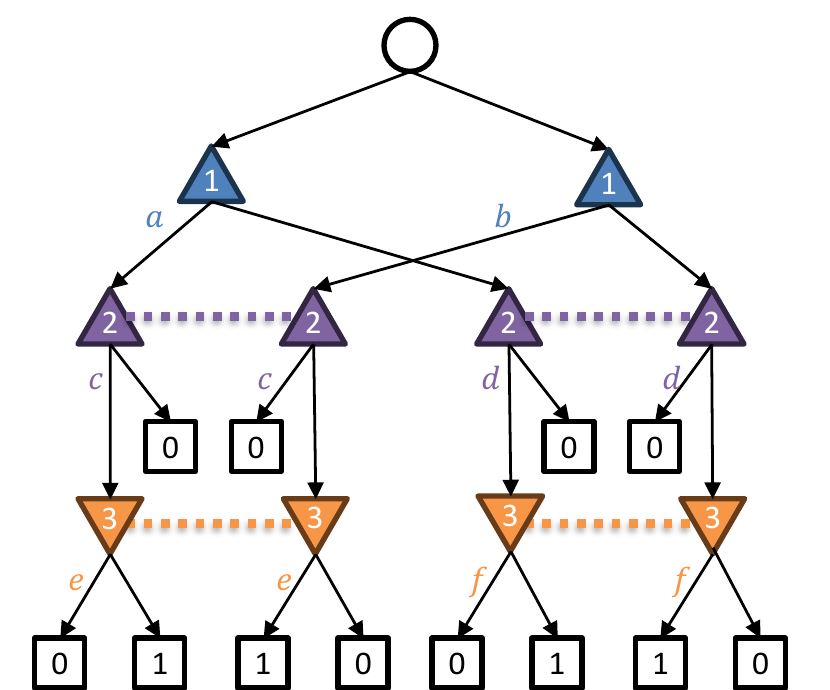
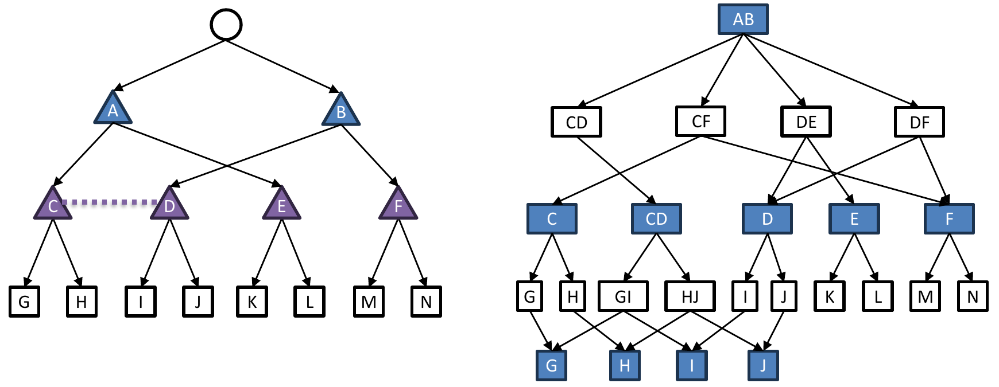
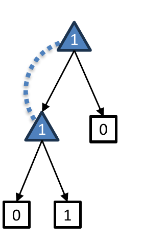
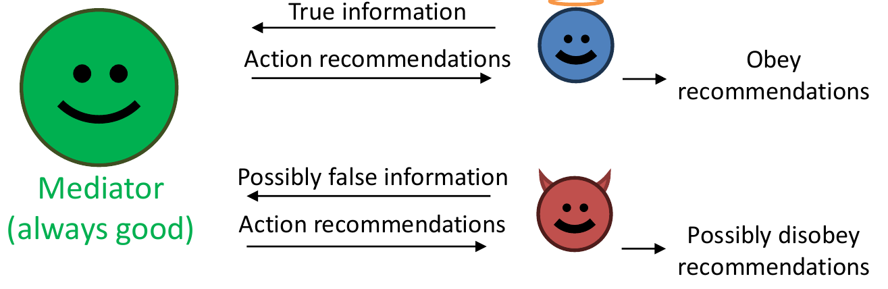

<!-- escape-math: v1 -->
# L18 团队博弈

本章转向**团队博弈（team games）**：多个玩家组成团队、共享同一效用函数，与对手（或对手团队）对抗。核心问题是：团队成员不能自由沟通、不能共享私有信息时，“团队的最优策略”应如何定义、又如何计算？我们将看到，看似自然的解概念在计算上极为困难，但通过刻画团队的**公共知识（common knowledge）**结构，可以在信息不对称程度有界时恢复多项式时间算法（团队信念 DAG，TB-DAG）。本章最后还介绍隐藏角色博弈（hidden-role games，即“社交推理”类游戏，如阿瓦隆）的解概念与精确求解。

## 什么是团队博弈？

考虑如下三玩家零和博弈：P1 与 P2 是**队友（teammates）**，共享同一效用函数，对手是 P3。这是一个“通信博弈”：P1 必须向 P2 传送一比特信息，且不能让 P3 知道。目标是找到团队的最优策略组合（strategy profile）。

记 $\bar{x} := 1 - x$。团队最大化、对手最小化团队效用时（团队先承诺策略），其值为

$$
\begin{aligned}
&\max\_{\substack{x\_1 \in \Delta(\Pi\_1)\\\ x\_2 \in \Delta(\Pi\_2)}}\\; \min\_{x\_3 \in \Delta(\Pi\_3)} u(x\_1, x\_2, y)
= \max\_{a,b,c,d \in [0,1]}\\; \min\_{e,f \in [0,1]} \tfrac{1}{2}\big(ac\bar{e} + \bar{a}d\bar{f} + b\bar{c}e + \bar{b}df\big) \\\
&\qquad \le \max\_{a,b,c,d} \tfrac{1}{2}\big(ac\bar{c} + \bar{a}d\bar{d} + b\bar{c}c + \bar{b}\bar{d}d\big) \qquad (\text{取 } e \gets c,\ f \gets d) \\\
&\qquad \le \frac{1}{2}\cdot\frac{1}{4}\cdot\big(a + \bar{a} + b + \bar{b}\big) = \frac{1}{4} \qquad \Big(\text{因为 } x\bar{x} = x(1-x) \le \tfrac{1}{4}\Big)
\end{aligned}
$$

事实上取 $a=b=c=d=1/2$ 时等号成立，故该值恰为 $1/4$。

**极小极大定理在此失效。** 交换 max 与 min 的次序（对手先承诺、团队后动），得到

$$
\min\_{y \in \Delta(\Pi\_3)}\\; \max\_{\substack{x\_1 \in \Delta(\Pi\_1)\\\ x\_2 \in \Delta(\Pi\_2)}} u(x\_1, x\_2, y)
= \min\_{e,f}\\; \max\_{a,b,c,d} \tfrac{1}{2}\big(ac\bar{e} + \bar{a}d\bar{f} + b\bar{c}e + \bar{b}df\big)
\ge \min\_{e,f} \max\big\\{\tfrac{f + \bar{e}}{2},\ \tfrac{e + \bar{f}}{2}\big\\} = \frac{1}{2},
$$

其中下界由团队的两种纯策略取法（$a=c=0, b=d=1$ 或 $a=c=1, b=d=0$）给出，再令对手取 $e=f$ 使 $f + \bar{e} = e + \bar{f} = 1$。于是 $\min\max = 1/2 > 1/4 = \max\min$。为什么？直观地说，团队的两名成员各自独立随机化时，无法共享一枚“秘密硬币”来协调彼此的随机选择——这正是多人团队与单一玩家的本质差别。

## 团队博弈的解概念

纳什均衡不是好答案：策略组合 $(a,b;\ c,d;\ e,f) = (1,0;\ 1,0;\ 1,0)$ 是一个纳什均衡，但 P1/P2 在其中**总是输**——纳什无法表达“团队联合最优”这一目标。

> **定义（团队极小极大均衡，TME）。** 团队极小极大均衡（team min-max equilibrium, TME）是下述优化问题的解：
> $$\max\_{\substack{x\_1 \in \Delta(\Pi\_1)\\\ x\_2 \in \Delta(\Pi\_2)}}\\; \min\_{y \in \Delta(\Pi\_3)} u(x\_1, x\_2, y).$$
> （这正是上面计算出的值 $1/4$ 所对应的解。）

问题是：这是**非凸优化**，因而困难，且如上所示极小极大定理不成立——称其为“均衡”都有些勉强。

> **定义（带相关的团队极小极大均衡，TMECor）。** 团队成员可以在赛前利用**团队私有随机性（team-private randomness）**相关化（correlate）各自的策略，即联合采样 $\mu \in \Delta(\Pi\_1 \times \Pi\_2)$：
> $$\max\_{\mu \in \Delta(\Pi\_1 \times \Pi\_2)}\\; \min\_{y \in \Delta(\Pi\_3)}\\; \mathbb{E}\_{(x\_1, x\_2) \sim \mu}\\; u(x\_1, x\_2, y).$$

在通信博弈中：TME 值为 $1/4$；TMECor 值为 $1/2$——P1/P2 以均匀分布在 $(1,0;\\,1,0)$ 与 $(0,1;\\,0,1)$ 两个纯策略组合之间相关化（“随机一次性密码本”，random one-time pad），从而把那比特信息对 P3 完全隐藏。

更正式地，TMECor 中的相关化通过**协调装置（coordination device）**实现（Farina, Celli, Gatti, Sandholm, NeurIPS 2018）：赛前队员们约定一组联合纯策略计划，临开赛时装置从分布 $\mu$ 中抽取一个联合纯计划，各队员照此执行。注意这不同于博弈论中通常的相关均衡概念——此处不需要激励相容约束，因为队员天然共享收益，故论文称其为“协调（coordination）”而非“相关（correlation）”。ex ante 协调的价值可能极大：与完全不协调相比，团队效用的提升可以达到与博弈树叶子数同阶的因子；反之，把解概念限制为 TME 也可能造成任意大的效用损失。但收益伴随代价：即使只求团队对给定对手策略的最优反应，也已是 NP-难且不可近似的（Basilico et al., AAAI 2017；Celli & Gatti, AAAI 2018）。

两种概念的对比如下：

| | TME | TMECor |
|---|---|---|
| 优化问题 | 非凸优化 | 凸优化（双线性鞍点） |
| 极小极大定理 | 不成立 | 成立 |

## 等价视角：（可定时的）不完美回忆零和博弈

团队博弈与**不完美回忆（imperfect recall）**双人零和博弈存在精确对应：把团队看作一个“记不住自己过去信息”的玩家。对应关系为：

| 团队博弈 | 不完美回忆博弈 |
|---|---|
| 团队（team） | 玩家（player） |
| 团队的策略组合 | 玩家的策略 |
| 不相关的策略组合 | 行为策略（behavioral strategy） |
| 相关的策略组合 | 混合策略（mixed strategy） |
| TME | 最优行为策略 |
| TMECor | 混合纳什均衡 |

关键警示：**库恩定理（Kuhn's theorem）在此不适用**——对不完美回忆博弈，混合策略与行为策略不等价！这也解释了为什么 TME $\ne$ TMECor。本章余下部分的问题是：**何时能高效计算 TMECor？**（严格说，对应关系要求博弈是**可定时（timeable）**的，见本章末的补充讨论。）

## 策略组合的表示：实现形式

如何表示团队的相关策略组合？用**实现形式（realization form）**。设 $Z$ 为终结节点集合，团队的纯策略记为向量 $\boldsymbol{x} \in \\{0,1\\}^Z$：若团队 ▲ 在通往 $z$ 的路径上打完了属于自己的全部动作，则 $\boldsymbol{x}[z] = 1$（团队 ▼ 类似）。于是 TMECor 是如下双线性鞍点问题的鞍点解：

$$
\max\_{\boldsymbol{x} \in \mathrm{conv}\\, X}\\; \min\_{\boldsymbol{y} \in \mathrm{conv}\\, Y}\\; \boldsymbol{x}^{\top} \boldsymbol{A} \boldsymbol{y}, \qquad \text{其中 } \boldsymbol{A}[z, z] = p\_{\mathrm{chance}}(z) \cdot u(z).
$$

这是一个**凸的双线性鞍点问题**！直觉：若两个团队都只有一名玩家，这就（模一个线性变换的意义下）退化为序列形式（sequence form）的 max-min 问题。

实现形式的理论基础（Farina et al., NeurIPS 2018）中还有几条值得记下的精确事实：

- **到达概率分解**：每个终结节点 $z$ 的到达概率可唯一分解为各玩家贡献之积乘以机会玩家的贡献——这正是 $\boldsymbol{A}$ 为对角矩阵的原因。
- **实现函数是线性的**，故其值域——实现多胞形——确实是凸多胞形；诱导同一实现向量的所有混合策略彼此收益等价，表示冗余因此被压缩掉。
- **与序列形式的关系**：对完美回忆玩家，实现形式恰是序列形式丢弃非终结序列变量后经简单线性变换得到的投影，可用线性规模约束描述；对不完美回忆玩家（如团队），描述约束数可能是指数的。
- **TMECor 是 TME 的“凸化”**：记 $\tilde\Omega$ 为行为策略可达的实现向量集合（一般非凸），则对非心不在焉（non-absent-minded）的玩家有 $\Omega = \mathrm{conv}\\,\tilde\Omega$。

## 计算 TMECor 是困难的

可惜实现形式本身并不能直接带来高效算法。下面的归约表明困难性是本质的。给定 3-SAT 公式，例如 $\phi(x\_1, x\_2, x\_3) = (x\_1 \lor x\_2) \land (\neg x\_1 \lor x\_3)$，构造如下团队博弈：

- 机会玩家均匀选取一个子句；P1 在该子句中选取一个变量；P2 **得知该变量（但不知来自哪个子句）**，并为其赋值 T 或 F；团队获胜当且仅当赋值满足对应子句。

P2 的纯策略恰为全体赋值 $\boldsymbol{x} \in \\{T, F\\}^3$；P1 与 P2 能以概率 1 获胜**当且仅当** P2 打出一个满足赋值。因此：

- 即便只是计算**单方团队**的最优策略也已是 NP-难的。更精细的复杂度分类如下（$\Delta\_2^P$、$\Sigma\_2^P$ 是多项式谱系中的类，分别指“带 SAT 预言机的多项式时间”与“带 SAT 预言机的非确定多项式时间”，满足 $\mathrm{NP} \subseteq \Delta\_2^P \subseteq \Sigma\_2^P$）：

  | | 团队 vs 单人 | 团队 vs 团队 |
  |---|---|---|
  | 计算 TMECor（值） | NP-完全（Koller & Megiddo, 1992） | $\Delta\_2^P$-完全（Zhang, Farina, Sandholm, ICML 2023） |
  | 计算 TME（值） | NP-完全（Koller & Megiddo, 1992） | $\Sigma\_2^P$-完全（同上） |

  除非多项式谱系坍塌，团队 vs 团队严格难于团队 vs 单人，且在团队 vs 团队设定下 TME 严格难于 TMECor——这正是两种解概念应当使用不同算法技术的复杂度证据。
- 推论：**实现多胞形（realization polytopes）不存在高效表示**（否则 TMECor 可用 LP 在多项式时间内求解，与 NP-难矛盾）。

**那我们还能做什么？** 实践中绕过困难性、把“低维但难以表示”的实现多胞形用起来的方法，阅读材料给出了两条主要路线的具体机制。

*辅助博弈与列生成（Farina et al., NeurIPS 2018）。* 把求 TMECor 归约为在一个**辅助博弈 $\Gamma^\*$** 中求双人零和纳什均衡：$\Gamma^\*$ 是完美回忆双人博弈，根节点 $\phi$ 的每个动作对应团队“枢轴队员”的一个纯策略计划，其后挂接原博弈中固定该计划后得到的子博弈，对手观察不到 $\phi$ 处的选择。$\Gamma^\*$ 与原博弈在实现形式下等价，于是可以把虚构对弈运行在其上——即**虚拟团队对弈（fictitious team-play）**算法：它不显式构造指数大的 $\Gamma^\*$，而是在原博弈上用混合整数线性规划（MILP）求解两边的最优反应，平均策略以实现形式维护；算法是 anytime 的且保证收敛到 TMECor，在三人 Kuhn 与三人 Leduc 扑克上比之前最优的行列生成算法快若干个数量级。

*Team-PSRO（McAleer et al., NeurIPS 2023）。* 第二条路线是运行 PSRO（策略空间响应预言机）。其表格版本**团队双预言机（Team DO）**为每个团队维护联合纯策略的种群，每轮在种群张成的受限零和标准式博弈中求纳什均衡，再把对该均衡的团队联合最优反应加入种群；当最优反应无法改进受限博弈的纳什值时终止，此时受限博弈的均衡即原博弈的 TMECor。Team-PSRO 把精确联合最优反应换成用**合作式强化学习**学到的近似联合最优反应（论文用 MAPPO：集中式评论家可见全局历史以降低方差、队友间共享网络参数——集中训练、分散执行），从而可扩展到大型博弈；作为副产品，算法输出“近似可利用度”（学到的近似最优反应对受限均衡的收益，是真实可利用度的下界）作为进度度量。其变体 **Team-PSRO Mix-and-Match** 还允许把不同联合最优反应中各队员的策略交叉重组进种群，以近乎免费的代价扩大种群、加速收敛。实验上：表格版在 Kuhn 扑克与 Liar's Dice 上收敛到近似 TMECor，且快于虚拟团队对弈；在四人 Google Research Football（每队两名玩家、带不完全信息的改造版）上，Team-PSRO 与 Team-PSRO-MM 在 Elo、对内置 AI 的净胜球、相对种群表现三项指标上均优于自我对弈基线，MM 变体最佳。代价是缺乏实用的收敛保证——最坏情形需枚举全部联合纯策略，且团队最优反应本身 NP-难；但对于足够大的博弈，这或许是唯一可行的办法。

## 团队信念 DAG（TB-DAG）

### 构造

思路之三（本章主线）：像序列形式那样为团队构造一个**单人决策问题**，办法是表示出什么是团队的**公共知识**。

构造中的基本对象：

- **决策点（decision point，即“信念”）**：由博弈树节点的一个**集合**标识（完美回忆情形下就是一个信息集）；
- **处方（prescription）**：在与该决策点相交的每个信息集上各选定一个动作；
- **观察点（observation point）**：同样由一个节点集合标识；
- **公共观察（public observation）**：团队观察到的、对全体成员为公共知识的信息。

由此得到的是一个 **DAG 上的决策问题**，可以用**缩放扩展（scaled extensions）**表示——同样的想法曾在 $\Phi$-后悔的线性偏差（linear deviations）中出现过。这一结构称为**团队信念 DAG（team belief DAG, TB-DAG）**（Zhang, Farina, Sandholm, ICML 2023）。

形式化地说，构造借助**连通图（connectivity graph）**：以博弈树节点为顶点，若两节点同层且存在某个团队信息集同时可达二者，则连边——连通图编码的正是“什么信息不是团队的公共知识”。TB-DAG 的决策点标签是博弈树节点的集合（信念），动作是与该信念相交的每个信息集各选一个动作组成的处方；在观察点处按连通分支分裂，每个分支就是一个公共观察。若两个决策问题终结节点集合相同、策略空间相同，则称**战略等价**；ICML 2023 论文证明 TB-DAG 与原团队决策问题战略等价（其 Theorem 4.2），且 DAG 版 CFR 可在其上高效运行：$N$ 个节点、$E$ 条边时 $T$ 轮遗憾为 $O(N\sqrt{T})$，每轮耗时 $O(E)$（其 Theorem 4.3）。换言之，TB-DAG 之于团队博弈正如序列形式之于完美回忆博弈：把带信息集的决策问题变成等价的完美信息决策问题，从而解锁后悔最小化工具箱。

### TB-DAG 有多大？

TB-DAG 的规模由观察点（即“（决策点，处方）对”）的数量主导。计数方法：在**每个公共状态（public state，即公共知识集合）内**分别计数。一个（决策点，处方）对可以由如下信息唯一确定：对每个**末信息集（last-infoset）$J$**，指明

- $J$ 是否被该玩家到达；
- 若是，在 $J$ 上选择哪个动作。

设 $b$ 为分支因子（branching factor），$k$ 为末信息集的个数，则

$$
\text{每个公共状态的观察点数} \le (b+1)^k .
$$

末信息集的个数 $k$ 恰好度量**信息不对称（information asymmetry）**：有多少信息为某个队员所知、却不是全队的公共知识。极端情形 $k = 1$ 意味着队员们信息对称，此时整个团队可以建模为一个完美回忆玩家。记 $N$ 为博弈树规模，则

$$
\text{CFR 每轮迭代运行时间} \\;\propto\\; \text{TB-DAG 的规模} \\;\le\\; (b+1)^k \cdot \mathrm{poly}(N),
$$

即当 $k$ 为常数时是多项式时间（实践中也相当高效）。这一结果本质上不可改进：若存在 $2^{O(k)} \cdot \mathrm{poly}(N)$ 的算法将否证指数时间假设（ETH）。

以合约桥牌（contract bridge）为例粗略估计：$k = 2\binom{52}{13} < 2^{40}$，$b < 26$，$N \approx 2^{200}$。朴素算法（写出标准式再求解）耗时约 $2^{2^{200}}$；而 TB-DAG 的规模

$$
< 2^6 \cdot 2^{40} \cdot \mathrm{poly}\\!\left(2^{200}\right) < 2^{2^{43}} \ll 2^{2^{200}}.
$$

**与既有表示的比较。** 此前两种方法都基于**公共状态**（连通图的连通分支，即无条件为公共知识的信息）而非公共观察（条件于团队已打出的策略才成为公共知识的信息）：Zhang & Sandholm（AAAI 2022）用树分解构造 LP，Carminati 等（NeurIPS 2022）则把博弈转换成战略等价但可能指数级更大的双人完美回忆博弈。TB-DAG 严格更优：规模从不超过公共状态版表示的 $2^p$ 倍（$p$ 为最大公共状态的节点数），且存在实例使公共状态版为指数规模而 TB-DAG 为多项式规模（即使前者先做**膨胀（inflation）**预处理）；反向的指数差距不存在，且公共观察使构造不再需要膨胀。实验上，在多人 Kuhn、Leduc 扑克与 Liar's Dice 基准上，TB-DAG 上的 CFR 变体（PCFR+、DCFR、LCFR）普遍比 ZS22 的 LP 快 2–3 个数量级：如 12 秩三人 Kuhn（约 1.7 万叶子）本方法约 1.4 秒收敛而 ZS22 与列生成方法均内存耗尽；L523（约 77.5 万叶子）上本方法约 25 秒，列生成方法超过 6 小时未解出。

## 补充一：为什么要求可定时性？

部分回答：不可定时（untimeable）的不完美回忆博弈行为非常怪异。考虑下图的单人博弈：玩家行动一次后“忘记”自己做过什么，再次行动（两个节点属于同一玩家且无法区分先后）。

- 每个**纯策略**的得分都是 $0$；
- 在两个节点上**均匀且独立地**随机化，得分却是 $1/4$。

“行为策略 $\not\supseteq$ 混合策略？！”——准确地说，这里连“玩家自己与自己相关化”都变得有意义，这正是可定时性假设要排除的病态。

## 补充二：隐藏角色博弈

隐藏角色博弈（hidden-role games），又称**社交推理博弈（social deduction games）**，是这样一类对抗性团队博弈：“好人（Good）”团队**不知道自己的队友是谁**。博弈强调通信：玩家可以自由交谈（以建立信任、协调行动），但好人玩家不知道对方是不是“坏人（Bad）”！此外还有分布式系统、网络安全、联邦学习等应用。以下介绍 Carminati、Zhang、Farina、Gatti、Sandholm（EC 2024）的工作，其贡献为：(1) 首个适用于一般隐藏角色博弈的解概念；(2) 首个一般隐藏角色博弈的高效算法；(3) 应用：精确求解 5 人与 6 人版本的阿瓦隆（Avalon）。

### 解概念

能直接用已有概念吗？**纳什均衡**不行——它无法刻画团队协调（当只有一个好/坏团队时，我们要的是团队的联合最优策略，而非某个纳什均衡）。**团队相关均衡**是团队身份为公共知识时最自然的概念——队员可以在赛前讨论策略（包括掷随机硬币以相关化）；但在隐藏角色博弈中，**赛前你连队友是谁都不知道**。因此需要新概念。

**解：分裂人格博弈（split-personality game）。** 把每个玩家 $i$ 拆成“好人版”与“坏人版”两个角色（Good-$i$ 与 Bad-$i$），从而把 $n$ 人隐藏角色博弈变成 $2n$ 人对抗性团队博弈。

> **定义（隐藏角色均衡，hidden-role equilibrium）。** 隐藏角色均衡 = 分裂人格博弈中的团队（不相关）均衡 = 好人团队要承诺的最优团队策略。

该概念**本质上是非对称的（没有对偶性/极小极大定理）**！而且非对称是必要的：在任何极小极大定理成立的隐藏角色博弈中，好人团队只要发送一个长随机串就能让团队身份立即公开（→ 角色不再隐藏！）——也就是说，若极大极小值相等，“隐藏角色”这个前提本身就会崩塌。

### 一个例子

三名玩家，角色为 Good、Good、Bad。大家自由交谈后投票选出一名“领袖”：若选出好人则好人团队胜；选出坏人则坏人胜；若无共识则坏人**默认获胜**。

- 若坏人如实声明“我是坏人”，两个好人会互投，好人当选，好人胜；
- 但坏人的最优策略是**假装好人**：此时好人团队无法获得任何信息，只能任意选一人，故 $\Pr[\text{好人胜}] = 2/3$。

现在做一个小改动：角色变为 Good、Good′、Bad（好人持有**可区分的**角色卡）。此时坏人陷入绝境：若自称 good，好人就选 good′；若自称 good′，就选 good；都不声称则暴露自己是坏人。**结论：好人团队可以确定性获胜。** 直觉：可区分的卡片 ⇒ **隐式相关（implicit correlation）**——角色卡本身充当了团队的相关化装置。

### 计算隐藏角色均衡

两个关键概念：若坏人团队人数少于好人团队，称坏人是**少数派（minority）**；若坏人团队（非正式地）“表现得像被单一对抗性控制器操纵”，称坏人是**协调的（coordinated）**。

> **定理（主要算法结果）。** 在以下三条假设下，存在计算隐藏角色均衡的高效算法：
> 1. 允许私有通信（private communication）；
> 2. 坏人团队是少数派；
> 3. 坏人团队是协调的。

私有通信是合理假设：可以用公开通信 + 公钥密码学实现（需假设坏人在计算能力上有界）。

更精确地说（EC 2024 论文的 Theorem 4.3）：设坏人为 $k$ 人且 $k < n/2$，则带私有通信的隐藏角色博弈值等于“加入一名恒为好人的中介者后的博弈”的对应值，且可在 $|H|^{O(k)}$ 时间内通过求解一个同规模的零和博弈精确算出；用 MPC 把中介者模拟掉之后，$\varepsilon$-隐藏角色均衡可在 $\mathrm{poly}(|H|^k, \log(1/\varepsilon))$ 时间内计算并执行。值得一提的是，论文所用的 MPC 是**信息论安全的**——对计算能力无界的对手也安全，这比上述课件讲法（公钥密码学需假设对手计算有界）更强。

> **定理（下界，非正式陈述）。**
> - 假设 (2)、(3) 但无 (1)：NP-难；
> - 假设 (2)、(1) 但无 (3)：coNP-难；
> - 仅假设 (2)：$\Sigma\_2^P$-难。
>
> 公开问题：假设 (1) 与 (3) 的情形如何？

论文给出的完整复杂度图景（玩家人数为常数时计算隐藏角色博弈值）如下：

| 坏人团队假设 | 无通信 | 公开通信 | 私有通信 |
|---|---|---|---|
| 协调 + 少数派 | NP-完全 | NP-难 | **P**（主定理） |
| 协调 | NP-完全（von Stengel & Koller, 1997） | NP-难 | 公开问题 |
| 少数派 | $\Sigma\_2^P$-完全 | $\Sigma\_2^P$-难 | coNP-难 |

**隐藏角色的代价（price of hidden roles, PoHR）。** 类比无政府代价，论文定义 PoHR 为“团队身份公开后好人团队的博弈值”与“隐藏角色博弈值”之比：对团队指派服从分布 $D$、且好人身份公开后可确定性获胜（归一化）的博弈类，PoHR 恰为 $1/p^\*$，$p^\*$ 是 $D$ 赋予最可能团队指派的概率——直觉是最坏情形下好人只能开局猜出全队名单，猜对才赢。特别地，$n$ 名玩家、$k$ 名坏人（$k < n/2$）时 PoHR $= \binom{n}{k}$；$k = 1$ 时至多为 $n$，与对抗团队博弈中“通信/相关的代价”可任意大形成鲜明对比。

**主定理的证明思路。** 先假设存在一名**始终在好人团队**的玩家，称为**中介者（mediator）**。由**显示原理（revelation principle）**：中介者收集各玩家的信息、返回动作推荐；好人报告真实信息并服从推荐，坏人则可能谎报、可能抗命。

- **主要思路 #1**：有私有通信且坏人协调时，这等价于中介者与坏人团队之间的**双人零和博弈** ⇒ 可以高效求解！由此还推出：在这些假设下隐藏角色博弈的博弈值是**有理数**。
- **主要思路 #2**：若没有中介者，就用**安全多方计算（multi-party computation, MPC）模拟一个**！（需要坏人少数派 + 私有通信。）

### 应用：精确求解阿瓦隆

在阿瓦隆中，玩家数 $< 7$ 时坏人团队是协调的 ⇒ 主定理适用。再经过大量化简（如剔除被占优策略），博弈小到可以用线性规划（LP）精确求解。具体规模上，论文把 5、6 人阿瓦隆的原始博弈树（Serrino et al. 2019 估计约 $10^{56}$ 个节点）经博弈特定的化简（剔除被占优策略、合并对称结构等）压缩到约 $10^8$ 个节点以内，从而使精确求解成为可能。（严格地讲，阿瓦隆的坏人团队本身并非协调的；论文对 5、6 人变体验证了“协调与否不影响博弈值”，即两种分裂人格博弈在这些实例上等价，因此主定理的结论仍然成立。）下表为各变体中**好人团队的（均衡）胜率**：

| 变体 | 5 名玩家 | 6 名玩家 |
|---|---|---|
| 无特殊角色（*Resistance*） | $3/10 = 0.3000$* | $1/3 \approx 0.3333$* |
| 梅林（Merlin） | $2/3 \approx 0.6667$* | $3/4 = 0.7500$* |
| 梅林与莫德雷德（Merlin & Mordred） | $731/1782 \approx 0.4102$ | $6543/12464 \approx 0.5250$ |
| 梅林与两个莫德雷德 | $5/18 \approx 0.2778$ | $99/340 \approx 0.2912$ |
| 梅林、莫德雷德、派西维尔、莫甘娜 | $67/120 \approx 0.5583$ | — |

*：Christiano（2018）已知。注意一个看似显然的等式并不成立：$\text{Resistance} \cdot \frac{2}{3} \stackrel{?}{=} \text{梅林 + 两个莫德雷德}$（$0.3000 \times 2/3 = 0.2000 \ne 0.2778$）——原因是好人团队的角色卡可区分 ⇒ 隐式相关！

### 未来研究方向

隐藏角色博弈是一类可以合理定义“求解”含义的新博弈类，仍有大量开放问题：

- （前述公开问题）坏人协调但非少数派、允许私有通信时，存在高效算法还是困难性结果？
- 若只允许公开通信，甚至连有限时间算法是否存在都不清楚（如何界定通信长度的上界？）——这对实践解读尤其重要，因为人类玩这类游戏时通常只用公开通信、不用密码学；
- 其他消息结构（如匿名消息）？
- 两个团队都隐藏身份时会怎样？是否存在一种隐藏角色均衡的定义，使其不依赖于“哪个团队先承诺策略”这一看似任意的不对称选择？

## 要点小结

- 团队博弈中，队友共享效用函数但不能自由沟通私有信息；极小极大定理对不相关的团队策略失效（通信博弈中 $\max\min = 1/4 < 1/2 = \min\max$），纳什均衡也无法表达团队联合最优。
- 两个核心解概念：TME（非凸、极小极大不成立）与 TMECor（允许团队私有随机性相关化，化为凸的双线性鞍点 $\max\_{\boldsymbol{x}\in\mathrm{conv}X}\min\_{\boldsymbol{y}\in\mathrm{conv}Y}\boldsymbol{x}^\top\boldsymbol{A}\boldsymbol{y}$）。
- 团队博弈 ≡（可定时的）不完美回忆双人零和博弈；TME ↔ 最优行为策略，TMECor ↔ 混合纳什均衡，库恩定理不适用。
- 计算 TMECor：团队 vs 单人已是 NP-完全（3-SAT 归约），团队 vs 团队为 $\Delta\_2^P$-完全（TME 更高达 $\Sigma\_2^P$-完全）；实现多胞形无高效表示。实践中：中小博弈用辅助博弈 + 虚拟团队对弈（MILP 最优反应）或列生成，大博弈用 Team-PSRO（合作式 RL 近似联合最优反应）。
- TB-DAG 按团队公共知识把团队博弈化为战略等价的单玩家 DAG 决策问题，CFR 可直接在其上运行（遗憾 $O(N\sqrt{T})$、每轮 $O(E)$）；CFR 每轮时间 $\le (b+1)^k \cdot \mathrm{poly}(N)$，其中 $k$ 为信息不对称度（末信息集数），$k$ 有界即多项式，且在 ETH 下不可改进。
- 隐藏角色博弈：经分裂人格博弈定义隐藏角色均衡（本质上非对称）；在“私有通信 + 坏人少数派 + 坏人协调”下可高效求解（显示原理 + MPC 模拟中介者），放松任一假设分别有 NP / coNP / $\Sigma\_2^P$ 下界；隐藏角色的代价恰为 $\binom{n}{k}$；应用上精确求解了 5、6 人阿瓦隆。
