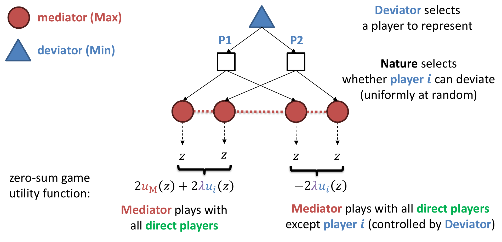
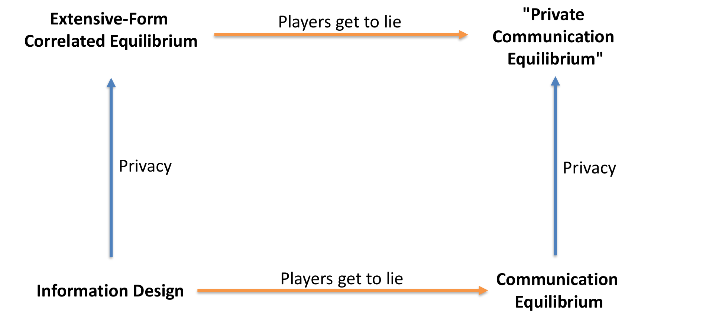

# 自动化机制设计

前面各讲的核心是"在给定博弈中求均衡"；本讲反其道而行：一个拥有承诺能力（commitment）的调解人（mediator）——领导者、拍卖者、信号发送者或相关装置——可以通过选择自己的策略来**设计**博弈，从而优化自己的目标。我们将看到，Stackelberg 均衡、最优相关均衡、机制设计（mechanism design）、信息设计（information design）这些看似独立的问题，都是"扩展式博弈中最优通信均衡（communication equilibrium）"的特例；而 Zhang 和 Sandholm（NeurIPS 2022）的主定理给出了一个关于博弈树规模多项式的统一算法。本讲还会给出基于拉格朗日松弛、可用无悔学习（含深度强化学习）求解的替代算法，并讨论扩展式相关均衡（EFCE）在这一图景中的位置。

## 1 四个激励问题

### 1.1 标准式博弈中的 Stackelberg 均衡

考虑如下标准式博弈（领导者选行，跟随者选列）：

| Leader \ Follower | $X$ | $Y$ |
|---|---|---|
| $X$ | $1,1$ | $11,0$ |
| $Y$ | $0,0$ | $10,1$ |

该博弈有唯一纳什均衡 $(X,X)$，领导者只得 $1$。但若领导者能**承诺**以概率 $1/2-\varepsilon$ 出 $X$（其余概率出 $Y$），跟随者的最优响应变为 $Y$，领导者期望效用约为 $10.5$——承诺能力带来巨大收益。忽略平局处理（tiebreaking），Stackelberg 均衡有两个等价视角：

- 领导者向跟随者**发出建议**（此处建议出 $Y$），跟随者需满足**服从约束**（obedience constraint）；
- 在**忽略领导者自身激励约束**的前提下求对领导者最优的均衡。即求解
  $$\max_{x_L\in\Delta(A_L),\;x_F\in\Delta(A_F)} u_L(x_L,x_F)\quad\text{s.t.}\quad u_F(x_L,x_F)\ge u_F(x_L,a_F)\ \ \forall a_F\in A_F;$$
  若再加上领导者的激励约束 $u_L(x_L,x_F)\ge u_L(a_L,x_F)\ (\forall a_L\in A_L)$，则变为"最优纳什均衡"问题。

把该博弈画成"领导者先承诺、跟随者观察到建议后行动"的扩展式博弈，可以看到：

> **Stackelberg 均衡** = 领导者的一个策略，使得固定领导者策略后，**直接策略**（direct strategy，即服从建议）是跟随者的最优响应。


### 1.2 最优相关均衡

以"小鸡博弈"（Chicken）为例：

|  | Stop | Go |
|---|---|---|
| **Stop** | $0,0$ | $0,1$ |
| **Go** | $1,0$ | $-5,-5$ |

相关装置（correlation device）按分布 $\mu=p\cdot(\text{Stop},\text{Go})+(1-p)\cdot(\text{Go},\text{Stop})$ 私下向双方发送建议。玩家策略是**直接的**：被激励去服从建议。

> **相关均衡**（correlated equilibrium, CE）= 调解人的一个策略，使得固定调解人策略后，直接策略组合是其他玩家的纳什均衡。

最优相关均衡即在这一约束下最大化某个目标（如社会福利）的 $\mu$——同样是"调解人优化 + 玩家服从"的结构。

### 1.3 机制设计

拍卖者卖一辆车，买方 1 估值 $\$6k$、买方 2 估值 $\$4k$，但拍卖者**不知道**估值。可以直接问，但买方可能撒谎；而且"直接问"是否最优也不清楚。经典结果：

> **定理（Myerson, Math of OR 1981）.** 假设买方估值独立同分布地抽自某分布 $D$，则存在（依赖于 $D$ 的）保留价 $r$，使下述机制最大化期望收益：询问各买方估值（"报价"）；若最高报价 $>r$，最高报价者赢得物品并支付 $\max\{\text{次高报价},\,r\}$，否则无人获得物品。

该机制是**直接的**（direct）：买方如实报价构成纳什均衡。把它写成扩展式的"增广博弈"：买方 $i$ 的类型 $v_i\sim D_i\in\Delta(\mathbb{R})$，各自报告 $v_i'\in\mathbb{R}$；机制（拍卖者的策略）输出赢家 $i^*\in\{\bot,1,2\}$ 与价格 $p\in\mathbb{R}$；若 $i^*=\bot$ 则所有人效用为 $0$，否则 $u_A=p$、$u_{i^*}=v_{i^*}-p$、其余人为 $0$。于是：

> **最优机制** = 拍卖者的一个策略，使得固定拍卖者策略后，直接策略组合（如实报告 $v_i'=v_i$）是其他玩家的纳什均衡。

### 1.4 信息设计（贝叶斯劝说）

信息设计（information design），又称贝叶斯劝说（Bayesian persuasion）（Kamenica & Gentzkow, American Economic Review 2011），可看作"反过来的机制设计"。一辆车售价 $\$5000$：以概率 $1/3$ 是好车（对买方价值 $\$6k$），以概率 $2/3$ 是差车（价值 $\$4k$），只有卖方知道真实质量。买方"买"则卖方得 $\$5k$、买方得 $+\$1k$（好车）或 $-\$1k$（差车）；"不买"双方得 $0$。与前面一样，卖方可以**承诺**并发送消息。

最优信号方案：好车必推荐"买"，差车以概率 $1/2$ 推荐"买"。于是
$$\Pr[\text{好车}\mid\text{卖方说“买”}]=\frac{1/3}{1/3+(2/3)(1/2)}=\frac12,$$
买方收到"买"的建议时买的期望效用为 $\frac12(1k)+\frac12(-1k)=0\ge$ 不买的 $0$，故其最优响应正是照做（策略是直接的）。尽管车只有 $1/3$ 的时间是好车，卖方却有 $2/3$ 的时间能把车卖出去。同样地：

> **最优解** = 卖方的一个策略，使得固定卖方策略后，直接策略是买方的最优响应。

Kamenica & Gentzkow（AER 2011）给出的正是一般化这类例子的完整理论。模型为：状态 $\omega\in\Omega$ 按公共先验 $\mu_0$ 抽取；发送者**承诺**一个信号 $\pi$（有限实现空间 $S$ 与一族分布 $\{\pi(\cdot\mid\omega)\}_{\omega\in\Omega}$）；接收者观察 $\pi$ 与实现 $s$，用贝叶斯法则形成后验 $\mu_s$，再采取自己的最优行动（无差异时按有利于发送者的方式打破平局）。每个信号都诱导一个**后验的分布** $\tau\in\Delta(\Delta(\Omega))$，而贝叶斯理性对 $\tau$ 只施加一个约束——**贝叶斯可信性**（Bayes plausibility）：
$$\sum_{\mu\in\operatorname{Supp}(\tau)}\mu\,\tau(\mu)=\mu_0,$$
即后验的期望必须回到先验（先验的一次"拆分"）。记 $\hat{v}(\mu)=\mathbb{E}_\mu\,v(\hat{a}(\mu),\omega)$ 为双方信念均为 $\mu$ 时发送者的期望效用（$\hat{a}(\mu)$ 为接收者在信念 $\mu$ 下的均衡行动）。

> **命题（Kamenica & Gentzkow 2011, Proposition 1）.** 以下三者等价：(i) 存在一个值为 $v^*$ 的信号；(ii) 存在一个**直接信号**（信号实现即行动建议，且接收者总是服从）值为 $v^*$；(iii) 存在一个贝叶斯可信的后验分布 $\tau$ 使 $\mathbb{E}_\tau\,\hat{v}(\mu)=v^*$。

注意 (ii) 正是本讲"直接策略 / 显示原理"在信息设计中的化身：不失一般性，调解人的消息就是行动建议。该命题把"设计信号"化归为"在先验的拆分上优化"，于是最优点有清晰的几何刻画。令 $V$ 为 $\hat{v}$ 的**凹闭包**（concave closure；Aumann & Maschler 称之为 concavification）：
$$V(\mu)\equiv\sup\big\{z\;\big|\;(\mu,z)\in\mathrm{co}(\hat{v})\big\},$$
即处处弱大于 $\hat{v}$ 的最小凹函数。

> **推论（Kamenica & Gentzkow 2011, Corollary 2）.** 最优信号的值恰为 $V(\mu_0)$；发送者能严格获益于劝说当且仅当 $V(\mu_0)>\hat{v}(\mu_0)$。

用它重新看卖车例：把状态约化为"买方认为车是好的概率" $\mu$，则 $\hat{v}(\mu)$ 是台阶函数——$\mu\ge 1/2$ 时买方买、卖方得 $5k$，否则得 $0$。先验 $\mu_0=1/3$ 处的凹闭包由两个后验 $\mu=0$ 与 $\mu=1/2$ 张成，贝叶斯可信性要求后者概率为 $2/3$，故 $V(1/3)=\frac23\cdot 5k$：前面的最优方案正是凹闭包构造的实例，"$2/3$ 的时间能成交"就是 $V(\mu_0)/5k$。

### 1.5 四个问题的共性

- **优化**（Optimization）：调解人（领导者 / 卖方 / 相关装置）有要优化的目标；
- **承诺**（Commitment）：调解人承诺一个策略 $\mu$；
- **通信**（Communication）：调解人与玩家通信（给予信息 / 建议，或从玩家处获得信息）。通信对博弈无直接作用，唯一目的是交换信息；且通信是**结构化的**——目前所见均为"信息报告"或"行动建议"两种。

本讲余下部分回答：这一框架有多一般？能否高效计算最优调解人策略？

## 2 扩展式博弈与通信均衡

考虑一般的扩展式博弈，外加一个在博弈每一时刻都与各玩家（私下）通信的调解人；通信是隐式建模在博弈树中的。

> **定义（通信均衡，communication equilibrium）.** 通信均衡是一个（可随机的）策略元组 $(\mu,x_1,x_2)$，使得所有玩家（不含调解人）都在最优响应：
> $$u_1(\mu,x_1,x_2)=\max_{x_1'}\;u_1(\mu,x_1',x_2),\qquad u_2(\mu,x_1,x_2)=\max_{x_2'}\;u_2(\mu,x_1,x_2').$$
> 等价地：固定 $\mu$ 后，$(x_1,x_2)$ 是纳什均衡。

> **主定理（Zhang & Sandholm, NeurIPS 2022）.** 存在关于博弈树规模多项式的算法，计算一个最大化调解人目标 $u_M(\mu,x_1,\dots,x_n)$ 的通信均衡 $(\mu,x_1,\dots,x_n)$。

困难在哪里？一般的策略可以是任意复杂的消息交互："若我观察到 $t$，就发消息 $m_1$；若再收到 $m_2$ 则出 $a$，收到 $m_3$ 则出 $a'$；然后若……"——**消息空间是无限的**，直接优化无从谈起。证明分三步把问题化归到可解的规模。

## 3 主定理的证明：三步

### 3.1 第一步：显示原理——从无限到有限

> **定理（显示原理，revelation principle，非正式表述；Forges, Econometrica 1985，论文中进一步推广）.** 对任意通信均衡，存在一个等价的**直接**通信均衡。"直接"同时要求：
> 1. 玩家发给调解人的消息是对其**私有信息的报告**，且均衡中玩家总是如实报告；
> 2. 调解人发给玩家的消息是**行动建议**，且均衡中玩家总是服从建议。

**证明思路（模拟论证）.** 给定一个使用任意消息的"间接"均衡，构造新的调解人：它在内部**模拟**旧调解人与原均衡策略。当真实类型为 $\$6k$ 的玩家在直接均衡中如实报"$\$6k$"时，新调解人算出他在原均衡中会报 $f(\$6k)$，并假装他确实如此报价，然后按原均衡行动；即使玩家撒谎报 $\$4k$，调解人也只是假装他报了 $f(\$4k)$。对称地，原均衡中调解人发消息 $m$、玩家以 $a=f(m)$ 回应；直接均衡中调解人直接建议"出 $a$"。关键在于：针对直接均衡的任何偏离（谎报类型 $f$，或不服从建议 $g$）都一一对应于针对原均衡的偏离（报 $f(\cdot)$、回应 $g(f(\cdot))$），原均衡无利可图的偏离在新均衡中同样无利可图。故均衡性质保持，而消息空间被约减为"类型报告 + 行动建议"的有限结构。$\square$

### 3.2 第二步：通信博弈——从有限到多项式

显示原理之后，可以只考虑如下**通信博弈**（communication game）：沿原博弈树下行，每个时刻玩家先向调解人发送（私有）信息，调解人私下建议行动，玩家再实际行动。通信博弈树中的一个状态形如
$$(s,\ \tau_1,\ \dots,\ \tau_n),\qquad s\in S\ \text{为原博弈树状态},\ \ \tau_i\ \text{为与玩家}\ i\ \text{的通信记录（transcript）}.$$
状态数 $\le |S|\cdot(\text{可能消息数})^{O(\text{树深})\cdot n}$：通信博弈是**有限的**，但仍然是指数大的。两个"不失一般性"的观察把它压到多项式：

> **观察 1.** 可设每个通信记录 $\tau_i$ 总对应原博弈的某个真实状态 $s_i$。
>
> **证明梗概.** 调解人希望玩家 $i$ 从偏离中得到的效用尽量低。若 $\tau_i$ 不对应任何真实状态，调解人立刻知道玩家 $i$ 偏离了，于是不应再向他透露任何有用信息——故玩家从这类 $\tau_i$ 中无法获益，可把这类记录从考虑中剔除。

于是状态可写为 $(s,s_1,\dots,s_n)$，状态数 $\le |S|^{n+1}$：大有改善，但在 $n$ 上仍是指数的。

> **观察 2.** 只需关心"单玩家偏离"：均衡约束是每个玩家在其他人都直接时不想偏离，故可设除至多一个 $i$ 外 $s_i=s$。

状态进一步压缩为 $(s,i,s_i)$，其中 $i\in[n]\cup\{\bot\}$ 标记（可能存在的）偏离者，$s_i$ 为该偏离者通信记录对应的状态。状态数 $\le n|S|^2$——**关于博弈树规模多项式**！

### 3.3 第三步：LP 对偶求解

先重述两个定义。

> **定义.** 通信均衡是策略元组 $(\mu,\boldsymbol{x}_1,\dots,\boldsymbol{x}_n)$，使对所有 $i$：
> $$u_i(\mu,\boldsymbol{x}_1,\dots,\boldsymbol{x}_i,\dots,\boldsymbol{x}_n)=\max_{\boldsymbol{x}_i'}\;u_i(\mu,\boldsymbol{x}_1,\dots,\boldsymbol{x}_i',\dots,\boldsymbol{x}_n).$$
> **直接通信均衡**是通信博弈中调解人的一个（可随机）策略 $\mu$，使对所有 $i$：
> $$u_i(\mu,\boldsymbol{x}_1^*,\dots,\boldsymbol{x}_i^*,\dots,\boldsymbol{x}_n^*)=\max_{\boldsymbol{x}_i'}\;u_i(\mu,\boldsymbol{x}_1^*,\dots,\boldsymbol{x}_i',\dots,\boldsymbol{x}_n^*),$$
> 其中 $\boldsymbol{x}_i^*$ 为玩家 $i$ 的直接策略（如实报告、服从建议）。

最优直接通信均衡因此是如下规划：目标与约束左端关于 $\mu$ **线性**，右端关于 $(\mu,\boldsymbol{x}_i')$ **双线性**：
$$\max_{\mu}\ \boldsymbol{c}^\top\mu\qquad\text{s.t.}\qquad \boldsymbol{b}_i^\top\mu\ \ge\ \max_{\boldsymbol{x}_i'\in\mathcal{X}_i}\ \mu^\top A_i\,\boldsymbol{x}_i'\quad\forall i,$$
其中 $\mu$ 取调解人的序列式（sequence-form）策略集 $\mathcal{X}_M$，$\mathcal{X}_i=\{\boldsymbol{x}:F_i\boldsymbol{x}=\boldsymbol{f}_i,\ \boldsymbol{x}\ge 0\}$ 为玩家 $i$ 的序列式策略多面体。对内层每个最大化取 LP 对偶：
$$\max_{\boldsymbol{x}\ge 0,\,F_i\boldsymbol{x}=\boldsymbol{f}_i}(A_i^\top\mu)^\top\boldsymbol{x}\ =\ \min_{\boldsymbol{v}_i:\,F_i^\top\boldsymbol{v}_i\ge A_i^\top\mu}\ \boldsymbol{f}_i^\top\boldsymbol{v}_i,$$
代回即得单个**线性规划**：
$$\max_{\mu\in\mathcal{X}_M,\;\boldsymbol{v}_i\,(i\in[n])}\ \boldsymbol{c}^\top\mu\quad\text{s.t.}\quad \boldsymbol{b}_i^\top\mu\ge \boldsymbol{f}_i^\top\boldsymbol{v}_i,\ \ F_i^\top\boldsymbol{v}_i\ge A_i^\top\mu\quad\forall i.$$
由于第二步已把通信博弈的规模控制在多项式，该 LP 的规模也是多项式的，主定理得证。

## 4 推论与实验

主定理立刻给出一系列问题的多项式时间算法：最优**序贯机制设计**、最优**序贯信息设计**、最优"认证均衡"（certification equilibrium，Forges & Koessler, J Math Econ 2005）、最优"调解均衡"（mediated equilibrium，Monderer & Tennenholtz, AIJ 2009）等。

**实验（支付空间图）.** 在一个约 1000 状态的中等规模议价博弈（bargaining game）上，计算各均衡概念可达的支付向量区域：其他均衡概念给出一整片区域，而通信均衡给出**唯一**的支付点——从而该博弈的纳什均衡支付也是唯一的。


## 5 基于拉格朗日的学习方法

LP 给出了多项式算法，但大规模博弈需要更可扩展的方法。把最优通信均衡写成约束优化并对激励约束做拉格朗日松弛：

$$\max_{\mu}\ u_M(\mu,\boldsymbol{x}^*)\quad\text{s.t.}\quad \max_{\boldsymbol{x}_i}\ u_i(\mu,\boldsymbol{x}_i,\boldsymbol{x}_{-i}^*)\le u_i(\mu,\boldsymbol{x}_i^*,\boldsymbol{x}_{-i}^*)\ \ \forall i$$
$$\Longrightarrow\qquad \max_{\mu}\ \min_{i,\,\boldsymbol{x}_i}\ u_M(\mu,\boldsymbol{x}^*)\;-\;\lambda\Big[\,u_i(\mu,\boldsymbol{x}_i,\boldsymbol{x}_{-i}^*)-u_i(\mu,\boldsymbol{x}_i^*,\boldsymbol{x}_{-i}^*)\,\Big].$$

这是一个**零和博弈**：最大化方是调解人，最小化方（"偏离者"）选择代表哪个玩家、如何偏离。

> **命题.** 存在 $\lambda^*>0$，使得对所有 $\lambda>\lambda^*$：该零和博弈中最大化方的均衡策略，恰好就是原博弈的最优通信均衡。

Zhang 等人（NeurIPS 2023）把最小的这样的 $\lambda^*$ 称为**临界拉格朗日乘子**（critical Lagrange multiplier），并证明了鞍点解 $(\mu^*,\boldsymbol{x}^*,\lambda^*)$ 的存在性（Proposition 3.1）。实际算法中并不需要预先知道 $\lambda^*$：把乘子随时间调大（如 $\lambda:=T^{1/4}$ 或 $\lambda:=T^{1/2}$），即可在平衡"均衡间隙"与"最优性间隙"的同时保证收敛。由此得到的速率（论文 Corollary 3.3、3.4 与 Theorem 3.5，按下文的 $\varepsilon$ 口径重述即课件中的版本）：CFR 型算法下调解人的**平均策略**以 $T^{-1/4}$ 收敛到最优均衡集；用乐观（optimism）技术加速到 $T^{-1/2}$；而借助化归出的零和博弈结构，乐观梯度下降/上升还能给出 $T^{-1/4}$ 的**末迭代**收敛。这些是首批可证明收敛到**最优**均衡（而非某个均衡）的学习动态。末迭代收敛还有一层含义：论文同时证明，任何**无调解人的独立学习动态**要保证 $\varepsilon$-末迭代收敛都需要超多项式时间（Proposition D.2）——把调解人作为额外玩家引入学习过程恰好绕过了这一已知障碍。每轮迭代的复杂度方面：通信均衡与认证均衡在嵌套值域条件（nested range condition）下是多项式的；NFCCE、EFCCE、EFCE 则存在固定参数可解（FPT）的实现。

### 5.1 拉格朗日作为扩展式博弈

这个 max–min 问题可以显式写成一个扩展式零和博弈（见下图）：偏离者（Min）先选择代表哪个玩家 $i$；自然（Nature）均匀随机地决定玩家 $i$ 是否可以偏离；随后调解人（Max）与"全部直接玩家"或"除 $i$ 外直接、$i$ 由偏离者控制"的阵容对弈，终点 $z$ 的零和效用分别为 $2u_M(z)+2\lambda u_i(z)$ 与 $-2\lambda u_i(z)$。



于是：**解一个零和博弈即可算出多人博弈的最优通信均衡**。但前提是我们知道足够大的乘子 $\lambda$，而 $\lambda$ 依赖收益尺度、可能非常大。

**方案一：取 $\lambda:=1/\varepsilon$。**

> **定理（隐藏博弈相关因子）.** 在拉格朗日博弈上：CFR 经 $1/\varepsilon^4$ 次迭代后平均策略收敛；OMWU 经 $1/\varepsilon^2$ 次迭代后平均策略收敛；OMWU 经 $1/\varepsilon^4$ 次迭代后末迭代收敛。

**方案二：二分搜索拉格朗日。** 改为可行性形式：找 $\mu$ 使 $u_M(\mu,\boldsymbol{x}^*)\ge\tau$ 且满足激励约束；对应的拉格朗日为
$$\max_{\mu}\ \min\Big\{\ u_M(\mu,\boldsymbol{x}^*)-\tau,\ \ -\max_{i,\,\boldsymbol{x}_i}\big[\,u_i(\mu,\boldsymbol{x}_i,\boldsymbol{x}_{-i}^*)-u_i(\mu,\boldsymbol{x}_i^*,\boldsymbol{x}_{-i}^*)\,\big]\ \Big\},$$
其值为 $0$ 当且仅当存在目标值 $\ge\tau$ 的均衡 $\mu$。它也可写成扩展式零和博弈——只需让偏离者多一个"谁都不代表"（none）的选择（其混合概率 $\sim 1/\lambda$，起隐式乘子作用）。

```
算法：二分搜索
在 τ ∈ [0,1] 上做二分搜索，重复 log(1/ε) 轮：
    运行求解上述拉格朗日博弈的算法，直到以下二者之一：
    • 找到保证值 > -ε 的 μ（向上分支：τ 可行），或
    • 证明值 < 0（向下分支：τ 不可行）
```

> **定理.** 二分搜索算法最后找到的 $\mu$ 是一个 $\varepsilon$-均衡，且其调解人目标至少为 $v^*-O(\varepsilon)$（$v^*$ 为最优均衡的调解人目标值）。

论文中的精确表述（Theorem 3.7）：返回的是 $\varepsilon$-均衡、调解人目标至少为 $v^*-2\varepsilon$ 的 $\mu$；若求解 (L2) 型博弈耗时 $f(\Gamma,\varepsilon)$，则总耗时为 $O(f(\Gamma,\varepsilon)\log(1/\varepsilon))$。效用有界也有精确版本：设原博弈收益归一化到 $[0,1]$，则二分搜索拉格朗日对应的零和扩展式博弈的收益落在 $[-2,2]$ 内（Proposition 3.6）。两种方案对**底层博弈求解器精度**的要求也不同：要保证目标损失 $O(\varepsilon)$，"直接"拉格朗日需要把单个博弈解到 $O(\varepsilon/\lambda^*)$ 精度（乘子越大要求越苛刻），而二分搜索方案每轮只需解到 $O(\varepsilon)$ 精度。

**两种拉格朗日的对比：**

| | "直接"拉格朗日 | "二分搜索"拉格朗日 |
|---|---|---|
| 可写成扩展式零和博弈 | ✓ | ✓ |
| 需求解的博弈数 | 1 个 ✓ | $\log(1/\varepsilon)$ 个 |
| 末迭代收敛 | 可能 ✓ | 含义不明 |
| 收敛速率（OMWU） | $O(1/\varepsilon^2)$ | $\tilde{O}(1/\varepsilon)$ ✓ |
| 效用尺度 | 依赖 $\lambda$（可能很大） | 被绝对常数界住 ✓ |

效用尺度在实践中很关键：深度学习求解器并不擅长高精度——有界效用的二分搜索版本**适合深度强化学习**。总之：只要能解零和博弈，就能计算各种概念下的最优均衡与最优机制。

**实验一（表格型设定）.** 在一系列博弈实例（节点数从数百到约 140 万）上比较 LP 与（"直接"拉格朗日）学习方法求解五种均衡概念（NFCCE、EFCCE、EFCE、COMM、CERT）的耗时：学习方法的扩展性显著优于 LP。例如在约 140 万节点的实例上，LP 仅对最弱的 NFCCE 在时限内完成（38.00s，而学习法仅 2.73s）；对 EFCCE、EFCE、CERT，LP 全部超时，学习法则分别以约 3m01s、10m48s、6m14s 完成。论文（Table 1）的完整设定是：23 个实例取自 8 类标准参数化基准博弈（Battleship、Liar's dice、Goofspiel、Kuhn poker、Leduc poker、ridesharing、Sheriff、双明手桥牌 double dummy bridge），共评估 7 种均衡概念（正文 5 种，另两种 NFCCERT 与 CCERT 见论文附录）；精度阈值 $\varepsilon$ 取各博弈收益范围的 $1\%$，目标函数一般和博弈取社会福利、零和博弈取玩家 1 的效用，超时上限 1 小时。总体观察是：学习方法通常比 LP 快**一个数量级以上**，且能拿下 LP 在时限内完全无法完成的概念与规模。

**实验二（连续拍卖）.** 在**预算受限买方之间的背靠背拍卖**（back-to-back auctions）中计算最优机制：2 件物品（第二件的估值在首场拍卖后抽取，用表格型 CFR+ 求解）与 4 件物品（估值在每场拍卖后抽取，用深度学习求解二分搜索拉格朗日）。图中横轴为"若买方如实报价时的收益"、纵轴为机制的可利用性（exploitability）：一价拍卖（FP）收益最高但如预期般极易被利用；二价无保留价（SP）与带保留价 $p$ 的二价拍卖（$R_p$）不可利用但收益较低；而本方法（Ours）在几乎零可利用性的同时取得最高收益——即真正最优的防操纵机制。

论文给出了更多值得记录的细节。2 件物品的设定为：两位买方各持预算 $1$，每件物品的估值均匀取自 $\{0,\frac14,\frac12,\frac34,1\}$；CFR+ 固定乘子 $\lambda=25$，运行 $10000$ 轮后 (L1) 的对偶间隙约为 $4.2\times10^{-4}$。一个有趣的发现是：最优机制有约 $8\%$ 的时间会把物品**免费送出**——看似不理性的举动实则激励买方尽早动用预算、以维持后续拍卖中的竞争性出价，同样的机制现象近期也在手工机制设计研究中被独立发现。4 件物品的设定（估值均匀取自 $\{0,0.1,\dots,0.5\}$，预算仍为 $1$）用 PSRO（双预言机框架，最佳响应由 PPO 训练）求解二分搜索拉格朗日：先用它复现 2 件物品的表格结果以验证正确性，随后在大设定下求得最优收益 $\approx1.1$，超过所有二价拍卖（均不超过 $1$）。论文还报告：PSRO 若直接用于"直接"拉格朗日 (L1)，会因乘子 $\lambda$ 引入的大收益范围而无法收敛——这为"效用尺度对深度 RL 至关重要"提供了实证注脚。


## 6 扩展式相关均衡及其在图景中的位置

扩展式相关均衡（extensive-form correlated equilibrium, EFCE；von Stengel & Forges, Math of OR 2008）中，调解人在博弈过程中逐步私下建议行动。把它写成增广博弈时会遇到问题：**调解人增广博弈是指数大的**，因为调解人要在开局选定任意完整策略组合。注意如下等价关系：调解人的**纯策略** = 给原博弈每个信息集指派一个行动 = 原博弈的一个纯策略组合；调解人的**混合策略**（不是行为策略！）= 纯策略组合上的分布 = 原博弈中的相关组合。由于调解人在后续信息集中**记不得自己早先发出的建议**，调解人是**不完美回忆**（imperfect recall）的——这正是最优 EFCE 为 NP 难的原因。EFCE 即：调解人的一个策略，使其承诺后，直接组合是其他玩家的纳什均衡。

三类问题在增广博弈中的对比（玩家私有信息一列三行相同：不完全信息，如机制设计中的私有类型 / 估值）：

| | 调解人的私有信息 | 调解人的行动 | 玩家的行动 |
|---|---|---|---|
| 机制设计 | 无 | 选择机制结果 | 报告类型 |
| 信息设计 | 完美信息 | 行动建议 | 博弈内行动 |
| EFCE | 只有当前玩家的信息 | 行动建议 | 博弈内行动 |

因此 **EFCE ≈ 信息设计 + 隐私约束**（调解人不能把一个玩家的信息透露给别的玩家）。沿"玩家是否可以说谎"和"隐私"两个维度，一般问题的几个重要子类形成如下方阵：



更一般地，此前讨论过的所有均衡概念（以及更多概念）都被同一张蕴含图连接起来：标准式相关均衡（Aumann 1974）、标准式粗相关均衡（Moulin & Vial 1978）、EFCE（von Stengel & Forges 2008）、扩展式粗相关均衡（Farina, Bianchi & Sandholm 2020）、通信均衡（Myerson 1986；Forges 1986）、认证均衡（Forges & Koessler 2005）、调解均衡（Monderer & Tennenholtz 2009）、（序贯）机制设计、（序贯）信息设计 / 贝叶斯劝说（Kamenica & Gentzkow 2011）等；图中的每条有向边对应四种加强之一——调解人获得完美回忆、调解人获得更多信息、玩家失去不服从建议的能力、玩家失去说谎的能力。这与之前 Φ-后悔一讲中"均衡概念 = 对某类偏离无后悔"的视角遥相呼应。


## 7 文献注记

许多特例此前被作为独立问题分别研究；本讲的框架可视为这些结果（以及更多结果）的统一。

**求最优均衡的 LP 算法：** 机制设计——单次拍卖（Conitzer & Sandholm, UAI 2002；Sandholm, CP 2003）、单玩家（Zhang & Conitzer, NeurIPS 2021）、拍卖（Papadimitriou, Pierrakos, Psomas & Rubinstein, GEB 2014）；序贯信息设计——单玩家（Gan, Majumdar, Radanovic & Singla, AAAI 2022）、多短视玩家（Wu, Zhang, Feng, Wang, Yang & Jordan, EC 2022）；最优相关均衡（Zhang, Farina, Celli & Sandholm, EC 2022）。

**拉格朗日方法：** 本讲的拉格朗日框架、收敛速率与全部实验出自 Zhang, Farina, Anagnostides, Cacciamani, McAleer, Haupt, Celli, Gatti, Conitzer & Sandholm（NeurIPS 2023）。"直接"拉格朗日在单步机制设计情形（Dütting, Feng, Narasimhan, Parkes & Ravindranath, JACM 2023）；"二分搜索"拉格朗日曾对 EFCE 与 NFCCE 提出过（但未加分析）（Farina, Ling, Fang & Sandholm, NeurIPS 2019）。

**计算单个均衡的无悔学习算法：** EFCE（Farina, Celli, Marchesi & Gatti, JACM 2022）；通信均衡（Fujii, arXiv 2023）；线性相关均衡（Farina & Pipis, NeurIPS 2023；Zhang, Farina & Sandholm, ICLR 2024）；标准式相关均衡——$\tilde{O}(n/\varepsilon)$ 收敛速率（$n$ 为节点数）（Peng & Rubinstein 2023；Dagan, Daskalakis, Fishelson & Golowich 2023），但能否像上述其他概念一样达到 $\mathrm{poly}(n,1/\varepsilon)$ 仍是公开问题。

**调解人的其他应用：** 对抗性团队博弈中的团队相关均衡（Carminati et al., ICML 2022；Zhang, Farina & Sandholm, ICML 2023；Zhang & Sandholm, AAAI 2022）；隐藏身份博弈（如 Avalon）（Carminati, Zhang, Farina, Gatti & Sandholm 2023）。未来方向：用深度强化学习在大规模问题（如序贯拍卖）上做实验。

## 要点小结

- Stackelberg 均衡、最优相关均衡、（Myerson 意义下的）最优拍卖机制、贝叶斯劝说共享同一结构：调解人**优化**目标、**承诺**策略 $\mu$、与玩家进行结构化**通信**（类型报告 / 行动建议）；最优解都是"固定 $\mu$ 后直接策略为最优响应"的策略。
- Kamenica & Gentzkow（AER 2011）的贝叶斯劝说一般理论：信号 = 先验的一次拆分，贝叶斯理性只要求**贝叶斯可信性** $\mathbb{E}_\tau[\mu]=\mu_0$；最优信号的值等于 $\hat{v}$ 的**凹闭包** $V(\mu_0)$，发送者严格获益当且仅当 $V(\mu_0)>\hat{v}(\mu_0)$；卖车例的"$\frac23$ 成交率"正是凹闭包构造。
- 通信均衡 $(\mu,x_1,\dots,x_n)$ 要求固定 $\mu$ 后玩家策略构成纳什均衡；主定理（Zhang & Sandholm, NeurIPS 2022）：最优通信均衡可在博弈树规模的多项式时间内求得。
- 证明三步：显示原理把消息空间化为"如实报告 + 服从建议"（模拟论证）；通信博弈经两个观察（记录必对应真实状态；只需考虑单玩家偏离）压缩到 $\le n|S|^2$ 个状态；激励约束右端双线性项经 LP 对偶化为单个线性规划。
- 拉格朗日方法把问题变成**一个零和扩展式博弈**（存在临界乘子 $\lambda^*$ 使命题成立）：取 $\lambda=1/\varepsilon$ 时 CFR 平均 $1/\varepsilon^4$、OMWU 平均 $1/\varepsilon^2$、OMWU 末迭代 $1/\varepsilon^4$ 收敛；二分搜索拉格朗日以 $\tilde O(1/\varepsilon)$ 速率收敛且效用有界（$[-2,2]$，论文精确保证目标 $\ge v^*-2\varepsilon$）、适合深度 RL。这些学习动态还是首批可证明收敛到**最优**均衡的动态，且借调解人绕过了无调解人学习末迭代收敛的超多项式障碍。
- 实验：约 1000 状态议价博弈上通信均衡支付唯一（故纳什支付唯一）；表格设定下学习方法扩展性优于 LP（8 类基准博弈 23 个实例，140 万节点实例上 LP 大面积超时）；连续拍卖中算出同时"近零可利用 + 最高收益"的最优机制（最优机制有 $8\%$ 的时间免费送出物品；4 件物品时用 PSRO+PPO 深度学习求解）。
- EFCE 中调解人不完美回忆，故最优 EFCE 是 NP 难的；EFCE ≈ 信息设计 + 隐私约束。所有讨论过的均衡概念由一张按"完美回忆 / 更多信息 / 不可不服从 / 不可说谎"四类加强连接的蕴含图统一起来。
