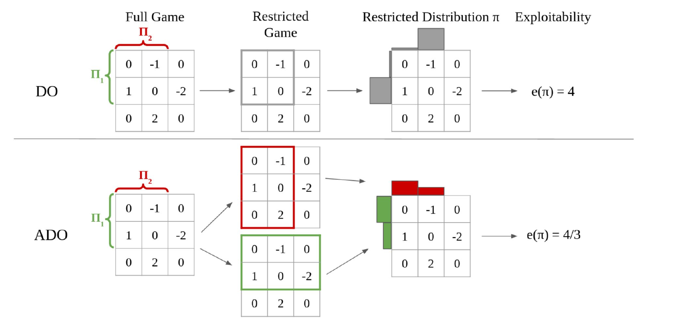
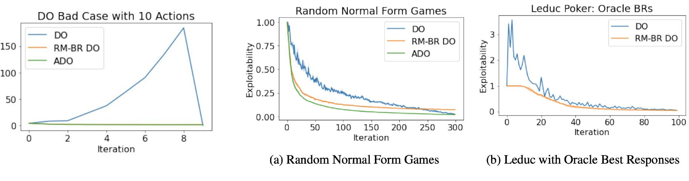
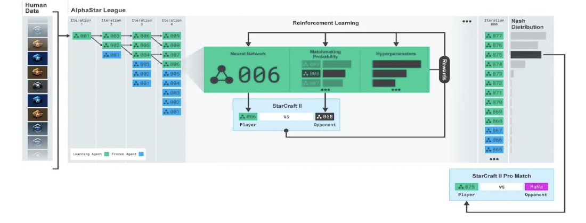
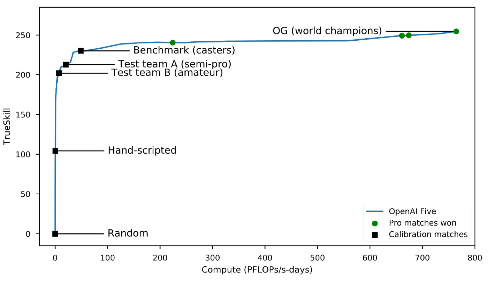

# 双预言机方法（DO 与 PSRO）

前面章节介绍的后悔最小化方法在表格化（tabular）情形下有完善的收敛理论，但当博弈大到连策略空间都无法枚举时，我们需要另一类框架：只维护一个很小的"策略池"，靠最优反应（best response）预言机逐步扩充它。本讲介绍以双预言机（double oracle, DO）为代表的一族方法及其与深度强化学习结合的推广——策略空间反应预言机（policy-space response oracles, PSRO），并讨论它们在星际争霸 II（AlphaStar）和 Dota 2（OpenAI Five）这两个大型即时战略游戏中的应用。本讲的主线可以概括为：**让强化学习在博弈论意义上站得住脚**。

## 双预言机方法

双预言机方法由 McMahan 等人（ICML 2003）针对两人零和博弈提出。其基本想法是：

- 自始至终只维护一个**受限的纯策略集合** $\Pi^t = (\Pi_1^t, \Pi_2^t)$；
- 求出由受限策略诱导的子博弈的纳什均衡 $\pi^r$；
- 对每个玩家计算一个（纯）**最优反应**策略 $\beta_i$（在整个博弈上，而非受限博弈上）；
- 把最优反应加入受限策略集，除非最优反应间隙（best-response gap）已经为零——此时 $\pi^r$ 就是原博弈的纳什均衡，算法终止。

**算法 1（双预言机，McMahan et al., 2003）**

```text
输入：初始种群 Π^0
重复（t = 0, 1, ...）：
    π^r ← 限制在 Π^t 中策略上的博弈的纳什均衡
    for i ∈ {1, 2}:
        求最优反应 β_i ← BR_i(π^r_{-i})
        Π_i^{t+1} ← Π_i^t ∪ {β_i}
直到 双方玩家都不存在新的最优反应
返回 π^r
```

### 双预言机方法的性质

- **正确性**：DO 保证终止于原博弈的一个精确纳什均衡。直觉是：若某一方还存在有利可图的新最优反应，算法就不会停；而一旦双方都无利可图，由定义即达到纳什均衡。
- **收敛速度**：在某些博弈中 DO 可以很快收敛，但最坏情况下需要把全部纯策略都加入受限集合——石头剪刀布就是平凡而重要的例子：其唯一均衡全支撑，DO 必须枚举全部三个纯策略才能终止。每步求解零和受限博弈的纳什均衡可用线性规划在关于 $|\Pi^t|$ 的多项式时间内完成（一般和情形为 PPAD-完全）。
- **指数下界**：最近 Zhang 和 Sandholm（IJCAI 2024）证明，即使在两人零和（2p0s）扩展式博弈中，DO 也可能需要**指数多次迭代**。该下界假设最优反应平局时按对抗性方式打破平局（adversarial tie breaking）；下界是否对任意平局打破方式都成立，仍是一个公开问题。
- 与虚构对弈（fictitious play）一样，DO 在根本上依赖最优反应的计算。

综合来看，DO 的优点是：有时经过很少几次迭代即可终止；与深度强化学习天然兼容（详见后文）；在非常大的博弈上表现出色。缺点是：即使在两人零和博弈中最坏情况也是指数的；需要反复求解一系列受限博弈的纳什均衡；**可利用度（exploitability）不是单调下降的**——训练中途停下来拿到的策略可能很差。最后一点直接催生了下面的改进。

## 任意时刻双预言机（Anytime DO）

**任意时刻保证（anytime guarantee）**指的是：可以在训练的任意时刻安全地停止算法，而当前输出的策略质量不会比之前更差。这在实践中极为重要——大规模训练里没人知道该在什么时候停。McAleer 等人（2022）提出的任意时刻双预言机（Anytime DO, ADO）解决了 DO 可利用度非单调的问题：它是 DO 的一个变体，保证**可利用度单调不增**。关键区别在于**受限博弈的定义**。

DO 为双方使用同一个受限博弈（双方都只能用 $\Pi_i^t$ 中的策略）；ADO 则为**每个玩家分别**定义一个受限博弈 $G^i$：在 $G^i$ 中，玩家 $i$ 只能用自己种群 $\Pi_i^t$ 中的策略，而**对手可以使用整个博弈中的任意策略**。$G^i$ 对玩家 $i$ 的博弈值为

$$\max_{\pi_i\in\Pi_i^t}\;\min_{\pi_{-i}}\; v_i(\pi_i,\pi_{-i}).$$

对 $G^i$ 求纳什均衡得到玩家 $i$ 的受限分布 $\pi_i^r$。由于 $\pi_i^r$ 是在"对手不受限"的最坏情形下求出的，它对所有可能的对手策略都稳健，从而每次加入新策略后可利用度不会上升。

McAleer 等人证明了 ADO 的两条关键性质：

- **命题 1（单调性）**：ADO 的可利用度单调不增。证明只需一步：$\Pi_i^t\subseteq\Pi_i^{t+1}$ 使上式中最大化集合变大，每个玩家对抗最优反应的值单调不减。
- **命题 2（终止正确性）**：ADO 终止时，两个受限均衡 $(\pi_1^r,\pi_2^r)$ 构成原博弈的精确纳什均衡；终止所需迭代次数不超过博弈的纯策略数（要求最优反应总取不在当前种群中的"新"最优反应）。

值得指出的是，ADO 的思想可追溯到 Zinkevich 等人（AAAI 2007）的 Range of Skill（ROS）算法：ROS 同样定义"一方受限"的博弈并保证可利用度单调下降，但它向种群加入的是受限均衡中的策略而非最优反应，只有渐近且指数级的收敛率，且只能保证 $\varepsilon$-纳什均衡；ADO 只加入最优反应，因此有不超过纯策略次数的终止保证，也才能经 APSRO（见后文）扩展到大博弈。

**算法 2（任意时刻双预言机，ADO）**

```text
输入：初始种群 Π^0
重复（t = 0, 1, ...）：
    π_i^r ← 受限博弈 G^i 的纳什均衡，对每个 i ∈ {1, 2}
    for i ∈ {1, 2}:
        求新的最优反应 β_i ← BR_i(π_{-i}^r)
        Π_i^{t+1} = Π_i^t ∪ {β_i}
直到 双方玩家都不存在新的最优反应
返回 π^r
```

下图在一个 $3\times 3$ 矩阵博弈上对比了两种方法。两个玩家的种群都是各自的前两个纯策略（$\Pi_1$、$\Pi_2$）。DO 求解的是双方都受限的 $2\times 2$ 子博弈，其受限均衡分布 $\pi$ 的可利用度为 $e(\pi)=4$；ADO 则求解两个不对称的受限博弈（一个玩家受限、另一个玩家不受限），所得受限分布的可利用度只有 $e(\pi)=4/3$。



### RM-BR DO

ADO 的代价是：与 DO 不同，它从最初几次迭代起就需要求解"一方拥有大量策略"的博弈（不受限那一侧的策略集可能巨大）。如何可扩展地求解这种博弈？答案是**后悔最小化 + 最优反应（regret minimization + best response, RM+BR）**框架（回忆第一次作业）：策略集巨大的那一方只需要一个最优反应预言机，而不需要枚举其动作——因为该方的后悔值**不依赖于其动作集的大小**，后悔最小化器只需要能对当前平均策略算出最优反应即可。由此得到的算法称为 **RM-BR DO**，它是 Anytime DO 的近似版本（McAleer et al., 2022）。

具体地，RM-BR（Johanson et al., 2012，与 CFR-BR 同源）在求解每个受限博弈的内循环中交替两步：不受限一方计算对当前受限分布的最优反应；受限一方用无后悔算法（论文用 Exp3.P，但任何后悔最小化算法都行）针对该最优反应更新混合分布。若第 $n$ 步累计后悔为 $R_n$，RM-BR 输出的分布满足 $e(\pi^n)\le R_n/n$；若每次外层迭代中两个受限博弈内的解的可利用度都不超过 $\varepsilon$，则 RM-BR DO 的可利用度逐次增加不超过 $2\varepsilon$；而当两个受限博弈的博弈值之差小于 $\varepsilon$ 时即可终止，此时 $\pi^r$ 是原博弈的 $\varepsilon$-纳什均衡。

实验结果如下图所示：在一个精心构造的 DO 坏例上，DO 的可利用度随迭代持续膨胀直到最后一次迭代才骤降（课件图中为 10 个动作；论文图示的构造为 9 个动作），而 ADO 与 RM-BR DO 全程保持在接近零的水平；在 500 个动作、收益从 $\mathrm{Uniform}(0,1)$ 采样的随机标准式博弈和 Leduc 扑克（使用精确最优反应预言机，论文实现中每次外层迭代做 10 万次 Exp3 更新并配 100 次最优反应更新）上，RM-BR DO 与 ADO 的可利用度始终低于 DO，且下降平稳、单调。



## 策略空间反应预言机（PSRO）

Lanctot 等人（NeurIPS 2017）提出的**策略空间反应预言机（policy-space response oracles, PSRO）**是双预言机和虚构对弈在概念上的统一推广。其结构是：

- 维护一个**元求解器（meta-solver）**，它在受限博弈上输出一个**元策略（meta-strategy）**：
  - 若元求解器取纳什均衡，PSRO 就退化为 DO；
  - 若取均匀平均，就退化为虚构对弈；
- 对每个玩家，针对对手的元策略求一个最优反应；
- 最优反应**用强化学习近似计算**——这是 PSRO 与经典 DO 的关键差别：策略不再是表格化的纯策略，而是由神经网络参数化的"策略"（policy），种群 $\Pi_i^t$ 是一个不断增长的策略库。

原论文还给出了这一框架的若干关键细节：

- **元博弈由经验博弈论分析（EGTA）构造**：种群中每个策略与对手每个策略相互对局，平均收益填入 $|\Pi_1|\times|\Pi_2|$ 的经验收益矩阵 $U^\Pi$，元求解器在这个矩阵上工作。而一旦把对手固定为其元策略，环境对学习的一方就是马尔可夫的，求最优反应退化为求解一个 MDP——这就是为什么任意 RL 算法都能充当最优反应预言机。
- **PSRO 统一了一族已有算法**：迭代最优反应对应元策略 $(0,\dots,1,0)$（只对最新对手反应），独立强化学习对应 $(0,\dots,0,1)$（只对正在训练的对手反应），虚构对弈对应均匀分布，DO 对应取元博弈的纳什均衡。**元求解器不必是纳什均衡**：论文还试验了后悔匹配、Hedge 与投影复制动态（PRD），并引入探索参数 $\gamma$ 把每个策略被选概率下限定为 $\gamma/(K+1)$，迫使元策略保持全支撑。
- 提出 PSRO 的动机是独立强化学习的**过拟合**问题，论文用**联合策略相关性（JPC）**量化：同一实验换多个随机种子各自独立训练再交叉配对，在激光打靶网格世界上，与"未曾共同训练"的同水平策略配合时平均收益损失达 34%（小地图）乃至 72%（可观测性更差的大地图）；PSRO 的并行实现深度认知层级（DCH）能把该损失压到百分之几到十几。

把 ADO 的受限博弈定义搬到 PSRO 的元求解器上，就得到 **Anytime PSRO（APSRO）**。与 RM-BR DO 每步重算完整最优反应不同，APSRO 只维护一个近似最优反应 RL 策略，内循环中每做一次 Exp3 更新只对它训练少量几步——"最优反应更新 / Exp3 更新"的比例成为权衡理论保证与速度的超参数。McAleer 等人（2022）在使用 DDQN 计算近似最优反应的 Leduc 扑克、13 张牌的 Goofspiel，以及用 PPO 计算最优反应的一个二维连续动作爬山博弈上比较了 PSRO 与 APSRO：APSRO 的（近似）可利用度全程低于 PSRO，且保持单调不增，验证了任意时刻保证在深度强化学习近似下依然有效。

### 神经虚构自对弈（NFSP）

PSRO 最重要的前身是 Heinrich 和 Silver（2016）提出的**神经虚构自对弈（neural fictitious self-play, NFSP）**——首个不依赖领域知识、端到端学习不完美信息博弈近似纳什均衡的方法。每个 NFSP 智能体维护两个神经网络：用离线 RL（fitted Q 学习）从循环缓冲记忆库训练的**最优反应网络** $Q(s,a)$，定义近似最优反应 $\beta=\varepsilon\text{-greedy}(Q)$；以及用监督学习模仿自己历史最优反应行为的**平均策略网络** $\Pi(s,a)$——后者的训练数据由**蓄水池采样**维护（避免有限记忆的窗口效应），且只有按 $\beta$ 行动产生的经验才入库，对应虚构对弈中的平均策略 $\pi$。

为使所有智能体能同时自对弈学习，NFSP 借鉴虚构对弈的**预期动态（anticipatory dynamics）**：行为策略取混合 $\sigma=(1-\eta)\pi+\eta\beta$（典型取 $\eta=0.1$），既为平均策略网络生成数据，也让最优反应针对对手平均策略"超前一步"的预测。实验上，NFSP 在 Leduc 扑克上把可利用度降到 0.06，而普通 DQN 类方法直接发散；在限注德州扑克上，它不借助手工抽象便逼近基于大量领域知识的超人类算法（对 2014 年 ACPC 前三名程序仅小负，如对 escabeche 为 $-52.1\pm 8.5$ mbb/h）。

Lanctot 等人后来在 Leduc 扑克上与 NFSP 正面对比：PSRO/DCH 初期收敛更快（元策略优于虚构对弈的均匀混合），但后期 NFSP 可利用度更低——因为 NFSP 学习**每个信息状态上**的平均策略，而 PSRO 只在博弈根部对完整策略混合；另一方面，PSRO/DCH 更善于利用固定弱对手的破绽，相当于一种稳健的反制策略。

## 自对弈 PSRO

McAleer 等人（ICLR 2024）提出的**自对弈 PSRO（Self-Play PSRO, SP-PSRO）**研究了策略种群应当如何增长的问题。其核心思想是：新策略不必等到对元策略的最优反应完全算好才加入种群，而是让一个"新策略" $\nu_i$ 与一个"反应策略" $\beta_{-i}$ 在内部循环中**互相对弈、共同进化**——$\beta_{-i}$ 学习针对当前元策略 $\pi_i^r$ 的最优反应，$\nu_i$ 再学习针对 $\beta_{-i}$ 的最优反应，同时用后悔最小化针对 $\beta_{-i}$ 更新元策略。外层迭代结束时，把双方都加入种群。

为什么值得加入一个混合策略而不只是纯最优反应？论文的论点是：每次迭代理想上应加入**近视最优策略**——加入后使新种群的最小可利用分布的可利用度下降最多的策略，而原博弈的纳什均衡策略正是最优的可加入策略。当均衡都是混合策略时（如推广的石头剪刀布），只加纯策略的方法（PSRO、APSRO 皆然）必须枚举全部纯策略，而加入一个近似均衡的混合策略一次就能把可利用度拉低很多。$\nu_i$ 用**离线 RL** 针对 $\beta_{-i}$ 训练，与 $\beta_{-i}$ 共享同一批环境经验，故样本量与 APSRO 相同；迭代结束时加入种群的是 $\nu_i$ 的**时间平均** $\bar\nu_i$（均匀采样 checkpoint 或蒸馏实现），以更接近混合的均衡策略。局限是：不断变化的 $\nu_i$ 让无后悔元策略更难学，SP-PSRO 的平台期反而可能高于 APSRO（实践中可后期切回 APSRO），且 $\bar\nu_i$ 不保证接近纳什均衡。

**算法 3（自对弈 PSRO）**

```text
输入：初始种群 Π^0 ∪ {ν_i}
while 未终止（t = 0, 1, ...）：
    任意初始化新策略 ν_i
    将 π_i^r 初始化为 Π_i^t ∪ {ν_i} 上的均匀分布，i ∈ {1, 2}
    for i ∈ {1, 2}:
        for n 次迭代:
            for m 次迭代:
                更新策略 β_{-i}，使其趋向 BR_{-i}(π_i^r)
                更新新策略 ν_i，使其趋向 BR_i(β_{-i})
            通过针对 β_{-i} 的后悔最小化更新 π_i^r
    Π_i^{t+1} = Π_i^t ∪ {β_i, ν̄_i}，i ∈ {1, 2}
返回 π^r
```

在使用表格化 Q 学习计算最优反应的扩展式博弈（Leduc 扑克、小型战舰、重复石头剪刀布、Goofspiel）上，SP-PSRO 的可利用度下降速度明显快于 PSRO 和 APSRO：它往往在最初几次迭代内就降到很低的水平，因为它每次迭代向种群中加入的是"针对反应之反应"，种群增长的质量更高。

## 流水线 PSRO

另一个方向是**并行化**：如何利用大量并行 worker 加速 PSRO？McAleer 等人（NeurIPS 2020）提出的**流水线 PSRO（Pipeline PSRO, P2SRO）**以一种有理论依据的方式利用并行性。其机制是把种群组织成若干**层级（level）**：

- 层级的**最低活跃策略**（lowest active policy）与更低层级中**已固定策略**的元纳什均衡对弈；
- 每个更高层级的活跃策略与低于它的所有固定策略和训练中策略的元纳什均衡对弈；
- 一旦最低活跃策略的训练**趋于平台期（plateau）**，它就被固定下来，同时加入一个新的活跃策略，原先的次低活跃策略成为新的最低活跃策略。


这样，多个策略可以同时在流水线的不同层级上训练，而每个策略面对的对手分布始终是良定义的（下层策略的元纳什均衡），避免了朴素并行 PSRO 中"对手在训练中不断变化"导致的不稳定。实验上，P2SRO 在 Leduc 扑克和随机对称标准式博弈上的可利用度显著低于朴素并行 PSRO、rectified PSRO、序贯 PSRO、自对弈以及 DCH 等基线。在 Barrage Stratego（一种大规模不完全信息策略游戏）上，针对历代元纳什均衡的最优反应收益随代数持续下降，最终策略对既有 bot 的胜率为：Asmodeus 81%、Celsius 70%、Vixen 69%、Celsius1.1 65%，平均胜率 71%。

## AlphaStar：星际争霸 II

星际争霸是 AI 研究的重要里程碑，其难点在于**实时操作**（非回合制）、**部分可观测性**（战争迷雾）、**巨大的动作空间**和**长期规划**。最常见的竞技形式是 5 局 1v1 锦标赛。公平性如何保障？主办方对 AlphaStar 施加了与人类相当的两条限制：受电脑鼠标机械极限约束的操作速度（APM，每分钟操作次数，由专门机制强制执行），以及由游戏内摄像机决定的地图视野。

AlphaStar 采用**联赛训练（league training）**：一个由智能体（竞争者）组成的联赛，智能体之间互相比赛。智能体**最初从人类比赛录像中监督学习**——这对解决探索问题至关重要：在星际争霸这样的博弈中，纯靠随机探索发现好的新策略如同大海捞针。



联赛内部的群体训练是 PSRO 式的，包含三类角色：

- **主智能体（main agents）**：采用**优先化虚构自对弈（prioritized fictitious self-play, PFSP）**机制，按每个对手对该智能体的胜率成比例地调整混合概率——对手越强（对自己胜率越高），越可能被选为对手；
- **主利用者（main exploiters）**：只与当前迭代的主智能体对弈，其职责是找出主智能体的潜在破绽；
- **联赛利用者（league exploiters）**：使用与主智能体类似的 PFSP 机制，但不会被主利用者针对；其职责是发现**整个联赛**的系统性弱点。

原论文还给出了精确机制与规模数据：

- **PFSP 的具体形式**：智能体 $A$ 以正比于 $f\big(\mathbb{P}[A\text{ 击败 }B]\big)$ 的概率采样冻结对手 $B$。默认取 $f_{\mathrm{hard}}(x)=(1-x)^p$，聚焦最难对付的对手（稳胜的对手概率为零）——可视为对 max-min 优化的平滑近似，与虚构对弈隐含的 max-avg 目标相对（高度非传递博弈中追求平均胜率反而易被利用）；另取 $f_{\mathrm{var}}(x)=x(1-x)$ 供主利用者与困境中的主智能体优先对战水平相当的对手。
- **主智能体的对手混合**：35% 自对弈、50% 对所有历史玩家的 PFSP、15% 对"遗忘玩家"（已打不过的历史主智能体）与历史主利用者的 PFSP。
- **联赛规模与重置**：3 个主智能体（每种族一个）、3 个主利用者、6 个联赛利用者；每个智能体用 32 块第三代 TPU 训练 44 天，联赛共产生约 900 个玩家。利用者达成目标（如联赛利用者对所有玩家胜率超 70%）后快照入联赛，并以一定概率重置回监督学习参数以保持多样性。
- **RL 细节**：每步可选动作约 $10^{26}$ 种；策略以一个概括人类策略的统计量 $z$（如开局建造顺序）为条件，并对与监督策略的 KL 散度施加惩罚以维持探索多样性；RL 更新组合了 V-trace 离线校正、TD($\lambda$) 与新的 UPGO 自我模仿更新。

训练过程中，联赛上纳什分布（least-exploitable 的互补竞争者集合）的权重持续向最新产生的竞争者集中，表明联赛在对所有历史竞争者不断进步。评估结果：AlphaStar Final 在天梯上超过了 99.8% 的人类排名玩家，达到宗师（Grandmaster）级别——三个种族的 MMR 分别为 6275（神族）、6048（人族）、5835（虫族）；只做监督学习的 AlphaStar Supervised 也超过了 84% 的人类玩家（其训练数据为 97.1 万局 MMR 超过 3500 的匿名人类录像，平均 MMR 3699）。但另一方面，AlphaStar 后来被发现**存在可被利用的弱点**——这正呼应了本讲的主题：训练成绩好不等于接近纳什均衡。

## OpenAI Five：Dota 2

Dota 2 是一个流行的实时团队零和博弈（基本可视为两人零和）。OpenAI Five 于 2019 年 4 月击败国际邀请赛冠军队，成为首个在电子竞技项目上战胜世界冠军的 AI，并击败了 99.5% 的人类对手。它面临的挑战与星际争霸类似，也有一些限制条件（例如英雄池比正式比赛小得多）。

训练过程完全**不使用任何人类对局数据**，纯靠自对弈：

- 训练中 80% 的对局与**最新参数**进行，20% 与**历史版本**进行——这是 PSRO 式的设计：用历史版本获得更稳健的策略，避免"策略坍塌"（strategy collapse，即当前策略只对最新对手过拟合）；
- **动态采样系统**：每个历史对手被赋予一个质量分并定期更新，对手按 softmax 分布采样——质量分高的历史版本更常被选中。

该动态采样的精确机制是：每个历史对手 $i$ 维护质量分 $q_i$，以 $p_i\propto e^{q_i}$ 被采样；每 10 次迭代把当前参数加入对手池，质量分初始化为现有最大值；每局结束后，若当前智能体击败历史对手则更新 $q_i\leftarrow q_i-\eta/(N p_i)$（$\eta=0.01$），若历史对手获胜则不更新。分布宽度直接反映进步速度：进步快时老对手迅速贬值，进步慢时与更多样化的历史对手对局。



成功的关键因素是把现有强化学习系统**扩展到前所未有的规模**——数千块 GPU 训练数月（十个月训练，累计约 800 PFlops/s·days 的算力；论文报告的精确值为 $770\pm 50$ PFlops/s·days）。深度学习同样至关重要：策略由循环神经网络参数化，具体是单层 4096 单元 LSTM（模型总参数超过 1.5 亿），用 PPO 加 GAE 训练，峰值时 1536 块 GPU、有效批量约 300 万时间步；训练期间游戏环境不断变化，OpenAI 靠称为"手术"（surgery）的迁移工具（约每两周一次）接续训练而不必从头重来。值得注意的是，AlphaStar 和 OpenAI Five 的重点都不在视觉处理，而在**决策**：模型可以同时看到所有可用信息，而人类需要主动点击才能查看地图的不同部分。论文中值得补充的其他数据：英雄池限制为 117 个英雄中的 17 个；在面向公众开放的 Arena 活动中，OpenAI Five 与 3,193 支队伍对局 7,257 场，胜率 99.4%（课程按约数记为 99.5%），仍有 29 支队伍合计赢下 42 局——面对分布外的创造性打法，它同样存在可被利用之处。

## 要点小结

- **双预言机（DO）**：维护受限纯策略集，交替进行"求受限博弈纳什均衡"与"求全博弈最优反应"，保证终止于精确纳什均衡；但最坏情况需指数次迭代（Zhang–Sandholm, IJCAI 2024，假设对抗性平局打破），且可利用度非单调。
- **Anytime DO（ADO）**：把受限博弈改为"己方受限、对方不受限"的每玩家博弈，保证可利用度单调不增，获得任意时刻可停的保证；其大规模实现 RM-BR DO 利用后悔最小化 + 最优反应，使大策略一侧只需最优反应预言机。
- **PSRO**：DO 与虚构对弈的统一推广，元求解器决定元策略（纳什均衡对应 DO，均匀平均对应 FP），最优反应用深度强化学习近似；Anytime PSRO 把任意时刻保证推广到该框架。
- **自对弈 PSRO**：新策略与反应策略在内循环中共同进化，每次迭代向种群加入"针对反应之反应"，收敛显著更快。
- **流水线 PSRO（P2SRO）**：把种群组织成层级流水线，最低活跃策略平台期后固定并向上推进，以有理论依据的方式利用并行性；在 Barrage Stratego 上对既有 bot 平均胜率 71%。
- **AlphaStar**：联赛训练 + PFSP + 主利用者/联赛利用者，从人类录像初始化解决探索问题，达到星际争霸 II 宗师级，但仍可被利用。
- **OpenAI Five**：无人类数据纯自对弈，80/20 当前/历史对手混合加 softmax 动态采样，单层 LSTM 策略，靠空前规模的算力（约 800 PFlops/s·days）战胜 Dota 2 世界冠军。
