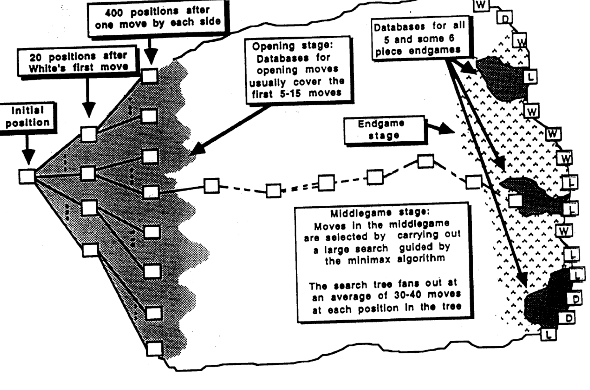
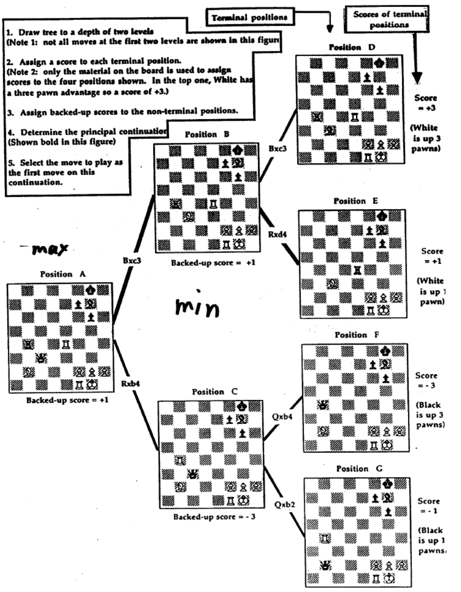
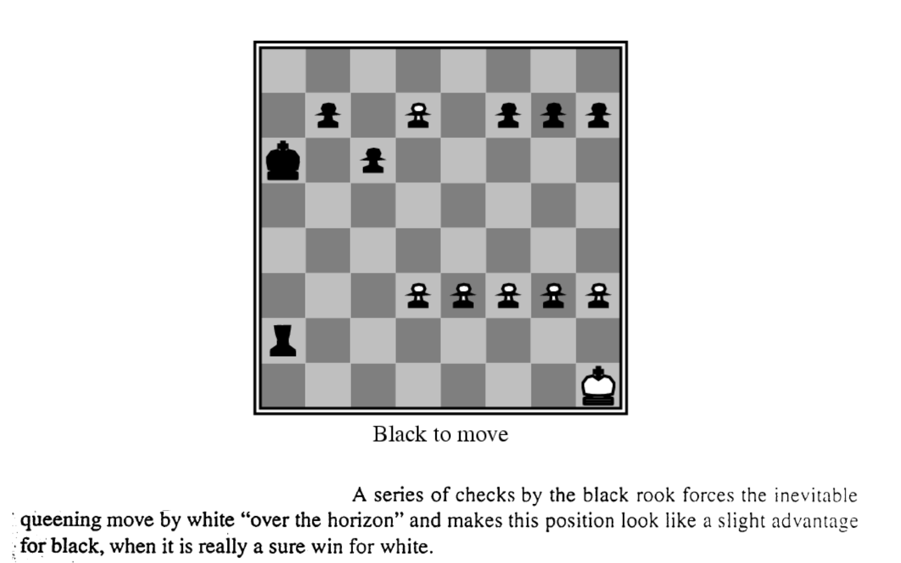

# L2 Perfect-Information Games 1: Tree Search

This lecture uses chess as its running example. It presents the classical machinery for solving sequential zero-sum perfect-information games: minimax search, alpha-beta pruning, and a series of engineering and algorithmic improvements on top of them. This line of techniques culminated in 1997, when Deep Blue defeated world champion Garry Kasparov 3½–2½ (the six-game record was loss–win–draw–draw–draw–win from Deep Blue's perspective). The ideas behind it remain the starting point for understanding more modern game-solving methods.

## A Rich History of Cumulative Ideas

The strength of computer chess did not come from any single breakthrough, but from ideas accumulated over decades. The table below lists each system's contribution (the year is when the technique appeared):

| System | Contribution | Year |
|---|---|---|
| Claude Shannon, Alan Turing | Minimax search with a scoring function | 1950 |
| Kotok/McCarthy program and ITEP program | Alpha-beta search, brute-force search | 1966 |
| Mac Hack | Transposition table | 1967 |
| Chess 3.0–Chess 4.9 | Iterative-deepening depth-first search | 1975 |
| Belle | Special-purpose circuitry | 1978 |
| Cray Blitz | Parallel search | 1983 |
| Hitech | Parallel evaluation | 1985 |
| Deep Blue | Parallel search + special-purpose circuitry | 1987 |

Further ideas include quiescence search (circa 1960s), automatically generated endgame databases based on dynamic programming (1977), conspiracy numbers (1988), singular extension (1980s), opening books, and the learning and engineering of evaluation functions (from the 1950s onward).

## The Game-Theoretic Perspective

Chess is a **game of perfect information**: whenever a player moves, they know the entire history of play so far. It is also a **finite game**: the action sets are finite and the game has finite length. Therefore:

- Chess **has a solution**: its outcome is one of win/tie/lose (that is, a Nash equilibrium exists, and in a finite zero-sum perfect-information game the equilibrium value is unique).
- **Backward induction** yields a **subgame perfect Nash equilibrium**.

**The reality**: computational complexity bounds rationality. The state space of chess is far too large for complete backward induction, so in practice one must approximate with limited-depth search plus heuristic evaluation.

## The Structure of the Game Tree



As shown above, the chess game tree grows from the initial position: there are 20 positions after White's first move, and 400 positions after one move by each side. The tree branches into 30–40 legal moves per position on average, and the leaves are labeled win (W) / tie (D) / loss (L). Practical play handles the game in three stages:

- **Opening stage**: use an opening book; such databases usually cover the first 5–15 moves. Opening books are available electronically too. In some opening lines, for example the Marshall Counter Attack in the Ruy Lopez, the book analysis goes as deep as 16 moves (32 plies).
- **Middlegame stage**: moves are selected by carrying out a large search guided by the minimax algorithm.
- **Endgame stage**: use endgame databases; databases have been built for all 5-piece and some 6-piece endgames.

## Minimax Search

Minimax is the basic algorithm for solving perfect-information zero-sum games. At each of its own nodes the MAX player (White) chooses the successor of maximum value, and the MIN player (Black) chooses the successor of minimum value; leaf values come from the evaluation function, and values are backed up the tree level by level.



Taking the two-level search in the figure as an example, the algorithm proceeds as follows:

1. Expand the game tree to a depth of two levels (note that not all moves at the first two levels are shown in the figure).
2. Assign a score to each terminal position (this example uses only the material difference: in position D, White is up three pawns, so the score is +3).
3. Assign backed-up scores to the non-terminal positions: a MIN node takes the minimum of its children, a MAX node the maximum. For instance, position B's two successors score +3 and +1, so its backed-up value is +1; position C's backed-up value is −3; the root position A (a MAX node) takes $\max\{+1, -3\} = +1$.
4. Determine the principal continuation, the path of best responses by both sides (shown in bold in the figure).
5. Play the first move on that principal continuation.

### Search Depth Pathology

Intuitively, deeper search yields stronger play (and in practice it does), but theoretical work has revealed a subtle problem, the **search depth pathology**:

- Beal (1980) and Nau (1982, 1983) analyzed whether values backed up by minimax search are more trustworthy than the heuristic values themselves. The analyses of their model showed that the backed-up values are somewhat **less** trustworthy.
- The anomaly goes away if sibling nodes' values are highly correlated [Beal 1982; Bratko & Gams 1982; Nau 1982].
- Pearl (1984) partly disagreed with this conclusion: he claimed that while strong dependencies between sibling nodes can eliminate the pathology, practical games like chess do not possess dependencies of sufficient strength; few chess positions are so strong that they cannot be spoiled abruptly if one really tries hard to do so. He concluded that the success of minimax is "based on the fact that common games do not possess a uniform structure but are riddled with early terminal positions, colloquially named blunders, pitfalls or traps. Close ancestors of such traps carry more reliable evaluations than the rest of the nodes, and when more of these ancestors are exposed by the search, the decisions become more valid."
- The problem is still not fully understood. For newer work, see the empirical study of the KRK endgame by Sadikov, Bratko, and Kononenko (2003), and the UAI-2010 / ICAPS-2010 papers by Ramanujan, Sabharwal, and Selman on sampling-style adversarial search.
- The same phenomenon also appears in imperfect-information games when one party has limited lookahead [Kroer & Sandholm, IJCAI-15; Kroer, Farina & Sandholm, AAAI-18].

## Alpha-Beta Pruning

Alpha-beta pruning cuts away subtrees that provably cannot affect the final decision, while returning exactly the same value as minimax. The idea is to maintain two bounds during the search: $\alpha$ is the best score MAX is already guaranteed along the path to the current node, and $\beta$ is the best score MIN is already guaranteed; once a node is proven to fall outside this window, its remaining successors need not be searched.


The figure shows a deep cutoff. The subtree of move A has already returned +10, so the root (a MAX node) is guaranteed at least +10. After following move B down to a MIN node, if that branch's value can be proven not to exceed +10, it cannot change the decision at the root. When move E is found at node P (a MIN node) to give position Q a score of only +2, move E already "refutes" move D: the value of P is at most +2, so the branch along move B is worth at most +2 and cannot beat the +10 already held at the root. Searching move F is therefore unnecessary, and it is cut off. Cutoffs can propagate across several levels of the tree, not just between adjacent parent and child.

The pseudocode is as follows (MAX-VALUE and MIN-VALUE are mutually recursive):

```text
function MAX-VALUE(state, game, α, β) returns the minimax value of state
    inputs: state, current state in game
            game, game description
            α, the best score for MAX along the path to state
            β, the best score for MIN along the path to state

    if CUTOFF-TEST(state) then return EVAL(state)
    for each s in SUCCESSORS(state) do
        α ← MAX(α, MIN-VALUE(s, game, α, β))
        if α ≥ β then return β      (* β cutoff *)
    end
    return α

function MIN-VALUE(state, game, α, β) returns the minimax value of state
    if CUTOFF-TEST(state) then return EVAL(state)
    for each s in SUCCESSORS(state) do
        β ← MIN(β, MAX-VALUE(s, game, α, β))
        if β ≤ α then return α      (* α cutoff *)
    end
    return β
```

### Complexity of Alpha-Beta Search

Let the branching factor be about $b = 30$ and the search depth be $d$. In the **best case** (ideal move ordering), alpha-beta needs to examine only about $2\,b^{d/2}$ terminal positions:

| Search depth $d$ | Best-case number of terminal positions (approx.) | Value |
|---|---|---|
| 2 | $2\times 30^1 \approx 6\times 10^1$ | 60 |
| 4 | $2\times 30^2 \approx 2\times 10^3$ | 2,000 |
| 6 | $2\times 30^3 \approx 6\times 10^4$ | 60,000 |
| 8 | $2\times 30^4 \approx 2\times 10^6$ | 2,000,000 |
| 10 | $2\times 30^5 \approx 6\times 10^7$ | 60,000,000 |
| 12 | $2\times 30^6 \approx 2\times 10^9$ | 2,000,000,000 |
| 14 | $2\times 30^7 \approx 6\times 10^{10}$ | ≈ Deep Blue's per-move search volume |
| 16 | $2\times 30^8 \approx 2\times 10^{12}$ | 2,000,000,000,000 |

- **Best case**: with the same amount of computation, alpha-beta can search **twice as deep** as minimax (the effective branching factor drops from $b$ to about $\sqrt{b}$) [Knuth & Moore 1975].
- **Worst case**: no node can be pruned at all, and the complexity is $O(b^d)$, the same as minimax.
- **Average case** (randomly ordered moves): the complexity drops from $O(b^d)$ to $O\big((b/\log b)^d\big)$.

To approach the best case, the key is to **search better moves first** (move ordering): captures → threats → forward moves → backward moves; and to use **iterative deepening**, where the values backed up in the previous iteration determine the ordering of successors in the current one. Because alpha-beta and quiescence search make different branches take very different amounts of time, iterative deepening (combined with time control) is used by all mainstream chess programs.

## The Evaluation Function

The leaves at the cutoff frontier are scored by an evaluation function. The typical approach computes the difference between the two sides on a number of features: material, mobility, king position, bishop pair, rook pair, open rook files, control of the center (computed piece by piece), and others. For example, Deep Blue used piece-square tables to capture the positional value of pieces: in its knight table, a knight in the center earns a positive score, while one retreated to a corner or edge earns a negative score.

- **Deep Blue**'s evaluation function implemented about **6,000 features in hardware**; after every real-world move, a **different weighting** of these features was downloaded to the chips based on the current situation on the board. This contributed greatly to its strong positional play.
- **Acquiring the weights**:
  - Weight learning based on a database of 900 grandmaster games (about 120 features): alter the weight of one feature → run a 5–6 ply search → if the moves match grandmaster play better, keep altering that parameter in the same direction (hill climbing); least-squares fitting with no search was also used.
  - Manually: grandmaster Joel Benjamin played "take-back chess" against the program; at possible errors, the evaluation was broken down, visualized, and the weighting possibly changed.
- Deep Blue was **not** brute force; it was "smart search plus knowledge-engineered evaluation."
- Other learning routes are also viable, for example Tesauro's backgammon programs: Neurogammon (1989) was taught with supervised learning on 400 games and reached the level of an intermediate human player; TD-Gammon (1992) used reinforcement learning (temporal difference) and reached the level of a world-class human tournament player.
- Deep Blue did **not** use the grandmaster game database during play, but it used such games offline to learn its evaluation function.

## The Horizon Problem and How to Tame It

The **horizon problem**: a fixed-depth search cannot see inevitable changes beyond its "horizon," and can make severe misevaluations.



In the figure, a series of checks by the black rook pushes White's inevitable pawn promotion "over the horizon" of the search depth, making the position look like a slight advantage for Black when it is really a sure win for White.

There are two families of remedies:

- **Quiescence search**: the (domain-specific) evaluation function returns a second number besides the evaluation: **stability**, determined by threats and other factors; if the position reached at the normal depth is unstable, the search continues deeper. The cost is variance in search time.
- **Singular extension**: domain independent; if a node's value is much better than its siblings', that node is searched deeper, even 30–40 plies. Deep Blue used a variant of this method.

## Transpositions and Transposition Tables

Different move sequences often reach the same position; this phenomenon is called a **transposition**, so the "game tree" is really a directed acyclic graph.


In the endgame example above: at depth 3 the tree has 90 terminal nodes but only 45 distinct positions; at depth 10 there are about $6.25\times 10^6$ terminal nodes but only about 625 distinct terminal positions. Recognizing transpositions brings orders-of-magnitude savings.

A **transposition table** uses a hash table holding millions of positions to avoid searching them again. Each entry stores: the position, its hash code, the score, the score type (exact / upper bound / lower bound), the depth of the searched tree rooted at the position, and the best move to make at the position.

The lookup algorithm:

```text
When a position P is arrived at, probe the hash table:
  if there is a match, and
    new_depth(P) ≥ stored_depth(P), and
    the score in the table is exact, or its bound is sufficient to make
    the move leading to P inferior to some other choice
  then P is assigned the attributes from the table
  else score P anew (by direct evaluation or by search — searching the
       stored old best move first) and store the new attributes in the table
```

Once the table fills up, replacement strategies apply: keep positions with greater searched-tree depth beneath them, or keep positions with more searched nodes beneath them.

## Endgame Databases

An endgame database **completely solves** an endgame and stores the result. The history goes back to Torres y Quevedo's automaton with a mating algorithm for KRK (king and rook versus king). The algorithm is described as a set of conditional rules (e.g., "if the black king is on the same side as the rook, move the rook to the other side away from the king; if the rook's rank extends more than one rank beyond the black king, retreat the rook one rank to shrink the black king's range; if the kings are an odd horizontal distance apart, the rook makes a waiting move..."), and it can be proven to force mate from any initial position. With the opponent's king placed on a6 and defending with optimal delay, mate takes at most 61 moves.

### Automatic Generation: Retrograde Analysis

Endgame databases are built automatically by dynamic-programming-style **retrograde analysis**:

- State space = {white to move (WTM), black to move (BTM)} × {all possible configurations of the remaining pieces}; build a WTM table and a BTM table, with legal moves connecting states between the two tables.
- Start at the terminal positions: mate, stalemate, and immediate capture without compensation (called a **reduction**). Mark the positions where White has won as won-in-0.
- Mark all unclassified WTM positions that have a move to some won-in-0 position as won-in-1 (storing the associated move).
- Mark all unclassified BTM positions that are forced to move to a won-in-1 position as won-in-2.
- Repeat until no more labelings occur; do the same for Black.
- All remaining unmarked positions are draws.

Compact representation methods help with the representation and generation of the database: exploit board symmetries (e.g., in the KRK database the black king only needs to be considered on the small set of squares within one triangular region), and filter out illegitimate and in-check states up front during generation.

### How Endgame Databases Changed Chess

- All 5-piece endgames have been solved (they can have more than $10^8$ states), and many 6-piece endgames too. For example, KRBKNN (about $10^{11}$ states): the longest path-to-reduction is 223 moves.
- **Rule changes**: databases revealed that some endgames require far more moves to win than the old rules allowed, prompting changes to the rule on the maximum number of moves from a capture/pawn move to completion.
- **Rewriting chess knowledge**: for example, the new insight in KRKQ that "the rook should be split from the king"; KRKN was thought to be a draw, but the databases show that White wins in 51% of WTM positions and 87% of BTM positions.
- Classic cases: in 1977 Walter Browne, playing White, faced Ken Thompson's Belle in a KQKR endgame, and Belle used the database to hold a draw in a losing position; similarly, a computer once used the database to force a draw against international master Hans Berliner. Databases also produce precise solutions humans find unbelievable, such as the complete move sequence for the KNNKP(d4) endgame: "White to move, mate in 84."
- Practical implication: when playing against a computer equipped with an endgame database, do **not** exchange pieces when the exchange would bring the game to a position that is in the database!

## Deep Blue's Search and Hardware

**Search capability**:

- About 200 million moves per second = $3.6\times 10^{10}$ moves in 3 minutes; 1 second corresponds to about 380 years of human thinking time.
- 3 minutes corresponds to: about 7 plies of uniform-depth minimax search; 10–14 plies of uniform-depth alpha-beta search.
- Software searches first (with selective and singular extensions); the last 5 plies are handled by specialized hardware.

**Hardware**:

- A 32-node RS/6000 SP multicomputer; each node had 1 IBM Power2 Super Chip (P2SC) and 16 chess chips. The chess chips handled: move generation (which often takes 40–50% of the time), evaluation, and some endgame heuristics plus small endgame databases.
- A 32 GB opening and endgame database.

## The Role of Computing Power

Self-play experiments with Belle and other programs (Thompson's two sets of experiments) show that playing strength grows with search size, but with **diminishing returns to computation power**; curves relating programs' ratings to the size of the tree searched within three minutes per move show the same pattern. One quantitative piece of evidence: the fraction of moves on which Belle's level-$l$ version disagreed with its level-$(l-1)$ version fell overall from about 33% at depth 4 versus 3 to about 18% at depth 11 versus 10; the deeper the search, the less one more ply changes the chosen moves (of course, the strength gains over the same period also came from other algorithmic and knowledge improvements).

Interestingly, the human-AI hybrids (centaurs) of **"Freestyle Chess"** were for a while stronger than either humans or AI alone.

## Key Takeaways

- A finite zero-sum perfect-information game (like chess) always has a solution (win/tie/lose), and backward induction yields a subgame perfect Nash equilibrium; but computational complexity bounds full rationality, so practice approximates with limited-depth search.
- Minimax alternately takes maxima/minima of backed-up values at MAX/MIN levels; the search depth pathology shows that backed-up values are not necessarily more trustworthy than static evaluations, and Pearl attributed the practical success of minimax to the non-uniform structure of games (the presence of traps is what makes search effective).
- Alpha-beta pruning returns the same value as minimax; in the best case it needs only about $2b^{d/2}$ leaves and doubles the depth achievable with the same compute; the worst case is $O(b^d)$; with random ordering it is about $O((b/\log b)^d)$. Move ordering and iterative deepening are the keys to approaching the best case.
- The evaluation function is the carrier of knowledge and learning: Deep Blue had about 6,000 hardware features plus dynamically downloaded weights; the weights came from learning over a database of grandmaster games and from manual tuning. TD-Gammon showed that reinforcement learning can also produce a world-class evaluation.
- The horizon problem is mitigated by quiescence search (domain specific) and singular extension (domain independent, reaching 30–40 plies).
- Transpositions make the game tree really a DAG; a transposition table (with depth and bound checks, and replacement strategies) brings orders-of-magnitude savings.
- Endgame databases use retrograde analysis to completely solve endgames, and they have rewritten both chess rules and human endgame knowledge.
- Deep Blue = parallel search + specialized hardware + knowledge-engineered evaluation; there are diminishing returns to computing power, and human-AI hybrids (centaurs) were for a long time the strongest of all.
