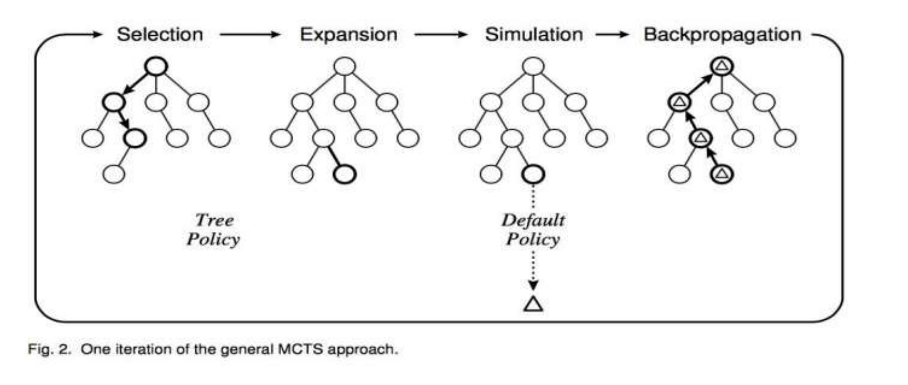
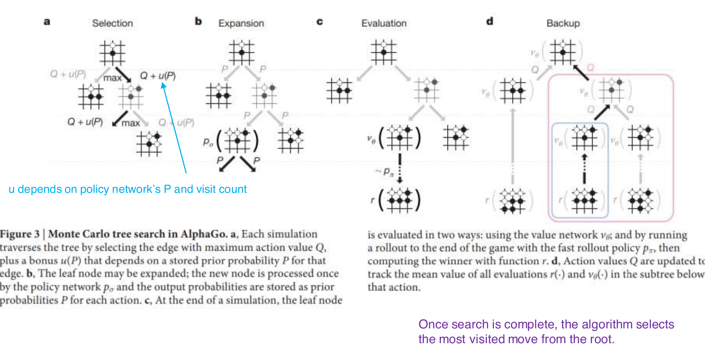

# L3 Perfect-Information Games 2: MCTS and AlphaGo

This lecture introduces **Monte Carlo Tree Search (MCTS)** — a lookahead-search framework that iteratively builds a partial search tree through random simulations — together with its two landmark applications: AlphaGo and AlphaGo Zero. AlphaGo combined deep learning with MCTS to reach superhuman Go for the first time; AlphaGo Zero removed human game records entirely, trained purely from self-play starting from scratch, and revealed the deep insight that **MCTS itself can serve as a policy improvement operator**.

## MCTS Overview

The idea of MCTS is: **rather than expanding the entire game tree, iteratively build a partial search tree**, concentrating computation on the most promising branches. Each iteration consists of four phases:

1. **Selection**: starting from the root, recursively descend the tree by choosing child nodes according to a **tree policy**. The tree policy balances **exploration** (visiting nodes we still know little about) against **exploitation** (visiting the node with the best current value estimate). Descent stops at an **expandable node** — a non-terminal node that still has unexplored children.
2. **Expansion**: add one or more child nodes to the tree. Which nodes are added depends on the actions available in the current position, and the details are also determined by the tree policy.
3. **Simulation** (also called a rollout): starting from the newly added node, play the game out to the end according to a **default policy** — the simplest default policy plays completely at random — and determine the value of this simulation from the actual win/loss outcome at the terminal position (the board result).
4. **Backpropagation**: retrace the path recorded during this iteration and update the statistics of every node on it with the simulation result. A node's value represents an estimate of "the payoff obtained by descending from the parent along this path"; the nodes' values are updated according to how the simulated game ended.

Two kinds of policy are critical to MCTS's behavior: the **tree policy** decides how child nodes are selected (i.e., the behavior of the selection phase), and the **default policy** decides how simulations are run (e.g., randomized), with the simulation results in turn used to update node values. Repeating these iterations, the search tree gradually grows toward the most promising directions and the value estimates at each node are refined.

## From Multi-Armed Bandits to UCT

### Upper Confidence Bounds (UCB) in Bandits

Each node in the selection phase can be viewed as a **multi-armed bandit** problem: every child node is an "arm"; pulling it yields a stochastic reward, and within a limited number of pulls we must balance "trying new arms" against "pulling the currently best arm". The classical solution is the **Upper Confidence Bound (UCB)** policy: maintain a confidence interval for each arm and always select the arm with the largest **upper confidence bound**,

$$
UCB(a_t) = Q_t(a) + c\sqrt{\frac{\log t}{N_{t-1}(a)}},
$$

where $Q_t(a)$ is arm $a$'s current average reward, $N_{t-1}(a)$ is the number of times the arm has been pulled, $t$ is the total number of pulls, and $c$ controls the width of the confidence interval. The second term grows slowly with $\log t$ and decays with $N_{t-1}(a)$: rarely pulled arms have wide intervals (high uncertainty), so their upper bounds are lifted and they get explored first; frequently pulled arms have narrow intervals, so their upper bounds regress toward their true means. Exploration and exploitation are thereby unified in a single scalar criterion.

### The UCT Algorithm

Applying UCB as the tree policy yields **UCT** (Upper Confidence bounds applied to Trees) [Kocsis & Szepesvári, ECML-06]: at each node selection, treat "which child to choose" as a multi-armed bandit problem, score child $i$ with the following expression, and pick the highest scorer,

$$
v_i + C \times \sqrt{\frac{\ln N}{n_i}},
$$

where $v_i$ is child $i$'s **value estimate**, $C$ is a tunable **exploration parameter**, $N$ is the **number of visits to the parent node**, and $n_i$ is the **number of visits to this child**.

Key properties of UCT:

- **$n_i = 0$ means infinite weight**: any child that has never been visited scores $+\infty$, which guarantees every child is explored at least once;
- **every child has a non-zero probability of being selected** (no branch is starved forever);
- **adjusting $C$ shifts the exploration–exploitation tradeoff**: larger $C$ favors exploration, smaller $C$ favors exploitation.

> **Theorem.** MCTS with UCT action selection in the Selection phase finds an optimal policy. [Kocsis & Szepesvári, ECML-06]

## Example: UCT on Othello

Let us walk through the algorithm on a concrete example. Consider an Othello opening where it is Black's move, with four legal moves $m_1, m_2, m_3, m_4$ forming the root's four children. Each node maintains a triple $(\bar X_j, n, n_j)$, meaning (average payoff, parent's visit count, this node's visit count):

- $n_j$: initially 0, so every edge's initial weight is infinite;
- $n$: initially 0;
- $C$: some positive constant (the numbers below in this example correspond to $C = 1$);
- $\bar X_j$: the average payoff of choosing this position (move), taking values in $[0,1]$, initially N/A.

**The first 4 iterations.** Since all children have infinite weight, the first four iterations select $m_1, m_2, m_3, m_4$ in turn; each is expanded and one random simulation is run. Suppose the results are: $m_1, m_2, m_3$ win for Black (payoff 1) and $m_4$ wins for White (payoff 0). After backpropagation the statistics are

| Node | $\bar X_j$ | $n$ | $n_j$ |
|------|-----------|-----|-------|
| $m_1$ | 1 | 4 | 1 |
| $m_2$ | 1 | 4 | 1 |
| $m_3$ | 1 | 4 | 1 |
| $m_4$ | 0 | 4 | 1 |

**Iteration 5.** All four children's UCT scores are $1 + \sqrt{\ln 4} \approx 2.18$ (for $m_4$, $0+\sqrt{\ln 4}\approx 1.18$); the first selection (Black's layer) ties and we take $m_1$. Now $m_1$ is an expandable node; it is expanded with White's three replies $m_{11}, m_{12}, m_{13}$ (all with statistics (N/A, 1, 0) and infinite weight), and the second selection (White's layer) takes $m_{11}$. A simulation from $m_{11}$ is run; suppose **White wins**. Backpropagation: $m_{11}$ becomes $(1, 2, 1)$ (its average payoff recorded from White's perspective), $m_1$'s average payoff is dragged down to $(0.5, 5, 2)$, the parent-visit counts of the other nodes become 5, and the root accumulates 5 visits.

**Iteration 6.** The four root children's UCT scores are now (with $N=5$):

- $m_1$: $0.5 + \sqrt{\ln 5 / 2} \approx 1.397$;
- $m_2$: $1 + \sqrt{\ln 5} \approx 2.269$;
- $m_3$: $1 + \sqrt{\ln 5} \approx 2.269$;
- $m_4$: $0 + \sqrt{\ln 5} \approx 1.269$.

$m_2$ and $m_3$ tie for highest; suppose $m_2$ is chosen. White's replies $m_{21}, m_{22}, m_{23}$ are expanded, and suppose $m_{22}$ is then selected. A simulation from that position is run; suppose **Black wins**. Backpropagation: $m_{22} \to (0, 2, 1)$ (White-perspective average payoff 0), $m_2 \to (1, 6, 2)$, and the parent-visit counts $n$ of the other nodes are updated to 6.

After 6 iterations the tree looks like this: the root's four children are $m_1 (0.5, 6, 2)$, $m_2 (1, 6, 2)$, $m_3 (1, 6, 1)$, $m_4 (0, 6, 1)$, with UCT scores $1.447$, $1.947$, $2.339$, $1.339$ respectively; in White's layer, $m_{11}$ scores $1 + \sqrt{\ln 2} \approx 1.833$ and $m_{22}$ scores $\sqrt{\ln 2} \approx 0.833$; the remaining unexplored nodes (shown in red in the figure) have infinite weight and are not actually in the tree.

**How to decide once search ends.** Given a completed search tree, the actual move can be picked using the max child (highest average score), the robust child (most visits), max-robust, or other child-selection schemes. Once a move is actually played, we keep only the subtree below that move for continued search and discard the rest.

## AlphaGo: Augmenting MCTS with Neural Networks

Pure MCTS estimates values through random simulations, so the quality of the simulations determines the quality of the value estimates in the tree. The core idea of AlphaGo [Silver et al., Nature 2016] is to augment MCTS with a **value network** and a **policy network**, making the search both shallower (no need to simulate to the end of the game) and narrower (focused on high-probability moves). The whole system is built in three steps:

1. The **policy network** is first trained by supervised learning on games of professional human Go players, then trained further by reinforcement learning (self-play); denote its output by $p_\sigma(a \mid s)$ — the probability of each move in position $s$;
2. The **value network** $v_\theta(s)$ is trained on data generated by the policy network playing against itself, directly estimating the winning probability (evaluation) of position $s$;
3. MCTS is then run, leveraging both networks during the search.

Two high-level ideas correspond to the two bottlenecks of MCTS:

- **Compress depth with the value network**: instead of rolling simulations out to the end of the game, call the value network directly at the leaves for an evaluation — replacing "seeing the game through to the end" with "the network evaluates at a glance";
- **Compress breadth with the policy network**: use the move probabilities given by the network to guide the search, concentrating attention on a few high-probability moves rather than treating all legal moves equally.

AlphaGo's MCTS has four phases (corresponding to panels a–d of the figure below):

- **a. Selection**: each simulation descends the tree choosing the edge that maximizes the action value $Q$ plus a bonus $u(P)$, where $u(P)$ depends on the prior probability $P$ stored on that edge (from the policy network) and on visit counts;
- **b. Expansion**: when a leaf node is reached it may be expanded; the new node is processed once by the policy network $p_\sigma$, and the output probabilities are stored as the prior probabilities $P$ for each action;
- **c. Evaluation**: at the end of a simulation, the leaf node is evaluated in two ways — directly by the value network $v_\theta$, and by playing the game out to the end with the fast rollout policy $p_\pi$, with the outcome computed by the function $r$;
- **d. Backup**: the action values $Q$ are updated to track the mean of all evaluations $r(\cdot)$ and $v_\theta(\cdot)$ within the subtree below that action.

Once the search is complete, the algorithm selects the **most visited** move from the root.

## AlphaGo Zero: Self-Play from Scratch

AlphaGo Zero pushes this framework to the extreme:

- **No human data whatsoever beyond the rules of the game** — no human game records, no hand-crafted features;
- The value and policy networks (merged into a single two-headed network) are trained by self-play **in the context of MCTS**, rather than from human data or separately from the search. In other words, **MCTS itself is used as a policy improvement operator**: the move distribution $\pi$ produced by the search is an improvement over the network's raw output $p$; the network is then trained toward $\pi$, and the cycle repeats;
- The whole system was **trained on 4 TPUs for 70 days** — for comparison, a large model like Gemini consumes tens of thousands of TPUs. (The paper reports two training runs: roughly 3 days for the 20-residual-block network and roughly 40 days for the 40-residual-block network, with self-play and evaluation on a single 4-TPU machine and parameter optimization on a further 64 GPU workers and 19 CPU parameter servers; the duration quoted here follows the lecture slides.)

**The training loop** (see the figure below): a. self-play — at each position $s_t$, run MCTS to obtain search probabilities $\pi_t$, sample the move $a_t \sim \pi_t$, and play until the game ends with outcome $z$; b. neural network training — feed each position $s_t$ into the network $f_\theta$, which outputs $(\mathbf p_t, v_t)$, and train so that $v_t$ fits the true game outcome $z$ and $\mathbf p_t$ fits the search probabilities $\pi_t$.

### Training Pipeline: Three Asynchronous Components

The paper decomposes the self-play training pipeline into three components that run in parallel, with data flowing among them in a loop:

- **Optimisation**: at each step, uniformly sample a mini-batch from all time steps of the most recent 500,000 self-play games (64 GPU workers, batch size 32 per worker, 2,048 in total), and minimize the loss with momentum (0.9) SGD, using $L_2$ regularization coefficient $c = 10^{-4}$; a new checkpoint is produced every 1,000 steps.
- **Evaluator**: the new checkpoint plays 400 games against the current best network (1,600 simulations per move, temperature $\mu \to 0$, i.e., deterministically taking the most visited move — the strongest play), and **replaces the current best only if it wins by a margin above 55%** — this threshold avoids switching networks on noise alone.
- **Self-play**: the current best player generates 25,000 games per iteration, running 1,600 MCTS simulations per move (about 0.4 seconds of thinking time). For the first 30 moves of each game the temperature is $\mu = 1$ (moves sampled in proportion to visit counts, ensuring position diversity); thereafter $\mu \to 0$. Additionally, Dirichlet noise is injected into the prior probabilities at the root node, $P(s,a) = (1-\varepsilon)\,p_a + \varepsilon\,\eta_a$ with $\eta \sim \mathrm{Dir}(0.03)$ and $\varepsilon = 0.25$, ensuring that all moves may be tried while the search can still overrule bad ones. To save computation, clearly lost games are resigned early; the resignation threshold is selected automatically to keep the false-positive rate (games that could have been won had play continued) below 5% (concretely, resignation is disabled in 10% of self-play games to measure the false-positive rate).

### Neural Network Loss Function

The loss function for the network $(\mathbf p, v) = f_\theta(s)$ is

$$
l = \underbrace{(z - v)^2}_{\text{value error}} \;-\; \underbrace{\boldsymbol\pi^{\mathrm T} \log \mathbf p}_{\text{maximize similarity of the network's move probabilities }\mathbf p\text{ to the search probabilities }\boldsymbol\pi} \;+\; \underbrace{c\,\lVert \theta \rVert^2}_{\text{regularizer}}
$$

The three terms are, respectively: the squared error of the value head against the actual game outcome $z$; the cross-entropy between the policy head and the MCTS search distribution $\boldsymbol\pi$; and an $L_2$ regularization term on the parameters $\theta$.

### Neural Network Architecture

The network input is a stack of $19 \times 19 \times 17$ feature planes: the current player's and the opponent's stones each occupy 8 history planes (the current position and the previous 7 moves), plus 1 constant plane indicating the color to play. The history planes are necessary — the rules forbid position repetition, so the state is not fully observable from the current position alone; the color plane is necessary because the komi is not observable. The network body is a **residual tower**: one convolutional block (256 $3\times3$ filters + batch normalization + ReLU) followed by 19 or 39 residual blocks (each with two layers of 256-filter $3\times3$ convolutions, batch normalization, and ReLU, with a skip connection), topped by two heads: the policy head outputs logits for $19^2 + 1 = 362$ moves (including pass), and the value head outputs a scalar winning probability in $[-1, 1]$ via a 256-dimensional hidden layer and a $\tanh$ nonlinearity.

The paper also reports an architecture ablation: four networks — "separate vs. combined two-headed" × "convolutional vs. residual" — were trained on a fixed dataset and compared in playing strength with the same search. Using the residual structure brought about **+600 Elo**, and merging policy and value into a two-headed network brought about **another +600 Elo** — the latter partly from computational efficiency, but more importantly because the dual objective regularizes the network toward a common representation that supports both uses.

### Search Algorithm

Each node $s$ in the search tree stores an edge $(s, a)$ for every legal action, and each edge stores a set of statistics $\{N(s,a), W(s,a), Q(s,a), P(s,a)\}$:

- $N$: the number of visits to that edge;
- $W$: total value (the cumulative sum of evaluations);
- $Q$: average value, $Q = W / N$;
- $P$: the policy network's output (the prior probability of that action).

**Selection** uses a PUCT variant:

$$
a_t = \arg\max_a \bigl( Q(s_t, a) + U(s_t, a) \bigr), \qquad
U(s, a) = c_{\text{puct}}\, P(s, a)\, \frac{\sqrt{\sum_b N(s, b)}}{1 + N(s, a)}.
$$

Compared with UCT, the exploration term is multiplied by the prior $P(s,a)$: moves the policy network considers good naturally receive higher exploration weight; as the visit count grows the term decays, giving way to exploitation dominated by $Q$.

**Expansion and evaluation**: when a leaf node is reached, the state is fed into the neural network to obtain a value estimate $v$ and a policy estimate $\mathbf p$; the new node's edges have $(N, W, Q)$ initialized to 0 and $P$ set to the policy output, after which $v$ is used for the backup.

**Backup**: the edge statistics along the path are updated with the value $v$ given by the network:

$$
N(s,a) \leftarrow N(s,a) + 1, \qquad
W(s,a) \leftarrow W(s,a) + v, \qquad
Q(s,a) = \frac{W(s,a)}{N(s,a)}.
$$

**Move selection**: once the search is complete, search probabilities $\pi$ are returned proportional to $N^{1/\mu}$, where $N$ is the visit count of each move from the root state and $\mu$ is a parameter controlling temperature — small $\mu$ concentrates probability on the most visited move, while large $\mu$ explores more uniformly.

Several engineering details of the paper's implementation are worth noting: when multiple search threads run in parallel, a **virtual loss** is used to ensure that the threads evaluate different nodes; leaf nodes are always expanded immediately (AlphaGo used dynamic expansion); positions are queued, one of the 8 rotations/reflections is applied at random, and they are then sent to the network (evaluated in batches of 8) — this exploits the symmetry of the rules of Go under rotation and reflection for data augmentation; the large-scale training run (the 40-block network) also used a transposition table. Compared with AlphaGo's APV-MCTS, AlphaGo Zero's search **does no rollouts at all and uses no tree policy** — "a simpler search turns out to be stronger", which is itself one of the paper's theses.

### Experimental Results

- **Training speed**: starting from random play, it surpassed AlphaGo Lee after only **36 hours** (by comparison, AlphaGo Lee was trained over several months); after 72 hours, under exactly the same 2-hour time controls and match conditions as the Seoul match, it **defeated the original AlphaGo Lee that had beaten Lee Sedol by 100 : 0** — and AlphaGo Zero used only a single machine with 4 TPUs, whereas AlphaGo Lee was distributed over many machines and used 48 TPUs.
- **Final playing strength**: in an internal tournament with 5 seconds per move (Elo scale, where a 200-point gap corresponds to roughly a 75% win rate), AlphaGo Zero (40-block network, trained 40 days, generating 29 million self-play games along the way) reached **5,185**, versus 4,858 for AlphaGo Master, 3,739 for AlphaGo Lee, and 3,144 for AlphaGo Fan. It is worth emphasizing that **the raw network with no search at all** (simply taking the most probable move in $\mathbf p$) still rated 3,055 — approaching AlphaGo Fan — showing that the network itself had already learned an extremely strong feel for the game from the search. In a 100-game match at 2-hour time controls, AlphaGo Zero beat AlphaGo Master — which had itself swept top human professionals 60 : 0 — by **89 : 11**.
- **Self-play vs. supervised learning**: a network of the same architecture trained by supervised learning on KGS human game records predicted human moves more accurately (60.4% on the KGS test set, exceeding all prior work), but played markedly weaker — the self-play player defeated it within the first 24 hours of training. This suggests that the policy AlphaGo Zero learns is **qualitatively different** from human play, rather than a better fit to human game records.

### The Go Knowledge AlphaGo Zero Learned

The paper documents a timeline of emergent knowledge: at about 10 hours it preferred an unremarkable corner move; at 47 hours it most frequently played the **3-3 invasion** joseki (consistent with human professional joseki); later it abandoned that joseki in favor of new variants it discovered itself. Concepts such as opening strategy, tesuji, life and death, ko fights, endgame, capturing races, sente, shape, influence, and territory all emerged spontaneously from first principles; intriguingly, the ladder ("shicho" — capturing sequences that may span the whole board, one of the first elements of knowledge humans learn) was only truly mastered by AlphaGo Zero late in training.

## These Techniques Apply to Single-Agent Settings Too

The "learning + search" combination is not limited to two-player games; it is equally powerful on single-agent problems:

- **Example 1: the Rubik's Cube.** McAleer et al., "Solving the Rubik's Cube with Approximate Policy Iteration", ICLR 2018; Agostinelli et al., "Solving the Rubik's Cube with Deep Reinforcement Learning and Search", Nature Machine Intelligence 2019. A value function guides the search over scrambled states $x_0, x_1, \dots, x_N$: each action $a \in \{U, U', \dots, F, F'\}$ is evaluated as $v_{x_i}(a) + R(A(x_i, a))$ and the maximum is taken, solving the cube from any scrambled state.
- **Example 2: edge test selection in kidney exchange.** McElfresh, Curry, Sandholm, Dickerson, "Improving Policy-Constrained Kidney Exchange via Pre-Screening", NeurIPS-20. "Which edge to laboratory-test next" is modeled as a search problem, and the same family of techniques improves policy-constrained kidney exchange matching.

## Key Takeaways

- MCTS iteratively builds a partial search tree; each iteration has four phases — selection, expansion, simulation, backpropagation. The tree policy handles the exploration–exploitation tradeoff; the default policy runs the simulations.
- UCT treats each node selection as a multi-armed bandit problem and selects children by $v_i + C\sqrt{\ln N / n_i}$; the infinite weight at $n_i=0$ guarantees every child is explored at least once, and $C$ tunes the exploration–exploitation tradeoff; MCTS with UCT finds an optimal policy (Kocsis & Szepesvári, ECML-06).
- AlphaGo compresses search breadth with a policy network and search depth with a value network: selection maximizes $Q + u(P)$; leaves are evaluated by both $v_\theta$ and fast rollouts; backup takes the mean of the two; the most visited move at the root is played.
- AlphaGo Zero uses no human data at all and treats MCTS as a policy improvement operator: in self-play the search produces $\pi$, and the network learns toward $(\boldsymbol\pi, z)$ with $l=(z-v)^2-\boldsymbol\pi^{\mathrm T}\log\mathbf p+c\lVert\theta\rVert^2$; trained on 4 TPUs for 70 days.
- AlphaGo Zero's search maintains $\{N, W, Q, P\}$ per edge, selects with $Q + c_{\text{puct}} P \frac{\sqrt{\sum_b N(s,b)}}{1+N(s,a)}$, backs up with incremental mean updates, and plays according to $\pi \propto N^{1/\mu}$; the implementation uses virtual loss for multithreaded parallelism, rotation/reflection data augmentation on positions, and performs no rollouts whatsoever.
- AlphaGo Zero's training pipeline consists of three asynchronous components — optimisation, evaluation (400 games, a new network replaces the current best only above a 55% win margin), and self-play (1,600 simulations per move, Dirichlet noise at the root, temperature $\mu=1$ for the first 30 moves); it surpassed AlphaGo Lee within 36 hours from random play and reached a final Elo of 5,185 (100 : 0 against AlphaGo Lee, 89 : 11 against AlphaGo Master); the raw network with no search still rated 3,055.
- The same "learning + search" techniques also apply to single-agent problems, such as Rubik's Cube solving and edge test selection in kidney exchange.
