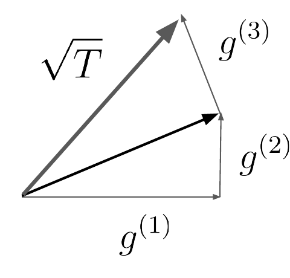

# L4 Normal-Form Games: LP, FTRL, Regret Matching

This lecture takes a deeper dive into equilibrium computation in normal-form (aka strategic-form) games: we first solve two-player zero-sum games in polynomial time via linear programming, then turn to simpler iterative algorithms that scale better to large games, and finally arrive at the framework of online learning and regret minimization. Many of the recent breakthroughs in solving large-scale games, covered later in this course, are built on this framework.

## 1 Minimax Equilibria via Linear Programming

### Recap on normal-form games

Normal-form games can be thought of as modeling simultaneous-move games, although the underlying strategic interaction can itself be sequential. Any finite game can be cast in normal form, but (as we will discuss in the next lecture) the normal-form representation is often inefficient.

Formally, there are $n$ players. Each player $i \in [n]$ has a finite set of available actions $\mathcal{A}_i$; write $m_i := |\mathcal{A}_i|$. Player $i$'s utility function $u_i$ maps every joint action profile $(a_1, \dots, a_n) \in \mathcal{A}_1 \times \cdots \times \mathcal{A}_n$ to a real value $u_i(a_1, \dots, a_n)$. One way of representing a normal-form game is to explicitly provide each player's payoff tensor, containing the utility for each possible action combination. Its size grows exponentially with the number of players. Players can randomize by specifying a probability distribution over their actions. Under a joint strategy $(\boldsymbol{x}_1, \dots, \boldsymbol{x}_n) \in \Delta(\mathcal{A}_1) \times \cdots \times \Delta(\mathcal{A}_n)$, the expected utility of player $i$ is

$$
u_i(\boldsymbol{x}_1, \dots, \boldsymbol{x}_n) := \mathbb{E}_{(a_1,\dots,a_n)\sim(\boldsymbol{x}_1,\dots,\boldsymbol{x}_n)}\, u_i(a_1, \dots, a_n) = \sum_{(a_1,\dots,a_n)} \prod_{i'=1}^{n} \boldsymbol{x}_{i'}[a_{i'}]\, u_i(a_1, \dots, a_n).
$$

Players are assumed to strive to maximize their expected utility.

### Zero-sum games and the minimax theorem

A (two-player) zero-sum game is the special case with only two players of exactly opposing interests: $u_1(a_1, a_2) = -u_2(a_1, a_2)$ for all $(a_1, a_2) \in \mathcal{A}_1 \times \mathcal{A}_2$; whatever one player wins, the other loses.

Let $\boldsymbol{A} \in \mathbb{R}^{m_1 \times m_2}$ be the payoff matrix of the game. Taking the perspective of the row player, consider the optimization problem

$$
\min_{\boldsymbol{x} \in \Delta(\mathcal{A}_1)} \max_{\boldsymbol{y} \in \Delta(\mathcal{A}_2)} \boldsymbol{x}^\top \boldsymbol{A} \boldsymbol{y} = \min_{\boldsymbol{x} \in \Delta(\mathcal{A}_1)} \max_{\boldsymbol{y} \in \Delta(\mathcal{A}_2)} \sum_{a_1 \in \mathcal{A}_1} \sum_{a_2 \in \mathcal{A}_2} \boldsymbol{x}[a_1]\, \boldsymbol{A}[a_1, a_2]\, \boldsymbol{y}[a_2]. \tag{1}
$$

The interpretation: the row player first specifies a strategy $\boldsymbol{x}$, whereupon the column player responds optimally to it. The key point is that the row player **anticipates** the column player's optimal response, which makes solutions to (1) particularly robust: it makes no difference whether the row player announces its strategy in advance. von Neumann's celebrated minimax theorem shows that, under optimal play, playing second does not confer an advantage:

> **Theorem 1.1 (von Neumann, 1928)** For any matrix $\boldsymbol{A} \in \mathbb{R}^{m_1 \times m_2}$,
>
> $$
> \min_{\boldsymbol{x} \in \Delta(\mathcal{A}_1)} \max_{\boldsymbol{y} \in \Delta(\mathcal{A}_2)} \boldsymbol{x}^\top \boldsymbol{A} \boldsymbol{y} = \max_{\boldsymbol{y} \in \Delta(\mathcal{A}_2)} \min_{\boldsymbol{x} \in \Delta(\mathcal{A}_1)} \boldsymbol{x}^\top \boldsymbol{A} \boldsymbol{y} = v. \tag{2}
> $$

More general versions of the minimax theorem exist (e.g., Sion, 1958). The quantity $v$ in (2) is called the **value** of the game. Theorem 1.1 shows that zero-sum games have a well-defined value; this is not so in general-sum games.

> **Remark 1.2 (Minimax equilibria are Nash equilibria)** Let $\boldsymbol{x} \in \arg\min_{\boldsymbol{x}' \in \Delta^{m_1}} \max_{\boldsymbol{y}' \in \Delta^{m_2}} \langle \boldsymbol{x}', \boldsymbol{A}\boldsymbol{y}'\rangle$ and $\boldsymbol{y} \in \arg\max_{\boldsymbol{y}' \in \Delta^{m_2}} \min_{\boldsymbol{x}' \in \Delta^{m_1}} \langle \boldsymbol{x}', \boldsymbol{A}\boldsymbol{y}'\rangle$ be a pair of minimax strategies. Then $(\boldsymbol{x}, \boldsymbol{y})$ is a Nash equilibrium. Indeed, Theorem 1.1 implies that $\langle \boldsymbol{x}, \boldsymbol{A}\boldsymbol{y}'\rangle \le v = \boldsymbol{x}^\top \boldsymbol{A} \boldsymbol{y}$ for any $\boldsymbol{y}'$ and $\langle \boldsymbol{x}', \boldsymbol{A}\boldsymbol{y}\rangle \ge v = \boldsymbol{x}^\top \boldsymbol{A} \boldsymbol{y}$ for any $\boldsymbol{x}'$; the other direction also holds. We will simply refer to $(\boldsymbol{x}, \boldsymbol{y})$ as an equilibrium.

> **Remark 1.3 (Generic zero-sum games have a unique equilibrium)** A zero-sum game can admit multiple equilibria. Yet the set of games with a unique equilibrium has measure one (van Damme, 1991): informally, if one samples a game from a distribution over games, that game will almost surely have a unique equilibrium.

### The linear programming formulation

The main algorithmic question in this context is how to efficiently solve (1). In fact, zero-sum games and linear programming are computationally equivalent (von Stengel, 2024); here we only cover the "games reduce to LP" direction.

The first point is that (1) is equivalent to $\min_{\boldsymbol{x} \in \Delta(\mathcal{A}_1)} \max_{a_2 \in \mathcal{A}_2} \boldsymbol{x}^\top \boldsymbol{A}[:, a_2]$, where $\boldsymbol{A}[:, a_2]$ denotes the column of $\boldsymbol{A}$ corresponding to action $a_2$; this holds because the column player can always best respond through a **pure strategy**. We introduce an auxiliary variable $t \in \mathbb{R}$ satisfying $t \ge \boldsymbol{x}^\top \boldsymbol{A}[:, a_2]$ for all $a_2 \in \mathcal{A}_2$. This is intended to implement $\max_{a_2} \boldsymbol{x}^\top \boldsymbol{A}[:, a_2]$, but so far we have only guaranteed $t \ge \max_{a_2} \boldsymbol{x}^\top \boldsymbol{A}[:, a_2]$. Making the objective $\min t$ forces an optimal $t$ to be exactly equal to that maximum. In summary, the induced linear program reads

$$
\begin{aligned}
\text{minimize}\quad & t \\
\text{subject to}\quad & t \ge \boldsymbol{x}^\top \boldsymbol{A}[:, a_2] \quad \forall a_2 \in \mathcal{A}_2, \\
& \sum_{a_1 \in \mathcal{A}_1} \boldsymbol{x}[a_1] = 1, \\
& \boldsymbol{x} \ge \boldsymbol{0}.
\end{aligned} \tag{P}
$$

We claim that if $(t, \boldsymbol{x})$ is an optimal solution to (P), then $\boldsymbol{x}$ solves (1). The same reasoning casts the column player's problem $\max_{\boldsymbol{y} \in \Delta(\mathcal{A}_2)} \min_{\boldsymbol{x} \in \Delta(\mathcal{A}_1)} \boldsymbol{x}^\top \boldsymbol{A} \boldsymbol{y}$ as

$$
\begin{aligned}
\text{maximize}\quad & t \\
\text{subject to}\quad & t \le \boldsymbol{y}^\top \boldsymbol{A}[a_1, :] \quad \forall a_1 \in \mathcal{A}_1, \\
& \sum_{a_2 \in \mathcal{A}_2} \boldsymbol{y}[a_2] = 1, \\
& \boldsymbol{y} \ge \boldsymbol{0}.
\end{aligned} \tag{D}
$$

The upshot is that **(D) is exactly the dual of (P)**. Hence linear programming duality immediately implies Theorem 1.1: the minimax theorem is a consequence of LP duality. Complementary slackness reveals further equilibrium structure: if a pure action $a_1$ enters the row player's support with positive probability at an optimal solution, then the constraint of (D) corresponding to $a_1$ must hold with equality. That is, the action attains exactly the highest expected utility against $\boldsymbol{y}$; every pure action in the support is a best response to the opponent's equilibrium strategy (Shoham and Leyton-Brown, 2009, §4.1).

> **Theorem 1.4** There is a polynomial-time algorithm for finding (minimax/Nash) equilibria in zero-sum games.

Unfortunately, LP solvers scale poorly in large games, which motivates simpler iterative algorithms.

## 2 Simple Iterative Algorithms

Iterative algorithms for solving zero-sum games have a long history, going back to von Neumann himself (Brown and von Neumann, 1950).

### 2.1 Best-response dynamics

Perhaps the most natural approach is to let the players best respond to each other's strategy in an alternating fashion (best-response dynamics). In general, however, this fails to converge; some zero-sum games do not even admit pure-strategy equilibria, in which case this algorithm is doomed. Take rock-paper-scissors: writing R for rock, P for paper, and S for scissors, starting from $(R, P)$, one round of best responses produces the sequence

$$
(S, P) \to (S, R) \to (P, R) \to (P, S) \to (R, S) \to (R, P),
$$

which is exactly where we started, so the dynamics cycle ad infinitum:


Nevertheless, the **average strategies** in this example do converge to the equilibrium: each action is asymptotically played with probability $1/3$. Does this hold in general? No. For example, one can tweak the payoffs of rock-paper-scissors so that the behavior of best-response dynamics is unchanged (the relative order of the actions is preserved), yet the equilibrium is different:

> **Proposition 2.1** There are zero-sum games in which the average strategies under best-response dynamics fail to converge to an equilibrium.

### 2.2 Fictitious play

A more sophisticated, classic algorithm is **fictitious play**, proposed by Brown (1951) and shown to converge by Robinson (1951), the same Julia Robinson who contributed to the resolution of Hilbert's tenth problem.

Fictitious play proceeds as follows. Initialize from arbitrary strategies $(\boldsymbol{x}^{(1)}, \boldsymbol{y}^{(1)})$. Let $\bar{\boldsymbol{x}}^{(t)} = \sum_{\tau=1}^{t} \boldsymbol{x}^{(\tau)} / t$ and $\bar{\boldsymbol{y}}^{(t)}$ be the players' average strategies up to time $t$. At every time $t$, the row player best-responds to the opponent's average strategy so far:

$$
\boldsymbol{x}^{(t)} \in \arg\min_{\boldsymbol{x} \in \Delta(\mathcal{A}_1)} \langle \boldsymbol{x}, \boldsymbol{A} \bar{\boldsymbol{y}}^{(t-1)} \rangle, \qquad \boldsymbol{y}^{(t)} \in \arg\max_{\boldsymbol{y} \in \Delta(\mathcal{A}_2)} \langle \bar{\boldsymbol{x}}^{(t-1)}, \boldsymbol{A} \boldsymbol{y} \rangle.
$$

One can think of this as the most basic form of opponent modeling: we do not know the opponent's next action, but we imagine a "fictitious" opponent whose next action adheres to the historical average. Unlike best-response dynamics, the time average of fictitious play converges in every zero-sum game:

> **Theorem 2.2 (Robinson, 1951)** The time average of fictitious play converges in zero-sum games.

Robinson's original paper only proved asymptotic convergence; the proof relies on a delicate inductive argument, from which one can derive a rate of $O\big(t^{-\frac{1}{m_1 + m_2 - 2}}\big)$. Daskalakis and Pan (2014) later proved that the convergence rate can indeed be exponentially slow: for a certain $m \times m$ payoff matrix (in fact, the identity matrix), fictitious play converges at a rate of $\Omega(t^{-1/m})$. One caveat of that result is that it only holds under **adversarial tie-breaking**; the convergence rate of fictitious play under non-adversarial tie-breaking remains an open problem (for recent progress, see Wang, 2025).

Another issue is that fictitious play converges only when **both** players follow the algorithm; if the opponent knows we are using fictitious play, we become exploitable. The next section formalizes this.

## 3 Online Learning, Regret Minimization, and Self-Play

This section introduces the framework of online learning and regret minimization, which both answers the question above and yields algorithms with stronger convergence guarantees than fictitious play. The key connection is that regret minimization in self-play converges to different types of equilibria.

### 3.1 Online learning and regret

Consider a learner who interacts with a (potentially adversarial) environment over $T$ rounds. In each round $t \in [T]$, the learner first specifies a mixed strategy $\boldsymbol{x}^{(t)} \in \Delta(\mathcal{A})$ (more generally, the strategy could be selected from any convex and compact set); the environment thereupon provides a utility vector $\boldsymbol{u}^{(t)}$, and the learner collects utility $\langle \boldsymbol{x}^{(t)}, \boldsymbol{u}^{(t)} \rangle$ for that round. An online algorithm produces a sequence of strategies based on the feedback observed so far, with the goal of maximizing the cumulative reward.

How should we measure the learner's performance? The most common benchmark is **regret**:

$$
\mathrm{Reg}^{(T)} := \max_{\boldsymbol{x} \in \Delta(\mathcal{A})} \left\{ \sum_{t=1}^{T} \langle \boldsymbol{x}, \boldsymbol{u}^{(t)} \rangle \right\} - \sum_{t=1}^{T} \langle \boldsymbol{x}^{(t)}, \boldsymbol{u}^{(t)} \rangle. \tag{3}
$$

The second term is the learner's cumulative utility over the $T$ rounds; the first term is the optimal utility that could have been obtained in hindsight through a **fixed strategy**. Naturally, the learner strives to minimize regret.

> **Remark 3.1** Regret can be negative, meaning that all fixed strategies yield inferior utility in hindsight to what the learner actually obtained. A simple example: $\boldsymbol{x}^{(t)} = \boldsymbol{u}^{(t)} = (1, 0)$ when $t$ is even and $\boldsymbol{x}^{(t)} = \boldsymbol{u}^{(t)} = (0, 1)$ when $t$ is odd. This observation will be relevant in a later lecture.

An online algorithm is called **no-regret** if $\mathrm{Reg}^{(T)} = o(T)$ under any (potentially adversarially chosen) sequence of utilities; we will be mostly interested in algorithms that produce strongly sublinear regret of the form $T^{1-\alpha}$ for a constant $\alpha \in (0, 1]$.

#### Is fictitious play no-regret?

Fictitious play can itself be viewed as an online learning algorithm. In the learning-theory literature it mostly goes by **follow the leader (FTL)**: in every round $t$, choose

$$
\boldsymbol{x}^{(t)} \in \arg\max_{\boldsymbol{x} \in \Delta(\mathcal{A})} \sum_{\tau=1}^{t-1} \langle \boldsymbol{x}, \boldsymbol{u}^{(\tau)} \rangle. \tag{4}
$$

Does it have the no-regret property? The answer is no.

> **Proposition 3.2** There is a sequence of utilities $(\boldsymbol{u}^{(t)})_{t=1}^{T}$ under which fictitious play incurs $\Omega(T)$ (linear) regret.

**Proof idea.** Suppose fictitious play is initialized at the first action, and consider the following sequence of utilities:

$$
\boldsymbol{u}^{(t)} = \begin{cases}
(\epsilon, 0) & \text{if } t = 1, \\
(0, 1) & \text{if } t \equiv 0 \pmod 2, \\
(1, 0) & \text{otherwise}.
\end{cases}
$$

It is not hard to see that fictitious play incurs linear regret under this sequence: it only obtains a nonzero utility of $\epsilon$ in the first round, whereas any fixed strategy in hindsight accrues roughly $T/2$. $\square$

The construction behind Proposition 3.2 can be strengthened considerably. **No deterministic** online algorithm can avoid linear regret (Blum and Mansour, 2007, Theorem 4.3): the adversary simply assigns utility 0 to the action selected by the learner and utility 1 to all other actions in every round, so the learner's cumulative utility is identically 0. Meanwhile, some action among the $m$ is selected at most $T/m$ times, and its cumulative utility is at least $(1 - 1/m)T$. This shows that **randomization** is essential for the no-regret property. On the other hand, even with randomization allowed, strengthening the benchmark to the best **sequence of actions** in hindsight (rather than the best fixed strategy) is hopeless: for any online algorithm, the adversary can give utility 1 to the action of smallest probability and utility 0 to all others in each round. The learner's expected utility per round is then at most $1/m$, while the sequence that picks that action each round obtains utility $T$; hence the regret is at least $(1 - 1/m)T$ (Blum and Mansour, 2007, Theorem 4.1). This explains why the definition of regret (3) adopts the "best fixed strategy" benchmark.

#### Follow the regularized leader (FTRL)

To address this deficiency of fictitious play, we introduce a small twist to (4):

$$
\boldsymbol{x}^{(t)} = \arg\max_{\boldsymbol{x} \in \Delta(\mathcal{A})} \left\{ \sum_{\tau=1}^{t-1} \langle \boldsymbol{x}, \boldsymbol{u}^{(\tau)} \rangle - \frac{1}{\eta} \mathcal{R}(\boldsymbol{x}) \right\}, \tag{5}
$$

where $\eta > 0$ is the **learning rate** and $\mathcal{R}$ is a strictly convex **regularizer**. The online algorithm (5) is known as follow the regularized leader (FTRL) (Kalai and Vempala, 2005); the strategies are well-defined since the underlying maximization problem is strictly concave. Intuitively, FTRL counterbalances fictitious play with a regularizer that incentivizes more mixed strategies; injecting more randomness into one's strategy makes it harder for the adversary to exploit the learner. The learning rate $\eta$ regulates how much the algorithm mixes. At the extreme $\eta = +\infty$, (5) recovers fictitious play.

> **Example 3.3 (Multiplicative weights update)** Let $\mathcal{R} : \boldsymbol{x} \mapsto \sum_{a \in \mathcal{A}} \boldsymbol{x}[a] \ln \boldsymbol{x}[a]$ be the (negative) entropy regularizer. It is not hard to show that the solution to (5) is $\boldsymbol{x}^{(t)}[a] \propto \exp\big(\eta \sum_{\tau=1}^{t-1} \boldsymbol{u}^{(\tau)}[a]\big)$. This is the multiplicative weights update (MWU, also known as exponential weights or randomized weighted majority), perhaps the most well-studied online algorithm.

> **Example 3.4 (Euclidean regularizer)** Let $\mathcal{R} : \boldsymbol{x} \mapsto \frac{1}{2} \sum_{a \in \mathcal{A}} (\boldsymbol{x}[a])^2 = \frac{1}{2} \|\boldsymbol{x}\|_2^2$. The solution to (5) is $\boldsymbol{x}^{(t)} = \Pi_{\Delta(\mathcal{A})}\big(\eta \sum_{\tau=1}^{t-1} \boldsymbol{u}^{(\tau)}\big)$, where $\Pi_{\Delta(\mathcal{A})}(\cdot)$ denotes the Euclidean projection operator.

Let $R := \max_{\boldsymbol{x} \in \Delta(\mathcal{A})} \mathcal{R}(\boldsymbol{x}) - \min_{\boldsymbol{x} \in \Delta(\mathcal{A})} \mathcal{R}(\boldsymbol{x})$ be the **range** of the regularizer, and assume that $\mathcal{R}$ is 1-strongly convex with respect to a norm $\|\cdot\|$. Denote by $\|\cdot\|_*$ the dual norm: $\|\boldsymbol{u}\|_* := \sup_{\|\boldsymbol{x}\| \le 1} \langle \boldsymbol{x}, \boldsymbol{u} \rangle$. For example, the dual norm of $\|\cdot\|_1$ is $\|\cdot\|_\infty$, while the dual norm of $\|\cdot\|_2$ is itself. More broadly, $\|\cdot\|_p$ and $\|\cdot\|_q$ are dual to each other when $1/p + 1/q = 1$. In this context, FTRL enjoys the following no-regret guarantee:

> **Theorem 3.5 (Kalai and Vempala, 2005)** For any sequence of utilities $(\boldsymbol{u}^{(t)})_{t=1}^{T}$, FTRL incurs regret bounded as
>
> $$
> \mathrm{Reg}^{(T)} \le \frac{R}{\eta} + \eta \sum_{t=1}^{T} \|\boldsymbol{u}^{(t)}\|_*^2. \tag{6}
> $$
>
> In particular, if $\|\boldsymbol{u}^{(t)}\|_* \le B$ for all $t$, setting $\eta := \frac{1}{B}\sqrt{R/T}$ yields $\mathrm{Reg}^{(T)} \le 2B\sqrt{RT}$.

Specializing to MWU (Example 3.3): the range of the entropic regularizer is $\ln m$, so if the utilities satisfy $\|\boldsymbol{u}^{(t)}\|_\infty \le 1$ for all $t$, MWU guarantees $\mathrm{Reg}^{(T)} \le 2\sqrt{T \ln m}$. This is known to be optimal against adversarial sequences of utilities. The tuning of the learning rate in Theorem 3.5 assumes the time horizon $T$ is known in advance, but that is not necessary: one can employ the doubling trick (Shalev-Shwartz, 2012).

Theorem 3.5 follows from a general framework; for MWU there is also a more direct **weight-based argument** (Littlestone and Warmuth, 1994; see also Blum and Mansour, 2007, Theorem 4.5). It is cleanest in loss notation $\boldsymbol{\ell}^{(t)} \in [0, 1]^{\mathcal{A}}$ (equivalently, negate the utilities): MWU maintains weights $w^{(t)}[a] = (1 - \eta)^{\sum_{\tau < t} \boldsymbol{\ell}^{(\tau)}[a]}$ and plays $\boldsymbol{x}^{(t)} \propto \boldsymbol{w}^{(t)}$. The key construction tracks the evolution of the total weight $W^{(t)} := \sum_{a} w^{(t)}[a]$. Let $F^{(t)}$ denote the fraction of the total weight at time $t$ lying on actions with loss 1 (in the binary-loss case). Then $F^{(t)}$ is exactly the algorithm's expected loss at that round, and exactly an $\eta F^{(t)}$ fraction of the total weight is removed each round, i.e., $W^{(t+1)} = W^{(t)} (1 - \eta F^{(t)})$. On the other hand, the weight of the best action gives the lower bound $W^{(T+1)} \ge (1 - \eta)^{L_{\min}}$, where $L_{\min}$ is the cumulative loss of the best fixed action. Combining the two and taking logarithms, using $\ln(1 - z) \le -z$ and $-\ln(1 - z) \le z + z^2$ (for $0 \le z \le 1/2$), yields $L_{\mathrm{MWU}}^{(T)} \le (1 + \eta) L_{\min} + \frac{\ln m}{\eta}$. Setting $\eta = \sqrt{\ln m / T}$ then recovers a regret bound on the order of $2\sqrt{T \ln m}$. The same argument works for $[0, 1]$-valued losses, with the update rule multiplying each weight by $1 - \eta\, \boldsymbol{\ell}^{(\tau)}[a]$ each round. It can also be refined to a bound depending on second-order quantities of the best action's loss, $L^{(T)} \le L_{\min} + \eta Q_{\min} + \frac{\ln m}{\eta}$ (the polynomial weights algorithm; Blum and Mansour, 2007, Theorem 4.6), which performs better when the best action's loss is small.

MWU's $O(\sqrt{T \ln m})$ bound is tight in two respects (Blum and Mansour, 2007, §4.3.4). First, when $T < \log_2 m$ no sublinear regret guarantee exists: the adversary each round randomly keeps half of the actions that have so far accumulated loss 0 at loss 0 and assigns loss 1 to the rest. Any online algorithm then has expected loss $T/2$, yet there always exists an action with total loss 0. Second, even with $m = 2$ and a loss sequence generated independently by fair coin flips (each of $(0, 1)$ and $(1, 0)$ occurring with probability $1/2$), any online algorithm has expected regret $\Omega(\sqrt{T})$; this comes from the $\sqrt{T}$-scale fluctuation of the central term of the binomial distribution.

#### Mirror descent

Another class of algorithms closely related to FTRL is (online) mirror descent (MD). For a regularizer $\mathcal{R}$, the induced Bregman divergence is defined as $\mathcal{B}_{\mathcal{R}}(\boldsymbol{x}, \boldsymbol{x}') := \mathcal{R}(\boldsymbol{x}) - \mathcal{R}(\boldsymbol{x}') - \langle \nabla \mathcal{R}(\boldsymbol{x}'), \boldsymbol{x} - \boldsymbol{x}' \rangle$. For example:

- the Euclidean regularizer $\mathcal{R} : \boldsymbol{x} \mapsto \frac{1}{2}\|\boldsymbol{x}\|_2^2$ generates the squared Euclidean distance $\mathcal{B}_{\mathcal{R}}(\boldsymbol{x}, \boldsymbol{x}') = \frac{1}{2}\|\boldsymbol{x} - \boldsymbol{x}'\|_2^2$;
- the (negative) entropy regularizer $\mathcal{R} : \boldsymbol{x} \mapsto \sum_{a \in \mathcal{A}} \boldsymbol{x}[a] \ln \boldsymbol{x}[a]$ generates the Kullback–Leibler divergence $\mathcal{B}_{\mathcal{R}}(\boldsymbol{x}, \boldsymbol{x}') = \sum_{a \in \mathcal{A}} \boldsymbol{x}[a] \ln \frac{\boldsymbol{x}[a]}{\boldsymbol{x}'[a]}$.

The update rule of MD is

$$
\boldsymbol{x}^{(t)} := \arg\max_{\boldsymbol{x} \in \Delta(\mathcal{A})} \left\{ \langle \boldsymbol{x}, \boldsymbol{u}^{(t-1)} \rangle - \frac{1}{\eta} \mathcal{B}_{\mathcal{R}}(\boldsymbol{x}, \boldsymbol{x}^{(t-1)}) \right\}. \tag{7}
$$

MD balances between optimizing with respect to the previously observed utility $\boldsymbol{u}^{(t-1)}$ and staying close, as measured by the Bregman divergence, to the previous strategy $\boldsymbol{x}^{(t-1)}$; the extreme case $\eta = +\infty$ amounts to best responding to the last observed utility.

Under certain assumptions on $\mathcal{R}$, namely that $\mathcal{R}$ is a Legendre regularizer (Cesa-Bianchi and Lugosi, 2006), MD is known to be equivalent to FTRL. For example, when $\mathcal{R}$ is the (negative) entropy regularizer, both FTRL and MD produce MWU.

> **Example 3.6 (Online gradient descent)** Let $\mathcal{R} : \boldsymbol{x} \mapsto \frac{1}{2}\|\boldsymbol{x}\|_2^2$. Then (7) becomes $\boldsymbol{x}^{(t)} = \Pi_{\Delta(\mathcal{A})}\big(\boldsymbol{x}^{(t-1)} + \eta \boldsymbol{u}^{(t-1)}\big)$, known as online gradient descent.

Let $R := \max_{\boldsymbol{x} \in \Delta(\mathcal{A})} \mathcal{B}_{\mathcal{R}}(\boldsymbol{x}, \boldsymbol{x}^{(1)})$. MD enjoys a no-regret guarantee that closely echoes Theorem 3.5:

> **Theorem 3.7** For any sequence of utilities $(\boldsymbol{u}^{(t)})_{t=1}^{T}$, MD incurs regret bounded as
>
> $$
> \mathrm{Reg}^{(T)} \le \frac{R}{\eta} + \eta \sum_{t=1}^{T} \|\boldsymbol{u}^{(t)}\|_*^2.
> $$

#### Regret matching

Returning to Example 3.3, the update rule of MWU can be equivalently expressed as

$$
\boldsymbol{x}^{(t)}[a] \propto \exp\Big(\eta \sum_{\tau=1}^{t-1} \big(\boldsymbol{u}^{(\tau)}[a] - \langle \boldsymbol{x}^{(\tau)}, \boldsymbol{u}^{(\tau)} \rangle\big)\Big) = \exp\big(\eta \boldsymbol{r}^{(t-1)}[a]\big),
$$

where $\boldsymbol{r}^{(t)} := \sum_{\tau=1}^{t} \big(\boldsymbol{u}^{(\tau)} - \langle \boldsymbol{x}^{(\tau)}, \boldsymbol{u}^{(\tau)}\rangle \boldsymbol{1}\big)$ is the cumulative (counterfactual) regret vector and $\boldsymbol{1}$ is the all-ones vector. Similarly, FTRL with Euclidean regularization (Example 3.4) can be equivalently written as $\boldsymbol{x}^{(t)} := \Pi_{\Delta(\mathcal{A})}\big(\eta \boldsymbol{r}^{(t-1)}\big)$. From this viewpoint, another natural algorithm suggests itself:

$$
\boldsymbol{x}^{(t)} \propto \max\big(\boldsymbol{r}^{(t-1)}, \boldsymbol{0}\big) := \big[\boldsymbol{r}^{(t-1)}\big]^+,
$$

which is precisely **regret matching (RM)** (Hart and Mas-Colell, 2000), given in Algorithm 1. It too has the no-regret property:

> **Theorem 3.8** For any sequence of utilities $(\boldsymbol{u}^{(t)})_{t=1}^{T}$ taking values in $[0,1]^{\mathcal{A}}$, RM incurs regret at most $\sqrt{mT}$.

```text
Algorithm 1: Regret matching (RM)         Algorithm 2: Regret matching+ (RM+)
 1  Initialize cumulative regrets r(0) := 0  1  Initialize cumulative regrets r(0) := 0
 2  for t = 1, ..., T do                    2  for t = 1, ..., T do
 3      θ(t) := max(r(t-1), 0)              3      θ(t) := r(t-1)
 4      if θ(t) = 0 then                    4      if θ(t) = 0 then
 5          let x(t) ∈ Δ(A) be arbitrary    5          let x(t) ∈ Δ(A) be arbitrary
 6      else                                6      else
 7          x(t) := θ(t) / ‖θ(t)‖₁           7          x(t) := θ(t) / ‖θ(t)‖₁
 8      output strategy x(t) ∈ Δ(A)          8      output strategy x(t) ∈ Δ(A)
 9      observe utility u(t) ∈ [0,1]^A       9      observe utility u(t) ∈ [0,1]^A
10      r(t) := r(t-1) + u(t)               10      r(t) := [r(t-1) + u(t)
            - ⟨x(t), u(t)⟩1                          - ⟨x(t), u(t)⟩1]⁺
```

**Proof of Theorem 3.8.** For any $t$,

$$
\big\|\big[\boldsymbol{r}^{(t)}\big]^+\big\|_2^2 \le \big\|\big[\boldsymbol{r}^{(t-1)}\big]^+ + \boldsymbol{g}^{(t)}\big\|_2^2 \le \big\|\big[\boldsymbol{r}^{(t-1)}\big]^+\big\|_2^2 + \big\|\boldsymbol{g}^{(t)}\big\|_2^2 + 2\big\langle \big[\boldsymbol{r}^{(t-1)}\big]^+, \boldsymbol{g}^{(t)} \big\rangle,
$$

where $\boldsymbol{g}^{(t)} := \boldsymbol{u}^{(t)} - \langle \boldsymbol{x}^{(t)}, \boldsymbol{u}^{(t)} \rangle \boldsymbol{1}$ is the instantaneous regret. Since $\langle \boldsymbol{x}^{(t)}, \boldsymbol{g}^{(t)} \rangle = 0$, and since by the definition of RM $\boldsymbol{x}^{(t)} \propto [\boldsymbol{r}^{(t-1)}]^+$, it follows that $\big\langle [\boldsymbol{r}^{(t-1)}]^+, \boldsymbol{g}^{(t)} \big\rangle = 0$. **The instantaneous regret is always orthogonal to the (positive) regret accumulated thus far**. Consequently,

$$
\big\|\big[\boldsymbol{r}^{(t)}\big]^+\big\|_2^2 \le \big\|\big[\boldsymbol{r}^{(t-1)}\big]^+\big\|_2^2 + \big\|\boldsymbol{g}^{(t)}\big\|_2^2.
$$

The resulting summation telescopes, so $\big\|[\boldsymbol{r}^{(T)}]^+\big\|_2^2 \le \sum_{t=1}^{T} \|\boldsymbol{g}^{(t)}\|_2^2 \le mT$ (since $\|\boldsymbol{g}^{(t)}\|_\infty \le 1$ for all $t$). $\square$

This is the "Pythagorean lemma": the magnitude of the cumulative regret grows by at most $\sqrt{T}$ per round, as illustrated below:



Although this regret bound is inferior to MWU's $2\sqrt{T \ln m}$, RM is **parameter-free** and **scale invariant**, and tends to perform remarkably well in practice (more on that in the upcoming lectures).

The original result of Hart and Mas-Colell (2000) concerns the stronger notion of **internal regret** rather than external regret. The language of modification rules makes this hierarchy precise (Blum and Mansour, 2007, §4.2): a (memoryless) modification rule $F : \mathcal{A} \to \mathcal{A}$ replaces, in hindsight, each action $a$ selected by the learner with $F(a)$. The regret of an algorithm with respect to a family $\mathcal{F}$ of rules is defined as $\max_{F \in \mathcal{F}} \sum_{t=1}^{T} \sum_{a \in \mathcal{A}} \boldsymbol{x}^{(t)}[a]\, \big(\boldsymbol{u}^{(t)}[F(a)] - \boldsymbol{u}^{(t)}[a]\big)$. Taking $\mathcal{F}$ to be the $m$ constant maps recovers (external) regret (3); taking $\mathcal{F}$ to be all $m(m-1)$ "single-swap" maps $F_{a \to a'}$ (which swap only $a$ for $a'$ and leave everything else fixed) yields internal regret; and taking all $m^m$ maps yields swap regret, which upper bounds both external and internal regret. Hart and Mas-Colell (2000) designed an adaptive procedure with sublinear internal regret based precisely on per-action counterfactual regrets (from which regret matching originates), and self-play with sublinear internal regret converges to correlated equilibrium (see Section 3.3).

A minor tweak to RM yields **RM+** (Algorithm 2), introduced by Tammelin (2014): the only difference is that negative regrets are truncated to 0 at every update (Line 10). An identical proof to Theorem 3.8 shows that RM+ enjoys a similar regret guarantee, yet RM+ is typically far superior to RM in practice. Farina et al. (2021) recently uncovered a neat connection: when operating over a certain lifted space, RM+ is an instance of MD while RM is an instance of FTRL, even though, unlike FTRL and MD, both RM and RM+ are parameter-free. This connection revolves around the framework of Blackwell approachability (Blackwell, 1956). RM+ was originally put forward as a simple heuristic to speed up RM, but the result of Farina et al. (2021) reveals that the difference between RM and RM+ is fundamental.

### 3.2 Self-play in zero-sum games

There is a celebrated connection between regret minimization and equilibrium computation in games. Consider first zero-sum games: have **both** players employ a regret minimization algorithm; the row player observes the sequence of utilities $(-\boldsymbol{A}\boldsymbol{y}^{(t)})_{t=1}^{T}$, while the column player observes $(\boldsymbol{A}^\top \boldsymbol{x}^{(t)})_{t=1}^{T}$. So long as both players have no-regret, this converges to an equilibrium (Freund and Schapire, 1999); one typically uses the same regret minimization algorithm for both players, which is why this paradigm is often called "self-play."

We say that a strategy profile $(\boldsymbol{x}, \boldsymbol{y})$ is an **$\epsilon$-equilibrium** if

$$
\max_{\boldsymbol{y}' \in \Delta(\mathcal{A}_2)} \langle \boldsymbol{y}', \boldsymbol{A}^\top \boldsymbol{x} \rangle - \min_{\boldsymbol{x}' \in \Delta(\mathcal{A}_1)} \langle \boldsymbol{x}', \boldsymbol{A} \boldsymbol{y} \rangle \le \epsilon; \tag{8}
$$

the left-hand side of (8) is referred to as the **duality gap**.

> **Theorem 3.9** Suppose the row player incurs regret $\mathrm{Reg}_1^{(T)}$ under the sequence of utilities $(-\boldsymbol{A}\boldsymbol{y}^{(t)})_{t=1}^{T}$ and the column player incurs regret $\mathrm{Reg}_2^{(T)}$ under the sequence of utilities $(\boldsymbol{A}^\top \boldsymbol{x}^{(t)})_{t=1}^{T}$. Then $(\bar{\boldsymbol{x}}^{(T)}, \bar{\boldsymbol{y}}^{(T)})$ is an $\epsilon$-equilibrium with $\epsilon = \frac{1}{T}\big(\mathrm{Reg}_1^{(T)} + \mathrm{Reg}_2^{(T)}\big)$.

**Proof.** The row player's regret can be expressed as

$$
\mathrm{Reg}_1^{(T)} = \max_{\boldsymbol{x}' \in \Delta(\mathcal{A}_1)} \sum_{t=1}^{T} \langle \boldsymbol{x}' - \boldsymbol{x}^{(t)}, -\boldsymbol{A}\boldsymbol{y}^{(t)} \rangle = \sum_{t=1}^{T} \langle \boldsymbol{x}^{(t)}, \boldsymbol{A}\boldsymbol{y}^{(t)} \rangle - T \min_{\boldsymbol{x}' \in \Delta(\mathcal{A}_1)} \langle \boldsymbol{x}', \boldsymbol{A} \bar{\boldsymbol{y}}^{(T)} \rangle. \tag{9}
$$

Similarly,

$$
\mathrm{Reg}_2^{(T)} = \max_{\boldsymbol{y}' \in \Delta(\mathcal{A}_2)} \sum_{t=1}^{T} \langle \boldsymbol{y}' - \boldsymbol{y}^{(t)}, \boldsymbol{A}^\top \boldsymbol{x}^{(t)} \rangle = T \max_{\boldsymbol{y}' \in \Delta(\mathcal{A}_2)} \langle \boldsymbol{y}', \boldsymbol{A}^\top \bar{\boldsymbol{x}}^{(T)} \rangle - \sum_{t=1}^{T} \langle \boldsymbol{x}^{(t)}, \boldsymbol{A}\boldsymbol{y}^{(t)} \rangle. \tag{10}
$$

Summing (9) and (10), the claim follows. $\square$

Thus, if both players have sublinear regret, the duality gap of the average strategies converges to 0 at a rate on the order of $O(1/\sqrt{T})$; that is, the average strategies converge to a minimax equilibrium.

### 3.3 Self-play in general-sum games

We now extend the previous connection to multi-player general-sum games. Regret minimizing algorithms do not necessarily converge to Nash equilibria, but they do converge to what is known as a coarse correlated equilibrium.

> **Definition 3.10 (Coarse correlated equilibrium)** A correlated distribution $\boldsymbol{\mu} \in \Delta(\mathcal{A}_1 \times \cdots \times \mathcal{A}_n)$ is an $\epsilon$-coarse correlated equilibrium (CCE) if for any player $i \in [n]$ and deviation $a_i' \in \mathcal{A}_i$,
>
> $$
> \mathbb{E}_{(a_1,\dots,a_n)\sim\boldsymbol{\mu}}\, u_i(a_1, \dots, a_n) \ge \mathbb{E}_{(a_1,\dots,a_n)\sim\boldsymbol{\mu}}\, u_i(a_i', a_{-i}) - \epsilon.
> $$

A Nash equilibrium is always a coarse correlated equilibrium, but not vice versa; a Nash equilibrium can be thought of as an uncorrelated (coarse) correlated equilibrium, that is, one where $\boldsymbol{\mu}$ is a product distribution.

> **Theorem 3.11** Suppose each player $i \in [n]$ incurs regret $\mathrm{Reg}_i^{(T)}$ under the sequence of utilities $(\boldsymbol{u}_i^{(t)}(\boldsymbol{x}_{-i}^{(t)}))_{t=1}^{T}$. Then the distribution $\boldsymbol{\mu} := \frac{1}{T} \sum_{t=1}^{T} \boldsymbol{x}_1^{(t)} \otimes \cdots \otimes \boldsymbol{x}_n^{(t)}$ is an $\epsilon$-coarse correlated equilibrium with $\epsilon = \frac{1}{T} \max_{1 \le i \le n} \mathrm{Reg}_i^{(T)}$.

A few comments are in order. First, $\boldsymbol{x}_1^{(t)} \otimes \cdots \otimes \boldsymbol{x}_n^{(t)}$ denotes the product distribution induced by $(\boldsymbol{x}_1^{(t)}, \dots, \boldsymbol{x}_n^{(t)})$, with $\otimes$ the tensor product; the correlated distribution $\boldsymbol{\mu}$ produced by Theorem 3.11 is thus a mixture of $T$ product distributions. We have also overloaded notation by writing $\mathbb{R}^{\mathcal{A}_i} \ni \boldsymbol{u}_i^{(t)}(\boldsymbol{x}_{-i}) := \big(u_i(a_i, \boldsymbol{x}_{-i}^{(t)})\big)_{a_i \in \mathcal{A}_i}$.

A coarse correlated equilibrium requires players to commit not to deviate **before** receiving any recommendation; the stronger notion of **correlated equilibrium (CE)** requires that a player still prefers not to deviate **after** receiving the recommended action $a_i$, that is, under the posterior induced by conditioning on $\boldsymbol{\mu}$. Self-play with external regret converges to CCE, while self-play with internal (or swap) regret converges to CE; this is precisely the game-theoretic counterpart of the regret hierarchy described in the previous section. In stark contrast to Nash equilibria, a sample CE can be found in polynomial time using a linear program (Shoham and Leyton-Brown, 2009, §4.6): the variables are the probabilities $p(a_1, \dots, a_n)$ of each pure action profile (as many variables as the size of the normal-form representation), and the incentive constraints read, for every player $i$ and all $a_i, a_i' \in \mathcal{A}_i$,

$$
\sum_{a_{-i} \in \mathcal{A}_{-i}} \big(u_i(a_i, a_{-i}) - u_i(a_i', a_{-i})\big)\, p(a_i, a_{-i}) \ge 0,
$$

that is, when player $i$ is recommended $a_i$, following the recommendation is at least as good in expectation as any deviation; together with $p \ge \boldsymbol{0}$ and $\sum_{a} p(a) = 1$. This constraint is linear because a CE involves a **single** joint randomization over action profiles; by contrast, writing the definition of Nash equilibrium directly as a feasibility program produces product terms such as $\prod_{j} p_j(a_j)$; the players' **independent** randomizations make the constraints bilinear, which is precisely why CE is polynomial-time solvable while Nash equilibria in general-sum games are not. Adding an objective to this LP (e.g., maximizing social welfare $\sum_{a} p(a) \sum_{i} u_i(a)$) also selects a CE with desired properties in polynomial time. The problems of uniqueness, Pareto optimality, guaranteed payoff, subset inclusion, and subset containment are all in P for CE (Shoham and Leyton-Brown, 2009, Theorem 4.6.1).

## Key Takeaways

- In two-player zero-sum games, the row player's minimax problem (1) can be written as the linear program (P); the column player's counterpart (D) is exactly the dual of (P), so von Neumann's minimax theorem is a consequence of LP duality and yields a polynomial-time algorithm for equilibria (Theorem 1.4). Minimax equilibria are Nash equilibria, and generic zero-sum games have a unique equilibrium.
- Best-response dynamics fail to converge in general (they cycle in rock-paper-scissors), and their average strategies may also fail to converge (Proposition 2.1). The time average of fictitious play (best responding to the opponent's historical average strategy) always converges in zero-sum games (Theorem 2.2), but the rate can be as slow as $\Omega(t^{-1/m})$ (Daskalakis–Pan, under adversarial tie-breaking), and as a strategy it is exploitable by the opponent.
- In online learning, regret measures the gap to the best fixed strategy in hindsight; fictitious play (follow the leader) is not no-regret (Proposition 3.2, linear regret), every deterministic algorithm necessarily suffers linear regret, and competing against the best sequence of actions in hindsight is also hopeless; hence "best fixed strategy + randomization" is the right benchmark.
- FTRL adds a strictly convex regularizer to the cumulative-utility objective: the negative-entropy regularizer yields MWU, the Euclidean regularizer yields a projected update; the regret bound is $R/\eta + \eta \sum_t \|\boldsymbol{u}^{(t)}\|_*^2$, which with an optimally tuned learning rate becomes $2B\sqrt{RT}$, specializing to $2\sqrt{T \ln m}$ for MWU. MWU also admits a direct proof using the total weight as a potential (the weight decays each round in proportion to the expected loss), and the bound is tight: no sublinear guarantee exists when $T < \log_2 m$, and the expected regret is $\Omega(\sqrt{T})$ even when $m = 2$. Mirror descent stays close to the previous strategy in Bregman divergence, is equivalent to FTRL under Legendre regularizers, and enjoys the same regret bound.
- Regret matching chooses strategies proportional to $[\boldsymbol{r}^{(t-1)}]^+$, with a $\sqrt{mT}$ regret bound proved via the Pythagorean lemma ("the instantaneous regret is orthogonal to the accumulated regret"); RM+ truncates negative regrets at every step, performs significantly better in practice, and can be viewed as an instance of MD over a lifted space. The regret hierarchy is captured by modification rules: external regret ⊂ internal regret ⊂ swap regret, and Hart–Mas-Colell's original procedure guarantees sublinear internal regret.
- The self-play connection: in zero-sum games, if both players have no-regret, the average strategies converge to an $\epsilon$-equilibrium with $\epsilon = (\mathrm{Reg}_1^{(T)} + \mathrm{Reg}_2^{(T)})/T$ (Theorem 3.9); in general-sum games, if all players have no (external) regret, the average correlated distribution converges to a coarse correlated equilibrium (Theorem 3.11), and internal regret yields convergence to correlated equilibrium. A correlated equilibrium can also be computed in polynomial time by linear programming (linear incentive constraints), in contrast to the bilinear feasibility constraints of Nash equilibria.
