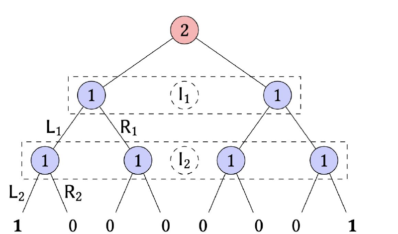
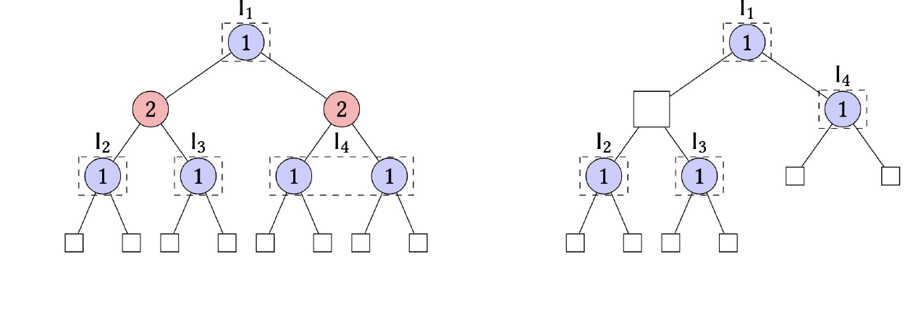
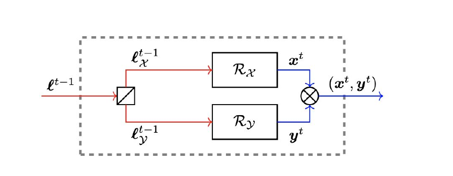
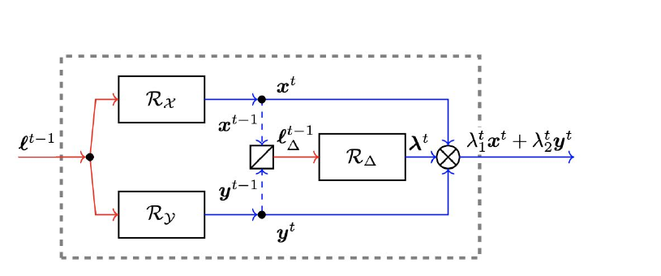

# L5 Extensive-Form Games 1: CFR

The previous lecture covered equilibrium computation and no-regret algorithms in normal-form games. Although every finite game can be cast into normal form, that representation is often inefficient for modeling sequential interaction. This lecture introduces the more compact **extensive-form game** (EFG), discusses three ways of representing strategies—mixed, behavioral, and sequence form—then introduces **tree-form decision problems** (TFDPs) and **regret circuits**, culminating in **counterfactual regret minimization** (CFR), the algorithm at the heart of many of the breakthrough results in game solving over the past two decades.

## Extensive-Form Games

An extensive-form game is represented through a rooted game tree. The set of nodes is denoted by $\mathcal{H}$; every node is either a **decision node** or a leaf (terminal) node. Each decision node belongs to the player who acts at that node; the set of all decision nodes belonging to player $i$ is denoted $\mathcal{H}_i \subseteq \mathcal{H}$. By convention, the set of players $[n] \cup \{c\}$ includes a (non-strategic) **chance player** $c$, which selects actions according to a fixed probability distribution and models external stochasticity such as the roll of a die. The player acting at a node $h \in \mathcal{H}$ selects an action from the set $A_h$ of available actions; for each $a \in A_h$, the tree contains an edge from $h$ to the node reached when $a$ is played. When the game reaches a leaf $z \in \mathcal{Z}$, each player $i \in [n]$ receives a payoff given by a utility function $u_i : \mathcal{Z} \to \mathbb{R}$.

**Imperfect information and perfect recall.** To capture imperfect information, the nodes $\mathcal{H}_i$ of each player $i$ are partitioned into **information sets** $\mathcal{J}_i$. An information set $j \in \mathcal{J}_i$ contains all nodes that the player **cannot distinguish** between. We can therefore assume that all nodes $h, h'$ in the same information set share the same action set $A_h = A_{h'} = A_j$—otherwise the player could tell $h$ and $h'$ apart. The set of **sequences** of player $i$ is defined as

$$\Sigma_i := \{(j, a) : j \in \mathcal{J}_i,\ a \in A_j\}.$$

For a node $h \in \mathcal{J}_i$, we denote by $\sigma_i(h)$ the ordered list of that player's own information sets encountered on the path to $h$, together with the actions played at them.

> **Definition (perfect recall).** Player $i$ has perfect recall if $\sigma_i(h) = \sigma_i(h')$ for all nodes $h, h'$ belonging to the same information set $j \in \mathcal{J}_i$. A game is of perfect recall if all of its players have perfect recall.

Intuitively, perfect recall means a player never forgets previously acquired information: if two nodes in the same information set had different past sequences, the player could distinguish them by memory—a contradiction. Almost everything in this lecture assumes perfect recall. Figure 1 shows a game of **imperfect** recall: Player 1 has two information sets $I_1$ (actions $L_1, R_1$) and $I_2$ (actions $L_2, R_2$), and by the time he acts at $I_2$ he has forgotten his action at $I_1$.



### Representing Strategies: Pure and Mixed Strategies

A **pure strategy** of player $i$ is any mapping $\mathcal{J}_i \ni j \mapsto A_j$, assigning an action to every information set. Let $\Pi_i$ denote the set of pure strategies of player $i$, and $\Delta(\Pi_i)$ the set of **mixed strategies** (distributions over pure strategies), denoted $\boldsymbol{\mu}_i \in \Delta(\Pi_i)$.

Every extensive-form game can be converted to normal form: keep the same players (dropping the chance player), take $\Pi_i$ as the pure strategies of player $i$, and define the utility under a joint pure strategy $(\pi_1, \dots, \pi_n) \in \Pi_1 \times \cdots \times \Pi_n$ as

$$\sum_{z \in \mathcal{Z}} u_i(z)\, p_c(z) \prod_{i' \in [n]} \prod_{\substack{(h, a) \preceq z \\ h \in \mathcal{H}_{i'}}} \pi_{i'}(a \mid h),$$

where $(h, a) \preceq z$ means that the path from the root to the leaf $z$ passes through $(h, a)$; if $h \in j$, then $\pi_i(a \mid h)$ is interpreted as $\pi_i(a \mid j)$; and $p_c(z)$ is the probability that the chance player plays all the actions on the path from the root to $z$.

The problem is that $|\Pi_i| = \prod_{j \in \mathcal{J}_i} |A_j|$: the number of pure strategies grows **exponentially** in the number of information sets. A concrete example: Player 1 acts first and chooses an action from $[m]$; Player 2 observes the action and then plays L or R at each of her $m$ information sets. The extensive-form game has only $\Theta(m)$ nodes, yet Player 2 has $2^m$ actions in the induced normal form.

> **Observation 1.1.** There is a two-player extensive-form game with $\Theta(m)$ nodes whose induced normal-form representation requires at least $2^m$ actions for one of the players.

This is not a theoretical pathology: this kind of blow-up is ubiquitous whenever a player must account for a large number of contingencies. We therefore cannot afford to handle every extensive-form game by converting it to normal form; specialized techniques are needed. From an optimization standpoint, we ask for two basic desiderata on a strategy representation (at the very least, when the other players are fixed, one should be able to optimize one's own utility efficiently):

1. The set of strategies is a **convex polytope**, described by a number of constraints polynomial in the size of the game tree;
2. Each player's utility is **linear** (or at least concave) in that player's own strategy.

### Behavioral Strategies and Kuhn's Theorem

A **behavioral strategy** $\boldsymbol{b}_i \in \prod_{j \in \mathcal{J}_i} \Delta(A_j)$ assigns, at each information set $j$, a probability to each action $a \in A_j$—that is, a mixed strategy that randomizes **independently** at each information set. Behavioral strategies have a compact representation (dimension equal to the number of sequences rather than the number of pure strategies), but does this lose expressivity? The celebrated theorem of Kuhn shows that under perfect recall it does not:

> **Theorem 1.2 (Kuhn, 1953).** Consider any perfect-recall game. For any mixed strategy $\boldsymbol{\mu}_i \in \Delta(\Pi_i)$, there exists a behavioral strategy $\boldsymbol{b}_i \in \prod_{j \in \mathcal{J}_i} \Delta(A_j)$ such that $u_i(\boldsymbol{b}_i, \boldsymbol{b}_{-i}) = u_i(\boldsymbol{\mu}_i, \boldsymbol{b}_{-i})$ for **every** behavioral strategy profile $\boldsymbol{b}_{-i}$ of the other players.

**A counterexample under imperfect recall.** The conclusion of Kuhn's theorem does not hold beyond perfect-recall games. Return to the game of Figure 1: the values at the terminal nodes are Player 1's utility, and the game is zero-sum (Player 2 minimizes Player 1's utility). If mixed strategies are allowed, Player 1 can play

$$\boldsymbol{\mu}_1 := \tfrac{1}{2}(L_1, L_2) + \tfrac{1}{2}(R_1, R_2),$$

which **correlates** the randomization between $I_1$ and $I_2$ and is therefore not a behavioral strategy. No matter how Player 2 responds, Player 1 is guaranteed utility $1/2$. If instead Player 1 is restricted to behavioral strategies, then against a minimizing Player 2 he can only get

$$\min\big(\boldsymbol{b}_1[I_1, L_1] \cdot \boldsymbol{b}_1[I_2, L_2],\ \boldsymbol{b}_1[I_1, R_1] \cdot \boldsymbol{b}_1[I_2, R_2]\big) = \min_{p, q}\, \big(p q,\ (1-p)(1-q)\big),$$

where $p = \boldsymbol{b}_1[I_1, L_1]$ and $q = \boldsymbol{b}_1[I_2, L_2]$. It is not hard to see that the optimal value of this expression is $1/4$, considerably lower than the $1/2$ guaranteed by mixed strategies. Theorem 1.2 reassures us that this loss cannot happen under perfect recall.

Two further remarks on Theorem 1.2 (Shoham & Leyton-Brown, §5.2). First, under perfect recall the equivalence is **two-way**: every behavioral strategy can likewise be replaced by an equivalent mixed strategy; as a corollary, restricting strategy sets to behavioral strategies **does not change the set of Nash equilibria**, so one can safely consider only behavioral strategies when computing equilibria of perfect-recall games. Second, in general imperfect-information games without perfect recall, the expressive power of mixed and behavioral strategies is in fact **incomparable**: there exist outcomes achievable by a mixed strategy that no behavioral strategy can reproduce (as in the example above), and also cases in the reverse direction.

### The Problem with Behavioral Strategies and the Sequence Form

Although behavioral and mixed strategies are equally expressive in theory (Theorem 1.2), behavioral strategies have a fundamental optimization flaw: even when all other players are fixed, a player's utility is **not linear—not even concave—in his own behavioral strategy**, as the products $p \cdot q$ in the expression above already reveal. More generally, the utility as a function of a behavioral strategy profile $(\boldsymbol{b}_1, \dots, \boldsymbol{b}_n)$ can be written as

$$\sum_{z \in \mathcal{Z}} u_i(z)\, p_c(z) \prod_{i' \in [n]} \prod_{\substack{(h, a) \preceq z \\ h \in \mathcal{H}_{i'}}} \boldsymbol{b}_{i'}[(j, a)],$$

so even after fixing all strategies but one player's, that player's utility still contains products of his own strategy variables—difficult to optimize. This violates the second desideratum (the first one, by contrast, is satisfied: the set of behavioral strategies is a Cartesian product of simplices, a convex polytope describable with polynomially many constraints). The **sequence-form** representation neatly sidesteps this difficulty; it was discovered independently by Romanovskii (1962) and by Koller, Megiddo, and von Stengel (1996).

The key difference of a sequence-form vector $\boldsymbol{x}_i \in \mathbb{R}^{\Sigma_i}$ is that for each sequence $(j, a) \in \Sigma_i$, the entry $\boldsymbol{x}_i[(j, a)]$ stores the **product of the player's own probabilities along the path from the root to playing action $a$ at information set $j$**, that is,

$$\boldsymbol{x}_i[\sigma] := \prod_{(j, a) \preceq \sigma} \boldsymbol{b}_i[(j, a)], \qquad \forall \sigma \in \Sigma_i,$$

where $\boldsymbol{b}_i$ is a behavioral strategy. For $\boldsymbol{x}_i$ to be a valid sequence-form strategy, it is enough to enforce probability flow conservation.

> **Definition 1.3 (Sequence-form polytope).** The sequence-form polytope is the convex set
> $$\mathcal{X}_i := \left\{ \boldsymbol{x}_i \in \mathbb{R}^{\Sigma_i}_{\geq 0} :\ \sum_{a \in A_j} \boldsymbol{x}_i[(j, a)] = \begin{cases} 1 & \text{if } p_j = \varnothing \\ \boldsymbol{x}_i[p_j] & \text{otherwise} \end{cases} \ \forall j \in \mathcal{J}_i \right\},$$
> where $p_j$ is the parent sequence of player $i$ at information set $j$ (the last "information set–action" pair of player $i$ on the path from the root to $j$; if there is none, we write $p_j = \varnothing$).

The number of constraints defining $\mathcal{X}_i$ is polynomial in the size of the game. More precisely, the total number of sequences of player $i$ is

$$|\Sigma_i| = 1 + \sum_{j \in \mathcal{J}_i} |A_j|,$$

where the "$1$" accounts for the empty sequence $\varnothing$ (no action taken yet from the root), captured in the flow conservation by $\boldsymbol{x}_i[\varnothing] = 1$; the number of sequences is **linear** in the size of the game tree—in stark contrast to the exponential blow-up in the number of pure strategies (Observation 1.1). The polytope's dimension is equally compact: the $1 + |\mathcal{J}_i|$ equality constraints are linearly independent, so $\dim \mathcal{X}_i = \sum_{j \in \mathcal{J}_i} (|A_j| - 1)$. More importantly, each player $i$'s utility can now be written as

$$u_i(\boldsymbol{x}) = \sum_{z \in \mathcal{Z}} u_i(z)\, p_c(z) \prod_{i' = 1}^{n} \boldsymbol{x}_{i'}[\sigma_{i'}(z)],$$

where $\sigma_{i'}(z)$ is the last sequence of player $i'$ on the path from the root to $z$. Hence $u_i(\boldsymbol{x})$ can be expressed as $\langle \boldsymbol{x}_i, \boldsymbol{u}_i(\boldsymbol{x}_{-i}) \rangle$, where $\boldsymbol{u}_i(\boldsymbol{x}_{-i}) \in \mathbb{R}^{\Sigma_i}$ does not depend on $\boldsymbol{x}_i$—**the utility is linear in the player's own sequence-form strategy**. Both desiderata are satisfied at once.

For two players, the utility can also be written in matrix form $\boldsymbol{x}_1^\top A\, \boldsymbol{x}_2$. The entry $(\sigma_1, \sigma_2)$ of the payoff matrix $A \in \mathbb{R}^{\Sigma_1 \times \Sigma_2}$ is defined by summing $u(z)\, p_c(z)$ over all leaves $z$ at which the last sequences of Players 1 and 2 are exactly $\sigma_1$ and $\sigma_2$. Since each leaf corresponds to a unique pair of last sequences, every leaf's payoff appears in $A$ only once, so $A$ is a **sparse matrix** whose number of nonzero entries is bounded by the number of leaves—again in contrast to the dense payoff matrix of the induced normal form (AGT §3.10; MAS §5.2.3).

### Linear Programming for Zero-Sum Games

In the special case of zero-sum games, Player 2's utility can be written as $\boldsymbol{x}^\top A \boldsymbol{y}$, where $\boldsymbol{x}, \boldsymbol{y}$ are sequence-form vectors; as in the previous lecture, we take Player 1 (who selects $\boldsymbol{x}$) to be the minimizer. By Definition 1.3, write the two players' sequence-form polytopes as $\mathcal{X} := \{\boldsymbol{x} \in \mathbb{R}^{\Sigma_1}_{\geq 0} : F_1 \boldsymbol{x} = \boldsymbol{f}_1\}$ and $\mathcal{Y} := \{\boldsymbol{y} \in \mathbb{R}^{\Sigma_2}_{\geq 0} : F_2 \boldsymbol{y} = \boldsymbol{f}_2\}$. Fixing Player 1's strategy $\boldsymbol{x} \in \mathcal{X}$, consider the linear program

$$\text{(P)}\quad \max_{\boldsymbol{y}}\ \boldsymbol{x}^\top A \boldsymbol{y} \quad \text{s.t. } F_2 \boldsymbol{y} = \boldsymbol{f}_2,\ \boldsymbol{y} \geq \boldsymbol{0}.$$

By strong duality, for any $\boldsymbol{x}$ the value of (P) equals the value of its dual:

$$\text{(D)}\quad \min_{\boldsymbol{v}}\ \boldsymbol{f}_2^\top \boldsymbol{v} \quad \text{s.t. } A^\top \boldsymbol{x} \geq F_2^\top \boldsymbol{v}.$$

In other words, for every $\boldsymbol{x} \in \mathcal{X}$ we have $\max_{\boldsymbol{y} \in \mathcal{Y}} \boldsymbol{x}^\top A \boldsymbol{y} = \min_{\boldsymbol{v} : A^\top \boldsymbol{x} \geq F_2^\top \boldsymbol{v}} \boldsymbol{f}_2^\top \boldsymbol{v}$. Solving $\min_{\boldsymbol{x} \in \mathcal{X}} \max_{\boldsymbol{y} \in \mathcal{Y}} \boldsymbol{x}^\top A \boldsymbol{y}$ therefore reduces to a single linear program in the variables $(\boldsymbol{x}, \boldsymbol{v})$:

$$\min_{\boldsymbol{x}, \boldsymbol{v}}\ \boldsymbol{f}_2^\top \boldsymbol{v} \quad \text{s.t. } F_1 \boldsymbol{x} = \boldsymbol{f}_1,\ \boldsymbol{x} \geq \boldsymbol{0},\ A^\top \boldsymbol{x} \geq F_2^\top \boldsymbol{v}.$$

This extends last lecture's result on normal-form zero-sum games to extensive-form games:

> **Theorem 1.4.** For any perfect-recall zero-sum extensive-form game, a minimax equilibrium can be computed in time polynomial in the size of the game tree.

In fact the bound can be refined: the total number of nonzero entries of the constraint matrices $F_1, F_2$ and of the payoff matrix $A$ is at most a constant times the size of the game tree, so the LP has size **linear** in the game tree (AGT §3.11, Theorem 3.13). The dual variables also admit an intuitive game-theoretic semantics (MAS §5.2.3): each component of $\boldsymbol{v}$ corresponds to an information set and can be interpreted as "the value of the subgame rooted at that information set under best response by the opponent," while the objective value $\boldsymbol{f}_2^\top \boldsymbol{v}$ is the value of the whole game. (For two-player general-sum games, the same construction yields a polynomial-size linear complementarity problem—feasibility of the primal and dual LPs plus complementary slackness—solvable by Lemke's algorithm; see AGT §3.11, Theorem 3.14.)

## Tree-Form Decision Problems

We now introduce the **tree-form decision problem** (TFDP) framework: take the perspective of a single player and abstract away all other players of the extensive-form game; what remains is the sequential decision problem faced by that player. The player interacts with the environment in two basic ways: at a **decision point** $j \in \mathcal{J}$ (corresponding to an information set), the player selects an action from $A_j$; at an **observation point** $k \in \mathcal{K}$, the player observes a signal $s \in S_k$. Decision and observation points form a tree. There is also a **transition function** $\rho$: given a decision point $j \in \mathcal{J}$ and an action $a \in A_j$, $\rho(j, a)$ returns the next point $p \in \mathcal{J} \cup \mathcal{K} \cup \{\bot\}$ reached in the tree ($\bot$ denotes the end of the decision process); similarly, $\rho(k, s)$ returns the next point after observing signal $s$ at observation point $k$.



### Inductive Decomposition of the Strategy Set

Let $\mathcal{X}$ be the sequence-form strategy set of the TFDP (Definition 1.3). We will see that $\mathcal{X}$ can be decomposed inductively using two basic operations—**convex hull** and **Cartesian product**. Using the figure above as an example, we proceed bottom-up: at the terminal decision points $j = I_2, I_3, I_4$, the strategy set $\mathcal{X}_j$ is the probability simplex $\Delta^2$; at the only observation point $k$, $\mathcal{X}_k = \mathcal{X}_{I_2} \times \mathcal{X}_{I_3}$, decomposing into two independent subproblems; finally, at $I_1$ the player must specify a probability for each of the two actions, denoted $\boldsymbol{\lambda}[a_1], \boldsymbol{\lambda}[a_2]$. By the definition of the sequence-form polytope, the strategies in the subtree rooted at $k$ must be multiplied by $\boldsymbol{\lambda}[a_1]$ and those in the subtree rooted at $I_4$ by $\boldsymbol{\lambda}[a_2]$, that is,

$$\mathcal{X} := \mathcal{X}_{I_1} = \big\{ \big(\boldsymbol{\lambda}[a_1], \boldsymbol{\lambda}[a_2], \boldsymbol{\lambda}[a_1] \boldsymbol{x}_k, \boldsymbol{\lambda}[a_2] \boldsymbol{x}_{I_4}\big) : (\boldsymbol{\lambda}[a_1], \boldsymbol{\lambda}[a_2]) \in \Delta^2,\ \boldsymbol{x}_k \in \mathcal{X}_k,\ \boldsymbol{x}_{I_4} \in \mathcal{X}_{I_4} \big\}.$$


This bottom-up decomposition extends directly to any TFDP:

- **Observation points decompose via Cartesian products.** Let the set of children of observation point $k \in \mathcal{K}$ be $\{p_1, \dots, p_\nu\} = \{\rho(k, s) : s \in S_k\} =: \mathcal{C}_k$; then
$$\mathcal{X}_k = \mathcal{X}_{p_1} \times \mathcal{X}_{p_2} \times \cdots \times \mathcal{X}_{p_\nu},$$
where $\mathcal{X}_{p_i}$ is the sequence-form polytope of the subtree rooted at $p_i$.

- **Decision points decompose via convex hulls.** Let the set of children of decision point $j \in \mathcal{J}$ be $\{p_1, \dots, p_\nu\} = \{\rho(j, a) : a \in A_j\} =: \mathcal{C}_j$; then
$$\mathcal{X}_j := \mathrm{co} \left\{ \begin{pmatrix} \boldsymbol{e}_1 \\ \mathcal{X}_{p_1} \\ \boldsymbol{0} \\ \vdots \\ \boldsymbol{0} \end{pmatrix}, \begin{pmatrix} \boldsymbol{e}_2 \\ \boldsymbol{0} \\ \mathcal{X}_{p_2} \\ \vdots \\ \boldsymbol{0} \end{pmatrix}, \dots, \begin{pmatrix} \boldsymbol{e}_\nu \\ \boldsymbol{0} \\ \boldsymbol{0} \\ \vdots \\ \mathcal{X}_{p_\nu} \end{pmatrix} \right\},$$
where $\boldsymbol{e}_i \in \mathbb{R}^{A_j}$ is the $i$-th unit vector.

## Regret Circuits and Counterfactual Regret Minimization

The previous lecture gave several efficient no-regret algorithms over the simplex (RM, MWU, and so on); the decomposition above shows that the sequence-form polytope can be built out of probability simplices using only i) Cartesian products and ii) convex hulls. **Regret circuits** (Farina, Kroer & Sandholm, ICML 2019) answer the following basic question: given that we know how to minimize regret efficiently over certain sets, can we **compose** several such regret minimizers to handle a more complex, composite set? It then suffices to design regret circuits for the two basic operations to obtain a no-regret algorithm over the sequence-form polytope—and that is precisely CFR.

One clarification: the previous lecture introduced regret minimization in the special case where the learner outputs a probability distribution, but the definitions carry over directly to a learner that outputs a point $\boldsymbol{x}$ in a general convex set $\mathcal{X}$ (for example, the sequence-form polytope) and then receives a linear utility function $\boldsymbol{x} \mapsto \langle \boldsymbol{x}, \boldsymbol{u} \rangle$. Moreover, Farina et al. point out that linear losses are **universal** in the following sense: even when the utility is an arbitrary convex function $\ell^t$, convexity gives $\ell^t(\hat{\boldsymbol{x}}) \geq \ell^t(\boldsymbol{x}^t) + \langle \partial \ell^t(\boldsymbol{x}^t),\, \hat{\boldsymbol{x}} - \boldsymbol{x}^t \rangle$, so feeding any (sub)gradient of $\ell^t$ at $\boldsymbol{x}^t$ as a linear loss into a regret minimizer that only handles linear losses yields regret no worse than under the original convex losses. It therefore suffices to design regret circuits for linear utilities; the general convex case is covered automatically.

### Regret Circuit for the Cartesian Product

Suppose that for each $p \in \mathcal{C}_k$ we have an online algorithm $\mathfrak{R}_p$ that minimizes regret efficiently over $\mathcal{X}_p$; we want a regret minimizer $\mathfrak{R}_k$ for $\mathcal{X}_k := \prod_{p \in \mathcal{C}_k} \mathcal{X}_p$. An online algorithm interacts with the environment in two steps—first it produces a strategy, then it observes the utility feedback; we handle the two separately:

- Whenever $\mathfrak{R}_k$ needs to produce a strategy, it asks each $\mathfrak{R}_p$ for a strategy $\boldsymbol{x}_p$ and outputs their concatenation (Cartesian product) $(\boldsymbol{x}_p)_{p \in \mathcal{C}_k}$;
- Whenever $\mathfrak{R}_k$ receives a utility vector $\boldsymbol{u}_k = (\boldsymbol{u}_p)_{p \in \mathcal{C}_k}$ from the environment, it forwards the component $\boldsymbol{u}_p$ to the corresponding $\mathfrak{R}_p$.



> **Proposition 3.2.** The regret of $\mathfrak{R}_k$ equals $\sum_{p \in \mathcal{C}_k} \mathrm{Reg}_p^{(T)}$, where $\mathrm{Reg}_p^{(T)}$ is the regret of $\mathfrak{R}_p$ (cumulated over $T$ steps).

**Proof idea.** Unfold the definition: since the joint optimum $(\hat{\boldsymbol{x}}, \hat{\boldsymbol{y}})$ can be chosen componentwise independently,

$$\mathrm{Reg}^{\mathcal{X} \times \mathcal{Y}}_T = \max_{(\hat{\boldsymbol{x}}, \hat{\boldsymbol{y}}) \in \mathcal{X} \times \mathcal{Y}} \sum_{t=1}^{T} \big( \langle \boldsymbol{\ell}_t, (\hat{\boldsymbol{x}}, \hat{\boldsymbol{y}}) \rangle - \langle \boldsymbol{\ell}_t, (\boldsymbol{x}_t, \boldsymbol{y}_t) \rangle \big) = \mathrm{Reg}^{\mathcal{X}}_T + \mathrm{Reg}^{\mathcal{Y}}_T.$$

In particular, if each $\mathfrak{R}_p$ has regret growing sublinearly in $T$, so does $\mathfrak{R}_k$. The extension to Cartesian products of more than two sets is direct.

### Regret Circuit for the Convex Hull

The convex hull is slightly more involved. Suppose we already have a regret minimizer $\mathfrak{R}_p$ over $\mathcal{X}_p$ for each $p \in \mathcal{C}_j$, and we want $\mathfrak{R}_j$ for $\mathcal{X}_j := \mathrm{co}\{(\mathcal{X}_p)_{p \in \mathcal{C}_j}\}$. We additionally use a regret minimizer $\mathfrak{R}_\Delta$ operating over the simplex $\Delta(\mathcal{C}_j)$, whose role is to decide how to mix among the $(\mathfrak{R}_p)$:

- Whenever $\mathfrak{R}_j$ needs to produce a strategy, it asks each $\mathfrak{R}_p$ for a strategy $\boldsymbol{x}_p$ and $\mathfrak{R}_\Delta$ for a strategy $\boldsymbol{\lambda} \in \Delta(\mathcal{C}_j)$, and outputs the mixture $(\boldsymbol{\lambda}[p]\, \boldsymbol{x}_p)_{p \in \mathcal{C}_j}$;
- Whenever $\mathfrak{R}_j$ receives a utility vector $\boldsymbol{u}_j$, it first forwards $\boldsymbol{u}_j$ unchanged to every $\mathfrak{R}_p$, and then forwards the vector $\big( \langle \boldsymbol{x}_p, \boldsymbol{u}_j \rangle \big)_{p \in \mathcal{C}_j}$ to $\mathfrak{R}_\Delta$.



Note that each component $\langle \boldsymbol{x}_p, \boldsymbol{u}_j \rangle$ forwarded to $\mathfrak{R}_\Delta$ reflects how well the corresponding sub-minimizer is currently "performing": $\mathfrak{R}_\Delta$ learns from this how to weight them.

> **Proposition 3.3.** The regret of $\mathfrak{R}_j$ is at most $\mathrm{Reg}_\Delta^{(T)} + \max_{p \in \mathcal{C}_j} \mathrm{Reg}_p^{(T)}$.

**Proof idea** (for two sets $\mathcal{X}, \mathcal{Y}$). Let $\mathfrak{R}_\Delta$ output $\boldsymbol{\lambda}_t = (\lambda_1^t, \lambda_2^t) \in \Delta^2$, so the strategy played is $\lambda_1^t \boldsymbol{x}_t + \lambda_2^t \boldsymbol{y}_t$. Starting from the definition of regret,

$$\mathrm{Reg}_T = \max_{\substack{\hat{\boldsymbol{\lambda}} \in \Delta^2 \\ \hat{\boldsymbol{x}} \in \mathcal{X}, \hat{\boldsymbol{y}} \in \mathcal{Y}}} \sum_{t=1}^T \Big( \langle \boldsymbol{\ell}_t, \hat{\lambda}_1 \hat{\boldsymbol{x}} + \hat{\lambda}_2 \hat{\boldsymbol{y}} \rangle - \langle \boldsymbol{\ell}_t, \lambda_1^t \boldsymbol{x}_t + \lambda_2^t \boldsymbol{y}_t \rangle \Big).$$

There are two key observations. First, since $\hat{\lambda}_1, \hat{\lambda}_2 \geq 0$, the joint maximization over $(\hat{\boldsymbol{x}}, \hat{\boldsymbol{y}})$ and $\hat{\boldsymbol{\lambda}}$ can be exchanged:

$$\max_{\hat{\boldsymbol{\lambda}} \in \Delta^2} \max_{\hat{\boldsymbol{x}}, \hat{\boldsymbol{y}}} \Big( \hat{\lambda}_1 \sum_t \langle \boldsymbol{\ell}_t, \hat{\boldsymbol{x}} \rangle + \hat{\lambda}_2 \sum_t \langle \boldsymbol{\ell}_t, \hat{\boldsymbol{y}} \rangle \Big) = \max_{\hat{\boldsymbol{\lambda}} \in \Delta^2} \Big( \hat{\lambda}_1 \max_{\hat{\boldsymbol{x}} \in \mathcal{X}} \sum_t \langle \boldsymbol{\ell}_t, \hat{\boldsymbol{x}} \rangle + \hat{\lambda}_2 \max_{\hat{\boldsymbol{y}} \in \mathcal{Y}} \sum_t \langle \boldsymbol{\ell}_t, \hat{\boldsymbol{y}} \rangle \Big).$$

Second, by the definition of the regret of $\mathfrak{R}_{\mathcal{X}}$, $\max_{\hat{\boldsymbol{x}} \in \mathcal{X}} \sum_t \langle \boldsymbol{\ell}_t, \hat{\boldsymbol{x}} \rangle = \mathrm{Reg}^{\mathcal{X}}_T + \sum_t \langle \boldsymbol{\ell}_t, \boldsymbol{x}_t \rangle$ (and similarly for $\mathcal{Y}$). Substituting and noting that for every $\hat{\boldsymbol{\lambda}}$ we have $\hat{\lambda}_1 \mathrm{Reg}^{\mathcal{X}}_T + \hat{\lambda}_2 \mathrm{Reg}^{\mathcal{Y}}_T \leq \max\{\mathrm{Reg}^{\mathcal{X}}_T, \mathrm{Reg}^{\mathcal{Y}}_T\}$, what remains is exactly the regret of $\mathfrak{R}_\Delta$ under the utility sequence $\boldsymbol{\ell}_t^\Delta = (\langle \boldsymbol{\ell}_t, \boldsymbol{x}_t \rangle, \langle \boldsymbol{\ell}_t, \boldsymbol{y}_t \rangle)$, and therefore

$$\mathrm{Reg}_T \leq \mathrm{Reg}^{\Delta}_T + \max\{\mathrm{Reg}^{\mathcal{X}}_T, \mathrm{Reg}^{\mathcal{Y}}_T\}.$$

The extension to the convex hull of $n$ sets is direct: $\mathfrak{R}_\Delta$ now runs over $\Delta^n$ and outputs $\lambda_1^t \boldsymbol{x}_1^t + \dots + \lambda_n^t \boldsymbol{x}_n^t$, with regret bound $\mathrm{Reg}_T \leq \mathrm{Reg}^{\Delta^n}_T + \max\{\mathrm{Reg}^{\mathcal{X}_1}_T, \dots, \mathrm{Reg}^{\mathcal{X}_n}_T\}$.

Combining Propositions 3.2 and 3.3 with the inductive decomposition of the previous section, together with the existence of efficient no-regret algorithms over the simplex, we obtain:

> **Theorem 3.4.** There exists an efficient online algorithm for minimizing regret over the sequence-form polytope.

### The CFR Algorithm

Spelling out the above construction in full yields **counterfactual regret minimization** (CFR), first proposed and analyzed by Zinkevich, Bowling, Johanson, and Piccione (NIPS 2007); the derivation here follows the regret-circuits framework of Farina et al. (2019). CFR should be understood as a **family of algorithms**: the local regret minimizer $\mathfrak{R}_j$ at each decision point can be instantiated with any no-regret algorithm for the simplex; by far the most common choices in practice are regret matching (RM) and its modern variants (such as RM$^+$), which we will discuss in detail in the next lecture.

In the pseudocode below, `NextStrategy` outputs the next CFR strategy: it first queries each local regret minimizer for a behavioral strategy and then converts it into a sequence-form vector (this conversion is exactly what guarantees linearity of the utility, as repeatedly emphasized above). `ObserveUtility` updates the **counterfactual utilities** fed to the local regret minimizer at each decision point.

```text
Algorithm 1: Counterfactual regret minimization (CFR)
Input: a regret minimizer R_j for each decision point j ∈ J of the TFDP

NextStrategy():
  for each decision point j ∈ J:
      b_j^(t) := R_j.NextStrategy()              # b_j^(t) ∈ Δ(A_j)
  for each decision point j ∈ J (in top-down order):
      for each action a ∈ A_j:
          if p_j = ∅:
              x^(t)[(j, a)] := b_j^(t)[a]
          else:
              x^(t)[(j, a)] := x^(t)[p_j] · b_j^(t)[a]
  return x^(t) ∈ R^Σ                              # a valid sequence-form strategy

ObserveUtility(u^(t) ∈ R^Σ):
  V^(t)[⊥] := 0
  for each node p ∈ J ∪ K in the tree (in bottom-up order):
      if p ∈ J:                                  # decision point
          j := p
          V^(t)[j] := Σ_{a ∈ A_j} b_j^(t)[a] · ( u^(t)[(j, a)] + V^(t)[ρ(j, a)] )
      else:                                      # observation point
          k := p
          V^(t)[k] := Σ_{s ∈ S_k} V^(t)[ρ(k, s)]
  for each decision point j ∈ J:
      for each action a ∈ A_j:
          u_j^(t)[a] := u^(t)[(j, a)] + V^(t)[ρ(j, a)]
      R_j.ObserveUtility(u_j^(t))
```

One can verify that the vector $\boldsymbol{x}^{(t)}$ filled in by `NextStrategy` satisfies the flow-conservation constraints of Definition 1.3 and is indeed a valid sequence-form strategy. `ObserveUtility` proceeds in two steps: the first computes, bottom-up, the expected utility $V^{(t)}$ of the subtree rooted at each node; the second constructs, at each decision point $j$, the local utility vector $\boldsymbol{u}_j^{(t)}$—the **counterfactual utility**, which measures the value of each action "had the player played so as to reach $j$"—and hands it to the local regret minimizer $\mathfrak{R}_j$.

The cumulative regret of CFR satisfies the following bound:

> **Proposition.** Let $\mathrm{Reg}_j^{(T)}$ ($j \in \mathcal{J}$) be the regret cumulated up to time $T$ by each local regret minimizer $\mathfrak{R}_j$. Then the regret $\mathrm{Reg}^{(T)}$ of CFR up to time $T$ satisfies
> $$\mathrm{Reg}^{(T)} \leq \sum_{j \in \mathcal{J}} \max\big\{0,\ \mathrm{Reg}_j^{(T)}\big\}.$$

It follows immediately that if each $\mathrm{Reg}_j^{(T)}$ grows sublinearly in $T$, so does $\mathrm{Reg}^{(T)}$. Combined with the framework of the previous lecture (in two-player zero-sum games, the time-averaged strategies of two no-regret players converge to a minimax equilibrium), CFR provides a scalable engine for equilibrium computation in large imperfect-information games.

**The original counterfactual-regret formulation.** The original CFR paper (Zinkevich et al., 2007) introduced the same idea from the extensive-form perspective, and it is instructive to compare. Let $\pi^{\sigma}(h)$ be the probability of reaching history $h$ under strategy profile $\sigma$, decomposed as a product of contributions of the players (including chance) $\pi^{\sigma}(h) = \prod_{i'} \pi_{i'}^{\sigma}(h)$; write $\pi_{-i}^{\sigma}$ for the contribution of all players except $i$. The **counterfactual utility** of information set $j \in \mathcal{J}_i$ is defined as the expected utility of $j$ "had player $i$ played so as to reach $j$":

$$u_i(\sigma, j) := \frac{\sum_{h \in j,\, z \in \mathcal{Z}} \pi_{-i}^{\sigma}(h)\, \pi^{\sigma}(h, z)\, u_i(z)}{\pi_{-i}^{\sigma}(j)},$$

where $\pi^{\sigma}(h, z)$ is the probability of going from $h$ to $z$, and $\pi_{-i}^{\sigma}(j) := \sum_{h \in j} \pi_{-i}^{\sigma}(h)$. Writing $\sigma|_{j \to a}$ for the profile identical to $\sigma$ except that action $a$ is always taken at $j$, the **immediate counterfactual regret** at $j$ is

$$\mathrm{Reg}_{i,\mathrm{imm}}^{(T)}(j) = \max_{a \in A_j}\ \sum_{t=1}^T \pi_{-i}^{\sigma^t}(j)\, \Big( u_i\big(\sigma^t|_{j \to a}, j\big) - u_i(\sigma^t, j) \Big).$$

> **Theorem (Zinkevich et al., 2007, Theorem 3).** In a perfect-recall game, player $i$'s overall regret satisfies
> $$\mathrm{Reg}_i^{(T)} \leq \sum_{j \in \mathcal{J}_i} \max\big\{0,\ \mathrm{Reg}_{i,\mathrm{imm}}^{(T)}(j)\big\}.$$

This is exactly the proposition above restated in the original notation—the original paper decomposes information set by information set, while regret circuits decompose along the inductive structure of the TFDP; the two arrive at the same place. The original paper instantiates each local minimizer with the Blackwell approachability algorithm (i.e., regret matching) and gives a precise convergence rate:

> **Theorem (Zinkevich et al., 2007, Theorem 4).** If player $i$ selects actions according to regret matching at every information set (probabilities proportional to the positive cumulative counterfactual regrets, uniform when all are nonpositive), then $\mathrm{Reg}_{i,\mathrm{imm}}^{(T)}(j) \leq \Delta_{u,i} \sqrt{|\bar{A}_i|\, T}$, and consequently
> $$\mathrm{Reg}_i^{(T)} \leq \Delta_{u,i}\, |\mathcal{J}_i|\, \sqrt{|\bar{A}_i|\, T},$$
> where $\Delta_{u,i} := \max_z u_i(z) - \min_z u_i(z)$ is the range of utilities and $|\bar{A}_i| := \max_{j \in \mathcal{J}_i} |A_j|$.

(The original statement is in terms of **average** regret $\frac{1}{T}\mathrm{Reg}^{(T)}$, with bound $\Delta_{u,i} |\mathcal{J}_i| \sqrt{|\bar{A}_i|} / \sqrt{T}$; multiplying by $T$ gives the formula above.) Note that the bound is only **linear** in the number of information sets—had we instead run a no-regret algorithm directly on the induced normal form, the number of pure strategies (exponential) would appear in the bound. This is precisely why the extensive-form structure must be exploited.

**Time-averaged strategies and equilibrium accuracy.** The connection between no-regret and equilibrium also has a precise quantitative form (Zinkevich et al., 2007, Theorem 2): in a zero-sum game, if both players' average overall regret up to time $T$ is less than $\epsilon$, then the time-averaged strategy profile $\bar{\sigma}^{(T)}$ is a $2\epsilon$-Nash equilibrium. Here the average strategy at each information set is weighted by the player's **own reach probability**: $\bar{\sigma}_i^{(T)}(j)(a) \propto \sum_{t} \pi_i^{\sigma^t}(j)\, \sigma^t(j)(a)$. The two perspectives agree completely here as well: Farina et al. (2019) verified that the losses fed to the local regret minimizers are exactly (the negation of) the original paper's counterfactual utilities, and that the uniform time average of tree-form (sequence-form) strategies coincides with vanilla CFR's per-information-set weighted average.

**Experimental evidence from poker.** Zinkevich et al. (2007) validated CFR on an abstraction of heads-up limit Texas Hold'em (the full game has about $9.2 \times 10^{17}$ states and $3.2 \times 10^{14}$ information sets): keeping the full four-round betting structure and bucketing card sequences into 10 buckets per round according to a "hand-strength-squared" metric yields an abstract game with about $1.65 \times 10^{12}$ states and $5.7 \times 10^7$ information sets—**two orders of magnitude** larger than anything previously solved. Each iteration samples only the chance player's actions (visiting just 18,496 states per iteration), and a single core completes about 750 iterations per second; parallelized across 4 CPUs, $2 \times 10^9$ iterations took less than 14 days, and the resulting strategy's exploitability within the abstract game was only **2.2 mb/h** (millibets per hand; an always-fold strategy loses 750 mb/h). After only $2 \times 10^8$ iterations (less than two days), exploitability was already below 13 mb/h. The experiments also showed that the number of iterations needed for a given accuracy grows roughly in proportion to the number of information sets, consistent with the theoretical bound above, and that larger abstractions translate directly into stronger practical play.

## Key Takeaways

- Extensive-form games are represented by rooted game trees, with information sets capturing imperfect information; **perfect recall** requires all nodes in the same information set to share the same past sequence, and the whole lecture works under this assumption.
- Converting to normal form explodes exponentially: a game with $\Theta(m)$ nodes can induce $2^m$ pure strategies (Observation 1.1). A good strategy representation needs two properties: the strategy set is a convex polytope with polynomially many constraints, and utility is linear (at least concave) in one's own strategy.
- **Kuhn's theorem**: under perfect recall, behavioral and mixed strategies are utility-equivalent; this fails without perfect recall (mixed strategies guarantee $1/2$, behavioral only $1/4$). But utilities in behavioral strategies contain products of one's own variables—nonlinear and nonconcave.
- The **sequence form** represents strategies by products of path probabilities; the polytope is characterized by flow-conservation constraints, and utility is linear in one's own strategy. Zero-sum extensive-form games can therefore be solved for minimax equilibria by a polynomial-size LP (Theorem 1.4).
- Abstracting to a single player's perspective yields a **tree-form decision problem** (TFDP); its sequence-form polytope decomposes inductively: Cartesian products at observation points, convex hulls at decision points.
- **Regret circuits** lift no-regret algorithms from simplices to the sequence-form polytope: the regret of a Cartesian product is the sum of the component regrets (Proposition 3.2), and the regret of a convex hull is at most the mixer's regret plus the maximum branch regret (Proposition 3.3), yielding an efficient sequence-form no-regret algorithm (Theorem 3.4).
- This construction is exactly **CFR** (Zinkevich et al., 2007): a local regret minimizer (most often RM and its variants) runs at each decision point, driven by counterfactual utilities, with total regret bounded by $\sum_j \max\{0, \mathrm{Reg}_j^{(T)}\}$.
- The original paper's counterfactual-regret decomposition gives a precise rate: under regret matching, $\mathrm{Reg}_i^{(T)} \leq \Delta_{u,i} |\mathcal{J}_i| \sqrt{|\bar{A}_i| T}$ (linear in the number of information sets); when both players' average regrets are below $\epsilon$, the averaged profile is a $2\epsilon$-equilibrium. Experimentally, CFR reached 2.2 mb/h exploitability on a $10^{12}$-state abstraction of limit Texas Hold'em, advancing the state of the art by two orders of magnitude.
