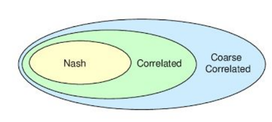
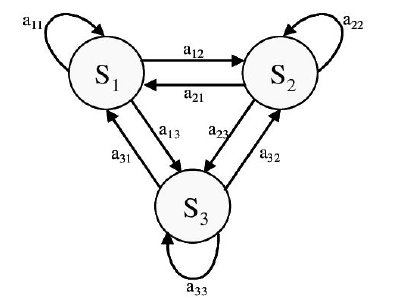

<!-- escape-math: v1 -->
# Correlated Equilibria and Φ-Regret

The previous lectures developed efficient algorithms for minimizing regret in an online environment. We now turn to general-sum games: when every player updates her strategy using no-regret learning, what does the outcome converge to? The answer is the correlated equilibrium (CE) and the coarse correlated equilibrium (CCE): solution concepts that are far more tractable than the Nash equilibrium. The bridge between no-regret learning and these concepts is Φ-regret, and minimizing Φ-regret reduces, via the general framework of Gordon et al., to the algorithm of Blum and Mansour.

## 1 Correlated and Coarse Correlated Equilibria

A major criticism of the Nash equilibrium is that, although one always exists, computing one in a general-sum game is intractable (PPAD-complete), let alone computing an optimal one. On top of that there is the equilibrium selection problem: a game can have multiple disparate equilibria. We should therefore not expect simple no-regret algorithms such as online gradient descent or regret matching to converge to Nash equilibria. But then, what *are* no-regret dynamics converging to in general-sum games? We confine our discussion to normal-form games.

A key premise of the Nash equilibrium is that players randomize **independently**. What if the distribution of outcomes is correlated instead? Consider the following two distributions over some $2\times 2$ bimatrix game:

$$
\boldsymbol{\mu} = \begin{bmatrix} 1/2 & 0 \\\ 0 & 1/2 \end{bmatrix}, \qquad
\boldsymbol{\mu}' = \begin{bmatrix} 1/6 & 1/6 \\\ 1/3 & 1/3 \end{bmatrix}.
$$

Both are distributions over $\mathcal{A}\_1\times\mathcal{A}\_2=\\{1,2\\}\times\\{1,2\\}$, but only $\boldsymbol{\mu}'$ is a product distribution: the row player playing $(1/3,\\,2/3)$ and the column player playing $(1/2,\\,1/2)$ induce exactly $\boldsymbol{\mu}'$, whereas no pair of independent strategies gives rise to $\boldsymbol{\mu}$.

> **Definition 1.1 (Coarse correlated equilibrium, CCE).** A correlated distribution $\boldsymbol{\mu}\in\Delta(\mathcal{A}\_1\times\cdots\times\mathcal{A}\_n)$ is an $\epsilon$-coarse correlated equilibrium if for any player $i\in[n]$ and deviation $a\_i'\in\mathcal{A}\_i$,
> $$\mathbb{E}\_{(a\_1,\dots,a\_n)\sim\boldsymbol{\mu}}\\, u\_i(a\_1,\dots,a\_n) \\;\ge\\; \mathbb{E}\_{(a\_1,\dots,a\_n)\sim\boldsymbol{\mu}}\\, u\_i(a\_i',\\, a\_{-i}) - \epsilon.$$

This definition echoes the Nash equilibrium, but allows the underlying distribution $\boldsymbol{\mu}$ to be correlated. It follows readily that a Nash equilibrium is always a CCE, since a Nash equilibrium is an "uncorrelated" (coarse) correlated equilibrium. But the set of CCEs can unlock new, sometimes more desirable, outcomes.

> **Definition 1.2 (Correlated equilibrium, CE; Aumann 1974).** A correlated distribution $\boldsymbol{\mu}\in\Delta(\mathcal{A}\_1\times\cdots\times\mathcal{A}\_n)$ is an $\epsilon$-correlated equilibrium if for any player $i\in[n]$ and deviation function $\phi\_i:\mathcal{A}\_i\to\mathcal{A}\_i$,
> $$\mathbb{E}\_{(a\_1,\dots,a\_n)\sim\boldsymbol{\mu}}\\, u\_i(a\_1,\dots,a\_n) \\;\ge\\; \mathbb{E}\_{(a\_1,\dots,a\_n)\sim\boldsymbol{\mu}}\\, u\_i\big(\phi\_i(a\_i),\\, a\_{-i}\big) - \epsilon.$$

The class of deviations in a CE is richer than in a CCE: a CCE only permits constant deviations (replacing the entire strategy by one fixed action), while a CE permits any *swap deviation* that may depend on the recommended action. A CE is therefore the stronger notion: every CE is also a CCE, that is, Nash $\subseteq$ CE $\subseteq$ CCE, as illustrated below.



Both definitions admit an interpretation through a trusted third party (a **mediator**, or **correlation device**): the mediator first samples a joint action profile $(a\_1,\dots,a\_n)$ from $\boldsymbol{\mu}$, then privately reveals the corresponding $a\_i$ to each player $i$ as a recommendation. The equilibrium condition is that no player has an incentive to deviate from the recommendation. The difference is that in a CE a player decides whether to deviate **after** seeing the recommendation (the deviation $\phi\_i(a\_i)$ can depend on the recommendation itself), whereas in a CCE the player must commit to whether she will follow the recommendation **before** seeing it. From that perspective, a CCE is harder to justify: without some binding mechanism, a player could still deviate after observing the recommendation.

### Example: the game of chicken

Two drivers are fast approaching the same intersection from different streets; each can Stop or Go. If both play Go a crash ensues, a bad outcome for both; a player who stops gets no utility from the game; and a player who proceeds while the other stops gets utility $1$ for crossing the intersection quickly. The payoff matrix is as follows (row player's payoff first):

|  | Stop | Go |
|---|---|---|
| **Stop** | $0,\ 0$ | $0,\ 1$ |
| **Go** | $1,\ 0$ | $-5,\ -5$ |


The game has exactly three Nash equilibria: (Go, Stop), (Stop, Go), and the mixed equilibrium $((5/6,\\,1/6),\\,(5/6,\\,1/6))$ in which both players Stop with probability $5/6$. The first two are unfair: they favor one player over the other; the third is even worse, leading to a crash with non-negligible probability, so much so that each player's expected utility is $0$. Nash equilibria are unsatisfactory here.

(C)CEs unlock better outcomes. Consider the correlated distribution $\tfrac12(\text{Go},\text{Stop}) + \tfrac12(\text{Stop},\text{Go})$: it is easy to verify that this is a CE (and hence a CCE), under which both players get expected utility $1/2$. This outcome has a natural interpretation: a **traffic light** is the correlation device. If Player 1 is recommended Stop, it means Player 2 will play Go with probability 1, so stopping is in Player 1's interest; if recommended Go, it means Player 2 will play Stop with probability 1, so proceeding is safe. In other words, in a CE the signal a player observes updates her beliefs about the behavior of the other players; the Nash equilibrium is the corner case in which the signal carries no pertinent information, since players act independently.

### Example: CE versus CCE

Consider the following $4\times 4$ bimatrix game, with payoff matrices for the row and column player respectively

$$
R = \begin{bmatrix} 2&0&0&0\\\ 0&2&0&0\\\ 3&0&0&0\\\ 0&3&0&0 \end{bmatrix},
\qquad
C = \begin{bmatrix} 2&0&3&0\\\ 0&2&0&3\\\ 0&0&0&0\\\ 0&0&0&0 \end{bmatrix}.
$$

The actions are labeled $1,2,3,4$. Consider the distribution $\boldsymbol{\mu}=\tfrac12(1,1)+\tfrac12(2,2)$ (which is not a product distribution). One can verify that $\boldsymbol{\mu}$ is an exact CCE: it is robust with respect to constant deviations. But it is not a CE: its CE gap is large, namely $1$. Take the swap deviation $\phi$ with $1\mapsto 3$ and $2\mapsto 4$ (the mapping of the remaining actions is moot, as they are almost surely never played under $\boldsymbol{\mu}$). Under $\boldsymbol{\mu}$ each player obtains utility $2$, while deviating according to $\phi$ gives utility $3$. This example shows that the CE's ability to "decide how to deviate after seeing the recommendation" has real content.

### Computational properties

CCEs and CEs not only unlock new outcomes; they also enjoy better computational properties than Nash equilibria: the set of (C)CEs is convex and can be described by a linear program.

> **Proposition 1.5.** There is a linear program with $\prod\_{i=1}^{n}|\mathcal{A}\_i|$ variables and $\sum\_{i=1}^{n}|\mathcal{A}\_i|\\,(|\mathcal{A}\_i|-1)$ constraints whose solution is an exact correlated equilibrium of the game.

Although each player $i$ has $|\mathcal{A}\_i|^{|\mathcal{A}\_i|}$ swap deviations in total, it is enough to consider only deviations that change a single action (called **internal deviations**), of which there are $|\mathcal{A}\_i|(|\mathcal{A}\_i|-1)$; the simple proof is left as an exercise. The key caveat of Proposition 1.5 is that the size of the LP grows exponentially with the number of players. A correlated distribution in a multiplayer game is itself an exponential object: one needs to specify $\prod\_{i=1}^n|\mathcal{A}\_i|-1$ coordinates. The method therefore only works for games with a constant number of players; but at least we know that a CE can be computed efficiently in such games. Moreover, any linear objective function can be incorporated into the LP, such as the social welfare (the sum of the players' utilities).

## 2 Φ-Regret and Its Connection to Correlated Equilibria

### The definition of Φ-regret

To connect correlated equilibria with regret minimization, we introduce Φ-regret, which is parameterized by a family of strategy deviations $\Phi$. We operate in the usual online learning setting: in every round $t\in[T]$ the learner first specifies a strategy $\boldsymbol{x}^{(t)}\in\mathcal{X}$ (with $\mathcal{X}$ convex and compact), whereupon the environment devises a linear utility function $\boldsymbol{x}\mapsto\langle\boldsymbol{x},\boldsymbol{u}^{(t)}\rangle$. For a set of deviations $\Phi$ comprising functions $\phi:\mathcal{X}\to\mathcal{X}$, define

$$
\Phi\mathrm{Reg}^{(T)} := \max\_{\phi\in\Phi}\left\\{\sum\_{t=1}^{T}\big\langle\phi(\boldsymbol{x}^{(t)}),\\,\boldsymbol{u}^{(t)}\big\rangle\right\\} - \sum\_{t=1}^{T}\big\langle\boldsymbol{x}^{(t)},\\,\boldsymbol{u}^{(t)}\big\rangle.
$$

An earlier lecture focused on the special case where $\Phi$ comprises only constant deviations, $\Phi\_{\mathrm{const}}=\\{\phi:\exists\\,\boldsymbol{x}'\in\mathcal{X},\ \phi(\boldsymbol{x})=\boldsymbol{x}'\\}$; this is the most standard notion of regret in online learning, called **external regret**. The key point is that the richer the set of deviations $\Phi$, the stronger the induced notion of *hindsight rationality*. At the other end of the spectrum, $\Phi$ contains all possible deviations $\mathcal{X}\to\mathcal{X}$; this is called **swap regret**.

Between external and swap regret lies one more classical notion: **internal regret**, introduced by Foster and Vohra. Internal regret only permits deviations that "swap every occurrence of one action $i$ for another action $j$" (leaving all other actions intact); together with the identity map there are $|\mathcal{A}|(|\mathcal{A}|-1)+1$ such deviations, whereas swap regret allows all $|\mathcal{A}|^{|\mathcal{A}|}$ maps. Since the gain of any swap deviation decomposes over the pairs $(i,j)$ according to the action originally played, swap regret is at most $|\mathcal{A}|$ times larger than internal regret (Blum & Mansour, 2007). The two are therefore equivalent as far as sublinearity is concerned, and the statement "no-regret dynamics converge to correlated equilibria" can equivalently be phrased with internal regret.

More generally, in convex games (games whose strategy sets are convex and compact and whose utility functions are multilinear), Gordon, Greenwald and Marks (2008) exhibited a strict hierarchy of increasingly refined notions between external and swap regret:

$$
\Phi\_{\mathrm{EXT}} \\;\subset\\; \Phi\_{\mathrm{EF}} \\;\subset\\; \Phi\_{\mathrm{LIN}} \\;\subset\\; \Phi\_{\mathrm{FE}} \\;\subset\\; \Phi\_{\mathrm{SWAP}},
$$

and the layers are provably distinct (for example, one can have no $\Phi\_{\mathrm{LIN}}$-regret while still having positive $\Phi\_{\mathrm{FE}}$-regret). Here: **linear regret** takes $\Phi$ to be all linear maps from $\mathcal{X}$ into itself; **finite-element regret** first triangulates a polyhedral strategy set and then expresses continuous deviations as linear maps in a higher-dimensional space via barycentric coordinates; Gordon et al. show that in polyhedral convex games, no finite-element regret already suffices for the empirical distribution of play to converge to correlated equilibria; **extensive-form regret** corresponds, in an extensive-form game, to deviations that "switch to a different substrategy right when the original strategy is about to act at some choice point," and dynamics with no extensive-form regret converge to **extensive-form correlated equilibria** (Forges & von Stengel, 2002). This lecture only develops the two endpoints, external and swap; efficient algorithms for the remaining layers are in the paper of Gordon et al.

Small external regret does not imply small swap regret. Suppose the learner picks a distribution over three actions $1,2,3$, and the utilities and selected actions follow the pattern below ($T\equiv 0 \pmod 3$; row $i$ gives the utility of action $i$ in each round):

| Action \ Round | 1 | 2 | 3 | 4 | 5 | 6 | 7 | 8 | 9 |
|---|---|---|---|---|---|---|---|---|---|
| 1 | 0 | 0 | 1 | 0 | 0 | 1 | 0 | 0 | 1 |
| 2 | 0 | 1 | 0 | 0 | 1 | 0 | 0 | 1 | 0 |
| 3 | 1 | 0 | 0 | 1 | 0 | 0 | 1 | 0 | 0 |

The learner plays $3,2,1,3,2,1,\dots$ in turn, collecting total utility $T/3$, which exactly matches the best fixed action in hindsight, so the external regret is $0$. But consider the swap deviation

$$
\phi:\ a\mapsto\begin{cases} 2 & a=1,\\\ 1 & a=2,\\\ 3 & a=3, \end{cases}
$$

under which the learner would collect maximal utility every round; the swap regret is $2T/3=\Omega(T)$. Indeed, it is known that MWU (the multiplicative weights update) can have swap regret growing linearly, so minimizing swap regret requires new algorithmic ideas.

### Correspondence with equilibrium concepts

We generalize Definition 1.2 to general multilinear games: each player $i$ selects a strategy $\boldsymbol{x}\_i$ from a convex and compact set $\mathcal{X}\_i$, and the utility can be expressed as $u\_i(\boldsymbol{x}\_1,\dots,\boldsymbol{x}\_n)=\langle\boldsymbol{x}\_i,\\, \boldsymbol{u}\_i(\boldsymbol{x}\_{-i})\rangle$, where $\boldsymbol{u}\_i$ does not depend on $\boldsymbol{x}\_i$. This is a useful abstraction that encompasses both normal-form games and extensive-form games under the sequence-form representation.

> **Definition 1.7 (Φ-equilibrium).** A correlated distribution $\boldsymbol{\mu}\in\Delta(\mathcal{X}\_1\times\cdots\times\mathcal{X}\_n)$ is an $\epsilon$-Φ-equilibrium if for any player $i\in[n]$ and deviation function $\Phi\_i\ni\phi\_i:\mathcal{X}\_i\to\mathcal{X}\_i$,
> $$\mathbb{E}\_{(\boldsymbol{x}\_1,\dots,\boldsymbol{x}\_n)\sim\boldsymbol{\mu}}\\, u\_i(\boldsymbol{x}\_1,\dots,\boldsymbol{x}\_n) \\;\ge\\; \mathbb{E}\_{(\boldsymbol{x}\_1,\dots,\boldsymbol{x}\_n)\sim\boldsymbol{\mu}}\\, u\_i\big(\phi\_i(\boldsymbol{x}\_i),\\, \boldsymbol{x}\_{-i}\big) - \epsilon.$$

> **Theorem 1.8.** Suppose that each player $i\in[n]$ incurs $\Phi\_i$-regret $\Phi\mathrm{Reg}\_i^{(T)}$ under the sequence of utilities $(\boldsymbol{u}\_i(\boldsymbol{x}\_{-i}^{(t)}))\_{t=1}^{T}$. Then the average correlated distribution of play
> $$\bar{\boldsymbol{\mu}} := \frac{1}{T}\sum\_{t=1}^{T}\boldsymbol{x}\_1^{(t)}\otimes\cdots\otimes\boldsymbol{x}\_n^{(t)}$$
> is an $\epsilon$-Φ-equilibrium with $\epsilon=\frac{1}{T}\max\_{1\le i\le n}\Phi\mathrm{Reg}\_i^{(T)}$.

Here $\boldsymbol{x}\_1^{(t)}\otimes\cdots\otimes\boldsymbol{x}\_n^{(t)}$ is the product distribution induced by $(\boldsymbol{x}\_1^{(t)},\dots,\boldsymbol{x}\_n^{(t)})$ ($\otimes$ denotes the tensor product), so $\bar{\boldsymbol{\mu}}$ is a mixture of $T$ product distributions; correlation arises precisely by playing multiple iterations of the game. As a special case: players minimizing swap regret converge (in terms of the average correlated distribution of play) to correlated equilibria, whereas external regret is associated with coarse correlated equilibria.

**Proof.** For any player $i$, by multilinearity,

$$
\Phi\mathrm{Reg}\_i^{(T)} = \max\_{\phi\_i\in\Phi\_i}\left\\{\sum\_{t=1}^{T}\big\langle\phi\_i(\boldsymbol{x}\_i^{(t)}),\\,\boldsymbol{u}\_i^{(t)}\big\rangle\right\\} - \sum\_{t=1}^{T}\big\langle\boldsymbol{x}\_i^{(t)},\\,\boldsymbol{u}\_i^{(t)}\big\rangle
= \max\_{\phi\_i\in\Phi\_i}\left\\{\sum\_{t=1}^{T} u\_i\big(\phi\_i(\boldsymbol{x}\_i^{(t)}),\\,\boldsymbol{x}\_{-i}^{(t)}\big)\right\\} - \sum\_{t=1}^{T} u\_i\big(\boldsymbol{x}\_1^{(t)},\dots,\boldsymbol{x}\_n^{(t)}\big).
$$

Let $\bar{\boldsymbol{\mu}}=\frac1T\sum\_{t=1}^{T}\bigotimes\_{i=1}^{n}\boldsymbol{x}\_i^{(t)}$; dividing both sides by $T$ gives

$$
\frac{1}{T}\Phi\mathrm{Reg}\_i^{(T)} = \max\_{\phi\_i\in\Phi\_i}\\; \mathbb{E}\_{(\boldsymbol{x}\_1,\dots,\boldsymbol{x}\_n)\sim\bar{\boldsymbol{\mu}}}\\, u\_i\big(\phi\_i(\boldsymbol{x}\_i),\\,\boldsymbol{x}\_{-i}\big) - \mathbb{E}\_{(\boldsymbol{x}\_1,\dots,\boldsymbol{x}\_n)\sim\bar{\boldsymbol{\mu}}}\\, u\_i(\boldsymbol{x}\_1,\dots,\boldsymbol{x}\_n),
$$

which is exactly the defining inequality of a Φ-equilibrium, and taking $\epsilon$ to be the maximum of $\frac1T\Phi\mathrm{Reg}\_i^{(T)}$ over players makes it hold for all players simultaneously. $\square$

## 3 A Framework for Minimizing Φ-Regret: Reducing Φ-Regret to External Regret

We now present the elegant framework of Gordon et al. (2008), which **reduces** Φ-regret minimization to external regret minimization. Assume $\Phi$ is convex and compact; the framework requires two basic subroutines:

1. **A fixed-point oracle**: for any deviation $\phi\in\Phi$, it outputs a fixed point $\mathcal{X}\ni\boldsymbol{x}=\phi(\boldsymbol{x})$.
2. **An external regret minimizer $\mathfrak{R}\_\Phi$** operating over the set of deviations $\Phi$.

Regarding Item 1: assume for now that $\Phi$ consists of continuous functions, so that a fixed point exists by Brouwer's fixed-point theorem. But existence does not imply efficient computability: computing approximate fixed points of general functions is known to be equivalent to finding Nash equilibria, which would defeat the purpose. We therefore need $\Phi$ to have enough structure; for example, when $\Phi$ contains only linear deviations, fixed points are easy to compute. For $\phi(\boldsymbol{x})=M\boldsymbol{x}$, the fixed-point equation $(M-I)\boldsymbol{x}=\boldsymbol{0}$ reduces to finding a point of the null space of $M-I$ subject to $\boldsymbol{x}\in\mathcal{X}$, which is solvable in polynomial time. Moreover, approximate fixed points ($\\|\boldsymbol{x}-\phi(\boldsymbol{x})\\|\le\epsilon$) suffice: Gordon et al. use accuracy $\epsilon\_t=1/\sqrt{t}$ in round $t$. If the (sub)gradients of the utilities are uniformly bounded, then by Hölder's inequality replacing exact with approximate fixed points introduces at most $O(\epsilon\_t)$ extra error per round. This accumulates to $O\big(\sum\_{t}\epsilon\_t\big)=O(\sqrt{T})$, which is exactly absorbed by the regret bound. Regarding Item 2: the external regret algorithm now operates over the deviation set $\Phi$ instead of $\mathcal{X}$, and $\Phi$ is a significantly more complex set; this is precisely the crux of designing efficient Φ-regret minimizers.

**The algorithm of Gordon et al.** (input: an external regret minimizer $\mathfrak{R}\_\Phi$ for the set $\Phi$):

```text
NextStrategy():
    φ^(t) := R_Φ.NextStrategy()
    return x^(t) ∈ X with x^(t) = φ^(t)(x^(t))   // via the fixed-point oracle

ObserveUtility(u^(t)):
    set the utility function u_Φ^(t) : φ ↦ ⟨φ(x^(t)), u^(t)⟩
    R_Φ.ObserveUtility(u_Φ^(t))
```

That is: in each round, take the next deviation $\phi^{(t)}$ produced by $\mathfrak{R}\_\Phi$ and output any of its fixed points $\boldsymbol{x}^{(t)}$ as the strategy; upon observing $\boldsymbol{u}^{(t)}$, feed the "deviation-level utility" $u\_\Phi^{(t)}:\phi\mapsto\langle\phi(\boldsymbol{x}^{(t)}),\boldsymbol{u}^{(t)}\rangle$ back to $\mathfrak{R}\_\Phi$.

> **Theorem 2.1 (Gordon et al., 2008).** If $\mathrm{Reg}^{(T)}$ is the external regret of $\mathfrak{R}\_\Phi$ and $\Phi\mathrm{Reg}^{(T)}$ is the Φ-regret of the algorithm above, then $\mathrm{Reg}^{(T)}=\Phi\mathrm{Reg}^{(T)}$.

**Proof.** Since $\boldsymbol{x}^{(t)}=\phi^{(t)}(\boldsymbol{x}^{(t)})$ (fixed point),

$$
\Phi\mathrm{Reg}^{(T)} = \max\_{\phi\in\Phi}\left\\{\sum\_{t=1}^{T}\big\langle\phi(\boldsymbol{x}^{(t)}),\boldsymbol{u}^{(t)}\big\rangle\right\\} - \sum\_{t=1}^{T}\big\langle\boldsymbol{x}^{(t)},\boldsymbol{u}^{(t)}\big\rangle
= \max\_{\phi\in\Phi}\left\\{\sum\_{t=1}^{T}\big\langle\phi(\boldsymbol{x}^{(t)}),\boldsymbol{u}^{(t)}\big\rangle\right\\} - \sum\_{t=1}^{T}\big\langle\phi^{(t)}(\boldsymbol{x}^{(t)}),\boldsymbol{u}^{(t)}\big\rangle.
$$

By the definition of $u\_\Phi^{(t)}$, the right-hand side is

$$
\Phi\mathrm{Reg}^{(T)} = \max\_{\phi\in\Phi}\left\\{\sum\_{t=1}^{T} u\_\Phi^{(t)}(\phi)\right\\} - \sum\_{t=1}^{T} u\_\Phi^{(t)}\big(\phi^{(t)}\big) = \mathrm{Reg}^{(T)}. \qquad \square
$$

### The Blum–Mansour algorithm: swap regret in normal-form games

We now instantiate the framework to minimize swap regret in normal-form games, obtaining the algorithm of Blum and Mansour (a closely related algorithm is due to Stoltz and Lugosi). The key is to understand the structure of the deviation set $\Phi$: in normal-form games it suffices to consider linear functions mapping $\Delta(\mathcal{A})$ to itself, and these admit a simple combinatorial characterization.

> **Lemma 2.2.** Any linear function $\phi:\Delta(\mathcal{A})\to\Delta(\mathcal{A})$ can be equivalently expressed as $\boldsymbol{x}\mapsto M\boldsymbol{x}$ for some (column-)stochastic matrix $M$.

Proof: since $\phi$ is linear, it can be written as $\boldsymbol{x}\mapsto M\boldsymbol{x}$; every column of $M$ equals the output of $\phi$ on the distribution that places all probability on the corresponding action, and since $\phi$ maps into $\Delta(\mathcal{A})$, every column is a probability distribution.

Armed with this characterization, we implement the two oracles required by the framework. **Item 1 (fixed points)**: a stochastic matrix induces a Markov chain over $\mathcal{A}$ (as illustrated below), and any stationary distribution of that chain is a fixed point; solving for a stationary distribution is just solving a linear system and can be done efficiently. (More broadly, when $\mathcal{X}$ is a polytope and $\Phi$ comprises linear deviations, computing a fixed point amounts to a linear program, solvable in polynomial time.)



**Item 2 (external regret over stochastic matrices)**: by definition, the set of stochastic matrices is a Cartesian product of simplices (one probability distribution per column):

$$
\big\\{[(\boldsymbol{x}\_a)\_{a\in\mathcal{A}}]:\ \boldsymbol{x}\_a\in\Delta(\mathcal{A})\ \ \forall a\in\mathcal{A}\big\\},
$$

where $[\\,(\boldsymbol{x},\boldsymbol{x}')\\,]$ denotes the matrix with columns $\boldsymbol{x},\boldsymbol{x}'$. The **regret circuit** from the previous lecture handles exactly such Cartesian products: maintain an independent regret minimizer for each column.

> **Lemma 2.3.** There is an efficient no-regret algorithm for minimizing external regret over the set of stochastic matrices.

**The Blum–Mansour algorithm** (input: a regret minimizer $\mathfrak{R}\_a$ for each action $a\in\mathcal{A}$, each operating over $\Delta(\mathcal{A})$):

```text
NextStrategy():
    for each a ∈ A:
        x_a^(t) := R_a.NextStrategy()
    M^(t) := [(x_a^(t))_{a∈A}]          // column a is the strategy of the a-th minimizer
    return x^(t) ∈ Δ(A) with x^(t) = M^(t) x^(t)   // any fixed point of M^(t) (stationary distribution)

ObserveUtility(u^(t) ∈ R^A):
    for each a ∈ A:
        u_a^(t) := x^(t)[a] · u^(t)
        R_a.ObserveUtility(u_a^(t))
```

To explain the second part: per the construction of Theorem 2.1, the utility observed by $\mathfrak{R}\_\Phi$ can be rewritten as

$$
u\_\Phi^{(t)}(\phi)=\big\langle\phi(\boldsymbol{x}^{(t)}),\\,\boldsymbol{u}^{(t)}\big\rangle=\big\langle M\boldsymbol{x}^{(t)},\\,\boldsymbol{u}^{(t)}\big\rangle=\big\langle M,\ \boldsymbol{u}^{(t)}\otimes\boldsymbol{x}^{(t)}\big\rangle,
$$

that is, $\mathfrak{R}\_\Phi$ observes the utility matrix $\boldsymbol{u}^{(t)}\otimes\boldsymbol{x}^{(t)}$; per the regret circuit for the Cartesian product, one should forward the corresponding component $\boldsymbol{x}^{(t)}[a]\\,\boldsymbol{u}^{(t)}$ to each $\mathfrak{R}\_a$. Instantiating every $\mathfrak{R}\_a$ with MWU and applying Theorem 2.1 yields:

> **Theorem 2.4.** There is an online algorithm whose swap regret is bounded by $O\big(\sqrt{T\\,|\mathcal{A}|\log|\mathcal{A}|}\big)$.

The naive argument only gives $O\big(|\mathcal{A}|\sqrt{T\log|\mathcal{A}|}\big)$: each of the $|\mathcal{A}|$ MWU algorithms incurs external regret $O(\sqrt{T\log|\mathcal{A}|})$. The improved bound exploits the structure of the observed utilities: for any $t\in[T]$,

$$
\sum\_{a\in\mathcal{A}}\big\\|\boldsymbol{u}\_a^{(t)}\big\\|\_\infty^2 = \big\\|\boldsymbol{u}^{(t)}\big\\|\_\infty^2\sum\_{a\in\mathcal{A}}\big(\boldsymbol{x}^{(t)}[a]\big)^2 \\;\le\\; \big\\|\boldsymbol{u}^{(t)}\big\\|\_\infty^2.
$$

Hence, by the MWU regret bound together with Theorem 2.1,

$$
\Phi\mathrm{Reg}^{(T)} \\;\le\\; \frac{|\mathcal{A}|\log|\mathcal{A}|}{\eta} + \eta\sum\_{t=1}^{T}\big\\|\boldsymbol{u}^{(t)}\big\\|\_\infty^2 \\;\le\\; \frac{|\mathcal{A}|\log|\mathcal{A}|}{\eta} + \eta T.
$$

Optimizing the learning rate $\eta$ gives the claim. Combined with Theorem 1.8, when all players run the Blum–Mansour algorithm, the average correlated distribution of play converges to the set of correlated equilibria.

The original formulation of Blum and Mansour did not go through the framework of Gordon et al., but was a direct black-box reduction: $|\mathcal{A}|$ external regret algorithms each output a distribution $\boldsymbol{q}\_a^{(t)}$, assembled into a matrix $Q^{(t)}$; the master algorithm takes any stationary distribution $\boldsymbol{p}^{(t)}=\boldsymbol{p}^{(t)}Q^{(t)}$ as its own strategy; equivalently, "select subalgorithm $\mathfrak{R}\_a$ with probability $\boldsymbol{p}^{(t)}[a]$ and then follow it"; upon observing the utilities, it forwards $\boldsymbol{p}^{(t)}[a]\\,\boldsymbol{u}^{(t)}$ to $\mathfrak{R}\_a$. The key identity behind the reduction is that the sum of the losses perceived by the subalgorithms equals the actual loss of the master algorithm:

$$
\sum\_{a\in\mathcal{A}} \boldsymbol{p}^{(t)}[a]\\,\big\langle\boldsymbol{q}\_a^{(t)},\\,\boldsymbol{u}^{(t)}\big\rangle \\;=\\; \boldsymbol{p}^{(t)}Q^{(t)}\boldsymbol{u}^{(t)} \\;=\\; \boldsymbol{p}^{(t)}\boldsymbol{u}^{(t)},
$$

so the swap regret is controlled by the sum of the $|\mathcal{A}|$ external regrets. The original paper arrives at the same bound $O\big(\sqrt{T|\mathcal{A}|\log|\mathcal{A}|}\big)$ via a different estimation route. Let $L\_a^{\min}$ denote the cumulative loss of the best action on the (scaled) utility sequence forwarded to $\mathfrak{R}\_a$; one has $\sum\_a L\_a^{\min}\le T$. By the concavity of the square root, $\sum\_a\sqrt{L\_a^{\min}}\le\sqrt{|\mathcal{A}|\\,T}$, and plugging this into the $O\big(\sqrt{L\_a^{\min}\log|\mathcal{A}|}\big)$-type regret bound of the experts algorithm gives the result.

Can the dependence on the number of actions be improved further? Blum and Mansour gave a partially negative answer: when swap regret is defined with respect to the **actually sampled actions** (rather than the distribution $\boldsymbol{p}^{(t)}$ itself) and the adversary is **adaptive** (its choices may depend on the learner's past actions), every randomized algorithm has expected swap regret $\Omega\big(\sqrt{T|\mathcal{A}|}\big)$. In other words, achieving average swap regret $\epsilon$ per round requires $\Omega(|\mathcal{A}|/\epsilon)$ rounds: a linear dependence on the number of actions is unavoidable in that model. (Whether a merely logarithmic dependence on $|\mathcal{A}|$ is achievable when regret is defined with respect to the distributions remains an open problem.) Blum and Mansour also extended the reduction to the partial-information (bandit) model, where the learner only observes the utility of the action actually played. This requires an additional smoothness assumption on the base algorithm (satisfied by the MAB algorithm of Auer et al.), and yields a swap regret bound of $O\big(|\mathcal{A}|\sqrt{T\\,|\mathcal{A}|\log|\mathcal{A}|}\big)$; Stoltz (2005) subsequently improved it to $O\big(\sqrt{T\\,|\mathcal{A}|\log|\mathcal{A}|}\big)$.

## Key Takeaways

- **CCE**: under the correlated distribution $\boldsymbol{\mu}$, no player gains from a constant deviation; **CE**: the deviation function may depend on the recommended action (swap deviations). The inclusions Nash $\subseteq$ CE $\subseteq$ CCE hold, and both concepts admit a mediator/correlation-device interpretation; a CCE requires committing before seeing the recommendation and is harder to justify without a binding mechanism.
- In the game of chicken, $\tfrac12(\text{Go},\text{Stop})+\tfrac12(\text{Stop},\text{Go})$ is a CE: fair, crash-free, and interpretable as a traffic light; the $4\times4$ example shows that a CCE can have a large CE gap.
- **Computation**: the set of (C)CEs is convex and describable by an LP ($\prod\_i|\mathcal{A}\_i|$ variables, $\sum\_i|\mathcal{A}\_i|(|\mathcal{A}\_i|-1)$ constraints; internal deviations suffice), but the LP grows exponentially with the number of players, so it only suits a constant number of players; linear objectives such as social welfare can be added.
- **Φ-regret** parameterizes hindsight rationality by a deviation family $\Phi$: constant deviations $\to$ external regret (corresponding to CCE); all deviations $\to$ swap regret (corresponding to CE). Between the two lie internal regret (swap regret $\le|\mathcal{A}|\times$ internal regret, equivalent for sublinearity) and, in convex games, the hierarchy $\Phi\_{\mathrm{EXT}}\subset\Phi\_{\mathrm{EF}}\subset\Phi\_{\mathrm{LIN}}\subset\Phi\_{\mathrm{FE}}\subset\Phi\_{\mathrm{SWAP}}$ (extensive-form regret corresponds to extensive-form correlated equilibria). Zero external regret is compatible with swap regret $\Omega(T)$ (e.g., for MWU).
- **Theorem 1.8**: if each player incurs $\Phi\_i$-regret $\Phi\mathrm{Reg}\_i^{(T)}$, the average correlated distribution of play $\bar{\boldsymbol{\mu}}=\frac1T\sum\_t\bigotimes\_i\boldsymbol{x}\_i^{(t)}$ is an $\epsilon$-Φ-equilibrium with $\epsilon=\frac1T\max\_i\Phi\mathrm{Reg}\_i^{(T)}$.
- **The framework of Gordon et al.**: with a "fixed-point oracle + an external regret minimizer over the deviation set $\Phi$" as subroutines, outputting a fixed point of $\phi^{(t)}$ as the strategy and feeding back $u\_\Phi^{(t)}:\phi\mapsto\langle\phi(\boldsymbol{x}^{(t)}),\boldsymbol{u}^{(t)}\rangle$ makes the Φ-regret exactly equal the external regret of $\mathfrak{R}\_\Phi$ (Theorem 2.1).
- **The Blum–Mansour algorithm**: linear deviations $\leftrightarrow$ column-stochastic matrices (Lemma 2.2); fixed point $=$ stationary distribution of a Markov chain (the original paper takes the stationary distribution of the matrix $Q^{(t)}$ assembled from the $N$ subalgorithms; key identity: sum of subalgorithm losses $=$ actual loss of the master); the set of stochastic matrices is a Cartesian product of simplices, handled by a regret circuit with one MWU per column; swap regret bound $O\big(\sqrt{T|\mathcal{A}|\log|\mathcal{A}|}\big)$ (Theorem 2.4), hence convergence to correlated equilibria. Lower bound $\Omega\big(\sqrt{T|\mathcal{A}|}\big)$ under an adaptive adversary; the reduction extends to the bandit model (Stoltz improved it to the same $O\big(\sqrt{T|\mathcal{A}|\log|\mathcal{A}|}\big)$ bound).
