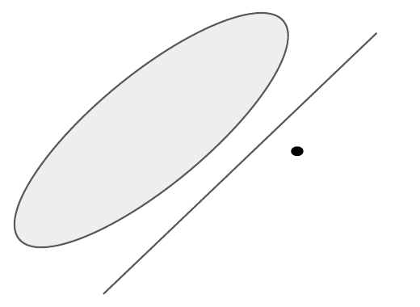
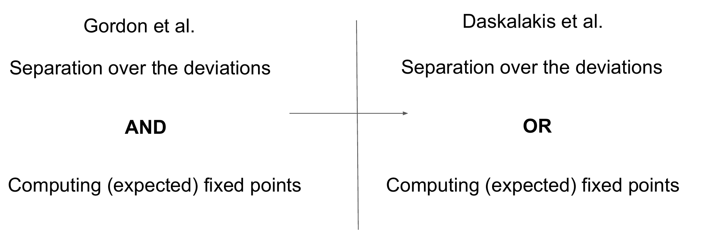

# L7 Minimizing Φ-Regret: Nonlinear Deviations

The previous lecture introduced the general framework of Gordon et al. (2008) for minimizing Φ-regret, which rests on two basic components: i) a fixed-point oracle that, given any deviation $\phi\in\Phi$, outputs one of its fixed points; and ii) an external regret minimization algorithm for the set $\Phi$. This lecture asks: can these two oracles always be implemented efficiently? And if not, are they truly necessary for minimizing Φ-regret? We will see that computing fixed points is, in a certain sense, necessary (a partial converse due to Hazan and Kale), but that this obstacle can be bypassed by allowing the learner to output mixed strategies. We then interpose the celebrated ellipsoid against hope (EAH) algorithm, which computes (coarse) correlated equilibria in multiplayer games in time polynomial in $\log(1/\epsilon)$. Finally, we show that the second component of the Gordon framework — minimizing external regret over the set of deviations — can also be relaxed, to a weaker semi-separation oracle, thereby covering nonlinear deviations of polynomial dimension.

## 1 Expected Fixed Points

### The Necessity of Fixed Points

The first oracle posited by the framework of Gordon et al. is one that outputs, for any deviation $\phi\in\Phi$, a fixed point of $\phi$. An immediate conceptual question is whether such an oracle is really necessary. Hazan and Kale (2007) showed that, in a certain sense, the answer is yes. Recall that an online algorithm is said to have **strongly sublinear** (Φ-)regret if its regret grows as $T^{1-\alpha}$ for some constant $\alpha\in(0,1]$; a fully polynomial-time approximation scheme (FPTAS) is an algorithm whose running time is polynomial in the dimension of $\mathcal{X}$ and in $1/\epsilon$.

> **Proposition 1.1 (Hazan and Kale, 2007).** If there is a polynomial-time algorithm that outputs strategies in $\mathcal{X}$ with strongly sublinear Φ-regret, then there is an FPTAS for computing a fixed point of any $\phi\in\Phi$.

**Proof idea.** Let $\epsilon>0$ be the desired precision and $\phi\in\Phi$ the function whose fixed point is to be computed. At round $t$, the algorithm outputs $\boldsymbol{x}^{(t)}\in\mathcal{X}$. If $\lVert\phi(\boldsymbol{x}^{(t)})-\boldsymbol{x}^{(t)}\rVert_2\le\epsilon$ we can terminate; otherwise, we forward to the algorithm the utility function

$$
u^{(t)}:\boldsymbol{x}\mapsto\frac{1}{\lVert\phi(\boldsymbol{x}^{(t)})-\boldsymbol{x}^{(t)}\rVert_2}\,\big\langle\phi(\boldsymbol{x}^{(t)})-\boldsymbol{x}^{(t)},\;\boldsymbol{x}-\boldsymbol{x}^{(t)}\big\rangle .
$$

Suppose the algorithm has failed to terminate with an $\epsilon$-fixed point after $T$ rounds. Then its Φ-regret satisfies

$$
\mathrm{\Phi Reg}^{(T)} \;\ge\; \sum_{t=1}^{T} u^{(t)}\big(\phi(\boldsymbol{x}^{(t)})\big)-\sum_{t=1}^{T} u^{(t)}\big(\boldsymbol{x}^{(t)}\big) \;=\; \sum_{t=1}^{T}\lVert\phi(\boldsymbol{x}^{(t)})-\boldsymbol{x}^{(t)}\rVert_2 \;\ge\; \epsilon T .
$$

For $T$ large enough, this contradicts the assumption that the algorithm minimizes Φ-regret (strongly sublinearly). $\square$

Proposition 1.1 should be seen as an obstacle to minimizing Φ-regret: computing fixed points of general nonlinear functions is intractable — in fact, equivalent to computing Nash equilibria (Daskalakis et al., 2008).

### The Importance of Nonlinear Deviations

But should we even care about sets $\Phi$ beyond linear functions? As covered in the previous lecture, in normal-form games linear deviations suffice to encompass all deviations from pure strategies to pure strategies; beyond that setting, they are no longer enough.

> **Example 1.2 (The XOR problem).** Let $\mathcal{X}=[0,1]^2$ be the strategy set of a learner in a tree-form decision problem, and consider the strategy deviation
> $$\begin{pmatrix}0\\1\end{pmatrix}\mapsto\begin{pmatrix}0\\0\end{pmatrix},\quad \begin{pmatrix}1\\0\end{pmatrix}\mapsto\begin{pmatrix}0\\0\end{pmatrix},\quad \begin{pmatrix}1\\1\end{pmatrix}\mapsto\begin{pmatrix}1\\1\end{pmatrix},\quad\text{and}\quad \begin{pmatrix}0\\0\end{pmatrix}\mapsto\begin{pmatrix}*\\ *\end{pmatrix}.$$
> (The vertices with exactly one coordinate equal to 1 map to $(0,0)$; the vertex $(1,1)$ maps to $(1,1)$; and the image of $(0,0)$ is irrelevant — an "XOR"-style conditional behavior.) We claim that no linear deviation $[0,1]^2\to[0,1]^2$ captures this deviation. Suppose, for contradiction, that a linear map $\boldsymbol{x}\mapsto\boldsymbol{M}\boldsymbol{x}$ did. On the one hand,
> $$\boldsymbol{M}\left(\frac12\begin{pmatrix}0\\1\end{pmatrix}+\frac12\begin{pmatrix}1\\0\end{pmatrix}\right)=\frac12\boldsymbol{M}\begin{pmatrix}0\\1\end{pmatrix}+\frac12\boldsymbol{M}\begin{pmatrix}1\\0\end{pmatrix}=\begin{pmatrix}0\\0\end{pmatrix};$$
> on the other hand,
> $$\boldsymbol{M}\left(\frac12\begin{pmatrix}0\\1\end{pmatrix}+\frac12\begin{pmatrix}1\\0\end{pmatrix}\right)=\frac12\boldsymbol{M}\begin{pmatrix}1\\1\end{pmatrix}=\frac12\begin{pmatrix}1\\1\end{pmatrix},$$
> a contradiction.

Linear deviations thus cannot express XOR-style conditional behavior, which arises naturally in tree-form (extensive-form) decision problems — and this is precisely the fundamental reason nonlinear deviations are needed.

### The Role of Mixed Strategies

Fortunately, there is a seemingly innocuous precondition in the statement of Proposition 1.1 that makes all the difference: the learner must output (pure) strategies in $\mathcal{X}$. It turns out that Proposition 1.1 can be sidestepped when the learner is allowed to output **mixed strategies** — points in $\Delta(\mathcal{X})$.

This may seem to conflict with Kuhn's theorem from an earlier lecture, which states that mixed strategies are no more powerful than sequence-form (or behavioral) strategies (we are implicitly assuming perfect recall). But it is precisely the **nonlinear** nature of the deviations that renders that equivalence invalid in this setting.

Zhang et al. (2024) further showed that the obstacle posed by Proposition 1.1 is sharper than it appears: even when the deviation set contains only **quadratic** polynomial deviations, as long as the learner is restricted to outputting behavioral strategies (points in $\mathrm{conv}\,\mathcal{X}$), guaranteeing Φ-regret at most $\epsilon\sqrt{N}$ is already PPAD-hard (where $N$ is the dimension of the strategy space and $\epsilon>0$ an absolute constant). The proof starts from a generalized circuit and shows that all gates can be approximately simulated using only multilinear operations, thereby embedding a PPAD-complete fixed-point problem into such "mild" nonlinear deviations. In other words, allowing the learner to output mixed strategies is not merely one trick among many — it is essentially the only way around fixed-point computation. To our knowledge, this is also the first natural online learning problem in which mixed strategies are required to guarantee efficiency.

### Expected Fixed Points

Zhang et al. (2024) observed this discrepancy and introduced the notion of an **expected fixed point**.

> **Definition 1.3 (Zhang et al., 2024).** For a function $\phi:\mathcal{X}\to\mathcal{X}$, a distribution $\boldsymbol{\mu}\in\Delta(\mathcal{X})$ is an $\epsilon$-expected fixed point of $\phi$ if
> $$\Big\lVert\,\mathbb{E}_{\boldsymbol{x}\sim\boldsymbol{\mu}}\big[\phi(\boldsymbol{x})-\boldsymbol{x}\big]\,\Big\rVert \le \epsilon .$$

Note that the norm is *outside* the expectation: we only require the **average** of $\phi(\boldsymbol{x})-\boldsymbol{x}$ to be small, not its pointwise magnitude. There are two key points about expected fixed points.

**First, expected fixed points are easy to compute.** Unlike actual fixed points, an approximate expected fixed point can be computed efficiently, and the following simple algorithm suffices. Start from any point $\boldsymbol{x}_0\in\mathcal{X}$ and repeatedly apply the mapping $\boldsymbol{x}_k\leftarrow\phi(\boldsymbol{x}_{k-1})$ for $k=1,\dots,K$. The key observation is that the resulting summation **telescopes**:

$$
\sum_{k=1}^{K}\big(\phi(\boldsymbol{x}_k)-\boldsymbol{x}_k\big)=\phi(\boldsymbol{x}_K)-\boldsymbol{x}_1+\sum_{k=1}^{K-1}\big(\phi(\boldsymbol{x}_k)-\boldsymbol{x}_{k+1}\big)=\phi(\boldsymbol{x}_K)-\boldsymbol{x}_1 .
$$

So, taking $\boldsymbol{\mu}$ to be the uniform distribution over $\boldsymbol{x}_1,\dots,\boldsymbol{x}_K$, we have $\mathbb{E}_{\boldsymbol{x}\sim\mu}[\phi(\boldsymbol{x})-\boldsymbol{x}]=\frac1K(\phi(\boldsymbol{x}_K)-\boldsymbol{x}_1)$. Since $\mathcal{X}$ is bounded, $K=O(1/\epsilon)$ iterations suffice to compute an $\epsilon$-expected fixed point. There is in fact an exponentially faster algorithm whose complexity scales polynomially in $\log(1/\epsilon)$ (Zhang et al., 2025); its upshot is precisely an application of the EAH algorithm covered in Section 2 below — one can try to prove this as an exercise.

A technical detail is hidden by this shorthand: the iteration $\boldsymbol{x}_k\leftarrow\phi(\boldsymbol{x}_{k-1})$ implicitly requires $\phi$ to map $\mathrm{conv}\,\mathcal{X}$ back to itself, but deviations over tree-form strategy sets are typically defined only on the set of pure strategies $\mathcal{X}$ — extending a polynomial deviation $\phi:\mathcal{X}\to\mathcal{X}$ to $\mathrm{conv}\,\mathcal{X}$ by its algebraic expression may produce image points outside $\mathrm{conv}\,\mathcal{X}$. Zhang et al. (2024) resolve this by introducing **consistent and efficient** extension maps $\delta:\mathrm{conv}\,\mathcal{X}\to\Delta(\mathcal{X})$: consistency means $\mathbb{E}_{\boldsymbol{x}'\sim\delta(\boldsymbol{x})}[\boldsymbol{x}']=\boldsymbol{x}$, and efficiency means the extended map $\phi_\delta(\boldsymbol{x}):=\mathbb{E}_{\boldsymbol{x}'\sim\delta(\boldsymbol{x})}[\phi(\boldsymbol{x}')]$ can be evaluated efficiently. They give two concrete choices for $\delta$: i) the **behavioral strategy map** $\beta$, which samples an action at each decision point $j$ reached with positive probability according to $\boldsymbol{x}[ja]/\boldsymbol{x}[j]$ — for degree-$k$ polynomial deviations, $\phi_\beta$ can be evaluated in time $N^{O(k)}$, but the support of $\beta(\boldsymbol{x})$ is generally exponentially large; and ii) the **Carathéodory map** $\gamma$, which writes $\boldsymbol{x}$ as a convex combination of at most $N$ pure strategies via Carathéodory's theorem (computable efficiently) — evaluating $\phi_\gamma(\boldsymbol{x})$ requires only $N$ evaluations of $\phi$ and yields a low-support distribution. The extended algorithm is: iterate $\boldsymbol{x}_\ell\leftarrow\phi_\delta(\boldsymbol{x}_{\ell-1})$ and output $\boldsymbol{\mu}=\frac1L\sum_{\ell=1}^{L}\delta(\boldsymbol{x}_\ell)$; the same telescoping argument gives $\lVert\mathbb{E}_{\boldsymbol{x}\sim\boldsymbol{\mu}}[\phi(\boldsymbol{x})-\boldsymbol{x}]\rVert\le 2/L$. This yields a complete black-box reduction: if $\mathfrak{R}_\Phi$ incurs external regret $\mathrm{Reg}^{(T)}$ with per-round cost $R_1$, and evaluating $\phi_\delta$ costs $R_2$, then there is a learning algorithm with Φ-regret at most $\mathrm{Reg}^{(T)}+\epsilon$ and per-round cost $O(R_1+R_2/\epsilon)$ — with no (potentially expensive) computation of actual fixed points.

> **Theorem 1.4 (Zhang et al., 2025).** There is a polynomial-time algorithm for computing an expected fixed point of any function $\phi:\mathcal{X}\to\mathcal{X}$.

It is worth noting that expected fixed points are not an "overly weak" relaxation: Zhang et al. (2024) also proved the converse direction — any polynomial-time algorithm running on $\Delta(\mathcal{X})$ with strongly sublinear Φ-regret again implies a polynomial-time algorithm for computing expected fixed points. In other words, the Hazan–Kale computational equivalence survives under this relaxation, with fixed points replaced by expected fixed points.

**Second, expected fixed points can substitute for actual fixed points in the framework of Gordon et al.** The learner now outputs a distribution $\boldsymbol{\mu}^{(t)}\in\Delta(\mathcal{X})$ in each round, and its Φ-regret is defined as

$$
\mathrm{\Phi Reg}^{(T)} := \max_{\phi\in\Phi}\;\sum_{t=1}^{T}\;\mathbb{E}_{\boldsymbol{x}^{(t)}\sim\boldsymbol{\mu}^{(t)}}\big\langle\phi(\boldsymbol{x}^{(t)})-\boldsymbol{x}^{(t)},\,\boldsymbol{u}^{(t)}\big\rangle .
$$

As in the previous lecture, we still assume an algorithm $\mathfrak{R}_\Phi$ that minimizes external regret over the set of deviations $\Phi$; the key difference is that Line 4 returns an *expected* fixed point of $\phi^{(t)}$ rather than an actual one.

```
Algorithm 1  A refinement of Gordon et al. (2008) using expected fixed points
Input: An external regret minimizer R_Φ for the set Φ

NextStrategy():
    Set φ⁽ᵗ⁾ := R_Φ.NextStrategy();
    return μ⁽ᵗ⁾ := ExpectedFP(φ⁽ᵗ⁾)   ∈ Δ(X);

ObserveUtility(u⁽ᵗ⁾):
    Set u_Φ⁽ᵗ⁾: φ ↦ E_{x∼μ⁽ᵗ⁾}⟨φ(x), u⁽ᵗ⁾⟩;
    R_Φ.ObserveUtility(u_Φ⁽ᵗ⁾);
```

> **Theorem 1.5.** If $\mathrm{Reg}^{(T)}$ is the external regret of $\mathfrak{R}_\Phi$, then the Φ-regret of this algorithm satisfies
> $$\mathrm{\Phi Reg}^{(T)} \le \mathrm{Reg}^{(T)} + \epsilon B T,$$
> where $\epsilon>0$ is a bound on the expected fixed-point gap (per Definition 1.3) and $\lVert\boldsymbol{u}^{(t)}\rVert_*\le B$.

**Proof.** Writing $\mathbb{E}$ for the expectation over $\boldsymbol{x}^{(t)}\sim\boldsymbol{\mu}^{(t)}$, we have

$$
\begin{aligned}
\mathrm{\Phi Reg}^{(T)}
&= \max_{\phi\in\Phi}\sum_{t=1}^{T}\mathbb{E}\big\langle\phi(\boldsymbol{x}^{(t)})-\boldsymbol{x}^{(t)},\boldsymbol{u}^{(t)}\big\rangle\\
&= \max_{\phi\in\Phi}\sum_{t=1}^{T}\mathbb{E}\big\langle\phi(\boldsymbol{x}^{(t)})-\phi^{(t)}(\boldsymbol{x}^{(t)}),\boldsymbol{u}^{(t)}\big\rangle+\sum_{t=1}^{T}\mathbb{E}\big\langle\phi^{(t)}(\boldsymbol{x}^{(t)})-\boldsymbol{x}^{(t)},\boldsymbol{u}^{(t)}\big\rangle\\
&\le \max_{\phi\in\Phi}\sum_{t=1}^{T}\big(u_\Phi^{(t)}(\phi)-u_\Phi^{(t)}(\phi^{(t)})\big)+\sum_{t=1}^{T}\mathbb{E}\big(\phi^{(t)}(\boldsymbol{x}^{(t)})-\boldsymbol{x}^{(t)}\big)\,\lVert\boldsymbol{u}^{(t)}\rVert_*\\
&\le \mathrm{Reg}^{(T)} + \epsilon B T .
\end{aligned}
$$

The first step adds and subtracts $\phi^{(t)}(\boldsymbol{x}^{(t)})$; in the second step, the first term is exactly the difference of utilities observed by $\mathfrak{R}_\Phi$, while the second is bounded using the dual norm; the final bound follows from the expected fixed-point gap $\lVert\mathbb{E}[\phi^{(t)}(\boldsymbol{x}^{(t)})-\boldsymbol{x}^{(t)}]\rVert\le\epsilon$. $\square$

**Takeaway:** minimizing Φ-regret really only requires a no-external-regret algorithm with respect to the set $\Phi$. Section 3 examines the complexity of that problem and presents the second crucial relaxation of the Gordon framework. But first, we interpose a celebrated algorithm for computing correlated equilibria — one that is intimately connected with the framework of Gordon et al.

## 2 The Ellipsoid Against Hope Algorithm: The Correlated Equilibrium LP in Multiplayer Games

The regret-minimization techniques covered so far yield running times polynomial in $1/\epsilon$: if the algorithm used has (Φ-)regret $\sqrt{T}$, then $1/\epsilon^2$ iterations are needed to reach an $\epsilon$-equilibrium. Can we do better in the regime $\epsilon\ll 1$? The other main route is linear programming, which returns an **exact** solution; but the LP describing (C)CEs has a number of variables that grows exponentially with the number of players. This section presents the **ellipsoid against hope** (EAH) algorithm, which computes (C)CEs in polynomial time even in multiplayer games. It was first introduced by Papadimitriou and Roughgarden (2008); we mostly follow the generalized version due to Farina and Pipis (2024). Note that this algorithm operates in the centralized model and is not compatible with the online learning framework, although, as we shall see, the two approaches do share similarities.

Our goal is to compute an $\epsilon$-Φ-equilibrium of a multilinear game: a correlated distribution $\boldsymbol{\mu}\in\Delta(\mathcal{X}_1\times\cdots\times\mathcal{X}_n)$ such that for any player $i\in[n]$ and deviation function $\Phi_i\ni\phi_i:\mathcal{X}_i\to\mathcal{X}_i$,

$$
\mathbb{E}_{(\boldsymbol{x}_1,\dots,\boldsymbol{x}_n)\sim\boldsymbol{\mu}}\,u_i(\boldsymbol{x}_1,\dots,\boldsymbol{x}_n)\;\ge\;\mathbb{E}_{(\boldsymbol{x}_1,\dots,\boldsymbol{x}_n)\sim\boldsymbol{\mu}}\,u_i\big(\phi_i(\boldsymbol{x}_i),\boldsymbol{x}_{-i}\big)-\epsilon . \tag{1}
$$

### The EAH Framework

From a more abstract point of view, EAH deals with optimization problems of the form

$$
\text{find } \boldsymbol{\mu}\in\Delta(\mathcal{X}) \text{ such that } \mathbb{E}_{\boldsymbol{x}\sim\boldsymbol{\mu}}\langle\boldsymbol{y},G(\boldsymbol{x})\rangle\ge 0\quad \forall \boldsymbol{y}\in\mathcal{Y}, \tag{2}
$$

where $\mathcal{X}\subseteq\mathbb{R}^d$, $\mathcal{Y}\subseteq\mathbb{R}^k$, and $G:\mathcal{X}\to\mathbb{R}^k$ is a function that can be evaluated efficiently. (Caution: in the context of problem (1), the set $\mathcal{X}$ here corresponds to $\mathcal{X}_1\times\cdots\times\mathcal{X}_n$, not to a single player's strategy set.) The crux of problem (2) is that $\boldsymbol{\mu}$ resides in a high-dimensional space: a canonical case is $\mathcal{X}=\mathcal{A}_1\times\cdots\times\mathcal{A}_n$ in a normal-form game, where even describing a distribution $\boldsymbol{\mu}$ could require $\prod_{i=1}^{n}|\mathcal{A}_i|-1$ coordinates.

We assume that $\mathcal{Y}$, which corresponds to the set of deviations, admits a **separation oracle**; under mild geometric assumptions, it is equivalent to posit merely a **membership oracle** (which decides whether a point $\boldsymbol{y}\in\mathbb{R}^k$ belongs to $\mathcal{Y}$). A special case is when $\mathcal{Y}$ is a polytope described by a polynomial number of constraints — for example, the deviation set corresponding to swap regret in normal-form games is the set of stochastic matrices (each player's deviation set is a Cartesian product of probability simplices). The key assumption in the EAH framework (Farina and Pipis, 2024) is the admission of a **good-enough-response (GER) oracle**: given any $\boldsymbol{y}\in\mathcal{Y}$, it returns a point $\boldsymbol{x}\in\mathcal{X}$ such that $\langle\boldsymbol{y},G(\boldsymbol{x})\rangle\ge 0$.

EAH solves (2) using only a separation oracle for $\mathcal{Y}$ and a GER oracle. The basic idea is to consider an $\epsilon$-approximate version of the dual of (2):

$$
\text{find } \boldsymbol{y}\in\mathcal{Y} \text{ such that } \langle\boldsymbol{y},G(\boldsymbol{x})\rangle\le-\epsilon\quad \forall \boldsymbol{x}\in\mathcal{X}. \tag{3}
$$

Because a GER oracle exists, (3) is guaranteed to be **infeasible**. Even so, EAH proceeds by executing the ellipsoid algorithm on that infeasible program — this is where the apt name "ellipsoid against hope" comes from. At each step $t$ of the algorithm, the ellipsoid produces a candidate point $\boldsymbol{y}^{(t)}\in\mathcal{Y}$, and we use the GER oracle to produce a point $\boldsymbol{x}^{(t)}\in\mathcal{X}$ that **refutes** $\boldsymbol{y}^{(t)}$ — in fact, it refutes an entire halfspace. This goes on until the volume of the ellipsoid has shrunk to an exponentially small amount. It then follows that

$$
\forall \boldsymbol{y}\in\mathcal{Y}\;\exists t\in[T]\;\text{ such that }\; \langle\boldsymbol{y},G(\boldsymbol{x}^{(t)})\rangle>-\epsilon .
$$

Thus,

$$
\min_{\boldsymbol{y}\in\mathcal{Y}}\max_{\boldsymbol{\mu}\in\Delta([T])}\;\sum_{t=1}^{T}\boldsymbol{\mu}^{(t)}\langle\boldsymbol{y},G(\boldsymbol{x}^{(t)})\rangle>-\epsilon .
$$

By the minimax theorem,

$$
\max_{\boldsymbol{\mu}\in\Delta([T])}\min_{\boldsymbol{y}\in\mathcal{Y}}\;\sum_{t=1}^{T}\boldsymbol{\mu}^{(t)}\langle\boldsymbol{y},G(\boldsymbol{x}^{(t)})\rangle>-\epsilon . \tag{4}
$$

In other words, there is a convex combination of $\boldsymbol{x}^{(1)},\dots,\boldsymbol{x}^{(T)}$ that refutes every possible $\boldsymbol{y}\in\mathcal{Y}$. That convex combination, a certificate of dual infeasibility, is thus an approximate solution to (2). The key point is that the zero-sum game arising in (4) is **much smaller** than the one we started with (its strategy sets are $\Delta([T])$ and $\mathcal{Y}$), and it can be solved with standard LP techniques.

> **Theorem 2.1 (Farina and Pipis, 2024).** Assuming a separation oracle for $\mathcal{Y}$ and a GER oracle, EAH runs in time $\mathrm{poly}(d,k,\log(1/\epsilon))$ and returns an $\epsilon$-approximate solution to (2).

### Computing Correlated Equilibria with EAH

Let us now apply this algorithm to solve (1). Assume that each $\Phi_i$ contains linear functions of the form $\mathcal{X}_i\ni\boldsymbol{x}_i\mapsto\boldsymbol{M}_i\boldsymbol{x}_i\in\mathcal{X}_i\subseteq\mathbb{R}^{m_i}$, where the set of valid matrices $\boldsymbol{M}_i$ is a polytope $\mathcal{Y}_i$ with a polynomial number of variables and constraints (for example, in swap regret from the previous section, the set of column-stochastic matrices is a Cartesian product of probability simplices), and that $\Phi_i$ contains the identity matrix. Since

$$
\mathbb{E}_{(\boldsymbol{x}_1,\dots,\boldsymbol{x}_n)\sim\boldsymbol{\mu}}\big\langle\boldsymbol{x}_i-\boldsymbol{M}_i\boldsymbol{x}_i,\,\boldsymbol{u}_i(\boldsymbol{x}_{-i})\big\rangle=\mathbb{E}_{(\boldsymbol{x}_1,\dots,\boldsymbol{x}_n)\sim\boldsymbol{\mu}}\big\langle\boldsymbol{I}-\boldsymbol{M}_i,\,\boldsymbol{u}_i(\boldsymbol{x}_{-i})\otimes\boldsymbol{x}_i\big\rangle,
$$

(where $\boldsymbol{I}$ is the identity matrix and $\otimes$ the tensor product), problem (1) can be written as

$$
\mathbb{E}_{(\boldsymbol{x}_1,\dots,\boldsymbol{x}_n)\sim\boldsymbol{\mu}}\big\langle\boldsymbol{I}-\boldsymbol{M}_i,\,\boldsymbol{u}_i(\boldsymbol{x}_{-i})\otimes\boldsymbol{x}_i\big\rangle\ge-\epsilon\quad \forall i\in[n],\ \boldsymbol{M}_i\in\mathcal{Y}_i, \tag{5}
$$

which indeed adheres to the form (2). What remains is to show that (5) admits a GER oracle. Take any $i\in[n]$ and deviation $\boldsymbol{M}_i\in\mathcal{Y}_i$, and let $\boldsymbol{x}_i\in\mathcal{X}_i$ be a **fixed point** of $\boldsymbol{M}_i$; then

$$
\mathbb{E}_{(\boldsymbol{x}_1,\dots,\boldsymbol{x}_n)\sim\boldsymbol{\mu}}\big\langle\boldsymbol{x}_i-\boldsymbol{M}_i\boldsymbol{x}_i,\,\boldsymbol{u}_i(\boldsymbol{x}_{-i})\big\rangle = 0,
$$

exactly as desired — **fixed points implement a GER**.

**The meta-game perspective and the construction of the GER.** Farina and Pipis (2024) cast problem (1) as a Hart–Schmeidler-style two-player zero-sum **meta-game**: the strategy set of the "Correlator" is the set of distributions over joint pure profiles, $\Delta(\Pi_1\times\cdots\times\Pi_n)$; the strategy set of the "Deviator" is $\mathcal{Y}=\Phi_1\times\cdots\times\Phi_n$; and the utility matrix $\boldsymbol{U}$ satisfies

$$
\boldsymbol{x}^\top\boldsymbol{U}\boldsymbol{y}=\sum_{p=1}^{n}\mathbb{E}_{\boldsymbol{s}\sim\boldsymbol{x}}\Big[u_p(\boldsymbol{s})-u_p\big(\phi_p(\boldsymbol{s}_p),\boldsymbol{s}_{-p}\big)\Big] .
$$

The number of rows of $\boldsymbol{U}$ is exponential (even doubly exponential) in the number of players and the strategy dimensions, which is exactly why the meta-game cannot be solved directly and the GER is needed. The full construction of the GER proceeds in two steps: first, take a fixed point $\boldsymbol{x}_p=\phi_p(\boldsymbol{x}_p)$ of each player's deviation $\phi_p$ (fixed points of linear deviations can be found by LP) and form the product distribution, which gives $\boldsymbol{x}^\top\boldsymbol{U}\boldsymbol{y}=0$; second, apply a **purification** technique in the spirit of Jiang and Leyton-Brown — by Carathéodory's theorem, each marginal $\boldsymbol{x}_p$ can be written as a convex combination of at most $d_p+1$ vertices, so one can replace each marginal, player by player, with a vertex that preserves $\boldsymbol{x}^\top\boldsymbol{U}\boldsymbol{y}\ge0$ (such a vertex must exist, since the original value is a convex combination of the vertex values), eventually obtaining a pure strategy profile as the GER's response. The only assumption on the game side of the framework is the **polynomial utility gradient property**: given a product distribution, the expected utility gradients of all players can be computed efficiently — this generalizes Papadimitriou and Roughgarden's polynomial expectation property, and is in fact satisfied implicitly by every no-regret learning algorithm. Notably, the "polynomial type" property required by the original EAH is **no longer** needed here, and this is precisely what allows the generalization to cover extensive-form games.

> **Theorem 2.2 (Farina and Pipis, 2024).** If, for each player $i\in[n]$ in a multilinear game, the set of deviations $\Phi_i$ admits a separation oracle, then there is an algorithm polynomial in $\log(1/\epsilon)$, $n$, and $m=\max_{1\le i\le n}m_i$ that outputs an $\epsilon$-Φ-equilibrium.

Two further remarks about this framework are worth making. **First, exact equilibria.** When the game has rational utilities and each $\Phi_i$ is a polytope of bounded facet complexity, Farina and Pipis (2024) in fact compute an **exact** Φ-equilibrium: the running time is polynomial in $N=\sum_p d_p^2$, the encoding length of the utilities, and the facet complexity, and the resulting equilibrium is represented as a convex combination of at most $N$ pure strategy profiles. (Theorems 2.1 and 2.2 in these lecture notes state the $\epsilon$-approximate versions, which apply to the more general setting; the complexity of both versions is polynomial in $\log(1/\epsilon)$, so there is no contradiction.) As a corollary, this yields the **first** polynomial-time algorithm for exact linear-deviation correlated equilibria (LCE) in extensive-form games, resolving an open question left by Farina and Pipis (2023); it also recovers an exact EFCE algorithm in a manner far simpler than the specialized construction of Huang and von Stengel. **Second, the GER relaxation is necessary.** They proved that constructing a **best-response** oracle for the Correlator of the meta-game is NP-hard — via a reduction from equilibrium selection in SAT games — so the GER is not merely a convenience: in this setting a best-response oracle is essentially impossible to implement efficiently, whereas a GER boils down precisely to computing fixed points of deviation functions.

### Similarities with the Φ-Regret Framework

Overall, EAH and the Φ-regret framework share several conceptual similarities: both operate over the set of deviations, returning in each round a fixed point of the corresponding deviation; both output a correlated distribution given as a mixture of product distributions, which admits an efficient, compact representation; and both require a separation oracle for the set of deviations — which brings us to the final topic of this lecture.

## 3 Nonlinear Deviations and Semi-Separation Oracles

The main requirement of both EAH and the framework of Gordon et al. is a separation oracle for the set of deviations. Indeed, focusing on external regret minimization, a separation oracle suffices to implement an algorithm such as FTRL efficiently; conversely, any regret minimizer should be able to perform separation — otherwise there would be a fixed utility exerting high regret. That is, under mild geometric assumptions, the following three are equivalent: i) deciding membership of a point; ii) separating a point from the set (as illustrated below, a point outside a convex set can always be separated from it by a hyperplane); and iii) finding a best response within the set given a utility vector — which is exactly the problem of minimizing regret over that set (necessity follows by considering a static utility; sufficiency is established through follow the regularized leader).



However, Daskalakis et al. (2025) recently showed that implementing a **membership oracle** can be NP-hard even when $\Phi$ contains only linear functions mapping $\mathcal{X}\to\mathcal{X}$. More precisely, what they prove is an exponential **query complexity** lower bound: any algorithm that may only issue membership queries to a convex set $\mathcal{P}\subset\mathbb{R}^d$ needs at least $\exp(\Omega(d))$ queries to distinguish the case "some $1/d$-neighborhood of $\phi$ consists entirely of endomorphisms of $\mathcal{P}$" from the case "$\phi$ is not an endomorphism". The proof idea is to distinguish the full $d$-dimensional unit ball from a ball with a random "cap" removed (the intersection of the unit ball with a halfspace): the two sets of endomorphisms differ drastically — for instance, a reflection map is always an endomorphism of the full ball but never of the capped ball — while there exist $\exp(\Omega(d))$ pairwise disjoint caps of constant width on the sphere, and only a query that happens to land inside the removed cap can tell the two apart. An immediate corollary is that even **computing after the fact** the value of the linear swap regret of a given loss sequence (that is, maximizing a linear function over $\Phi$) is intractable in general. Does this mean that minimizing Φ-regret or applying the EAH framework becomes intractable? Not so. So far we have insisted on having *both* a separation oracle for the set of deviations *and* an expected fixed-point oracle (that is, a GER oracle), but it turns out to be enough to implement their **disjunction** — what Daskalakis et al. (2025) coined a **semi-separation oracle** (Definition 3.2).



We introduce this notion in the general setting where the set of deviations $\Phi$ comprises nonlinear functions of the following form.

> **Definition 3.1 (Zhang et al., 2025).** Given a map $\psi:\mathcal{X}\to\mathbb{R}^{k'}$, the set of deviations $\Phi_\psi$ is the set of all maps $\phi:\mathcal{X}\to\mathcal{X}$ that can be expressed as a matrix–vector product
> $$\phi(\boldsymbol{x})=\boldsymbol{K}^{(\phi)}\psi(\boldsymbol{x})+\boldsymbol{c}^{(\phi)}$$
> for some matrix $\boldsymbol{K}\in\mathbb{R}^{d\times k'}$ and vector $\boldsymbol{c}\in\mathbb{R}^d$. We denote by $k=d\times k'+d$ the dimension of $(\boldsymbol{K},\boldsymbol{c})$.

One can think of $\psi$ as a **feature mapping**; a natural example captured by Definition 3.1 is **low-degree polynomials**, where $\psi$ contains all products of up to $\ell$ entries of $\boldsymbol{x}$. Minimizing regret over the set of all valid $(\boldsymbol{K},\boldsymbol{c})$ is daunting, but it turns out not to be necessary — one can instead solve the following simpler problem (the reason why this suffices is beyond the scope of these notes).

> **Definition 3.2 (Semi-separation).** In the semi-separation problem, we are given a function $\phi:\mathcal{X}\to\mathbb{R}^d$ and we have to compute either of the following:
> - an $\epsilon$-expected fixed point $\boldsymbol{\mu}\in\Delta(\mathcal{X})$ of $\phi$; or
> - a point $\boldsymbol{x}\in\mathcal{X}$ such that $\phi(\boldsymbol{x})\notin\mathcal{X}$.

Once we have an algorithm for computing expected fixed points (Theorem 1.4), implementing the semi-separation oracle is actually not hard: one basically runs the same algorithm. If during its execution we identify a point with $\phi(\boldsymbol{x})\notin\mathcal{X}$, we terminate immediately — this is a certificate that $\phi$ is not a valid mapping; otherwise, the algorithm will find an expected fixed point of $\phi$, even though $\phi$ may not be a valid transformation. In other words, the basic idea of the recent framework of Daskalakis et al. (2025) is to **make allowance for functions that do not necessarily map $\mathcal{X}$ back to $\mathcal{X}$**: the figure below illustrates this relaxation — $\Phi$ is the set of deviations that genuinely map $\mathcal{X}$ to itself, and $\Phi_{\mathrm{FP}}$ is the larger class of functions with the "fixed-point property"; for functions inside $\Phi$ the oracle returns an expected fixed point (✓), for functions outside $\Phi_{\mathrm{FP}}$ it returns evidence that they map some point out of $\mathcal{X}$ (✗), and for functions in the gray zone either answer is acceptable.


In the special case of linear deviations, the semi-separation oracle of Daskalakis et al. (2025) is particularly direct: given an affine transformation $\phi$, minimize the convex function $\lVert\phi(\boldsymbol{p})-\boldsymbol{p}\rVert^2$ over $\mathcal{P}$; if the minimum is $0$, we have a fixed point in $\mathcal{P}$; otherwise, letting $\boldsymbol{u}=\phi(\boldsymbol{p}^*)-\boldsymbol{p}^*$ (where $\boldsymbol{p}^*$ is the optimum) and $\boldsymbol{p}_{\boldsymbol{u}}=\arg\max_{\boldsymbol{p}\in\mathcal{P}}\langle\boldsymbol{p},\boldsymbol{u}\rangle$, the linear constraint $\langle\phi'(\boldsymbol{p}_{\boldsymbol{u}}),\boldsymbol{u}\rangle\le\langle\boldsymbol{p}_{\boldsymbol{u}},\boldsymbol{u}\rangle$ is violated by $\phi$ but satisfied by every endomorphism $\phi'$ of $\mathcal{P}$, thereby separating $\phi$ from $\Phi$. To turn the semi-separation oracle into full learning and equilibrium-computation algorithms, the paper introduces a "shell" mechanism: the online algorithm maintains a shell set $\tilde{\Phi}$, defined by a polynomial number of halfspaces, guaranteed to contain $\Phi$ and shrinking over time; via a variant of the ellipsoid method, in time $\mathrm{poly}(d,\log(1/\epsilon))$ it either finds in the shell a transformation that has a fixed point in $\mathcal{P}$, or certifies that the volume of the shell's intersection with $\Phi$ has dropped below $\epsilon$; this is combined with projected gradient descent over time-varying action sets (shell gradient descent). Two concrete results follow: for general convex sets with only oracle access, linear swap regret admits a regret bound of $O(d^4\sqrt{T})$ with per-round running time $\mathrm{poly}(d,T)$; on the equilibrium side, an $\epsilon$-linear correlated equilibrium (LCE) in general convex games can be computed in time polynomial in $\sum_i d_i$ and $\log(1/\epsilon)$, represented as a mixture of polynomially many product distributions. These results correspond to the special case of Theorem 3.3 in which $\psi$ is the identity feature mapping (i.e., linear deviations); Theorem 3.3 below is the unified version generalized by Zhang et al. (2025) to nonlinear deviations induced by feature mappings.

We conclude with the main implication for minimizing $\Phi_\psi$-regret per Definition 3.1.

> **Theorem 3.3.** There is an algorithm, based on EAH, that computes an $\epsilon$-$\Phi_\psi$-equilibrium of any multilinear $n$-player game with complexity $\mathrm{poly}(n,m,k,\log(1/\epsilon))$. Furthermore, in the online learning setting, there is an efficient algorithm with regret bounded as $\mathrm{poly}(m,k)\sqrt{T}$ after $T$ rounds.

This algorithm minimizes Φ-regret with respect to all deviation sets of **polynomial dimension**, and can run EAH efficiently with respect to such sets. It captures low-degree polynomial deviations as a special case, and the dimension of the set represents a fundamental barrier.

Specialized to extensive-form games, Zhang et al. (2024) give explicit parameterized bounds: for polynomial deviations of degree at most $k$, Φ-regret at most $\epsilon$ can be achieved within $N^{O(kd^3)}/\epsilon^2$ rounds (where $N$ is the strategy-space dimension and $d$ the depth of the game tree, assuming a constant branching factor) — for fixed $k$, this is polynomial for Bayesian games and quasipolynomial for balanced game trees ($d=\mathrm{polylog}\,N$). They also introduce **$k$-mediator deviations**: the player may query, at any point during the game, $k$ mediators each holding a copy of the strategy; for this deviation set the bound improves to $N^{O(k)}/\epsilon^2$, which is polynomial for any extensive-form game. All $k$-mediator deviations are degree-$k$ polynomials, but not vice versa; the case $k=1$ corresponds exactly to linear swap deviations. This result sits between two extremes: on one end, Farina and Pipis's $\mathrm{poly}(N)/\epsilon^2$ for linear swap regret; on the other, the $N^{\tilde{O}(1/\epsilon)}$ of Dagan et al. and Peng–Rubinstein for full swap regret (polynomial only when $\epsilon$ is constant, and there is evidence that full swap regret requires exponentially many rounds in the usual accuracy regime $\epsilon\le\mathrm{poly}(1/N)$).

## Key Takeaways

- Hazan–Kale (2007): a polynomial-time algorithm with strongly sublinear Φ-regret implies an FPTAS for computing a fixed point of any $\phi\in\Phi$ — fixed points are necessary when the learner outputs pure strategies, and computing fixed points of general nonlinear functions, being equivalent to Nash equilibrium computation, is intractable. Zhang et al. (2024) further showed that even with only quadratic polynomial deviations, guaranteeing Φ-regret $\epsilon\sqrt{N}$ while outputting behavioral strategies is already PPAD-hard.
- Linear deviations suffice in normal-form games, but the XOR example shows they lack expressive power in tree-form decision problems, motivating nonlinear deviations.
- Mixed strategies (outputs in $\Delta(\mathcal{X})$) bypass the Hazan–Kale lower bound; the equivalence given by Kuhn's theorem fails under nonlinear deviations.
- An expected fixed point, $\lVert\mathbb{E}_{\boldsymbol{x}\sim\boldsymbol{\mu}}[\phi(\boldsymbol{x})-\boldsymbol{x}]\rVert\le\epsilon$, is efficiently computable: iterating $\boldsymbol{x}_k\leftarrow\phi(\boldsymbol{x}_{k-1})$ makes the sum telescope, so $O(1/\epsilon)$ iterations suffice; there even exists an algorithm polynomial in $\log(1/\epsilon)$ (Theorem 1.4). Rigorously, one extends the deviation to $\mathrm{conv}\,\mathcal{X}$ through a consistent and efficient extension map $\delta$ (the behavioral strategy map $\beta$ or the Carathéodory map $\gamma$); the black-box reduction costs $O(R_1+R_2/\epsilon)$ per round. Moreover, Φ-regret minimization with mixed-strategy outputs is computationally equivalent to computing expected fixed points.
- Replacing the fixed-point oracle in the Gordon framework with expected fixed points yields $\mathrm{\Phi Reg}^{(T)}\le\mathrm{Reg}^{(T)}+\epsilon BT$ (Theorem 1.5).
- Ellipsoid against hope (EAH): run the ellipsoid method on the infeasible dual program (3), refuting each candidate point via the GER oracle, and finally read off a certificate — an $\epsilon$-Φ-equilibrium — from a much smaller zero-sum game via the minimax theorem; the running time is $\mathrm{poly}(d,k,\log(1/\epsilon))$ (Theorem 2.1). For CE, fixed points of linear deviations implement the GER (Theorem 2.2); the GER is constructed as a product distribution of fixed points, purified via Carathéodory and Jiang–Leyton-Brown into a pure profile, and since a best-response oracle for the Correlator is NP-hard, the GER relaxation is indispensable. For rational polyhedral games the framework computes **exact** Φ-equilibria (convex combinations of at most $N$ pure profiles), including the first polynomial-time exact LCE algorithm for extensive-form games.
- Separation, membership, and best response (regret minimization) are equivalent under mild geometric assumptions; but even for linear deviations, distinguishing "a whole neighborhood consists of endomorphisms" from "not an endomorphism" requires $\exp(\Omega(d))$ membership queries (unit ball vs. capped ball), and even computing the linear swap regret value after the fact is intractable.
- The semi-separation oracle relaxes "separation" and "expected fixed-point computation" to their disjunction: return an expected fixed point, or return evidence that $\phi(\boldsymbol{x})\notin\mathcal{X}$. In the linear case the construction minimizes $\lVert\phi(\boldsymbol{p})-\boldsymbol{p}\rVert^2$ and, when no fixed point exists, produces a separating hyperplane along the furthest-point direction; combined with a shrinking shell set and the ellipsoid method, this gives linear swap regret $O(d^4\sqrt{T})$ for general convex sets and computes an $\epsilon$-LCE in general convex games in time $\mathrm{poly}(\sum_i d_i,\log(1/\epsilon))$. Hence, for nonlinear deviations induced by feature mappings (including low-degree polynomials), equilibria are computed in $\mathrm{poly}(n,m,k,\log(1/\epsilon))$ and online regret is bounded by $\mathrm{poly}(m,k)\sqrt{T}$ (Theorem 3.3); in extensive-form games, the explicit bound for degree-$k$ polynomial deviations is $N^{O(kd^3)}/\epsilon^2$, and for $k$-mediator deviations $N^{O(k)}/\epsilon^2$.
