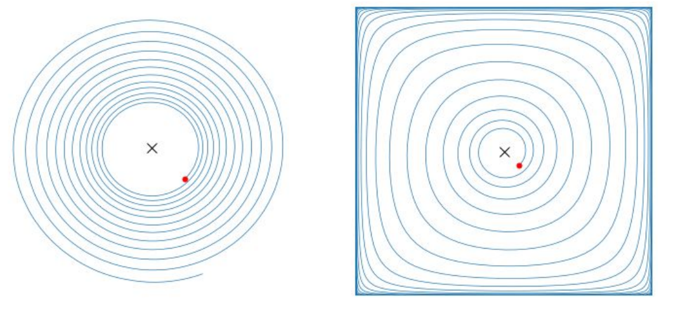

# L8 Optimism and Last-Iterate Convergence

A basic premise of the online learning framework is that the sequence of utilities given as input to the learner is produced by an adversary so as to maximize the learner's regret. This worst-case perspective is overly pessimistic in self-play: when we design the algorithms on both sides, we have considerable control over the underlying sequence of utilities. This chapter answers two questions: can we break the $\Theta(\sqrt{T})$ regret barrier of the adversarial setting (optimistic no-regret learning), and—since regret-based guarantees only yield convergence in a time-average sense—what can be said about the **last iterate** of the dynamics?

## Optimistic no-regret learning

### The necessity of optimism

Before introducing the framework, it is worth highlighting the intrinsic limitations of non-optimistic algorithms. A priori, one possibility would be that a better analysis could show that existing algorithms such as MWU already enjoy smaller regret in self-play—after all, the adversarial $\Omega(\sqrt{T})$ lower bound is very much not compatible with "the adversary is also running MWU." Yet this turns out to be impossible:

> **Theorem 8.1 (Chen and Peng, 2020).** For any learning rate, when both players in a two-player game employ MWU, at least one of the players will have $\Omega(\sqrt{T})$ regret. Similar lower bounds are known for other common algorithms, such as RM and RM⁺.

The main takeaway is that overcoming the $\sqrt{T}$ barrier requires **new algorithmic ideas**; improving the analysis alone is not enough. This is where the optimistic (also called predictive) online learning framework comes in (Chiang et al., 2012; Rakhlin and Sridharan, 2013). Optimistic algorithms maintain, for each round $t \in [T]$, a dynamically updated **prediction vector** $\boldsymbol{m}^{(t)}$ whose goal is to match the next utility $\boldsymbol{u}^{(t)}$ as closely as possible.

All online algorithms we have seen have an optimistic counterpart. **Optimistic FTRL** (OFTRL; Syrgkanis et al., 2015) is defined as

$$
\boldsymbol{x}^{(t)} = \operatorname*{argmax}_{\boldsymbol{x} \in \mathcal{X}} \Big\{ \Big\langle \boldsymbol{x},\, \boldsymbol{m}^{(t)} + \sum_{\tau=1}^{t-1} \boldsymbol{u}^{(\tau)} \Big\rangle - \frac{1}{\eta} \mathcal{R}(\boldsymbol{x}) \Big\},
$$

where $\eta > 0$ is the learning rate, $\mathcal{R}$ is a strictly convex regularizer (such as the squared Euclidean norm or negative entropy), and $\mathcal{X}$ is a convex and compact set of strategies (such as the sequence-form polytope). The only difference from FTRL is the prediction vector $\boldsymbol{m}^{(t)}$: setting $\boldsymbol{m}^{(t)} = \boldsymbol{0}$ for all $t$ recovers FTRL.

**Optimistic mirror descent** (OMD; not to be confused with online mirror descent) is defined as

$$
\boldsymbol{x}^{(t)} := \operatorname*{argmax}_{\boldsymbol{x} \in \mathcal{X}} \Big\{ \langle \boldsymbol{x}, \boldsymbol{m}^{(t)} \rangle - \frac{1}{\eta} \mathcal{B}_{\mathcal{R}}(\boldsymbol{x}, \hat{\boldsymbol{x}}^{(t-1)}) \Big\}, \qquad
\hat{\boldsymbol{x}}^{(t)} := \operatorname*{argmax}_{\hat{\boldsymbol{x}} \in \mathcal{X}} \Big\{ \langle \hat{\boldsymbol{x}}, \boldsymbol{u}^{(t)} \rangle - \frac{1}{\eta} \mathcal{B}_{\mathcal{R}}(\hat{\boldsymbol{x}}, \hat{\boldsymbol{x}}^{(t-1)}) \Big\},
$$

where $\mathcal{B}_{\mathcal{R}}(\boldsymbol{x}, \boldsymbol{x}') := \mathcal{R}(\boldsymbol{x}) - \mathcal{R}(\boldsymbol{x}') - \langle \nabla \mathcal{R}(\boldsymbol{x}'), \boldsymbol{x} - \boldsymbol{x}' \rangle$ is the Bregman divergence induced by $\mathcal{R}$. Unlike OFTRL, OMD relies on a secondary, auxiliary sequence of strategies $(\hat{\boldsymbol{x}}^{(t)})$.

There are many ways to set the prediction vector (uniform averaging over a fixed window $H$, geometric discounting, and so on—all convex combinations of past utilities), but by far the most common mechanism is the simple one-step recency bias $\boldsymbol{m}^{(t)} := \boldsymbol{u}^{(t-1)}$. Unless explicitly stated otherwise, we always use this prediction in what follows. It is worth noting that the main guarantees of this chapter do not hinge on that specific choice: both the uniform average over a fixed window $H$ and the geometrically discounted recency bias ($\boldsymbol{m}^{(t)} := \sum_{\tau=0}^{t-1} \delta^{-\tau} \boldsymbol{u}^{(\tau)} \big/ \sum_{\tau=0}^{t-1} \delta^{-\tau}$, $\delta \in (0,1)$) satisfy RVU bounds of the same form, so the boundedness and convergence results below hold under those prediction mechanisms as well; one can even allow different players to employ **different** algorithms and different prediction mechanisms (Anagnostides et al., 2022a).

### The RVU property

The analysis of optimistic no-regret learning revolves around a key property:

> **Definition 8.2 (RVU; Syrgkanis et al., 2015).** An online algorithm satisfies the **regret bounded by variation in utilities** (RVU) property if there are constants $\alpha, \beta, \gamma > 0$ such that its regret can be bounded as
>
> $$
> \mathrm{Reg}^{(T)} \le \alpha + \beta \sum_{t=1}^{T} \big\| \boldsymbol{u}^{(t)} - \boldsymbol{m}^{(t)} \big\|_*^2 - \gamma \sum_{t=1}^{T} \big\| \boldsymbol{x}^{(t)} - \boldsymbol{x}^{(t-1)} \big\|^2.
> $$

Compared to the usual regret bounds of FTRL/MD, there are two notable differences. First, the regret is bounded by the **misprediction error** $\sum_t \|\boldsymbol{u}^{(t)} - \boldsymbol{m}^{(t)}\|_*^2$—the crux of the entire analysis is to show that in self-play the misprediction error is small. Second, there is a **negative term**, indicating that large variation in the player's strategies actually results in *smaller* regret (!).

> **Proposition 8.3 (Syrgkanis et al., 2015).** Both OFTRL and OMD satisfy the RVU property with parameters $\alpha \propto 1/\eta$, $\beta = \eta$, and $\gamma \propto 1/\eta$. Precisely, with the one-step recency prediction $\boldsymbol{m}^{(t)} = \boldsymbol{u}^{(t-1)}$, OFTRL satisfies the RVU property with $(\alpha, \beta, \gamma) = (\Omega/\eta,\ \eta,\ 1/(4\eta))$, and OMD with $(\Omega/\eta,\ \eta,\ 1/(8\eta))$, where $\Omega := \sup_{\boldsymbol{x} \in \mathcal{X}} \mathcal{R}(\boldsymbol{x}) - \inf_{\boldsymbol{x} \in \mathcal{X}} \mathcal{R}(\boldsymbol{x})$ is the diameter of the range of the regularizer (for OMD one takes instead $\sup_{\boldsymbol{x}} \mathcal{B}_{\mathcal{R}}(\boldsymbol{x}, \hat{\boldsymbol{x}}^{(0)})$).

As a result, if we ignore the negative term for now, the optimal regret bound as a function of $\eta$ is proportional to $\sqrt{\sum_{t=1}^{T} \|\boldsymbol{u}^{(t)} - \boldsymbol{m}^{(t)}\|_*^2}$. This is always on the order of $\sqrt{T}$, even if the predictions are grossly inaccurate, but it can be much smaller when the misprediction error is small.

**Predictive regret matching.** Predictions can also be incorporated into the regret matching framework (Farina et al., 2021). The overarching idea is the same: use a prediction $\boldsymbol{m}^{(t)}$ to guess the next regret vector. Both algorithms guarantee regret bounded by $\sum_{t=1}^{T} \|\boldsymbol{u}^{(t)} - \boldsymbol{m}^{(t)}\|_*^2$, just like OFTRL/OMD; on the flip side, PRM and PRM⁺ do **not** satisfy the RVU property. Nevertheless, as we will see in more detail in the next lecture, PRM and PRM⁺ are among the most effective algorithms for solving zero-sum games.

```text
Algorithm 1: Predictive RM (PRM)               Algorithm 2: Predictive RM⁺ (PRM⁺)
 1  Initialize cumulative regrets r⁽⁰⁾ := 0;    1  Initialize cumulative regrets r⁽⁰⁾ := 0;
 2  for t = 1, ..., T do                        2  for t = 1, ..., T do
 3      θ⁽ᵗ⁾ := [r⁽ᵗ⁻¹⁾ + m⁽ᵗ⁾                  3      θ⁽ᵗ⁾ := [r⁽ᵗ⁻¹⁾ + m⁽ᵗ⁾
              − ⟨m⁽ᵗ⁾, x⁽ᵗ⁻¹⁾⟩1]⁺;                       − ⟨m⁽ᵗ⁾, x⁽ᵗ⁻¹⁾⟩1]⁺;
 4      if θ⁽ᵗ⁾ = 0 then                        4      if θ⁽ᵗ⁾ = 0 then
 5          let x⁽ᵗ⁾ ∈ Δ(A) be arbitrary        5          let x⁽ᵗ⁾ ∈ Δ(A) be arbitrary
 6      else                                    6      else
 7          x⁽ᵗ⁾ := θ⁽ᵗ⁾ / ‖θ⁽ᵗ⁾‖₁;             7          x⁽ᵗ⁾ := θ⁽ᵗ⁾ / ‖θ⁽ᵗ⁾‖₁;
 8      output strategy x⁽ᵗ⁾ ∈ Δ(A);            8      output strategy x⁽ᵗ⁾ ∈ Δ(A);
 9      observe utility u⁽ᵗ⁾ ∈ [0,1]ᴬ;          9      observe utility u⁽ᵗ⁾ ∈ [0,1]ᴬ;
10      r⁽ᵗ⁾ := r⁽ᵗ⁻¹⁾ + u⁽ᵗ⁾                  10      r⁽ᵗ⁾ := [r⁽ᵗ⁻¹⁾ + u⁽ᵗ⁾
              − ⟨x⁽ᵗ⁾, u⁽ᵗ⁾⟩1;                         − ⟨x⁽ᵗ⁾, u⁽ᵗ⁾⟩1]⁺;
```

The figure below (taken from Farina et al.) shows the dramatic speedup of predictive regret matching (in the form of PCFR⁺) over CFR⁺, LCFR, and DCFR on three standard benchmark games—Goofspiel, Liar's dice, and Battleship—direct practical evidence for the intuition that utility sequences in self-play are predictable.


## Near-optimal regret in zero-sum games

First, an insurmountable lower bound: regret cannot be smaller than a constant. Even in a single-player (static) setting, a learner with no prior information will most likely fail to identify the optimal strategy in the first round, so even if it plays optimally from the second round onward, its regret is $\Omega(1)$. Our goal is therefore **bounded (constant) regret**.

The analysis relies on two key properties. The first is **stability**, a consequence of regularization:

> **Lemma 8.4 (Stability).** For any round $t$, OFTRL and OMD guarantee $\|\boldsymbol{x}^{(t)} - \boldsymbol{x}^{(t-1)}\| \le O(\eta)$.

This stability property is in fact essential for proving the $\sqrt{T}$ bound in the adversarial setting; it is not satisfied by fictitious play, best-response dynamics, or even regret matching. The issue with regret matching arises when all regrets are negative or close to zero: then even a tiny utility vector can result in entirely different strategies. This is the fundamental reason why the upcoming analysis—or any known analysis, for that matter (Farina et al., 2023)—does not work for PRM and PRM⁺.

The second property is that the sequence of utilities observed by each player is Lipschitz continuous in the strategies of the other players. The lemma below is stated for normal-form games, but similar bounds hold more generally:

> **Lemma 8.5.** For any player $i \in [n]$, $\|\boldsymbol{u}_i^{(t)} - \boldsymbol{u}_i^{(t-1)}\|_\infty \le \sum_{i' \ne i} \|\boldsymbol{x}_{i'}^{(t)} - \boldsymbol{x}_{i'}^{(t-1)}\|_1$, where $\boldsymbol{u}_i^{(t)} = \boldsymbol{u}_i(\boldsymbol{x}_{-i}^{(t)})$.

Recall that $\boldsymbol{u}_i(\boldsymbol{x}_{-i}) = (\mathbb{E}_{\boldsymbol{a}_{-i} \sim \boldsymbol{x}_{-i}}\, u_i(a_i, \boldsymbol{a}_{-i}))_{a_i \in \mathcal{A}_i}$ is the utility gradient of player $i$. Proof idea: for

$$
\sum_{\boldsymbol{a}_{-i}} \prod_{i' \ne i} \boldsymbol{x}_{i'}^{(t)}[a_{i'}]\, u_i(\cdot, \boldsymbol{a}_{-i}) - \sum_{\boldsymbol{a}_{-i}} \prod_{i' \ne i} \boldsymbol{x}_{i'}^{(t-1)}[a_{i'}]\, u_i(\cdot, \boldsymbol{a}_{-i}),
$$

first apply the triangle inequality together with $|u_i(\cdot)| \le 1$, and then use the fact that the total variation distance between two product distributions is bounded by the sum of the total variation distances of the marginals; this gives $\le \sum_{i' \ne i} \|\boldsymbol{x}_{i'}^{(t)} - \boldsymbol{x}_{i'}^{(t-1)}\|_1$.

Putting Lemmas 8.4 and 8.5 together with the RVU property: OFTRL/OMD perform well when the misprediction error is small; by Lemma 8.5, in self-play the misprediction error is bounded by the variation of the other players' strategies; and by Lemma 8.4, if all players employ a stable algorithm, this variation is much smaller than in the adversarial setting.

> **Theorem 8.6 (Syrgkanis et al., 2015).** If all players employ OFTRL or OMD in a multi-player setting with learning rate $\eta = T^{-1/4}$, the regret of each player is bounded as $O(T^{1/4})$.

**Proof.** Combining Proposition 8.3 with Lemmas 8.4 and 8.5, the regret of each player $i$ as a function of $\eta$ and $T$ is bounded as

$$
\mathrm{Reg}_i^{(T)} \le O\Big(\frac{1}{\eta}\Big) + \eta \sum_{t=1}^{T} \big\| \boldsymbol{u}_i^{(t)} - \boldsymbol{u}_i^{(t-1)} \big\|_*^2 \le O\Big(\frac{1}{\eta}\Big) + O(\eta^3 T).
$$

Optimizing over $\eta$ gives the claim. $\square$

This should be compared with the bound $O(1/\eta) + O(\eta T)$ in the adversarial setting: stability compresses the $\eta T$ term down to $\eta^3 T$.

Stability alone already yields the considerable improvement of $T^{1/4}$, but we are still far from the goal of constant regret. To get there we must exploit the negative term in the RVU bound. Suppose all players employ an algorithm satisfying the RVU property with parameters $(\alpha, \beta, \gamma)$. By Lemma 8.5, summing the regrets of all players and relaxing (using the fact that $\|\boldsymbol{u}_i^{(t)} - \boldsymbol{u}_i^{(t-1)}\|_*^2$ is controlled by $(n-1)\sum_{i' \ne i} \|\boldsymbol{x}_{i'}^{(t)} - \boldsymbol{x}_{i'}^{(t-1)}\|_1^2$):

$$
\sum_{i=1}^{n} \mathrm{Reg}_i^{(T)} \le \alpha n + \big( (n-1)^2 \beta - \gamma \big) \sum_{i=1}^{n} \sum_{t=1}^{T} \big\| \boldsymbol{x}_i^{(t)} - \boldsymbol{x}_i^{(t-1)} \big\|_1^2 \le \alpha n - \frac{\gamma}{2} \sum_{i=1}^{n} \sum_{t=1}^{T} \big\| \boldsymbol{x}_i^{(t)} - \boldsymbol{x}_i^{(t-1)} \big\|_1^2,
$$

as long as $\gamma \ge 2(n-1)^2 \beta$. By Proposition 8.3, OFTRL and OMD satisfy the RVU property with $\gamma \propto 1/\eta$ and $\beta = \eta$, so taking $\eta \propto 1/n$ guarantees $\sum_{i=1}^{n} \mathrm{Reg}_i^{(T)} = O(1)$—the **sum** of the regrets is bounded. But what we want to bound is the **maximum** of the regrets: some player could have $\Omega(T)$ regret as long as another player has regret $-\Theta(T)$, and the two would cancel out. To address this discrepancy, we focus for now on a special class of games.

### Games with nonnegative sum of regrets

The canonical example is two-player zero-sum games. For any sequences of strategies $(\boldsymbol{x}^{(t)})$ and $(\boldsymbol{y}^{(t)})$, the sum of the two players' regrets equals the duality gap, and is therefore nonnegative:

$$
\mathrm{Reg}_1^{(T)} + \mathrm{Reg}_2^{(T)} = \max_{\boldsymbol{x}' \in \mathcal{X}} \sum_{t=1}^{T} \langle \boldsymbol{x}' - \boldsymbol{x}^{(t)}, -\boldsymbol{A}\boldsymbol{y}^{(t)} \rangle + \max_{\boldsymbol{y}' \in \mathcal{Y}} \sum_{t=1}^{T} \langle \boldsymbol{y}' - \boldsymbol{y}^{(t)}, \boldsymbol{A}^\top \boldsymbol{x}^{(t)} \rangle = T \Big( \max_{\boldsymbol{y}' \in \mathcal{Y}} \langle \boldsymbol{y}', \boldsymbol{A}^\top \bar{\boldsymbol{x}}^{(T)} \rangle - \min_{\boldsymbol{x}' \in \mathcal{X}} \langle \boldsymbol{x}', \boldsymbol{A} \bar{\boldsymbol{y}}^{(T)} \rangle \Big) \ge 0.
$$

There are also important classes of multi-player games with this property, such as **polymatrix zero-sum games** (Cai et al., 2016): a generalization of two-player zero-sum games—there is an underlying graph, and every player is uniquely associated with a node; every edge represents a (two-player) zero-sum game played between the two incident players; a player's utility is the sum of the utilities from all the edge games it participates in. The property further covers **constant-sum polymatrix games** and **strategically zero-sum games** (Moulin and Vial, 1978)—the latter being bimatrix games that are strategically equivalent to some zero-sum game. It is worth noting that the reason this class of games enjoys such favorable learning dynamics appears to be deeply connected to their **admission of a minimax theorem** (Daskalakis and Papadimitriou, 2009; Cai and Daskalakis, 2011; Cai et al., 2016).


Under the nonnegative-sum-of-regrets assumption, rearranging the summed inequality above yields:

> **Theorem 8.7 (Anagnostides et al., 2022a).** If all players employ OFTRL or OMD with a sufficiently small learning rate in a game with nonnegative sum of regrets, then
>
> $$
> \sum_{i=1}^{n} \sum_{t=1}^{T} \big\| \boldsymbol{x}_i^{(t)} - \boldsymbol{x}_i^{(t-1)} \big\|_1^2 \le O(1).
> $$
>
> The left-hand side is called the **second-order path length**. In other words, OFTRL/OMD guarantee a bounded second-order path length (we will see later what this tells us about last-iterate convergence). Here, "sufficiently small learning rate" means precisely that the players' RVU parameters satisfy $\gamma_i \ge 2(n-1)\sum_{j \ne i} \beta_j$; given the constants of Proposition 8.3, this condition is met, for example, when all players use OMD with the same learning rate $\eta \le 1/(4(n-1))$. This in turn implies that the misprediction error of each player is bounded, and hence:

> **Corollary 8.8.** If all players employ OFTRL or OMD with a sufficiently small learning rate in a game with nonnegative sum of regrets, each player has bounded regret ($O(1)$).

Precisely, the individual regret satisfies $\mathrm{Reg}_i^{(T)} \le \alpha + 2n(n-1)\alpha\beta/\gamma$; in particular, when all players use OMD with the negative-entropy regularizer and $\eta = 1/(4(n-1))$, each player's regret is at most $8n \log |\mathcal{A}_i|$ (Anagnostides et al., 2022a)—the regret is not only constant, but grows only slowly, with the number of players and the logarithm of the number of actions.

## Near-optimal regret in general-sum games

The main assumption behind Corollary 8.8—nonnegative sum of regrets—is a severe restriction on the class of games. The basic idea for strengthening the previous approach is to consider a **stronger notion of regret that happens to be always nonnegative**. Swap regret is precisely such a notion.

> **Observation 8.9.** For any sequence of utilities $(\boldsymbol{u}^{(t)})$ and strategies $(\boldsymbol{x}^{(t)})$,
>
> $$
> \mathrm{SwapReg}^{(T)} = \max_{\phi \in \Phi_{\mathrm{swap}}} \sum_{t=1}^{T} \big\langle \phi(\boldsymbol{x}^{(t)}) - \boldsymbol{x}^{(t)},\, \boldsymbol{u}^{(t)} \big\rangle \ge 0,
> $$
>
> where $\Phi_{\mathrm{swap}}$ is the set of all swap deviations. Nonnegativity follows simply because $\Phi_{\mathrm{swap}}$ contains the identity mapping. (One could equivalently work with $\max\{0, \mathrm{Reg}^{(T)}\}$—which can be thought of as a notion of $\Phi$-regret in which $\Phi$ contains all constant transformations together with the identity; in what follows we carry out the analysis for the stronger notion of swap regret.)

With swap regret, the sum of the players' regrets is automatically nonnegative without restricting the class of games. The crux lies in showing that there is an algorithm that guarantees an RVU bound with respect to swap regret. To this end, recall the Blum–Mansour algorithm for minimizing swap regret:

```text
Algorithm 3: Blum–Mansour algorithm for minimizing swap regret
 1  Input: an (external) regret minimizer ℜ_a for each action a ∈ A
 2  NextStrategy():
 3      for each action a ∈ A do
 4          Δ(A) ∋ x_a⁽ᵗ⁾ := ℜ_a.NextStrategy();
 5      set M⁽ᵗ⁾ := [(x_a⁽ᵗ⁾)_{a∈A}];          // column-stochastic matrix with x_a⁽ᵗ⁾ as column a
 6      return Δ(A) ∋ x⁽ᵗ⁾ = M⁽ᵗ⁾ x⁽ᵗ⁾;       // output the fixed point of the Markov chain
 7  ObserveUtility(u⁽ᵗ⁾ ∈ ℝᴬ):
 8      for each action a ∈ A do
 9          u_a⁽ᵗ⁾ := x⁽ᵗ⁾[a] · u⁽ᵗ⁾;
10          ℜ_a.ObserveUtility(u_a⁽ᵗ⁾);
```

From this reduction we know that $\mathrm{SwapReg}^{(T)} = \sum_{a \in \mathcal{A}} \mathrm{Reg}_a^{(T)}$, where $\mathrm{Reg}_a^{(T)}$ is the external regret of the local minimizer $\Re_a$ operating over the $a$-th column of the stochastic matrix. Instantiating each $\Re_a$ with OFTRL or OMD, Proposition 8.3 gives

$$
\mathrm{SwapReg}^{(T)} \le O\Big(\frac{1}{\eta}\Big) + \sum_{a \in \mathcal{A}} \eta \sum_{t=1}^{T} \big\| \boldsymbol{u}_a^{(t)} - \boldsymbol{u}_a^{(t-1)} \big\|_*^2 - \Omega\Big(\frac{1}{\eta}\Big) \sum_{a \in \mathcal{A}} \sum_{t=1}^{T} \big\| \boldsymbol{x}_a^{(t)} - \boldsymbol{x}_a^{(t-1)} \big\|^2.
$$

To conclude the proof, it suffices to establish, for some constant $C$,

$$
\big\| \boldsymbol{x}^{(t)} - \boldsymbol{x}^{(t-1)} \big\|_1 \le C \sum_{a \in \mathcal{A}} \big\| \boldsymbol{x}_a^{(t)} - \boldsymbol{x}_a^{(t-1)} \big\|,
$$

that is, the fixed point $\boldsymbol{x}^{(t)}$ of the Markov chain must evolve smoothly as a function of the transition probabilities. However, this is not the case in general: in the regime where $\epsilon \ll 1$, consider the two stochastic matrices

$$
\boldsymbol{M} = \begin{pmatrix} 1-\epsilon & 2\epsilon \\ \epsilon & 1-2\epsilon \end{pmatrix} \qquad \text{and} \qquad \boldsymbol{M}' = \begin{pmatrix} 1-2\epsilon & \epsilon \\ 2\epsilon & 1-\epsilon \end{pmatrix},
$$

thinking of $\boldsymbol{M}'$ as obtained from $\boldsymbol{M}$ after an update. Even though $\boldsymbol{M} \approx \boldsymbol{M}'$, the unique fixed point of $\boldsymbol{M}$ is $(2/3, 1/3)$ while the unique fixed point of $\boldsymbol{M}'$ is $(1/3, 2/3)$: two Markov chains whose transition probabilities are close can still have fixed points that are far apart, in clear violation of the inequality above.

### Multiplicative stability and the logarithmic regularizer

Two key ideas are needed to sidestep this obstacle. The first is that stability of the fixed points is guaranteed when the stochastic matrix satisfies a stronger notion of stability, namely **multiplicative stability**. Multiplicative stability for a vector $\boldsymbol{x}_a^{(t)}$ means that

$$
\max_{a' \in \mathcal{A}} \max \Big\{ 1 - \frac{\boldsymbol{x}_a^{(t)}[a']}{\boldsymbol{x}_a^{(t-1)}[a']},\; 1 - \frac{\boldsymbol{x}_a^{(t-1)}[a']}{\boldsymbol{x}_a^{(t)}[a']} \Big\} \le O(\eta),
$$

that is, the **ratio** of every coordinate between two consecutive rounds has to be close to 1. The counterexample above does not have this property: a coordinate changing from $\epsilon$ to $2\epsilon$ violates multiplicative stability no matter how small $\epsilon$ is. Most of the algorithms we have seen do not guarantee this stronger notion of stability—but MWU does.

> **Theorem.** If the transition probabilities of two Markov chains are multiplicatively close, their fixed points will also be close.

Chen and Peng (2020) used this observation to show that the Blum–Mansour algorithm in conjunction with MWU guarantees stability of the fixed points, thereby obtaining the improved bound of $T^{1/4}$ (as in Theorem 8.6). The proof is based on the **Markov chain tree theorem**, which provides a combinatorial, closed-form solution for the stationary distribution of an ergodic Markov chain. We denote by $\mathcal{T}_a$ the set of all directed trees rooted at $a \in \mathcal{A}$ (the precise definition is not important for our purposes here).

> **Fact 8.10.** The stationary distribution $\boldsymbol{x} \in \Delta(\mathcal{A})$ of an ergodic Markov chain described through a column-stochastic matrix $\boldsymbol{M}$ can be expressed as
>
> $$
> \boldsymbol{x}[a] = \frac{\displaystyle \sum_{T \in \mathcal{T}_a} \prod_{(u,v) \in E(T)} \boldsymbol{M}[v, u]}{\displaystyle \sum_{a' \in \mathcal{A}} \sum_{T \in \mathcal{T}_{a'}} \prod_{(u,v) \in E(T)} \boldsymbol{M}[v, u]}.
> $$

Even so, it is still unclear whether one can get an RVU bound for swap regret through MWU. The second key idea is to switch to a different regularizer, namely the **logarithmic regularizer**

$$
\mathcal{R}: \boldsymbol{x} \mapsto - \sum_{a \in \mathcal{A}} \log \boldsymbol{x}[a].
$$

This brings out an important aspect of the FTRL/MD regret bound that we have neglected so far: the primal norm $\|\cdot\|$ under which $\mathcal{R}$ is strongly convex. It turns out that the analysis carries over even when one uses the **local norm** induced by the Hessian of $\mathcal{R}$, which dynamically changes over time. The local norm induced by the logarithmic regularizer is

$$
\|\boldsymbol{x}\|_{\boldsymbol{x}'} = \sqrt{\sum_{a \in \mathcal{A}} \Big( \frac{\boldsymbol{x}[a]}{\boldsymbol{x}'[a]} \Big)^2},
$$

which precisely measures some form of multiplicative deviation. This analysis fits into the more general framework of **self-concordant barrier** regularization (Abernethy, Hazan, and Rakhlin, 2008): for any nondegenerate self-concordant regularizer, OFTRL satisfies an RVU bound expressed in the local norms induced by its Hessian, with the log-barrier on the simplex as the canonical instance. Using the Markov chain tree theorem, one can prove that

$$
\big\| \boldsymbol{x}^{(t)} - \boldsymbol{x}^{(t-1)} \big\|_1 \le C \sum_{a \in \mathcal{A}} \big\| \boldsymbol{x}_a^{(t)} - \boldsymbol{x}_a^{(t-1)} \big\|_{\boldsymbol{x}_a^{(t-1)}},
$$

(Lemma 4.2 of Anagnostides et al., 2022b, gives the precise form $\|\boldsymbol{x}^{(t)} - \boldsymbol{x}^{(t-1)}\|_1^2 \le 64|\mathcal{A}| \sum_{a \in \mathcal{A}} \|\boldsymbol{x}_a^{(t)} - \boldsymbol{x}_a^{(t-1)}\|_{\boldsymbol{x}_a^{(t-1)}}^2$, valid for $\eta \le 1/16$.) We thus arrive at an RVU bound for swap regret:

> **Theorem 8.11 (Anagnostides et al., 2022b).** There is an algorithm—call it BM-OFTRL-LogBar, in which every local minimizer $\Re_a$ in the Blum–Mansour template is instantiated as OFTRL with the logarithmic regularizer—that satisfies the RVU property with respect to swap regret, with parameters $\alpha \propto \log T / \eta$, $\beta \propto \eta$, and $\gamma \propto 1/\eta$. Precisely, letting $m := |\mathcal{A}|$ and $\eta \le 1/(128\sqrt{m})$, for $T \ge 2$,
>
> $$
> \mathrm{SwapReg}^{(T)} \le \frac{2m^2 \log T}{\eta} + 4\eta \sum_{t=1}^{T} \big\| \boldsymbol{u}^{(t)} - \boldsymbol{u}^{(t-1)} \big\|_\infty^2 - \frac{1}{2048\, m\, \eta} \sum_{t=1}^{T} \big\| \boldsymbol{x}^{(t)} - \boldsymbol{x}^{(t-1)} \big\|_1^2.
> $$

The $\log T$ factor in the bound appears because the logarithmic regularizer has an unbounded range; the issue is handled by considering, in the definition of regret, only comparators away from the relative boundary of the simplex—under which the log-barrier has an "effective diameter" of $O(m^2 \log T)$, which is exactly the source of the first term above and appears to be unavoidable with current techniques.

> **Corollary 8.12.** There is an algorithm such that, when employed by all players, it guarantees in any general-sum multi-player game that
>
> $$
> \sum_{i=1}^{n} \sum_{t=1}^{T} \big\| \boldsymbol{x}_i^{(t)} - \boldsymbol{x}_i^{(t-1)} \big\|_1^2 \le O(\log T),
> $$
>
> and in particular each player has $O(\log T)$ swap regret—which is near-optimal (improving it to a constant is an open question).

Precisely, letting $m_i := |\mathcal{A}_i|$ and $m := \max_i m_i$, when all players employ BM-OFTRL-LogBar with $\eta = 1/(128(n-1)\sqrt{m})$, the second-order path length is at most $8192\sqrt{m} \sum_{i=1}^n m_i^2 \log T$, and each player's swap regret satisfies

$$
\mathrm{SwapReg}_i^{(T)} \le 256 \sqrt{m}\, \Big( (n-1)m_i^2 + \sum_{j=1}^{n} m_j^2 \Big) \log T = O\big(n\, m^{5/2} \log T\big).
$$

The protocol only requires each player to know an upper bound on the number of players and the maximum number of actions in order to tune its learning rate, so it is still strongly uncoupled; it is also the first construction to achieve this guarantee under a **time-invariant learning rate**. Since swap regret dominates external regret, combined with the standard connection between swap regret and correlated equilibria this also yields convergence of the average correlated distribution of play to the set of correlated equilibria at a rate of $O(\log T / T)$ in general games—the fastest rate known. Numerical experiments on randomly generated $3 \times 3$ bimatrix games show that each player's swap regret indeed grows logarithmically in $T$, indicating that the $O(\log T)$ analysis is essentially tight (Anagnostides et al., 2022b).

It is worth noting that the first near-optimal bound on the external regret was obtained by Daskalakis et al. (2021) by analyzing the optimistic version of MWU; their analysis is quite involved and will not be covered here. The bound they obtained (also Anagnostides et al., 2022c, via the Stoltz–Lugosi internal-regret reduction) was $O(\log^4 T)$, whereas the construction of Theorem 8.11 improves swap regret—and hence external regret—directly to $O(\log T)$, bypassing the higher-order smoothness framework introduced in that work.

### Adversarial robustness

What if one or more players deviate from the prescribed protocol? Can we still retain the $\sqrt{T}$ regret that is feasible in the adversarial setting? The answer is yes: have each player keep track of the second-order variation in the utilities, $\sum_{\tau=1}^{t} \|\boldsymbol{u}^{(\tau)} - \boldsymbol{u}^{(\tau-1)}\|_*^2$. As long as all players follow the prescribed algorithm, this quantity is $O(\log t)$; hence, as soon as a player detects in some round $t$ that $\sum_{\tau=1}^{t} \|\boldsymbol{u}^{(\tau)} - \boldsymbol{u}^{(\tau-1)}\|_*^2 \ge \omega(\log t)$, it switches to an algorithm tuned for the adversarial regime—for example BM-MWU with a decaying learning rate $\eta = O(1/\sqrt{t})$. The resulting dynamics simultaneously guarantee $O(\log T)$ swap regret for each player when all players follow the protocol, and $O(\sqrt{T})$ swap regret against arbitrary adversarial utility sequences (with $\|\boldsymbol{u}^{(t)}\|_\infty \le 1$) (Anagnostides et al., 2022b).

## Last-iterate convergence

All the guarantees based on regret minimization we have seen so far apply only after some form of **averaging**: in zero-sum games the average strategies converge to the set of minimax equilibria, and more generally the average correlated distribution of play converges to the set of (coarse) correlated equilibria. What can be said about the **last iterate** of the algorithms themselves?

Traditional no-regret algorithms, such as MWU or online gradient descent, fail to converge in iterates to the set of equilibria—even in zero-sum games, game dynamics are known to exhibit remarkably complex behavior (see, for example, Andrade et al., 2021). The figure below illustrates this failure: the dynamics perpetually cycle around the equilibrium (marked ×), or even spiral outward, and the iterates never settle on the equilibrium.



Optimism turns out to remedy exactly this problem: besides improving the regret, it can also ensure last-iterate convergence in some classes of games. In other words, there is a deep connection between last-iterate convergence and near-optimal regret.

### Convergence in games with nonnegative sum of regrets

We have already shown that in such games OMD and OFTRL guarantee $\sum_{i=1}^{n} \sum_{t=1}^{T} \|\boldsymbol{x}_i^{(t)} - \boldsymbol{x}_i^{(t-1)}\|_1^2 \le O(1)$. This means that each player's strategies vary very slowly over time, perhaps suggesting some form of convergence. It turns out that for some algorithms in the OMD family—such as optimistic gradient descent—small variation does imply that players are already approximately best responding:

> **Lemma 8.13.** Suppose that each player employs OMD with a **smooth regularizer** (smooth meaning $\|\nabla \mathcal{R}(\boldsymbol{x}) - \nabla \mathcal{R}(\boldsymbol{x}')\|_* \le G \|\boldsymbol{x} - \boldsymbol{x}'\|$; not to be confused with the "smooth games" of Definition 8.15). If $\|\boldsymbol{x}_i^{(t)} - \boldsymbol{x}_i^{(t-1)}\| \le \epsilon$ for all players $i$, then $\boldsymbol{x}^{(t)}$ is an $O(\epsilon)$-Nash equilibrium.

We caution that this lemma does not hold for all regularizers: MWU (entropic regularization) is a non-example. Combining Lemma 8.13 with Theorem 8.7, we find that the individual iterates converge at a rate of $T^{-1/2}$ to approximate Nash equilibria:

> **Corollary 8.14.** Suppose that each player employs OMD with a smooth regularizer in a game with nonnegative sum of regrets. Then for any $\epsilon > 0$, after $T = O(1/\epsilon^2)$ rounds, most strategies are $\epsilon$-Nash equilibria.

This rate is known to be tight (proving last-iterate convergence of *all* iterates, not just "most" of them, is considerably harder; see Cai et al., 2022; Gorbunov et al., 2022). The framework has direct implications for **extensive-form games**: Nash equilibria of zero-sum extensive-form games can be cast as the bilinear saddle-point problem $\min_{\boldsymbol{x} \in \mathcal{X}} \max_{\boldsymbol{y} \in \mathcal{Y}} \boldsymbol{x}^\top \boldsymbol{A} \boldsymbol{y}$ over sequence-form polytopes; when both players employ OMD (with Euclidean regularization) and $\eta \le 1/(4\|\boldsymbol{A}\|_2)$ (spectral norm), after $O(1/\epsilon^2)$ rounds there is an iterate that is an $O(\epsilon)$-approximate Nash equilibrium—the first polynomial-time last-iterate guarantee for no-regret dynamics in extensive-form games (Anagnostides et al., 2022a). Experiments on two standard benchmarks, Kuhn poker and Leduc poker, show that the saddle-point gaps of both the last iterate and the average iterate converge, with larger learning rates leading to substantially faster convergence, illustrating the importance of sharp theoretical bounds. Convergence is the ultimate form of predictability: it trivializes the problem of online learning. In light of Corollary 8.14, it is perhaps not surprising that OMD has bounded regret in zero-sum games. More surprising is the behavior of the learning dynamics in general-sum games (corresponding to Corollary 8.12): even though players do **not** converge to approximate Nash equilibria, their strategies move at an arbitrarily slow pace—the algorithm's regularizer is not smooth, so Lemma 8.13 does not apply, yet it still guarantees $O(\log T)$ regret for each player; the misprediction error is small even though the players never actually converge.


### Smooth games and social welfare

Finally, let us extend our scope beyond games with nonnegative sum of regrets. The motivation is **equilibrium selection**: a game can have multiple equilibria, and some are more desirable than others. A common metric for the quality of equilibria is the **social welfare** $\mathrm{SW}(\boldsymbol{x}) := \sum_{i=1}^{n} u_i(\boldsymbol{x})$; the question is how to guarantee that no-regret learning leads to outcomes whose social welfare is not too far from the optimal value $\mathrm{OPT}$. The **price of anarchy** framework quantifies precisely the inefficiency of equilibria, and the following concept provides an elegant answer.

> **Definition 8.15 (Smooth games; Roughgarden, 2015).** A game is $(\lambda, \mu)$-**smooth** with respect to a welfare-optimal strategy profile $(\boldsymbol{x}_1', \dots, \boldsymbol{x}_n')$ if
>
> $$
> \sum_{i=1}^{n} u_i(\boldsymbol{x}_i', \boldsymbol{x}_{-i}) \ge \lambda \cdot \mathrm{OPT} - \mu \sum_{i=1}^{n} u_i(\boldsymbol{x}_1, \dots, \boldsymbol{x}_n) \qquad \forall (\boldsymbol{x}_1, \dots, \boldsymbol{x}_n).
> $$

In words: if each player plays its component of the welfare-optimal profile, then no matter what the other players do, the players collectively guarantee some fraction of the optimal welfare. The definition may look artificial, but Roughgarden (2015) showed that many important classes of games are smooth—for example simultaneous second-price auctions, valid utility games, congestion games with affine costs, and more; in some sense it is a generalization of zero-sum games. For a given game, the optimal ratio $\sup_{\lambda, \mu} \lambda/(1+\mu)$ over all parameter pairs $(\lambda, \mu)$ for which the smoothness condition holds is the game's robust price of anarchy. Smoothness is intimately connected to regret minimization:

> **Proposition 8.16.** Suppose that each player $i$ has regret $\mathrm{Reg}_i^{(T)}$ in a $(\lambda, \mu)$-smooth game. Then
>
> $$
> \frac{1}{T} \sum_{t=1}^{T} \mathrm{SW}\big(\boldsymbol{x}_1^{(t)}, \dots, \boldsymbol{x}_n^{(t)}\big) \ge \frac{\lambda}{1+\mu} \mathrm{OPT} - \frac{1}{1+\mu} \cdot \frac{1}{T} \sum_{i=1}^{n} \mathrm{Reg}_i^{(T)}.
> $$

That is, in a $(\lambda, \mu)$-smooth game, no-regret dynamics always secure at least a $\lambda/(1+\mu) =: \rho$ fraction of the optimal welfare; $\rho$ is called the **robust price of anarchy**. The rate of convergence is driven by the **sum** of the players' regrets.

Now consider the two possibilities when players employ OMD with a smooth regularizer. If the sum of the regrets is **nonnegative**, by Corollary 8.14 the players converge to a Nash equilibrium; otherwise the sum of the regrets must be **negative**—and by Proposition 8.16, this means not only that we are matching a $\lambda/(1+\mu)$ fraction of the optimal welfare, but that we are **strictly outperforming** it. In other words, when OMD fails to converge, its welfare is higher than what the smoothness theory predicts:

> **Theorem 8.17 (Anagnostides et al., 2022a).** If all players employ OMD with a smooth regularizer for $T = O(1/\epsilon^2)$ rounds, then
>
> - either the players have converged to an $\epsilon$-Nash equilibrium;
> - or the average social welfare is at least $\frac{\lambda}{1+\mu}\mathrm{OPT} + \frac{1}{1+\mu}\cdot\frac{\epsilon^2}{16\eta}$—with a constant learning rate $\eta$, an improvement of $\Omega(\epsilon^2)$ over the fraction guaranteed by the robust price of anarchy.
>
> Interestingly, the farther away from Nash equilibria, the larger the improvement in terms of social welfare. (Each of the two problems in isolation is hard!)

The figure below illustrates this dichotomy: in the left panel, the two players' regrets keep becoming increasingly negative (the dynamics do not converge to a Nash equilibrium); the right panel plots the trajectory of the dynamics in the utility plane (color encodes time)—it does not stop at the Nash equilibrium (marked ★), but spirals outward, continually improving the social welfare beyond the level guaranteed by the robust price of anarchy.


## Key Takeaways

- The adversarial $\sqrt{T}$ barrier can be overcome in self-play, but not through better analysis of old algorithms: in two-player self-play MWU, some player must have $\Omega(\sqrt{T})$ regret (Theorem 8.1); optimistic (predictive) algorithms are needed.
- OFTRL and OMD satisfy the RVU property: regret $\le \alpha + \beta\sum_t\|\boldsymbol{u}^{(t)}-\boldsymbol{m}^{(t)}\|_*^2 - \gamma\sum_t\|\boldsymbol{x}^{(t)}-\boldsymbol{x}^{(t-1)}\|^2$; the prediction is typically $\boldsymbol{m}^{(t)} = \boldsymbol{u}^{(t-1)}$. PRM/PRM⁺ enjoy a similar misprediction-error bound but do not satisfy RVU.
- Stability (Lemma 8.4: $\|\boldsymbol{x}^{(t)}-\boldsymbol{x}^{(t-1)}\| = O(\eta)$) plus Lipschitzness of the utilities (Lemma 8.5) gives $O(T^{1/4})$ regret in self-play; exploiting the negative term of RVU, in games with nonnegative sum of regrets (including zero-sum and polymatrix zero-sum games) one further obtains $O(1)$ regret and bounded second-order path length.
- For general-sum games, switch to the always-nonnegative swap regret; in the Blum–Mansour reduction the fixed points are not stable in general, so one needs multiplicative stability (which MWU has) and the local norms induced by the logarithmic regularizer, together with the Markov chain tree theorem, to obtain an RVU bound for swap regret, and hence $O(\log T)$ swap regret per player (near-optimal; improving to a constant is open). Tracking the second-order variation of the utilities allows falling back to an adversarial algorithm when others deviate from the protocol.
- In the last-iterate sense MWU/gradient descent fail miserably; OMD with a smooth regularizer converges to approximate Nash equilibria at a rate of $T^{-1/2}$ in games with nonnegative sum of regrets ($T = O(1/\epsilon^2)$, and the rate is tight); in $(\lambda,\mu)$-smooth games, OMD either converges to an $\epsilon$-Nash equilibrium or its average welfare outperforms the robust price of anarchy $\lambda/(1+\mu)$ by $\Omega(\epsilon^2)$.
