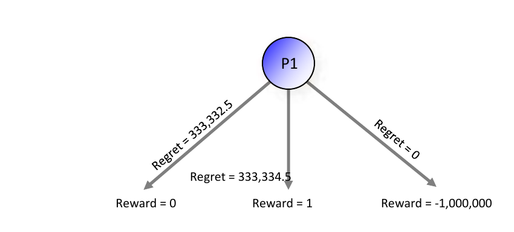
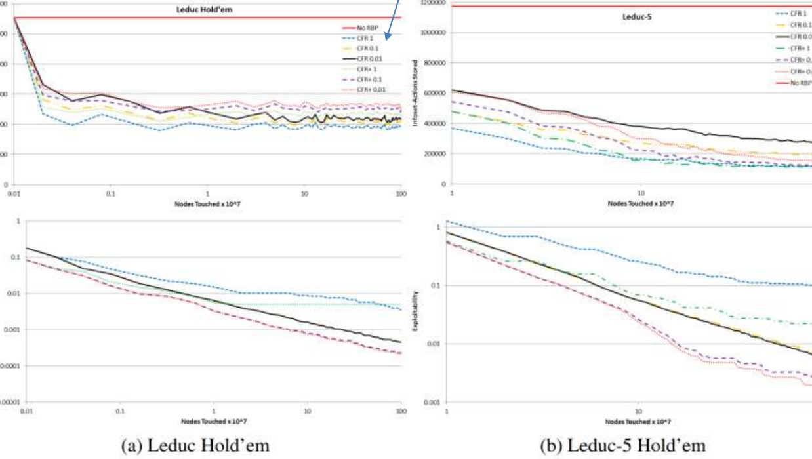
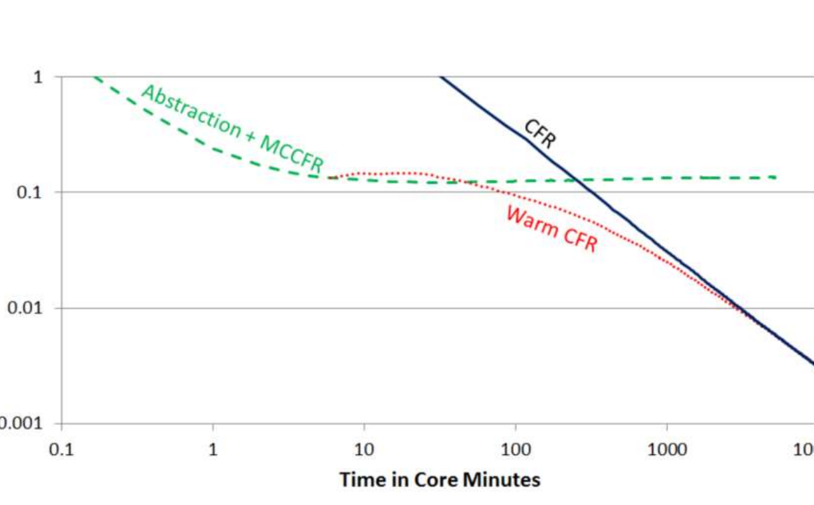

# L9 CFR Speedups

This lecture covers a collection of techniques for speeding up counterfactual regret minimization (CFR). The focus is on techniques that are **theoretically sound** and **game-independent** — although game-specific techniques also exist, such as the faster traversal of Johanson et al. (IJCAI-11), which applies at least to poker, and the sequence-form linear-program sparsification of Farina & Sandholm (2021), which works well at least on poker. Several of these techniques apply to algorithms beyond CFR as well.

## Technique Family 1: Predictivity (Optimism)

The first family is predictivity, also known as optimism. The general framework of this family was covered in full in the previous lecture (optimism and last-iterate convergence) and is not repeated here. However, the assigned reading for this lecture — Farina, Kroer & Sandholm (AAAI-21, "Faster Game Solving via Predictive Blackwell Approachability") — adds a deep structural result to the family, and its algorithm PCFR+ will appear again in the hyperparameter-schedule experiments later in this lecture, so we summarize the key points here.

**RM and RM+ are exactly FTRL and OMD, respectively.** Blackwell approachability frames regret minimization as a repeated game with vector-valued payoffs: the $i$-th component of the payoff vector $u(\boldsymbol{x}^t, \boldsymbol{\ell}^t) = \langle \boldsymbol{\ell}^t, \boldsymbol{x}^t\rangle\boldsymbol{1} - \boldsymbol{\ell}^t$ is exactly the change in regret relative to always playing action $i$, and with the target set taken to be the cone $\mathbb{R}^n_{\le 0}$, driving the average payoff toward that cone is equivalent to minimizing regret. Following the constructive proof of Blackwell's theorem, each round one selects a halfspace containing the target set and "forces" the payoff into it. The paper proves that using FTRL (with regularizer $\frac{1}{2}\|\cdot\|_2^2$, domain $\mathbb{R}^n_{\ge 0}$, any step size $\eta > 0$) to select the halfspace to force produces **exactly the same iterates** as regret matching (RM), and using OMD produces **exactly the same iterates** as RM+. In other words, the two most important local regret minimizers in game-solving practice are exactly special cases of the two most classic online convex optimization algorithms applied to this approachability game — and the correspondence holds for every step size.

**Predictive RM+ (PRM+) and PCFR+.** Plugging predictive OMD (given a prediction $\boldsymbol{m}^t$ of the next loss vector) into this correspondence yields the first predictive variant of RM+: maintain a quasi-regret vector $\boldsymbol{z}^t$, update it after observing the loss via $\boldsymbol{z}^t \leftarrow \big[\boldsymbol{z}^{t-1} + \langle \boldsymbol{\ell}^t, \boldsymbol{x}^t\rangle\boldsymbol{1} - \boldsymbol{\ell}^t\big]^+$, and before playing, correct with the prediction, $\boldsymbol{\theta}^t \leftarrow \big[\boldsymbol{z}^{t-1} + \langle \boldsymbol{m}^t, \boldsymbol{x}^{t-1}\rangle\boldsymbol{1} - \boldsymbol{m}^t\big]^+$, then play the normalized $\boldsymbol{\theta}^t$. Its regret bound is $R^T \le \sqrt{2\sum_{t=1}^{T} \big\|u(\boldsymbol{x}^t,\boldsymbol{\ell}^t) - \boldsymbol{v}^t\big\|_2^2}$, which depends directly on the prediction error; with perfect predictions the regret stays constant. (For comparison, Brown & Sandholm AAAI-19 had tried the heuristic of "counting the most recent iterate's regret twice," but that does not constitute a predictive algorithm.) Using PRM+ as the local regret minimizer at every information set, together with **quadratic averaging** (iteration $t$ weighted by $t^2$) and **alternating updates**, with prediction $\boldsymbol{m}^t = \boldsymbol{\ell}^{t-1}$, gives **PCFR+**. On 18 benchmark extensive-form games, PCFR+ is 3–6 orders of magnitude faster than CFR+, DCFR, and LCFR on Battleship and Pursuit-evasion already after 500 iterations (about 10 orders of magnitude after 2000), and 0.5–1 order of magnitude faster on Goofspiel; but on poker games (the River endgame used by Libratus, Leduc) the predictions help little, and DCFR remains the fastest there.

## Technique 2: Alternation

**Alternation** means: in CFR, perform an update for player 1, then an update for player 2, and so on in turns, rather than updating both players simultaneously (in an interleaved fashion) within one iteration. As an example, consider the dual updates of two regret minimizers (RM) in a zero-sum matrix game with payoff matrix $\boldsymbol{A}$:

```text
Simultaneous iterates:                  Alternating iterates:
for t = 1, …, T:                        for t = 1, …, T:
  · xᵗ ← request strategy from P1's RM    · yᵗ ← request strategy from P2's RM
  · yᵗ ← request strategy from P2's RM    · pass utility A yᵗ to P1's RM
  · pass utility A yᵗ to P1's RM          · xᵗ ← request strategy from P1's RM
  · pass utility −Aᵀ xᵗ to P2's RM        · pass utility −Aᵀ xᵗ to P2's RM
```

The motivation is immediate: each agent updates based on the opponent's **newest** strategy. Alternation converges faster in practice. Theoretically, Burch et al. (JAIR-19) proved that alternating CFR still enjoys a provable $O(\sqrt{T})$ cumulative regret bound. Later work sharpened the convergence rate of alternation: Wibisono, Tao & Piliouras (2022) showed that alternating mirror descent has $T^{1/3}$ regret in zero-sum games; Katona, Wang & Wibisono (2025) improved this to $T^{1/5}$; and Farina et al. (2023) gave a lower bound of (roughly) $T^{1/2}$ for alternating RM+.

## Technique Family 3: Re-Weighting

The third family is re-weighting, from Brown & Sandholm (AAAI-19, distinguished paper honorable mention). At the time, the algorithms from that paper were the fastest for zero-sum games (normal- and extensive-form).

### Motivation: Limitations of CFR+

CFR+ was the previously fastest algorithm in practice, but the following toy example exposes its weakness. Consider a single decision for player 1 with three actions of rewards $0$, $1$, and $-1{,}000{,}000$, respectively.



- **First iteration**: play all actions with equal probability $P = 1/3$; the expected reward is $-333{,}333$. Updating regret as "action expected value − achieved value" gives regrets $333{,}333$, $333{,}334$, and $0$ for the left, middle, and right actions (CFR+ floors regret at zero, so negative regret is set to zero).
- **Second iteration**: play actions proportional to their positive regret, i.e., $P \approx 1/2$, $P \approx 1/2$, $P = 0$; the expected reward is about $0.5$, and after the regret update the middle action's regret is about $333{,}334.5$.

The problem: the left and middle actions have nearly equal regret, so from then on CFR+ can only suppress the probability of the left action at a rate of about $1/2$ per iteration. **It takes CFR+ 471,407 iterations to learn to pick the middle action with 100% probability!**

The fix: discount the regrets and average-strategy contributions of early "bad" iterations by weighing iteration $t$ by $t$ — we call this **Linear CFR**. It learns to pick the middle action in only **970 iterations**, while its worst-case convergence bound increases by only a factor of $\frac{2}{\sqrt{3}}$.

### Weighted Averaging Schemes for CFR+

This "weight the iterations" idea is theoretically general:

> **Theorem 1** (Brown & Sandholm, AAAI-19). Suppose $T$ iterations of RM+ are played in a two-player zero-sum game. Then the weighted average strategy profile — where iteration $t$ is weighed proportional to $w_t > 0$ with $w_i \le w_j$ for all $i < j$ (a nondecreasing weight sequence) — is a $\frac{w_T}{\sum_{t=1}^{T} w_t}\,\Delta\,|\mathcal{I}|\sqrt{|A|}\,\sqrt{T}$-Nash equilibrium.

Note the $w_T$ in the numerator, so the bound is never lower than with uniform weights; but in practice the weighted variants converge much faster, and the small theoretical relaxation is well worth it.

### Discounted CFR (DCFR)

- **Linear CFR**: weigh iteration $t$ by $t$ (both in the regrets and in the average strategy).
- **CFR+**: floor regrets at zero (and weigh iteration $t$ by $t$ in the average strategy).

Can the two be combined into Linear CFR+? In theory, yes — but **in practice it does very poorly**. Less aggressive combinations, however, do well; this gives **Discounted CFR (DCFR)**:

- on each iteration, multiply **positive** regrets by $\dfrac{t^{\alpha}}{t^{\alpha}+1}$;
- on each iteration, multiply **negative** regrets by $\dfrac{t^{\beta}}{t^{\beta}+1}$;
- weight contributions toward the average strategy by $\left(\dfrac{t}{t+1}\right)^{\gamma}$.

In fact, DCFR unifies the earlier algorithms into one family: LCFR is exactly $\mathrm{DCFR}_{1,1,1}$ (multiplying the accumulated regrets and average-strategy contributions by $\frac{t}{t+1}$ each iteration is equivalent to weighing iteration $t$ by $t$), and CFR+ is exactly $\mathrm{DCFR}_{\infty,-\infty,2}$ (positive regrets undiscounted, negative regrets set to zero outright, average strategy weighted by $t^2$).

> **Theorem 2** (Brown & Sandholm, AAAI-19). Assume $T$ iterations of DCFR are conducted in a two-player zero-sum game. Then the weighted average strategy profile is a $\dfrac{6\,\Delta\,|\mathcal{I}|\,(|A| + 1/\sqrt{T})}{\sqrt{T}}$-Nash equilibrium.

That is, DCFR's worst-case convergence bound is only a small constant factor worse than CFR's. With $\alpha = 1.5$, $\beta = 0$, $\gamma = 2$, DCFR consistently outperforms CFR+ in practice — usually by a factor of 2–3 on the HUNL endgames (in Goofspiel its performance is essentially identical to CFR+). The variant $\mathrm{DCFR}_{3/2,-\infty,2}$ (negative regrets set to zero outright) is usually equally strong, but occasionally produces a spike in exploitability that takes many iterations to recover from, so the paper recommends $\mathrm{DCFR}_{3/2,0,2}$ by default; and in settings where negative-regret pruning may be used, it further recommends $\mathrm{DCFR}_{3/2,1/2,2}$ with $\beta = 1/2$ (negative regrets then decrease multiplicatively toward $-\infty$, which facilitates pruning).

The figure below shows experiments on the heads-up no-limit Texas hold'em (HUNL) endgames used by Libratus (exploitability in mbb/g, lower is better):


Since $\beta > 0$ facilitates the regret-based pruning discussed later in this lecture (regrets can go negative), the figure also shows results for $\beta = 1/2$. In addition, the paper observes that CFR+ converges faster when iteration $t$ is assigned weight $t^2$ (rather than $t$) in the average strategy, so the paper uses $t^2$ weighting when computing the average strategy for CFR+ and its variants throughout.

The paper contains several further improvements:

- **The average strategy can be discounted in different ways.** CFR+ does this in one specific way (linear weighting); the paper shows many other ways are theoretically valid: any nondecreasing weight sequence with "final weight / sum of weights $\to 0$" works, e.g., $t^x$ for any $x > 0$. Within this valid space, many choices are empirically faster.
- **Monte Carlo Linear CFR.** CFR+ and DCFR do poorly with sampling (Monte Carlo variants), but Linear CFR works very well with it. Concretely (discounted MCCFR): split an MCCFR run into segments of $10^7$ "nodes touched" each (a hardware- and implementation-independent measure of time), and at the end of each segment $n$ multiply all accumulated regrets and average-strategy contributions by $\frac{n}{n+1}$. On HUNL endgames this consistently beats vanilla MCCFR, and also beats an initial-discount variant that multiplies the accumulated quantities once by $\frac{1}{10}$ after the first segment.
- **A different local regret minimizer: NormalHedge.** The CFR framework allows any regret minimizer at each information set. The paper tests replacing RM with NormalHedge (NH): NH is likewise parameter-free and assigns zero probability to negative-regret actions (so it is compatible with regret flooring), and it beats RM in iteration count on HUNL endgames with costly "mistake actions"; but each iteration is about 5× slower due to the exponentiation and the line search over the parameter $c^t$, so it loses in wall-clock time — unless the algorithm is bottlenecked by memory access rather than computation.
- **Optimistic LCFR.** Counting the most recent iterate's regret twice (Optimistic RM) inside LCFR gives a further speedup on endgames with severe mistake actions, but performs worse on other games. That is, optimistic LCFR is worth considering exactly in the settings where LCFR already dominates.

Summary: discounting early CFR iterations yields better performance. DCFR matches or exceeds CFR+ in all domains tested and was, at the time, the state-of-the-art equilibrium-finding algorithm in large imperfect-information games; Linear CFR does even better in games with extremely suboptimal actions but is inferior to DCFR otherwise — it is, however, compatible with sampling, which CFR+ and DCFR are not.

### Hyperparameter Schedules

The DCFR above uses the fixed $\alpha = 1.5$, $\beta = 0$, $\gamma = 2$ for every $t$ — that is, a **fixed (constant) hyperparameter schedule (HS)**. Zhang, McAleer & Sandholm (2024, "Faster Game Solving via Hyperparameter Schedules") propose letting the hyperparameters vary with the iteration, yielding **HS-DCFR**:

- on each iteration, multiply positive regrets by $\dfrac{t^{\mathrm{HS}_\alpha}}{t^{\mathrm{HS}_\alpha}+1}$, negative regrets by $\dfrac{t^{\mathrm{HS}_\beta}}{t^{\mathrm{HS}_\beta}+1}$, and weight average-strategy contributions by $\left(\dfrac{t}{t+1}\right)^{\mathrm{HS}_\gamma}$;
- the schedules: $\mathrm{HS}_\alpha:\ \alpha = 1 + \frac{3}{n}t$; $\mathrm{HS}_\beta:\ \beta = -1 - \frac{2}{n}t$; $\mathrm{HS}_{\gamma 30}:\ \gamma_{30} = 30 - \frac{5}{n}t$; $\mathrm{HS}_{\gamma 15}:\ \gamma_{15} = 15 - \frac{5}{n}t$, where $n$ is the total number of iterations planned (the experiments use $n = 1000$);
- that is, $\alpha$ rises linearly from 1 to about 4, $\beta$ falls linearly from $-1$ to about $-3$ (negative regrets are discounted ever more strongly), and $\gamma$ decreases linearly from 30 (or 15). This performs experimentally better than simply setting the weights of the first 1/3 of iterations to 0.

This yields the two variants HS-DCFR(30) and HS-DCFR(15) (the same scheduling idea applies to PCFR+ and other algorithms, giving HS-PCFR+(30) and HS-PCFR+(15)). The figure below shows results on six games (Battleship-3, Goofspiel-4 (limited information), Goofspiel-4, Blotto, Goofspiel-5, and an HUNL endgame):


On both extensive-form and normal-form games, the HS-powered algorithms improve over the prior state of the art by **orders of magnitude** — they represent the current state of the art.

## Technique Family 4: Dynamic Pruning Techniques

In perfect-information games, $\alpha\beta$-pruning can prune subtrees **permanently**. Why can't this be done in imperfect-information games? Because the strategies keep changing across CFR iterations, a branch that looks useless right now may become relevant again later — so pruning here must be inherently **dynamic (temporary)**.

### Early Idea: Partial Pruning

**Partial pruning** (Lanctot et al., ICML-09): if on some path the **opponent's** reach probability (the probability that the opponent plays the game to that point) is 0, then that path can be pruned, because it will not affect any regret update. This is a no-brainer optimization (Lanctot et al. report a factor-of-30 improvement in some games), but one can prune more.

### Interval Regret-Based Pruning (Interval RBP)

**Interval regret-based pruning (Interval RBP)** (Brown & Sandholm, NeurIPS-15) extends pruning to paths that **the agent itself** reaches with zero probability. Such pruning is necessarily temporary. Consider an action $a \in A(I)$ with $\sigma^t(I, a) = 0$, and suppose it is known that action $a$ will not be played with positive probability until some far-future iteration $t'$ (in regret matching, this is the case when $R^t(I, a) \ll 0$):

- Determining $t'$: the condition on when the regret might turn positive can be projected conservatively, or checked dynamically.
- Since action $a$ is played with zero probability on iteration $t$, the strategy played and the reward received beyond $a$ (that is, in the subtree $D(I, a)$) contribute nothing to the regret of any information set preceding $a$ on iteration $t$. In fact, everything that happens in $D(I, a)$ has no bearing on the rest of the game tree until iteration $t'$. So on iterations $t, \ldots, t'-1$ one can **procrastinate** in deciding what happened beyond action $a$.
- Upon reaching iteration $t'$, rather than individually making up the $t' - t$ missed iterations, one can do a **single** iteration: play against the average of the opponents' strategies over the skipped iterations, and declare that we played that strategy on all the missed iterations.
- Moreover, since player $i$ never plays action $a$ with positive probability between iterations $t$ and $t'$, every other player can apply partial pruning to that part of the game tree for those iterations — that is, skip it completely.
- This in turn means player $i$ has free rein to play whatever she wants in $D(I, a)$ without affecting the other players' regrets. In light of that, and of the fact that player $i$ decides what is played in $D(I, a)$ after seeing what the other players have played, she might as well play a strategy that guarantees zero regret for all information sets $I' \in D(I, a)$ over iterations $t \ldots t'$ — a **counterfactual best response (CBR)** to the average of the opponent strategies is exactly such a zero-regret strategy.

> **Definition.** A counterfactual best response (CBR) is a strategy similar to a best response, except that it maximizes counterfactual value even at information sets that it does **not reach** due to its own earlier actions.

### Total Regret-Based Pruning (Total RBP)

**Total regret-based pruning (Total RBP)** (Brown & Sandholm, ICML-17) improves the way regret is made up when pruning ends:

- Interval RBP: compute a CBR against the opponents' average strategy over the **skipped** iterations $t \ldots t'$, and update the regret in the pruned branch as if that CBR had been played on those iterations.
- Total RBP: compute a CBR in the pruned branch against the opponents' average strategy over **all** iterations $1 \ldots t'$ played so far, and set the regret as if that CBR had been played on all those iterations.
- An **approximate CBR** can be used instead of an exact one. The paper gives an upper bound on how approximate it may be while keeping the theoretical convergence guarantee: formally, a $T$-near CBR satisfies, at every information set, $\sum_{a \in A(I)} \big[v(I,a) - v(I)\big]_+^2 \le \Delta(I)\,|A(I)|$ — that is, the sum of squared positive "regret increments" stays on the order of RM's per-iteration increment bound (and the approximation must approach an exact CBR as $T$ grows). Note that in practice CFR converges much faster than the theoretical bound, so the potential function (used in the convergence proof) is typically far below the theoretical bound; choosing a coarser near-CBR as the theory allows permits slightly longer pruning but may actually hurt performance. Clever heuristics for deciding on a near-CBR can lead to even better performance in practice. Likewise, $t'$ can be projected conservatively or checked dynamically. (In the ICML-17 camera-ready version the algorithm was renamed **best-response pruning (BRP)**; the slides keep the name Total RBP from the earlier version.)

The precise conditions from the paper are as follows. Write $\psi^{\bar\sigma_{-i},T}(I,a)$ for the (approximate) CBR value against the opponents' total average strategy, and $v^{\sigma^t}(I)$ for the value of information set $I$ on iteration $t$. Then on iteration $T$, if

$$T\,\psi^{\bar\sigma_{-i},T}(I,a) \;\le\; \sum_{t=1}^{T} v^{\sigma^t}(I),$$

action $a$ can be pruned — even perfectly responding to the opponents' total average strategy beyond $a$ still does worse than what has been achieved over the iterations so far. The pruning duration is

$$T' \;=\; \frac{\sum_{t=1}^{T} v^{\sigma^t}(I) \;-\; T\,\psi^{\bar\sigma_{-i},T}(I,a)}{U(I,a) - L(I,a)}$$

iterations, where $U(I,a), L(I,a)$ are upper and lower bounds on the payoffs reachable in $D(I,a)$: in each iteration the regret of $a$ can increase by at most $U(I,a)-L(I,a)$, so this duration is conservatively safe; a dynamic check using the opponents' reach probabilities $\pi_{-i}^{\sigma^t}(I)$ can prune even longer. When pruning ends, compute a CBR against the opponents' average strategy over all $T+T'$ iterations and reset the regrets as if that CBR had been played on all those iterations:

$$R^{T+T'}(I,a) \;=\; (T+T')\,\psi^{\bar\sigma_{-i},T+T'}(I,a) \;-\; \sum_{t=1}^{T+T'} v^{\sigma^t}(I),$$

and similarly, for every information set $I'$ in $D(I,a)$ and action $a'$, set $R^{T+T'}(I',a') = (T+T')\,\big[\psi^{\bar\sigma_{-i},T+T'}(I',a') - \psi^{\bar\sigma_{-i},T+T'}(I')\big]$. Theorem 1 of the paper guarantees that after resetting the regrets this way, the exploitability bound of the subsequent average strategy is exactly the same as if those iterations had been run without pruning. Since the reset does not need the pre-pruning regrets, the regret storage for the pruned subtree can be released immediately — this is the source of the space advantage below.

**Total RBP has a space advantage.**

- Storing regrets: pruned subtrees need not be stored, because their regrets are computed from scratch at iteration $t'$.

> **Theorem.** For any information set $I$ and action $a \in A(I)$ that is not part of any best response to any Nash equilibrium, there exists an iteration $T_{I,a}$ such that for all $T \ge T_{I,a}$, action $a$ in information set $I$ (and all its descendants) can be pruned **forever**.

  The algorithm itself cannot know whether $T$ has met the condition, so every once in a while a (near) best-response computation in $D(I, a)$ is still needed — but that does not require storing regrets.

- Storing average strategies: fortunately, if action $a$ is pruned for long enough, the stored cumulative strategy in $D(I, a)$ can be discarded at the cost of a small increase in the distance of the final average strategy from a Nash equilibrium (by declaring that we never play $a$ in $I$).

> **Corollary.** In a zero-sum game (with some threshold $C/\sqrt{T}$, $C > 0$, on the average strategy), after a finite number of iterations, CFR with Total RBP requires only $O(|\text{information sets not pruned by the above theorem}|\cdot|A|)$ space.

  This is particularly useful when the abstraction is grown dynamically.

**Total RBP is faster than CFR.** Same number of iterations, but each iteration is faster. Intuitively, as both players converge to a Nash equilibrium, actions that are not a CBR will eventually do worse than actions that are, so those suboptimal actions accumulate increasing amounts of negative regret, and can therefore be pruned for increasingly long periods.

> **Theorem.** In a zero-sum game, if both players choose strategies according to CFR with Total RBP, then conducting $T$ iterations traverses only $O(|\mathcal{S}|\,T + |\mathcal{H}|\ln T)$ nodes, where $\mathcal{S}$ is the set of game paths that are part of some CBR to some equilibrium, and $\mathcal{H}$ is the set of all game paths (i.e., information sets).

The figure below shows convergence and required space for CFR / CFR+ with Total RBP on Leduc Hold'em and Leduc-5 Hold'em (top: number of information set–action pairs stored; bottom: exploitability; the x-axis on both is the number of nodes traversed). The number in the legend is the constant $C$ in the criterion: set an action's probability to 0 when its average probability falls below $C/\sqrt{T}$. On Leduc-5 with $C = 0.1$, the required space is reduced by about a factor of **7** (for both CFR and CFR+), and the reduction factor grows with game size; on Leduc, the space quickly drops to about half of its initial value. Thresholds between $0.01$ and $0.1$ work well for both space and speed: lower thresholds converge somewhat faster, higher thresholds reduce space faster. In convergence speed, Total RBP is about 2× faster than Interval RBP on Leduc-5 (both applied on top of CFR). The same idea can also be used for other regret-based algorithms, and even for other algorithms such as EGT and Fictitious Play (Brown, Kroer & Sandholm, AAAI-17).



One detail about combining CFR+ with RBP: since Interval RBP can only prune negative-regret actions, it modifies the definition of CFR+ so that regret can go negative but immediately jumps back up to zero as soon as the regret increases; Total RBP does not require this modification. Both forms of RBP change the behavior of CFR+: without pruning, CFR+ puts positive probability on an action as soon as its regret increases, whereas RBP waits until pruning is over. CFR+'s linear weighting of the average strategy is only guaranteed to converge to a Nash equilibrium if pruning does not occur; pruning with CFR+ does well empirically, but the convergence is noisy. This noise can be reduced by using the **lowest-exploitability average strategy profile found so far** — the experiments above do exactly that.

## Technique Family 5: Warm Starting

**Warm starting** CFR (Brown & Sandholm, AAAI-16):

- Naively starting CFR from given strategies does **not** help (and often hurts) compared to starting from uniform strategies. It was therefore believed that CFR cannot be warm started — but the paper showed it can.
- The input strategies can come from any source: hand-crafted, a different algorithm, CFR run on a coarser abstraction, and so on.
- The technique enables **simultaneous abstraction and equilibrium finding** (see also the earlier paper, Brown & Sandholm, IJCAI-15).
- The core idea: **pretend the input strategies came from CFR** — set not just the average strategies, but also the number of iterations so far $T$ and the regrets, appropriately. The paper gives the constraints that must be satisfied for the CFR convergence proof to go through, and suggests specific choices within those constraints that perform well in practice.

A first experiment on Flop Texas hold'em shows that naively continuing CFR from the input strategies (Warm 100 / Warm 500 / Warm 2500, where the number is how many iterations were used to generate the input strategy) produces convergence curves that nearly coincide with CFR run from scratch — confirming that naive warm starting does not help. A second experiment, plotted against time (core-minutes), shows the value of proper warm starting:



Solving quickly on a coarse abstraction (Abstraction + MCCFR) reaches medium accuracy fast but then stalls (the abstraction error caps the achievable accuracy); properly warm-started CFR from the abstraction solution (Warm CFR) inherits the time saved in the coarse-abstraction phase and keeps converging to high accuracy, significantly outperforming CFR run from scratch on the full game for most of the time horizon.

## Key Takeaways

- **Alternation** lets each player update against the opponent's newest strategy and is faster in practice; it retains an $O(\sqrt{T})$ regret guarantee (Burch et al., JAIR-19), the regret of alternating mirror descent has been improved step by step to $T^{1/5}$, and alternating RM+ has a lower bound of roughly $T^{1/2}$.
- **RM and RM+ are exactly FTRL and OMD** (Farina, Kroer & Sandholm, AAAI-21): under the Blackwell approachability framework the iterates coincide exactly; the resulting predictive RM+ (PRM+) has a regret bound that depends directly on the prediction error, and its CFR instantiation PCFR+ is orders of magnitude faster than CFR+/DCFR/LCFR on non-poker benchmark games, while DCFR is faster on poker.
- **Re-weighting** (Brown & Sandholm, AAAI-19): Linear CFR weighs iteration $t$ by $t$, cutting convergence on the toy example with an extremely suboptimal action from 471,407 iterations to 970; weighted averaging with any nondecreasing weight sequence carries a $\frac{w_T}{\sum w_t}\Delta|\mathcal{I}|\sqrt{|A|}\sqrt{T}$ equilibrium guarantee.
- **DCFR** ($\alpha=1.5,\ \beta=0,\ \gamma=2$, unifying LCFR $=\mathrm{DCFR}_{1,1,1}$ and CFR+ $=\mathrm{DCFR}_{\infty,-\infty,2}$) consistently beats CFR+, with a worst-case bound of a $\frac{6\Delta|\mathcal{I}|(|A|+1/\sqrt{T})}{\sqrt{T}}$-Nash equilibrium; Linear CFR is compatible with Monte Carlo sampling (discounted MCCFR), while CFR+/DCFR are not.
- **Hyperparameter schedules** (Zhang, McAleer & Sandholm, 2024) let $\alpha,\beta,\gamma$ vary linearly with the iteration; HS-DCFR / HS-PCFR+ achieve order-of-magnitude speedups on both normal- and extensive-form games and are the current state of the art.
- **Dynamic pruning**: partial pruning removes paths the opponent reaches with zero probability; Interval RBP and Total RBP further prune the agent's own zero-probability actions, making up the skipped iterations in one shot with a (near) CBR against the (interval or total) average opponent strategy. Total RBP reduces the traversal of $T$ iterations to $O(|\mathcal{S}|T + |\mathcal{H}|\ln T)$ nodes and, after finitely many iterations, needs space proportional only to the unpruned information sets.
- **Warm starting** (Brown & Sandholm, AAAI-16): by setting the average strategy, the iteration count $T$, and the regrets simultaneously, CFR can be continued from a strategy of any provenance, enabling simultaneous abstraction and equilibrium finding.
