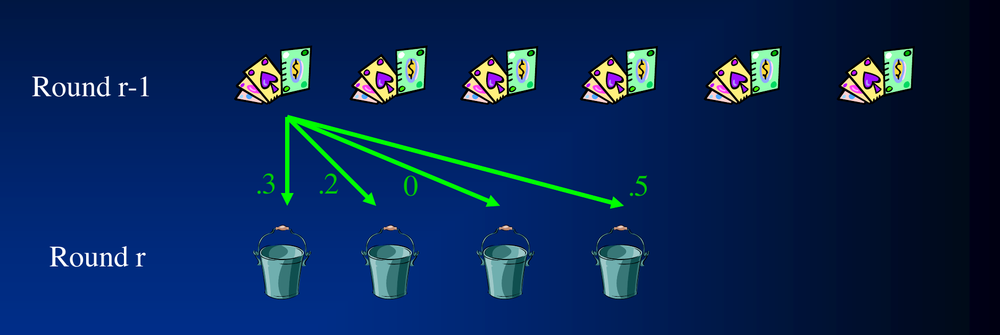
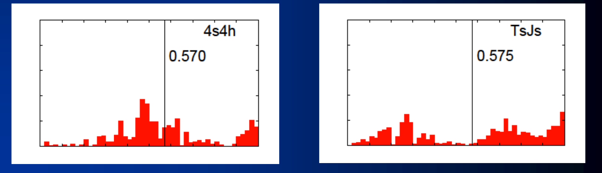
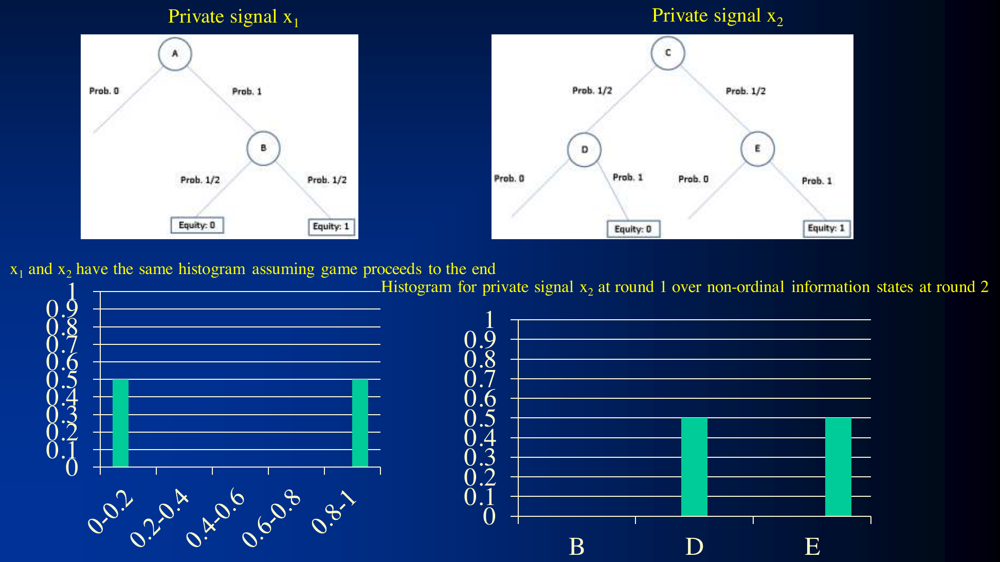

# L10 Game Abstraction 1

For large imperfect-information games, even the best equilibrium-finding algorithms cannot be run on the original game directly. This chapter covers *practical* game abstraction: automatically compress the original game into a smaller abstract game, solve for an equilibrium in the abstract game, and map the solution back to the original game. We cover lossless abstraction (GameShrink), early lossy abstraction, potential-aware abstraction, and the 2014 state of the art (potential-aware, imperfect-recall abstraction with earth mover's distance). We then turn to hierarchical abstraction, which couples abstraction with distributed equilibrium computation, and Tartanian7, the champion agent built with these techniques. Abstraction with theoretical guarantees is the subject of the next chapter.

## The Automated Game Abstraction Framework

The framework of automated game abstraction is shown below [Gilpin & Sandholm, EC-06/J. of the ACM 2007, AAAI-06 …]. The idea was foreshadowed by Shi & Littman 01 and Billings et al., IJCAI-03, and is now used by basically all competitive Texas Hold'em programs:


The pipeline has three steps: an **abstraction algorithm** compresses the original game into an abstract game; an **equilibrium-finding algorithm** computes a Nash equilibrium of the abstract game; and a **reverse model** interprets that equilibrium as a strategy in the original game. Abstractions are classified as **lossless** or **lossy**, depending on whether information is lost.

## Lossless Game Abstraction

Lossless abstraction [Gilpin & Sandholm, EC-06, J. of the ACM 2007] merges only nodes that are fully strategically equivalent, so an equilibrium of the abstract game corresponds exactly to an equilibrium of the original game.

### Information Filters

Observation: a game can be made smaller by **filtering the information a player receives**. Instead of observing a specific signal exactly, the player observes a filtered *set* of signals. In poker, for example, rather than knowing he holds A♥, the player receives the signal {A♠, A♣, A♥, A♦}: he knows only that his card is some ace. The coarser the filtering, the smaller the abstracted game.

### The Signal Tree

The algorithm operates on the **signal tree** rather than the game tree itself. Each edge of the signal tree corresponds to the revelation of some signal by nature to at least one player. Because only the signal tree, not the full game tree, needs to be loaded into memory, extremely large games become tractable.

### The Isomorphic Relation

The isomorphic relation captures the notion of **strategic symmetry** between nodes. It is defined recursively:

> **Definition (isomorphism in the signal tree).**
> - Two **leaves** in the signal tree are isomorphic if, for each action history in the game, the payoff vectors (one payoff per player) are the same;
> - Two **internal nodes** in the signal tree are isomorphic if their children are isomorphic.

The internal-node case has a difficulty: the children may appear in different orders (permutations of children). The solution is to run a custom **perfect matching** algorithm between the children of the two nodes, such that only isomorphic children are matched; such a perfect matching exists if and only if the two nodes are isomorphic.

### The Abstraction Transformation and the Equilibrium-Preservation Theorem

The abstraction transformation merges **two isomorphic nodes that are siblings** in the signal tree into a single node. Its correctness is guaranteed by the following theorem:

> **Theorem (lossless abstraction preserves Nash equilibria).** If a strategy profile is a Nash equilibrium in the abstracted (smaller) game, then its interpretation in the original game is a Nash equilibrium.

This is exactly why the "reverse model" step in Figure 1 is exact in the lossless case.

### The GameShrink Algorithm

GameShrink proceeds in two passes:

```text
GameShrink:
  1. Bottom-up pass: run dynamic programming (DP) to mark all
     isomorphic pairs of nodes in the signal tree
  2. Top-down pass: starting from the top of the signal tree,
     perform the abstraction transformation (merge) for siblings
     where applicable
```

> **Theorem (completeness and complexity of GameShrink).** GameShrink conducts all such transformations, and runs in time $\tilde{O}(n^2)$, where $n$ is the number of nodes in the signal tree. Since the signal tree is typically much smaller than the game tree, this is usually highly sublinear in the game tree size.

### Case Study: Solving Rhode Island Hold'em

Rhode Island Hold'em was proposed as an AI challenge problem by Shi & Littman 01; its game tree has 3.1 billion nodes. GameShrink's performance on it:

- Without abstraction, the linear program (LP) for an equilibrium has 91,224,226 rows and columns (unsolvable);
- GameShrink runs in **one second** to produce the lossless abstraction;
- After that, the LP has only 1,237,238 rows and columns (50,428,638 non-zeros);
- Solving this LP with the CPLEX barrier method took 8 days and 25 GB of RAM, yielding an **exact Nash equilibrium**.

This was the largest imperfect-information game solved by then, by over four orders of magnitude.

## Lossy Game Abstraction

The example game for the rest of this lecture is Texas Hold'em. Its structure: nature deals 2 cards to each player → a round of betting → nature deals 3 shared cards → a round of betting → nature deals 1 shared card → a round of betting → nature deals 1 shared card → a round of betting. In terms of size:

- Two-player **Limit** Texas Hold'em has roughly $10^{18}$ nodes;
- Two-player **No-Limit** Texas Hold'em has roughly $10^{165}$ nodes.

Even after lossless abstraction, the game is too big to solve, so it must be compressed further; this calls for **lossy** abstraction.

### The First Abstraction Algorithm Applied to Texas Hold'em

The first abstraction algorithm applied to Texas Hold'em [Gilpin & Sandholm, AAAI-06] makes GameShrink abstract "harder": it no longer requires a perfect matching between children, so approximately isomorphic nodes are merged as well. To speed up the matching, a faster matching heuristic is used: two nodes are matched only if

$$|\text{wins}_{\text{node}_1} - \text{wins}_{\text{node}_2}| + |\text{losses}_{\text{node}_1} - \text{losses}_{\text{node}_2}| < k$$

(i.e., the difference in win/loss counts serves as the similarity metric). The method merges greedily, which tends to produce lopsided abstractions.

### Clustering + Integer Programming

A better and more scalable approach to lossy abstraction [Gilpin & Sandholm, AAMAS-07] operates on the signal tree of **one player's private signals together with the common signals**, one player at a time (no longer on the joint signal tree of both players' signals). The state-of-the-art algorithm described later does the same. The method is "clustering + integer programming (IP)":

- For every betting round $i$, tell the algorithm how many buckets $K_i$ it is allowed to generate. $K_i$ determines the size of the abstraction and should be set based on the computational resources available for the equilibrium computation;
- First round: run $k_1$-means clustering to bucket that round's nodes;
- Each later round $i$: run an IP to determine how many children each parent bucket should be allowed to have, so that the total number of children does not exceed $K_i$. The value of allowing a parent to have $k$ children is assessed by running k-means clustering, for different values of $k$, under each parent before running the IP.

## Potential-Aware Abstraction

All prior abstraction algorithms used "probability of winning (assuming no more betting)" as the similarity metric between hands, but this does not capture a hand's **potential**: a drawing hand may have a modest current chance of winning yet a large chance of becoming strong in later rounds. Potential is not one-dimensional ("positive" or "negative") but "multidimensional": a hand can improve in many different ways on different boards. Potential-aware abstraction [Gilpin, Sandholm & Sørensen, AAAI-07; Gilpin & Sandholm, AAAI-08] was designed precisely to capture potential.

### Bottom-Up Pass to Determine the Round-1 Abstraction

The algorithm proceeds bottom-up, starting from the last round. Suppose the bucketing of round $r$ has already been determined. Then each hand in round $r-1$ is represented as a **histogram**: the probability distribution over the round-$r$ buckets that it transitions into (via nature's dealing of the public cards), as shown below (this hand transitions into round $r$'s four buckets with probabilities 0.3, 0.2, 0, 0.5).



These histograms are then clustered using the $L_1$ norm, with a predetermined number of clusters that depends on the target abstraction size. In the last (4th) round, no more public cards will come, so hands have no potential left; the probability of winning (assuming the remaining public cards are dealt out uniformly at random, i.e., a rollout) is used directly as the similarity metric.

### Determining the Round-2 Abstraction

For each round-1 bucket $i$:

- Make a bottom-up pass, considering only hands compatible with bucket $i$, to determine the round-3 buckets;
- For $k_i = 1, 2, \ldots, \max$, cluster the round-2 hands into $k_i$ clusters based on each hand's histogram over the round-3 buckets.

Then run an IP to decide how many children each round-1 bucket may have, subject to $\sum_i k_i \le K_2$. The IP's objective is:

- Error metric for each bucket = the sum of the $L_2$ distances of the hands in the bucket from the bucket's centroid;
- Total error to minimize = the sum of the buckets' errors, weighted by the probability of reaching the bucket.

### Determining the Round-3 and Round-4 Abstractions

Round 3 is done analogously to round 2. Round 4 is also analogous, except that now there is no potential left, so clustering is based directly on the probability of winning (assuming rollout). At this point the potential-aware abstraction has been computed.

## Key Ideas of 2007–2013

The three main threads of practical lossy abstraction in this period were:

- **Integer programming** [Gilpin & Sandholm, AAMAS-07]: optimally allocating the numbers of children among parent buckets subject to a bucket budget;
- **Potential-aware abstraction** [Gilpin, Sandholm & Sørensen, AAAI-07; Gilpin & Sandholm, AAAI-08]: replacing the scalar win probability with the distribution over next-round buckets as the similarity metric;
- **Imperfect recall** [Waugh et al., SARA-09; Johanson et al., AAMAS-13]: allowing players in the abstract game to "forget" which bucket they were in during earlier rounds, thereby decoupling the abstractions of the different rounds and drastically reducing the cost of both abstraction computation and equilibrium finding.

Imperfect recall deserves a few more words [Brown et al., AAMAS-15]. Intuitively, a perfect-recall abstraction forces a player to distinguish at a later round everything he could distinguish at an earlier round, even when the distinction has no strategic significance later. For example, having distinguished K♥3♣ from K♥4♣ preflop, perfect recall forces the player to keep distinguishing these two hands on a flop of K♠J♦9♥, even though the 3♣ versus 4♣ difference is extremely unlikely to affect play. Imperfect recall allows the agent to "forget" such distinctions once they are no longer relevant. The cost is the loss of theoretical guarantees: CFR-type algorithms have no convergence guarantee on imperfect-recall games (the exception being the guarantee of Lanctot et al., ICML-12 for a class of well-formed games), and Nash equilibria in behavioral strategies may even fail to exist. Yet in practice, poker agents using imperfect-recall abstractions have consistently outperformed agents using perfect-recall abstractions.

## State of the Art: Potential-Aware + Imperfect Recall + Earth Mover's Distance

The 2014 state-of-the-art algorithm [Ganzfried & Sandholm, AAAI-14] is "potential-aware imperfect-recall abstraction with earth mover's distance in imperfect-information games." Understanding it takes three steps: EHS and its shortcoming, distribution-awareness and EMD, and finally high-dimensional potential-awareness.

### Expected Hand Strength (EHS)

EHS (expected hand strength, also known as equity) is defined as

$$\text{EHS} = \Pr[\text{win}] + \tfrac{1}{2}\Pr[\text{tie}],$$

where the opponent's hand is drawn uniformly at random and the remaining public cards are dealt out by a uniform random rollout. Early poker abstraction approaches all used EHS (or EHS exponentiated to some power) to cluster hands [e.g., Billings et al., IJCAI-03; Gilpin & Sandholm, AAAI-06; Zinkevich et al., NIPS-07; Waugh et al., SARA-09].

The shortcoming of EHS is that it fails to account for the **distribution of hand strength**. For example, 4♠4♥ and T♠J♠ have almost identical EHS (about 0.57), yet their distributional shapes are entirely different: 44's EHS frequently falls in the $[0.4, 0.6]$ range and rarely in $[0.7, 0.9]$, while exactly the reverse is true for T♠J♠ (a suited connector): it often becomes a very strong hand, and often ends up with nothing. The figure below compares the EHS histograms of the two hands:



Clustering by EHS would put these two hands in the same bucket, but they should clearly be played differently.

### Distribution-Aware Abstraction and Earth Mover's Distance

Distribution-aware abstraction uses the **full distribution** of hand strength: each hand is represented as a histogram (over equities after all public cards are dealt, still assuming a uniform random hand for the opponent), and the distance between histograms is measured by the **earth mover's distance (EMD)**.

> **Earth mover's distance (EMD):** the minimum cost of turning one pile of dirt into the other, where cost = amount of dirt moved × the distance by which it is moved.

EMD can be computed in linear time in the one-dimensional setting, but is more challenging in higher dimensions. The prior best approach used distribution-aware abstraction with imperfect recall for the flop and turn rounds [Johanson et al., AAMAS-13].

### Potential-Awareness + High-Dimensional EMD

Distribution-awareness alone is still not enough: two hands can have very similar distributions over strength at the end, yet **realize their equity in different ways and at different rates** (one hand's strength may be settled by the next round, while another's is resolved only at the final round), so the two call for different betting strategies. Potential-aware abstraction [Gilpin, Sandholm & Soerensen, AAAI-07] considers all future rounds, not just the final round.

The key technical difficulty: in distribution-aware abstraction, histograms are over **cardinal** equity values, so the distance between bins is naturally defined; in potential-aware abstraction, histograms are over **non-ordinal** next-round information states (there is no natural distance between buckets), so EMD must be computed in a higher-dimensional space.

The example in the figure below illustrates the distinction. Private signal $x_1$ at node A transitions to B with probability 1, and from B reaches equity 0 or 1 with probability 1/2 each; private signal $x_2$ at node C transitions to D or E with probability 1/2 each, with D reaching equity 0 with probability 1 and E reaching equity 1 with probability 1. If we only look at the outcome at the end of the game, $x_1$ and $x_2$ have identical equity histograms (equity 0 and 1, half each); but the histograms over round-2 information states reached from round 1 are different: $x_1$ lands entirely on state B, while $x_2$ lands half on D and half on E. The two hands' "paths" are completely different, and potential-aware abstraction distinguishes hands using exactly the latter kind of histogram:



### The Algorithm

The potential-aware imperfect-recall abstraction algorithm with EMD works as follows:

- Perform one **bottom-up** pass over the tree, representing each node by its distribution histogram over next-round clusters;
- EMD is now computed in a multi-dimensional space, with the **ground distance** taken to be the (next-round) EMD between the corresponding cluster means (i.e., distances are given recursively by the EMDs already computed for the next round);
- The best general-purpose EMD implementation is far too slow for the scale of Texas Hold'em, so the paper develops a fast custom heuristic for approximating it in this setting;
- Using this algorithm to compute the flop-round abstraction yields strategies that beat the best prior abstraction algorithm.

Note the two simplifications afforded by imperfect recall:

- There is no longer any need to perform multiple bottom-up passes, as in earlier potential-aware abstraction;
- There is no longer any need to run an IP to allocate child buckets among parent buckets.

## Hierarchical Abstraction, Distributed Equilibrium Computation, and Post-Processing

Tartanian7 [Brown, Ganzfried & Sandholm, AAMAS-15], the champion agent of the 2014 ACPC (Annual Computer Poker Competition), pushed this chapter's three-step framework to a much larger scale. The motivation comes from hardware: the strongest equilibrium-finding algorithm of the time, MCCFR, parallelizes easily on shared-memory machines, but shared-memory machines have limited memory and core counts. Exploiting a supercomputer with more memory and more cores means facing **inter-blade memory access latency** (on the machine the authors used, same-blade access takes about 130 nanoseconds, cross-blade about one microsecond). Naively parallelized MCCFR reads and writes information sets scattered across different blades on every iteration, which is impractically slow. The solution is to make the abstraction itself fit the hardware: cut the game tree into **disjoint pieces** so that the sampling on each blade only accesses information sets located on that blade.

### The Hierarchical Abstraction Algorithm

Hierarchical abstraction has two levels:

1. First cluster **public information** at some special early round $\hat{r}$ (the flop round for no-limit Texas Hold'em): the 1,755 public flops (after accounting for suit isomorphisms) are clustered into $C=60$ public buckets, each bucket assigned to one blade;
2. Then, for each public bucket, cluster the compatible **private** information states **separately** for each round from $\hat{r}$ through the final round (500 private buckets per round per public bucket).

Rounds before $\hat{r}$ (preflop) are handled separately with an arbitrary abstraction algorithm (the strongest agents use no abstraction preflop). This way, after leaving the preflop, each sampled trajectory accesses information sets on only one blade. The scheme requires players to remember the public bucket throughout the hand (so it is not full imperfect recall), but does not force them to remember other distinctions that are no longer relevant, thereby retaining most of the benefits of imperfect recall.

### A Similarity Metric for Public Information

How should the distance between public flops be defined? The prior approach of Waugh et al., SARA-09 builds a transition table for each public board $f$: $T[f][i][j]$ is the probability (in a small perfect-recall base abstraction) of transitioning from preflop bucket $i$ to flop bucket $j$, and k-means is run with the $L_2$ distance between transition tables. Beyond the difficulty of scaling this to large base abstractions, there is a conceptual flaw: take two extremely similar public boards A♥K♠3♦ and A♥K♠2♦. If the base abstraction puts 4♣3♠-A♥K♠3♦ and 4♣2♠-A♥K♠2♦ into bucket 12 but the crossed combinations into bucket 13, then the two boards have probabilities 0 and 1, respectively, on that transition component, and the $L_2$ distance applies the maximum penalty, even though the boards map extremely similar hands into the same bucket and should be judged similar.

The new algorithm first computes a sufficiently strong base abstraction $A$ (in practice, a 169-5000-5000-5000 imperfect-recall abstraction), then counts, for each public board $i$, how many private hole-card combinations it sends into each flop bucket $b$ of $A$. Denote the count by $c_i$; given the public board there are $\binom{49}{2}=1176$ hole-card combinations. The similarity of two public boards is the sum over buckets of the overlap of the counts, $s_{i,j}=\sum_b \min(c_i, c_j)$, and the distance is defined as

$$d_{i,j} = \frac{V - s_{i,j}}{V},$$

i.e., the fraction of private states that are **not** mapped into the same bucket when paired with $i$ versus $j$ ($V=1176$). The intuition: since $A$ is known to be strong, public boards that $A$ frequently groups into the same bucket should be judged close. Note that $d$ is not a metric (distinct boards can be at distance 0), so algorithms designed for metric spaces such as k-means are not applicable; the paper uses k-means++ initialization followed by an iterative reassignment clustering that depends only on pairwise distances. Computing all the distances requires iterating over about 7.7 billion triples, which is done quickly using the precomputed transition table.

### Distributed Equilibrium Computation

The accompanying equilibrium-finding algorithm is a distributed modification of external-sampling MCCFR: one **head blade** is designated to run MCCFR on the top of the tree (preflop); whenever a sampled trajectory exits the top of the tree (reaches the flop), the current state is sent to all $C$ child blades, and each child blade samples public cards from its own public bucket and continues its own MCCFR iteration. Once the child blades return their values, the head blade computes a weighted average, weighing by the number of choices of public information (possible flops) in each bucket, so that each flop is weighed equally in expectation. This guarantees that the estimate is **unbiased**. In practice a two-pass approach (first record which flop sequences are encountered and send them in batch to the child blades for evaluation, then use the returned values on a second pass) reduces communication; the inter-blade communication overhead is about 60 microseconds per iteration, negligible against the roughly 15 milliseconds each iteration takes.

### Post-Processing: Reverse Mapping, Thresholding, and Purification

The "reverse model" step of the framework diagram calls for dedicated techniques in games with huge action spaces. The opponent may take actions not in the abstraction (e.g., arbitrary bet sizes), so the opponent's actions must be mapped back into the abstract game; the experiments used the **pseudo-Harmonic mapping** [Ganzfried & Sandholm, IJCAI-13], then the leading approach and broadly adopted among the top agents.

Equilibrium finding only converges approximately and may leave positive probability on poor actions, so post-processing is also needed. **Thresholding** sets probabilities below some threshold to zero and renormalizes; **purification** is the special case where the highest-probability action is played with probability 1. But combined with reverse mapping, thresholding has a pitfall: the more finely some region of the action space is discretized, the more the probability mass there is diluted, and those actions are penalized for it. For example, with probabilities $(0.1, 0.25, 0.15, 0.15, 0.2, \ldots)$ spread over {fold, call, 0.5 pot, 0.75 pot, 1 pot, …}, purification selects call, even though 0.65 of the mass is on bet actions. The remedy is to first group similar actions into **meta-actions** (fold / call / bet) and purify among them; only if bet is selected does one purify within the bet sizes (in the example, this yields a pot-sized bet). In addition, biasing toward **conservative actions that reduce variance** (fold) helps the stronger agent: if the equilibrium is mixed at some point, play further down that path will likely remain uncertain, so it is better to end the hand early rather than continue into a part of the game where the agent is weak. The final new post-processor combines all three ideas: if the fold probability exceeds a threshold, fold with probability 1; otherwise purify among the three meta-actions, and if bet is selected, purify within the bet sizes. Tests against the two strongest agents of 2013 show that the new post-processor (threshold 0.2) wins +71 mbb/h on average, significantly better than purification (+37) and thresholding at 0.15 (+27), and also better in the worst observed case.

### Tartanian7: Scale and Results

The abstraction generated with these techniques was of unprecedented scale: 169 preflop buckets, 60 public flop buckets, and 500 private buckets for each of the flop/turn/river rounds within each public bucket (30,000 private buckets per round); the action abstraction had 6,104,546 nodes; the whole abstract game had $5.49\times10^{15}$ nodes, $6.6\times10^{10}$ information sets, and $1.8\times10^{11}$ infoset-action pairs (a measure directly proportional to CFR's memory usage), six times larger than the largest abstractions used by prior no-limit Texas Hold'em agents, and the largest imperfect-information game tackled by an equilibrium-finding algorithm at the time. The equilibrium computation ran for 1,200 hours on the Blacklight supercomputer using 961 cores (60 blades × 16 cores + 1 core for the head blade), for a total of 1,153,200 core-hours. The resulting agent, Tartanian7, won the 2014 ACPC two-player no-limit Texas Hold'em competition, beating each opponent with statistical significance, with an average win rate of 479 mbb/h (milli big blinds per hand).

## Conclusions

- All the techniques in this chapter are **domain-independent**, although presented through poker;
- Automated **lossless** information abstraction exactly solved a 3.1-billion-node game (Rhode Island Hold'em);
- **Lossy** information abstraction is key to tackling very large games like Texas Hold'em; the main progress of 2007–2013 was integer programming, potential-awareness, and imperfect recall;
- The 2014 state-of-the-art algorithm was the first information abstraction algorithm to combine potential-awareness and imperfect recall (with EMD as the distance metric);
- Hierarchical abstraction combines "cluster public information first, then cluster private information separately per public bucket" with distributed MCCFR, enabling equilibrium computation to scale to abstractions six times larger than before on a supercomputer with high memory latency; together with reverse mapping and the new family of post-processors, it produced Tartanian7, the 2014 ACPC champion;
- Future directions: apply these techniques to other domains; develop abstraction techniques that have both theoretical bounds and good practical performance (theoretical bounds are discussed in the next chapter).

## Key Takeaways

- The three-step game abstraction framework: the abstraction algorithm compresses the game → equilibrium is found in the abstract game → a reverse model maps it back to the original game; abstractions are lossless or lossy.
- Lossless abstraction defines an isomorphic relation on the signal tree (leaves compare payoff vectors over all action histories; internal nodes compare children via a perfect matching) and merges isomorphic siblings; a theorem guarantees that a Nash equilibrium of the abstract game interprets back to a Nash equilibrium of the original game.
- GameShrink: bottom-up DP to mark isomorphic pairs + top-down merging, in time $\tilde{O}(n^2)$ ($n$ = number of signal-tree nodes); in one second it shrank the LP of the 3.1-billion-node Rhode Island Hold'em from 91 million rows/columns to 1.2 million, ultimately yielding an exact Nash equilibrium.
- Lossy abstraction for Limit ($\sim\!10^{18}$ nodes) and No-Limit ($\sim\!10^{165}$ nodes) Texas Hold'em: from GameShrink with relaxed matching, to "clustering + IP" (given a bucket budget $K_i$ per round, the IP allocates child buckets subject to $\sum_i k_i \le K$, minimizing reach-probability-weighted clustering error).
- Potential-aware abstraction replaces the scalar win probability with the "histogram of transition probabilities into next-round buckets" ($L_1$ clustering), capturing multidimensional potential; in the last round there is no potential, so it falls back to the probability of winning.
- EHS only sees the mean and cannot tell apart hands with different distributional shapes; distribution-aware abstraction compares equity histograms using EMD.
- State of the art (Ganzfried & Sandholm, AAAI-14): potential-awareness + imperfect recall + high-dimensional EMD (ground distance = next-round EMD), a single bottom-up pass with no IP, beating the best prior abstraction.
- Imperfect recall lets players forget distinctions that are no longer relevant (e.g., K♥3♣ vs. K♥4♣, distinguished preflop, need not stay distinguished after the flop); it consistently outperforms perfect-recall abstraction in practice, but CFR has no convergence guarantee on it.
- Hierarchical abstraction (Brown, Ganzfried & Sandholm, AAMAS-15): cluster public flops into 60 buckets assigned to blades, then cluster private information separately within each bucket; the distance between public boards is built from "the fraction of private combinations that a strong base abstraction sends into the same bucket," fixing the conceptual flaw of the transition-table $L_2$ distance.
- Distributed MCCFR: the head blade runs the preflop, child blades sample from their public buckets, and weighting by the number of available public cards keeps the estimate unbiased; inter-blade communication overhead is negligible.
- Post-processing: the pseudo-Harmonic mapping translates opponent actions back into the abstraction; before thresholding/purification, fine-grained actions are grouped into meta-actions (fold/call/bet) to avoid the dilution penalty, with a bias toward the variance-reducing fold; the new post-processor wins +71 mbb/h on average, beating purification (+37).
- Tartanian7: an abstract game of $5.49\times10^{15}$ nodes (6× the largest prior abstraction), equilibrium computed over 1,200 hours on 961 cores; in the 2014 ACPC it beat every opponent with statistical significance, averaging 479 mbb/h.
