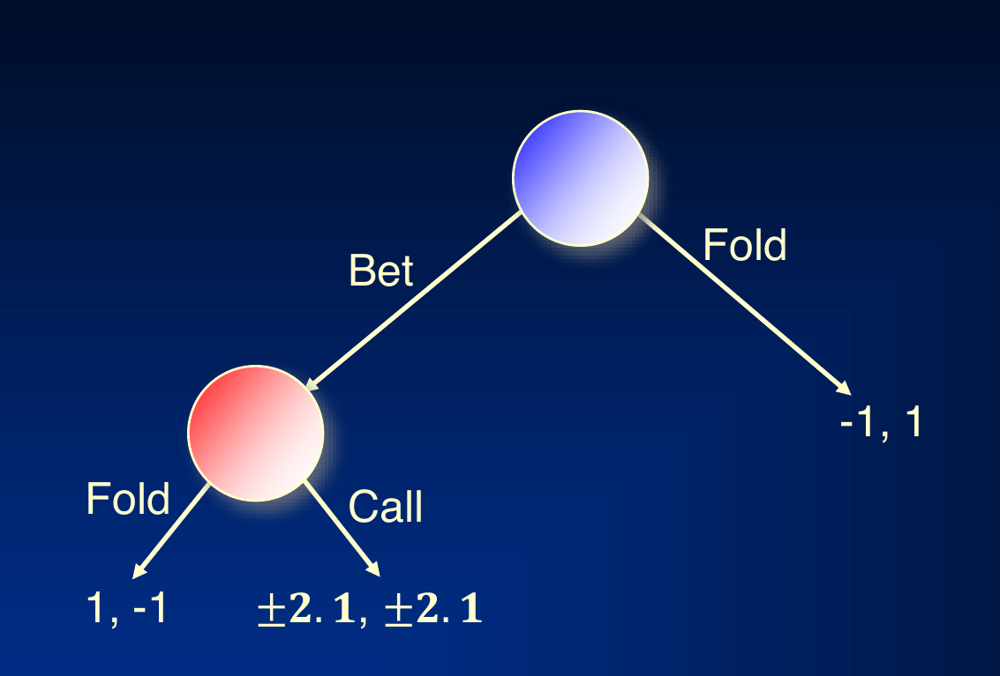
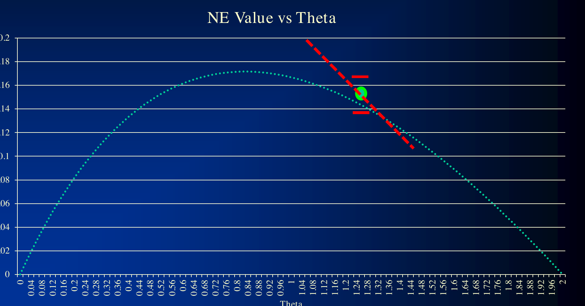

# L11 Game Abstraction 2

The previous lecture introduced the motivation for abstraction and its basic types. This lecture goes deeper into four topics: action abstraction with optimality guarantees (via regret transfer and parameter optimization), performing abstraction and equilibrium finding simultaneously, reverse mapping of the abstract game's solution back into the original game, and a unified framework for lossy abstraction with exploitability bounds. All of these techniques are domain independent.

## Action Abstraction

Action abstraction has traditionally been done manually: a human decides, for example, which bet sizes are allowed in poker. Before the work of Brown and Sandholm, action abstraction algorithms for extensive games (even just for poker) came with no guarantees on solution quality [Hawkin et al., AAAI-11, 12]. For stochastic games, an action abstraction algorithm with bounds, based on discrete optimization, already existed [Sandholm & Singh, EC-12].

This lecture presents the first algorithm for parameter optimization for one player (in two-player zero-sum games), applied to **action size abstraction** ["Regret Transfer and Parameter Optimization with Application to Optimal Action Abstraction", Brown & Sandholm, AAAI-14]. Its core technique is **regret transfer**: using regret matching or counterfactual regret minimization (CFR), one can warm start the solver by transferring regrets after the game's payoffs change.

**Setting**: as we change the actions (e.g., bet sizes in poker or bid sizes in auctions), the game's payoffs change, but the game topology does not.

### Motivation: A Simple Game

Consider the following toy game: Player 1 chooses Bet or Fold; on Fold the payoff is $(-1, 1)$; on Bet, Player 2 chooses Fold (payoff $(1, -1)$) or Call (payoff $\pm 2, \mp 2$, a zero-sum exchange of $\pm 2$). We solve it with no-regret learning.

Running no-regret learning on this game for about 2000 iterations, $\epsilon$ (the exploitability distance to a Nash equilibrium) decreases smoothly from about $0.1$ to about $0.02$.

Now suppose that partway through the run we change the payoff of the Bet–Call branch from $\pm 2$ to $\pm 2.1$, a perturbation of magnitude

$$\delta = 2.1 - 2 = 0.1.$$

There are three ways to respond:

- **Start Over**: clear all state and solve from scratch. $\epsilon$ jumps back up to about $0.1$, and all 2000 iterations of prior computation are wasted.
- **Naïve Regret Transfer**: directly carry the regrets accumulated on the old game into the new game and keep running. $\epsilon$ only jumps to about $0.05$, but then it **stalls** — convergence slows markedly and it lingers around $0.045$, eventually being overtaken by Start Over. The reason is that the old regrets were accumulated on the old payoff scale; their magnitude does not match the new game, and the leftover oversized regrets impede refinement of the equilibrium.
- **Correct Regret Transfer**: deweight the transferred regrets (and the accumulated strategy used for strategy averaging) by a factor of $O\!\left(\dfrac{1}{(1+\delta\sqrt{T})^2}\right)$, where $T$ is the number of iterations already run. The intuition: the old regrets and old strategy were collected on a slightly different game; the larger the perturbation and the longer the run, the less trustworthy the old data. Warm started this way, $\epsilon$ resumes decreasing at a good rate from about $0.05$ and ends up significantly better than the other two curves.

### Optimal Parameter Selection

Regret transfer lets us **optimize abstraction parameters online**. Return to the action size selection problem: each abstraction (each bet-size vector $\theta$) has a Nash equilibrium value that is not known until we solve it, and we want to pick the action abstraction with the highest equilibrium value for us. (Note: optimizing action sizes jointly with action probabilities would be quadratic; hence we optimize sizes only.)

The algorithm is a **warm-started gradient ascent**: in the toy game above, parameterize the Bet–Call payoff as $\pm\theta$ and aim to maximize Player 1's Nash equilibrium value (a smooth unimodal curve in $\theta$, observed only noisily at each step).

1. **Step 1**: run $K_1$ iterations of no-regret learning at the current $\theta$, obtaining an estimate of the equilibrium value with $\epsilon$ error bars.
2. **Step 2**: estimate the gradient (by finite differences: run small perturbations around $\theta$).
3. **Step 3**: move $\theta$ along the gradient direction and warm start via regret transfer — deweight the regrets and the strategies used for averaging as above. The error bars temporarily expand after the move.
4. **Step 4**: run $K_2$ iterations of no-regret learning at the new $\theta$; the error bars shrink again.
5. Repeat to convergence.

The method has been applied to no-limit Texas Hold'em (one bet size optimized in that experiment) and to Leduc Hold'em (two bet sizes optimized simultaneously in that experiment).

## Simultaneous Abstraction and Equilibrium Finding

The traditional pipeline is serial: first abstract, then solve for an equilibrium in the abstract game. **Strategy-based abstraction** couples the two stages into a bidirectional loop: the abstraction feeds the equilibrium finder, and the strategies discovered by the solver feed back to guide refinement of the abstraction:

> **Caption**: the original game is automatically abstracted into an abstract game, a custom equilibrium-finding algorithm computes a Nash equilibrium, and a reverse model maps it back to the original game. In the simultaneous framework, the feedback arrow lets the abstraction adjust dynamically as solving progresses.

What has been implemented so far is the direction of **adding actions into the abstraction**: when solving reveals that an action that was abstracted away is valuable, it is added back into the abstraction, with warm starting via discounting (the regret deweighting above) ["Simultaneous Abstraction and Equilibrium Finding in Games", Brown & Sandholm, IJCAI-15].

## Reverse Mapping

After solving for an equilibrium in the abstract game, the opponent's actions in the original game may not lie in the abstract action set (e.g., the opponent bets an amount that does not exist in the abstraction). **Action translation** maps the opponent's actual action $x$ onto a neighboring abstract action $A$ or $B$ (with $A \le x \le B$). Let $f(x)$ denote the probability of mapping $x$ to $A$ (so $x$ is mapped to $B$ with probability $1 - f(x)$). The desiderata for $f$ are:

1. $f(A) = 1,\ f(B) = 0$ (endpoint preservation);
2. monotonicity: the closer $x$ is to $A$, the more it should map to $A$;
3. scale invariance;
4. a small change in $x$ should not lead to a large change in $f$;
5. a small change in $A$ or $B$ should not lead to a large change in $f$.

The **pseudo-harmonic mapping** [Ganzfried & Sandholm, IJCAI-13] is

$$f(x) = \frac{(B-x)(1+A)}{(B-A)(1+x)}.$$

It was derived from the Nash equilibrium of a simplified no-limit poker game and satisfies all of the desiderata above; it is much less exploitable than prior mappings in simplified domains; and it performs well in practice in no-limit Texas Hold'em, significantly outperforming the best prior reverse mapping, the randomized geometric mapping.

## Lossy Abstraction with Exploitability Bounds

### Game Abstraction Is Nonmonotonic

The intuition that "a finer abstraction gives a better solution" does not hold. Consider the following zero-sum game (the attacker chooses rows, the defender chooses columns; entries give both players' payoffs):

| | A | Between | B |
|---|---|---|---|
| **A** | $0, 2$ | $1, 1$ | $2, 0$ |
| **B** | $2, 0$ | $1, 1$ | $0, 2$ |

Every equilibrium of this game has the following form: the attacker randomizes 50-50 between A and B; the defender plays A with probability $p$, B with probability $p$, and Between with probability $1 - 2p$; there is an equilibrium for each $p \in [0, \tfrac{1}{2}]$.

- **An abstraction**: remove the attacker's action B. In the remaining game the defender will choose A — but that is far from equilibrium in the original game, where the attacker would switch to B.
- **A coarser abstraction**: remove both the attacker's B and the defender's A. In the remaining game the defender will choose Between, which **is exactly** an equilibrium strategy in the original game.

So the coarser abstraction yields an equilibrium of the original game while the finer one does not — an **abstraction pathology**. Such pathologies also occur in small poker games [Waugh et al., AAMAS-09].

### Can We Bound Exploitability Despite Abstraction Pathologies?

The first affirmative answer was for stochastic games [Sandholm & Singh, EC-12]. Here we present a unified abstraction framework for extensive-form games [Kroer & Sandholm, NeurIPS-18]: it applies to $n$-player general-sum games, generalizes and improves over prior work [Lanctot et al., ICML-12; Kroer & Sandholm, EC-14, EC-16], and can also be used for modeling-error analysis.

The framework decomposes the mapping from the original game to the abstract game into two steps that can be analyzed separately, as illustrated below: first abstract a branch of the original game onto an adjacent branch (producing the **perfect-recall refinement** of the abstract game), then coarsen Player 2's information sets to obtain the abstraction.

The two-step decomposition:

Formally, the mapping between the original game $\Gamma$ and the abstract game $\Gamma'$ consists of three parts:

- an **information-set mapping** $f$: a surjection from each information set $I$ of the original game onto an information set $f(I)$ of (the perfect-recall refinement of) the abstract game, required to respect the information-set tree structure;
- an **action mapping** $g$: a surjection from the action set at $I$ onto the action set at $f(I)$ (action removal is modeled by mapping several original actions onto the same abstract action);
- a **leaf-node mapping**: for each information set $I$ and action $a$, a surjection from the original-game leaves reached below $I$ before player $i$ acts again onto the abstract leaves below $f(I)$.

The **perfect-recall refinement** $\tilde\Gamma$ shares the same game tree as the abstraction $\Gamma'$ (same nodes, actions, chance probabilities, and payoffs) but partitions the information sets of $\Gamma'$ more finely, finely enough to satisfy perfect recall. It is introduced purely as an analytical device: the first step (original game → refinement) measures payoff and distribution differences caused by the mapping, and the second step (refinement → abstraction) measures differences caused by information-set coarsening.

Why bound approximate solution concepts? The strongest abstractions in practice are **imperfect-recall** abstractions, and finding a Nash equilibrium in an imperfect-recall game is NP-hard; CFR-style algorithms at convergence produce strategy profiles with **bounded counterfactual regret** at every information set. The framework therefore covers three kinds of abstract solutions: exact Nash equilibria, $\epsilon$-Nash equilibria, and strategy profiles with bounded counterfactual regret.

**Definition (lifted strategy)**: given a strategy profile $\sigma'$ of the abstract game, a lifted strategy is a strategy profile $\sigma$ of the original game such that for every abstract information set $I'$ and corresponding original information set $I$, the probability mass on each abstract action can be spread in any way across the set of original actions that map to it. Formally,

$$\sigma'(I', a') = \sum_{a \in g^{-1}(a')} \sigma(I, a),$$

where $g^{-1}(a')$ is the set of original actions mapping to the abstract action $a'$.

**The key proof construction** recursively decomposes the value of an information set onto its descendant information sets. Write $V_i(I)$ for the **counterfactual value** of information set $I$ [Zinkevich et al., NIPS-07]: the expected utility of $I$ when all players play according to the profile $\sigma$ except that player $i$ plays to reach $I$. Following the identity of Kroer & Sandholm [EC-14], $V_i(I)$ can be written as a sum over immediate descendants:

$$V_i(I) = \sum_{a \in A_I} \sigma(I, a)\left( \sum_{J \in D_{Ia}} \pi^{\sigma}_{-i}(J \mid I)\, V_i(J) \;+\; \sum_{z \in Z_{Ia}} \pi^{\sigma}_{-i}(z \mid I)\, u_i(z) \right),$$

where $D_{Ia}$ and $Z_{Ia}$ are the descendant information sets and leaves reachable after taking action $a$ at $I$ before player $i$ acts again, and $\pi^{\sigma}_{-i}$ is the reach probability excluding player $i$'s actions. The abstract value $W_i$ has the same form. Expanding this identity on both sides and inducting layer by layer (induction over the acyclicity of the abstract information sets), one obtains: the difference between the values of the original and abstract games under the same lifted strategy equals exactly a weighted sum, along the way, of **payoff differences** and **reach-probability differences** — denote this recursively defined difference by $M(I, \sigma, \sigma'_{-i})$. In particular, at the root there is an exact equality (not merely an inequality):

$$W_i(r') = V_i(r) \pm M\!\left(r, \sigma, \sigma'_{-i}\right).$$

That is, for any abstract profile $\sigma'$ and any of its lifted strategies $\sigma$, the difference between the lifted strategy's utility in the original game and the abstract utility is characterized exactly by $M$; the inequality in the final theorem comes only from the abstract game not being solved exactly.

> **Theorem (Abstraction Theorem, [Kroer & Sandholm, NeurIPS-18])**: Given
> - a perfect-recall game,
> - an acyclic abstract game,
> - a mapping between them satisfying several mild, natural assumptions, and
> - an $\epsilon$-Nash equilibrium in the abstract game,
>
> then **any** lifted strategy is an $\epsilon'$-Nash equilibrium in the original game, where $\epsilon' = \max_i \epsilon'_i$ and
>
> $$\epsilon'_i = \epsilon + \text{mapping error}_i + \text{refinement error}_i,$$
>
> i.e., the mapping error (the error from mapping the real game onto the perfect-recall refinement of the abstract game) plus the refinement error (the error between the perfect-recall refinement and the abstract game).

The paper gives the exact form as follows. Let $\sigma^{*} = (\sigma^{*}_i, \sigma_{-i})$ be the lifted strategy $\sigma$ with player $i$ replaced by a best response in the original game, and let $\sigma^{*0}$ be the profile obtained by spreading $\sigma^{*}$ back onto the abstract game via the action mapping; write $P(\tilde I, \hat\sigma)$ for the (payoff-plus-distribution) value difference between a refinement information set $\tilde I$ and the abstract information set it belongs to. Then

$$\epsilon'_i = \epsilon + \underbrace{M\!\left(r, \sigma^{*}, \sigma'_{-i}\right) - M\!\left(r, \sigma, \sigma'_{-i}\right)}_{\text{mapping error}_i} + \underbrace{\sum_{I \in \mathcal{I}_i} \pi^{\sigma^{*}}(I)\,\big[ P\!\left(f(I), I^{*}\!\!\to\! I\right) - P\!\left(\tilde I_I, \sigma^{*0}\right) \big]}_{\text{refinement error}_i},$$

where $M$ is the mapping difference defined recursively above. Note that both error terms depend on the best response $\sigma^{*}$, so the decomposition is in general **ex post** — one must first solve the abstract game and evaluate, before the numbers can be computed; that is the price paid for exactness.

Advantages over prior work:

- an **exact decomposition** of the error;
- the equilibrium in the abstract game need not be exact ($\epsilon > 0$ is allowed);
- no restrictive assumptions of prior work;
- exponentially better bound than Lanctot et al. [ICML-12];
- a similar result for solutions of the abstract game with bounded counterfactual regret (gain at most $\epsilon_a$ by switching to any action $a$).

The **mapping error**$_i$ is the sum of two terms:

- **Payoff error**: an expectation over leaf nodes in the real game of the utility difference between the real leaf and the node it maps onto, i.e., $R_i(z, \tilde z) = u_i(z) - \tilde u_i(\tilde z)$, where $\tilde z$ is the refinement leaf that $z$ maps to under the leaf-node mapping;
- **Distribution error**: a sum over leaf nodes in the abstraction of the difference between the probability of reaching the abstract leaf and the sum of reach probabilities on the real leaves that map to it, i.e., $P_i(\tilde z \mid I, a, \sigma, \sigma') = \sum_{z \mapsto \tilde z} \pi^{\sigma}_{-i}(z \mid I) - \pi^{\sigma'}_{-i}(\tilde z \mid f(I))$.

The **refinement error**$_i$: a sum over information sets $I_p$ in the perfect-recall refinement of the abstraction (let $I'$ be the corresponding abstract information set), each term being:

- **Payoff error**: an expectation over leaves under $I'$ of the utility difference compared to the corresponding leaf under $I_p$. The paper allows an arbitrary per-information-set scaling factor $\omega_{I_p} > 0$, i.e., $R_i(z' \mid I_p) = \tilde u_i(\tilde z) - \omega_{I_p}\, u_i(z')$: payoffs only need to be similar in a **relative** sense (for example, two subtrees whose payoffs differ by a common constant factor are strategically equivalent, and choosing the corresponding $\omega$ makes this term zero);
- **Distribution error**: a sum over leaves under $I_p$ of the difference between the probability of reaching the refinement leaf from $I_p$ and the sum of probabilities of reaching abstract leaves from $I'$.

**Solutions with bounded counterfactual regret** (Theorem 2): if the abstract profile $\sigma'$ has counterfactual regret at most $r(I')$ at every abstract information set $I'$ (i.e., the gain from switching to any action $a'$ is at most $r(I')$), then any lifted strategy is an $\epsilon'$-Nash equilibrium of the original game, with a bound of the same form as Theorem 1 except that the abstract-solving error term $\epsilon$ is replaced by a weighted sum of per-information-set terms $\pi^{\sigma'}_{-i}(f(I))\, r(f(I))$ — the per-information-set regret bounds take the place of the global $\epsilon$.

**Recovering prior ex ante bounds**: the paper further proves that under a **distributional-similarity condition** — leaves and nodes mapped to each other have identical reach distributions (in the sense that disregards Chance moves; this is weaker than the "same sequence of information-set–action pairs" required by prior work) — the terms in the mapping and refinement errors that depend on the best response $\sigma^{*}$ vanish, and the bounds become **computable ex ante** (before solving the abstract game, by taking maxima). The framework then recovers and simultaneously tightens all prior extensive-form game abstraction bounds: compared to Sandholm & Singh [EC-12] (stochastic games) and Kroer & Sandholm [EC-14, EC-16], it leaves expectations in several places where they took maxima, hence is tighter; compared to Lanctot et al. [ICML-12] (whose error grows linearly in the number of information sets), the new bound is exponentially better.

### Future Research Directions

The distribution error terms in the decomposition above are in general **not computable ex ante** (i.e., before running a solver on the abstract game), because they can depend on the players' strategies. Prior approaches required that for pairs of leaves mapped to each other, the leaves have the same sequence of information-set–action pairs leading to them in the abstraction — under that assumption one can take maxima and obtain ex ante bounds.

The paper uses two counterexamples to show that assumptions of this kind are in a sense **necessary**:

- **General-sum counterexample**: two nodes of Player 1 are abstracted into a single information set, with payoff error only $\epsilon$ (arbitrarily small) at each node. Player 2 is not abstracted and can play opposite actions in the left and right subtrees, thereby changing whether Player 1 should prefer left or right; in the original game Player 1 can react separately, but in the abstraction it cannot. Thus in the abstract equilibrium Player 1 gets only $v/2$ with every strategy, whereas $v$ is achievable in the original game — despite an arbitrarily small payoff error (the high-loss equilibrium persists even at $\epsilon = 0$), abstraction costs $v/2$.
- **Zero-sum counterexample**: two bottom information sets of Player 2 are merged; in the abstract equilibrium Player 2 plays $\ell$ and $r$ with equal probability, getting expected utility $\epsilon/2$ lower than the best response in the original game — a loss of $\epsilon/2$ despite a payoff error of $0$. The reason is that the unabstracted Player 1 controls the distribution over nodes inside the abstract information set, making it inconsistent with what Player 2 knows in the original game.

On both counterexamples, Theorems 1 and 2 still hold; they merely give weak bounds commensurate with the actual large error (all of the large error sits in the distribution-dependent terms). This shows that strategy-independent ex ante bounds cannot exist for fully general games.

One promising idea: find other specialized but practical game classes where game structure can be leveraged to give computable ex ante bounds. In particular, the decomposition relies on utility differences themselves (rather than their absolute values, as prior approaches did), so structured game classes could potentially even cancel out error terms.

## Key Takeaways

- All techniques in this lecture are domain independent: the first action abstraction algorithm with optimality guarantees (iteratively adjusting the action size vector), simultaneous abstraction and equilibrium finding, the pseudo-harmonic reverse mapping, and lossy abstraction with exploitability bounds.
- **Regret transfer**: after the game's payoffs change (topology unchanged), the correct approach is to deweight the regrets and accumulated strategies by $O(1/(1+\delta\sqrt{T})^2)$ and warm start; naïve transfer stalls, and starting over wastes the computation already done.
- **Optimal parameter selection**: run no-regret learning at the current $\theta$ → estimate the gradient → move $\theta$ and transfer regrets → keep running, repeating to convergence; applied to no-limit Texas Hold'em and Leduc Hold'em.
- **Pseudo-harmonic mapping** $f(x) = \frac{(B-x)(1+A)}{(B-A)(1+x)}$ satisfies endpoint preservation, monotonicity, scale invariance, and continuity desiderata, and significantly outperforms the randomized geometric mapping.
- **Abstraction pathology**: a finer abstraction can give a worse solution in the original game while a coarser one happens to be an equilibrium — abstraction quality is nonmonotonic.
- **Abstraction Theorem** (Kroer & Sandholm, NeurIPS-18): $\epsilon'_i = \epsilon + \text{mapping error}_i + \text{refinement error}_i$, each error decomposing further into a payoff error and a distribution error; the decomposition is **exact** (the inequality comes only from inexactly solving the abstract game), but is generally ex post and depends on the best response; under distributional-similarity conditions it recovers ex ante computable bounds and tightens all prior results; counterexamples show such distributional assumptions are necessary in general games. Applies to $n$-player general-sum perfect-recall games, with exponentially better bounds than prior work.
- Open problems: distribution errors are in general not computable ex ante; find game classes whose structure makes the error terms ex ante computable, or even mutually canceling.
