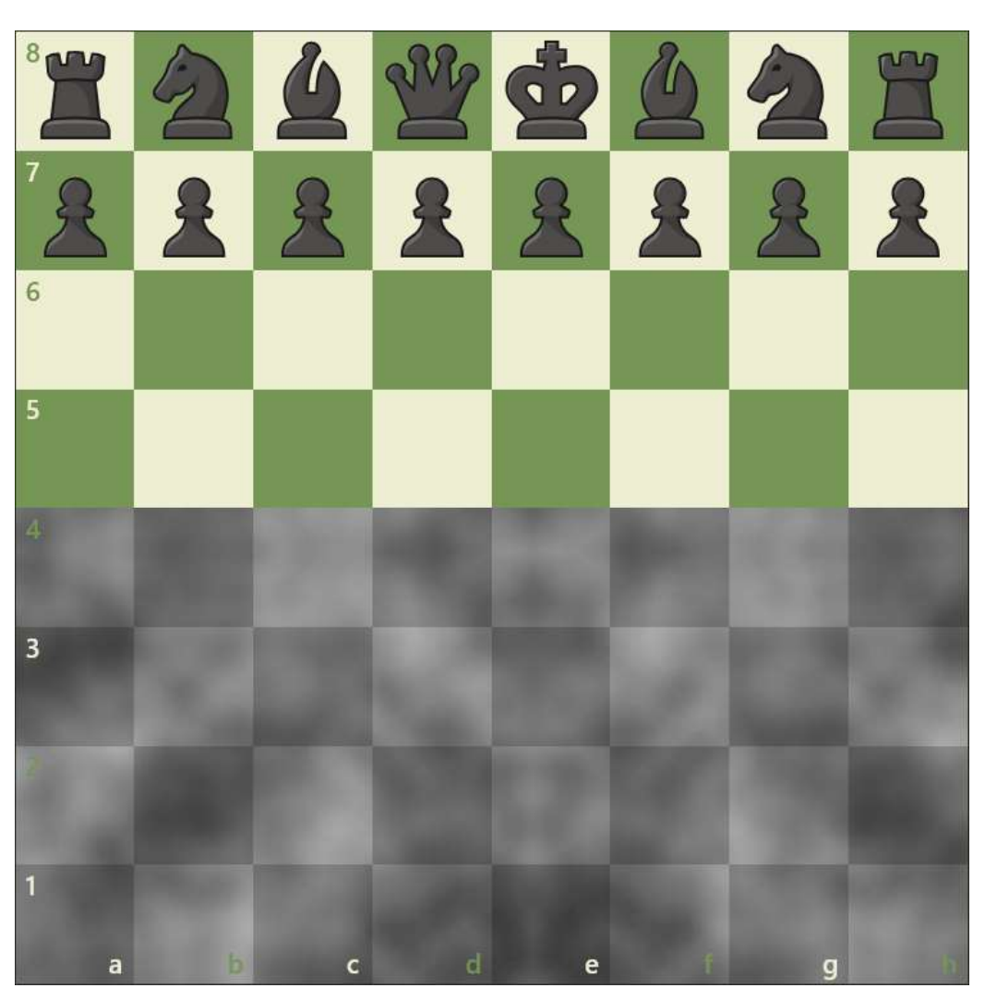
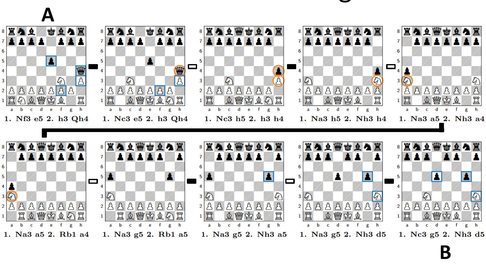
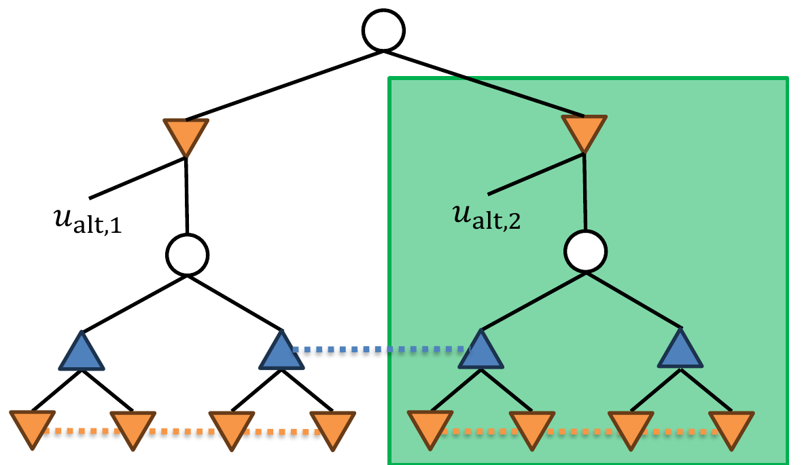
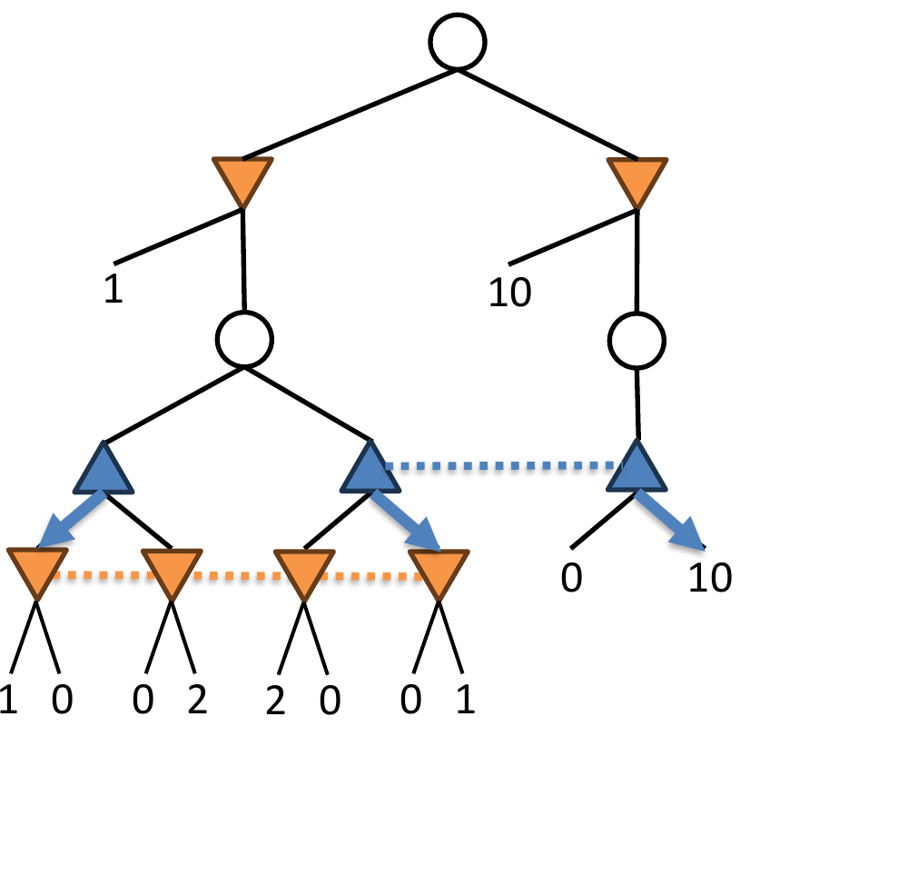

<!-- escape-math: v1 -->
# L15 Knowledge-Limited Subgame Solving

This chapter presents general-purpose search techniques for imperfect-information games that do not rely on common knowledge, together with their flagship application: *Obscuro*, the first superhuman agent for Fog of War chess (also known as Dark Chess). The material is based on joint work by Tuomas Sandholm and his PhD student Brian Hu Zhang.

## Fog of War Chess

Fog of War chess follows almost the same rules as regular chess, but each player sees only the squares that their own pieces can reach (by moving or attacking); the rest of the board is hidden behind "fog of war": when an opponent's piece moves out of sight, the player can no longer perceive where it is.

The figure above shows the board from Black's perspective: Black's pieces and the region they control are clearly visible, while White's half of the board is completely shrouded in fog. This means a player does not even know whether they are in check: for example, White's queen can sneak to h4 without Black noticing, and the king is captured on the next move. This makes Fog of War chess a game of extremely imperfect information.

The precise rules given in the paper [Zhang & Sandholm NeurIPS-21] additionally include: if a legal en passant capture exists, the player is informed of the en passant square; there is no check or checkmate: the goal is simply to capture the opponent's king, so "stalemate" is actually a win for the side that leaves the opponent without a legal move, and castling through attacked squares is legal (though it usually loses immediately). These rules guarantee that a player always knows their own set of legal moves exactly.

## kth-Order Knowledge and Common Knowledge

Reasoning in imperfect-information games involves higher-order knowledge (kth-order knowledge): what I know, what you know I know, what I know you know I know, and so on. If a proposition holds under "everyone knows" iterated to any finite order, it is called **common knowledge**.

Higher-order knowledge in Fog of War chess can be very deep. The slides give an elegant example: let Position A be the position after 1. Nf3 e5 2. h3 Qh4, and Position B the position after 1. Nc3 g5 2. Nh3 d5. Question: in Position A, is it common knowledge that the position is not B? The answer is no, but it can be 8th-order knowledge.

The figure shows a chain from Position A to Position B: adjacent positions on the chain differ by a single piece (the knight, pawn, and queen migrate square by square). Starting from what they can see, a player can only rule out one position on the chain per order of knowledge: both players know for sure that the current position is not the 1st on the chain, both know that both know it is not the 2nd, and so on. The proposition "everyone knows that everyone knows that … the position is not B" holds for 8 repetitions but fails for 9. In other words, the order of knowledge needed to distinguish two positions can be arbitrarily high; this is precisely why common-knowledge sets can be enormous.

## Recap: Real-Time Subgame Solving

In **perfect-information** games, real-time subgame solving is straightforward: upon reaching a decision point, simply isolate the subgame beneath that point and solve it; the rest of the game is irrelevant.

In **imperfect-information** games this fails: a subgame cannot be solved in isolation, because its solution may depend on other parts of the game: information sets may span nodes both "inside" and "outside" the subgame.

The basic idea [Gilpin & Sandholm AAAI-06]: start from a **blueprint strategy** (computed, for example, in a coarse abstraction, via deep learning, or from human heuristics), and upon arriving at a decision point, **refine** the blueprint locally. The history of this line of techniques falls into two categories:

- **"Unsafe" methods**: subgame solving can make the agent more exploitable than the blueprint [Gilpin & Sandholm AAAI-06; Gilpin & Sandholm AAMAS-07; Gilpin, Sandholm & Sørensen AAMAS-08; Ganzfried & Sandholm AAMAS-15 …];
- **"Safe" methods**: subgame solving does not make the agent more exploitable than the blueprint [Burch et al. AAAI-14; Moravcik et al. AAAI-16; Schmid et al. AAAI-16; Brown & Sandholm NeurIPS-17 …].

## Common-Knowledge Subgames

All prior subgame-solving approaches are built on the **common-knowledge subgame**.

> **Definition (Common-knowledge subgame)**
>
> - Two nodes in the same layer of the game tree are **connected** if there is an information set connecting some descendant of the first node to some descendant of the second node;
> - The common-knowledge subgame at a node $h$ consists of all nodes **recursively connected** to $h$, and all their descendants.

Intuitively, the common-knowledge subgame captures exactly the set of nodes that both players know that both players know that … they could currently be in, so a subgame can be defined and solved self-consistently on top of it.

The paper [Zhang & Sandholm NeurIPS-21] formalizes this as the **infoset hypergraph**: form a hypergraph $G$ whose vertices are all nodes of the game and whose hyperedges are the information sets. For a node set $S$, its **order-$k$ knowledge set** $S^k$ is defined as all nodes of $G$ at distance at most $k-1$ from $S$; the **common-knowledge closure** $S^\infty$ is the connected component of $G$ containing $S$. Intuitively, if it is known that the true node lies in $S$, then the opponent knows the true node lies in $S^2$, we know the opponent knows it lies in $S^3$, and so on; "the true node lies in $S^\infty$" is exactly common knowledge. The closure $I^\infty$ of the current information set $I$ is the common-knowledge subgame in the slides' sense above.

### Margins and Safety

The central concept of safe subgame solving is the **margin**. Number the subgame's **entry points** (the information sets through which the subgame is entered) by $j$. P2's margin at entry point $j$ is defined as

$$M\_j := u\_{\text{enter},j} - u\_{\text{alt},j}$$

where $u\_{\text{enter},j}$ is P2's best response value against P1's **new strategy**, and $u\_{\text{alt},j}$ is P2's best response value against P1's **blueprint strategy**, called the **alternate value**. The quantity $u\_{\text{alt},j}$ corresponds to the value P2 can guarantee by "taking a different route" above the entry point, as shown in the figure below.

> **Theorem (informal):** Any P1 strategy that ensures all of P2's margins are nonnegative is safe (i.e., no more exploitable than the blueprint).
> [Burch, Johanson, Bowling 2014; Moravcik et al. 2016; Brown & Sandholm 2017]

Building on this theorem, two classic objective functions give concrete solving methods:

- **Resolve refinement** [Burch, Johanson, Bowling 2014]: find a subgame strategy maximizing
$$\sum\_{j \in \text{Information sets}} \min\\{0, M\_j\\}.$$
  The idea is to "compensate" the entry points that the new strategy hurts;
- **Maxmargin subgame solving** [Moravcik et al. 2016]: find a subgame strategy maximizing
$$\min\_{j \in \text{Information sets}} M\_j,$$
  i.e., make the safety margin at every entry point as large as possible.

The previous state-of-the-art safe subgame-solving technique is **reach maxmargin subgame solving** [Brown & Sandholm NeurIPS-17], whose idea is: for the gifts the opponent has given us along the path to information set $j$, we may optionally give them back. This technique achieved superhuman performance in two-player no-limit Texas hold'em [Brown & Sandholm Science 2018]. The new algorithm of this chapter also uses this idea.

## The Problem: Common-Knowledge Sets Can Be Too Large

Beyond poker, common-knowledge sets (denoted $C$) can be too large to handle:

- **Two-player Texas hold'em**: $|C| < 2 \times 10^6$; with practical poker-specific tricks, the effective size is roughly $|C| \approx 10^3$ [Johanson et al. IJCAI-11], comfortably manageable in real time.
- **Fog of War chess**: $C$ is often too large to even store in memory, much less to work with in real time; it is not even obvious how to efficiently **determine** whether two nodes belong to the same common-knowledge set.

Consequently, the entire methodology based on common-knowledge subgames simply cannot be deployed in games like Fog of War chess.

## Knowledge-Limited Subgame Solving

**Knowledge-limited subgame solving** begins with a rhetorical question: do the "far-away" nodes in a common-knowledge set really matter? Return to the picture of higher-order knowledge: P1 (▲) knows she is in some information set; P2 (▼) knows that P1 knows she is there; P1 knows that P2 knows that P1 knows … but a few more steps along the knowledge chain, one may reach a situation where "▲ knows that ▼ knows that ▲ knows we are **not** at some node"; in that case, the node can have only a negligible influence on the current decision.

> **Idea**: ignore nodes that are "too far away" in the knowledge graph; keep only nodes within knowledge distance $k$ of the current position to construct the subgame. This is called **$k$-KLUSS**.

The figure illustrates 2-KLUSS: centered on the current position, the portion covered by expanding two orders along the knowledge chain (the green box) is included in the subgame and solved within the maxmargin framework (still retaining the alternate values $u\_{\text{alt},j}$), while the remaining nodes are simply ignored. One detail of difference: the old algorithm **KLSS** [Zhang & Sandholm NeurIPS-21] would **freeze** the nodes on the truncated boundary to the blueprint strategy, whereas the new algorithm **Knowledge-Limited Unfrozen Subgame Solving (KLUSS)** does not freeze them.

Concretely, the construction of $k$-KLSS (for positive odd $k$) compresses the game tree in three steps (after fixing our strategy outside the order-$k$ knowledge set $I^k$ of the current information set $I$):

1. The opponent's best response outside $I^{k+1}$ is thereby also fixed, so all nodes outside $I^{k+1}$ can be pruned outright;
2. For nodes $h \in I^{k+1} \setminus I^k$, our strategy is likewise fixed, so the payoffs at these nodes are merely a function of the opponent's subgame strategy and the blueprint; they can be precomputed and folded into a single row of the payoff matrix, after which these nodes too are pruned, ultimately leaving a subgame of size $I^k$;
3. When $k = 1$, one can additionally perform **transposition merging**: two nodes that are transpositions of each other induce two blocks of the subgame payoff matrix that are identical except for the first row, and deleting one of them (or whichever block is weakly dominated) loses very little. In games like dark chess, where information is fleeting and a position's evaluation depends mainly on the position itself, this approximation has negligible impact.

The size reduction from limiting knowledge can be extreme. The paper's parameterized example **$N$-matching pennies**: nature chooses $n \in \\{1, \dots, N\\}$ uniformly at random, we observe $\lfloor n/2 \rfloor$, the opponent observes $\lfloor (n+1)/2 \rfloor$, and then both players simultaneously choose heads or tails; if both choose heads we score $n$, if both choose tails we score $N - n$, and on a mismatch we score $0$. At any information set $I$ just after nature's move there is **no common knowledge whatsoever**: $I^\infty$ is essentially the entire game tree, whereas $I^k$ has only $\Theta(k)$ nodes.

### Is It Safe?

Theoretically, **no**. The counterexample below shows that ignoring "far-away" nodes can let the solution damage the margins of the ignored entry points.

In this small game, P2's alternate value at the left entry point is $1$, and at the right entry point it is $10$. The leaf payoff pairs are $(1,0),(0,2),(2,0),(0,1)$, and the right-hand branch pays $(0,10)$. If solving treats the right entry point (alternate value $10$) as a node "too far away" and ignores it, P1's new strategy can drop P2's best response value at that entry point from $10$ to $0$. Harming P2 means P1's new strategy is **more exploitable** than the blueprint. Common-knowledge subgame solving is safe precisely because it takes every entry point into account; truncating the knowledge chain breaks that guarantee.

The paper gives a sharper, exact statement:

> **Proposition** [Zhang & Sandholm NeurIPS-21, Proposition 3]: There exists a game and blueprint for which applying 1-KLSS at every information set reached during play increases exploitability by a factor linear in the size of the game.

The counterexample lies in a variant of $N$-matching pennies: nature chooses $n \in \\{1, \dots, N\\}$ and reveals it only to us, and then the two players play matching pennies (the opponent wins iff the choices match). The blueprint "play heads with probability $1/2 + 2/N$ regardless of $n$" is a $\Theta(1/N)$-equilibrium; but when maxmargin 1-KLSS is applied independently at every information set, it treats the strategy at all $m \ne n$ as fixed and therefore tilts toward tails at each one. The composed strategy always plays tails and is fully exploited by the opponent's "always tails". Intuitively, 1-KLSS takes a **systematic error** in the blueprint (an action played too often overall, rather than too often within a particular information set) and "fully corrects" it separately in every information set, causing overcorrection.

There are, however, two mitigations:

- KLSS **tends to be safe in practice**, based on experimental observations on small games [Zhang & Sandholm NeurIPS-21];
- There also exist theoretical ways to make KLSS safe [Zhang & Sandholm NeurIPS-21; Liu et al. ICML-23].

**Three routes to safety** [Zhang & Sandholm NeurIPS-21].

1. **Updating the blueprint**: whenever a $k$-KLSS solve is performed at an information set $I$, immediately and **permanently incorporate** the result into the blueprint, overriding the blueprint on $I^k$; then the resulting sequence of blueprints has non-increasing exploitability (Theorem 4). During the current playthrough, one should use the blueprint itself rather than the freshly computed subgame solution: if "at which information set to solve" depends on the opponent's current strategy, one falls into the counterexample above; reserving the solution for later playthroughs removes that dependence.
2. **Allocating deviations from the blueprint**: collapse each of our information sets into a single node to obtain a graph $G'$. If 1-KLSS is run at every information set of an **ancestor-closed independent set** $\mathcal{I}$, then an $\varepsilon$-equilibrium blueprint still yields an $\varepsilon$-equilibrium strategy (Theorem 5); independence guarantees that each opponent information set is affected by at most one solve. In practice one can preselect a distribution over independent sets: upon reaching $I$, with probability $1 - p(I)$ simply play the blueprint to the end, otherwise run 1-KLSS; taking $p(I) \le 1/\chi(I^\infty)$ (where $\chi$ is the chromatic number) is always safe.
3. **Affine equilibrium**: defined as an **affine combination** of Nash equilibrium strategies (the coefficients sum to $1$, but each coefficient may be positive or negative). Key property: every affine equilibrium is a best response to **any equilibrium strategy** of the opponent, so an opponent who wishes to exploit it must deviate from equilibrium herself, thereby exposing herself to counter-exploitation. The paper proves: when the blueprint happens to be an equilibrium strategy, running 1-KLSS at every information set of the game yields a strategy that is necessarily an affine equilibrium (Theorem 9). This equilibrium notion may be of independent research interest.

**The internal-gift perspective: Safe-1-KLSS and OLSS** [Liu et al. ICML-23]. Liu et al. explain from the perspective of **margin decomposition** why 1-KLSS is unsafe, and construct safety fixes on that basis. They rewrite the common-knowledge subgame margin as $\min\\{d + R\\}$: $d$ is the change term of the new strategy relative to the blueprint, and $R \ge 0$ is called the **internal gift** (its role parallels the gifts in reach maxmargin). The crux: one common-knowledge subgame corresponds to **multiple** order-1 subgames, and 1-KLSS maximizes the margin independently in each order-1 subgame, effectively amplifying the same internal gift (dividing by a reaching belief that is at most $1$) and then spending it separately in several places, so total spending can far exceed the gift itself.

- **Safe-1-KLSS**: **distribute** the internal gift among the order-1 subgames according to reaching beliefs, so that total spending never exceeds the gift; one can then prove that exploitability does not increase under nested application; that is, applying it at every information set is safe.
- **Opponent-Limited Subgame Solving (OLSS)**: OLSS-I limits **how the opponent reaches** the subgame: the opponent may only mix over a prespecified set of strategies for reaching it (provably safe if that set contains all pure undominated strategies; in practice the blueprint plus a few "biased" strategies suffices); OLSS-II additionally fixes the opponent's in-subgame actions to prespecified strategies, degenerating the subgame into a single-agent environment (an "environment model"), whose size is independent of any order of knowledge closure. This is no longer safe, but it is the only feasible approach on games such as two-player Mahjong (whose order-1 closure is about $10^{11}$).

Experimentally, Safe-1-KLSS and OLSS-I reduce exploitability on every poker test game (whereas 1-KLSS mostly increases it), and they are about two orders of magnitude faster than common-knowledge methods (in Flop Hold'em, an order-1 subgame is only $1/1326$ the size of the common-knowledge subgame); with only one or two opponent strategies, OLSS-II significantly improves the win rate of a two-player Mahjong agent.

**Safety in practice: experimental evidence.** Zhang & Sandholm tested nested application of 1-KLSS on a variety of small and medium games (Abrupt Dark Hex, 4-card Goofspiel, Kuhn poker, 3-rank Leduc poker, Liar's Dice), using blueprints deliberately weakened by forcing every action to be played with probability at least $\varepsilon$: except for the toy game 100-matching pennies (where exploitability rose to about $7.7\times$ its original value), **exploitability decreased in every practical game**: $8.3\times$ lower in Kuhn poker, and down to $0$ in increasing-order Goofspiel; when the blueprint is an exact equilibrium ($\varepsilon = 0$), the equilibrium was not ruined in any game tested. This is the experimental basis for the slides' claim that "KLSS tends to be safe in practice".

## Application to Fog of War Chess: Obscuro

The size characteristics of Fog of War chess complement KLUSS exactly:

- **No check or checkmate**: capturing the king wins $\Rightarrow$ positions are highly volatile;
- **Large game tree**: almost identical to that of regular chess;
- **Moderate-sized information sets**: $10^5$ to $10^6$ is common, and more than $10^7$ is very rare $\Rightarrow$ KLUSS is practically implementable;
- **Unmanageable common-knowledge sets**: in practice likely larger than $10^{12}$, and can exceed $10^{18}$; real-time enumeration is completely impractical.

Using KLUSS, the authors built **Obscuro**, the first superhuman agent for Fog of War chess: 97–3 against amateur humans and 16–4 against the #1-rated human, superhuman with statistical significance.

This line had already been validated by a generation of agents before Obscuro. The dark chess agent in the NeurIPS-21 paper used **depth-limited 1-KLSS**: no blueprint, only Stockfish 13's evaluation at depth 1 (truncated to $\pm 6$ pawns) as leaf values; combined with an imperfect-information version of **iterative deepening** (each round exactly solves the current trunk, then expands the interior leaves in both players' strategy supports, prioritizing checks, captures, and promotions), while maintaining the current information set exactly in real time. That agent ran on a single 6-core CPU machine: it beat a baseline agent searching only one ply of imperfect information 59.5–40.5 (significant at 95% confidence); it lost only 2 of 20-plus games against amateur humans rated about 1700 on chess.com; but it lost 1–9 to the then-#1-rated human (FIDE Master Luis Chan, 2416; estimated rating about 2000); in those games it often built large advantages in the opening and middlegame but played the endgame too pessimistically. Only by switching to the unfrozen KLUSS and adding the accompanying techniques described below did Obscuro cross the superhuman threshold.

### Additional Techniques in Obscuro

**Evaluation function.** Use Stockfish, a perfect-information chess engine, directly as the evaluation function. Regular chess and Fog of War chess do not differ much in terms of which positions are good or bad, so this evaluation function is good enough.

**No blueprint $\Rightarrow$ nested subgame solving.** Obscuro has no precomputed blueprint: the first move is solved directly from the root; every later move runs 2-KLUSS on the reached subgame, using the solution from the previous move as the blueprint.

**Expanding the game tree during subgame solving.** A new variant of growing-tree CFR [Schmid et al. 2023] is used: in each iteration, one player performs one node expansion of an MCTS-like exploration algorithm while the other player acts according to its current strategy; the players swap roles every iteration. This avoids unnecessarily expanding nodes that **neither player wants to play to reach** (MCTS or GT-CFR alone would expand such nodes), while remaining provably sound (it eventually converges to an equilibrium). For any given tree in the process, PCFR+ [Farina, Kroer & Sandholm AAAI-21] is used as the solver.

**Adaptive mixing of Resolve and Maxmargin.** The two objective functions have complementary strengths:

| | Resolve refinement | Maxmargin |
|---|---|---|
| Weakness | No preference among the set of safe subgame strategies | Extremely pessimistic when margins cannot all be made nonnegative (e.g., due to approximation errors): focuses all attention on the entry point $j$ with minimum margin |
| Strength | Optimistic when margins cannot all be made nonnegative | "Aggressively" tries to improve upon the blueprint whenever possible |

Obscuro's approach: use **Maxmargin** when all margins can be made nonnegative, and **Resolve** otherwise $\Rightarrow$ "best of both worlds" behavior.

**Weighted Resolve objective.** In Resolve (when some margin $< 0$), the standard objective is

$$\sum\_{j \in [m]} \min\\{0, M\_j\\},$$

but any weighted sum with all-positive weights enjoys the same theoretical guarantees. Obscuro uses

$$\sum\_{j \in [m]} \frac{1}{2}\left(\frac{1}{m} + \frac{y\_j}{\sum\_{j} y\_j}\right) \min\\{0, M\_j\\},$$

where $y\_j$ measures how likely information set $j$ is to be reached. This both "increases weight on information sets that are more likely to be reached" and "keeps all weights positive" (half uniform weight, half reach-probability weight).

**Approximately purifying the strategy.** Keep only the $k$ most likely moves from the strategy's support ($k = 1$ when some margin $< 0$; $k = 3$ when all margins $\ge 0$). Purification removes the danger of bad actions ending up in the support with small probability; but good play at a high level requires some mixing, so $k > 1$ is allowed at least when it is "provably safe" (margins $\ge 0$).

### Examples of Obscuro's Behavior

The slides showcase several classes of intelligent behavior that emerged in Obscuro's actual play:

- **Smart randomization**: as in the figure above, in the opening Obscuro mixes among several equally reasonable moves (such as knight b1–c3 and queen d1–b3), so that the opponent cannot infer its setup from the moves played;
- **Bluffing**;
- **Risk-taking when losing** (from play against the #1-rated human);
- **A tactic that relies on randomization**.

These behaviors are not hand-coded; they arise naturally from equilibrium solving in an environment of extremely imperfect information.

## Conclusions and Future Directions

- Fog of War chess is now: (i) the **largest turn-based game** (measured by the amount of imperfect information) in which superhuman performance has been achieved; and (ii) the **largest game** in which imperfect-information search techniques have been successfully applied;
- Knowledge-limited subgame solving avoids the need to generate common-knowledge sets;
- Obscuro also introduced many accompanying techniques (Stockfish evaluation, nested subgame solving, a new GT-CFR variant, PCFR+, the Resolve/Maxmargin mix, weighted Resolve, approximate purification).

Future research directions:

- Other applications of the pattern of "alternating between MCTS-like exploration and playing the current strategy";
- Practical, provably safe variants of KLUSS;
- Integration with other techniques: blueprints from deep reinforcement learning, continuation strategies [Brown, Sandholm & Amos NeurIPS-18; Brown & Sandholm Science 2019], and opponent modeling.

## Key Takeaways

- In imperfect-information games, subgames cannot be solved in isolation; the standard approach is real-time subgame refinement on top of a blueprint strategy, with a distinction between "safe" and "unsafe" methods.
- Prior methods all rest on the **common-knowledge subgame** (the closure defined by recursive connectivity through information sets); safety is characterized by the **margin** $M\_j := u\_{\text{enter},j} - u\_{\text{alt},j}$: any P1 strategy that keeps all P2 margins nonnegative is safe. Representative objectives: Resolve refinement (maximize $\sum\_j \min\\{0, M\_j\\}$) and Maxmargin (maximize $\min\_j M\_j$), plus reach maxmargin with the option of giving gifts back.
- In games like Fog of War chess, common-knowledge sets can exceed $10^{12}$, making methods based on them completely infeasible.
- **KLUSS**: ignore nodes at knowledge distance greater than $k$ in the knowledge graph (e.g., 2-KLUSS), without freezing boundary nodes (unlike the older KLSS). In the construction, nodes outside $I^{k+1}$ are pruned outright, and the payoffs at $I^{k+1} \setminus I^k$ are folded into a single row of the payoff matrix. It is theoretically unsafe (exploitability can grow by a factor linear in the game size; counterexample: $N$-matching pennies) but tends to be safe in practice; routes to safety include updating the blueprint, allocating deviations over an ancestor-closed independent set, and affine equilibria [Zhang & Sandholm NeurIPS-21], as well as Safe-1-KLSS, which decomposes the margin via internal gifts, and the opponent-limited OLSS [Liu et al. ICML-23].
- **Obscuro**, with 2-KLUSS at its core, combined with Stockfish evaluation, nested subgame solving, a new GT-CFR variant (alternating MCTS-like exploration with playing the current strategy, swapping roles each iteration, still provably convergent), PCFR+, the adaptive Maxmargin/Resolve mix, the weighted Resolve objective $\sum\_j \frac{1}{2}\big(\frac{1}{m} + \frac{y\_j}{\sum\_j y\_j}\big)\min\\{0, M\_j\\}$, and approximate purification ($k = 1$ or $3$), became the first statistically significant superhuman agent for Fog of War chess (97–3 against amateurs, 16–4 against the world #1).
