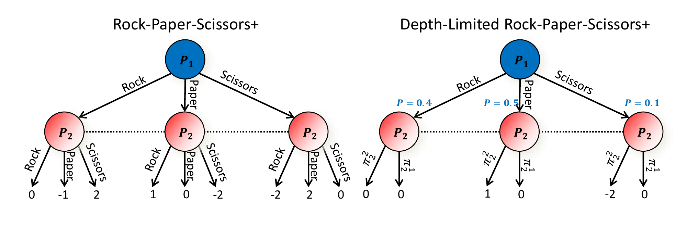
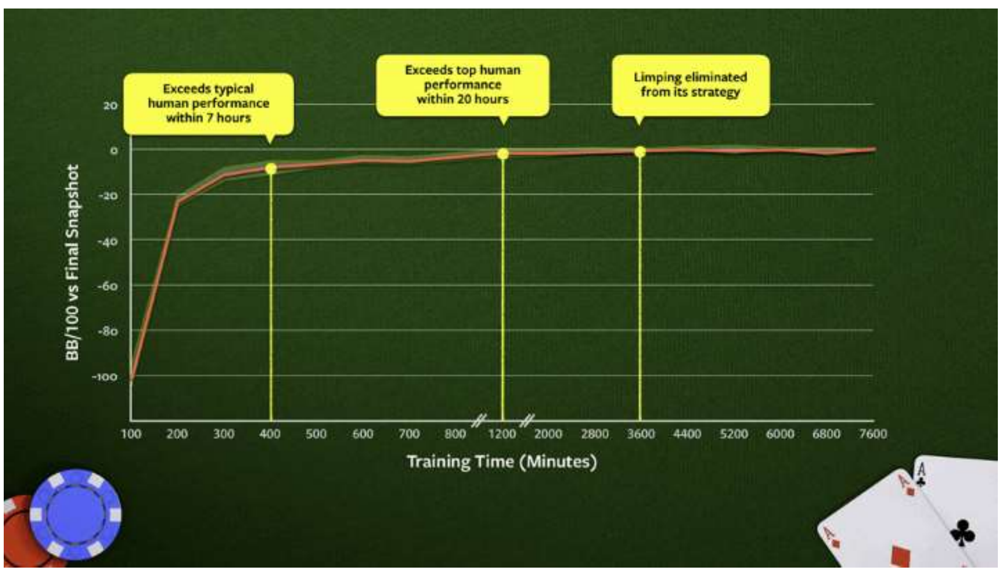

# L16 Pluribus: Multiplayer No-Limit Hold'em

This chapter has two parts. The first presents **depth-limited subgame solving** [Brown, Sandholm & Amos, NeurIPS-18; Brown & Sandholm, Science 2019]: it generalizes the "limited lookahead plus leaf evaluation" search paradigm of perfect-information games to imperfect-information games, and both the obstacles and the way around them are instructive. The second part presents Pluribus, the superhuman AI for six-player no-limit Texas hold'em [Brown & Sandholm, Science 2019], which is built directly on depth-limited solving and is the first AI to beat top human professionals in a multiplayer game.

## Depth-Limited Subgame Solving

### Why Limited Lookahead Works in Perfect-Information Games

In perfect-information games and single-agent search, the full game tree is too large to traverse exhaustively, but we can expand the tree only to a limited depth and substitute at each leaf node an **estimate of the state's value**: the value of that state assuming both players play perfectly thereafter. As long as the estimate is exact, limited-lookahead search plays an equilibrium strategy. This paradigm powered every superhuman system from chess to Go.

In imperfect-information games, however, **state values are not well defined at all**: the value of an information set depends on both players' strategies in the rest of the game, and there is no strategy-independent "value of a state." The following example makes the difficulty concrete.

### Example: Rock-Paper-Scissors+ and the Failure of Naive Truncation

Consider Rock-Paper-Scissors+ (an enhanced version of Rock-Paper-Scissors): P1 moves first, and P2 moves **without seeing** P1's choice (so P2's three nodes lie in one information set, joined by dashed lines). The payoffs are those of ordinary Rock-Paper-Scissors except that every encounter involving Scissors is played for double stakes: when P1 plays Rock the payoffs are $(0, -1, 2)$, when Paper $(1, 0, -2)$, and when Scissors $(-2, 2, 0)$, indexed by P2's choice of Rock, Paper, Scissors. The game is zero-sum, and its Nash equilibrium is for each player to mix Rock, Paper, Scissors with probabilities $(0.4, 0.4, 0.2)$; the value of the game is 0. One can verify the indifference conditions. When P2 mixes $(0.4, 0.4, 0.2)$, P1's expected payoff from Rock is $0 \times 0.4 + (-1) \times 0.4 + 2 \times 0.2 = 0$, from Paper is $1 \times 0.4 + 0 \times 0.4 + (-2) \times 0.2 = 0$, and from Scissors is $(-2) \times 0.4 + 2 \times 0.4 + 0 \times 0.2 = 0$: all three pure strategies are indifferent. By the symmetric computation, P1 mixing $(0.4, 0.4, 0.2)$ likewise makes P2 indifferent.

Now mimic what is done in perfect-information games: truncate after P1's move, replacing each leaf value by an estimate of "both players play equilibrium thereafter." Since P2's equilibrium strategy gives each of P1's pure strategies expected payoff 0, every leaf value is 0, as shown on the right of the figure. But in this depth-limited subgame all three actions have (truncated) value 0, so P1 is indifferent, and the solver may well output a mix far from equilibrium, for example $(0.8, 0.1, 0.1)$, heavily favoring Rock. Once P1 actually plays this way, P2 need only always play Paper to win, in expectation, $0.8 \times 1 + 0.1 \times 0 + 0.1 \times (-2) = 0.6$ per game. The supposed "leaf evaluation" cannot be sustained when the opponent can **adapt to your change**. The essence of the problem: in real-time planning one must consider how the opponent will adapt to changes in one's strategy (except in perfect-information games and the single-agent setting).

### The Algorithm: Giving the Opponent a Choice of Continuation Strategies at the Leaves

The fix is to make the truncated subgame still acknowledge that "the opponent has more than one way to play": at each leaf node, allow the opponent one final action in which she chooses among several **continuation strategies** (policies) $\pi_2^1, \pi_2^2, \dots$, each specifying complete play beyond the leaf and thereby determining the leaf's value. The algorithm iterates:

1. Solve the subgame with the current set of P2 leaf-node strategies;
2. Compute a P2 best response;
3. Add that best response to the set of leaf-node continuation strategies;
4. Repeat.

(Generating the opponent's continuation strategies by best response is not the only way.) The next figure shows the depth-limited subgame after two continuation strategies have been added: the opponent may choose between $\pi_2^1$ and $\pi_2^2$ at each leaf, and P1's strategy is pushed back close to the equilibrium, to $(0.4, 0.5, 0.1)$.

> **Theorem.** This iterative algorithm converges to a Nash equilibrium in two-player zero-sum games. In practice it reaches very low exploitability within a small number of iterations. It can also be combined with safe, recursive subgame solving.

### Safe Depth-Limited Solving Starting Later than the Root

In imperfect-information games, "subgames" are not independent of one another, but Libratus's endgame-solving techniques can be carried over, except that the "endgames" are now **midgames that end in continuation-strategy choices**:

- Start with a **blueprint strategy** covering the whole game, obtained for example via abstraction plus equilibrium computation, Deep CFR [Brown, Lerer, Gross & Sandholm, ICML-19], or manual construction;
- When solving for our strategy in an endgame (midgame), give the opponent a choice between two models: following the blueprint, or entering the endgame model [Burch et al., AAAI-14; Jackson, AAAI-14; Moravcik et al., AAAI-16; Brown & Sandholm, NIPS-17; Moravcik et al., Science 2017; Brown & Sandholm, Science 2018]. The objective is that for any private type the opponent may hold, she is not better off choosing the endgame model (**Theorem: this is safe**);
- Allow the opponent to get back in the endgame all the gifts she has given so far (**Theorem: safe**) [Brown & Sandholm, NIPS-17 Best Paper; Science 2018].

This scheme can be applied **recursively**: the action the opponent actually just took can be incorporated into the subgame model, and the closer the endgame is to the end of the game, the finer the abstraction one can afford (**Theorem: safe**) [Brown & Sandholm, NIPS-17 Best Paper; Science 2018].

### Head-to-Head in Two-Player No-Limit Hold'em: Modicum

Depth-limited solving produced what was then the second-strongest AI for heads-up no-limit Texas hold'em, Modicum [Brown, Sandholm & Amos, NeurIPS-18], using only 700 core hours of computation and 16 GB of memory, and playing in real time on a 4-core CPU at 20 seconds per hand. Head-to-head results against two generations of champion agents (in milli-big-blinds per game):

| | Baby Tartanian8 (2016 champion, 2 million core hours, 18 TB memory) | Slumbot (2018 champion, 250,000 core hours, 2 TB memory) |
|---|---|---|
| Modicum (no real-time reasoning) | $-57 \pm 13$ | $-11 \pm 8$ |
| Modicum (just one continuation strategy) | $-10 \pm 8$ | $-1 \pm 15$ |
| Modicum (just a few continuation strategies) | $\mathbf{6 \pm 5}$ | $\mathbf{11 \pm 9}$ |

The qualitative leap from real-time depth-limited search is plain: without real-time reasoning Modicum loses clearly, while giving the opponent a choice among just a few continuation strategies lets it beat both champions.

The takeaways of this segment: planning is important in imperfect-information games too, but it takes a different form: in real-time planning you must consider how the opponent can adapt to changes in your strategy (except in perfect-information games and the single-agent setting); states do not have well-defined values in imperfect-information games; and the depth-limited solving algorithm above is sound; it is what enabled the then-second-strongest heads-up no-limit Texas hold'em AI to be developed on a 4-core CPU with 16 GB of RAM.

## Multiplayer Games and Pluribus

### From Two-Player Zero-Sum to Multiplayer: The Missing Guarantees

All prior superhuman AI milestones were in two-player (zero-sum) games: checkers (Chinook, 1994), Othello (Logistello, 1997), chess (Deep Blue, 1997), two-player limit Texas hold'em (Polaris, 2008), Go (AlphaGo, 2016), two-player no-limit Texas hold'em (Libratus, 2017), and, if they count as superhuman, StarCraft II (AlphaStar) and DOTA 2 (OpenAI Five) in 2019. Multiplayer games have fundamental additional difficulties, even in normal form:

- **Playing a Nash equilibrium is no longer safe**: an equilibrium strategy does not guarantee the equilibrium value in a multiplayer game;
- **Even finding an approximate Nash equilibrium is hard**: there are complexity lower bounds in theory [Daskalakis et al. 2009; Chen et al. 2009; Rubinstein 2018], and in practice the fastest complete algorithm scales only to 3–5 players with 3–5 strategies per player [Berg & Sandholm, AAAI-17].

A subtler difficulty is the **equilibrium selection problem**: even if a Nash equilibrium of a multiplayer game could be computed efficiently, when each player independently computes and plays one equilibrium, their joint strategy profile need not be an equilibrium, so players still have an incentive to deviate. The paper illustrates this with the Lemonade Stand Game [Zinkevich et al. 2011]: several players simultaneously pick a point on a ring, each wanting to be as far as possible from every other player; the Nash equilibria have the players spaced uniformly around the ring, but there are infinitely many such equilibria (the ring can be rotated arbitrarily), and if each player independently picks one to play, the joint outcome is almost surely not a uniform spacing. Two-player zero-sum games are a special case: even when both players independently compute and select equilibria, the joint strategy is still a Nash equilibrium, a deep reason why all previous superhuman milestones could land in two-player zero-sum games. Beyond two-player zero-sum, then, "what should the goal of solving even be" becomes a question in itself; the Pluribus paper's answer is: do not target any game-theoretic solution concept, but instead empirically build an AI that consistently defeats humans, including elite professionals.

Multiplayer no-limit Texas hold'em (the world's most popular variant, the six-player game) was a recognized AI, game theory, and operations research milestone that had remained open for decades. Pluribus found superhuman strategies with a novel set of algorithms, but outside two-player zero-sum games there is **no** guarantee that the solution found is a Nash equilibrium. The work was named a runner-up for *Science*'s Breakthrough of the Year 2019.

### The Overall Design of Pluribus

Pluribus was developed on, and runs on, a single server with **no GPUs**; it uses **no data** (from human play); and it does **not adapt to the opponent**. Its architecture is "offline blueprint computation + real-time depth-limited search":

The abstraction-generation module produces both information abstraction (algorithm from [Brown, Ganzfried & Sandholm, AAMAS-15]) and action abstraction; the coarse abstraction of the game serves the offline blueprint computation, while a finer abstraction serves the online depth-limited subgame solving, which takes the blueprint strategy profile as input and finally outputs an action.

The blueprint strategy itself is executed directly only in the **first betting round** (of four): that round has few enough decision points that the blueprint can afford to use no information abstraction and a very large action abstraction. After the first betting round (or even within it, if an opponent chooses a bet size sufficiently different from the action abstraction), Pluribus switches to real-time search. For first-round bets that are only slightly off the abstraction, Pluribus rounds the bet to a nearby on-tree size using the **pseudoharmonic mapping** [Ganzfried & Sandholm, IJCAI-13] and then continues with the blueprint as if the opponent had used the latter size. Information abstraction drastically reduces the complexity of the game, but it may wash away subtleties that matter for superhuman performance. In actual play against humans, Pluribus therefore uses information abstraction only to reason about situations on **future** betting rounds, **never** on the betting round it is currently in. (During offline self-play for the blueprint, it is used throughout.)

### Pluribus's New Form of Depth-Limited Search

Pluribus's depth-limited search for imperfect-information games has two new design elements:

- At the leaves, **all players** (not just the opponents) choose among $k$ continuation strategies;
- **Search starts before the current situation** (at the beginning of the current betting round) rather than at the current information set: this mitigates the exploitability of unsafe search while keeping its advantages. Our player's strategy on the moves already taken is kept fixed; as in Libratus, the opponent's actual actions are added to the subgame model before solving, so **no reverse mapping of actions is needed**.

The paper uses $k = 4$: the four continuation strategies are the precomputed blueprint strategy, a blueprint variant biased toward folding, one biased toward calling, and one biased toward raising. Each player still in the hand chooses independently among these $k$ strategies at the leaves (no player observes the others' choices), and a leaf's value is estimated by rolling out the remainder of the game according to the continuation strategies the players chose. The subgame's root is an initial chance node that reaches each root node according to the normalized probability of reaching it under the previously computed strategy profile (the blueprint profile on the first solve of the hand). This structure leads the searcher to more balanced strategies: if the searcher plays an unbalanced strategy (say, always Rock in Rock-Paper-Scissors), an opponent shifting to another continuation strategy (always Paper) punishes it. One resulting implementation point: Pluribus keeps track of the probability it would have reached the current situation with each possible hand. Regardless of which hand it actually holds, it first computes a balanced strategy for **every possible hand**, then executes the action corresponding to its actual hand, so as to remain unpredictable to the opponents.

### Pluribus's Equilibrium-Finding Algorithm

Blueprint computation and depth-limited subgame solving share a single equilibrium-finding algorithm, a significant improvement over MCCFR [Lanctot et al., NeurIPS-09]:

- It uses the fastest sampling-based equilibrium-finding algorithm for zero-sum games, **Linear CFR** [Brown & Sandholm, AAAI-19 Distinguished Paper Honorable Mention]: Pluribus applies linear weighting to both the regrets and the strategy averaging ("**Linear MCCFR**");
- A new form of **dynamic pruning** is used early in the run (not in the last two steps of the game);
- Memory is saved by allocating a sequence in RAM only when it is actually encountered.

Each MCCFR iteration designates one player as the **traverser**: a hand is simulated according to all players' current strategies, and then for every decision the traverser made (and for the hypothetical decisions that would be encountered after choosing the other actions, and so on recursively, traversed depth-first), the algorithm examines the counterfactual outcomes. Since it knows every player's strategy for the iteration, these hypothetical outcomes can be simulated exactly. The difference between an action's counterfactual value and the value the traverser actually achieved (in expectation) is added to that action's **counterfactual regret**: how much the traverser regrets not having chosen that action previously; at the end of the iteration the strategy is updated so that actions with higher counterfactual regret are chosen with higher probability. In two-player zero-sum games CFR guarantees that the average strategy converges to a Nash equilibrium; in **all finite games**, CFR still guarantees that counterfactual regrets grow sublinearly in the number of iterations (hence average performance is asymptotically no worse than the best fixed strategy in hindsight), and it eliminates iteratively strictly dominated actions.

The motivation for Linear CFR: in vanilla CFR regret is accumulated rather than replaced, so the first, completely random (and typically very bad) iterations influence the regrets at a decay rate of only $1/T$. Linear CFR assigns weight $T$ to iteration $T$'s regret contributions and to the strategy averaging, so the first iteration's influence decays at the rate $1 \big/ \sum_{t=1}^{T} t = \frac{2}{T(T+1)}$. In practice the strategy improves faster, while the worst-case bound on total regret is nearly unchanged. (Pluribus applies the discounting only early in the run, because later the time cost of the extra multiplications is not worth the benefit.) The dynamic pruning takes the following form: actions with extremely negative regret are not explored in 95% of iterations. When solving a subgame in real time, if the subgame is large or early in the hand, Pluribus uses the same Monte Carlo Linear CFR as in blueprint computation; otherwise it switches to a vectorized Linear CFR that samples only chance events (such as board cards) [Johanson et al., IJCAI-11].

### Resources and Speed at Play Time

At play time Pluribus runs on a regular computer: two Intel Haswell E5-2695 v3 CPUs, less than 128 GB of memory, and no GPUs; searching a single subgame takes 1–33 seconds depending on the situation, and on average it plays a hand in 20 seconds, roughly twice as fast as human professionals. For comparison: AlphaGo used 1920 CPUs and 280 GPUs for real-time search in its 2016 matches against Lee Sedol; Deep Blue used 480 custom-designed chips in 1997; Libratus used 100 CPUs in 2017.

### Performance against Top Human Professionals

The evaluation used AIVAT [Burch et al., AAAI-18] for variance reduction; results are reported in the field's standard metric, **milli big blinds per game** (mbb/game, thousandths of a big blind won on average per hand), and statistical significance was measured at the 95% confidence level by a one-tailed t test of whether Pluribus is profitable. There were two experiments.

**Experiment 1: one professional against five copies of Pluribus.** The copies were independent and did not even know one another's seats. Chris Ferguson and Darren Elias each played 5,000 hands (incentivized by a \$2,000 appearance fee each, plus another \$2,000 to whoever lost less; neither knew the other's identity or results). Over the combined 10,000 hands Pluribus won an average of $32 \pm 15$ mbb/game, winning with statistical significance ($p = 0.014$); in a later experiment with the identical setup, Pluribus also beat Linus Loeliger. Per person, Darren Elias was behind by $40 \pm 22$ mbb/game ($p = 0.033$) and Chris Ferguson by $25 \pm 20$ mbb/game ($p = 0.107$, not significant on its own; the paper suggests this may be due to variance, skill, and/or his more conservative strategy biased toward folding in unfamiliar difficult situations).

**Experiment 2: five professionals against one Pluribus.** A total of 10,000 hands were played over 12 days; for each six-player session the five humans were selected based on availability from a pool of 13 top professionals: each had won over \$1 million playing poker, and several had won over \$10 million (Linus Loeliger, Jimmy Chou, Seth Davies, Michael Gagliano, Anthony Gregg, Dong Kim, Jason Les, Daniel McAulay, Nick Petrangelo, Sean Ruane, Trevor Savage, Jake Toole; the slides list these 12, while the paper's list of 13 also includes Greg Merson). The participants did not know who else was playing; each used a fixed alias throughout so that they could track one another's tendencies. \$50,000 was divided among the human players according to performance to incentivize their best play (a guaranteed minimum of \$0.40 per hand, up to \$1.60). After AIVAT adjustment, Pluribus won an average of $48 \pm 25$ mbb/game, a very high win rate in six-player no-limit Texas hold'em, especially against a collection of elite professionals, winning with statistical significance ($p = 0.028$). Pluribus's performance was quite steady over the whole experiment, which also suggests the humans were unable to find exploitable weaknesses in it.

### Training Cost and Training Curve

Blueprint training used a 64-core server with 512 GB of memory and no GPUs, for 8 days and 12,400 CPU core hours in total, about \$150 at cloud computing prices (the paper quotes about \$144 at spot-instance rates; the slides record it as about \$150). This is in sharp contrast to all previous game-AI milestones, which used large server clusters and/or GPU farms. The training curve (vertical axis: BB/100 relative to the final snapshot) shows:

Pluribus surpassed typical human level within about 7 hours and top human level within about 20 hours; with further training, **limping** (entering the pot preflop by just calling, a play humans consider weak) was eliminated from its strategy entirely. Because Pluribus's strategy comes entirely from self-play with no human data, it also offers an outside perspective on what optimal play in multiplayer no-limit hold'em looks like: it confirms the conventional human wisdom that limping is suboptimal for every player except the small blind (who has already invested half a big blind by the rules and so needs to invest only half as much as the others to call). But it overturns the folk wisdom that "donk betting" (starting a new betting round with a bet after ending the previous round with a call) is a mistake: Pluribus donk-bets far more often than human professionals do.

## Key Takeaways

- In perfect-information games, "limited lookahead plus leaf state values" works because state values are well defined; in imperfect-information games a state's value depends on both players' global strategies, so **state values are not well defined**, and naive truncation gets exploited by an adaptive opponent (the Rock-Paper-Scissors+ example).
- **Depth-limited solving**: at the leaves, give the opponent one final action choosing among several continuation strategies; iterate "solve subgame → compute best response → add to the strategy set." It converges to Nash equilibrium in two-player zero-sum games, needs only a few iterations in practice, and combines with safe recursive subgame solving (on this basis Modicum became the second-strongest heads-up no-limit hold'em AI on a 4-core CPU with 16 GB of RAM).
- In multiplayer games, playing a Nash equilibrium is no longer safe and finding even an approximate equilibrium is hard both in theory and in practice; Pluribus solved six-player no-limit Texas hold'em with "offline blueprint + real-time depth-limited search" (all players choose among $k$ continuation strategies at the leaves, and search starts at the beginning of the current betting round) together with Linear MCCFR (linear weighting + dynamic pruning + on-demand memory allocation).
- Pluribus uses no GPUs, no human data, and no opponent adaptation; training cost about \$150 of cloud compute, play requires only 2 CPUs at 20 seconds per hand, and it beat, with statistical significance, elite professionals who had each won millions of dollars.
