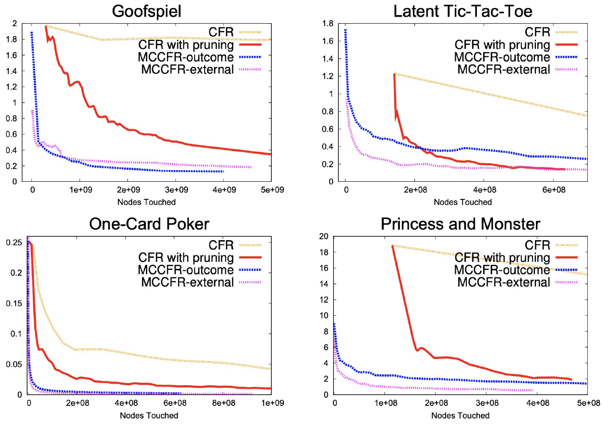
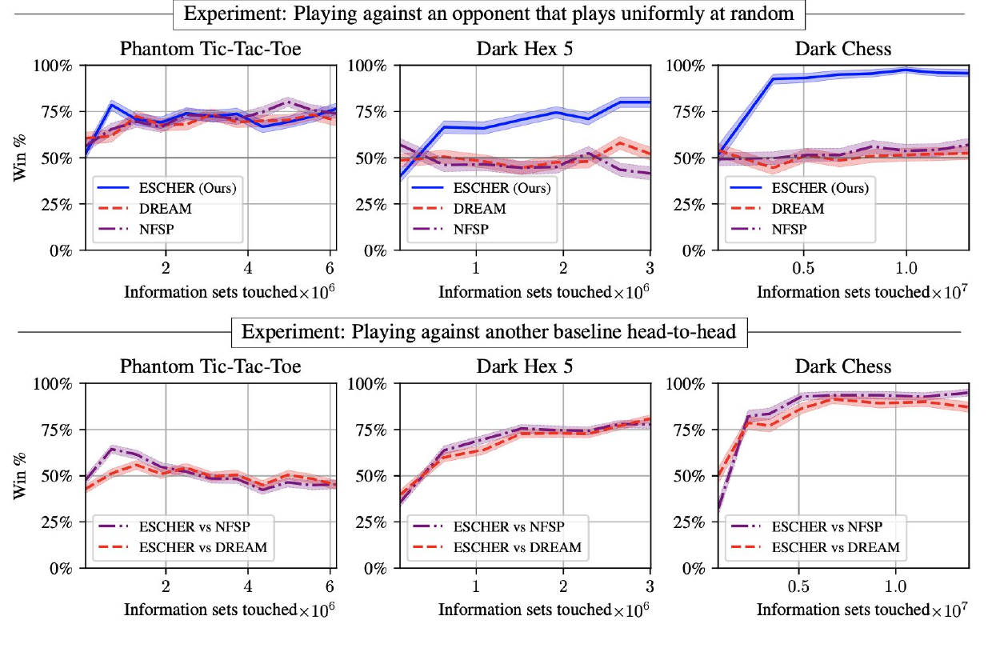

# L17 Deep Learning in Game Solving

In very large games, even running a handful of CFR iterations can be entirely prohibitive, since every iteration requires a full traversal of the game tree. This chapter first introduces Monte Carlo counterfactual regret minimization (MCCFR, Lanctot et al., 2009), a stochastic approximation of CFR whose per-iteration running time is far lower than that of vanilla CFR; many state-of-the-art game-solving algorithms, including Libratus, rely on MCCFR or its variants to construct a blueprint strategy. Building on MCCFR, the chapter then covers two more modern algorithms: Deep CFR (Brown et al., 2019), which replaces manual game abstraction with deep neural networks to handle game trees far too large for tabular methods, and ESCHER (McAleer et al., 2023), which drastically reduces the variance of the utility estimator and is thereby often the most effective approach on large games. The running theme is that stochastic regret minimization is, at its core, the search for a cheap, low-variance gradient estimator that tightly approximates the true underlying gradient.

## Stochastic Regret Minimization and MCCFR

### Motivation and Framework

Recall how CFR works: it deploys an independent regret minimizer at every information set; upon observing a utility $\boldsymbol{u}^{(t)}$, it constructs the counterfactual utilities at each information set (their exact form as a function of $\boldsymbol{u}^{(t)}$ was derived via regret circuits in a homework problem) and performs an update on each regret minimizer. Both steps demand a full game-tree traversal and are expensive. The basic idea of MCCFR is to replace $\boldsymbol{u}^{(t)}$ with a sparse estimator $\tilde{\boldsymbol{u}}^{(t)}$, which confers two benefits: first, one no longer needs to compute $\boldsymbol{u}^{(t)}$ exactly; second, only a subset of the information sets needs to be updated in each iteration. So long as the estimator is unbiased, that is, $\mathbb{E}[\tilde{\boldsymbol{u}}^{(t)}] = \boldsymbol{u}^{(t)}$, the regret degradation caused by the stochastic approximation can be bounded as a function of the estimator's variance (see the theorem below).

Lanctot et al. (2009) organize this idea into a general framework. Let $\mathcal{Q} = \{Q_1, \dots, Q_r\}$ be a collection of subsets of the terminal nodes $\mathcal{Z}$, called **blocks**, whose union covers all of $\mathcal{Z}$. Each iteration samples one block $Q_k$ with probability $q_k > 0$ and considers only the terminal nodes in that block; write $q(z) = \sum_{k : z \in Q_k} q_k$ for the probability that terminal node $z$ is considered this round. For an information set $j$, the sampled counterfactual value is defined by summing the exact counterfactual values within the block, weighted by $1/q(z)$. Since the blocks cover $\mathcal{Z}$, a direct summation shows that the sampled counterfactual value equals the exact one in expectation: this is what "the estimator is unbiased" means concretely in an extensive-form game. The framework subsumes all earlier CFR variants: taking $\mathcal{Q} = \{\mathcal{Z}\}$ (a single block, $q_1 = 1$) recovers vanilla CFR; letting each block contain all terminal nodes that share the same sequence of chance outcomes yields the "chance-sampled CFR" of the Zinkevich et al. technical report, the variant used in all early poker experiments but limited to games whose size is dominated by chance. External sampling and outcome sampling, introduced below, are two new members of this framework.

We continue to focus on (two-player) zero-sum extensive-form games, where the goal is to compute an approximate minimax (Nash) equilibrium; most of the techniques extend to regret minimization in general-sum games. Equilibrium computation in this setting can be phrased as the bilinear saddle-point problem

$$
\min_{\boldsymbol{x} \in \mathcal{X}} \max_{\boldsymbol{y} \in \mathcal{Y}} \; \sum_{z \in \mathcal{Z}} u_2(z)\, \boldsymbol{x}[\sigma_1(z)]\, \boldsymbol{y}[\sigma_2(z)]\, \boldsymbol{c}[\sigma_c(z)],
$$

where $\sigma_i(z) \in \Sigma_i$ is the last sequence of player $i \in \{1, 2, c\}$ on the path from the root of the game tree to terminal node $z \in \mathcal{Z}$, $\mathcal{X}$ and $\mathcal{Y}$ are the sequence-form polytopes of the two players, and $\boldsymbol{c}$ is the fixed strategy of the chance player. The saddle-point problem can be cast as $\boldsymbol{x}^\top \boldsymbol{A}\boldsymbol{y}$; Player 1's utility vector is $\boldsymbol{u}_{\mathcal{X}} = -\boldsymbol{A}\boldsymbol{y}$ (the negative sign because Player 1 is the minimizer) and Player 2's is $\boldsymbol{u}_{\mathcal{Y}} = \boldsymbol{A}^\top\boldsymbol{x}$. Utility computation thus boils down to matrix–vector products, which are relatively expensive, so we resort to sampling to construct unbiased estimators. There is a basic tradeoff here: we want estimators that are cheap and sparse, yet we must control their variance to limit the regret degradation. This chapter presents the two standard ways of navigating this tradeoff: external sampling and outcome sampling.

### External Sampling

External sampling samples only the external forces: the opponent and the chance player. Take the perspective of Player 1 (Player 2 is fully symmetric): independently sample a pure strategy $\tilde{\boldsymbol{y}}^{(t)}$ for Player 2 and a pure strategy $\tilde{\boldsymbol{c}}$ for the chance player. If $\mathbb{E}[\tilde{\boldsymbol{y}}^{(t)}] = \boldsymbol{y}^{(t)}$ and $\mathbb{E}[\tilde{\boldsymbol{c}}] = \boldsymbol{c}$, then the estimator

$$
\boldsymbol{x} \mapsto u_1(\boldsymbol{x}, \tilde{\boldsymbol{y}}^{(t)}, \tilde{\boldsymbol{c}})
$$

is an unbiased estimate of $\boldsymbol{u}_{\mathcal{X}}^{(t)} = -\boldsymbol{A}\boldsymbol{y}^{(t)}$.

**Sublinear algorithms in normal-form games.** It is worth dwelling first on the power of external sampling in the special case of normal-form games. Suppose each player employs a regret minimizer whose per-iteration running time is linear in the dimension (most online algorithms, such as RM and MWU, have this property). Then the per-iteration complexity is dominated by the matrix–vector products $\boldsymbol{A}\boldsymbol{y}^{(t)}$ and $\boldsymbol{A}^\top\boldsymbol{x}^{(t)}$. If $\boldsymbol{A} \in \mathbb{R}^{m_1 \times m_2}$ has $\mathrm{nnz}(\boldsymbol{A})$ nonzero entries, each such computation takes $O(\mathrm{nnz}(\boldsymbol{A}))$ arithmetic operations; for a dense matrix this is quadratic and unacceptable on large instances. External sampling replaces $\boldsymbol{y}^{(t)}$ with a pure strategy $\tilde{\boldsymbol{y}}^{(t)}$ sampled from it, and $\boldsymbol{A}\tilde{\boldsymbol{y}}^{(t)}$ can clearly be computed in linear time: the per-iteration cost drops from $O(\mathrm{nnz}(\boldsymbol{A}))$ to $O(m_1 + m_2)$, with even larger gains in extensive-form games. Combined with the theorem below, this implies that stochastic regret minimization in self-play finds an $\epsilon$-equilibrium in $\tilde{O}((m_1 + m_2)/\epsilon^2)$ time ($\tilde{O}$ hides logarithmic factors). This is essentially the famous **sublinear** algorithm of Grigoriadis and Khachiyan (1995): "sublinear" because, for any $\epsilon > 0$, finding an $\epsilon$-equilibrium takes less time than merely reading the entire input, namely $\mathrm{nnz}(\boldsymbol{A})$!

By way of comparison, deterministic methods without sampling that use the optimistic variant have total running time $\tilde{O}(\mathrm{nnz}(\boldsymbol{A})/\epsilon)$, which is superior when the precision $\epsilon$ is small enough; linear programming is polynomial in $\log(1/\epsilon)$ but introduces higher dimension dependencies that preclude its use on large-scale problems. The takeaway is that the best algorithm depends on the regime of approximation accuracy; this chapter focuses on very large games where one is content with a relatively crude $\epsilon$, and there stochastic regret minimization is to be preferred.

**Implementing external sampling in extensive-form games.** Start from the root and gradually make your way toward the terminal nodes: whenever you touch a node belonging to the opponent or the chance player, sample an action according to $\boldsymbol{y}^{(t)}$ or $\boldsymbol{c}$ respectively; if the node belongs to Player 1, branch over all actions and proceed recursively. Since only a single action is followed at opponent/chance nodes, computing this estimator is far cheaper than computing the exact utility vector; moreover, only the information sets on the paths reached by the sampled opponent/chance strategies need to be updated, typically a small fraction. Running CFR with this utility estimator yields **external-sampling MCCFR**.

### Outcome Sampling

Outcome sampling goes further: it samples not just the opponent and chance, but **every** player's strategy. For Player 1, it takes as input a fully mixed reference strategy $\boldsymbol{r}^{(t)} \in \mathcal{X}$ and samples a terminal node $\tilde{z}^{(t)} \in \mathcal{Z}$ according to

$$
\mathbb{P}[\tilde{z}^{(t)} = z] = \boldsymbol{r}^{(t)}[\sigma_1(z)]\, \boldsymbol{y}^{(t)}[\sigma_2(z)]\, \boldsymbol{c}[\sigma_c(z)] \qquad \forall z \in \mathcal{Z},
$$

and then produces the estimator

$$
\tilde{\boldsymbol{u}}_{\mathcal{X}}^{(t)} = \frac{u_1(\tilde{z}^{(t)})}{\boldsymbol{r}^{(t)}[\sigma_1(\tilde{z}^{(t)})]}\, \boldsymbol{e}_{\tilde{z}^{(t)}},
$$

where $\boldsymbol{e}_z \in \mathbb{R}^{\Sigma_1}$ is the unit vector with $\boldsymbol{e}_z[\sigma_1(z)] = 1$. It is a simple exercise to verify that this estimator is unbiased: $\mathbb{E}[\tilde{\boldsymbol{u}}_{\mathcal{X}}^{(t)}] = \boldsymbol{u}_{\mathcal{X}}^{(t)}$. Sampling a terminal node is very cheap: start from the root and at each node sample according to the acting player's strategy, in time proportional to the depth $d$ of the game tree, typically exponentially smaller than the number of nodes; having sampled $\tilde{z}^{(t)}$, one CFR step takes $O(d\,|\mathcal{A}|)$ time, since only the information sets on the path from the root to $\tilde{z}^{(t)}$ need updating.

The cost is variance: the estimator's variance is proportional to the inverse of $\min_{z \in \mathcal{Z}} \boldsymbol{r}^{(t)}[\sigma_1(z)]$. A theoretically sensible approach is to choose $\boldsymbol{r}^{(t)}$ maximizing $\min_z \boldsymbol{r}^{(t)}[\sigma_1(z)]$, thereby minimizing variance; it can be shown that there exists a **balanced strategy** $\boldsymbol{r}^*$ with $\boldsymbol{r}^*[\sigma] \geq 1/|\Sigma_1|$ for all $\sigma \in \Sigma_1$ (Farina et al., 2020), though this is not necessarily what works best in practice. The estimator uses the importance sampling technique, to which we return in the ESCHER section. Running CFR with this estimator yields **outcome-sampling MCCFR**.

Outcome sampling has one further distinctive advantage: it does not require knowing the opponent's strategy. If terminal nodes are sampled according to the opponent's own strategy (that is, the opponent's part of the sampling distribution is $\boldsymbol{y}^{(t)}$), the opponent's reach probability in the estimator exactly cancels the same factor in the counterfactual values, so the update depends only on the observed playout. As Lanctot et al. (2009) point out, this lets outcome-sampling MCCFR serve as an **online** regret minimization algorithm for extensive-form games; one only needs to mix sufficient exploration into one's own strategy to guarantee $q(z) \geq \delta > 0$, in the same spirit as the Exp3 algorithm for normal-form games. External sampling does not enjoy this property.

The figure below, taken from Lanctot et al. (2009), compares CFR, CFR with pruning, and the two MCCFR variants on four games (Goofspiel, Latent Tic-Tac-Toe, One-Card Poker, Princess and Monster). The horizontal axis is the number of nodes touched, an implementation-independent measure of computation (using wall-clock time instead leads to nearly identical conclusions). Both MCCFR variants reach lower exploitability than CFR with far fewer nodes touched across almost all budgets, and external sampling is overall slightly better than outcome sampling. Two implementation details from the experiments are worth mentioning. First, outcome sampling used an $\epsilon$-greedy sampling distribution: at each information set, sample an action uniformly at random with probability $\epsilon$ and according to the current strategy $\boldsymbol{y}^{(t)}$ otherwise; $\epsilon = 0.6$ worked well across all four games. Even though the regret bound suggests making $\delta$ as large as possible, putting some bias on the most likely outcome turns out to help in practice. Second, "CFR with pruning" used the following trick: when updating one player's regrets, if the opponent has zero probability of reaching the current history, the entire subtree at that history can be pruned for the current iteration with no effect on the resulting computation; this keeps vanilla CFR barely practical on these games (in Latent Tic-Tac-Toe, for example, the first iteration of CFR touches 142 million nodes, while later iterations touch as few as 5 million as dominated actions are identified and eliminated), yet even so MCCFR retains an orders-of-magnitude advantage. In Goofspiel, both MCCFR variants need only a few million nodes touched to push exploitability below 0.5, whereas CFR needs about 2.5 billion, a gap of three orders of magnitude. The wall-clock difference per iteration is even more extreme: vanilla CFR takes 28–120 seconds per iteration, outcome sampling only 46–150 microseconds, and external sampling about 28–150 milliseconds (as low as 99 microseconds on the smallest game). Outcome sampling is not uniformly dominant, however: it beats external sampling on Goofspiel, yet on Latent Tic-Tac-Toe it is even slower than vanilla CFR. Which game properties favor which sampling scheme remained an open question in the paper.

### Regret Analysis of the Stochastic Approximation

The following analysis is not restricted to extensive-form games, nor to external or outcome sampling: as long as the estimator is unbiased, the regret of stochastic regret minimization degrades only slightly relative to its deterministic core. Formally, we want to design a stochastic regret minimizer $\mathfrak{R}$ that, upon receiving the true utility sequence $(\boldsymbol{u}^{(t)})_{t=1}^T$, feeds the estimates $(\tilde{\boldsymbol{u}}^{(t)})_{t=1}^T$ to a deterministic regret minimizer $\tilde{\mathfrak{R}}$ (such as CFR) and directly outputs $\tilde{\mathfrak{R}}$'s output. Write $\mathrm{Reg}^{(T)}(\boldsymbol{x}) = \sum_{t=1}^T \langle \boldsymbol{x} - \boldsymbol{x}^{(t)}, \boldsymbol{u}^{(t)} \rangle$ for the regret with respect to a comparator $\boldsymbol{x} \in \mathcal{X}$, and $\mathrm{Reg}^{(T)} = \max_{\boldsymbol{x} \in \mathcal{X}} \mathrm{Reg}^{(T)}(\boldsymbol{x})$; $\widetilde{\mathrm{Reg}}^{(T)}(\boldsymbol{x})$ is defined analogously with $\tilde{\boldsymbol{u}}^{(t)}$. The key assumption is conditional unbiasedness:

$$
\mathbb{E}\big[\tilde{\boldsymbol{u}}^{(t)} \,\big|\, \tilde{\boldsymbol{u}}^{(1)}, \dots, \tilde{\boldsymbol{u}}^{(t-1)}\big] = \boldsymbol{u}^{(t)}.
$$

> **Theorem (Farina et al., 2020; a weaker version appears in Lanctot et al., 2009).** Suppose there are constants $M$ and $\tilde{M}$ such that for all $\boldsymbol{x}, \boldsymbol{x}' \in \mathcal{X}$ and $t \in [T]$,
>
> $$
> |\langle \boldsymbol{x} - \boldsymbol{x}', \boldsymbol{u}^{(t)} \rangle| \leq M, \qquad |\langle \boldsymbol{x} - \boldsymbol{x}', \tilde{\boldsymbol{u}}^{(t)} \rangle| \leq \tilde{M}.
> $$
>
> Then for any $\delta \in (0, 1)$, with probability at least $1 - \delta$,
>
> $$
> \mathrm{Reg}^{(T)} \leq \widetilde{\mathrm{Reg}}^{(T)} + (M + \tilde{M}) \sqrt{2T \log \frac{1}{\delta}}.
> $$

**Proof idea.** Fix any comparator $\boldsymbol{x} \in \mathcal{X}$ and decompose the true regret as

$$
\mathrm{Reg}^{(T)}(\boldsymbol{x}) = \widetilde{\mathrm{Reg}}^{(T)}(\boldsymbol{x}) + \sum_{t=1}^T d^{(t)}, \qquad d^{(t)} := \langle \boldsymbol{x} - \boldsymbol{x}^{(t)}, \boldsymbol{u}^{(t)} \rangle - \langle \boldsymbol{x} - \boldsymbol{x}^{(t)}, \tilde{\boldsymbol{u}}^{(t)} \rangle.
$$

By conditional unbiasedness, $\boldsymbol{x}^{(t)}$ depends only on $\tilde{\boldsymbol{u}}^{(1)}, \dots, \tilde{\boldsymbol{u}}^{(t-1)}$, so $(d^{(t)})$ is a **martingale difference sequence**; its magnitude satisfies $|d^{(t)}| \leq M + \tilde{M}$. Applying the Azuma–Hoeffding concentration inequality to its sum,

$$
\mathbb{P}\Big[\mathrm{Reg}^{(T)}(\boldsymbol{x}) \leq \widetilde{\mathrm{Reg}}^{(T)}(\boldsymbol{x}) + \epsilon\Big] = 1 - \mathbb{P}\Big[\sum_{t=1}^T d^{(t)} > \epsilon\Big] \geq 1 - \exp\Big(-\frac{2\epsilon^2}{4T(M + \tilde{M})^2}\Big).
$$

Setting $\epsilon = (M + \tilde{M})\sqrt{2T \log(1/\delta)}$ yields the statement. $\square$

Since $\tilde{\mathfrak{R}}$ is a deterministic regret minimizer, $\widetilde{\mathrm{Reg}}^{(T)}$ can be bounded with the techniques covered earlier in the course, with the catch that the observed utilities can have magnitude as large as $\tilde{M}$. The theorem carries two main lessons. First, ignoring lower-order terms, the regret of $\mathfrak{R}$ exceeds that of $\tilde{\mathfrak{R}}$ only by a term depending on $\sqrt{T}$ and on the estimator's magnitude $\tilde{M}$; hence **sublinear regret holds with high probability**, but unlike deterministic algorithms, stochastic regret minimization cannot break the $\sqrt{T}$ barrier, and this is not a limitation of the analysis but happens for a fundamental reason (see the discussion of sparse equilibria below). Second, one should make $\tilde{M}$ as small as possible: this is exactly where the tradeoff between external and outcome sampling becomes evident. Even with the balanced strategy, outcome sampling's $\tilde{M}$ is a factor $|\Sigma|$ higher; instantiating $\tilde{\mathfrak{R}}$ with CFR gives a total regret bound of $O(|\Sigma|\sqrt{T})$.

**MCCFR-specific bounds.** For extensive-form games, Lanctot et al. (2009) give bounds that depend more explicitly on the game structure. Let $\vec{a}_i$ be the subsequence of a history retaining only player $i$'s actions, and $\mathcal{I}_i(\vec{a}_i)$ the set of player $i$'s information sets whose action subsequence is exactly $\vec{a}_i$; define the game's $M$-value as $M_i = \sum_{\vec{a}_i} \sqrt{|\mathcal{I}_i(\vec{a}_i)|}$. It satisfies $\sqrt{|\mathcal{I}_i|} \leq M_i \leq |\mathcal{I}_i|$, and both ends are attained by certain games. Write $\Delta_{u,i} = \max_z u_i(z) - \min_z u_i(z)$ for the utility range. They first tighten the average-regret bound of vanilla CFR to $R_i^{(T)} \leq \Delta_{u,i} M_i \sqrt{|\mathcal{A}_i|}\,/\sqrt{T}$ (the earlier Zinkevich et al. bound had $|\mathcal{I}_i|$ in place of $M_i$), and then prove:

- **External sampling**: for any $p \in (0, 1]$, with probability at least $1-p$,
$$
R_i^{(T)} \leq \Big(1 + \sqrt{\tfrac{2}{p}}\Big)\, \Delta_{u,i}\, M_i\, \sqrt{|\mathcal{A}_i|}\,\big/\sqrt{T}.
$$
That is, external sampling needs only a constant factor (depending on the confidence) more iterations than vanilla CFR, while traversing only a fraction of the game tree each round; for balanced games where the two players make roughly equally many decisions, its per-iteration cost is $O(\sqrt{|H|})$ (vanilla CFR's is $O(|H|)$, where $|H|$ is the number of histories), so the total time for equilibrium computation is asymptotically strictly better.
- **Outcome sampling**: if in every round $q(z) \geq \delta > 0$ (or the opponent's reach probability is zero), then with probability at least $1-p$,
$$
R_i^{(T)} \leq \Big(1 + \sqrt{\tfrac{2}{p}}\Big)\, \frac{1}{\delta}\, \Delta_{u,i}\, M_i\, \sqrt{|\mathcal{A}_i|}\,\big/\sqrt{T}.
$$
The extra $1/\delta$ factor is exactly the price of importance sampling appearing in the bound, corroborating the earlier analysis that the variance is proportional to the inverse of the minimum sampling probability.

**Sparse equilibria and a lower bound for stochastic algorithms.** In a normal-form zero-sum game, a strategy $\boldsymbol{x} \in \Delta(\mathcal{A})$ is called $k$-sparse if at most $k$ of its coordinates are positive. A well-known result in algorithmic game theory (Lipton, Markakis, and Mehta, 2003) states that for any $\epsilon > 0$, there exist $\log(m)/\epsilon^2$-sparse equilibrium strategies. Stochastic regret minimization gives a constructive proof of this fact: run self-play MWU, sampling each player's pure strategy every round; the average is a sparse equilibrium. Moreover, $\log(m)/\epsilon^2$ is the best sparsity one can hope for (Feder et al., 2007), which implies that no stochastic algorithm can beat the regret barrier $\Omega(\sqrt{T \log m})$ even in self-play: there is no analog of optimistic-type acceleration in the stochastic setting (this observation is due to Haipeng Luo).

## Automated Game Abstraction and Deep CFR

Stochastic regret minimization, starting from MCCFR, is a key component of modern game-solving algorithms; the other central innovation is function approximation with deep neural networks in place of manual game abstraction. Abstraction techniques have been very successful in poker, but their main caveat is that abstraction often requires domain-specific knowledge and can miss strategic nuances of the game; there is also a chicken-and-egg problem: determining a good abstraction requires knowing the equilibrium, yet computing an equilibrium rests on a compact game abstraction.

### Neural Fictitious Self-Play

Neural fictitious self-play (NFSP, Heinrich and Silver, 2016) is the precursor of Deep CFR. Fictitious play is not the most attractive algorithm in the tabular setting (even tabular fictitious play can converge exponentially slowly; Daskalakis and Pan, 2014), but it has been repopularized in large-scale game solving: unlike sophisticated algorithms such as FTRL or mirror descent that solve a convex optimization problem each round, executing fictitious play hinges only on a **best response oracle**, which is exactly what deep reinforcement learning techniques are good at implementing.

NFSP maintains two datasets $\mathcal{D}_{\mathrm{RL}}^{(t)}$ and $\mathcal{D}_{\mathrm{SL}}^{(t)}$ that grow during training, together with two neural networks:

- **Value network** $Q(\theta_Q^{(t)})$: trained on $\mathcal{D}_{\mathrm{RL}}^{(t)}$ with Q-learning, a standard deep RL algorithm, to predict the value of each action at each state; maximizing the value at each state (mixed with a small amount of exploration) yields the player's approximate best response, as fictitious play requires.
- **Policy network** $\Pi(\theta_\Pi^{(t)})$: trained on $\mathcal{D}_{\mathrm{SL}}^{(t)}$ with supervised learning to imitate the player's past behavior, aiming to capture the player's **average strategy**. It is needed because only the average strategy of (tabular) fictitious play converges; with a last-iterate guarantee, this extra network would be unnecessary.

Both networks are continuously updated by stochastic gradient descent; when acting, the player mixes between the approximate best response given by deep RL and the average strategy given by the policy network, in some proportion. NFSP is a common baseline when evaluating deep-learning approaches on large games.

### Deep CFR

Deep CFR (Brown et al., 2019) is a sound approximation of CFR, motivated just like NFSP: doing away with manual abstraction. Instead of computing regrets exactly at each information set, whose number is enormous, it banks on a neural network's ability to **generalize** across similar information sets. Concretely, Deep CFR maintains for each player a **regret network** $R(\theta_R^{(t)})$ that outputs, for each information set, an approximation to the counterfactual regrets of its actions; were this network exact, Deep CFR would revert to ordinary MCCFR. The regret network is trained on a dynamic dataset $\mathcal{D}^{(t)}$, each of whose samples maps an (information set, action) pair to a counterfactual regret. As in NFSP, Deep CFR also maintains a **policy network** approximating the average strategy—again because even tabular CFR converges only on average.

In each iteration, Deep CFR performs multiple partial traversals of the game tree in the manner of external-sampling MCCFR:

1. At each opponent node encountered, first obtain an approximation to the opponent's counterfactual regrets from the opponent's regret network, then determine the opponent's behavioral strategy with regret matching (RM or a variant) and sample an action from it;
2. Along the traversal, compute the sampled counterfactual values $\tilde{\boldsymbol{u}}^{(t)}(a \mid j)$ for each sampled information set $j$, and from them the instantaneous counterfactual regrets

$$
\tilde{\boldsymbol{g}}^{(t)}(a \mid j) = \tilde{\boldsymbol{u}}^{(t)}(a \mid j) - \sum_{a' \in \mathcal{A}_j} \boldsymbol{b}(a' \mid j)\, \tilde{\boldsymbol{u}}^{(t)}(a' \mid j),
$$

where $\boldsymbol{b}(\cdot \mid j)$ is the behavioral strategy obtained by applying regret matching to that player's regret network;
3. For every such infoset–action pair $(j, a)$, add the sample $\{(j, a) \mapsto \tilde{\boldsymbol{g}}^{(t)}(a \mid j)\}$ to the dataset, obtaining $\mathcal{D}^{(t+1)}$;
4. Train the regret network on the updated dataset. In other words, the role of the game-tree traversals is to collect data for training the regret network.

External sampling has a key property here (Brown et al., 2019, Lemma 1): taking expectation for an information set $j$ conditioned on the event "this round's sampled block intersects $j$", the sampled instantaneous regret is exactly an unbiased estimate of the **advantage** (the difference between action $a$'s counterfactual value and the current strategy's counterfactual value) up to a normalizing factor independent of $a$ (the other players' probability of reaching $j$), so training a regression network on these samples is principled. Deep CFR's soundness theorem then incorporates the function-approximation error explicitly into the convergence bound: let each iteration perform $K$ traversals, let $\epsilon_L$ upper-bound the excess of the regret network's average loss over the best achievable loss, and let $\Delta$ be the utility range; then, provided the replay memory is large enough, with probability $1 - \rho$,

$$
\mathrm{Reg}^{(T)} \leq \Big(1 + \sqrt{\tfrac{2}{\rho K}}\Big)\, \Delta\, |\mathcal{I}|\, \sqrt{|\mathcal{A}|}\, \sqrt{T} \;+\; 4T\, |\mathcal{I}|\, \sqrt{|\mathcal{A}|\, \Delta\, \epsilon_L},
$$

so the average regret is, with high probability, at most $4|\mathcal{I}|\sqrt{|\mathcal{A}|\Delta\epsilon_L}$: the approximation error enters the asymptotic floor only through a **square root**, and as the error tends to zero the algorithm converges to a Nash equilibrium. This is the precise sense in which "Deep CFR is theoretically sound as long as the function-approximation error is small enough."

The paper's implementation has several details that matter greatly for performance: each iteration executes $K$ external-sampling traversals ($K$ in the tens of thousands in the experiments); once the memory exceeds capacity, **reservoir sampling** keeps the samples representative: with a sliding window instead, exploitability stops decreasing and even rises once the memory fills up; the regret network is **retrained from scratch every iteration** rather than fine-tuned from the previous weights (fine-tuning yields about 50% higher final exploitability, which the authors attribute to a single network falling into poor local minima as the target changes from round to round); linear-CFR iteration weighting (samples from round $t$ get weight $t$) is used to accelerate convergence; and regret matching, when all regrets are negative, does not fall back to the uniform strategy but deterministically picks the action with the largest regret, a change that makes regret matching more tolerant of approximation error.

A reassuring property of Deep CFR is that it is theoretically sound whenever the function-approximation error is small enough; in principle one can simply make the network capacity large enough, although practical constraints severely limit the usable network size. Brown et al. (2019) showed experimentally that despite being a general-purpose algorithm, Deep CFR is competitive with or even outperforms manual abstraction approaches, and it beats NFSP. The experiments ran on the flop variant of two-player limit Texas hold'em (FHP, over $10^{12}$ nodes and $10^9$ information sets) with a network of only 7 layers and 98,948 parameters: Deep CFR converged to an exploitability of 37 mbb/g (milli big blinds per game), against 47 mbb/g for NFSP; compared with manual abstractions that cluster on domain-specific features, Deep CFR's asymptotic exploitability matched that of the 3.6-million-cluster abstraction while converging substantially faster. The figure below (from the paper) compares the convergence of Deep CFR, NFSP, and domain-specific abstractions of varying granularity (distinguished by cluster count): Deep CFR reaches low exploitability with far fewer nodes touched than the lossless abstraction (234M clusters), two to three orders of magnitude fewer samples, without hitting a floor at high exploitability the way lossy abstractions do. In head-to-head evaluation on the much larger HULH (over $10^{17}$ nodes), Deep CFR beat NFSP by $43 \pm 2$ mbb/g and lost only $11 \pm 2$ mbb/g to the solution computed from a $3.3 \times 10^8$-cluster abstraction; for reference, the 2007 poker AI Polaris used an abstraction of roughly $3 \times 10^8$ clusters and defeated human professionals by about $52 \pm 10$ mbb/g after variance reduction.

A popular variant of Deep CFR is DREAM (Steinberger et al., 2020), which switches to outcome sampling and introduces a baseline-based variance-reduction technique to mitigate the variance of importance sampling; the details are beyond the scope of this course.

## ESCHER

The final algorithm of this chapter is ESCHER (McAleer et al., 2023). It belongs to the outcome-sampling MCCFR family but uses an improved utility estimator. The motivation: in outcome sampling, importance sampling makes the estimator's variance very large (proportional to $1/\min_z \boldsymbol{r}^{(t)}[\sigma_1(z)]$), and the problem is especially severe when the estimates are to be produced by a deep neural network, which struggles with outputs of wildly different magnitudes. ESCHER **eliminates importance sampling altogether** while retaining theoretical soundness.

Concretely, ESCHER uses a **fixed** reference strategy $\boldsymbol{r}_i$ for each player $i$ (it can be the balanced strategy mentioned above, but need not be); unlike in typical outcome-sampling MCCFR, it is crucial that the reference strategy remain unchanged throughout. Each iteration, ESCHER samples a terminal node $\tilde{z}^{(t)} \sim (\boldsymbol{r}_i, \boldsymbol{x}_{-i}^{(t)})$ by the usual random-walk of outcome sampling with the reference strategy, and then updates the regret minimizers at every information set on the path from the root to $\tilde{z}^{(t)}$. The key difference: ESCHER uses a neural network to estimate **conditional values**, not counterfactual values. If $u_i^{(t)}(a \mid j)$ is the counterfactual value at time $t$, there is the decomposition

$$
u_i^{(t)}(a \mid j) = \boldsymbol{x}_{-i}^{(t)}(j) \cdot Q_i^{(t)}(a \mid j),
$$

where $\boldsymbol{x}_{-i}^{(t)}(j)$ is the probability that all other players reach information set $j$, and $Q_i^{(t)}(a \mid j)$ is the conditional value. Since sampling reaches $j$ according to $\boldsymbol{r}_i$, the neural network's estimate satisfies

$$
\mathbb{E}[\tilde{u}_i^{(t)}(a \mid j)] = \boldsymbol{r}_i(j) \cdot \boldsymbol{x}_{-i}^{(t)}(j) \cdot Q_i^{(t)}(a \mid j) = \boldsymbol{r}_i(j) \cdot u_i^{(t)}(a \mid j).
$$

This is not an unbiased estimate of the counterfactual value: it is off by a scaling factor $\boldsymbol{r}_i(j)$; but the point is that regret matching and its variants are **scale invariant**, and the scaling factor, because the reference strategy is fixed, stays the same throughout, so it does not affect the iterates produced. In other words, ESCHER is a theoretically sound algorithm in the tabular setting. In practice it also significantly outperforms popular algorithms such as DREAM.

In more detail, McAleer et al. (2023) decompose the outcome-sampling MCCFR estimator into two factors: one is a reach-probability correction of the form $1/\boldsymbol{r}_i(j)$, which ensures every information set is updated equally often in expectation; the other is an unbiased estimate of the (conditional) history value constructed from the terminal utility. DREAM uses a bootstrapped baseline to reduce the variance of the second factor, but since the baseline is imperfect and the bootstrapping still divides by sampling probabilities recursively, the variance remains high; ESCHER removes the first factor entirely by fixing the reference strategy (at the mere cost of reweighting each information set's regrets by $w(j) := \boldsymbol{r}_i(j)$) and directly replaces the second factor with a **history value function**: for every information set $j$ and action $a$ on the trajectory, the instantaneous regret estimate is $Q_i^{(t)}(a \mid j) - \sum_{a'} \boldsymbol{b}(a' \mid j)\, Q_i^{(t)}(a' \mid j)$, containing no importance-sampling term whatsoever. The theoretical analysis (in the martingale-difference-sequence plus Azuma–Hoeffding framework from earlier in this chapter) shows that, as long as the reference strategy assigns positive probability to every action, with high probability $\mathrm{Reg}^{(T)} = O\big(\frac{|\mathcal{A}|\,|\mathcal{I}_i|}{\min_j w(j)}\, \sqrt{T \log(1/p)}\big)$; the dependence on $1/\min_j w(j)$ shows that the **balanced strategy is the theoretically optimal reference strategy** (in practice the paper approximates it with uniform sampling over the actions at each information set). The analysis also accommodates approximation error in the value function: if the history-value error has magnitude at most $\epsilon$, it enters the regret only as a **linear additive term** $|\mathcal{I}_i|\,\epsilon$; function-approximation error is not amplified. The full deep ESCHER maintains three replay buffers: a regret buffer for training the regret network (reinitialized each iteration), a buffer of trajectories with terminal utilities for training the history-value network (retrained each iteration), and an average-policy buffer for training the average-policy network that produces the final output; since it only needs random walks under the reference strategy and the opponent's current strategy, it is completely model-free and requires no recursive game-tree expansion the way external sampling does.

The table below (from McAleer et al., 2023) reports the **average variance of the regret estimator** of each algorithm (averaged over the first five training iterations; lower is better): the top three rows are deep algorithms on large games, the bottom three are tabular versions with oracle value functions; Ablation 1 is ESCHER with the history value function replaced by a bootstrapped baseline, and Ablation 2 is ESCHER with the reach-probability weighting restored (i.e., importance sampling reinstated). Restoring both at once recovers exactly DREAM. Because it contains no importance sampling at all, ESCHER's estimator variance is orders of magnitude lower than that of the ablations, DREAM, and outcome-sampling MCCFR (OS-MCCFR); the ablations' high variance indeed translates into the win-rate deficits shown later, demonstrating that both changes are necessary:

| Game | ESCHER | Ablation 1 | Ablation 2 | DREAM / OS-MCCFR |
|---|---|---|---|---|
| Phantom Tic-Tac-Toe | $(2.6 \pm 0.1)\times 10^{-1}$ | $(4.1 \pm 0.7)\times 10^{1}$ | $(1.4 \pm 0.4)\times 10^{7}$ | $(4.6 \pm 1.0)\times 10^{7}$ (DREAM) |
| Dark Hex 4 | $(1.8 \pm 0.1)\times 10^{-1}$ | $(1.3 \pm 0.9)\times 10^{2}$ | $(3.1 \pm 1.7)\times 10^{8}$ | $(2.8 \pm 2.0)\times 10^{8}$ (DREAM) |
| Dark Hex 5 | $(1.3 \pm 0.1)\times 10^{-1}$ | $(3.3 \pm 1.6)\times 10^{2}$ | $(2.0 \pm 0.6)\times 10^{5}$ | $(5.3 \pm 3.9)\times 10^{8}$ (DREAM) |
| Leduc | $(5.3 \pm 0.0)\times 10^{0}$ | — | $(3.3 \pm 0.7)\times 10^{2}$ | $(2.8 \pm 0.0)\times 10^{2}$ (DREAM); $(2.2 \pm 0.0)\times 10^{3}$ (OS-MCCFR) |
| Battleship | $(1.4 \pm 0.0)\times 10^{0}$ | — | $(7.1 \pm 0.3)\times 10^{2}$ | $(1.2 \pm 0.0)\times 10^{3}$ (DREAM); $(2.4 \pm 0.0)\times 10^{3}$ (OS-MCCFR) |
| Liar's Dice | $(9.0 \pm 0.1)\times 10^{-1}$ | — | $(7.8 \pm 0.9)\times 10^{1}$ | $(4.0 \pm 0.8)\times 10^{2}$ (DREAM); $(1.2 \pm 0.1)\times 10^{3}$ (OS-MCCFR) |

The figure below (also from McAleer et al., 2023) shows playout win rates: the top row is each algorithm's win rate against a uniform-random opponent, where ESCHER clearly leads DREAM and NFSP on Dark Hex 5 and Dark Chess (on the largest game, Dark Chess, DREAM and NFSP have no advantage over a random opponent at all); the bottom row is ESCHER's head-to-head win rate against NFSP and DREAM, and the gap widens as the game grows: on Dark Chess, ESCHER beats DREAM and NFSP head-to-head over 90% of the time. Since exploitability cannot be computed exactly on these large games, the paper uses head-to-head win rate in place of NashConv as the evaluation metric.

## Key Takeaways

- In very large games, CFR's full game-tree traversal is infeasible; MCCFR replaces exact utilities with unbiased sparse utility estimators $\tilde{\boldsymbol{u}}^{(t)}$, drastically cutting the per-iteration cost, and Libratus used it to construct its blueprint strategy.
- Two standard estimators: **external sampling** samples only the opponent's and chance's pure strategies (updating only the information sets reachable along the sampled paths); **outcome sampling** samples every player, drawing one terminal node per $\mathbb{P}[\tilde{z}^{(t)} = z] = \boldsymbol{r}^{(t)}[\sigma_1(z)]\boldsymbol{y}^{(t)}[\sigma_2(z)]\boldsymbol{c}[\sigma_c(z)]$ and correcting with importance sampling, at $O(d\,|\mathcal{A}|)$ time per round but with variance proportional to $1/\min_z \boldsymbol{r}^{(t)}[\sigma_1(z)]$.
- In normal-form games, external sampling cuts the per-iteration cost from $O(\mathrm{nnz}(\boldsymbol{A}))$ to $O(m_1 + m_2)$, yielding the Grigoriadis–Khachiyan sublinear algorithm: an $\epsilon$-equilibrium in $\tilde{O}((m_1+m_2)/\epsilon^2)$ time, faster than reading the input.
- Regret analysis (Farina et al., 2020): as long as the estimator is conditionally unbiased, $\mathrm{Reg}^{(T)} \leq \widetilde{\mathrm{Reg}}^{(T)} + (M + \tilde{M})\sqrt{2T\log(1/\delta)}$ holds with high probability; the proof decomposes the error term into a martingale difference sequence and applies Azuma–Hoeffding. Corollaries: stochastic algorithms cannot break the $\sqrt{T}$ barrier (the optimality of $\log(m)/\epsilon^2$-sparse equilibria yields an $\Omega(\sqrt{T\log m})$ lower bound), and estimators with small $\tilde{M}$ are preferable.
- Deep CFR approximates per-information-set counterfactual regrets with a regret network and the average strategy with a policy network, collecting training data through external-sampling MCCFR partial traversals; it is theoretically sound when the function-approximation error is small, and experimentally matches or beats manual abstraction while outperforming NFSP.
- ESCHER fixes the reference strategy and estimates conditional values instead of counterfactual values; its estimates equal the counterfactual values times a fixed scaling factor $\boldsymbol{r}_i(j)$, and regret matching's scale invariance leaves the iterates unaffected, thereby eliminating importance sampling and its high variance entirely, making it often the most effective method on large games.
