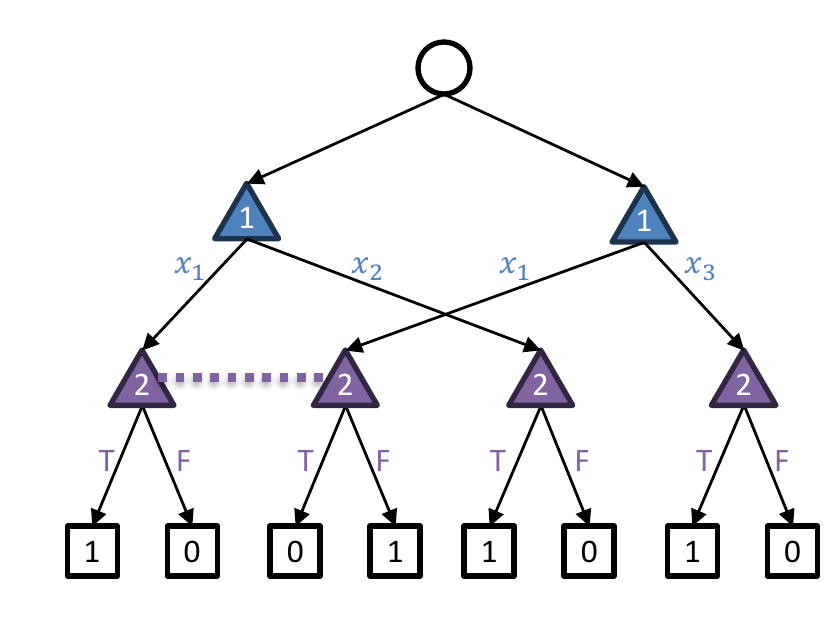

<!-- escape-math: v1 -->
# L18 Team Games

This chapter turns to **team games**: several players form a team, share a single utility function, and play against an opponent (or an opposing team). The central question is: when teammates cannot communicate freely and cannot share their private information, how should "the team's optimal strategy" be defined, and how can it be computed? We will see that the natural solution concepts are computationally very hard. But by characterizing the team's **common knowledge**, one can recover polynomial-time algorithms when the degree of information asymmetry is bounded (the team belief DAG, TB-DAG). The chapter closes with solution concepts and exact solving of hidden-role games (the "social deduction" genre, e.g., Avalon).

## What Are Team Games?

Consider the following three-player zero-sum game: P1 and P2 are **teammates** sharing the same utility function, and P3 is the opponent. It is a "communication game": P1 must transmit one bit of information to P2 without P3 learning it. The goal is to find an optimal strategy profile for the team.

Write $\bar{x} := 1 - x$. When the team commits first (team maximizes, opponent minimizes the team's utility), the value is

$$
\begin{aligned}
&\max\_{\substack{x\_1 \in \Delta(\Pi\_1)\\\ x\_2 \in \Delta(\Pi\_2)}}\\; \min\_{x\_3 \in \Delta(\Pi\_3)} u(x\_1, x\_2, y)
= \max\_{a,b,c,d \in [0,1]}\\; \min\_{e,f \in [0,1]} \tfrac{1}{2}\big(ac\bar{e} + \bar{a}d\bar{f} + b\bar{c}e + \bar{b}df\big) \\\
&\qquad \le \max\_{a,b,c,d} \tfrac{1}{2}\big(ac\bar{c} + \bar{a}d\bar{d} + b\bar{c}c + \bar{b}\bar{d}d\big) \qquad (\text{setting } e \gets c,\ f \gets d) \\\
&\qquad \le \frac{1}{2}\cdot\frac{1}{4}\cdot\big(a + \bar{a} + b + \bar{b}\big) = \frac{1}{4} \qquad \Big(\text{since } x\bar{x} = x(1-x) \le \tfrac{1}{4}\Big)
\end{aligned}
$$

In fact, equality holds at $a=b=c=d=1/2$, so the value is exactly $1/4$.

**The minimax theorem fails here.** Swapping the order of max and min (the opponent commits first, the team responds) gives

$$
\min\_{y \in \Delta(\Pi\_3)}\\; \max\_{\substack{x\_1 \in \Delta(\Pi\_1)\\\ x\_2 \in \Delta(\Pi\_2)}} u(x\_1, x\_2, y)
= \min\_{e,f}\\; \max\_{a,b,c,d} \tfrac{1}{2}\big(ac\bar{e} + \bar{a}d\bar{f} + b\bar{c}e + \bar{b}df\big)
\ge \min\_{e,f} \max\big\\{\tfrac{f + \bar{e}}{2},\ \tfrac{e + \bar{f}}{2}\big\\} = \frac{1}{2},
$$

where the lower bound comes from two pure profiles of the team ($a=c=0, b=d=1$ or $a=c=1, b=d=0$), after which the opponent sets $e=f$ so that $f + \bar{e} = e + \bar{f} = 1$. Hence $\min\max = 1/2 > 1/4 = \max\min$. Why? Intuitively, two teammates who randomize independently cannot share a "secret coin" to coordinate their random choices; that is exactly what distinguishes a team of players from a single player.

## Solution Concepts for Team Games

Nash equilibrium is not a good answer: the profile $(a,b;\ c,d;\ e,f) = (1,0;\ 1,0;\ 1,0)$ is a Nash equilibrium in which P1/P2 **always lose**: Nash cannot express the goal of "jointly optimal play by the team."

> **Definition (Team min-max equilibrium, TME).** A team min-max equilibrium (TME) is a solution to the optimization problem
> $$\max\_{\substack{x\_1 \in \Delta(\Pi\_1)\\\ x\_2 \in \Delta(\Pi\_2)}}\\; \min\_{y \in \Delta(\Pi\_3)} u(x\_1, x\_2, y).$$
> (These are precisely the solutions we computed above, with value $1/4$.)

The problem: this is a **nonconvex optimization**, hence hard, and as shown above the minimax theorem does not hold; calling it an "equilibrium" is already a stretch.

> **Definition (Team min-max equilibrium with correlation, TMECor).** The teammates may correlate their strategies before the game using **team-private randomness**, i.e., they jointly sample $\mu \in \Delta(\Pi\_1 \times \Pi\_2)$:
> $$\max\_{\mu \in \Delta(\Pi\_1 \times \Pi\_2)}\\; \min\_{y \in \Delta(\Pi\_3)}\\; \mathbb{E}\_{(x\_1, x\_2) \sim \mu}\\; u(x\_1, x\_2, y).$$

In the communication game: the TME value is $1/4$; the TMECor value is $1/2$: P1/P2 correlate uniformly between the two pure profiles $(1,0;\\,1,0)$ and $(0,1;\\,0,1)$ (a "random one-time pad"), which hides the bit from P3 completely.

More formally, correlation in TMECor is implemented through a **coordination device** (Farina, Celli, Gatti, Sandholm, NeurIPS 2018): before the game, the teammates agree on a set of joint pure plans; just before play begins, the device draws one joint pure plan from the distribution $\mu$, and each teammate plays according to it. Note that this differs from the usual notion of correlated equilibrium: no incentive-compatibility constraints are needed here, because teammates naturally share payoffs, so the paper calls it "coordination" rather than "correlation." The value of ex ante coordination can be enormous: the team's utility gain over no coordination can be as large as a factor on the order of the number of leaves in the game tree; conversely, restricting the solution concept to TME can cost the team an arbitrarily large amount of utility. But the benefit comes at a price: even computing a team best response to a fixed opponent strategy is already NP-hard and inapproximable (Basilico et al., AAAI 2017; Celli & Gatti, AAAI 2018).

The two concepts compare as follows:

| | TME | TMECor |
|---|---|---|
| Optimization problem | nonconvex | convex (bilinear saddle point) |
| Minimax theorem | fails | holds |

## An Equivalent View: (Timeable) Zero-Sum Games of Imperfect Recall

Team games correspond exactly to two-player zero-sum games of **imperfect recall**: think of the team as a single player who cannot remember her own past information. The correspondence is:

| Team games | Imperfect-recall games |
|---|---|
| team | player |
| strategy profile for the team | strategy for the player |
| uncorrelated strategy profile | behavioral strategy |
| correlated strategy profile | mixed strategy |
| TME | optimal behavioral strategy |
| TMECor | mixed Nash equilibrium |

The crucial caveat: **Kuhn's theorem does not apply**; for imperfect-recall games, mixed and behavioral strategies are not equivalent! This also explains why TME $\ne$ TMECor. The question for the remainder of the chapter is: **when can we compute TMECor efficiently?** (Strictly speaking, the correspondence requires the game to be **timeable**; see the bonus discussion at the end of the chapter.)

## Representing Team Strategy Profiles: The Realization Form

How should we represent correlated strategy profiles of a team? With the **realization form**. Let $Z$ be the set of terminal nodes; a pure strategy of the team is a vector $\boldsymbol{x} \in \\{0,1\\}^Z$ where $\boldsymbol{x}[z] = 1$ if team ▲ plays all of its own actions on the path to $z$ (similarly for team ▼). Then TMECor is a saddle point of the following bilinear saddle-point problem:

$$
\max\_{\boldsymbol{x} \in \mathrm{conv}\\, X}\\; \min\_{\boldsymbol{y} \in \mathrm{conv}\\, Y}\\; \boldsymbol{x}^{\top} \boldsymbol{A} \boldsymbol{y}, \qquad \text{where } \boldsymbol{A}[z, z] = p\_{\mathrm{chance}}(z) \cdot u(z).
$$

This is a **convex, bilinear saddle-point problem**! Intuition: if both teams consist of a single player, this reduces (modulo a linear transformation) to the sequence-form max-min problem.

A few precise facts from the theory of the realization form (Farina et al., NeurIPS 2018) are worth recording:

- **Reach-probability decomposition**: the reach probability of every terminal node $z$ factors uniquely into the product of the players' contributions times the chance player's contribution; this is exactly why $\boldsymbol{A}$ is a diagonal matrix.
- **The realization function is linear**, so its range, the realization polytope, is indeed a convex polytope; all mixed strategies inducing the same realization vector are payoff-equivalent, and this redundancy is compressed away.
- **Relation to the sequence form**: for a perfect-recall player, the realization form is a projection of the sequence form (after dropping the non-terminal sequence variables and applying a simple linear transformation), describable with linearly many constraints; for an imperfect-recall player (such as a team), the description may require exponentially many constraints.
- **TMECor is the "convexification" of TME**: writing $\tilde\Omega$ for the set of realization vectors achievable by behavioral strategies (in general nonconvex), one has $\Omega = \mathrm{conv}\\,\tilde\Omega$ for any player who is not absent-minded.

## Computing TMECor Is Hard

Unfortunately, the realization form alone does not yield an efficient algorithm. The following reduction shows the hardness is intrinsic. Given a 3-SAT formula, say $\phi(x\_1, x\_2, x\_3) = (x\_1 \lor x\_2) \land (\neg x\_1 \lor x\_3)$, construct this team game:

- Chance picks a clause uniformly; P1 picks a variable in that clause; P2 **learns the variable (but not the clause)** and assigns it T or F; the team wins if and only if the assignment satisfies the corresponding clause.

P2's pure strategies are exactly the assignments $\boldsymbol{x} \in \\{T, F\\}^3$; P1 and P2 can win with probability 1 **if and only if** P2 plays a satisfying assignment. Therefore:

- Even computing an optimal strategy for a **single team** (against no strategic opponent) is NP-hard. The finer complexity classification is as follows ($\Delta\_2^P$ and $\Sigma\_2^P$ are classes in the polynomial hierarchy — polynomial time with a SAT oracle, and nondeterministic polynomial time with a SAT oracle, respectively — satisfying $\mathrm{NP} \subseteq \Delta\_2^P \subseteq \Sigma\_2^P$):

  | | team vs. player | team vs. team |
  |---|---|---|
  | Computing TMECor (value) | NP-complete (Koller & Megiddo, 1992) | $\Delta\_2^P$-complete (Zhang, Farina, Sandholm, ICML 2023) |
  | Computing TME (value) | NP-complete (Koller & Megiddo, 1992) | $\Sigma\_2^P$-complete (same) |

  Unless the polynomial hierarchy collapses, team-vs.-team is strictly harder than team-vs.-player, and within team-vs.-team, TME is strictly harder than TMECor, complexity evidence that the two solution concepts call for different algorithmic techniques.
- Corollary: **realization polytopes admit no efficient representation** (otherwise TMECor could be solved in polynomial time by LP, contradicting NP-hardness).

**So what can we do?** In practice, the readings give two main routes that work around the hardness while exploiting the "low-dimensional but hard-to-describe" realization polytope.

*Auxiliary game and column generation (Farina et al., NeurIPS 2018).* Computing a TMECor reduces to computing a two-player zero-sum Nash equilibrium in an **auxiliary game $\Gamma^\*$**: $\Gamma^\*$ is a perfect-recall two-player game in which each action at a root node $\phi$ corresponds to one pure plan of the team's "pivot" member, with the subgame of the original game under that fixed plan attached below, and the opponent does not observe the choice at $\phi$. Since $\Gamma^\*$ is equivalent to the original game in realization form, one can in principle run fictitious play on it. This is the **fictitious team-play** algorithm: it never constructs the exponentially large $\Gamma^\*$ explicitly, but instead computes best responses for both sides on the original game via mixed-integer linear programming (MILP), maintaining average strategies in realization form; the algorithm is anytime and guaranteed to converge to a TMECor, and on three-player Kuhn and three-player Leduc poker it scales to dramatically larger games than the only prior algorithm (the hybrid column-generation algorithm, which exceeded its 40 GB memory budget on the Leduc instances).

*Team-PSRO (McAleer et al., NeurIPS 2023).* The second route is to run PSRO (policy-space response oracles). Its tabular version, **team double oracle (Team DO)**, maintains a population of joint pure strategies for each team; each round solves a Nash equilibrium of the restricted zero-sum normal-form game spanned by the populations and adds the team's joint best response to that equilibrium into the population; it terminates when the best response cannot improve the Nash value of the restricted game, at which point the restricted equilibrium is a TMECor of the original game. Team-PSRO replaces the exact joint best response with an approximate joint best response learned by **cooperative reinforcement learning** (the paper uses MAPPO: a centralized critic that sees the full game history to reduce variance, with network parameters shared among teammates — centralized training, decentralized execution), which scales to large games; as a byproduct, the algorithm outputs an "approximate exploitability" (the value of the learned approximate best response against the restricted equilibrium — a lower bound on true exploitability) as a progress measure. A variant, **Team-PSRO Mix-and-Match**, additionally allows recombining the individual teammates' policies from different joint best responses into the population, enlarging the population and accelerating convergence at almost no cost. Experimentally: the tabular versions converge to approximate TMECor on Kuhn poker and Liar's Dice, faster than fictitious team-play; on four-player Google Research Football (two players per team, modified to include imperfect information), Team-PSRO and Team-PSRO-MM both beat the self-play baseline on all three metrics (Elo, goal difference against the built-in AI, and relative population performance), with the MM variant best. The cost is the lack of practical convergence guarantees: in the worst case one must enumerate all joint pure strategies, and team best response is itself NP-hard; but for sufficiently large games, this may be the only possible approach.

## The Team Belief DAG (TB-DAG)

### Construction

The third idea (the main thread of this chapter): construct a **single-player decision problem** for the team, the way the sequence form does for a perfect-recall player, by representing what is **common knowledge** to the team.

The basic objects of the construction:

- **Decision point** (a "belief"): identified by a **set** of game-tree nodes (under perfect recall, this is just an information set);
- **Prescription**: a selection of one action at each information set intersecting that decision point;
- **Observation point**: likewise identified by a set of nodes;
- **Public observation**: information observed by the team that is common knowledge among all team members.

The result is a **decision problem on a DAG**, representable with **scaled extensions**, the same idea that appeared for linear deviations in $\Phi$-regret. This structure is the **team belief DAG (TB-DAG)** (Zhang, Farina, Sandholm, ICML 2023).

Formally, the construction uses the **connectivity graph**: its vertices are the game-tree nodes, and two nodes at the same depth are adjacent if some team information set can reach both; the connectivity graph encodes precisely "what is *not* common knowledge to the team." Decision points of the TB-DAG are labeled by sets of game-tree nodes (beliefs); actions are prescriptions choosing one action per information set intersecting the belief; at observation points the problem splits along connected components, each component being one public observation. Two decision problems with the same terminal nodes and the same strategy space are called **strategically equivalent**; the ICML 2023 paper proves that the TB-DAG is strategically equivalent to the original team decision problem (its Theorem 4.2), and that a DAG version of CFR runs efficiently on it: with $N$ nodes and $E$ edges, the regret after $T$ iterations is $O(N\sqrt{T})$ and each iteration takes time $O(E)$ (its Theorem 4.3). In other words, the TB-DAG does for team games what the sequence form does for perfect-recall games: it turns a decision problem with information sets into an equivalent perfect-information decision problem, unlocking the regret-minimization toolbox.

### How Big Is the TB-DAG?

The size of the TB-DAG is dominated by the number of observation points (i.e., (decision point, prescription) pairs). The counting method: count **within each public state** (a common-knowledge set) separately. A (decision point, prescription) pair is uniquely determined by specifying, for each **last-infoset $J$**,

- whether $J$ is reached by that player;
- if so, which action is selected at $J$.

Let $b$ be the branching factor and $k$ the number of last-infosets; then

$$
\text{observation points per public state} \le (b+1)^k .
$$

The number of last-infosets $k$ exactly measures **information asymmetry**: how much information is known to some team member but is not common knowledge to the whole team. The extreme case $k = 1$ means the teammates have symmetric information, in which case the whole team can be modeled as a single perfect-recall player. Writing $N$ for the size of the game tree,

$$
\text{CFR per-iteration runtime} \\;\propto\\; \text{size of the TB-DAG} \\;\le\\; (b+1)^k \cdot \mathrm{poly}(N),
$$

which is polynomial time (and quite efficient in practice) when $k$ is a constant. This is essentially tight: an algorithm running in $2^{O(k)} \cdot \mathrm{poly}(N)$ would disprove the Exponential Time Hypothesis (ETH).

Take contract bridge as a rough estimate: $k = 2\binom{52}{13} < 2^{40}$, $b < 26$, $N \approx 2^{200}$. The naïve algorithm (write down the normal form and solve it) takes time about $2^{2^{200}}$, whereas the TB-DAG has size

$$
< 2^6 \cdot 2^{40} \cdot \mathrm{poly}\\!\left(2^{200}\right) < 2^{2^{43}} \ll 2^{2^{200}}.
$$

**Comparison with prior representations.** Both earlier approaches are based on **public states** (connected components of the connectivity graph — information that is unconditionally common knowledge) rather than public observations (information that becomes common knowledge only conditional on the strategy the team has played): Zhang & Sandholm (AAAI 2022) build an LP from tree decompositions, while Carminati et al. (NeurIPS 2022) convert the game into a strategically equivalent but potentially exponentially larger two-player perfect-recall game. The TB-DAG is strictly better: its size never exceeds $2^p$ times that of the public-state-based representation ($p$ being the number of nodes in the largest public state), and there exist instances where the public-state version is exponential while the TB-DAG is polynomial (even when the former is first preprocessed by **inflation**); no exponential gap exists in the reverse direction, and public observations make inflation unnecessary altogether. Experimentally, on multiplayer Kuhn, Leduc, and Liar's Dice benchmarks, CFR variants on the TB-DAG (PCFR+, DCFR, LCFR) are generally 2–3 orders of magnitude faster than the ZS22 LP: for example, on 12-rank three-player Kuhn (about 17,000 leaves) the TB-DAG method converges in about 1.4 seconds while both ZS22 and the column-generation method run out of memory; on L523 (about 775,000 leaves) it takes about 25 seconds, while the column-generation method fails to solve within 6 hours.

## Bonus #1: Why Timeability?

A partial answer: untimeable imperfect-recall games behave very strangely. Consider the single-player game below: after acting once, the player "forgets" what she did and acts again (the two nodes belong to the same player, who cannot tell which came first).

- Every **pure strategy** scores $0$;
- **Randomizing uniformly and independently** at the two nodes scores $1/4$.

"Behavioral strategies $\not\supseteq$ mixed strategies?!" More precisely, here it even becomes meaningful for the player to "correlate with herself," which is exactly the pathology the timeability assumption rules out.

## Bonus #2: Hidden-Role Games

Hidden-role games, a.k.a. **social deduction games**, are adversarial team games in which the "Good" team **does not know who its own teammates are**. The games emphasize communication: players may talk freely (to establish trust and coordinate actions), but a Good player does not know whether they are talking to a "Bad" player! There are further applications to distributed systems, network security, federated learning, and more. The rest of this section presents the work of Carminati, Zhang, Farina, Gatti, and Sandholm (EC 2024), whose contributions are: (1) the first solution concepts suitable for general hidden-role games; (2) the first efficient algorithms for solving general hidden-role games; (3) an application: exactly solving the 5- and 6-player versions of Avalon.

### Solution Concepts

Can we just use existing concepts? **Nash equilibrium** does not work: it does not capture team coordination (when there is only one team, Good or Bad, we want the jointly optimal strategy of the team, not merely some Nash equilibrium). **Team-correlated equilibrium** is the most natural concept when team identities are common knowledge: teammates can discuss strategy before the game (including flipping random coins to correlate). But in hidden-role games, **before the game begins you do not even know who your teammates are**. A new concept is needed.

**Solution: the split-personality game.** Split every player $i$ into a "Good version" and a "Bad version" (Good-$i$ and Bad-$i$), turning the $n$-player hidden-role game into a $2n$-player adversarial team game.

> **Definition (Hidden-role equilibrium).** A hidden-role equilibrium = a team (uncorrelated) equilibrium of the split-personality game = the optimal team strategy for the Good team to commit to.

The concept is **inherently asymmetric (no duality/minimax theorem)**! And the asymmetry is essential: in any hidden-role game where the minimax theorem holds, the Good team can cause the teams to be publicly revealed immediately by sending a long random string (→ roles no longer hidden!); that is, if the max-min and min-max values were equal, the very premise of "hidden roles" would collapse.

### An Example

Three players, with roles Good, Good, Bad. After free discussion, the players vote to elect a "leader": if a Good player is elected, the Good team wins; if the Bad player is elected, Bad wins; if there is no consensus, Bad **wins by default**.

- If the Bad player honestly declares "I am bad," the two Good players vote for each other, a Good player is elected, and Good wins;
- But Bad's optimal strategy is to **pretend to be Good**: then the Good team learns nothing and can only elect someone arbitrarily, so $\Pr[\text{Good wins}] = 2/3$.

Now make one small change: the roles are Good, Good′, Bad (the Good players hold **distinguishable** role cards). Now Bad is doomed: if he claims to be good, the Good players elect good′; if he claims to be good′, they elect good; if he claims neither, he reveals himself as Bad. **Conclusion: the Good team can win deterministically.** Intuition: distinguishable cards ⇒ **implicit correlation**: the role cards themselves act as the team's correlation device.

### Computing Hidden-Role Equilibria

Two key concepts: if the Bad team has fewer players than the Good team, Bad is a **minority**; if the Bad team (informally) "acts like it is being controlled by a single adversary controller," Bad is **coordinated**.

> **Theorem (Main algorithmic result).** Under the following three assumptions, there is an efficient algorithm for computing hidden-role equilibria:
> 1. private communication is allowed;
> 2. the Bad team is a minority;
> 3. the Bad team is coordinated.

Private communication is a reasonable assumption: it can be implemented with public communication plus public-key cryptography (assuming Bad is computationally bounded).

More precisely (Theorem 4.3 of the EC 2024 paper): if Bad has $k$ players with $k < n/2$, then the private-communication hidden-role value of the game equals the corresponding value of "the game with a mediator added who is always Good," and it can be computed exactly in $|H|^{O(k)}$ time by solving a zero-sum game of the same size; after simulating the mediator away with MPC, an $\varepsilon$-hidden-role equilibrium can be computed and executed in $\mathrm{poly}(|H|^k, \log(1/\varepsilon))$ time. The MPC used in the paper is in fact **information-theoretically secure** (secure even against computationally unbounded adversaries), which is stronger than the slide's framing (public-key cryptography requires a computationally bounded adversary).

> **Theorem (Lower bounds, informal).**
> - Assuming (2) and (3) but not (1): NP-hard;
> - Assuming (2) and (1) but not (3): coNP-hard;
> - Assuming (2) only: $\Sigma\_2^P$-hard.
>
> Open problem: what about assuming (1) and (3)?

The paper's full complexity landscape (computing the hidden-role value with a constant number of players):

| Bad-team assumptions | no communication | public communication | private communication |
|---|---|---|---|
| coordinated + minority | NP-complete | NP-hard | **P** (main theorem) |
| coordinated | NP-complete (von Stengel & Koller, 1997) | NP-hard | open problem |
| minority | $\Sigma\_2^P$-complete | $\Sigma\_2^P$-hard | coNP-hard |

**The price of hidden roles (PoHR).** Analogous to the price of anarchy, the paper defines the PoHR as the ratio of "the Good team's value once team identities are made public" to "the hidden-role value": for the class of games in which team assignments are drawn from a distribution $D$ and Good wins deterministically (normalized to $1$) once identities are public, the PoHR is exactly $1/p^\*$, where $p^\*$ is the probability $D$ assigns to the most likely team assignment; the intuition is that in the worst case Good can only open by guessing the entire team roster, winning only if the guess is right. In particular, with $n$ players and $k$ Bad players ($k < n/2$), the PoHR is exactly $\binom{n}{k}$; for $k = 1$ it is at most $n$, in sharp contrast to adversarial team games, where the "price of communication/correlation" can be arbitrarily large.

**Proof ideas for the main theorem.** First suppose there is a player who is **always on the Good team**, called the **mediator**. By the **revelation principle**: the mediator collects each player's information and sends back action recommendations; Good players report honestly and obey the recommendations, while Bad players may lie and may disobey.

- **Main idea #1**: with private communication and a coordinated Bad team, this is equivalent to a **two-player zero-sum game between the mediator and the Bad team** ⇒ it can be solved efficiently! A corollary: under these assumptions, the value of a hidden-role game is a **rational number**.
- **Main idea #2**: if there is no mediator, **simulate one using secure multi-party computation (MPC)**! (Requires a minority Bad team plus private communication.)

### Application: Solving Avalon Exactly

In Avalon, with fewer than 7 players the Bad team is coordinated ⇒ the main theorem applies. After extensive simplifications (e.g., removing dominated strategies), the game becomes small enough to solve exactly with linear programming (LP). Concretely, the paper uses game-specific reductions (removing dominated strategies, merging symmetric structures, etc.) to compress the raw game trees of 5- and 6-player Avalon (estimated at about $10^{56}$ nodes by Serrino et al. 2019) down to about $10^8$ nodes or fewer, making exact solving possible. (Strictly speaking, the Bad team in Avalon is not itself coordinated; the paper verifies for the 5- and 6-player variants that "coordination does not change the value," i.e., the two split-personality games are equivalent on these instances, so the conclusion of the main theorem still holds.) The table below gives the **(equilibrium) win rate of the Good team** in each variant:

| Variant | 5 players | 6 players |
|---|---|---|
| No special roles (*Resistance*) | $3/10 = 0.3000$* | $1/3 \approx 0.3333$* |
| Merlin | $2/3 \approx 0.6667$* | $3/4 = 0.7500$* |
| Merlin & Mordred | $731/1782 \approx 0.4102$ | $6543/12464 \approx 0.5250$ |
| Merlin & 2 Mordreds | $5/18 \approx 0.2778$ | $99/340 \approx 0.2912$ |
| Merlin, Mordred, Percival, Morgana | $67/120 \approx 0.5583$ | — |

*: already known to Christiano (2018). Note that one seemingly obvious identity does **not** hold: $\text{Resistance} \cdot \frac{2}{3} \stackrel{?}{=} \text{Merlin + 2 Mordreds}$ ($0.3000 \times 2/3 = 0.2000 \ne 0.2778$); the reason is that the Good team's role cards are distinguishable ⇒ implicit correlation!

### Future Research Directions

Hidden-role games are a new class of games for which one can reasonably define what it means to "solve" the game, and many open questions remain:

- (The open problem above) With a coordinated but non-minority Bad team and private communication, is there an efficient algorithm or a hardness result?
- If only public communication is allowed, it is not even clear whether a finite-time algorithm exists (how does one bound the length of communication?); this is especially important for practical interpretations, since humans playing these games usually restrict themselves to public communication and use no cryptography;
- Other messaging structures (e.g., anonymous messages)?
- What happens when both teams are hidden? Is there even a way to define hidden-role equilibria that does not depend on the seemingly arbitrary asymmetry of which team commits to its strategy first?

## Key Takeaways

- In team games, teammates share a utility function but cannot freely communicate private information; the minimax theorem fails for uncorrelated team strategies (in the communication game, $\max\min = 1/4 < 1/2 = \min\max$), and Nash equilibrium cannot express joint team optimality.
- Two core solution concepts: TME (nonconvex, minimax fails) and TMECor (correlation via team-private randomness; reduces to the convex bilinear saddle point $\max\_{\boldsymbol{x}\in\mathrm{conv}X}\min\_{\boldsymbol{y}\in\mathrm{conv}Y}\boldsymbol{x}^\top\boldsymbol{A}\boldsymbol{y}$).
- Team games ≡ (timeable) two-player zero-sum imperfect-recall games; TME ↔ optimal behavioral strategy, TMECor ↔ mixed Nash equilibrium, and Kuhn's theorem does not apply.
- Computing TMECor: NP-complete already for team-vs.-player (3-SAT reduction), $\Delta\_2^P$-complete for team-vs.-team (TME is even higher, $\Sigma\_2^P$-complete); realization polytopes admit no efficient representation. In practice: for small-to-medium games, the auxiliary game plus fictitious team-play (MILP best responses) or column generation; for large games, Team-PSRO (cooperative RL for approximate joint best responses).
- The TB-DAG turns a team game into a strategically equivalent single-player DAG decision problem based on the team's common knowledge; CFR runs directly on it (regret $O(N\sqrt{T})$, $O(E)$ per iteration); CFR's per-iteration time is $\le (b+1)^k \cdot \mathrm{poly}(N)$, where $k$ is the information asymmetry (number of last-infosets), polynomial for bounded $k$, and unimprovable under ETH.
- Hidden-role games: the hidden-role equilibrium is defined via the split-personality game (inherently asymmetric); efficiently solvable under "private communication + minority Bad + coordinated Bad" (revelation principle + MPC-simulated mediator), with NP / coNP / $\Sigma\_2^P$ lower bounds when any one assumption is relaxed; the price of hidden roles is exactly $\binom{n}{k}$; as an application, 5- and 6-player Avalon were solved exactly.
