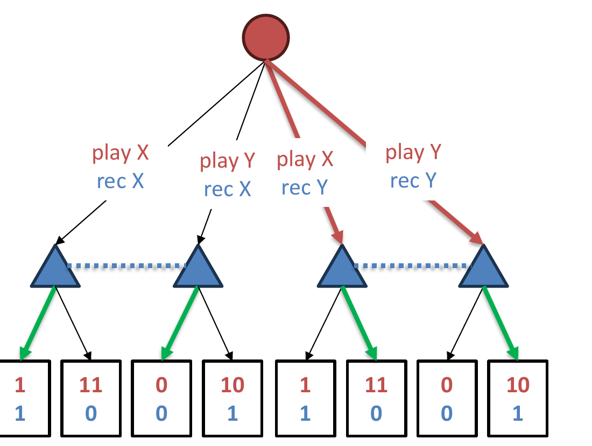
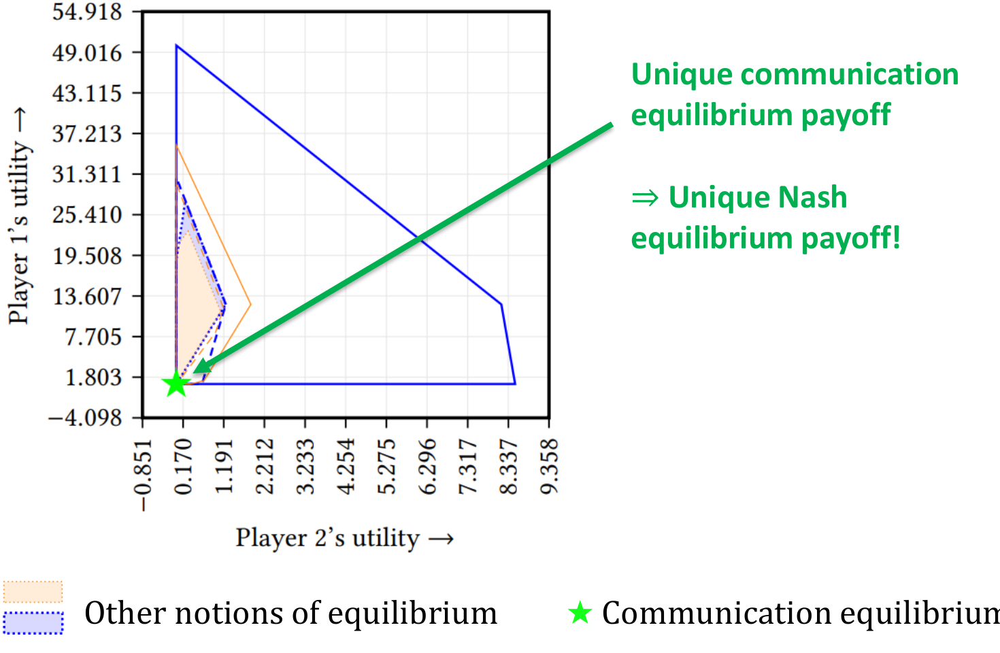
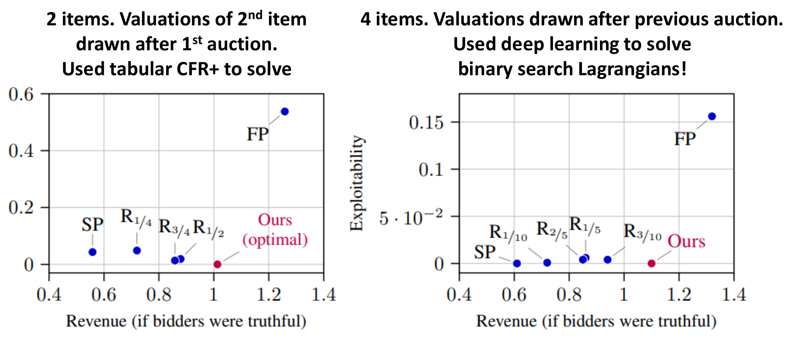
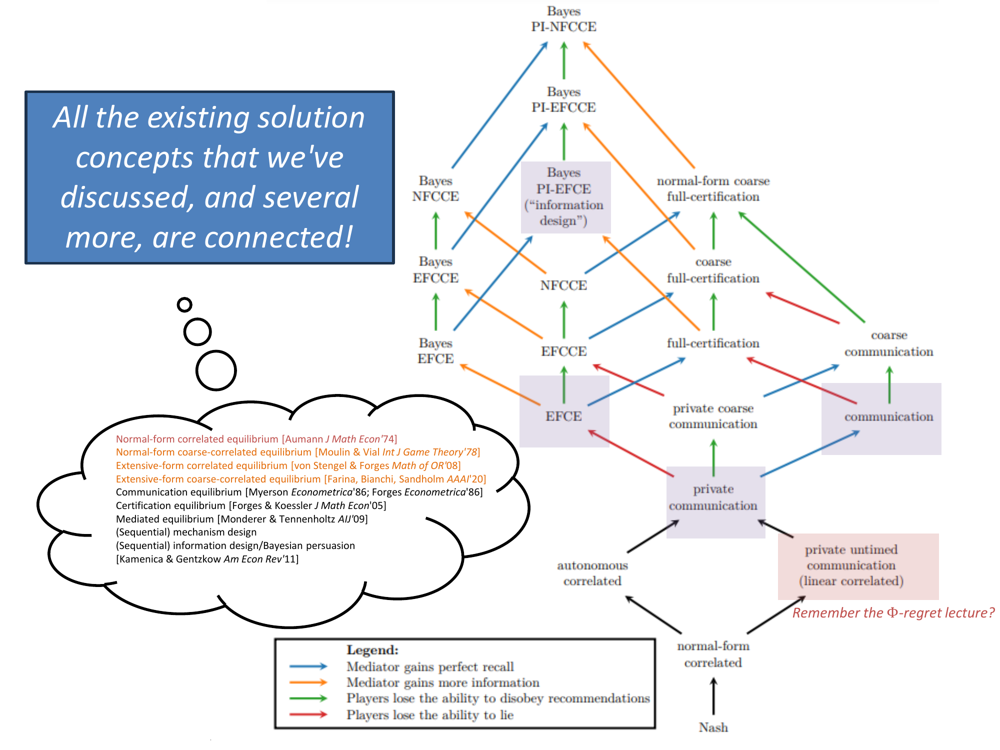

<!-- escape-math: v1 -->
# L19 Automated Mechanism Design

The previous lectures centered on *finding equilibria in a given game*; this lecture inverts the question: a mediator with the power of **commitment** (a leader, an auctioneer, a signal sender, or a correlation device) can **design** the game by choosing its own strategy to optimize its own objective. We will see that Stackelberg equilibrium, optimal correlated equilibrium, mechanism design, and information design (seemingly independent problems) are all special cases of computing an optimal **communication equilibrium** in an extensive-form game, and that the main theorem of Zhang & Sandholm (NeurIPS 2022) gives a unified algorithm polynomial in the size of the game tree. The lecture also develops an alternative algorithm based on Lagrangian relaxation, solvable by no-regret learning (including deep RL), and places extensive-form correlated equilibrium (EFCE) in this picture.

## 1 Four Incentive Problems

### 1.1 Stackelberg Equilibria in Normal-Form Games

Consider the following normal-form game (the leader picks the row, the follower the column):

| Leader \ Follower | $X$ | $Y$ |
|---|---|---|
| $X$ | $1,1$ | $11,0$ |
| $Y$ | $0,0$ | $10,1$ |

The game has a unique Nash equilibrium $(X,X)$, giving the leader only $1$. But if the leader can **commit** to playing $X$ with probability $1/2-\varepsilon$ (and $Y$ with the remaining probability), the follower's best response becomes $Y$, and the leader's expected utility is about $10.5$: commitment power yields an enormous gain. Ignoring tiebreaking, a Stackelberg equilibrium has two equivalent views:

- The leader **issues a recommendation** to the follower (here, recommending $Y$), and the follower must satisfy an **obedience constraint**;
- Compute the equilibrium that is optimal for the leader **while ignoring the leader's own incentive constraint**. That is, solve
  $$\max\_{x\_L\in\Delta(A\_L),\\;x\_F\in\Delta(A\_F)} u\_L(x\_L,x\_F)\quad\text{s.t.}\quad u\_F(x\_L,x\_F)\ge u\_F(x\_L,a\_F)\ \ \forall a\_F\in A\_F;$$
  adding the leader's incentive constraint $u\_L(x\_L,x\_F)\ge u\_L(a\_L,x\_F)\ (\forall a\_L\in A\_L)$ turns this into the "optimal Nash equilibrium" problem.

Drawing this game in extensive form (with the leader committing first and the follower acting after observing the recommendation), one sees:

> **Stackelberg equilibrium** = a strategy for the leader such that, holding the leader's strategy fixed, the **direct strategy** (i.e., obeying the recommendation) is a best response for the follower.



### 1.2 Optimal Correlated Equilibria

Take the game of Chicken as an example:

|  | Stop | Go |
|---|---|---|
| **Stop** | $0,0$ | $0,1$ |
| **Go** | $1,0$ | $-5,-5$ |

A correlation device privately sends recommendations to both players according to the distribution $\mu=p\cdot(\text{Stop},\text{Go})+(1-p)\cdot(\text{Go},\text{Stop})$. The players' strategies are **direct**: they are incentivized to follow the recommendations.

> **Correlated equilibrium (CE)** = a strategy for the mediator such that, holding the mediator's strategy fixed, the direct profile is a Nash equilibrium for the other players.

An *optimal* correlated equilibrium maximizes some objective (e.g., social welfare) over such $\mu$: again the "mediator optimizes + players obey" structure.

### 1.3 Mechanism Design

An auctioneer is selling a car; buyer 1 values it at \\$6k, buyer 2 at \\$4k, but the auctioneer does **not** know the valuations. One could simply ask, but buyers may lie, and it is not even clear that "just asking" is optimal. The classical result:

> **Theorem (Myerson, Math of OR 1981).** Assuming buyer valuations are drawn i.i.d. from some distribution $D$, there exists a reserve price $r$ (dependent on $D$) for which the following mechanism maximizes expected revenue: ask the buyers for their valuations ("bids"); if the highest bid exceeds $r$, the highest bidder wins the item and pays $\max\\{\text{second-highest bid},\\,r\\}$; otherwise nobody wins.

This mechanism is **direct**: buyers bidding their true values is a Nash equilibrium. Written as an extensive-form "augmented game": buyer $i$ has type $v\_i\sim D\_i\in\Delta(\mathbb{R})$ and submits a report $v\_i'\in\mathbb{R}$; the mechanism (the auctioneer's strategy) outputs a winner $i^\*\in\\{\bot,1,2\\}$ and a price $p\in\mathbb{R}$; if $i^\*=\bot$ everyone gets $0$, otherwise $u\_A=p$, $u\_{i^\*}=v\_{i^\*}-p$, and everyone else gets $0$. Hence:

> **Optimal mechanism** = a strategy for the auctioneer such that, holding the auctioneer's strategy fixed, the direct profile (truthful reports $v\_i'=v\_i$) is a Nash equilibrium for the other players.

### 1.4 Information Design (Bayesian Persuasion)

Information design, a.k.a. Bayesian persuasion (Kamenica & Gentzkow, American Economic Review 2011), can be seen as "mechanism design, but backwards." A car is on sale for \\$5,000: with probability $1/3$ it is a good car (worth \\$6k to the buyer), with probability $2/3$ a bad car (worth \\$4k), and only the seller knows the true quality. If the buyer buys, the seller gets \\$5k and the buyer gets $+\\$1k$ (good car) or $-\\$1k$ (bad car); if the buyer passes, both get $0$. As before, the seller can **commit** and send messages.

The optimal signaling scheme: always recommend "buy" when the car is good, and recommend "buy" with probability $1/2$ when it is bad. Then
$$\Pr[\text{good car}\mid\text{seller says ``buy''}]=\frac{1/3}{1/3+(2/3)(1/2)}=\frac12,$$
and the buyer's expected utility from buying upon a "buy" recommendation is $\frac12(1k)+\frac12(-1k)=0\ge$ the $0$ from passing, so the buyer's best response is exactly to do what the seller says (the strategy is direct). Even though the car is good only $1/3$ of the time, the seller sells the car $2/3$ of the time. Again:

> **Optimal solution** = a strategy for the seller such that, holding the seller's strategy fixed, the direct strategy is a best response for the buyer.

Kamenica & Gentzkow (AER 2011) developed the complete theory generalizing this example. The model: a state $\omega\in\Omega$ is drawn from a common prior $\mu\_0$; the Sender **commits** to a signal $\pi$ (a finite realization space $S$ and a family of distributions $\\{\pi(\cdot\mid\omega)\\}\_{\omega\in\Omega}$); the Receiver observes $\pi$ and a realization $s$, forms a posterior $\mu\_s$ by Bayes' rule, and then takes an action optimal for herself (breaking ties in the Sender's favor when indifferent). Every signal induces a **distribution of posteriors** $\tau\in\Delta(\Delta(\Omega))$, and Bayesian rationality imposes exactly one constraint on $\tau$ (**Bayes plausibility**):
$$\sum\_{\mu\in\operatorname{Supp}(\tau)}\mu\\,\tau(\mu)=\mu\_0,$$
i.e., the expectation of the posteriors must equal the prior (a "splitting" of the prior). Write $\hat{v}(\mu)=\mathbb{E}\_\mu\\,v(\hat{a}(\mu),\omega)$ for the Sender's expected utility when both parties hold belief $\mu$ ($\hat{a}(\mu)$ being the Receiver's equilibrium action under belief $\mu$).

> **Proposition (Kamenica & Gentzkow 2011, Proposition 1).** The following are equivalent: (i) there exists a signal with value $v^\*$; (ii) there exists a **straightforward signal** (a direct signal: the realization is an action recommendation, and the Receiver always obeys it) with value $v^\*$; (iii) there exists a Bayes-plausible distribution of posteriors $\tau$ with $\mathbb{E}\_\tau\\,\hat{v}(\mu)=v^\*$.

Note that (ii) is exactly the information-design incarnation of this lecture's "direct strategy / revelation principle": without loss of generality, the mediator's messages are action recommendations. The proposition reduces "designing a signal" to "optimizing over splittings of the prior," and the optimum has a clean geometric characterization. Let $V$ be the **concave closure** of $\hat{v}$ (what Aumann & Maschler call the concavification):
$$V(\mu)\equiv\sup\big\\{z\\;\big|\\;(\mu,z)\in\mathrm{co}(\hat{v})\big\\},$$
the smallest concave function that is everywhere weakly above $\hat{v}$.

> **Corollary (Kamenica & Gentzkow 2011, Corollary 2).** The value of an optimal signal is exactly $V(\mu\_0)$; the Sender strictly benefits from persuasion if and only if $V(\mu\_0)>\hat{v}(\mu\_0)$.

Applying this to the car example: reduce the state to $\mu$, "the probability the buyer assigns to the car being good"; then $\hat{v}(\mu)$ is a step function: the buyer buys and the seller gets $5k$ when $\mu\ge 1/2$, and $0$ otherwise. At the prior $\mu\_0=1/3$, the concave closure is spanned by the two posteriors $\mu=0$ and $\mu=1/2$, and Bayes plausibility forces the latter to have probability $2/3$, so $V(1/3)=\frac23\cdot 5k$: the optimal scheme above is exactly an instance of the concave-closure construction, and "selling $2/3$ of the time" is precisely $V(\mu\_0)/5k$.

### 1.5 What These Problems Have in Common

- **Optimization**: the mediator (leader / seller / correlation device) has an objective it wants to optimize;
- **Commitment**: the mediator commits to a strategy $\mu$;
- **Communication**: the mediator communicates with the players (giving them information/recommendations, or getting information from them). Communication has no direct effect on the game; its only purpose is to exchange information. And the communication is **structured**: in all examples so far it has been either "information reports" or "action recommendations."

The rest of the lecture answers: how general is this framework, and can we compute optimal mediator strategies efficiently?

## 2 Extensive-Form Games and Communication Equilibria

Consider a general extensive-form game, plus a mediator who communicates (privately) with each player at every timestep of the game; the communication is modeled implicitly inside the game tree.

> **Definition (communication equilibrium).** A communication equilibrium is a tuple of (possibly randomized) strategies $(\mu,x\_1,x\_2)$ such that all players (not including the mediator) are best-responding:
> $$u\_1(\mu,x\_1,x\_2)=\max\_{x\_1'}\\;u\_1(\mu,x\_1',x\_2),\qquad u\_2(\mu,x\_1,x\_2)=\max\_{x\_2'}\\;u\_2(\mu,x\_1,x\_2').$$
> Equivalently: with $\mu$ held fixed, $(x\_1,x\_2)$ is a Nash equilibrium.

> **Main theorem (Zhang & Sandholm, NeurIPS 2022).** There exists an algorithm polynomial in the size of the game tree that computes a communication equilibrium $(\mu,x\_1,\dots,x\_n)$ maximizing the mediator's objective $u\_M(\mu,x\_1,\dots,x\_n)$.

Where is the difficulty? A general strategy can involve arbitrarily complex message exchanges: "if I observe $t$, I send message $m\_1$; then if I receive $m\_2$ I play $a$, but if I receive $m\_3$ I play $a'$; then if…". The **message space is infinite**, so direct optimization is hopeless. The proof reduces the problem to a tractable size in three steps.

## 3 Proof of the Main Theorem: Three Steps

### 3.1 Step 1: The Revelation Principle — from Infinite to Finite

> **Theorem (revelation principle, informal statement; Forges, Econometrica 1985, further generalized in the full paper).** For every communication equilibrium, there exists an equivalent **direct** communication equilibrium. "Direct" requires both:
> 1. The players' messages to the mediator are **reports of their private information**, and in equilibrium players always report truthfully;
> 2. The mediator's messages to the players are **action recommendations**, and in equilibrium players always obey the recommendations.

**Proof idea (simulation argument).** Given an "indirect" equilibrium using arbitrary messages, construct a new mediator that internally **simulates** the old mediator and the original equilibrium strategies. When a player whose true type is \\$6k truthfully reports "\\$6k" in the direct equilibrium, the new mediator computes that he would have bid $f(\\$6k)$ in the original equilibrium, pretends he did exactly that, and acts as the original equilibrium prescribes. Even if the player lies and reports \\$4k, the mediator simply pretends he bid $f(\\$4k)$. Symmetrically, in the original equilibrium the mediator sends a message $m$ and the player responds with $a=f(m)$; in the direct equilibrium the mediator directly recommends "play $a$." The key point: any deviation against the direct equilibrium (misreporting one's type via $f$, or disobeying a recommendation via $g$) corresponds one-to-one to a deviation against the original equilibrium (reporting $f(\cdot)$, responding $g(f(\cdot))$). A deviation that is unprofitable in the original equilibrium remains unprofitable in the new one. Hence the equilibrium property is preserved, while the message space is reduced to the finite structure of "type reports + action recommendations." $\square$

### 3.2 Step 2: The Communication Game — from Finite to Polynomial

After the revelation principle, one may restrict attention to the following **communication game**: walk down the original game tree; at every timestep each player first sends (private) information to the mediator, the mediator privately recommends an action, and the player then actually acts. A state in the communication game tree has the form
$$(s,\ \tau\_1,\ \dots,\ \tau\_n),\qquad s\in S\ \text{a state of the original game tree},\ \ \tau\_i\ \text{the transcript with player}\ i.$$
The number of states is $\le |S|\cdot(\text{\\# possible messages})^{O(\text{tree depth})\cdot n}$: the communication game is **finite**, but still exponentially large. Two "without loss of generality" observations compress it to polynomial size:

> **Observation 1.** One may assume that every transcript $\tau\_i$ always corresponds to some actual state $s\_i$ of the original game.
>
> **Proof sketch.** The mediator wants player $i$'s utility from deviating to be as low as possible. If $\tau\_i$ does not correspond to any actual state, the mediator immediately knows that player $i$ deviated, and should therefore reveal no further useful information to him, so the player cannot benefit from such a $\tau\_i$, and such transcripts can be removed from consideration.

States can then be written $(s,s\_1,\dots,s\_n)$, with at most $|S|^{n+1}$ states: much better, but still exponential in $n$.

> **Observation 2.** One only needs to care about a single deviating player at a time: the equilibrium constraints say that no player wants to deviate while everyone else is direct, so one may assume $s\_i=s$ for all but at most one $i$.

States compress further to $(s,i,s\_i)$, where $i\in[n]\cup\\{\bot\\}$ marks the (possible) deviator and $s\_i$ is the state corresponding to that deviator's transcript. The number of states is $\le n|S|^2$: **polynomial in the size of the game tree**!

### 3.3 Step 3: Solving via LP Duality

First restate the two definitions.

> **Definition.** A communication equilibrium is a tuple of strategies $(\mu,\boldsymbol{x}\_1,\dots,\boldsymbol{x}\_n)$ such that for all $i$:
> $$u\_i(\mu,\boldsymbol{x}\_1,\dots,\boldsymbol{x}\_i,\dots,\boldsymbol{x}\_n)=\max\_{\boldsymbol{x}\_i'}\\;u\_i(\mu,\boldsymbol{x}\_1,\dots,\boldsymbol{x}\_i',\dots,\boldsymbol{x}\_n).$$
> A **direct communication equilibrium** is a (possibly randomized) mediator strategy $\mu$ in the communication game such that for all $i$:
> $$u\_i(\mu,\boldsymbol{x}\_1^\*,\dots,\boldsymbol{x}\_i^\*,\dots,\boldsymbol{x}\_n^\*)=\max\_{\boldsymbol{x}\_i'}\\;u\_i(\mu,\boldsymbol{x}\_1^\*,\dots,\boldsymbol{x}\_i',\dots,\boldsymbol{x}\_n^\*),$$
> where $\boldsymbol{x}\_i^\*$ is player $i$'s direct strategy (report honestly, obey recommendations).

The optimal direct communication equilibrium is therefore the following program: the objective and the left-hand sides of the constraints are **linear** in $\mu$, while the right-hand sides are **bilinear** in $(\mu,\boldsymbol{x}\_i')$:
$$\max\_{\mu}\ \boldsymbol{c}^\top\mu\qquad\text{s.t.}\qquad \boldsymbol{b}\_i^\top\mu\ \ge\ \max\_{\boldsymbol{x}\_i'\in\mathcal{X}\_i}\ \mu^\top A\_i\\,\boldsymbol{x}\_i'\quad\forall i,$$
where $\mu$ ranges over the mediator's sequence-form strategy set $\mathcal{X}\_M$, and $\mathcal{X}\_i=\\{\boldsymbol{x}:F\_i\boldsymbol{x}=\boldsymbol{f}\_i,\ \boldsymbol{x}\ge 0\\}$ is player $i$'s sequence-form strategy polytope. Taking the LP dual of each inner maximization,
$$\max\_{\boldsymbol{x}\ge 0,\\,F\_i\boldsymbol{x}=\boldsymbol{f}\_i}(A\_i^\top\mu)^\top\boldsymbol{x}\ =\ \min\_{\boldsymbol{v}\_i:\\,F\_i^\top\boldsymbol{v}\_i\ge A\_i^\top\mu}\ \boldsymbol{f}\_i^\top\boldsymbol{v}\_i,$$
and substituting back yields a single **linear program**:
$$\max\_{\mu\in\mathcal{X}\_M,\\;\boldsymbol{v}\_i\\,(i\in[n])}\ \boldsymbol{c}^\top\mu\quad\text{s.t.}\quad \boldsymbol{b}\_i^\top\mu\ge \boldsymbol{f}\_i^\top\boldsymbol{v}\_i,\ \ F\_i^\top\boldsymbol{v}\_i\ge A\_i^\top\mu\quad\forall i.$$
Since Step 2 already kept the communication game at polynomial size, this LP is also of polynomial size, proving the main theorem.

## 4 Corollaries and Experiments

The main theorem immediately yields polynomial-time algorithms for a family of problems: optimal **sequential mechanism design**, optimal **sequential information design**, optimal **certification equilibria** (Forges & Koessler, J Math Econ 2005), optimal **mediated equilibria** (Monderer & Tennenholtz, AIJ 2009), and more.

**Experiment (payoff-space plot).** On a medium-sized bargaining game (about 1000 states), compute the region of payoff vectors achievable under various equilibrium concepts: the other equilibrium concepts give whole regions, while the communication equilibrium yields a **unique** payoff point; consequently, the Nash equilibrium payoff of this game is unique as well.



## 5 A Lagrangian-Based Learning Method

The LP gives a polynomial algorithm, but large-scale games call for more scalable methods. Write the optimal communication equilibrium as a constrained optimization problem and relax the incentive constraints with a Lagrange multiplier:

$$\max\_{\mu}\ u\_M(\mu,\boldsymbol{x}^\*)\quad\text{s.t.}\quad \max\_{\boldsymbol{x}\_i}\ u\_i(\mu,\boldsymbol{x}\_i,\boldsymbol{x}\_{-i}^\*)\le u\_i(\mu,\boldsymbol{x}\_i^\*,\boldsymbol{x}\_{-i}^\*)\ \ \forall i$$
$$\Longrightarrow\qquad \max\_{\mu}\ \min\_{i,\\,\boldsymbol{x}\_i}\ u\_M(\mu,\boldsymbol{x}^\*)\\;-\\;\lambda\Big[\\,u\_i(\mu,\boldsymbol{x}\_i,\boldsymbol{x}\_{-i}^\*)-u\_i(\mu,\boldsymbol{x}\_i^\*,\boldsymbol{x}\_{-i}^\*)\\,\Big].$$

This is a **zero-sum game**: the maximizer is the mediator, and the minimizer (the "deviator") chooses which player to represent and how to deviate.

> **Proposition.** There exists $\lambda^\*>0$ such that for all $\lambda>\lambda^\*$: the equilibrium strategy of the maximizing player in this zero-sum game is exactly an optimal communication equilibrium of the original game.

Zhang et al. (NeurIPS 2023) call the smallest such $\lambda^\*$ the **critical Lagrange multiplier**, and prove the existence of a saddle-point solution $(\mu^\*,\boldsymbol{x}^\*,\lambda^\*)$ (Proposition 3.1). A practical algorithm need not know $\lambda^\*$ in advance: growing the multiplier over time (e.g., $\lambda:=T^{1/4}$ or $\lambda:=T^{1/2}$) balances the "equilibrium gap" against the "optimality gap" while still guaranteeing convergence. The resulting rates (the paper's Corollary 3.3, Corollary 3.4, and Theorem 3.5; restated in the slides' $\varepsilon$-form below): under CFR-type algorithms the mediator's **average strategy** converges to the set of optimal equilibria at rate $T^{-1/4}$; with **optimism** this accelerates to $T^{-1/2}$; and thanks to the reduced zero-sum structure, optimistic gradient descent/ascent also achieves $T^{-1/4}$ **last-iterate** convergence. These are the first learning dynamics that provably converge to *optimal* equilibria (rather than to some equilibrium). One implication of last-iterate convergence is worth singling out: the paper also shows that any **independent learning dynamics without a mediator** requires superpolynomial time to guarantee $\varepsilon$-last-iterate convergence (Proposition D.2). Introducing the mediator as an extra player in the learning process precisely bypasses this known barrier. As for per-iteration complexity: communication and certification equilibria are polynomial-time per iteration under the nested range condition, while NFCCE, EFCCE, and EFCE admit fixed-parameter tractable (FPT) implementations.

### 5.1 The Lagrangian as an Extensive-Form Game

The max–min problem can be written out explicitly as a zero-sum extensive-form game (shown in the figure). The deviator (Min) first chooses which player $i$ to represent; Nature then decides, uniformly at random, whether player $i$ is allowed to deviate. The mediator (Max) then plays either against "all direct players" or against "all players direct except $i$, who is controlled by the deviator," with zero-sum utilities at terminal $z$ equal to $2u\_M(z)+2\lambda u\_i(z)$ and $-2\lambda u\_i(z)$ respectively.


So: **solving a single zero-sum game computes an optimal communication equilibrium of a multi-player game**. But this presumes we know a large enough multiplier $\lambda$, which depends on the payoff scales and can be very large.

**Solution #1: set $\lambda:=1/\varepsilon$.**

> **Theorem (hiding game-dependent factors).** On the Lagrangian game: CFR converges in average strategy after $1/\varepsilon^4$ iterations; OMWU converges in average strategy after $1/\varepsilon^2$ iterations; OMWU converges in iterates after $1/\varepsilon^4$ iterations.

**Solution #2: a binary-search Lagrangian.** Reformulate as feasibility: find $\mu$ with $u\_M(\mu,\boldsymbol{x}^\*)\ge\tau$ that satisfies the incentive constraints; the corresponding Lagrangian is
$$\max\_{\mu}\ \min\Big\\{\ u\_M(\mu,\boldsymbol{x}^\*)-\tau,\ \ -\max\_{i,\\,\boldsymbol{x}\_i}\big[\\,u\_i(\mu,\boldsymbol{x}\_i,\boldsymbol{x}\_{-i}^\*)-u\_i(\mu,\boldsymbol{x}\_i^\*,\boldsymbol{x}\_{-i}^\*)\\,\big]\ \Big\\},$$
whose value is $0$ if and only if there exists an equilibrium $\mu$ with value at least $\tau$. It too can be written as a zero-sum extensive-form game: just give the deviator one more option, representing "none" of the players (whose mixed probability plays the role $\sim 1/\lambda$ of an implicit multiplier).

```text
Algorithm: binary search
Binary-search over τ ∈ [0,1], for log(1/ε) rounds:
    run an algorithm that solves the Lagrangian game above until either:
    • it finds μ guaranteeing value > −ε (branch high: τ feasible), or
    • it proves value < 0 (branch low: τ infeasible)
```

> **Theorem.** The last $\mu$ found by the binary-search algorithm is an $\varepsilon$-equilibrium whose mediator objective is at least $v^\*-O(\varepsilon)$ (where $v^\*$ is the mediator objective of an optimal equilibrium).

The exact statement in the paper (Theorem 3.7): the algorithm returns an $\varepsilon$-equilibrium $\mu$ with mediator objective at least $v^\*-2\varepsilon$; if solving an (L2)-type game takes time $f(\Gamma,\varepsilon)$, the total runtime is $O(f(\Gamma,\varepsilon)\log(1/\varepsilon))$. An exact version of the bounded-utility claim also holds: with the original game's payoffs normalized to $[0,1]$, the payoffs of the zero-sum extensive-form game corresponding to the binary-search Lagrangian lie in $[-2,2]$ (Proposition 3.6). The two solutions also differ in the **accuracy demanded of the underlying game solver**: to guarantee an objective loss of $O(\varepsilon)$, the "direct" Lagrangian requires solving the single game to accuracy $O(\varepsilon/\lambda^\*)$ (the larger the multiplier, the harsher the requirement), whereas the binary-search version only needs accuracy $O(\varepsilon)$ per round.

**Comparison of the two Lagrangians:**

| | "Direct" Lagrangian | "Binary-search" Lagrangian |
|---|---|---|
| Expressible as a zero-sum extensive-form game | ✓ | ✓ |
| Number of games to solve | 1 ✓ | $\log(1/\varepsilon)$ |
| Last-iterate convergence | possible ✓ | unclear what it even means |
| Convergence rate (OMWU) | $O(1/\varepsilon^2)$ | $\tilde{O}(1/\varepsilon)$ ✓ |
| Utility scale | depends on $\lambda$ (possibly huge) | bounded by an absolute constant ✓ |

The utility scale matters greatly in practice: deep-learning solvers struggle with high precision; the bounded-utility binary-search version is **amenable to deep RL**. In short: if you can solve zero-sum games, you can compute optimal equilibria and optimal mechanisms under a variety of concepts.

**Experiment 1 (tabular setting).** On a series of game instances (ranging from a few hundred to about 1.4 million nodes), compare the runtime of the LP versus the learning method (the "direct" Lagrangian) for computing five equilibrium concepts (NFCCE, EFCCE, EFCE, COMM, CERT): the learning method scales significantly better than the LP. For example, on the roughly 1.4-million-node instance, the LP finishes within the time limit only for the weakest concept, NFCCE (38.00s, versus just 2.73s for learning); for EFCCE, EFCE, and CERT the LP always times out, while the learning method finishes in about 3m01s, 10m48s, and 6m14s respectively. The full setup in the paper (Table 1): 23 instances drawn from 8 classes of established parametric benchmark games (Battleship, Liar's dice, Goofspiel, Kuhn poker, Leduc poker, ridesharing, Sheriff, double dummy bridge), with 7 equilibrium concepts evaluated in total (5 in the main text; the other two, NFCCERT and CCERT, appear in the appendix); the accuracy threshold $\varepsilon$ is $1\\%$ of each game's payoff range, the objective is social welfare for general-sum games and player 1's utility for zero-sum games, and the timeout is 1 hour. The overall observation: the learning method is typically **more than an order of magnitude** faster than the LP, and it solves concepts and scales that the LP cannot finish at all within the time limit.

**Experiment 2 (continuous auctions).** Compute optimal mechanisms for **back-to-back auctions among budget-constrained bidders**: 2 items (the valuation for the second item is drawn after the first auction; solved with tabular CFR+) and 4 items (valuations drawn after every auction; solved with deep learning on the binary-search Lagrangian). In the figure, the x-axis is "revenue assuming truthful bidding" and the y-axis is the mechanism's exploitability: the first-price auction (FP) has the highest revenue but is, as expected, highly exploitable; the second-price auction with no reserve (SP) and the second-price auctions with reserve $p$ ($R\_p$) are not exploitable but yield lower revenue; while our method (Ours) achieves the highest revenue with essentially zero exploitability, a truly optimal, manipulation-proof mechanism.

The paper reports further details worth recording. The 2-item setting: two bidders each with budget $1$, each item's valuation drawn uniformly from $\\{0,\frac14,\frac12,\frac34,1\\}$; CFR+ with fixed multiplier $\lambda=25$, run for $10{,}000$ iterations to a duality gap of about $4.2\times10^{-4}$ for (L1). One intriguing finding: the optimal mechanism gives an item away **for free** about $8\\%$ of the time (seemingly irrational behavior that in fact incentivizes bidders to spend their budget earlier, sustaining competitive bidding in later auctions); the same mechanism phenomenon was recently discovered independently in manual mechanism design research. The 4-item setting (valuations uniform over $\\{0,0.1,\dots,0.5\\}$, budget still $1$) is solved with PSRO (a double-oracle framework, with best responses trained by PPO) on the binary-search Lagrangian: first it reproduces the tabular 2-item results as a correctness check, and then in the larger setting it finds an optimal revenue of $\approx 1.1$, exceeding every second-price auction (none exceeds $1$). The paper also reports that PSRO applied directly to the "direct" Lagrangian (L1) fails to converge because of the large reward range induced by the multiplier $\lambda$, an empirical footnote to the claim that utility scale is crucial for deep RL.



## 6 Extensive-Form Correlated Equilibria and Their Place in the Picture

In an extensive-form correlated equilibrium (EFCE; von Stengel & Forges, Math of OR 2008), the mediator privately recommends actions gradually, as the game proceeds. Writing this as an augmented game runs into a problem: **the mediator-augmented game is exponentially large**, because the mediator must pick an arbitrary complete strategy profile at the start. Note the following equivalences: a **pure strategy** of the mediator = an assignment of one action to every information set of the original game = a pure strategy profile of the original game; a **mixed strategy** of the mediator (not a behavioral strategy!) = a distribution over pure profiles = a correlated profile in the original game. Since the mediator **cannot remember its own earlier recommendations** at later information sets, the mediator has **imperfect recall**, and this is exactly why computing an optimal EFCE is NP-hard. An EFCE is: a strategy for the mediator such that, if the mediator commits to it, the direct profile is a Nash equilibrium for the other players.

Comparison of the three problem classes in the augmented game (the players' private information is the same in all three rows: imperfect information, e.g., the private types/valuations of mechanism design):

| | Mediator's private information | Mediator's actions | Players' actions |
|---|---|---|---|
| Mechanism design | None | selects mechanism outcome | type reports |
| Information design | perfect information | action recommendations | in-game actions |
| EFCE | only the current player's information | action recommendations | in-game actions |

Hence **EFCE ≈ information design + privacy constraints** (the mediator may not leak one player's information to the others). Along the two dimensions "can the players lie?" and "privacy," several important subclasses of the general problem form the following square:


More generally, every equilibrium concept discussed so far (and several more) is connected by a single implication graph: normal-form correlated equilibrium (Aumann 1974), normal-form coarse-correlated equilibrium (Moulin & Vial 1978), EFCE (von Stengel & Forges 2008), extensive-form coarse-correlated equilibrium (Farina, Bianchi & Sandholm 2020), communication equilibrium (Myerson 1986; Forges 1986), certification equilibrium (Forges & Koessler 2005), mediated equilibrium (Monderer & Tennenholtz 2009), (sequential) mechanism design, (sequential) information design / Bayesian persuasion (Kamenica & Gentzkow 2011), and others. Every directed edge in the graph corresponds to one of four strengthenings: the mediator gains perfect recall, the mediator gains more information, the players lose the ability to disobey recommendations, or the players lose the ability to lie. This resonates with the "equilibrium concept = no regret against a class of deviations" view from the earlier Φ-regret lecture.



## 7 Bibliographic Notes

Many special cases were previously studied as separate problems; this lecture's framework can be viewed as a unification of those results (and more).

**LP-based algorithms for finding optimal equilibria:** mechanism design: single-shot (Conitzer & Sandholm, UAI 2002; Sandholm, CP 2003), one player (Zhang & Conitzer, NeurIPS 2021), auctions (Papadimitriou, Pierrakos, Psomas & Rubinstein, GEB 2014); sequential information design: one player (Gan, Majumdar, Radanovic & Singla, AAAI 2022), multiple myopic players (Wu, Zhang, Feng, Wang, Yang & Jordan, EC 2022); optimal correlated equilibria (Zhang, Farina, Celli & Sandholm, EC 2022).

**Lagrangians:** the Lagrangian framework, convergence rates, and all experiments of this lecture are from Zhang, Farina, Anagnostides, Cacciamani, McAleer, Haupt, Celli, Gatti, Conitzer & Sandholm (NeurIPS 2023). The "direct" Lagrangian in the single-step mechanism design case (Dütting, Feng, Narasimhan, Parkes & Ravindranath, JACM 2023); the "binary-search" Lagrangian was previously stated (but not analyzed) for EFCE and NFCCE (Farina, Ling, Fang & Sandholm, NeurIPS 2019).

**No-regret learning algorithms for computing a single equilibrium:** EFCE (Farina, Celli, Marchesi & Gatti, JACM 2022); communication equilibrium (Fujii, arXiv 2023); linear correlated equilibrium (Farina & Pipis, NeurIPS 2023; Zhang, Farina & Sandholm, ICLR 2024); normal-form correlated equilibrium ($\tilde{O}(n/\varepsilon)$ convergence rate, where $n$ is the number of nodes; Peng & Rubinstein 2023; Dagan, Daskalakis, Fishelson & Golowich 2023), but whether $\mathrm{poly}(n,1/\varepsilon)$ is achievable as for the other concepts above remains open.

**Other applications of mediators:** team-correlated equilibria in adversarial team games (Carminati et al., ICML 2022; Zhang, Farina & Sandholm, ICML 2023; Zhang & Sandholm, AAAI 2022); hidden-role games such as Avalon (Carminati, Zhang, Farina, Gatti & Sandholm 2023). Future direction: large-scale experiments with deep RL, e.g., in sequential auctions.

## Key Takeaways

- Stackelberg equilibrium, optimal correlated equilibrium, optimal auction mechanisms (à la Myerson), and Bayesian persuasion share one structure: the mediator **optimizes** an objective, **commits** to a strategy $\mu$, and engages in structured **communication** with the players (type reports / action recommendations); in each case the optimum is a strategy such that, with $\mu$ held fixed, the direct strategy is a best response.
- The general theory of Bayesian persuasion (Kamenica & Gentzkow, AER 2011): a signal = a splitting of the prior, and Bayesian rationality imposes only **Bayes plausibility** $\mathbb{E}\_\tau[\mu]=\mu\_0$; the value of an optimal signal equals the **concave closure** $V(\mu\_0)$ of $\hat{v}$, and the Sender strictly benefits if and only if $V(\mu\_0)>\hat{v}(\mu\_0)$; the "$\frac23$ sale rate" of the car example is exactly the concave-closure construction.
- A communication equilibrium $(\mu,x\_1,\dots,x\_n)$ requires the players' strategies to form a Nash equilibrium with $\mu$ held fixed; the main theorem (Zhang & Sandholm, NeurIPS 2022): an optimal communication equilibrium is computable in time polynomial in the size of the game tree.
- The three-step proof: the revelation principle reduces messages to "honest reports + obeyed recommendations" (simulation argument); the communication game is compressed via two observations (transcripts must correspond to actual states; only one deviator at a time matters) to at most $n|S|^2$ states; the bilinear right-hand side of the incentive constraints is linearized by LP duality into a single linear program.
- The Lagrangian method turns the problem into **one zero-sum extensive-form game** (a critical multiplier $\lambda^\*$ exists making the proposition hold): with $\lambda=1/\varepsilon$, CFR converges in averages in $1/\varepsilon^4$, OMWU in averages in $1/\varepsilon^2$, and OMWU in iterates in $1/\varepsilon^4$; the binary-search Lagrangian converges at rate $\tilde{O}(1/\varepsilon)$ with bounded utilities (in $[-2,2]$; the paper's exact guarantee is objective $\ge v^\*-2\varepsilon$) and is amenable to deep RL. These learning dynamics are also the first to provably converge to **optimal** equilibria, and the mediator bypasses the superpolynomial last-iterate barrier of mediator-free learning.
- Experiments: on a ~1000-state bargaining game the communication-equilibrium payoff is unique (hence the Nash payoff is unique); in the tabular setting learning scales far better than LP (23 instances from 8 benchmark classes, with the LP timing out broadly on the 1.4-million-node instance); in continuous auctions the method computes a mechanism with near-zero exploitability *and* the highest revenue (the optimal mechanism gives items away for free $8\\%$ of the time; the 4-item case is solved by deep learning with PSRO+PPO).
- In EFCE the mediator has imperfect recall, so optimal EFCE is NP-hard; EFCE ≈ information design + privacy constraints. All equilibrium concepts discussed are unified by one implication graph whose edges are the four strengthenings "perfect recall / more information / cannot disobey / cannot lie."
