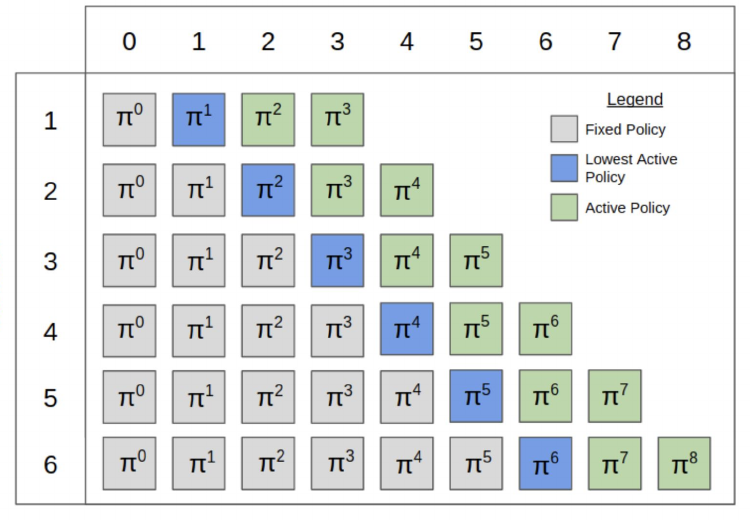

<!-- escape-math: v1 -->
# Double Oracle and PSRO

The regret-minimization methods of the previous chapters come with complete convergence theory in the tabular setting. When a game is so large that even its strategy space cannot be enumerated, however, we need a different kind of framework: maintain only a small pool of strategies, and grow it gradually through a best-response oracle. This lecture covers the family of methods represented by **double oracle (DO)** and its deep-reinforcement-learning generalization, **policy-space response oracles (PSRO)**, together with their applications to two large real-time strategy games: StarCraft II (AlphaStar) and Dota 2 (OpenAI Five). The theme of the lecture is **making RL game-theoretically sound**.

## The Double Oracle Method

The double oracle method was introduced by McMahan et al. (ICML 2003) for two-player zero-sum games. The basic idea:

- Throughout, maintain only a **restricted set of pure strategies** $\Pi^t = (\Pi\_1^t, \Pi\_2^t)$;
- Find a Nash equilibrium $\pi^r$ of the game induced by the restricted strategies;
- Compute a (pure) **best response** $\beta\_i$ for each player (against the full game, not the restricted one);
- Add the best responses to the restricted sets, unless the best-response gap is already zero, in which case $\pi^r$ is a Nash equilibrium of the original game and the algorithm terminates.

**Algorithm 1 (Double Oracle, McMahan et al., 2003)**

```text
Input: initial population Π^0
repeat {for t = 0, 1, ...}:
    π^r ← Nash equilibrium of the game restricted to strategies in Π^t
    for i ∈ {1, 2}:
        find a best response β_i ← BR_i(π^r_{-i})
        Π_i^{t+1} ← Π_i^t ∪ {β_i}
until no novel best response exists for either player
return π^r
```

### Properties of the Double Oracle Method

- **Correctness**: DO is guaranteed to terminate at an exact Nash equilibrium of the original game. Intuitively, if either player still had a profitable new best response, the algorithm would not stop; once neither does, the definition of Nash equilibrium is met.
- **Convergence speed**: DO can converge quickly in some games, but in the worst case it must expand all pure strategies. Rock–paper–scissors is the trivial but important example: its unique equilibrium has full support, so DO must enumerate all three pure strategies before terminating. Each iteration solves a zero-sum restricted game, which linear programming solves in time polynomial in $|\Pi^t|$ (the general-sum case is PPAD-complete).
- **Exponential lower bound**: Zhang and Sandholm (IJCAI 2024) recently showed that even in two-player zero-sum (2p0s) extensive-form games, DO can require **exponentially many iterations**. The lower bound assumes adversarial tie breaking among best responses; whether it holds regardless of how ties are broken remains an open question.
- Like fictitious play, DO relies fundamentally on the computation of best responses.

Overall, DO's advantages are: it can sometimes terminate after a small number of iterations; it is naturally compatible with deep RL (more on that soon); and it performs excellently in very large games. Its disadvantages: the worst case is exponential even in 2p0s games; it requires finding a Nash equilibrium in a series of restricted games; and its **exploitability is not monotonically decreasing**: a policy obtained by stopping mid-training can be arbitrarily poor. This last point directly motivates the next improvement.

## Anytime Double Oracle

An **anytime guarantee** means that one can safely stop the algorithm at any moment during training, and the quality of the current output will not be worse than before. This is highly desirable in practice. In large-scale training, nobody knows when to stop. Anytime double oracle (ADO), introduced by McAleer et al. (2022), fixes DO's non-monotonic exploitability: it is a variant of DO that guarantees **nonincreasing exploitability**. The key difference lies in the **definition of the restricted game**.

DO uses a single restricted game for both players (both may only play strategies in $\Pi\_i^t$); ADO instead defines a separate restricted game $G^i$ **for each player**: in $G^i$, player $i$ may only play strategies from its own population $\Pi\_i^t$, while the **opponent may play any strategy in the full game**. The game value of $G^i$ for player $i$ is

$$\max\_{\pi\_i\in\Pi\_i^t}\\;\min\_{\pi\_{-i}}\\; v\_i(\pi\_i,\pi\_{-i}).$$

Solving $G^i$ for a Nash equilibrium yields player $i$'s restricted distribution $\pi\_i^r$. Because $\pi\_i^r$ is computed against the worst case of an unrestricted opponent, it is robust to every possible opposing strategy, so exploitability cannot rise when a new strategy is added.

McAleer et al. prove two key properties of ADO:

- **Proposition 1 (Monotonicity)**: ADO's exploitability is monotonically non-increasing. The proof is one step: since $\Pi\_i^t \subseteq \Pi\_i^{t+1}$, the maximization set in the display above grows, so each player's value against a best response is monotonically non-decreasing.
- **Proposition 2 (Termination correctness)**: When ADO terminates, the two restricted equilibria $(\pi\_1^r, \pi\_2^r)$ form an exact Nash equilibrium of the original game; termination takes no more iterations than the number of pure strategies in the game (requiring that a *novel* best response, one not already in the population, always be chosen).

ADO's idea traces back to the Range of Skill (ROS) algorithm of Zinkevich et al. (AAAI 2007). ROS likewise defines one-side-restricted games and guarantees monotonically decreasing exploitability, but it adds a strategy that is part of a restricted equilibrium rather than a best response, has only an asymptotic (and exponential) convergence rate, and is only guaranteed to reach an $\varepsilon$-Nash equilibrium. ADO adds only best responses, hence its termination guarantee within the number of pure strategies, and hence its scalability to large games via APSRO (see below).

**Algorithm 2 (Anytime Double Oracle, ADO)**

```text
Input: initial population Π^0
repeat {for t = 0, 1, ...}:
    π_i^r ← Nash equilibrium of the restricted game G^i, for each i ∈ {1, 2}
    for i ∈ {1, 2}:
        find a novel best response β_i ← BR_i(π_{-i}^r)
        Π_i^{t+1} = Π_i^t ∪ {β_i}
until no novel best response exists for either player
return π^r
```

The figure below contrasts the two methods on a $3 \times 3$ matrix game. Both players' populations consist of their first two pure strategies ($\Pi\_1$, $\Pi\_2$). DO solves the $2 \times 2$ subgame in which both players are restricted, and its restricted distribution $\pi$ has exploitability $e(\pi) = 4$; ADO solves two asymmetric restricted games (one player restricted, the other unrestricted), and the resulting restricted distribution has exploitability only $e(\pi) = 4/3$.


### RM-BR DO

The cost of ADO is that, unlike DO, it must from the very first iterations solve games in which one player has a large number of strategies (the unrestricted side's strategy set may be huge). How can such games be solved in a scalable way? The answer is the **regret minimization + best response (RM+BR)** framework (recall Homework 1): the side with the huge strategy set only needs a best-response oracle, never an enumeration of its actions, because that side's regret **does not depend on the size of its action set**. The regret minimizer only needs to compute a best response to the current average strategy. The resulting algorithm is called **RM-BR DO**, an approximate version of Anytime DO (McAleer et al., 2022).

Concretely, RM-BR (Johanson et al., 2012, a sibling of CFR-BR) alternates two steps in the inner loop that solves each restricted game: the unrestricted player computes a best response to the current restricted distribution, and the restricted player updates its mixture against that best response with a no-regret algorithm (the paper uses Exp3.P, but any regret-minimizing algorithm works). If the cumulative regret after $n$ steps is $R\_n$, the distribution output by RM-BR satisfies $e(\pi^n) \le R\_n / n$. As long as the solutions within both restricted games have exploitability at most $\varepsilon$ in each outer iteration, RM-BR DO's exploitability never increases by more than $2\varepsilon$ from one iteration to the next. The algorithm can terminate when the difference between the two restricted games' values falls below $\varepsilon$, at which point $\pi^r$ is an $\varepsilon$-Nash equilibrium of the original game.

Experimental results are shown below. On a carefully constructed bad case for DO, DO's exploitability keeps inflating with iterations and drops only at the final iteration (10 actions in the slides' figure; the construction shown in the paper's figure has 9 actions), while ADO and RM-BR DO stay near zero throughout. On random normal-form games with 500 actions and payoffs sampled from $\mathrm{Uniform}(0,1)$, and on Leduc poker (with an exact best-response oracle; the paper's implementation runs 100,000 Exp3 updates with 100 best-response updates per outer iteration), RM-BR DO and ADO keep exploitability below DO at all times, with a steady, monotone descent.


## Policy-Space Response Oracles (PSRO)

**Policy-space response oracles (PSRO)**, introduced by Lanctot et al. (NeurIPS 2017), is a conceptual generalization that unifies double oracle and fictitious play. Its structure:

- Maintain a **meta-solver** that outputs a **meta-strategy** over the restricted game:
  - if the meta-solver computes a Nash equilibrium, PSRO reduces to DO;
  - if it computes uniform averages, it reduces to fictitious play;
- For each player, compute a best response to the opponents' meta-strategy;
- Best responses are **computed approximately with reinforcement learning**. This is the key difference from classical DO: strategies are no longer tabular pure strategies but "policies" parameterized by neural networks, and the population $\Pi\_i^t$ is an ever-growing policy library.

The original paper adds several key details of the framework:

- **The meta-game is constructed via empirical game-theoretic analysis (EGTA)**: every policy in the population is played against every opposing policy, and the average payoffs fill a $|\Pi\_1| \times |\Pi\_2|$ empirical payoff matrix $U^\Pi$, on which the meta-solver operates. Once the opponent is fixed to its meta-strategy, the environment is Markovian from the learning player's perspective, so computing a best response reduces to solving an MDP, which is why any RL algorithm can serve as the best-response oracle.
- **PSRO unifies a family of existing algorithms**: iterated best response corresponds to the meta-strategy $(0, \dots, 1, 0)$ (respond only to the newest opponent policy), independent RL to $(0, \dots, 0, 1)$ (respond only to the opponent currently being trained), fictitious play to the uniform distribution, and DO to the Nash equilibrium of the meta-game. **The meta-solver need not be a Nash equilibrium**: the paper also experiments with regret matching, Hedge, and projected replicator dynamics (PRD), and introduces an exploration parameter $\gamma$ that lower-bounds the probability of selecting any policy at $\gamma / (K+1)$, forcing the meta-strategy to keep full support.
- PSRO was motivated by the **overfitting** problem of independent RL, which the paper quantifies via **joint policy correlation (JPC)**: train the same experiment independently under multiple random seeds, then cross-pair the resulting policies. On the Laser Tag gridworld, pairing with an equally skilled policy that was **not co-trained** costs 34% of average reward on the small map, and up to 72% on a larger map with worse observability; PSRO's parallel implementation, Deep Cognitive Hierarchies (DCH), compresses this loss to a few percent up to the low teens.

Transporting ADO's restricted-game definition onto PSRO's meta-solver yields **Anytime PSRO (APSRO)**. Unlike RM-BR DO, which recomputes a full best response at every inner-loop step, APSRO maintains a single approximate-best-response RL policy and trains it for only a few steps per Exp3 update. The "best-response updates / Exp3 updates" ratio becomes a hyperparameter trading theoretical guarantees against speed. McAleer et al. (2022) compared PSRO and APSRO on Leduc poker and 13-card Goofspiel with DDQN approximate best responses, and on a two-dimensional continuous-action hill-climbing game with PPO best responses: APSRO's (approximate) exploitability is below PSRO's throughout and stays monotonically non-increasing, confirming that the anytime guarantee survives deep-RL approximation.

### Neural Fictitious Self-Play (NFSP)

PSRO's most important predecessor is **neural fictitious self-play (NFSP)**, due to Heinrich and Silver (2016), the first method to learn approximate Nash equilibria of imperfect-information games end-to-end, without domain knowledge. Each NFSP agent maintains two neural networks: a **best-response network** $Q(s, a)$, trained with offline RL (fitted Q-learning) from a circular replay buffer, defining the approximate best response $\beta = \varepsilon\text{-greedy}(Q)$; and an **average-policy network** $\Pi(s, a)$, trained by supervised learning to imitate the agent's own historical best-response behavior. **Reservoir sampling** maintains this network's training data (avoiding the window effects of finite memory), and only experience generated while acting according to $\beta$ enters the buffer, corresponding to the average strategy $\pi$ in fictitious play.

To let all agents learn simultaneously in self-play, NFSP borrows the **anticipatory dynamics** of fictitious play: the behavior policy is the mixture $\sigma = (1 - \eta)\pi + \eta\beta$ (typically $\eta = 0.1$), which both generates data for the average-policy network and makes the best response anticipate the opponents' average policy "one step ahead." Experimentally, NFSP drove exploitability down to 0.06 on Leduc poker, whereas plain DQN-style methods diverge outright. On limit Texas hold'em, without any handcrafted abstraction, it approached the performance of superhuman algorithms built on extensive domain knowledge (losing only narrowly to the top three programs of ACPC 2014, e.g., $-52.1 \pm 8.5$ mbb/h against escabeche).

Lanctot et al. later compared against NFSP head-to-head on Leduc poker: PSRO/DCH converges faster early on (its meta-strategy beats fictitious play's uniform mixture), but NFSP reaches lower exploitability late in training, because NFSP learns an average strategy **at every information state**, whereas PSRO mixes over complete policies only at the root of the game. On the other hand, PSRO/DCH is better at exploiting the weaknesses of fixed weak opponents, amounting to a robust counter-strategy.

## Self-Play PSRO

**Self-Play PSRO (SP-PSRO)**, due to McAleer et al. (ICLR 2024), studies how the policy population ought to grow. Its core idea: a new strategy need not wait until a best response to the meta-strategy has been fully computed before joining the population; instead, a "new strategy" $\nu\_i$ and a "response policy" $\beta\_{-i}$ **play against each other and co-evolve** inside the inner loop: $\beta\_{-i}$ learns a best response to the current meta-strategy $\pi\_i^r$, $\nu\_i$ learns a best response to $\beta\_{-i}$, and the meta-strategy is updated by regret minimization against $\beta\_{-i}$. At the end of the outer iteration, both are added to the population.

Why bother adding a mixed strategy rather than only pure best responses? The paper's argument: ideally, each iteration should add the **myopically optimal strategy** (the one whose addition most lowers the exploitability of the new population's least-exploitable distribution), and a Nash equilibrium strategy of the original game is exactly the optimal strategy to add. When equilibria are mixed (as in generalized rock–paper–scissors), methods that only add pure strategies (PSRO and APSRO alike) must enumerate every pure strategy, whereas adding one approximately equilibrium mixed strategy can pull exploitability down sharply in a single shot. $\nu\_i$ is trained against $\beta\_{-i}$ with **off-policy RL**, sharing the same environment experience as $\beta\_{-i}$, so sample complexity matches APSRO. What gets added at the end of the iteration is the **time average** $\bar{\nu}\_i$ of $\nu\_i$ (implemented by uniformly sampling checkpoints or by distillation), which more closely resembles a mixed equilibrium strategy. Limitations: the ever-changing $\nu\_i$ makes the no-regret meta-strategy harder to learn, so SP-PSRO's plateau can actually be higher than APSRO's (in practice one can switch back to APSRO late in training). Nor is $\bar{\nu}\_i$ guaranteed to be close to a Nash equilibrium.

**Algorithm 3 (Self-Play PSRO)**

```text
Input: initial population Π^0 ∪ {ν_i}
while not terminated {t = 0, 1, ...}:
    initialize new strategy ν_i arbitrarily
    initialize π_i^r to uniform over Π_i^t ∪ {ν_i}, i ∈ {1, 2}
    for i ∈ {1, 2}:
        for n iterations:
            for m iterations:
                update policy β_{-i} toward BR_{-i}(π_i^r)
                update new strategy ν_i toward BR_i(β_{-i})
            update π_i^r via regret minimization vs. β_{-i}
    Π_i^{t+1} = Π_i^t ∪ {β_i, ν̄_i}, i ∈ {1, 2}
return π^r
```

On extensive-form games with tabular Q-learning best responses (Leduc poker, tiny Battleship, repeated rock–paper–scissors, Goofspiel), SP-PSRO's exploitability drops markedly faster than PSRO's and APSRO's: it often reaches very low levels within the first few iterations, because each iteration adds a "response to the response" to the population; the population grows with higher quality.

## Pipeline PSRO

Another direction is **parallelization**: how can a large number of parallel workers accelerate PSRO? **Pipeline PSRO (P2SRO)**, introduced by McAleer et al. (NeurIPS 2020), exploits parallelism in a theoretically grounded way. Its mechanism organizes the population into **levels**:

- The **lowest active policy** of the levels plays against the meta Nash equilibrium of the **fixed policies** in lower levels;
- Each higher-level active policy plays against the meta Nash equilibrium of all fixed and training policies in the levels below it;
- Once the lowest active policy's training **plateaus**, it becomes fixed, a new active policy is added, and the previously next-lowest active policy becomes the new lowest active policy.



In this way many policies train simultaneously at different levels of the pipeline. The opponent distribution each policy faces is always well defined (the meta Nash equilibrium of the levels below), which avoids the instability of naive parallel PSRO, where "the opponent keeps changing during training." Experimentally, P2SRO achieves significantly lower exploitability than naive parallel PSRO, rectified PSRO, sequential PSRO, self-play, and DCH baselines on Leduc poker and random symmetric normal-form games. On Barrage Stratego (a large-scale imperfect-information strategy game), best-response payoffs against the meta Nash equilibria of successive generations decrease steadily. The final policy's win rates against existing bots are: Asmodeus 81%, Celsius 70%, Vixen 69%, Celsius1.1 65%, for an average win rate of 71%.

## AlphaStar: StarCraft II

StarCraft was an important milestone for AI research, its difficulty lying in **real-time play** (not turn-based), **partial observability** (fog of war), an **enormous action space**, and **long-term planning**. The most common competitive form is a 1v1 tournament played over 5 games. How is fairness enforced? The organizers imposed two human-comparable restrictions on AlphaStar: an action speed constrained by the mechanical limits of a computer mouse (APM, actions per minute, enforced by a dedicated mechanism), and a view of the map dictated by the in-game camera.

AlphaStar uses **league training**: a league of agents, or competitors, that play games against each other. Agents are **initially trained by supervised learning from human game replays**. This is essential for solving the exploration problem: in a game like StarCraft, discovering good new strategies by pure random exploration is nearly hopeless.


The league's population training is PSRO-type, with three roles:

- **Main agents**: use a **prioritized fictitious self-play (PFSP)** mechanism that adapts the mixture probabilities proportionally to each opponent's win rate against the agent: the tougher the opponent (that is, the higher its win rate against the agent), the more likely it is to be selected;
- **Main exploiters**: play only against the current iteration of the main agents; their job is to identify potential exploits in the main agents;
- **League exploiters**: use a PFSP mechanism similar to the main agents', but are not targeted by main exploiters; their job is to find systemic weaknesses of the **entire league**.

The original paper further gives the exact mechanisms and scale figures:

- **The precise form of PFSP**: agent $A$ samples frozen opponent $B$ with probability proportional to $f\big(\mathbb{P}[A \text{ beats } B]\big)$. The default is $f\_{\mathrm{hard}}(x) = (1 - x)^p$, focusing on the hardest opponents (opponents it already beats get probability zero). This can be viewed as a smooth approximation of max-min optimization, as opposed to the max-avg objective implicit in fictitious play (in highly non-transitive games, pursuing average win rate produces policies that are easy to exploit). The alternative $f\_{\mathrm{var}}(x) = x(1 - x)$ is used so that main exploiters and struggling main agents preferentially play opponents near their own level.
- **The main agents' opponent mixture**: 35% self-play, 50% PFSP against all past players in the league, and 15% PFSP against "forgotten players" (past main agents the agent can no longer beat) and past main exploiters.
- **League size and resets**: 3 main agents (one per race), 3 main exploiters, 6 league exploiters; each agent was trained for 44 days on 32 third-generation TPUs, and the league produced almost 900 distinct players. Exploiters are snapshotted into the league upon meeting their goal (e.g., a league exploiter beating all players in more than 70% of games), and are reset back to the supervised parameters with some probability to preserve diversity.
- **RL details**: roughly $10^{26}$ possible actions per step; the policy is conditioned on a statistic $z$ summarizing the human strategy (e.g., the opening build order), with a KL-divergence penalty toward the supervised policy to maintain exploration diversity; the RL update combines V-trace off-policy correction, TD($\lambda$), and a new self-imitation update called UPGO.

During training, the weight of the Nash distribution over the league (the least-exploitable complementary set of competitors) keeps concentrating on the most recently produced competitors, showing that the league is improving against all of its history. Evaluation: AlphaStar Final played above 99.8% of ranked human players on the ladder, at Grandmaster level, with MMRs of 6275 (Protoss), 6048 (Terran), and 5835 (Zerg) across the three races. The supervised-only AlphaStar Supervised also placed above 84% of human players, reaching an average MMR of 3699 (it was trained on 971,000 anonymized replays from players with MMR above 3500). On the flip side, AlphaStar was later found to **have exploitable weaknesses**, which echoes this lecture's theme: good training results do not mean proximity to a Nash equilibrium.

## OpenAI Five: Dota 2

Dota 2 is a popular real-time team zero-sum game (basically 2p0s). In April 2019, OpenAI Five defeated the International championship team, becoming the first AI to beat world champions at an e-sports game, and beat 99.5% of its human opponents. It faces challenges similar to StarCraft's, with some restrictions (for example, a much smaller hero pool than in competitive play).

Training used **no human gameplay data at all**, relying purely on self-play:

- 80% of training games are played against the **latest set of parameters**, and 20% against **past versions**, a PSRO-type design: past versions yield more robust strategies and avoid "strategy collapse" (the current policy overfitting to only the latest opponent);
- **Dynamic sampling system**: each past opponent is assigned a quality score that is periodically updated, and opponents are sampled according to a softmax distribution: past versions with higher quality scores are chosen more often.

The exact mechanism: each past opponent $i$ maintains a quality score $q\_i$ and is sampled with probability $p\_i \propto e^{q\_i}$. Every 10 iterations, the current parameters are added to the opponent pool, with its quality score initialized to the existing maximum. After each game, if the current agent defeats the past opponent, the update $q\_i \leftarrow q\_i - \eta / (N p\_i)$ is applied (with $\eta = 0.01$); if the past opponent wins, no update is applied. The spread of the distribution directly reflects the speed of progress: when progress is fast, old opponents depreciate quickly; when progress is slow, the agent plays against a wider variety of past opponents.


The key to success was **scaling existing reinforcement learning systems to unprecedented levels**: thousands of GPUs training for months (ten months of training, totaling about 800 PFlops/s·days of compute; the precise figure reported in the paper is $770 \pm 50$ PFlops/s·days). Deep learning was likewise crucial: the policy is parameterized by a recurrent neural network (concretely, a single-layer 4096-unit LSTM with over 150 million total model parameters), trained with PPO plus GAE, at peak using 1536 GPUs with an effective batch size of about 3 million timesteps. The game environment kept changing during training, and OpenAI continued training without restarting via a transfer tool called "surgery" (roughly once every two weeks). Neither AlphaStar nor OpenAI Five focuses on visual processing. The emphasis is on **decision making**: the model can see all available information simultaneously, whereas a human must actively click to view different parts of the map. Further figures from the paper: the hero pool was restricted to 17 of the 117 heroes. In the public Arena event, OpenAI Five played 7,257 games against 3,193 teams, winning 99.4% (recorded in the course as the round figure 99.5%), yet 29 teams still managed 42 wins in total. Against creative, out-of-distribution play, it too had exploitable weaknesses.

## Key Takeaways

- **Double oracle (DO)**: maintains a restricted set of pure strategies, alternating between solving the restricted game's Nash equilibrium and computing full-game best responses; guaranteed to terminate at an exact Nash equilibrium. But the worst case requires exponentially many iterations (Zhang–Sandholm, IJCAI 2024, assuming adversarial tie breaking), and exploitability is non-monotone.
- **Anytime DO (ADO)**: changes the restricted game into per-player games in which "own side restricted, opponent unrestricted," guaranteeing monotonically non-increasing exploitability and hence an anytime guarantee; its large-scale implementation RM-BR DO uses regret minimization + best response, so the large-strategy side only needs a best-response oracle.
- **PSRO**: a unifying generalization of DO and fictitious play; the meta-solver determines the meta-strategy (Nash equilibrium gives DO, uniform averaging gives FP), and best responses are approximated by deep RL; Anytime PSRO carries the anytime guarantee into this framework.
- **Self-Play PSRO**: a new strategy and a response policy co-evolve in the inner loop, and each iteration adds a "response to the response" to the population, converging significantly faster.
- **Pipeline PSRO (P2SRO)**: organizes the population into a leveled pipeline; the lowest active policy is fixed once it plateaus and the pipeline advances, exploiting parallelism in a theoretically grounded way; on Barrage Stratego it achieves an average 71% win rate against existing bots.
- **AlphaStar**: league training + PFSP + main exploiters/league exploiters, initialized from human replays to solve exploration, reaching Grandmaster level in StarCraft II, yet still exploitable.
- **OpenAI Five**: pure self-play with no human data, an 80/20 current/past opponent mixture with softmax dynamic sampling, a single-layer LSTM policy, and unprecedented compute (about 800 PFlops/s·days) to defeat the Dota 2 world champions.
